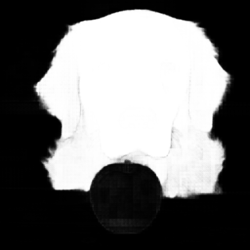
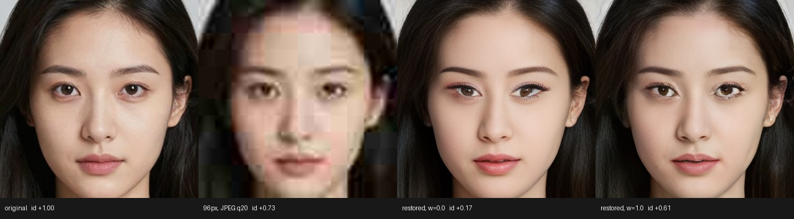
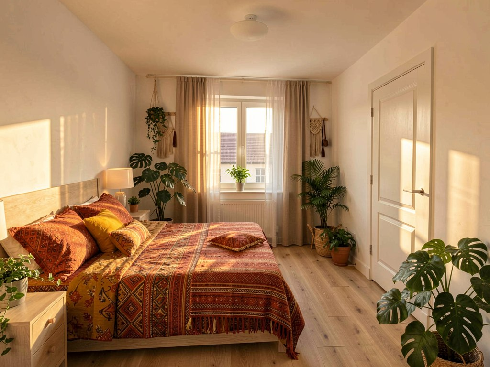
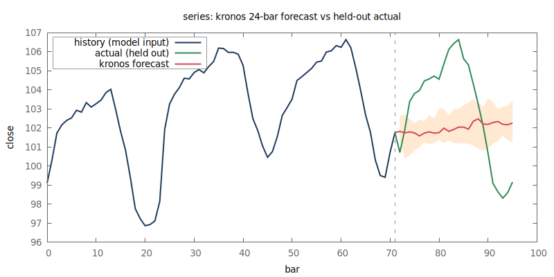

# brain


**brain trains and runs neural networks on the hardware you already have.**

One Rust program does the whole job: download a model, run it, fine-tune it,
quantize it so it fits, and serve it behind an OpenAI-compatible API. It needs
no Python, no PyTorch and no separate inference runtime, and the same models
run on NVIDIA cards, on other GPUs, on a plain CPU, on an Intel NPU or in a
browser.

**Built by [Swedish Embedded AB](https://swedishembedded.com)** - we put AI on
hardware that ships. [Hire us](#who-builds-brain).

[](https://www.youtube.com/watch?v=6N3J8Xj0HkY)

## Three projects, one stack

brain is one of three open projects that work together. Each one stands on its
own:

| Project | Its role |
|---|---|
| **[brain](https://github.com/swedishembedded/brain)** (this repository) | **Runs the models.** Inference, training, fine-tuning, quantization and serving. |
| **[sven](https://github.com/swedishembedded/sven)** | **Runs the agent.** A terminal AI agent that reads code, runs tools and works through tasks, using any model provider, brain included. |
| **[Splinter](https://github.com/mkschreder/splinter)** | **Turns agent experience into better local models.** It runs sven on real tasks, checks the results, trains a model with brain, and releases it only when held-out tests show it improved. |

You can use brain without the other two: it serves models to any application
that speaks the OpenAI, Anthropic or OpenRouter API, or D-Bus, or links the
Rust SDK.

## What brain does

| | Models | What you can do |
|---|---|---|
| **Text** | Qwen3, Qwen3.5, Qwen3.8, GLM, GPT, LFM2.5 | chat, tool calls, embeddings; serve many users at once; train from scratch; fine-tune with LoRA |
| **Vision** | YOLOv8, SAM 2.1, ZipDepth, SCRFD, ArcFace, CLIP, Florence-2 | object detection, segmentation and video tracking, depth, face detection and recognition |
| **Vision and language** | Qwen3-VL, MiniCPM-V, FastVLM, Moondream 3, DeepSeek-OCR, Qwen3-Omni | describe images, answer questions about them, turn documents into markdown |
| **Image generation** | Z-Image, FLUX.2 Klein, FLUX.1 Kontext, SDXL, ControlNet, PuLID | text to image, editing, inpainting, style and identity control, LoRA training |
| **Image restoration** | CodeFormer, Real-ESRGAN, SUPIR | face restoration, 4x upscaling |
| **Video** | Wan 2.1/2.2, LTX-2.5 | text to video, written straight to an mp4 |
| **Speech and audio** | Qwen3-TTS, CosyVoice, Nemotron ASR, Qwen3-ASR, MiniMax Music | text to speech with voice cloning, speech to text, music |
| **Forecasting** | Chronos-2, Kronos, FinCast, TimesFM | time-series forecasts with uncertainty, and a backtester to score them |
| **3D** | WorldMirror-2, Gaussian Splatting | turn photos into a 3D scene you can fly through |
| **World models** | DIAMOND, GenieRedux | playable, action-driven video simulations |
| **A digital animal** | [the fruit fly](docs/models/fly.md) | a fruit-fly nervous system, run as a spiking network, moving a simulated body |

Every model is used the same way: `brain <model> <action>` on the command
line, and the same models over HTTP, D-Bus and the SDK. The full catalog, with
a page per model saying what it supports and what it does not yet, is
[`docs/models/index.md`](docs/models/index.md).

## Hardware

brain picks up whatever compute the machine has; `brain devices` shows what it
found.

| Hardware | How brain runs on it |
|---|---|
| **NVIDIA GPUs** | natively through the NVIDIA driver (CUDA), with hand-tuned kernels for the hottest paths; nothing to install at build time ([`docs/using/cuda.md`](docs/using/cuda.md)) |
| **Any modern GPU** | through Vulkan, Metal or DirectX 12: NVIDIA, AMD, Intel and Apple |
| **CPU only** | the same models, compiled for the CPU's cores; slower, but nothing else needed |
| **Intel NPU** | through OpenVINO, for the models that support it |
| **A browser tab** | through WebGPU |

Pick a device with `--device` (`--device gpu0`, `--device gpu`, `--device cpu`)
and a GPU backend with `--backend` (`cuda`, `vulkan`, `wgpu`). A model too big
for one card can be split across several, quantized to INT8 or INT4, or
streamed from memory as it runs ([`docs/introduction/hardware.md`](docs/introduction/hardware.md),
[`docs/scaling/overview.md`](docs/scaling/overview.md)).

## Get started

Build it (a recent stable Rust toolchain is all it needs):

```bash
make build/release
export PATH="$PWD/target/release:$PATH"     # once per shell
brain doctor                                # checks the model store, the disk and the GPUs, and says how to fix what fails
```

Run a model. Its weights download the first time it is used:

```bash
$ brain infer qwen3 --prompt "The capital of France is" --max-new 12
The capital of France is Paris. The capital of Italy is Rome. The capital of
```

Serve it behind an OpenAI-compatible API:

```bash
$ brain serve --openai 8799 &
APIKEY openai sk-brain-...
$ curl http://127.0.0.1:8799/v1/chat/completions -H "Authorization: Bearer $APIKEY" \
    -H 'Content-Type: application/json' \
    -d '{"model":"Qwen/Qwen3-0.6B","messages":[{"role":"user","content":"Say hello in exactly five words."}]}'
```

The server answers many requests together rather than one after another, keeps
several models loaded within a memory budget, and also speaks the Anthropic and
OpenRouter APIs and D-Bus. `braintop` shows what it is doing
([`docs/using/serving.md`](docs/using/serving.md),
[`docs/using/monitoring.md`](docs/using/monitoring.md)).

A few more commands to find your way around:

```bash
brain pull Qwen/Qwen3-0.6B                  # download a model ahead of time
brain caps                                  # every model and what it can do
brain models list                           # what is on disk, and what it needs to run
```

[`docs/introduction/quickstart.md`](docs/introduction/quickstart.md) trains a
small model from scratch and serves a real one in about five minutes.

## See it work

Every command below is real, and every picture is that command's output. The
first few feed into each other: one model's output is the next model's input.

### Generate an image, then take it apart

```bash
$ brain --device gpu s3dit text2image \
    --prompt "a golden retriever dog and a red apple on a wooden table, photorealistic, natural lighting" \
    --width 512 --height 512 --seed 7 --steps 8 --precision int8 --out image=seed.png   # the seed reproduces the picture below
```


A detector finds what the prompt asked for: an apple, a dog and a dining table.

```bash
$ brain yolov8 detect --weights <models>/Ultralytics/YOLOv8/model.brain.safetensors --image seed.ppm
brain yolov8 detect: 3 detection(s) on 512x512
```


A segmentation model cuts out the dog from one click, and a depth model
estimates how far away everything is:

```bash
$ brain sam2 segment --in image=seed.png --points "220,180" --labels "1" --out mask=dog-mask.png
$ brain zipdepth --image seed.ppm --weights <models>/zipdepth/zipdepth_base.pth \
    --headless --view depth --colormap turbo --out depth.ppm
```

| segmentation (sam2) | depth (zipdepth) |
|---|---|
|  |  |

### Change everything except what you selected

Turn the dog mask around and regenerate the rest of the picture. The dog stays
exactly as it was; the table, the apple and the background change:

```bash
$ brain --device gpu s3dit inpaint --in image=seed.png --in mask=bg-mask.png \
    --prompt "a golden retriever dog sitting behind a slice of chocolate cake on a white marble kitchen countertop, bright natural daylight, blurred modern kitchen background, photorealistic" \
    --strength 1.0 --feather 0 --steps 8 --precision int8 \
    --out image=inpainted.png
```


### Restore a damaged face, and check it is still the same person

One model finds the face, a second restores a badly damaged copy, and a third
compares the result with the original to check that the restoration kept the
person's identity:

```bash
$ brain scrfd detect --in image=portrait.png --json
$ brain codeformer restore_face --w 1.0 --in image=degraded.png --out image=restored.png
$ brain arcface embed --align false --in image=restored.png --out embedding=restored.bin
```



The restoration at `w=1.0` is closer to the original than the damaged copy, both
pixel by pixel and by identity. The one at `w=0.0` looks just as good and is
further away on both: the third model catches what the eye does not
([`docs/models/codeformer.md`](docs/models/codeformer.md)). The original
portrait was generated by brain; it is not a photograph of a real person.

### Furnish an empty room with a LoRA you trained

Generate an empty room, then furnish it in a style learned from your own
pictures, keeping the room itself:

```bash
$ brain --device gpu flux2 generate --variant klein-9b --precision int8 \
    --prompt "Photorealistic professional real estate photograph of an empty unfurnished bedroom. Bare white walls, plain light oak floorboards, a single large window, a radiator under the window, a white panelled door. Completely empty room, no furniture, no rugs, no curtains." \
    --width 1024 --height 768 --seed 20260827 --out empty-room.png   # the seed reproduces the picture below
$ brain --device gpu flux2 generate --variant klein-9b --precision int8 \
    --ref empty-room.png --strength 1.0 --ref-size 768 \
    --adapter boho.brain --lora-scale 1.0 \
    --prompt "a bohemian style room, photorealistic interior photograph, warm natural daylight, layered textiles and patterned fabrics, rattan and natural wood, plants, eclectic decor, professional real estate photography" \
    --width 1024 --height 768 --seed 7 --out staged-room.png   # the seed reproduces the picture below
```

| before | after |
|---|---|
|  |  |

`brain flux2 finetune <captioned-image-dir> --out boho.brain` trains the style
adapter; LoRA files from other tools load too
([`docs/models/flux2.md`](docs/models/flux2.md)).

### Text to video

```bash
$ brain --device gpu wan t2v \
    --prompt "a golden retriever running along a sandy beach at sunset, waves in the background, cinematic" \
    --frames 9 --width 416 --height 240 --steps 20 --seed 7 --output-path wan.mp4   # the seed reproduces the picture below
```


### Text to speech and back

```bash
$ brain qwen3tts synth --text "Brain trains and runs neural networks from scratch, in Rust." --out spoken.wav
$ brain nemotronasr transcribe --in audio=spoken.wav --json
{"text":"Brain trains and runs neural networks from scratch in rust. ",...}
```

### Read a document

```bash
$ brain deepseek2ocr generate --in image=doc.png --prompt "<|grounding|>Convert the document to markdown."
Brain trains and runs neural networks from scratch, in Rust.
```

### Forecast, and score the forecast

```bash
$ brain forecast predict --csv crates/kronos/tests/data/synthetic_hourly.csv \
    --horizon 6 --samples 16 --origins 16 --gnuplot kronos-forecast.png
```



The forecast is scored against data the model never saw and against simple
baselines, and the report says where the model's uncertainty band was too
narrow rather than hiding it ([`docs/models/kronos.md`](docs/models/kronos.md)).

### A fruit fly's nervous system, running

A real *Drosophila* connectome, mapped by published neuroscience work, run as a
network of spiking neurons on the GPU and moving a simulated body through the
animal's own motor neurons:

```bash
$ make samples/fly/interactive/run ARGS="--connectome $BRAIN_CONNECTOME_DIR --body $BRAIN_FLYBODY_FRUITFLY_XML --frames 240"
```


It moves its legs; it does not walk yet. [`docs/models/fly.md`](docs/models/fly.md)
says which behaviours are there and which are not.

## How you know it works

brain does not lean on another framework to be correct, so it checks itself:

- **Every imported model is compared with its reference implementation**, step
  by step, by tests you can run; the agreement each one reached is in the test.
- **Training is checked numerically.** The gradients brain computes are
  compared with finite differences (`make test/gradcheck`).
- **Backends are checked against each other.** The same computation must give
  the same answer on every backend (`make test/parity`).
- **Limits are written down.** Where a model is not yet trainable, not yet
  servable or not checked at full size, its page says so.

`make test` runs the test suite.

## Documentation

| | |
|---|---|
| **All documentation** | [`docs/readme.md`](docs/readme.md) |
| What brain is | [`docs/introduction/what-is-brain.md`](docs/introduction/what-is-brain.md) |
| Install and build | [`docs/introduction/install.md`](docs/introduction/install.md) |
| Quickstart | [`docs/introduction/quickstart.md`](docs/introduction/quickstart.md) |
| Hardware and devices | [`docs/introduction/hardware.md`](docs/introduction/hardware.md) |
| NVIDIA GPUs | [`docs/using/cuda.md`](docs/using/cuda.md) |
| Model catalog | [`docs/models/index.md`](docs/models/index.md) |
| The command line | [`docs/using/cli.md`](docs/using/cli.md) |
| Serving over HTTP and D-Bus | [`docs/using/serving.md`](docs/using/serving.md) |
| The Rust SDK | [`docs/using/sdk.md`](docs/using/sdk.md) |
| Configuration | [`docs/using/configuration.md`](docs/using/configuration.md) |
| Fine-tuning with LoRA | [`docs/training/lora.md`](docs/training/lora.md) |
| Using several GPUs | [`docs/scaling/overview.md`](docs/scaling/overview.md) |
| Performance | [`docs/performance/overview.md`](docs/performance/overview.md) |
| Contributing | [`AGENTS.md`](AGENTS.md) |

## Who builds brain

brain is built by **[Swedish Embedded AB](https://swedishembedded.com)**. We
build AI that runs on hardware that ships: the GPU you already have, a CPU with
no GPU at all, an Intel NPU, a board in the field or a browser tab. Everything
in this repository is that work, done in the open and held to tests you can run
yourself.

If your team needs any of this, you can hire us:

* **Running models on the hardware you have** - NVIDIA and other GPUs, CPUs,
  Intel NPUs, embedded Linux boards, the browser.
* **Making a large model fit** - quantization, weight streaming, splitting a
  model across GPUs.
* **Porting a model** from a paper or a PyTorch checkpoint, with its results
  checked against the original.
* **Making GPU code fast** - and proving it is still correct afterwards.
* **Production inference** - serving many users at once, keeping models loaded,
  scheduling across accelerators.
* **Embedded and real-time firmware** alongside the AI, which is where this
  company started.

Send an email to **info@swedishembedded.com** and tell us what you are trying
to ship.

## License

Apache-2.0 - see [`LICENSE`](LICENSE). Model weights carry their own licenses;
see [`docs/compliance/third-party-models.md`](docs/compliance/third-party-models.md).

Copyright (c) 2026 Swedish Embedded AB.
