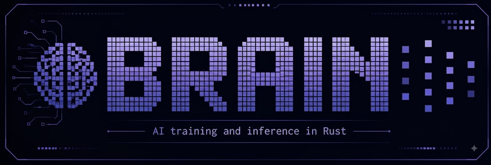

# brain



**brain trains and runs neural networks on the hardware you already have.**

One Rust program does the whole job: download a model, run it, fine-tune it,
quantize it so it fits, and serve it behind an OpenAI-compatible API. It needs
no Python, no PyTorch and no separate inference runtime, and the same models
run on NVIDIA cards, on other GPUs, on a plain CPU, on an Intel NPU or in a
browser.

**Built by [Swedish Embedded AB](https://swedishembedded.com)** - we put AI on
hardware that ships. [Hire us](#who-builds-brain).

[](https://www.youtube.com/watch?v=6N3J8Xj0HkY)

## Three projects, one stack

brain is one of three open projects that work together. Each one stands on its
own:

| Project | Its role |
|---|---|
| **[brain](https://github.com/swedishembedded/brain)** (this repository) | **Runs the models.** Inference, training, fine-tuning, quantization and serving. |
| **[sven](https://github.com/swedishembedded/sven)** | **Runs the agent.** A terminal AI agent that reads code, runs tools and works through tasks, using any model provider, brain included. |
| **[Splinter](https://github.com/mkschreder/splinter)** | **Turns agent experience into better local models.** It runs sven on real tasks, checks the results, trains a model with brain, and releases it only when held-out tests show it improved. |

You can use brain without the other two: it serves models to any application
that speaks the OpenAI, Anthropic or OpenRouter API, or D-Bus, or links the
Rust SDK.

## What brain does

| | Models | What you can do |
|---|---|---|
| **Text** | Qwen3, Qwen3.5, GLM, GPT, LFM2.5 | chat, tool calls, embeddings; serve many users at once; train from scratch; fine-tune with LoRA |
| **Vision** | YOLOv8, SAM 2.1, ZipDepth, SCRFD, ArcFace, CLIP, Florence-2 | object detection, segmentation and video tracking, depth, face detection and recognition |
| **Vision and language** | Qwen3-VL, MiniCPM-V, FastVLM, Moondream 3, DeepSeek-OCR, Qwen3-Omni | describe images, answer questions about them, turn documents into markdown |
| **Image and video generation** | Z-Image, FLUX.2 Klein, FLUX.1 Kontext, SDXL, Wan, LTX | text to image, editing, inpainting, identity control, LoRA training, text to video |
| **Speech and audio** | Qwen3-TTS, CosyVoice, Nemotron ASR, Qwen3-ASR, MiniMax Music | text to speech with voice cloning, speech to text, music |
| **Forecasting, 3D, world models** | Chronos-2, Kronos, WorldMirror-2, DIAMOND | time-series forecasts, photos to 3D scenes, playable simulations |

Every model is used the same way: `brain <model> <action>` on the command
line, and the same models over HTTP, D-Bus and the SDK. The catalog, with a
page per model saying what it supports and what it does not yet, is
[`docs/reference/models/index.md`](docs/reference/models/index.md).

## Hardware

brain picks up whatever compute the machine has; `brain devices` shows what it
found. Four backends are compiled into every native build and share the same
kernels; pick a device with `--device` and a backend with `--backend`:

| Backend | Runs on |
|---|---|
| `wgpu` (default) | any GPU with a Vulkan, Metal or DirectX 12 driver: NVIDIA, AMD, Intel, Apple; also WebGPU in a browser |
| `vulkan` | Vulkan driven directly |
| `cuda` | NVIDIA GPUs through the driver, with native CUDA kernels for the hottest paths ([details](docs/guides/hardware/cuda.md)) |
| `cpu` | the CPU's cores; slower, but nothing else needed |

The **Intel NPU** is a separate path for a subset of models: they are exported
to ONNX and run through OpenVINO rather than on brain's own kernels, and it is
opt-in per model (each model page says whether it has one). A model too big for
one card can be split across several, quantized, or streamed from memory as it
runs ([`docs/guides/hardware/choosing-hardware.md`](docs/guides/hardware/choosing-hardware.md)).

## Get started

Build it (a recent stable Rust toolchain is all it needs):

```bash
make build/release
export PATH="$PWD/target/release:$PATH"     # once per shell
brain doctor                                # checks the model store, the disk and the GPUs, and says how to fix what fails
```

Run a model. Its weights download the first time it is used:

```bash
$ brain infer qwen3 --prompt "The capital of France is" --max-new 12
The capital of France is Paris. The capital of Italy is Rome. The capital of
```

Serve it behind an OpenAI-compatible API (it also speaks the Anthropic and
OpenRouter APIs and D-Bus):

```bash
$ brain serve --openai 8799 &
$ curl http://127.0.0.1:8799/v1/chat/completions -H "Authorization: Bearer $APIKEY" \
    -H 'Content-Type: application/json' \
    -d '{"model":"Qwen/Qwen3-0.6B","messages":[{"role":"user","content":"Say hello in exactly five words."}]}'
```

[`docs/getting-started/quickstart.md`](docs/getting-started/quickstart.md) trains
a small model from scratch and serves a real one in about five minutes, and
[`docs/getting-started/tour.md`](docs/getting-started/tour.md) shows real
commands and their output, one model feeding the next.

## How you know it works

brain does not lean on another framework to be correct, so it checks itself:

- **Every imported model is compared with its reference implementation**, step
  by step, by tests you can run.
- **Training is checked numerically** against finite differences (`make test/gradcheck`).
- **Backends are checked against each other** (`make test/parity`).
- **Limits are written down.** Where a model is not yet trainable, not yet
  servable or not checked at full size, its page says so.

## Documentation

Everything is under [`docs/`](docs/index.md) and is published at
<https://swedishembedded.com/docs/brain>.

| | |
|---|---|
| Start | [`docs/index.md`](docs/index.md), [install](docs/getting-started/install.md), [quickstart](docs/getting-started/quickstart.md) |
| Guides | [inference](docs/guides/inference/models-and-weights.md), [training](docs/guides/training/lora.md), [hardware](docs/guides/hardware/choosing-hardware.md), [serving](docs/guides/serving/serving.md) |
| Concepts | [architecture](docs/concepts/architecture.md), [scaling across GPUs](docs/concepts/scaling/overview.md) |
| Reference | [CLI](docs/reference/cli.md), [SDK](docs/reference/sdk.md), [configuration](docs/reference/configuration.md), [models](docs/reference/models/index.md) |
| Contributing | [`docs/contributing/index.md`](docs/contributing/index.md), [`AGENTS.md`](AGENTS.md) |

## Who builds brain

brain is built by **[Swedish Embedded AB](https://swedishembedded.com)**. We
build AI that runs on hardware that ships: the GPU you already have, a CPU with
no GPU at all, an Intel NPU, a board in the field or a browser tab. Everything
in this repository is that work, done in the open and held to tests you can run
yourself.

If your team needs any of this, you can hire us:

* **Running models on the hardware you have** - NVIDIA and other GPUs, CPUs,
  Intel NPUs, embedded Linux boards, the browser.
* **Making a large model fit** - quantization, weight streaming, splitting a
  model across GPUs.
* **Porting a model** from a paper or a PyTorch checkpoint, with its results
  checked against the original.
* **Making GPU code fast** - and proving it is still correct afterwards.
* **Production inference** - serving many users at once, keeping models loaded,
  scheduling across accelerators.
* **Embedded and real-time firmware** alongside the AI, which is where this
  company started.

Send an email to **info@swedishembedded.com** and tell us what you are trying
to ship.

## License

Apache-2.0 - see [`LICENSE`](LICENSE). Model weights carry their own licenses;
see [`docs/compliance/third-party-models.md`](docs/compliance/third-party-models.md).

Copyright (c) 2026 Swedish Embedded AB.
