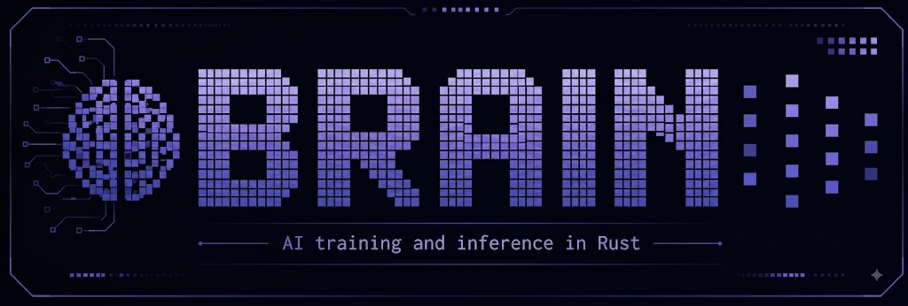

<!-- SPDX-License-Identifier: Apache-2.0 -->
<!-- Copyright (c) 2026 Martin Schröder <info@swedishembedded.com> -->

# Brain



### Train it. Optimize it. Serve it. Own the entire stack.

**brain is an open-source AI engine built from first principles in Rust.** It trains, fine-tunes, evaluates, optimizes and serves neural networks on hardware you control, with its own compute kernels and execution backends rather than a dependency on PyTorch or a hosted inference provider.

Language models are only part of the picture. brain brings text, embeddings, vision, document understanding, image and speech generation, video, forecasting, decision models, 3D reconstruction and interactive world models into **one extensible engine**, exposed through a CLI, a Rust SDK and interoperable serving APIs.

**[Get started](#quickstart)** · **[Documentation](docs/index.md)** · **[Model catalog](docs/reference/models/index.md)** · **[Capabilities and certification](docs/reference/training-capabilities.md)** · **[Examples](samples/README.md)** · **[Book](https://www.amazon.com/dp/B0HRWWYHGF?maas=maas_adg_B0EF476BE0ACF3F28B1215EE6A9E234B_afap_abs&ref_=aa_maas&tag=maas)**

[](https://www.youtube.com/watch?v=6N3J8Xj0HkY)

---

## Three projects, one stack

brain is one of three open projects that work together. Each stands on its own:

| Project | Its role |
| --- | --- |
| **[brain](https://github.com/swedishembedded/brain)** (this repository) | **Runs the models.** Inference, training, fine-tuning, quantization and serving. |
| **[Sven](https://sven.swedishembedded.com)** | **Runs the agent.** A terminal AI agent that reads code, runs tools and works through tasks, using any model provider, brain included. |
| **[Splinter](https://github.com/mkschreder/splinter)** | **Turns agent experience into better local models.** It runs Sven on real tasks, checks the results, trains a model with brain, and releases it only when held-out tests show it improved. |

You can use brain without the other two: it serves models to any application that speaks the OpenAI, Anthropic or OpenRouter API or D-Bus, or links the Rust SDK.

## Why brain exists

Most AI applications begin with someone else's runtime, hardware assumptions and deployment boundaries. brain starts lower in the stack: **the math, the kernels, the model implementation, the learning loop and the server** are all inspectable and under your control.

| What you need | What brain provides |
| --- | --- |
| **Independence from a framework runtime** | A Rust-native engine with its own WGSL compute kernels, native CUDA fast paths, tensor/model implementations, training code and serving runtime. No Python or PyTorch is required to build or operate the core engine. |
| **One implementation across different machines** | Runtime-selectable CPU, wgpu, native Vulkan and CUDA backends. Browser WebGPU and selected NPU integrations extend the hardware story without pretending every device executes identically. |
| **Training, not just inference** | Training from scratch, full fine-tuning, parameter-efficient adapters, preference and feedback learning, policy-gradient updates, distillation, evaluation and resumable checkpoints, where supported by the architecture. |
| **Large models under finite budgets** | Quantized execution, GGUF and safetensors workflows, layer-streamed training, memory-aware model placement, KV-cache management and measured model optimization. |
| **Real application integration** | A unified capability registry, CLI, embeddable Rust SDK, authenticated HTTP APIs, D-Bus and an event-driven stdio interface. |
| **Evidence rather than a model-name checklist** | Finite-difference gradient checks, independent forward-parity tests, cross-backend checks, serving conformance, held-out evaluation, performance instrumentation and explicit per-model certification. |

brain is designed for engineers who want to **run AI locally, deploy it onto constrained hardware, adapt it to their own data, or understand and change the engine itself**.

## What you can build

The model catalog contains the complete architecture-by-architecture list, including the actions and weights each model supports. These are representative capabilities, not a claim that every model supports every training method or device.

| Area | Capabilities and implementations | Go deeper |
| --- | --- | --- |
| **Language models** | Chat, reasoning, tool calls, text generation, fill-in-the-middle, recurrent and hybrid decoders, mixture-of-experts models, speculative decoding and long-context inference. Implementations include Qwen3, Qwen3.8, Qwen3.5 MoE, Ripple/Ricursive, Ouro, Huginn, GLM-DSA and GPT-2. | [Text inference](docs/guides/inference/text.md) · [Language models](docs/reference/models/index.md#text) |
| **Embeddings and retrieval** | Text/image embeddings, semantic search, retrieval, contrastive training, CLIP, LFM2.5-Encoder and T5 conditioning. | [Rust SDK](docs/reference/sdk.md) · [Retrieval sample](samples/text/retrieve/README.md) |
| **Vision and documents** | Image understanding and captioning, visual grounding, OCR, document-to-Markdown extraction, object and face detection, segmentation, tracking, depth and image-quality measurement. Includes Qwen3-VL, MiniCPM-V, DeepSeek-OCR, Mirage, YOLO, SAM2 and more. | [Vision guide](docs/guides/inference/vision.md) · [Vision models](docs/reference/models/index.md#vision-language) |
| **Image creation and restoration** | Text-to-image, image editing, ControlNet conditioning, identity-conditioned generation, upscaling, face restoration, and composed image pipelines. Includes FLUX, Z-Image, SDXL, PuLID, CodeFormer, SUPIR and RRDBNet. | [Image generation](docs/guides/inference/image-generation.md) · [Imaging](docs/guides/inference/imaging.md) |
| **Audio and speech** | Streaming and offline speech recognition, speech synthesis, voice cloning, speech embeddings and multimodal speech/text models. Includes Nemotron ASR, Qwen3-ASR, Qwen3-TTS and CosyVoice. Music-generation work is also present, with validation limits documented per model. | [Speech guide](docs/guides/inference/speech.md) · [Speech models](docs/reference/models/index.md#speech) |
| **Video and world models** | Text-to-video through Wan; video/audio generation pipelines and APIs; action-conditioned, playable worlds through DIAMOND and GenieRedux. **LTX-2.5 has no serving certification and MiniMax-H3's text-to-video and first/last-frame tasks are still in progress**; see their model pages. | [Video models](docs/reference/models/index.md#video-generation) · [World models](docs/guides/inference/world-models.md) |
| **3D and reconstruction** | Multi-view reconstruction, structure from motion, depth and 3D Gaussian-splat fitting and rendering, including WorldMirror-2. | [3D guide](docs/guides/inference/three-d.md) · [Reconstruction sample](samples/reconstruction/splat/README.md) |
| **Forecasting and risk** | Probabilistic and multivariate time-series forecasting, financial OHLCV modeling, horizon-specific time-to-event and competing-risk predictions. Includes TimesFM-3, Chronos-2, FinCast, Kronos and Horizon. | [Forecasting guide](docs/guides/inference/forecasting.md) · [Model catalog](docs/reference/models/index.md#forecasting) |
| **Decisions and control** | Typed option selection, calibrated decision heads, reinforcement learning for decisions, simulation and action-conditioned environments. Includes decision encoders, research samples and a fruit-fly connectome simulation. | [Decision models](docs/reference/models/decision.md) · [Decision samples](samples/decision/) |

**What “supported” means:** A registered model is not automatically a production-certified model. The [model catalog](docs/reference/models/index.md) marks available infer/train/adapter actions; the generated [capability and serving-certification matrix](docs/reference/training-capabilities.md) names the tests behind each contract and distinguishes **production** from **preview**. A few ports have documented limitations on real-weight validation or complete pipelines. **Consult those sources before choosing a model for a deployment.** Third-party weights also carry their own licenses and access terms.

## Quickstart

### 1. Build and inspect the engine

You need a Rust toolchain, CMake and a C compiler. A GPU is optional; the CPU backend can run the engine and its tests.

```bash
git clone https://github.com/swedishembedded/brain.git
cd brain
make build/release

./target/release/brain devices
./target/release/brain caps
./target/release/brain caps qwen3
```

The optimized binary is `target/release/brain`; the build also produces `brain-gpu-worker`, used for isolated GPU health checks. See [installation](docs/getting-started/install.md), [hardware selection](docs/guides/hardware/choosing-hardware.md) and the [CLI reference](docs/reference/cli.md).

### 2. Serve a real language model

Fetch a small Qwen3 model, inspect the machine's readiness, and start an authenticated OpenAI-compatible API:

```bash
./target/release/brain pull Qwen/Qwen3-0.6B
./target/release/brain doctor --model Qwen/Qwen3-0.6B
./target/release/brain serve
```

In another terminal, use the **OpenAI API key printed by `brain serve`**:

```bash
curl http://127.0.0.1:8788/v1/chat/completions \
  -H 'Content-Type: application/json' \
  -H 'Authorization: Bearer <OPENAI_API_KEY_FROM_SERVER>' \
  -d '{
    "model": "Qwen/Qwen3-0.6B",
    "messages": [{"role": "user", "content": "Explain what a gradient is in one sentence."}]
  }'
```

You can also start `brain serve --autofetch` to permit supported checkpoints to be downloaded on first use; downloads are otherwise explicit. For production deployment, store keys in a restricted file rather than relying on startup output. See [models and weights](docs/guides/inference/models-and-weights.md), [serving](docs/guides/serving/serving.md) and [HTTP API](docs/reference/api/http.md).

### 3. Train something from scratch

Train a small GPT on a generated arithmetic dataset, then evaluate it on held-out examples:

```bash
make gpt/calculator/data
make gpt/calculator/train
make gpt/calculator/eval
```

This produces a real model checkpoint and reports perplexity and exact-match performance, not merely a successful forward pass. For larger models, start with [fine-tuning](docs/guides/training/lora.md) or the [training capability matrix](docs/reference/training-capabilities.md).

For more task-oriented walkthroughs, use the full [quickstart](docs/getting-started/quickstart.md), the [tour](docs/getting-started/tour.md) (real commands and output, one model feeding the next) or explore the standalone [Rust, Python and shell samples](samples/README.md).

## One engine, several ways in

```text
                       Your application or experiment
                                     |
              +----------------------+----------------------+
              |                      |                      |
           Rust SDK                brain CLI           Served interfaces
              |                      |             HTTP / D-Bus / stdio
              +----------------------+----------------------+
                                     |
                     Typed capabilities + model catalog
                                     |
                 Training / inference / jobs / evaluation
                                     |
                Model runtimes + shared numerical operators
                                     |
           Scheduling / residency / memory / checkpoints
                                     |
                 Portable WGSL kernels + optimized paths
                                     |
             +-----------+------------+-----------+-----------+
             |           |            |           |           |
           CPU JIT      wgpu       Vulkan       CUDA      WebGPU*

        * Browser target; selected NPU paths use separate graph/runtime
          integrations rather than the common eager WGSL backend.
```

The same architecture's declared actions are discoverable with `brain caps <architecture>` and accessible from the command line or supported served interfaces. Model-specific configuration, accepted inputs and action outputs come from a typed capability manifest, rather than separate hand-maintained wrappers.

[Architecture](docs/concepts/architecture.md) · [CLI](docs/reference/cli.md) · [Rust SDK](docs/reference/sdk.md) · [HTTP](docs/reference/api/http.md) · [D-Bus](docs/reference/api/dbus.md)

## The execution engine

**Portable baseline, hardware-aware execution.** brain's WGSL kernel catalog is the common mathematical implementation used by four native execution paths:

- **CPU:** WGSL compiled to native code using a Cranelift JIT, with multicore execution.
- **wgpu:** GPU execution across supported Vulkan, Metal and DirectX drivers, with a WebGPU browser target.
- **Native Vulkan:** direct Vulkan execution with WGSL translated to SPIR-V.
- **CUDA:** an NVIDIA driver-based backend that can compile translated WGSL for the target GPU and use native CUDA kernels for supported high-performance operations. Ahead-of-time CUDA kernel packages are also supported.

`brain devices` lists what was found; select hardware with `--device` and how it is driven with `--backend`. Precision and fast-kernel paths are **capability-gated**: the portable numerical baseline remains available when a device lacks a specialized format or instruction. brain also has **separate, model-specific NPU integrations**, including Intel NPU execution via ONNX/OpenVINO and an embedded Rockchip sample; these are not interchangeable fifth/sixth eager backends.

This design matters when moving workloads between a workstation, an accelerator server, a browser and a constrained device: model code does not need a new implementation for every compute backend. Performance still depends on the model, precision, kernels and hardware; portability is not a promise of equal speed.

[Hardware support](docs/guides/hardware/choosing-hardware.md) · [CUDA](docs/guides/hardware/cuda.md) · [WGSL kernels](docs/reference/kernels/index.md) · [Native CUDA kernels](docs/reference/kernels/cuda.md) · [Rockchip NPU sample](samples/npu/rockchip/README.md)

## Training and adaptation

brain contains the learning stack as well as the runtime. Depending on the architecture and base-weight format, it supports:

- **From-scratch training and full-parameter fine-tuning**, with optimizers, gradient accumulation, held-out evaluation, activation recomputation, precision selection and checkpoint/resume.
- **Parameter-efficient adaptation**, including LoRA and quantized-base LoRA/QLoRA; selected trainers also implement IA³, LoKR, DoRA and LoRA variants.
- **Supervised fine-tuning (SFT)** of conversation records, including multi-turn and tool-result context with explicit trainable turns.
- **Preference learning** with DPO, IPO, SimPO and ORPO, **feedback learning** with KTO, **policy-gradient learning** from scored rollouts and **policy distillation**. Availability and real-weight validation vary by architecture.
- **Multimodal and specialized learning**, including selected vision-language fine-tuning, contrastive encoder training, detection, forecasting, decision heads and reinforcement-learning experiments.
- **Served training jobs** on the same accelerator pool as inference, with job status, bounded artifacts and adapters that can be loaded for serving.
- **Multi-device execution** primitives, including data, pipeline and tensor parallelism, collectives and authenticated distributed-job protocols. Deployment/performance maturity is tracked separately from functional correctness.

Training is not claimed for a model just because inference is registered. Check the [test-backed training matrix](docs/reference/training-capabilities.md) and the specific architecture's page before choosing a method.

[Fine-tuning guide](docs/guides/training/lora.md) · [Served training](docs/guides/training/served-training.md) · [Optimizer state](docs/guides/training/optimizer-state.md) · [Scaling](docs/concepts/scaling/overview.md) · [SDK training workflows](docs/reference/sdk.md)

## Make models fit, and make serving predictable

The practical problem is often not *can the network compute this?* but *can this particular machine load, train and serve it within its memory and latency budget?*

brain addresses that problem across the lifecycle:

- **Checkpoint and weight handling:** Hugging Face model retrieval, safetensors and GGUF support, weight inspection, import/export and quantization.
- **Memory-bounded training:** streamed checkpoint loading, layer-streamed training, compressed base weights and configurable optimizer-state placement where the trainer supports them.
- **Memory-aware inference:** model residency and placement across available accelerators, weight formats and budget constraints; paged or compressed KV caches and model-dependent offload paths.
- **Concurrent serving:** batching, admission control, cancellation, streaming responses, prefix reuse, adapter banks, multi-GPU replicas and routing across multiple serving instances where supported.
- **Measured optimization:** `brain optimize` searches weight formats under a memory budget and checks the result on held-out data; `brain prune` offers structured model reduction. Hardware probes, FLOP/OPS accounting and benchmark tools expose the cost of a workload.
- **Operations:** authenticated API surfaces, TLS for non-loopback HTTP, quotas and limits, observability, an interactive `braintop` monitor, and explicitly modeled device-failure behavior.

Capabilities such as paging, speculative decoding, sparse attention, sharding and offload are **model- and path-dependent**; they are not universal switches for every architecture.

[Serving guide](docs/guides/serving/serving.md) · [Optimization](docs/guides/serving/optimizing.md) · [Performance](docs/concepts/execution/performance.md) · [Monitoring](docs/guides/serving/monitoring.md) · [Security](docs/guides/serving/security.md) · [Models and weights](docs/guides/inference/models-and-weights.md)

## Correctness is part of the feature

A model that emits plausible output has not necessarily been ported correctly; a backward pass that executes has not necessarily learned the right gradient. brain treats both as testable engineering contracts.

- **Finite-difference gradient checks** compare analytical gradients with perturbations of the same forward computation.
- **Reference parity gates** compare imported model components with independent numerical reference outputs and validate tensor coverage.
- **Backend and precision checks** compare accelerated, quantized and portable paths against stated numerical tolerances.
- **Behavioral gates** test learning, held-out scoring, save/load/resume, batching, cancellation and serving lifecycle properties.
- **Performance gates and probes** separate correctness, measured hardware capacity and workload-specific efficiency.

```bash
BRAIN_DEVICE=cpu make test   # full suite on CPU, without a GPU
make test/gradcheck         # finite-difference backward-pass checks
make test/parity            # backend/parity checks (hardware-dependent)
make help                   # discover additional checks and targets
```

These checks establish *specific* contracts, not a blanket claim that every model or every device has passed every test. Consult the [per-model certification matrix](docs/reference/training-capabilities.md), [testing/release gates](docs/contributing/release-gates.md) and individual model documentation.

## Documentation and project map

| Start here | What you'll find |
| --- | --- |
| [Install and quickstart](docs/getting-started/install.md) | Dependencies, supported platforms and first end-to-end training/inference runs. |
| [Model catalog](docs/reference/models/index.md) | Architecture pages, inference/training status, default weights, limitations and how to run each model. |
| [CLI and configuration](docs/reference/cli.md) | Commands, device selection, model store, tuning and environment settings; see also [configuration](docs/reference/configuration.md). |
| [Rust SDK](docs/reference/sdk.md) | Embedding inference, training, serving and specialized pipelines directly into Rust applications. |
| [HTTP and D-Bus APIs](docs/reference/api/http.md) | OpenAI-, Anthropic- and OpenRouter-compatible HTTP subsets, and the [D-Bus API](docs/reference/api/dbus.md). |
| [Practical guides](docs/index.md) | Hardware, text, vision, image generation, speech, forecasting, 3D, training, deployment and optimization. |
| [Samples](samples/README.md) | Complete standalone Rust applications plus Python and shell clients. |
| [Architecture and kernels](docs/concepts/architecture.md) | Backend design, layers, kernel catalogs and numerical contracts. |
| [From First Principles to Intelligent Machines](docs/book/index.md) | A sixteen-volume textbook connecting ML mathematics and algorithms to the implementation of a complete engine. Read it [in this repository](docs/book/index.md) or [buy the book](https://www.amazon.com/dp/B0HRWWYHGF?maas=maas_adg_B0EF476BE0ACF3F28B1215EE6A9E234B_afap_abs&ref_=aa_maas&tag=maas). |
| [Contributing](docs/contributing/index.md) | Building, tests, generated files, documentation and contribution conventions; see also [AGENTS.md](AGENTS.md). |

The manual is also published at <https://swedishembedded.com/docs/brain>.

**Source layout:** `crates/` contains the engine, model families, backends, SDK and services; `samples/` demonstrates applications and integrations; `tests/` and `scripts/` hold system and repository gates; `docs/` is the user-facing manual; `brain-py/` contains an optional Python subprocess client; `papers/` contains research work. The core does not depend on the sample applications or an external agent orchestrator.

## Project status and scope

brain is a growing research-and-engineering codebase, not a claim that every model family is equally mature. **Production** and **preview** refer to the repository's explicitly tested serving contracts; they are not blanket security, performance or fitness-for-purpose guarantees. Some architectures are fully served, some expose selected working actions, and some remain partial research ports. The [model catalog](docs/reference/models/index.md) and [generated capability matrix](docs/reference/training-capabilities.md) are the authoritative user-facing sources for those distinctions.

brain owns **model execution and learning**: architectures, kernels, checkpoint formats, optimization, evaluation, training and serving. It does not try to be an agent harness, an application workflow engine or an entire cloud control plane. Its interfaces exist so those systems can use it without owning its internal implementation.

## License and contact

brain's source code is licensed under **[Apache License 2.0](LICENSE)**. Documentation and individual assets may carry their own SPDX notices. Downloaded model weights, datasets and third-party assets retain their respective licenses and restrictions; see [third-party model licensing](docs/compliance/third-party-models.md) and [NOTICE](NOTICE.md).

Built in the open by **[Swedish Embedded AB](https://swedishembedded.com/)**. We build AI that runs on hardware that ships: the GPU you already have, a CPU with no GPU at all, an Intel NPU, a board in the field or a browser tab. If your team needs any of this, you can procure our services:

* **Running models on the hardware you have**: NVIDIA and other GPUs, CPUs, Intel NPUs, embedded Linux boards, the browser.
* **Making a large model fit**: quantization, weight streaming, splitting a model across GPUs.
* **Porting a model** from a paper or a PyTorch checkpoint, with its results checked against the original.
* **Making GPU code fast**, and proving it is still correct afterwards.
* **Production inference**: serving many users at once, keeping models loaded, scheduling across accelerators.
* **Embedded and real-time firmware** alongside the AI, which is where this company started.

Send an email to **[info@swedishembedded.com](mailto:info@swedishembedded.com)** and tell us what you are trying to ship.

**Website:** [swedishembedded.com](https://swedishembedded.com/) · **Documentation:** [brain manual](docs/index.md)

Copyright (c) 2026 Martin Schröder.
