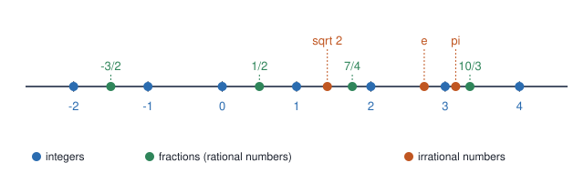
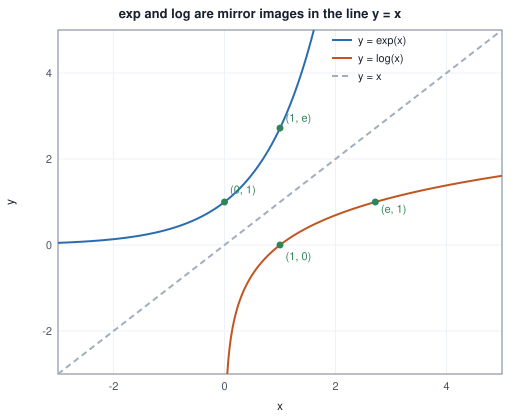

<!-- SPDX-License-Identifier: CC-BY-4.0 -->
<!-- Copyright (c) 2026 Martin Schröder <info@swedishembedded.com> -->

# Numbers, Quantities and Notation

*What are the numbers a machine learns with, and how do we write about them precisely?*

## The problem

Here are four facts about an ordinary language model, each stated the way a
person would say it aloud.

- It has seven billion adjustable numbers (its **parameters**).
- It was trained on about two trillion pieces of text.
- Training changed each parameter by steps of roughly three ten-thousandths.
- To avoid dividing by zero, a formula somewhere adds one hundred-millionth
  to a quantity.

Try writing those four numbers with digits and you meet the first problem of
this book: `7000000000`, `2000000000000`, `0.0003`, `0.00000001`. Nobody
reads these reliably, and a miscounted zero changes the meaning by a factor of
ten. We need a notation in which the size of a number is visible at a glance
and the digits that matter are separated from the zeros that merely place the
decimal point.

Now look at what the model does with one piece of text. It assigns a chance
to every word it might see next, and the chance it assigned to the words that
actually occurred measures how well it predicted them. For a whole document
those chances are *multiplied*, one factor per word. A 400-word document in
which each word had chance 0.1 has chance $0.1 \times 0.1 \times \dots$ four
hundred times, which is a number with 399 zeros after the decimal point before
the first nonzero digit. A computer cannot store it. It stores zero, and a
program that treats that zero as the answer is wrong in a way that raises no
error.

Third, every number a model reports about its own quality (its **loss**) is
built the same way: compute something small for each example in a dataset,
then add the results up and divide by how many there were. Writing "do this
for every example and add them all up" without ambiguity, for a dataset of
any size, needs a notation of its own.

So this chapter gives you the number systems machine learning computes with,
and the handful of notations that every later page uses: powers and scientific
notation for sizes, **logarithms** for turning products into sums, the
$\sum$ and $\prod$ symbols for repeated addition and multiplication,
braces for collections, and the $f(x)$ notation for a rule with inputs and
outputs. Nothing here goes beyond school arithmetic in difficulty. What is new
is the care: every rule is derived from the one before it, and every numerical
claim is computed by a program rather than typed, so that you can check it.

You may use only school arithmetic: addition, subtraction, multiplication,
division and fractions. Everything else is introduced below.

## Integers

A **natural number** answers "how many?": $0, 1, 2, 3, \dots$. An
**integer** is a natural number or the negative of one:
$\dots, -3, -2, -1, 0, 1, 2, 3, \dots$. The set of all integers is written
$\mathbb{Z}$, and the natural numbers $\mathbb{N}$ (a **set** is a collection
of things; the notation is introduced two sections below).

Integers are the numbers of counting and of naming. A vocabulary of 50,000
tokens numbers them $0, 1, \dots, 49999$, and the number is the token's
identity. The position of an element in a list is an integer. The number of
examples in a dataset, the number of layers in a network and the number of
steps taken so far in training are integers. Wherever the question is "which
one?" or "how many?", the answer is an integer, and the integers are exactly
the numbers where nothing lies between neighbours: after 7 comes 8.

Adding, subtracting and multiplying two integers always gives an integer. We
say the integers are **closed** under these operations. Division is the
exception: $7 / 2$ is not an integer. When we need to stay among integers we
use **division with remainder**. For any integers $a$ and $b \neq 0$ we can
write

$$
a = b\,q + r ,
$$

where $q$ is the **quotient** and $r$ the **remainder**. Take $a = 17$ and
$b = 5$: $17 = 5 \cdot 3 + 2$, so $q = 3$ and $r = 2$. For negative numbers
the statement above does not by itself fix $q$ and $r$. For $a = -17$,
$b = 5$ both $-17 = 5 \cdot (-4) + 3$ and $-17 = 5 \cdot (-3) + (-2)$ are true.
Languages disagree on which one they report. Two conventions exist: the
**floor** convention rounds the quotient down, so the remainder takes the sign
of $b$; the **truncating** convention rounds it toward zero, so the remainder
takes the sign of $a$.

<!-- worked: numbasics.integer_division -->
| a, b | floor q | floor r | truncating q | truncating r |
|---|---:|---:|---:|---:|
| 17, 5 | 3 | 2 | 3 | 2 |
| -17, 5 | -4 | 3 | -3 | -2 |
| 17, -5 | -4 | -3 | -3 | 2 |
| -17, -5 | 3 | -2 | 3 | -2 |
<!-- /worked -->

Every row satisfies $a = bq + r$ under both conventions. Which convention your
language uses for `%` is a fact you must look up, and when an index is wrapped
around with a remainder (as in a ring buffer), a negative input is where the
two diverge.

A computer stores an integer in a fixed number of binary digits, called
**bits**. With $n$ bits it can distinguish $2^n$ different patterns (the
notation $2^n$ is defined in the section on exponents). If the patterns are
used for the non-negative integers they cover $0$ to $2^n - 1$; if half of
them are used for negatives, the range is $-2^{n-1}$ to $2^{n-1} - 1$.

<!-- worked: numbasics.integer_ranges -->
| bits n | smallest signed -2^(n-1) | largest signed 2^(n-1) - 1 | largest unsigned 2^n - 1 |
|---:|---:|---:|---:|
| 8 | -128 | 127 | 255 |
| 16 | -32,768 | 32,767 | 65,535 |
| 32 | -2,147,483,648 | 2,147,483,647 | 4,294,967,295 |
| 64 | -9,223,372,036,854,775,808 | 9,223,372,036,854,775,807 | 18,446,744,073,709,551,615 |
<!-- /worked -->

Two lessons follow. A 32-bit signed integer tops out near two billion, which
is smaller than the number of parameters of a modern model: counting
parameters in 32 bits silently wraps around. And integers never become
approximate: an integer that fits is stored exactly. Hold on to that; the
numbers in the next section are not so lucky.

## Real numbers and the number line

Measurements, probabilities and weights are not whole numbers. A learning rate
of $0.0003$, a probability of $0.4$, a weight of $-1.7$: these live between
the integers. Start with fractions.

A **rational number** is a ratio of two integers $p/q$ with $q \neq 0$:
$\tfrac12$, $-\tfrac32$, $\tfrac{22}{7}$. Every integer is rational
($5 = 5/1$). Writing a rational number in decimal always ends in one of two
ways. Long division of $p$ by $q$ produces a remainder at each step, and there
are only $q$ possible remainders, so either the remainder becomes $0$ (the
expansion **terminates**) or some remainder repeats and the digits cycle from
then on forever.

<!-- worked: numbasics.decimal_expansions -->
| number | decimal expansion (parentheses mark the repeating block) | behaviour |
|---|---|---|
| 1/3 | `0.(3)` | repeats 1 digit(s) |
| 1/8 | `0.125` | terminates |
| 1/7 | `0.(142857)` | repeats 6 digit(s) |
| 22/7 | `3.(142857)` | repeats 6 digit(s) |
| 5/12 | `0.41(6)` | repeats 1 digit(s) |
| sqrt(2) | `1.41421356237309504880...` | never repeats (proved in the text) |
<!-- /worked -->

Repeating blocks are why $\tfrac13$ cannot be written exactly with a finite
number of decimal digits, and (as a later chapter shows) why $0.1$ cannot be
written exactly with a finite number of binary digits either.

Are the rationals enough? The ancient answer is no. Consider a square with
side 1; its diagonal has length $\sqrt{2}$, the positive number whose square
is $2$. Suppose $\sqrt{2} = p/q$ with the fraction in lowest terms, meaning $p$
and $q$ share no common factor. Squaring gives $p^2 = 2q^2$, so $p^2$ is even,
so $p$ is even (the square of an odd number is odd), say $p = 2k$. Then
$4k^2 = 2q^2$, so $q^2 = 2k^2$ and $q$ is even too. But then $p$ and $q$ share
the factor 2, contradicting lowest terms. No such fraction exists.

A number that is not rational is **irrational**. $\sqrt{2}$ is one; so are
$\pi$ and the number $e$ we meet below. Their decimal expansions never end and
never repeat. The collection of all rational and irrational numbers together
is the set of **real numbers**, written $\mathbb{R}$. Think of $\mathbb{R}$ as
a line with no gaps: every point on it is a real number.



The picture shows how the three kinds of number sit together. Integers are
spaced out. Fractions fill in between them, and between any two fractions,
however close, there is another fraction. Yet the irrational numbers are in
the gaps too, and in a precise sense there are far more of them. You cannot
tell by looking which kind a point is: $\tfrac32 = 1.5$ and $\sqrt{2} = 1.414\dots$
are close neighbours of different kinds.

Irrational numbers can be approached by rational ones as closely as we please.
Here is a recipe that does so for $\sqrt{2}$. If $x$ is too small then $2/x$ is
too big (their product is 2), so their average lies closer to the answer.
Start with $x = 1$ and repeat $x \leftarrow \tfrac12\left(x + \tfrac{2}{x}\right)$,
keeping every value as an exact fraction.

<!-- worked: numbasics.sqrt2_approximations -->
| step | fraction x | x as decimal | x squared | x squared minus 2 |
|---:|---:|---:|---:|---:|
| 0 | 1 | 1.000000000000 | 1.000000000000 | -1.00e+00 |
| 1 | 3/2 | 1.500000000000 | 2.250000000000 | 2.50e-01 |
| 2 | 17/12 | 1.416666666667 | 2.006944444444 | 6.94e-03 |
| 3 | 577/408 | 1.414215686275 | 2.000006007305 | 6.01e-06 |
| 4 | 665857/470832 | 1.414213562375 | 2.000000000005 | 4.51e-12 |
<!-- /worked -->

The error of $x^2$ against $2$ shrinks from $2.5 \times 10^{-1}$ to $6.9 \times 10^{-3}$ to
$6.0 \times 10^{-6}$ to $4.5 \times 10^{-12}$: the number of correct digits roughly
doubles each step. (This is Newton's method; the chapter on derivatives
explains why it works.) Each value is a genuine fraction, and the sequence
walks toward a number that is not one. This is the sense in which a computer,
which only has fractions to work with, can work with $\mathbb{R}$ at all: it
stores a rational approximation, with finitely many digits, and every
computation carries a small error. How small, and when the errors stop being
small, is the subject of the chapter on floating-point numbers. For the rest
of this chapter we treat real numbers as exact and use a program only to
print them.

Real numbers are ordered (for any two, one is smaller) and we write stretches
of the line as **intervals**: $[a, b]$ is all $x$ with $a \le x \le b$, the
**closed interval** that includes both ends; $(a, b)$ is all $x$ with
$a < x < b$, the **open interval** without them. A probability, for example,
is a real number in $[0, 1]$.

## Sets

We have started to talk about "the set of integers" and "all $x$ with
$a \le x \le b$". Machine learning is full of collections (a vocabulary, a
dataset, the set of possible labels), so we fix the language now.

A **set** is a collection of distinct objects, called its **elements**. We
write a finite set by listing its elements in braces: $A = \{1, 2, 3, 4\}$.
Two facts define it. Order does not matter ($\{1,2\} = \{2,1\}$) and repeats
do not count ($\{1, 2, 2, 3, 2\} = \{1, 2, 3\}$). We write $x \in A$ for
"$x$ is an element of $A$" and $x \notin A$ for "is not". The number of
elements of a finite set $A$ is written $\lvert A \rvert$. The set with no
elements is the **empty set**, $\varnothing$.

Sets can be described by a rule instead of a list. The **set-builder**
notation $\{\, n \in \mathbb{Z} : n^2 < 20 \,\}$ reads "the set of integers $n$
such that $n^2 < 20$", and the colon means "such that". We also use the
shorthand $\{1, \dots, n\}$ for the integers from $1$ to $n$ (the book's
notation page lists it), and $\mathbb{R}$, $\mathbb{Z}$, $\mathbb{N}$ are sets
in this sense. Because $\mathbb{N}$, $\mathbb{Z}$, $\mathbb{R}$ contain one
another, we say that $B$ is a **subset** of $A$, written $B \subseteq A$, when
every element of $B$ is in $A$.

Three operations combine sets. The **union** $A \cup B$ holds everything in
either; the **intersection** $A \cap B$ holds what is in both; the
**difference** $A \setminus B$ holds what is in $A$ and not in $B$.

<!-- worked: numbasics.set_operations -->
| expression | value | note |
|---|---|---|
| A | {1, 2, 3, 4} | |A| = 4 |
| B | {3, 4, 5} | |B| = 3 |
| union A U B | {1, 2, 3, 4, 5} | 5 elements |
| intersection A n B | {3, 4} | 2 elements |
| difference A \ B | {1, 2} | 2 elements |
| {3, 4} subset of A? | true |  |
| {3, 4} subset of B? | true |  |
| {n in Z : n^2 < 20} | {-4, -3, -2, -1, 0, 1, 2, 3, 4} | 9 elements |
| {1, 2, 2, 3, 2} | {1, 2, 3} | repeats collapse: 3 elements |
| A x B (ordered pairs) | 12 pairs | |A| * |B| |
<!-- /worked -->

The last row introduces the **product** of two sets: $A \times B$ is the set
of **ordered pairs** $(a, b)$ with $a \in A$ and $b \in B$. A pair differs
from a two-element set because order matters and repeats are allowed:
$(3, 3)$ is a pair, $\{3, 3\} = \{3\}$ is not. A **dataset** of $N$ labelled
examples is exactly a collection of $N$ pairs $(x_n, y_n)$, input and desired
output. One subtlety to remember: a set collapses repeats, but a real dataset
may contain the same example twice, and each copy counts. When that matters
the book says "the list of examples" and indexes it by $n = 1, \dots, N$,
which is how we write datasets in the sections below.

## Exponents

Return to the opening problem. Repeated multiplication is the first compact
notation: $2 \times 2 \times 2 \times 2 \times 2$ is written $2^5$. In general,
for a number $b$ (the **base**) and a positive integer $n$ (the **exponent**),

$$
b^n = \underbrace{b \times b \times \cdots \times b}_{n \text{ factors}} .
$$

An exponent counts factors, so adding exponents should correspond to
multiplying powers. Count the factors in a product of $2^3$ and $2^5$: there
are $3 + 5 = 8$ of them. That observation is the **product rule**,

$$
b^m \cdot b^n = b^{m+n} ,
$$

and every other rule follows from it. For example $(b^m)^n$ is $n$ copies of
$b^m$, each with $m$ factors, so it has $m n$ factors:
$(b^m)^n = b^{mn}$. And $(ab)^n = a^n b^n$, because we may rearrange the $n$
copies of $a$ and the $n$ copies of $b$ in a product.

So far an exponent had to be a positive integer. We now extend it, and the
extension is not a free choice: we demand that the product rule keep holding.

**Zero.** The rule says $b^0 \cdot b^n = b^{0+n} = b^n$. A number that leaves
every $b^n$ unchanged when multiplied is $1$, so $b^0$ must equal $1$ (for
$b \neq 0$).

**Negative integers.** The rule says $b^{-n} \cdot b^{n} = b^{0} = 1$, so
$b^{-n}$ must be the reciprocal: $b^{-n} = 1 / b^n$. Thus $2^{-3} = 1/8$.

**Fractions.** The power rule says $(b^{1/2})^2 = b^{1} = b$, so $b^{1/2}$ is
a number whose square is $b$: the square root. In general $b^{1/k}$ is the
$k$-th root of $b$ (for positive $b$), and $b^{m/k} = (b^{1/k})^m$.

**Any real number.** An irrational exponent such as $2^{\sqrt{2}}$ is
defined by squeezing: $2^{1.4}$, $2^{1.41}$, $2^{1.414}$, ... are powers with
rational exponents, and they close in on one number, which we call
$2^{\sqrt{2}}$. We take the existence of this limit for granted until the
chapters on functions and derivatives. From here on, $b^x$ is defined for
every positive base $b$ and every real exponent $x$.

<!-- worked: numbasics.exponent_rules -->
| rule | left side | value | right side | value | equal |
|---|---|---:|---|---:|---|
| product | 2^3 * 2^5 | 256 | 2^(3+5) | 256 | yes |
| quotient | 3^7 / 3^4 | 27 | 3^(7-4) | 27 | yes |
| power of power | (2^3)^2 | 64 | 2^(3*2) | 64 | yes |
| power of product | (2*5)^3 | 1000 | 2^3 * 5^3 | 1000 | yes |
| zero exponent | 7^0 | 1 | 1 | 1 | yes |
| negative exponent | 2^(-3) | 0.125 | 1 / 2^3 | 0.125 | yes |
| fractional exponent | 9^(1/2) | 3 | sqrt(9) | 3 | yes |
| fractional, then power | (2^(1/2))^2 | 2 | 2^1 | 2 | yes |
<!-- /worked -->

The program checks each rule with specific numbers, and the "equal" column
tests for equality up to the tiny error of the machine's own arithmetic. Two
cautions are in order. Parentheses decide meaning: $-2^2$ is $-(2^2) = -4$ but
$(-2)^2 = 4$. And a tower $a^{b^c}$ is read from the top, as $a^{(b^c)}$.

### Scientific notation

Every positive number can be written as $m \times 10^k$ with a **mantissa**
$m$ in $[1, 10)$ and an integer exponent $k$. The exponent says how big the
number is (its **order of magnitude**) and the mantissa carries the digits.
Programs write the same thing as `7e9` for $7 \times 10^9$ and `1e-8` for
$10^{-8}$.

<!-- worked: numbasics.scientific_notation -->
| quantity | written out | scientific notation | as a program writes it |
|---|---|---|---|
| parameters in a large model | `7,000,000,000` | 7 x 10^9 | `7e+09` |
| training tokens seen | `2,000,000,000,000` | 2 x 10^12 | `2e+12` |
| a typical learning rate | `0.0003` | 3 x 10^-4 | `0.0003` |
| a small constant added to avoid dividing by zero | `0.00000001` | 1 x 10^-8 | `1e-08` |
<!-- /worked -->

Multiplying two numbers in this notation multiplies mantissas and adds
exponents, by the product rule: $(7 \times 10^9) \times (2 \times 10^{12}) =
14 \times 10^{21} = 1.4 \times 10^{22}$. Sizes in machine learning span so many
orders of magnitude that this is how one compares them: the exponents of a
learning rate of $3 \times 10^{-4}$ and a parameter count of $7 \times 10^{9}$
are $-4$ and $9$, which differ by 13, so the two quantities are thirteen
orders of magnitude apart.

### Sizes of models

Exponents also let us count. A natural way to organise the numbers in a model
is as square grids of $d \times d$ numbers, each with $d$ extra numbers
alongside. One such grid holds $d^2 + d$ numbers. A network stacks many of
them; the table repeats the same grid 32 times.

<!-- worked: numbasics.parameter_counts -->
| d | numbers per grid d*d + d | scientific | 32 grids | scientific | GiB at 4 bytes each |
|---:|---:|---:|---:|---:|---:|
| 1,024 | 1,049,600 | 1.05e+06 | 33,587,200 | 3.36e+07 | 0.13 |
| 4,096 | 16,781,312 | 1.68e+07 | 537,001,984 | 5.37e+08 | 2.00 |
| 8,192 | 67,117,056 | 6.71e+07 | 2,147,745,792 | 2.15e+09 | 8.00 |
<!-- /worked -->

Doubling the width $d$ multiplies the grid size by close to four, because of
the exponent $2$ in $d^2$. Parameter counts therefore grow quickly with width,
and memory with them. Each number costs a fixed number of bytes in memory (the
number format is the subject of the chapter on floating point). For a model of
$7 \times 10^9$ parameters:

<!-- worked: numbasics.memory_for_7b -->
| format | bytes each | total bytes | GB (10^9) | GiB (2^30) |
|---|---:|---:|---:|---:|
| 32-bit float | 4 | 2.80e+10 | 28.00 | 26.08 |
| 16-bit float | 2 | 1.40e+10 | 14.00 | 13.04 |
| 8-bit integer | 1 | 7.00e+09 | 7.00 | 6.52 |

One GiB is 1,073,741,824 bytes, which is 7.4 percent more than one GB of 1,000,000,000.
<!-- /worked -->

The two memory columns differ, and the difference is itself an exponent
story. The prefix "giga" in everyday use means $10^9$, but memory comes in
powers of two, and $2^{30}$ is the closest power of two to $10^9$. The book
writes $\mathrm{GiB}$ for $2^{30}$ bytes and GB for $10^9$ bytes, as the
notation page states, and a claim about a model fitting in memory is only
meaningful with the right one.

## Logarithms

An exponent answers "what do I get after multiplying $b$ by itself $x$
times?". Reverse the question. If $2^x = 1024$, what is $x$? You can find
$x = 10$ by trying. The answer deserves a name, because the question
(how many times must I multiply to reach this?) comes up constantly. The
**logarithm** to base $b$ of a positive number $y$, written $\log_b y$, is the
exponent $x$ such that $b^x = y$:

$$
\log_b y = x \iff b^x = y \qquad (b > 0,\; b \neq 1,\; y > 0).
$$

So $\log_2 1024 = 10$, $\log_{10} 1000 = 3$ and $\log_{10} 0.001 = -3$. The
restriction $y > 0$ is not a technicality: a positive base raised to any real
power is positive, so no exponent produces $0$ or a negative number, and
$\log_b y$ is undefined there. We will see in a moment why a program that is
asked for $\log 0$ answers $-\infty$ and not an error.

A logarithm and an exponent undo one another, by definition:
$\log_b(b^x) = x$ and $b^{\log_b y} = y$.

### The rules, derived

Every rule of logarithms is a rule of exponents read backwards. Let
$x = \log_b u$ and $z = \log_b v$, so that $u = b^x$ and $v = b^z$.

- **Product.** $uv = b^x b^z = b^{x+z}$, and so by definition
  $\log_b(uv) = x + z$:
  $$
  \log_b(uv) = \log_b u + \log_b v .
  $$
- **Quotient.** The same argument with $b^{x}/b^{z} = b^{x-z}$ gives
  $\log_b(u/v) = \log_b u - \log_b v$.
- **Power.** $u^k = (b^x)^k = b^{kx}$, so
  $$
  \log_b(u^k) = k \log_b u .
  $$
  With $k = -1$ this says $\log_b(1/u) = -\log_b u$, and $\log_b 1 = 0$ because
  $b^0 = 1$.
- **Change of base.** Let $x = \log_b y$, so $y = b^x$. Take $\log_c$ of both
  sides and use the power rule: $\log_c y = x \log_c b$. Hence
  $$
  \log_b y = \frac{\log_c y}{\log_c b} .
  $$
  Logarithms to different bases differ only by a constant factor, which is why
  the choice of base is mostly a convention.

The product rule is the one that matters most for this book: **a logarithm
turns multiplication into addition**. The following table checks each rule
numerically. The "difference" column shows the rounding error of the
computer's arithmetic, a few parts in $10^{16}$.

<!-- worked: numbasics.log_rules -->
| rule | left side | value | right side | value | difference |
|---|---|---:|---|---:|---:|
| log of a product | log(8 * 32) | 5.5451774445 | log 8 + log 32 | 5.5451774445 | 0.0e+00 |
| log of a quotient | log(8 / 32) | -1.3862943611 | log 8 - log 32 | -1.3862943611 | 2.2e-16 |
| log of a power | log(8^3.5) | 7.2780453959 | 3.5 * log 8 | 7.2780453959 | 8.9e-16 |
| log of 1 | log 1 | 0.0000000000 | 0 | 0.0000000000 | 0.0e+00 |
| change of base | log_2 32 | 5.0000000000 | log 32 / log 2 | 5.0000000000 | 0.0e+00 |
| change of base | log_10 1000 | 3.0000000000 | log 1000 / log 10 | 3.0000000000 | 4.4e-16 |
| reciprocal | log(1/8) | -2.0794415417 | -log 8 | -2.0794415417 | 0.0e+00 |
<!-- /worked -->

### The number $e$ and natural logarithms

Three bases are in use: 10 (digits), 2 (bits) and a third that arises by
itself. Suppose a quantity grows by a fraction $1/n$ at each of $n$ equal
steps, so that after all of them it has been multiplied by $(1 + 1/n)^n$. If
$n = 1$ the factor is $2$. What happens with more and finer steps?

<!-- worked: numbasics.e_limit -->
e = 2.718281828459

| n | (1 + 1/n)^n | difference from e |
|---|---:|---:|
| 10^0 | 2.000000000000 | -7.18e-01 |
| 10^1 | 2.593742460100 | -1.25e-01 |
| 10^2 | 2.704813829422 | -1.35e-02 |
| 10^3 | 2.716923932236 | -1.36e-03 |
| 10^4 | 2.718145926825 | -1.36e-04 |
| 10^6 | 2.718280469096 | -1.36e-06 |
| 10^8 | 2.718281798347 | -3.01e-08 |
| 10^12 | 2.718523496037 | 2.42e-04 |
| 10^15 | 3.035035206549 | 3.17e-01 |
| 10^16 | 1.000000000000 | -1.72e+00 |
<!-- /worked -->

The values settle: $2$, $2.59$, $2.7048$, $2.71692$, and so on toward a number
written $e = 2.718281828\ldots$, an irrational number. (We will not prove that
the values converge; the chapter on derivatives defines the limit properly.)
The bottom rows warn us of something else: for very large $n$ the printed
value drifts away from $e$ and at $n = 10^{16}$ it is exactly $1$. The
mathematics has not changed; the computer cannot distinguish $1 + 10^{-16}$
from $1$, and the cause is the finite-digit storage described in the chapter
on floating-point numbers. We have just seen our first numerical failure.

The function that takes $x$ to $e^x$ is written $\exp(x)$, and its inverse, the
logarithm to base $e$, is the **natural logarithm**. The book's notation page
fixes the convention: $\log x$ with no base means the natural logarithm, and
bases other than $e$ are written out as $\log_2$ and $\log_{10}$. (Programming
languages mostly agree: `log` is natural, `log2` and `log10` are the others.
A formula copied from a paper that writes "log" must be checked for which it
means.) Why $e$ is the natural choice is an observation about rates of change
that the derivatives chapter makes precise.

Because exp and log are inverses, their graphs are reflections of one another
in the line $y = x$: if $(a, b)$ is on the graph of $\exp$, meaning
$b = e^a$, then $a = \log b$, so $(b, a)$ is on the graph of $\log$.



The picture exposes three habits worth keeping. The exponential is positive
everywhere, tiny for negative arguments and explosive for positive ones.
The logarithm is defined only for positive inputs; it plunges toward $-\infty$
as the input approaches 0 from above, and it grows slowly, so slowly that
$\log$ of a million is only about 13.8. And the logarithm of 1 is 0, with
inputs below 1 giving negative values; a probability is at most 1, so the
logarithm of a probability is never positive. Check it against inverses on
actual numbers:

<!-- worked: numbasics.exp_log_inverse -->
Going exp then log returns the starting number:

| x | exp(x) | log(exp(x)) |
|---|---:|---:|
| -2.0 | 0.135335 | -2.000000 |
| -0.5 | 0.606531 | -0.500000 |
| 0.0 | 1.000000 | 0.000000 |
| 1.0 | 2.718282 | 1.000000 |
| 2.5 | 12.182494 | 2.500000 |

Going log then exp does too, for positive inputs:

| x | log(x) | exp(log(x)) |
|---|---:|---:|
| 0.1 | -2.302585 | 0.1 |
| 0.5 | -0.693147 | 0.5 |
| 1 | 0.000000 | 1 |
| 2.71828 | 1.000000 | 2.71828 |
| 10 | 2.302585 | 10 |
| 1000 | 6.907755 | 1000 |
<!-- /worked -->

### Logarithms count digits and bits

The last property is the one that rescues the opening problem. For a power of
ten, $\log_{10}$ is the number of zeros. For other numbers it is a fraction,
and the integer part tells the order of magnitude. $\log_{10}$ is how we turn
"how many digits?" into a smooth quantity, and $\log_2$ turns "how many
binary digits?" into one:

<!-- worked: numbasics.digits_and_bits -->
| quantity x | log_10 x | log_2 x | bits to number x things (ceil of log_2) |
|---|---:|---:|---:|
| a count of 1,000 | 3.0000 | 9.9658 | 10 |
| a model with 7 x 10^9 parameters | 9.8451 | 32.7047 | 33 |
| a corpus of 2 x 10^12 tokens | 12.3010 | 40.8631 | 41 |
| an epsilon of 10^-8 | -8.0000 | -26.5754 | - |
| a vocabulary of 50,000 tokens | 4.6990 | 15.6096 | 16 |
| a vocabulary of 128,000 tokens | 5.1072 | 16.9658 | 17 |
| one million | 6.0000 | 19.9316 | 20 |
<!-- /worked -->

A vocabulary of $50{,}000$ tokens needs $\lceil \log_2 50000 \rceil = 16$ bits
to name each token, where $\lceil\cdot\rceil$ rounds up to the next integer,
and $128{,}000$ needs 17. Seven billion parameters is a ten-digit number but
a 33-bit one. The logarithm is a ruler on which sizes that differ by factors
of ten or a thousand are the same distance apart, and that is exactly what we
want when comparing quantities that range from $10^{-8}$ to $10^{12}$.

## Function notation

We have been writing expressions like $e^x$ and $\log_b y$, where a letter
stands for an input and the expression says what to do with it. This is the
idea of a function, and this section only introduces its notation. The next
chapter builds the theory.

A **function** is a rule that takes an input and produces an output. We give
the rule a name, usually a single letter, and write $f(x)$ for the output the
rule $f$ produces from the input $x$. To define a function we give the rule:

$$
f(x) = 3x - 2 .
$$

This reads: "$f$ of $x$ equals three times $x$ minus two". The letter $x$
inside the definition is a placeholder, a name for whatever the input is. We
use the function by replacing it with a value: $f(2) = 3 \cdot 2 - 2 = 4$, and
$f(-1) = -5$. We may as well put an expression inside:
$f(a + 1) = 3(a + 1) - 2 = 3a + 1$. The name of the placeholder is arbitrary
($f(t) = 3t - 2$ is the same rule), and *what we do to the input* is the only
content of $f$.

Notation that is easy to misread: $f(x)$ names the output for input $x$, not
the function itself, which is $f$. And $f(x)$ is not $f$ times $x$. Even
the familiar $\log x$ is this notation without parentheses: the function
$\log$ applied to $x$.

A rule often has two kinds of numbers in it. In $h(x) = wx + b$ the quantity
$x$ is the input we vary from one use to the next, while $w$ and $b$ are
numbers the rule is built from. When we want to stress that, we write
$h(x; w, b)$ and read it "$h$ of $x$, with parameters $w$ and $b$": the
semicolon separates the input from the settings. Changing $w$ and $b$ gives a
different rule; changing $x$ gives a different output of the same rule. In
machine learning the entire game is to adjust the parameters so that the rule
gives good outputs, and in the book's notation the parameters of a model are
collected in $\theta$ and the model written $f_\theta$.

<!-- worked: numbasics.function_evaluation -->
| x | f(x) = 3x - 2 | g(x) = x^2 | h(x; w=3, b=-2) | h(x; w=0.5, b=1) |
|---:|---:|---:|---:|---:|
| -1 | -5 | 1 | -5 | 0.5 |
| 0 | -2 | 0 | -2 | 1.0 |
| 1 | 1 | 1 | 1 | 1.5 |
| 2 | 4 | 4 | 4 | 2.0 |
| 2.5 | 5.5 | 6.25 | 5.5 | 2.25 |
<!-- /worked -->

To say which numbers a function takes and gives, we write
$f: A \to B$, "$f$ is a function from the set $A$ to the set $B$": the set $A$
of acceptable inputs and the set $B$ that contains the outputs. $f(x) = 3x - 2$
is a function $\mathbb{R} \to \mathbb{R}$. The logarithm is not: its inputs
are only the positive reals, so we write $\log: (0, \infty) \to \mathbb{R}$,
and the rule "the input must be in the set $A$" is part of what a function
is. Intervals and sets, as above, are how we state it.

A **loss** is a function too: its input is the parameters (everything else is
held fixed) and its output is one number saying how badly the model does. We
write it $L(w)$. We construct one in the next section.

## Summation notation

An example. We have a dataset of five points $(x_n, y_n)$, and a candidate
rule $f(x) = 2x + 1$. For each point the prediction is $f(x_n)$, the error is
$f(x_n) - y_n$, and we square it so that positive and negative errors cannot
cancel. The loss is the average of the five squared errors.

<!-- worked: numbasics.loss_dataset -->
| n | x_n | y_n | f(x_n) = 2 x_n + 1 | error | error squared | running sum |
|---:|---:|---:|---:|---:|---:|---:|
| 1 | 0.0 | 1.2 | 1.0 | -0.2 | 0.04 | 0.04 |
| 2 | 1.0 | 2.8 | 3.0 | +0.2 | 0.04 | 0.08 |
| 3 | 2.0 | 5.3 | 5.0 | -0.3 | 0.09 | 0.17 |
| 4 | 3.0 | 7.1 | 7.0 | -0.1 | 0.01 | 0.18 |
| 5 | 4.0 | 8.8 | 9.0 | +0.2 | 0.04 | 0.22 |

Sum of squared errors 0.22, divided by N = 5: L = 0.044.
<!-- /worked -->

Writing out "add the first, add the second, ..., add the fifth" works for five
examples. For a million examples or for $N$ examples, we need a symbol. The
**summation** symbol $\Sigma$ (capital Greek sigma) says "add":

$$
\sum_{i=a}^{b} t_i = t_a + t_{a+1} + \dots + t_b .
$$

The symbol $i$ is the **index** (a placeholder, like $x$ in a function), the
numbers $a$ and $b$ are its **lower and upper bound**, both included, and
$t_i$ is the **term**, which usually depends on $i$. The loss is

$$
L = \frac{1}{N} \sum_{n=1}^{N} \bigl(f(x_n) - y_n\bigr)^2 ,
$$

and **every loss in machine learning has this shape**: an average, over the
dataset, of a per-example quantity. In pseudocode a sum is an ordinary loop
with a variable initialised to zero:

```text
function mean_squared_error(x: array<real>[N], y: array<real>[N],
                            w: real, b: real) -> real:
    require N > 0, "the mean of no examples is undefined"
    total = 0.0
    for n in 0 .. N:                  # n = 0, ..., N-1: the book's i = 1, ..., N
        err = (w * x[n] + b) - y[n]
        total = total + err * err
    return total / N
```

Note the loop's range. Mathematics indexes from 1 and pseudocode from 0, so
the sum over $n = 1, \dots, N$ becomes a loop over `0 .. N`, as the notation
page promises. The number of terms in a sum from $a$ to $b$ is $b - a + 1$ if
$b \ge a$ and zero otherwise; mistakes in this count are among the commonest
bugs in code that sums, which is why the table below is worth reading.

<!-- worked: numbasics.term_counts -->
| i from .. to | terms by counting | max(b - a + 1, 0) |
|---|---:|---:|
| 1 to 10 | 10 | 10 |
| 0 to 9 | 10 | 10 |
| 3 to 3 | 1 | 1 |
| 4 to 3 | 0 | 0 |
| -2 to 2 | 5 | 5 |
<!-- /worked -->

A sum with no terms is $0$, the starting value of the loop. That convention
keeps every rule below valid even for empty ranges.

Because the loss is a function of the model's parameters, we can see it as
one. Holding $b = 1$ fixed, here is $L$ at five values of $w$; it is lowest
near $w = 2$, and we will later learn how to find that minimum without trying
values.

<!-- worked: numbasics.loss_as_function_of_w -->
| w | L(w) with b = 1 |
|---:|---:|
| 1.0 | 6.0040 |
| 1.5 | 1.5240 |
| 2.0 | 0.0440 |
| 2.5 | 1.5640 |
| 3.0 | 6.0840 |
<!-- /worked -->

### Rules of sums

Adding is commutative and associative, so a sum can be rearranged, split and
scaled. Each rule below follows by writing out the terms.

- **Constants come out.** $\sum_i c\,t_i = c \sum_i t_i$, because
  $c t_1 + \dots + c t_n = c (t_1 + \dots + t_n)$.
- **Sums split.** $\sum_i (s_i + t_i) = \sum_i s_i + \sum_i t_i$: regroup the
  terms.
- **Ranges split.** $\sum_{i=1}^{n} t_i = \sum_{i=1}^{m} t_i + \sum_{i=m+1}^{n} t_i$.
- **A constant term** added $n$ times: $\sum_{i=1}^{n} c = n c$.
- **The index is a dummy.** $\sum_{i} t_i = \sum_{j} t_j$, and shifting it
  changes the bounds: $\sum_{i=1}^{n} t_i = \sum_{j=0}^{n-1} t_{j+1}$.

<!-- worked: numbasics.sum_linearity -->
| i | x_i | y_i | 3 x_i + y_i |
|---:|---:|---:|---:|
| 1 | 2 | 1 | 7 |
| 2 | 4 | -1 | 11 |
| 3 | 6 | 3 | 21 |
| 4 | 8 | 5 | 29 |

Sum of the last column: 68. Three times the sum of x (20) plus the sum of y (8): 68.
<!-- /worked -->

The first two rules together are called **linearity**: a sum of a scaled
combination equals the scaled combination of the sums. They are what lets us
differentiate a loss one example at a time later on.

Nested sums add over two indices, as when a table of numbers is summed by rows
and by columns. Finite sums can be performed in either order:

<!-- worked: numbasics.double_sum -->
|  | j = 1 | j = 2 | j = 3 | sum |
|---|---:|---:|---:|---:|
| row 1 | 1 | 2 | 3 | 6 |
| row 2 | 4 | 5 | 6 | 15 |
| column sums | 5 | 7 | 9 | 21 |

Summing rows first gives 21; summing columns first gives 21.
<!-- /worked -->

We should get a feel for what a sum computes by deriving one closed form. The
sum $1 + 2 + \dots + n$ looks like it needs $n$ additions. Write it twice,
once forwards and once backwards, and add column by column:

$$
\begin{aligned}
S &= 1 + 2 + \dots + (n-1) + n \\
S &= n + (n-1) + \dots + 2 + 1 \\
2S &= (n+1) + (n+1) + \dots + (n+1) = n(n+1) .
\end{aligned}
$$

Every column sums to $n + 1$ and there are $n$ columns, so
$\sum_{i=1}^{n} i = \tfrac{n(n+1)}{2}$. A million additions collapse to one
multiplication and one division.

<!-- worked: numbasics.sum_closed_form -->
| n | 1 + 2 + ... + n by adding | n(n+1)/2 |
|---:|---:|---:|
| 4 | 10 | 10 |
| 10 | 55 | 55 |
| 100 | 5,050 | 5,050 |
| 1,000 | 500,500 | 500,500 |
| 1,000,000 | 500,000,500,000 | 500,000,500,000 |
<!-- /worked -->

The same sort of reasoning shows $\sum_{i=1}^{n} i^2 = \tfrac{n(n+1)(2n+1)}{6}$
(the exercises ask you to check, not derive, it). Expanding a sum into its
terms, one at a time with a running total, is the dependable way to check any
such statement:

<!-- worked: numbasics.sum_expanded -->
| i | term i^2 | value | running sum |
|---:|---|---:|---:|
| 1 | 1^2 | 1 | 1 |
| 2 | 2^2 | 4 | 5 |
| 3 | 3^2 | 9 | 14 |
| 4 | 4^2 | 16 | 30 |
| 5 | 5^2 | 25 | 55 |

The sum is 55; the closed form n(n+1)(2n+1)/6 with n = 5 gives 55.
<!-- /worked -->

## Product notation

The same notation exists for multiplication. The capital Greek letter pi,
$\Pi$, means "multiply":

$$
\prod_{i=a}^{b} t_i = t_a \cdot t_{a+1} \cdots t_b .
$$

An empty product is $1$, the starting value for a multiplication loop, for the
reason that an empty sum is $0$: the starting value must leave the next factor
unchanged. Products have the rules of sums, translated: constants raised to the
number of terms ($\prod_{i=1}^{n} c\,t_i = c^n \prod_i t_i$), and ranges split
as before.

The **factorial** $n! = \prod_{i=1}^{n} i = 1 \cdot 2 \cdots n$ is the best
known product, with $0! = 1$ for the empty product. It counts the orders in
which $n$ different things can be arranged, and it grows alarmingly:

<!-- worked: numbasics.factorials -->
| n | n! | fits in a signed 64-bit integer |
|---:|---:|---:|
| 0 | 1 | yes |
| 1 | 1 | yes |
| 2 | 2 | yes |
| 3 | 6 | yes |
| 5 | 120 | yes |
| 10 | 3,628,800 | yes |
| 15 | 1,307,674,368,000 | yes |
| 20 | 2,432,902,008,176,640,000 | yes |
| 21 | 51,090,942,171,709,440,000 | NO |
| 25 | 15,511,210,043,330,985,984,000,000 | NO |

The first n whose n! exceeds 2^63 - 1 = 9,223,372,036,854,775,807 is n = 21.
<!-- /worked -->

Here the integer limits of the first section bite: $21!$ does not fit into a
signed 64-bit integer, so a program computing it with fixed-width integers
returns a wrong answer without complaint. (Languages with arbitrary-precision
integers, like the one that computed this table, do not wrap but their
numbers get slow and large.)

Products can hide surprising structure. Take $\prod_{i=1}^{n} \tfrac{i+1}{i}$.
Written out, the numerator of each factor cancels the denominator of the next:

<!-- worked: numbasics.product_expanded -->
| i | factor (i+1)/i | running product |
|---:|---:|---:|
| 1 | 2/1 | 2 |
| 2 | 3/2 | 3 |
| 3 | 4/3 | 4 |
| 4 | 5/4 | 5 |
| 5 | 6/5 | 6 |
| 6 | 7/6 | 7 |

Every numerator cancels the next denominator, so the product of the first n factors is n + 1.
<!-- /worked -->

so the product collapses to $n + 1$. Cancellations of this kind, called
**telescoping**, are the other main tool for evaluating sums and products
in closed form.

## Why products of probabilities become sums of logarithms

We now have all the pieces. A model reading a text assigns, to each word, a
chance that it would have appeared there: a number $p_i$ in $(0, 1]$. (What
these chances mean, and how a model computes them, are the subjects of the
probability and learning volumes. For now they are just numbers between 0 and
1.) The chance the model gives to the whole text, when each word's chance is
judged given the words before it, is their product,

$$
P = \prod_{i=1}^{n} p_i .
$$

Taking the logarithm and applying the product rule once for each factor,

$$
\log P = \log \prod_{i=1}^{n} p_i = \sum_{i=1}^{n} \log p_i .
$$

The product has become a sum, and a sum of per-example quantities is the shape
of a loss. Better predictions mean larger $P$ and therefore a larger
$\log P$, since $\log$ is increasing. Everything about the quality of a text
model can be read from $\sum_i \log p_i$, and this is why log-probabilities
(rather than probabilities) are the language of model evaluation.

Check it on four words with chances $0.5, 0.2, 0.1, 0.4$:

<!-- worked: numbasics.log_of_product -->
| i | p_i | log p_i | running product | running sum of logs | exp of that sum |
|---:|---:|---:|---:|---:|---:|
| 1 | 0.5 | -0.6931 | 0.5000 | -0.6931 | 0.5000 |
| 2 | 0.2 | -1.6094 | 0.1000 | -2.3026 | 0.1000 |
| 3 | 0.1 | -2.3026 | 0.0100 | -4.6052 | 0.0100 |
| 4 | 0.4 | -0.9163 | 0.0040 | -5.5215 | 0.0040 |
<!-- /worked -->

The last column recovers the product from the sum of logs: $\exp(\log P) = P$.
Each log is negative, because each $p_i < 1$, and the sum gets more negative
with more words. A longer text always has a smaller chance.

There is a second reason for the logarithm, and it is not about elegance but
about whether the answer can be computed at all. Computers store numbers in a
fixed number of bits. The **64-bit** format common in scientific programs can
represent positive numbers only down to about $5 \times 10^{-324}$, and the
**32-bit** format common in machine learning only down to about
$1.4 \times 10^{-45}$; anything smaller is stored as $0$. This is
**underflow**. Multiply $0.1$ by itself $n$ times in each format and compare
with the sum of $n$ natural logarithms of $0.1$.

<!-- worked: numbasics.underflow -->
| n factors of 0.1 | true product | multiplied in 64 bits | multiplied in 32 bits | sum of n natural logs |
|---:|---|---:|---:|---:|
| 10 | 1e-10 | 1.000e-10 | 1.000e-10 | -23.03 |
| 38 | 1e-38 | 1.000e-38 | 1.000e-38 | -87.50 |
| 45 | 1e-45 | 1.000e-45 | 1.401e-45 | -103.62 |
| 46 | 1e-46 | 1.000e-46 | 0.000e+00 | -105.92 |
| 100 | 1e-100 | 1.000e-100 | 0.000e+00 | -230.26 |
| 300 | 1e-300 | 1.000e-300 | 0.000e+00 | -690.78 |
| 323 | 1e-323 | 9.881e-324 | 0.000e+00 | -743.73 |
| 324 | 1e-324 | 0.000e+00 | 0.000e+00 | -746.04 |
| 400 | 1e-400 | 0.000e+00 | 0.000e+00 | -921.03 |
<!-- /worked -->

In 32 bits the product vanishes at $n = 46$, after only 46 words, and in
64 bits at $n = 324$. The sum of logs is an ordinary number all the way:
$-105.92$ and $-746.04$ at the points where the products disappear, and
$-921.03$ for 400 factors. The picture plots the base-10 logarithm of each
quantity.


Nothing is wrong with any single multiplication: each is accurate. What fails
is the range of the numbers; the final answer is smaller than the smallest
representable number. Taking logarithms moves the problem to a scale where
the magnitudes are modest: 400 factors of $0.1$ become the number $-921$.

<!-- worked: numbasics.stable_log_sum_demo -->
Direct product of 400 factors of 0.1 in 64 bits: 0.0.

Sum of 400 logs: -921.0340; average per token: -2.3026; and exp of that average: 0.1000.
<!-- /worked -->

The same demo shows the second use of the logarithm: dividing the sum by $n$
gives the average log-probability per word, about $-2.3026$, and its
exponential is $0.1$, the typical chance per word. A log-probability of a
long text has little meaning to a human, but the average per word does.

The algorithm in the book's pseudocode:

```text
function log_likelihood(p: array<real>[N]) -> real:
    require N > 0, "a text of no words has no log-likelihood"
    total = 0.0
    for i in 0 .. N:
        require p[i] > 0.0 and p[i] <= 1.0, "a chance must lie in (0, 1]"
        total = total + log(p[i])
    return total
```

The `require` on `p[i] > 0` is not pedantry. A chance of exactly zero would
give $\log 0 = -\infty$ and the whole sum is $-\infty$: the model has declared
the text impossible. In practice such a value means the chance underflowed or
was never computed correctly, and the better place to stop is at the boundary.
(Real implementations usually do not compute $p_i$ at all and then take its
logarithm: they compute $\log p_i$ directly from the model's raw scores, so
that no tiny probability is ever formed. The chapter on floating-point numbers
shows how.)

## Making it work

**Which log?** A program's `log` is the natural logarithm. Information content
measured with $\log_2$ is in bits, with $\log$ in nats; they differ by the
constant factor $\log 2 \approx 0.693$ of the change-of-base rule. Mixing them
silently is a classic error: a loss reported in nats and compared with a
published figure in bits is off by 44 percent.

**Identities that are not.** Several equalities look plausible and are false.
They all come from treating an operation as if it distributed over addition.

<!-- worked: numbasics.common_mistakes -->
| claimed identity | values | left side | right side |
|---|---|---:|---:|
| log(a + b) = log a + log b | a = 2, b = 3 | 1.6094 | 1.7918 |
| (a + b)^2 = a^2 + b^2 | a = 2, b = 3 | 25 | 13 |
| 1 / (a + b) = 1/a + 1/b | a = 2, b = 3 | 0.2000 | 0.8333 |
| sum of x_i^2 = (sum of x_i)^2 | x = (1, 2, 3) | 14 | 36 |
<!-- /worked -->

The logarithm is the best example. It turns products to sums, so it is tempting
to believe it also turns sums to something simple, but there is no rule for
$\log(a + b)$ at all. The same warning applies to sums: the sum of squares is
not the square of the sum.

**Exponentials overflow.** $\exp$ is the one function here that can leave the
representable range from the other side: it grows so quickly that moderate
arguments overflow.

<!-- worked: numbasics.exp_limits -->
| x | exp(x) in 64 bits | exp(x) in 32 bits |
|---|---:|---:|
| 10 | 2.203e+04 | 2.203e+04 |
| 50 | 5.185e+21 | 5.185e+21 |
| 88 | 1.652e+38 | 1.652e+38 |
| 89 | 4.490e+38 | inf |
| 100 | 2.688e+43 | inf |
| 709 | 8.218e+307 | inf |
| 710 | inf | inf |
| -87 | 1.646e-38 | 1.646e-38 |
| -104 | 6.814e-46 | 0.000e+00 |
| -745 | 4.941e-324 | 0.000e+00 |
| -746 | 0.000e+00 | 0.000e+00 |
<!-- /worked -->

In 32 bits, $\exp(89)$ is already infinite and $\exp(-104)$ is zero; in 64
bits the limits are about $710$ and $-745$. A formula that uses $e^{z}$ for an
unrestrained $z$ breaks in both directions. Moving to logarithms avoids
underflow of products but does not remove the problem when we must add
probabilities rather than multiply them: $\log(a + b)$ cannot be computed from
$\log a$ and $\log b$ by any of the rules above, and the way out (the
**log-sum-exp** trick) is the central technique of the floating-point chapter.

**Off-by-one in sums.** Mathematics counts from 1, arrays from 0, and ranges in
pseudocode exclude the upper end. A sum over $n = 1, \dots, N$ has $N$ terms,
and is the loop `for n in 0 .. N`; checking the number of terms against
$b - a + 1$ (the term count table) catches most mistakes.

**Large sums lose small terms.** Adding a million numbers one after another in
32 bits is not guaranteed to give the right sum, because once the running
total is large, small terms fall below its resolution. The order and grouping
of the additions matter, in a way the mathematics of $\sum$ does not show. We
return to this under compensated summation in the floating-point chapter.

## Where this appears in brain

This chapter's ideas are not preliminaries that the engine outgrew; they are
in the code.

**Log-probabilities.** `crates/model/src/logprobs.rs` defines `row_logprob`,
the log of the chance a model gave to one chosen word, computed from the
model's raw scores for every word in the vocabulary. Its doc comment calls it
"numerically-stable", which is the problem of the last two sections: the
function never forms the tiny probability itself. Its tests include one that
asserts the result is never positive (`row_logprob_is_never_positive`), which
is the statement of this chapter that the logarithm of a number at most 1 is
at most 0. The function arrived in commit `78c381b52` (5 September 2026),
which gave models a per-token log-probability primitive and replaced two
hand-written copies of the same reduction in the evaluation code with one
shared function. The commit also says that the objectives for preference
optimisation, policy-gradient and distillation training are built from this
primitive: every one of them is a sum of log-probabilities of the shape
$\sum_i \log p_i$ derived above.

**Parameter counts.** `crates/bench/src/arch.rs` computes a model's parameter
count with `param_list().iter().map(|(_, n)| *n as u64).sum()`: a sum over
the model's list of parameter tensors, accumulated in a 64-bit unsigned integer, so that counts of several billion
do not wrap, as the integer-range table above warned. The same crate's scaling-law sweep, `crates/bench/src/scaling.rs`
(introduced in commit `f6069a024`, 24 June 2026), fits the law
$L(N) \approx E + A N^{-\alpha}$ relating a loss to the parameter count $N$. A
power law is a curve with an exponent, and the fit works by taking logarithms
so that the curve becomes a straight line in $\log N$ and $\log(L - E)$,
where an ordinary line-fitting method applies; its doc comment describes
the method as ordinary least squares in log-log space. An exponent and a
logarithm, used for exactly the reasons this chapter gives.

## Exercises

1. **[Calculate]** Compute $-23 = 7q + r$ under both the floor and the
   truncating convention. Then say which convention can make a hash-table index
   `h % size` negative when `h` is negative and `size` is positive, and which
   cannot.

2. **[Calculate]** Simplify $\dfrac{2^{-3} \cdot 2^{7}}{2^{2}}$ and
   $\left(3^{2}\right)^{-1/2}$ using only the rules of exponents. A model has
   $1.3 \times 10^9$ parameters stored at 2 bytes each: give its size in
   scientific notation in bytes and in GiB.

3. **[Calculate]** Given $\log_{10} 2 \approx 0.3010$, find $\log_{10} 8$,
   $\log_{10} 5$ (write $5 = 10/2$), $\log_{10} 0.25$ and the number of digits
   of $2^{100}$. Then, given $\log 10 \approx 2.3026$, convert $\log_{10} 2$ to a natural logarithm.

4. **[Calculate]** Expand and evaluate $\sum_{i=1}^{4} (2i - 1)$ and guess a
   closed form for $\sum_{i=1}^{n}(2i-1)$ from linearity and the sum
   $\sum i = n(n+1)/2$. Then evaluate $\sum_{i=0}^{10} 2^i$ by multiplying the
   whole sum by 2, subtracting the original and seeing what cancels; give the
   general formula for $\sum_{i=0}^{n} 2^i$.

5. **[Calculate]** Show by telescoping that
   $\prod_{i=2}^{n}\left(1 - \tfrac{1}{i^2}\right) = \tfrac{n+1}{2n}$, using
   $1 - 1/i^2 = \tfrac{(i-1)(i+1)}{i^2}$. Check the case $n = 4$ by
   multiplying directly.

6. **[Calculate]** For $A = \{1,2,3,4\}$ and $B = \{3,4,5\}$ check that
   $\lvert A \cup B \rvert = \lvert A \rvert + \lvert B \rvert - \lvert A \cap B \rvert$.
   How many subsets does a set of $n$ elements have (each element is in or
   out), and how many does a vocabulary of 50,000 tokens have, in scientific
   notation (use $\log_{10}$ to find the exponent)?

7. **[Implement]** In a language of your choice, implement the repeated product
   of $0.1$ in 64-bit floating point and reproduce the 64-bit column of
   `numbasics.underflow`. Find, by a loop, the smallest $n$ at which the
   product is exactly zero and compare it with $324$. If your language has a
   32-bit float, reproduce the other column too.

8. **[Implement]** Implement `log_likelihood` from the pseudocode and reproduce
   `numbasics.log_of_product` and `numbasics.stable_log_sum_demo`. Make your
   function reject a chance of $0$ and of $1.5$ with an error, and say what it
   returns for a chance of exactly $1$.

9. **[Implement]** Implement `mean_squared_error` and reproduce
   `numbasics.loss_dataset` and `numbasics.loss_as_function_of_w`. Then scan $w$
   from 0 to 4 in steps of 0.01 and report the $w$ with the smallest loss;
   compare it with the $w$ that sets the average error to zero.

10. **[Implement]** Starting from $x = 1$, run the averaging recipe
    $x \leftarrow \tfrac12 (x + 2/x)$ with exact fractions (or big integers)
    and reproduce `numbasics.sqrt2_approximations`. Count the digits of the
    numerator at each step: by what factor do they grow?

11. **[Investigate]** Reproduce `numbasics.e_limit` for $n = 10^k$ up to $k = 18$.
    At which $k$ does the computed value first move away from $e$ instead of
    toward it, and what does the value become? Explain with the fact that a
    64-bit number has about 16 decimal digits. Then compute $(1 + 1/n)^n$ as
    $\exp(n \log(1 + 1/n))$ with the language's `log1p` function if it has one
    (it computes $\log(1+u)$ accurately for tiny $u$) and compare.

12. **[Investigate]** Add $\log 0.1$ to itself $10^7$ times in 32-bit floating
    point, and compare with $10^7 \cdot \log 0.1$ computed in one
    multiplication. How large is the relative error? Try summing in blocks of 1000
    first and then adding the block totals, and report what changes. You are
    seeing a preview of the floating-point chapter: say in a sentence why the
    order of additions matters.

## Summary

We began with seven billion parameters and a learning rate of $3 \times 10^{-4}$
and needed a notation for both. **Integers** are the exact numbers of counting
and naming; stored in a fixed number of bits, they have a range and wrap when
it is exceeded. **Real numbers** fill the line between them, including
irrational numbers such as $\sqrt{2}$ that no fraction equals, and a computer
only ever holds approximations to them. A **set** is a collection of distinct
elements, written with braces, combined by union, intersection and difference;
a dataset is a list of pairs. An **exponent** counts factors, and the rule
$b^m b^n = b^{m+n}$ forces the meaning of $b^0$, $b^{-n}$ and $b^{1/k}$;
scientific notation turns sizes into exponents so that orders of magnitude
can be compared. A **logarithm** is the inverse of the exponent, and the
product rule $\log(uv) = \log u + \log v$ turns multiplication into addition;
the logarithms to bases 10, 2 and $e$ count digits, bits and, by
convention in this book, natural growth. **Summation** and **product**
notation write repeated addition and multiplication over an index, and a loss
is an average of per-example terms. **Function notation** $f(x)$ names the
output of a rule for an input, with $f(x; w, b)$ separating inputs from
parameters.

The central result is practical: a product of many chances underflows, and the
sum of their logarithms does not, which is why log-probabilities are what
models compute and report. The limits are equally practical. A logarithm
cannot add two probabilities; an exponential overflows quickly; sums lose
small terms; and all of it happens on a machine that stores approximations.
Those points are taken up in the chapter on floating-point numbers.

What remains unfinished is the idea we used most and defined least: the
function. We wrote $f(x)$ and $L(w)$ and treated them as rules, but we have
not asked what happens when one rule feeds another, when a rule can be
reversed, or what shapes the graphs of rules can take. The next chapter,
Functions and Their Shapes, builds exactly that, starting
from the notation introduced here.
