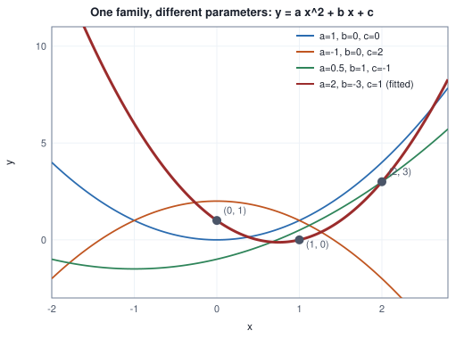
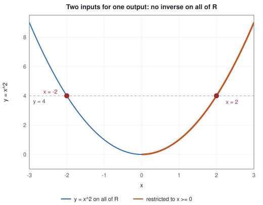
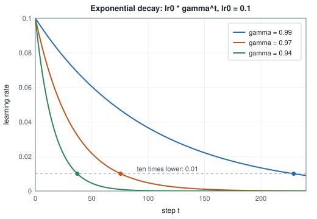
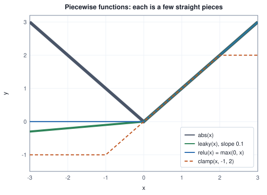
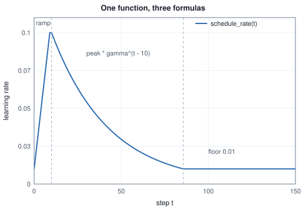

<!-- SPDX-License-Identifier: CC-BY-4.0 -->
<!-- Copyright (c) 2026 Martin Schröder <info@swedishembedded.com> -->

# Functions and Their Shapes

*How do we describe a rule that turns inputs into outputs, and what shapes can such rules take?*

Somewhere in every training run there is a rule that answers one small
question over and over: how big a step should we take now? At the first step
the answer is tiny, a few steps later it has reached its peak, and by the end
it has sunk to a floor that is never quite zero. Nobody stores that answer for
each of a million steps. They store a rule and ask it. A bank's rule for what a
deposit will be worth in ten years, and a weather service's rule from today's
temperature to tomorrow's, are the same kind of object: give it a number, get a
number back, by a fixed procedure. We call such a rule a **function**, and
machine learning is, from end to end, the study of choosing good ones.

Chapter 1 left us the notation $f(x)$ and one fact about it that carries the
whole subject. A rule often has *parameters*, numbers like $w$ and $b$ in
$wx + b$ that stay fixed while the input varies. A model is a function whose
parameters are not known in advance, and learning is the search for values that
make it agree with data. To search, we must be able to say which family of
rules we are choosing from, how the shape of a rule moves when a parameter
moves, and what no member of the family can express at all.

The first hazard is the plainest. Not every formula is a rule everywhere:
$1/x$ has no value at 0 and $\log x$ has none below 0, and a model fed such an
input fails without warning. So we start with a vocabulary for the inputs a
rule accepts and the outputs it can give. A neural network then forces the
next question on us, because it is dozens of simple rules in a row, the output
of each the input of the next: what does feeding one rule into another do to
the shapes we can reach? Sometimes we know the output and want the input back,
as when a pixel scaled into a range must be scaled back, or when a logarithm
undoes an exponential; when is that possible, and when has information been
destroyed? And through all of it runs the question of which shapes there are to
choose from: straight lines, curves that bend a fixed number of times, curves
that grow explosively, curves made of straight pieces joined at corners. Each
has a use in learning and a failure of its own.

The chapter takes those questions in order and ends with the shapes the rest of
the book builds on. It uses real numbers, exponents, logarithms and function
notation from Chapter 1 and nothing else; where it points forward to vectors,
matrices or derivatives, it says so and does not use them. Before the first
definition, bring five ideas from Chapter 1 back to mind. The answers are at the
end of the chapter.

1. (Chapter 1, real numbers.) Is $\sqrt{2}$ a fraction of two integers? What does a computer store instead of it?
2. (Chapter 1, exponents.) Write $2^3 \times 2^{-5}$ as a single power of 2 and as a fraction.
3. (Chapter 1, logarithms.) What are $\log_2 32$ and $\log_{10} 0.001$?
4. (Chapter 1, logarithms.) Use the product rule to write $\log_2(8 \times 4)$ as a sum and evaluate it.
5. (Chapter 1, function notation.) If $f(x; w, b) = wx + b$, evaluate $f(2; 3, -1)$ and say which of $x$, $w$, $b$ are inputs and which are parameters.

## What a function is

A **function** $f$ from a set $A$ to a set $B$, written $f: A \to B$,
assigns to every element $x$ of $A$ exactly one element $f(x)$ of $B$. Three
words are attached to it.

- The **domain** $A$ is the set of inputs the function accepts.
- The **codomain** $B$ is a set that is promised to contain every output.
- The **range** (or image) is the set of outputs that actually occur:
  $\{f(x) : x \in A\}$. It is always inside the codomain and may be smaller.

"Exactly one" has two halves and both matter. Every input in the domain must
produce *some* output, so a rule with a hole (no value at $x = 0$) must have
that point removed from its domain. And no input may produce two outputs: the
rule "the number whose square is $x$" is not a function, because 4 would map
to both 2 and $-2$. Many inputs may share one output ($f(x) = x^2$ sends both
2 and $-2$ to 4); that is allowed, and we return to it when we ask about
running a function backwards.

A function can be given in three equivalent ways, and the skill is moving
between them. A **formula** says what to compute. A **table** lists inputs and
outputs, which is all a computer ever has. A **graph** plots each pair
$(x, f(x))$ as a point on a plane whose horizontal axis is the input and whose
vertical axis is the output, which is how we see a shape. The "exactly one
output" rule has a visual form: no vertical line meets the graph twice.

Here are six rules from Chapter 1 evaluated at five inputs. Where a rule has
no value, the table says so.

<!-- worked: functions_ch.domain_checks -->
| x | 1/x | sqrt(x) | log(x) | x^2 | 2^x |
|---|---:|---:|---:|---:|---:|
| -2 | -0.5 | undefined | undefined | 4 | 0.25 |
| -1 | -1 | undefined | undefined | 1 | 0.5 |
| 0 | undefined | 0 | undefined | 0 | 1 |
| 1 | 1 | 1 | 0 | 1 | 2 |
| 4 | 0.25 | 2 | 1.386 | 16 | 16 |
<!-- /worked -->

Read the columns as domains. The rule $1/x$ is a function on all reals except
0. The square root accepts $x \ge 0$ (we write $[0, \infty)$). The logarithm
accepts only $x > 0$, the interval $(0, \infty)$. The square $x^2$ and the
power $2^x$ accept every real number. Then the ranges: $x^2$ gives only
nonnegative numbers, so its range is $[0, \infty)$ even though its codomain
may be written $\mathbb{R}$; $2^x$ gives only positive numbers, range
$(0, \infty)$; $\log$ gives every real number, range $\mathbb{R}$. Notice the
mirror: the domain of $\log$ is the range of $2^x$ (or $e^x$) and vice
versa. That is not an accident, and Section "Running a function backwards"
explains why.

A program is the same idea with a contract. A function in the sense of this
chapter has no memory and no side effects: the same input always gives the
same output, and nothing else in the world changes. Programmers call that a
**pure function**. Real code is often not pure (it reads a clock, draws a
random number, updates a counter), and when a result is not reproducible the
first thing to check is which hidden input the code was reading. The book's
[pseudocode conventions](../pseudocode.md) enforce purity: anything a function
needs is an argument.

Finally, a function may take more than one number. The loss of a model with
two parameters is $L(w, b)$, a function whose domain is pairs of reals. Nothing
in this chapter changes for such functions except that graphs need more
dimensions. Lists of numbers as a single input become precise in the next
chapter, on vectors; here we keep to one input and one output, where every
idea can be drawn.

## Families of functions and their parameters

Chapter 1 wrote $h(x; w, b) = wx + b$ and said that $w$ and $b$ are settings.
Turn them and watch what happens. A **line** is the function

$$
h(x; w, b) = w x + b .
$$

Its graph is a straight line. The parameter $b$ is its value at $x = 0$ (the
**intercept**): changing $b$ slides the whole graph up or down. The parameter
$w$ is how much the output changes when the input increases by 1 (the
**slope**): $h(x+1) - h(x) = w$ for every $x$. A large $w$ gives a steep line, a
negative $w$ a falling one, $w = 0$ a flat one. Five members of the family:

<!-- worked: functions_ch.line_family -->
| x | w=1, b=0 | w=2, b=0 | w=0.5, b=0 | w=1, b=2 | w=-1, b=1 |
|---|---:|---:|---:|---:|---:|
| -2 | -2 | -4 | -1 | 0 | 3 |
| -1 | -1 | -2 | -0.5 | 1 | 2 |
| 0 | 0 | 0 | 0 | 2 | 1 |
| 1 | 1 | 2 | 0.5 | 3 | 0 |
| 2 | 2 | 4 | 1 | 4 | -1 |
<!-- /worked -->

The set of all lines is a **family** of functions indexed by two numbers.
This is the first example of what machine learning means by a *model*: not one
function, but a family, with the parameters as the dial settings that pick one
member. Picking a member from data is the whole learning problem, in its
simplest form:

> Given examples $(x_1, y_1), \dots, (x_n, y_n)$, find parameter values for
> which $h(x_i; w, b)$ is close to $y_i$.

With a line and two examples there is nothing to search for; the two numbers
are fixed by the requirement that the line passes through both. Take the
points $(1, 3)$ and $(4, 9)$. The slope is the rise over the run, and the
intercept follows from either point:

<!-- worked: functions_ch.line_through_two_points -->
| step | value |
|---|---|
| slope w = (y2 - y1) / (x2 - x1) | (9 - 3) / (4 - 1) = 2 |
| intercept b = y1 - w x1 | 3 - 2 * 1 = 1 |
| check x = 1 | 2 * 1 + 1 = 3 |
| check x = 4 | 2 * 4 + 1 = 9 |
<!-- /worked -->

Two examples fix a line exactly. Three examples that do not lie on one line
cannot be matched by any line, and the choice of the "closest" one needs a
definition of closest, which is the subject of Volume II. This section keeps
the exact case, because it shows the counting that returns below: **a family
with $k$ parameters can be made to pass through $k$ chosen points** (under a
mild condition: below, that the chosen $x$ values are all different), and no more. To fit more points we need more parameters, which
means richer families. The classical one is next.

## Polynomials

A **polynomial** of **degree** $n$ is a function of the form

$$
p(x) = c_0 + c_1 x + c_2 x^2 + \dots + c_n x^n = \sum_{j=0}^{n} c_j x^j ,
$$

with real numbers $c_0, \dots, c_n$, the **coefficients**, and $c_n \ne 0$. A
degree-1 polynomial is a line ($c_1 = w$, $c_0 = b$). Degree 2 is a
**quadratic**, whose graph is a parabola: a bowl if $c_2 > 0$, an upside-down
bowl if $c_2 < 0$. Degree 3 can bend twice, and in general a polynomial of
degree $n$ has a graph with at most $n - 1$ bends (a **bend** is a place
where the graph turns from rising to falling or the reverse). A polynomial has $n + 1$
parameters, so each extra degree buys one more dial.

Figure 1 shows four members of the quadratic family $y = a x^2 + b x + c$,
with the parameters in the legend. Changing $c$ lifts the curve, changing $a$
widens, narrows or flips it, and $b$ moves its lowest point sideways. All
four have the same *kind* of shape and visibly different ones.



**Figure 1.** A quadratic family. The thick curve is the member that passes
through the three marked points; the next subsection computes it.

### Evaluating a polynomial

To compute $p(3)$ for $p(x) = 2x^3 - 5x^2 + 3x - 4$ one can form $3^3$, $3^2$
and so on and add up. A better route regroups the sum so that every step is one
multiplication and one addition:

$$
p(x) = c_0 + x\bigl(c_1 + x(c_2 + x\, c_3)\bigr) .
$$

This is **Horner's rule**: start from the highest coefficient, and at each
step multiply by $x$ and add the next coefficient down. It costs $n$
multiplications and $n$ additions for degree $n$, never forms a large power,
and is how polynomials are evaluated in practice.

<!-- worked: functions_ch.horner_steps -->
| step | value |
|---|---|
| start with c3 | 2 |
| multiply by x = 3, add c2 = -5 | 2 * 3 + (-5) = 1 |
| multiply by x = 3, add c1 = 3 | 1 * 3 + (3) = 6 |
| multiply by x = 3, add c0 = -4 | 6 * 3 + (-4) = 14 |
| direct power-by-power evaluation | 14 |
<!-- /worked -->

In the book's pseudocode:

```text
function horner(c: array<real>[n + 1], x: real) -> real:
    require n >= 0, "a polynomial has at least a constant term"
    acc = c[n]
    for j in n - 1 down to 0:
        acc = acc * x + c[j]
    return acc
```

### Fitting a polynomial through points by hand

Take three points: $(0, 1)$, $(1, 0)$ and $(2, 3)$. A quadratic
$p(x) = c + b x + a x^2$ has three unknowns, and each point gives one
equation, by substituting its $x$ and asking that $p(x)$ equal its $y$:

$$
\begin{aligned}
x = 0:&\quad c = 1 \\
x = 1:&\quad a + b + c = 0 \\
x = 2:&\quad 4a + 2b + c = 3 .
\end{aligned}
$$

These are three equations that are *linear* in the unknowns $a$, $b$ and $c$
(each unknown appears only multiplied by a number), and such a system is
solved by **elimination**: use one equation to remove an unknown from the
others, then repeat on what remains. The first equation already gives
$c = 1$. Substituting into the other two:

$$
a + b = -1, \qquad 4a + 2b = 2 \;\Longrightarrow\; 2a + b = 1 .
$$

Subtract the first of these from the second: $(2a + b) - (a + b) = 1 - (-1)$,
so $a = 2$. Then $b = -1 - a = -3$. The polynomial is
$p(x) = 2x^2 - 3x + 1$, and the check is to evaluate it at each point:

<!-- worked: functions_ch.quadratic_fit -->
Solution of the three equations: c = 1, b = -3, a = 2, so p(x) = 2 x^2 + (-3) x + 1.

| x | y wanted | p(x) | matches |
|---|---:|---:|---:|
| 0 | 1 | 1 | yes |
| 1 | 0 | 0 | yes |
| 2 | 3 | 3 | yes |
<!-- /worked -->

This is the thick curve in Figure 1. Its shape can be read from the numbers:
it factors as $(2x - 1)(x - 1)$, so it is zero at $x = \tfrac12$ and $x = 1$,
and since $a > 0$ it is a bowl whose lowest point is halfway between its
zeros.

<!-- worked: functions_ch.quadratic_roots_and_vertex -->
| quantity | value |
|---|---|
| a, b, c | 2, -3, 1 |
| b^2 - 4ac | 1 |
| zeros (x where p(x) = 0) | 0.5 and 1 |
| lowest point (x, p(x)) | (0.75, -0.125) |
<!-- /worked -->

The same procedure for $n + 1$ points gives a system of $n + 1$ equations in the
$n + 1$ coefficients. The elimination is mechanical, and writing it as an
algorithm shows the steps without surprises:

```text
function fit_polynomial(xs: array<real>[m], ys: array<real>[m]) -> array<real>[m]:
    require m >= 1, "no points"
    require all xs[i] are distinct, "two points at one x have no function through them"   # exact comparison
    # row i of A is the powers of xs[i]: [1, x, x^2, ..., x^(m-1)]; the equations are A c = ys
    A = zeros(real, [m, m + 1])               # augmented matrix: last column is ys
    for i in 0 .. m:
        for j in 0 .. m:
            A[i, j] = xs[i] ^ j               # 0 ^ 0 = 1: the column of ones is exact at x = 0
        A[i, m] = ys[i]
    for col in 0 .. m:
        # pivot: the row r >= col with the largest abs(A[r, col]); the first one on a tie
        pivot = col + argmax([abs(A[r, col]) for r in col .. m])
        swap A[col, :], A[pivot, :]
        require abs(A[col, col]) > 0, "singular system"   # an exact zero only; see below
        d = A[col, col]
        for j in 0 .. m + 1:
            A[col, j] = A[col, j] / d          # now A[col, col] = 1
        for r in 0 .. m:
            if r != col:
                f = A[r, col]
                for j in 0 .. m + 1:
                    A[r, j] = A[r, j] - f * A[col, j]   # clears the column
    return A[:, m]                              # c[j] is the coefficient of x^j
```

The distinctness requirement is the "one output per input" rule from the
start of the chapter in action: two points with the same $x$ and different $y$
cannot lie on any function. With distinct $x$ values the system always has
exactly one solution, so **$n + 1$ points with distinct $x$ determine exactly
one polynomial of degree at most $n$**. (The proof, for the curious: a nonzero
polynomial of degree at most $n$ has at most $n$ zeros, because if $r$ is a
zero then $p(x) = (x - r)\,q(x)$ with $q$ of one degree less carrying the
remaining zeros, and a nonzero constant has none. So the difference of
two solutions, which would vanish at $n + 1$ points, must be the zero
polynomial.)

The two `require` tests compare exactly, on purpose: they catch points that
are the same, and a pivot that is exactly zero. Points that are merely very
close pass them, and the answer degrades without any error. For the points
$(0, 1)$, $(1, 0)$ and $(1 + \delta, 3)$ the coefficients are $c_0 = 1$,
$c_1 = -3/\delta$ and $c_2 = 3/\delta$ up to terms of order one: they grow
like $1/\delta$, and once $\delta$ is near the round-off of the format the
digits of the solution are gone. Distinct is necessary; well separated is
what a program needs.

### More parameters is not more truth

Does the ability to hit any points mean a polynomial is a good model? Take five
readings of a quantity that really follows $y = 1 + 2 \cdot x$, each corrupted by
a little noise: $(0, 1.1)$, $(1, 2.9)$, $(2, 5.2)$, $(3, 6.8)$, $(4, 9.1)$. A
line through the first and last point is $y = 1.1 + 2\,x$, close to the truth. A
polynomial of degree 4 has five parameters and passes through all five points
exactly, noise included. Compare them inside the measured range and beyond it:

<!-- worked: functions_ch.interpolation_overfit -->
Degree-4 coefficients c0..c4: 1.1, 0.5, 2.0417, -0.85, 0.10833.

| x | true rule 2x + 1 | line through first and last point | degree-4 polynomial through all five |
|---|---:|---:|---:|
| 0 | 1 | 1.1 | 1.1 |
| 1 | 3 | 3.1 | 2.9 |
| 2 | 5 | 5.1 | 5.2 |
| 3 | 7 | 7.1 | 6.8 |
| 4 | 9 | 9.1 | 9.1 |
| 5 | 11 | 11.1 | 16.1 |
| 6 | 13 | 13.1 | 34.4 |
| 8 | 17 | 17.1 | 144.3 |
<!-- /worked -->

Inside $[0, 4]$ the two agree with the data to within the noise. At $x = 5$ the
polynomial is already off by about five; at $x = 8$ it predicts 144.3 where the
rule gives 17. The extra freedom was spent on reproducing the noise, and
outside the data the noise is amplified. This is the first sighting of
overfitting, which Volume II treats properly: a family flexible enough to
match anything it is shown has no reason to behave sensibly where it has not
been shown anything.

Even for a function with no noise at all, high-degree polynomials are not a
safe default. Fit polynomials of increasing degree through equally spaced
points of the smooth bump $1/(1 + 25\,x^2)$ on $[-1, 1]$ and record the largest
gap between polynomial and function over a fine grid of 1001 equally spaced points
$x_i = -1 + 2i/1000$, $i = 0, \dots, 1000$ (the nodes are the $n$ equally spaced points
$-1 + 2i/(n-1)$):

<!-- worked: functions_ch.runge -->
| points n | degree n-1 | largest error on [-1, 1] |
|---|---:|---:|
| 3 | 2 | 0.6462 |
| 5 | 4 | 0.4384 |
| 9 | 8 | 1.045 |
| 13 | 12 | 3.663 |
<!-- /worked -->

The error does not shrink as the degree grows; beyond degree 4 it grows, and
at degree 12 the polynomial overshoots by more than three times the size of
the whole bump (whose height is 1). The wiggles live near the ends of the
interval. Polynomials are excellent for describing a function near one point
(the Taylor expansions of the chapter on gradients, Chapter 8) and poor as a universal approximator over a
range. Neural networks use a different construction, which we reach in the
section on piecewise functions.

## Composition

One rule has so far taken a number and returned a number, and a network does
not stop there: let the output of one rule be the input of another. If $g: A \to B$ and $f: B \to C$, the
**composition** $f \circ g$ ("$f$ after $g$") is the function

$$
(f \circ g)(x) = f(g(x)) .
$$

The inner function $g$ runs first. The composition is defined exactly for
those $x$ in the domain of $g$ whose output $g(x)$ is in the domain of $f$.
That condition is the **domain check**, and it is where compositions fail in
practice. Evaluate a four-stage chain, $a = 3x - 2$, then $b = a^2$, then
$b + 1$, then $c = \log(b + 1)$, one stage at a time:

<!-- worked: functions_ch.composition_steps -->
| x | a = 3x - 2 | b = a^2 | b + 1 | c = log(b + 1) |
|---|---:|---:|---:|---:|
| -1 | -5 | 25 | 26 | 3.258 |
| 0 | -2 | 4 | 5 | 1.609 |
| 1 | 1 | 1 | 2 | 0.6931 |
| 2 | 4 | 16 | 17 | 2.833 |
<!-- /worked -->

Figure 2 draws the pipeline, with under each value the set it lives in. The
logarithm needs a positive input, and the stages before it guarantee one:
$a^2 \ge 0$, so $b + 1 \ge 1 > 0$ for every real $x$. That argument, tracing
each stage's range to check it lands inside the next stage's domain, is how to
verify a composition without trying every input. A function written as
$\log(a^2)$ instead would fail at $a = 0$.


**Figure 2.** A composition as a pipeline. Rounded boxes are functions; ovals
are values with the set each lies in. Every oval's set is inside the domain of
the box that follows it.

When the check fails the composition is smaller than its parts. Take
$f(u) = \log u$ composed with $g(x) = x^2 - 1$. The composition
$\log(x^2 - 1)$ exists only where $x^2 - 1 > 0$, that is $|x| > 1$:

<!-- worked: functions_ch.domain_of_composition -->
| x | inner x^2 - 1 | log(x^2 - 1) |
|---|---:|---:|
| -3 | 8 | 2.079 |
| -1 | 0 | undefined |
| -0.5 | -0.75 | undefined |
| 0 | -1 | undefined |
| 1 | 0 | undefined |
| 1.5 | 1.25 | 0.2231 |
| 3 | 8 | 2.079 |
<!-- /worked -->

Two properties of composition are used constantly.

**Order matters.** $f \circ g$ and $g \circ f$ are generally different
functions. With $f(x) = x + 1$ and $g(x) = x^2$, "square, then add one" is not
"add one, then square":

<!-- worked: functions_ch.composition_order -->
| x | g(x) = x^2 | (f o g)(x) = x^2 + 1 | f(x) = x + 1 | (g o f)(x) = (x + 1)^2 |
|---|---:|---:|---:|---:|
| -2 | 4 | 5 | -1 | 1 |
| 0 | 0 | 1 | 1 | 1 |
| 1 | 1 | 2 | 2 | 4 |
| 2 | 4 | 5 | 3 | 9 |
| 3 | 9 | 10 | 4 | 16 |
<!-- /worked -->

**Grouping does not matter.** $(f \circ g) \circ h = f \circ (g \circ h)$,
because both mean "do $h$, then $g$, then $f$". This is why a chain can be
written $f_3 \circ f_2 \circ f_1$ without parentheses, and why a program may
evaluate it in a loop over stages.

### Depth, and what composing lines cannot do

A neural network is a composition: the input passes through a first simple
function (a *layer*), whose output passes through a second, and so on. The
natural question is what depth buys. Compose two lines. The first layer is
$u = w_1 x + b_1$, the second is $y = w_2 u + b_2$. Substitute:

$$
y = w_2 (w_1 x + b_1) + b_2 = (w_2 w_1)\, x + (w_2 b_1 + b_2) .
$$

The result is again a line, with slope $w_2 w_1$ and intercept
$w_2 b_1 + b_2$. Two layers of lines are exactly as expressive as one. With
$u = 2x + 1$ and $y = -3u + 4$:

<!-- worked: functions_ch.lines_collapse -->
Layer 1: u = 2x + 1. Layer 2: y = (-3)u + 4. Collapsed: w = -3 * 2 = -6, b = -3 * 1 + 4 = 1.

| x | u = 2x + 1 | y = -3u + 4 | -6x + 1 |
|---|---:|---:|---:|
| -2 | -3 | 13 | 13 |
| -1 | -1 | 7 | 7 |
| 0 | 1 | 1 | 1 |
| 1 | 3 | -5 | -5 |
| 2 | 5 | -11 | -11 |
<!-- /worked -->

The same is true of ten lines in a row, or a hundred: composing any number of
lines yields one line. A network of nothing but lines could be replaced by one
line (with several inputs, one matrix; Chapter 4), and all its depth would be
wasted. This is not only a thought experiment. When a trained network is
deployed, a normalisation step that is a line per channel followed by a
convolution that is a line per channel can be, and is, merged into one: the
section on brain below shows that merge in a kernel. What makes depth
worthwhile is putting a function that is *not* a line between the lines. We
need such a function; the section on piecewise functions supplies the simplest.

## Running a function backwards

Sometimes we know the output and want the input. A pixel value in $0 \ldots
255$ was scaled to $[-1, 1]$ for a model, and the model's output has to be scaled
back. A value was passed through $e^x$, and we want $x$ again. A function $f$
can be undone when there is a function $f^{-1}$ (read "$f$ inverse") such that

$$
\begin{aligned}
f^{-1}(f(x)) &= x \quad \text{for every } x \text{ in the domain of } f,\\
f(f^{-1}(y)) &= y \quad \text{for every } y \text{ in the range of } f.
\end{aligned}
$$

Such an $f^{-1}$ is the **inverse function**. The notation is a trap, because
the $-1$ is not an exponent: $f^{-1}(y)$ is not $1/f(y)$. The two coincide
only in the name.

### When an inverse exists

To undo $f$, each output must tell us which input produced it, so no two
inputs may share an output. A function with that property is **one-to-one**:
$f(a) = f(b)$ implies $a = b$. The square $f(x) = x^2$ fails: $f(2) = f(-2) = 4$,
and seeing the output 4 we cannot tell whether the input was 2 or $-2$.
Figure 3 shows it as a **horizontal line test**: a horizontal line crosses the
graph twice at height 4.



**Figure 3.** A function without an inverse on all of $\mathbb{R}$, and the
restriction that has one.

Trying to undo a square with a square root makes the information loss concrete:

<!-- worked: functions_ch.square_not_invertible -->
| x | y = x^2 | sqrt(y) | sqrt(y) equals x |
|---|---:|---:|---:|
| -3 | 9 | 3 | NO |
| -2 | 4 | 2 | NO |
| -1 | 1 | 1 | NO |
| 0 | 0 | 0 | yes |
| 1 | 1 | 1 | yes |
| 2 | 4 | 2 | yes |
| 3 | 9 | 3 | yes |
<!-- /worked -->

The sign was destroyed when we squared, and nothing downstream can recover it.
Machine learning meets this over and over: any step that merges inputs (a
rounding, a maximum, a clamp) is a step that cannot be undone, and a model
that needs to reconstruct its input (Volumes VII to IX) must avoid or
compensate for it.

The repair is to **restrict the domain**. On $[0, \infty)$ the square is
one-to-one (the thick part of Figure 3) and its inverse is the square root,
which is how $\sqrt{\ }$ became a function with a single value: it was defined
as the inverse of the restricted square.

### Finding and composing inverses

To find an inverse, write $y = f(x)$ and solve for $x$. For the line
$y = 2x + 1$: $x = (y - 1)/2$, so $f^{-1}(y) = (y - 1)/2$. For exponentials,
Chapter 1 defined the logarithm exactly as the solution of $b^x = y$, so
$\log_b$ is the inverse of $b^x$, and $\exp$ and $\log$ are inverses of each
other (the mirror image across $y = x$ drawn in Chapter 1). The domain-and-range
mirror noticed in the first table is now explained: the domain of $f^{-1}$ is
the range of $f$, and the range of $f^{-1}$ is the domain of $f$.

<!-- worked: functions_ch.inverse_roundtrip -->
| x | y = 2x + 1 | (y - 1) / 2 | log(exp(x)) | exp(log(y)) |
|---|---:|---:|---:|---:|
| -2 | -3 | -2 | -2 | undefined |
| 0 | 1 | 0 | 0 | 1 |
| 1 | 3 | 1 | 1 | 3 |
| 3 | 7 | 3 | 3 | 7 |
<!-- /worked -->

The last cell is undefined for the right reason: $y = -3$ is outside the
domain of $\log$, so the round trip $\exp(\log(y))$ has no meaning, while
$\log(\exp(x))$ works for every $x$ because the range of $\exp$ is positive.

What is the inverse of a composition? To undo "put on socks, then put on
shoes" you take off the shoes first. Formally, if $y = f(g(x))$, undo $f$ first
to get $g(x)$, then undo $g$:

$$
(f \circ g)^{-1} = g^{-1} \circ f^{-1} .
$$

The order reverses. With $g = \exp$ and $f(u) = 3u - 2$, the composite is
$y = 3e^x - 2$, and its inverse is "add 2, divide by 3, take the logarithm":

<!-- worked: functions_ch.inverse_of_composite -->
| x | y = 3 exp(x) - 2 | undo f: (y + 2) / 3 | undo g: log(.) |
|---|---:|---:|---:|
| -1 | -0.8964 | 0.3679 | -1 |
| 0 | 1 | 1 | 0 |
| 1 | 6.155 | 2.718 | 1 |
| 2 | 20.17 | 7.389 | 2 |
<!-- /worked -->

The reversal of order is why, when the gradients of a network are computed
(Volume III), they flow from the last layer to the first.

### Inverting what has no formula

Often the inverse exists but cannot be written down. Solve $x^3 + x = 10$ for
$x$: there is no simple formula, yet $f(x) = x^3 + x$ is increasing, so each
output has exactly one input. We can find it by **bisection**: if $f$ is
increasing and $f(\text{lo}) \le y \le f(\text{hi})$, the answer is between
$\text{lo}$ and $\text{hi}$. Test the midpoint; if $f(\text{mid})$ is below
the target the answer is to its right, otherwise to its left; either way the
interval halves. Here the target is $y = 10$ on $[0, 3]$, and the loop stops
as soon as the interval is narrower than the tolerance $0.001$; since
$3/2^{12} = 0.00073$ that is after exactly the twelve steps shown (values
printed to six significant digits).

<!-- worked: functions_ch.bisection_inverse -->
| step | lo | hi | mid | f(mid) | decision |
|---|---:|---:|---:|---:|---|
| 1 | 0 | 3 | 1.5 | 4.875 | too small, raise lo |
| 2 | 1.5 | 3 | 2.25 | 13.6406 | too big, lower hi |
| 3 | 1.5 | 2.25 | 1.875 | 8.4668 | too small, raise lo |
| 4 | 1.875 | 2.25 | 2.0625 | 10.8362 | too big, lower hi |
| 5 | 1.875 | 2.0625 | 1.96875 | 9.59958 | too small, raise lo |
| 6 | 1.96875 | 2.0625 | 2.01562 | 10.2046 | too big, lower hi |
| 7 | 1.96875 | 2.01562 | 1.99219 | 9.8988 | too small, raise lo |
| 8 | 1.99219 | 2.01562 | 2.00391 | 10.0509 | too big, lower hi |
| 9 | 1.99219 | 2.00391 | 1.99805 | 9.97463 | too small, raise lo |
| 10 | 1.99805 | 2.00391 | 2.00098 | 10.0127 | too big, lower hi |
| 11 | 1.99805 | 2.00098 | 1.99951 | 9.99365 | too small, raise lo |
| 12 | 1.99951 | 2.00098 | 2.00024 | 10.0032 | too big, lower hi |
<!-- /worked -->

The true answer is $x = 2$ (since $8 + 2 = 10$), and the interval closes on it.
After $k$ steps the interval has width $(\text{hi} - \text{lo})/2^k$, so to
reach a tolerance $\varepsilon$ we need
$k \ge \log_2\bigl((\text{hi} - \text{lo})/\varepsilon\bigr)$ steps: the
logarithm of Chapter 1 is the cost. The method relies on exactly one property
of $f$, that it is increasing, which Section "Monotonic functions" names.

```text
function invert_increasing(f: function(real) -> real, y: real, lo: real, hi: real,
                           tol: real) -> real:
    require lo < hi and tol > 0, "empty interval or tolerance"
    require f(lo) <= y and y <= f(hi), "the target is outside f's values on [lo, hi]"
    while hi - lo > tol:
        mid = (lo + hi) / 2
        if f(mid) < y:
            lo = mid
        else:
            hi = mid
    return (lo + hi) / 2
```

## Exponential functions

An **exponential function** has the variable in the exponent:

$$
f(x) = a \, b^{x}, \qquad a \ne 0,\; b > 0,\; b \ne 1 .
$$

Where a line adds the same amount for each unit step of $x$, an exponential
multiplies by the same factor: $f(x+1) = a\, b^{x+1} = b \cdot f(x)$. If
$b > 1$ the function grows; if $0 < b < 1$ it decays; $a$ is the value at
$x = 0$. Its range, for $a > 0$, is $(0, \infty)$: it never reaches zero and never
goes negative. (For non-integer $x$, $b^x$ is defined by Chapter 1's rules for
fractional exponents and, for irrational $x$, by closing in on it through
fractions.)

Every base can be traded for the number $e$ of Chapter 1. Since
$b = e^{\log b}$, the exponent rule $(e^m)^x = e^{mx}$ gives

$$
b^x = e^{x \log b} ,
$$

so any exponential is $e^{kx}$ for some **rate** $k = \log b$, negative for
decay. This is why $e^x$ is the exponential function and the others are
rescalings of its input: it removes a constant from every formula.

### Compounding

A deposit of 100 earning 5 % a year is multiplied by 1.05 each year:
$100 \cdot 1.05^t$ after $t$ years. The doubling time is the $t$ at which the
factor reaches 2, so $1.05^t = 2$ and $t = \log 2 / \log 1.05$. The logarithm is
the inverse of the exponential doing its job:

<!-- worked: functions_ch.compounding -->
Doubling time: log 2 / log 1.05 = 14.207 years.

| year t | balance 100 * 1.05^t |
|---|---:|
| 0 | 100.00 |
| 1 | 105.00 |
| 5 | 127.63 |
| 10 | 162.89 |
| 20 | 265.33 |
| 50 | 1146.74 |
<!-- /worked -->

Doubling takes 14.2 years the first time, and also the second (100 to 200 near
year 14.2, 200 to 400 near year 28.4): in an exponential the time to multiply by
a fixed factor does not depend on where you start.

### Decay: learning-rate schedules

The same shape governs a training run in reverse. Early in training large steps
make fast progress; late, the same steps overshoot, so the step size is
brought down. A **learning rate schedule** is a function from the step number
$t$ to the learning rate $\eta_t$. The simplest is exponential decay,

$$
\eta_t = \eta_0 \, \gamma^{t}, \qquad 0 < \gamma < 1 .
$$

Each step multiplies the rate by $\gamma$. Starting at $\eta_0 = 0.1$:

<!-- worked: functions_ch.decay_table -->
| step t | gamma = 0.99 | gamma = 0.97 | gamma = 0.94 |
|---|---:|---:|---:|
| 0 | 0.1 | 0.1 | 0.1 |
| 10 | 0.0904 | 0.0737 | 0.0539 |
| 50 | 0.0605 | 0.0218 | 0.00453 |
| 100 | 0.0366 | 0.00476 | 0.000205 |
| 200 | 0.0134 | 0.000226 | 4.22e-07 |
<!-- /worked -->

The choice of $\gamma$ is hard to feel from the table; it is easier to ask in
steps. Rewrite $\gamma = e^{-k}$, so $k = -\log\gamma$ and
$\eta_t = \eta_0 e^{-kt}$. The rate has halved when $e^{-kt} = \tfrac12$, at
$t = \log 2 / k$ (the **half-life**), and dropped tenfold at $t = \log 10 / k$:

<!-- worked: functions_ch.decay_times -->
| gamma | rate k = -log(gamma) | half-life log 2 / k | 10x lower: log 10 / k | first whole step |
|---|---:|---:|---:|---:|
| 0.99 | 0.01005 | 68.97 | 229.1 | 230 |
| 0.97 | 0.03046 | 22.76 | 75.6 | 76 |
| 0.94 | 0.06188 | 11.2 | 37.21 | 38 |
<!-- /worked -->

Figure 4 plots the three curves and marks the step at which each reaches 0.01.
With a decay factor of 0.99 the rate takes 229 steps to fall to a tenth of its
start; with 0.94 it takes 38. The table and the picture are one fact stated in
two ways, and the choice of $\gamma$ is the choice of a time scale.



**Figure 4.** Exponential decay for three decay factors. The dashed line is a
tenth of the starting rate.

### Why exponentials are different

Exponentials grow, or shrink, faster than any polynomial, and that fact is used
in both directions. Compare $x^2$, $x^{10}$, $2^x$ and $e^x$:

<!-- worked: functions_ch.growth_comparison -->
| x | x^2 | x^10 | 2^x | e^x |
|---|---:|---:|---:|---:|
| 1 | 1 | 1 | 2 | 2.718 |
| 5 | 25 | 9765625 | 32 | 148.4 |
| 10 | 100 | 1.000e+10 | 1024 | 22026 |
| 20 | 400 | 1.024e+13 | 1048576 | 4.852e+08 |
| 50 | 2500 | 9.766e+16 | 1.126e+15 | 5.185e+21 |
| 100 | 10000 | 1.000e+20 | 1.268e+30 | 2.688e+43 |
<!-- /worked -->

The degree-10 polynomial is far ahead for a long while and then loses for
good: at 50 it is still ahead of $2^x$ (about $9.8 \times 10^{16}$ against
$1.1 \times 10^{15}$), and at 100 it is ten orders of magnitude behind
($10^{20}$ against $1.3 \times 10^{30}$).
The practical consequence is a warning. An exponential of a large number
overflows quickly (the last sections of this chapter show it), a probability that falls
exponentially with length is what makes the product of Chapter 1 underflow, and
anything that compounds, such as a rate applied once per layer in a deep network,
becomes enormous or vanishing in tens of steps.

## Monotonic functions

A function is **increasing** if a larger input never gives a smaller output:
$a < b$ implies $f(a) \le f(b)$. It is **strictly increasing** if $a < b$
implies $f(a) < f(b)$. **Decreasing** and **strictly decreasing** reverse the
inequalities. A function of any of these kinds is **monotonic**. A line is
strictly increasing when $w > 0$ and strictly decreasing when $w < 0$;
$e^x$ and $\log x$ are strictly increasing; $x^2$ is strictly decreasing on
$(-\infty, 0]$ and strictly increasing on $[0, \infty)$, which is why we can
restrict it to the second half and invert it; and a constant is both increasing
and decreasing, but not strictly either.

Three consequences are used in nearly every later chapter.

**Strictly monotonic implies one-to-one, hence invertible.** If $a \ne b$,
one of them is smaller, so the outputs differ. A strictly monotonic function
is invertible onto its range, and its inverse has the same direction (the
mirror image of a rising graph still rises). That is why $\log$ and $\exp$ are
invertible and why bisection works.

**Compositions keep direction.** Increasing after increasing is increasing;
decreasing after decreasing is also increasing; a mixture is decreasing.

**Monotonic functions preserve the arg max.** Write $\arg\max_i s_i$ for the
index of the largest entry of a list of scores $s_1, \dots, s_n$. Suppose entry
$k$ is the largest, so $s_k \ge s_i$ for all $i$. If $g$ is increasing,
$g(s_k) \ge g(s_i)$ for all $i$ as well, so $k$ is still a position of the
maximum. If $g$ is *strictly* increasing a unique maximum stays unique; if it
is merely increasing, entries that differed may become ties. If $g$ is
decreasing the largest entry becomes the smallest and the arg max becomes the
$\arg\min$. Try it on four scores:

<!-- worked: functions_ch.monotone_argmax -->
| transform g | g(s) for s = (2.0, -1.0, 0.5, 3.1) | arg max (0-indexed) |
|---|---|---:|
| identity | 2, -1, 0.5, 3.1 | 3 |
| 7 + 3 * s | 13, 4, 8.5, 16.3 | 3 |
| exp(s) | 7.389, 0.3679, 1.649, 22.2 | 3 |
| s^3 | 8, -1, 0.125, 29.79 | 3 |
| -s | -2, 1, -0.5, -3.1 | 1 |
| s^2 | 4, 1, 0.25, 9.61 | 3 |
<!-- /worked -->

The strictly increasing transforms ($7 + 3 \cdot s$, $\exp$, $s^3$) agree on index 3.
Negation, which is decreasing, picks the old minimum at index 1. The square is
not monotonic on the whole line; it happens to keep index 3 here because the
largest score is also the largest in magnitude, and with different scores it would not.

This is more than a curiosity. A language model (Volume V) outputs one raw
score per vocabulary word, called a *logit*, and turns the scores into chances
by an exponential followed by a division by a positive number that is the same
for every word. Both steps are strictly increasing, so the word with the
largest score is the word with the largest chance: **to pick the most likely
word you never need to compute the chances**. Likewise, in Chapter 1 we replaced
a product of chances by a sum of logarithms to avoid underflow. Because
$\log$ is strictly increasing, the candidate with the largest product has the
largest sum of logs:

<!-- worked: functions_ch.monotone_ranking_of_models -->
| model | product of chances | sum of logs |
|---|---:|---:|
| A | 0.012 | -4.423 |
| B | 0.018 | -4.017 |
| C | 0.0108 | -4.528 |

Best by either: model B.
<!-- /worked -->

A monotone transform preserves the *ranking of single values*. It does not
preserve ranking by averages, because an average is a sum and a sum does not
commute with a nonlinear function. Two runs, each scored on three examples:

<!-- worked: functions_ch.monotone_mean_warning -->
| run | scores | mean of s | mean of exp(s) | exp(mean of s) |
|---|---|---:|---:|---:|
| steady | 1, 1, 1 | 1 | 2.718 | 2.718 |
| spiky | 0, 0, 2.4 | 0.8 | 4.341 | 2.226 |
<!-- /worked -->

By mean score, "steady" wins (1 against 0.8). By mean of $e^s$, "spiky" wins
(4.341 against 2.718), because the large score is stretched far more than the
zeros are shrunk. Only the last column, which applies the transform *after*
averaging, keeps the ranking. The lesson is to say which scale an average is
taken on: averaging log-probabilities and averaging probabilities are
different questions with different answers, and Volume XV returns to it when
metrics are compared.

## Piecewise functions

A **piecewise function** is defined by different formulas on different parts
of its domain. The standard notation lists the pieces with their conditions.
The absolute value is the simplest:

$$
|x| = \begin{cases} x & \text{if } x \ge 0, \\ -x & \text{if } x < 0. \end{cases}
$$

The pieces must cover the domain without overlapping, so that every input gets
exactly one output. The points where one piece hands over to the next are the
**joins**. At a join the pieces may agree on the value (the graph has no jump,
and can be drawn without lifting the pencil) or may not, and they may meet at an
angle, a **kink**: $|x|$ has a kink at 0. Four piecewise functions come up
constantly in machine learning, and are drawn in Figure 5:

- ReLU, the rectified linear unit, $\operatorname{relu}(x) = \max(0, x)$:
  zero for negative inputs, the identity for positive ones. One kink at 0.
- The **clamp** $\operatorname{clamp}(x, l, u) = \min(\max(x, l), u)$, which
  holds $x$ inside the interval $[l, u]$ by replacing anything outside with
  the nearest end. Two kinks, one at each end of the interval.
- The **leaky ReLU**, which keeps a small slope on the negative side:
  $x$ if $x \ge 0$, and $0.1x$ otherwise.
- The **step**, 0 for $x \le 0$ and 1 for $x > 0$, whose pieces do not agree at
  the join: it jumps.

The first three have no jump; the step does. All of these are built from a
comparison and two lines, or from composing `max` and `min` with lines.

<!-- worked: functions_ch.piecewise_shapes -->
| x | abs(x) | relu(x) = max(0, x) | clamp(x, -1, 2) | leaky(x), slope 0.1 | step(x) |
|---|---:|---:|---:|---:|---:|
| -3 | 3 | 0 | -1 | -0.3 | 0 |
| -2 | 2 | 0 | -1 | -0.2 | 0 |
| -1 | 1 | 0 | -1 | -0.1 | 0 |
| -0.5 | 0.5 | 0 | -0.5 | -0.05 | 0 |
| 0 | 0 | 0 | 0 | 0 | 0 |
| 0.5 | 0.5 | 0.5 | 0.5 | 0.5 | 1 |
| 1 | 1 | 1 | 1 | 1 | 1 |
| 2 | 2 | 2 | 2 | 2 | 1 |
| 3 | 3 | 3 | 2 | 3 | 1 |
<!-- /worked -->



**Figure 5.** Four piecewise functions. The right half of $|x|$, ReLU and the
leaky ReLU coincide, so the thicker curves are drawn first and the thinner on
top.

The word "activation function" belongs to Volume III, where these are inserted
between layers; here they are only shapes. Their monotonic status is worth
noting. ReLU, the clamp and the step are increasing but not strictly, so by the
last section none of them is invertible: ReLU maps every negative number to 0,
exactly the information loss of the square. The leaky ReLU is strictly
increasing and invertible. The absolute value is not one-to-one on the whole
line ($|2| = |-2|$), and on $[0, \infty)$ it is just the identity.

### Breaking the collapse

Return to the composition of lines, which collapsed to one line. Put ReLU between
them: $u = 2x + 1$, then $\max(0, u)$, then $y = -3 \max(0, u) + 4$. Compare with
the collapsed line $-6x + 1$:

<!-- worked: functions_ch.relu_breaks_collapse -->
| x | u = 2x + 1 | max(0, u) | y = -3 max(0, u) + 4 | the collapsed line -6x + 1 |
|---|---:|---:|---:|---:|
| -2 | -3 | 0 | 4 | 13 |
| -1 | -1 | 0 | 4 | 7 |
| 0 | 1 | 1 | 1 | 1 |
| 1 | 3 | 3 | -5 | -5 |
| 2 | 5 | 5 | -11 | -11 |
<!-- /worked -->

Where the ReLU passes its input unchanged ($u > 0$, that is $x > -\tfrac12$)
the composite equals the collapsed line; where it clips ($x < -\tfrac12$), the
composite stays at 4 while the line rises. The graph now has a kink at
$x = -\tfrac12$ and is no longer any line. One kink is a modest start, but
shifted and scaled ReLUs can be added, and each adds a kink wherever we put
it. The sum $\operatorname{relu}(x) - 2\operatorname{relu}(x-1) +
\operatorname{relu}(x-2)$ builds a tent: zero up to 0, a rise to height 1 at
$x = 1$, a fall back to 0 at $x = 2$, and zero after.

<!-- worked: functions_ch.relu_tent -->
| x | relu(x) | relu(x - 1) | relu(x - 2) | relu(x) - 2 relu(x - 1) + relu(x - 2) |
|---|---:|---:|---:|---:|
| -1 | 0 | 0 | 0 | 0 |
| -0.5 | 0 | 0 | 0 | 0 |
| 0 | 0 | 0 | 0 | 0 |
| 0.5 | 0.5 | 0 | 0 | 0.5 |
| 1 | 1 | 0 | 0 | 1 |
| 1.5 | 1.5 | 0.5 | 0 | 0.5 |
| 2 | 2 | 1 | 0 | 0 |
| 2.5 | 2.5 | 1.5 | 0.5 | 0 |
| 3 | 3 | 2 | 1 | 0 |
| 3.5 | 3.5 | 2.5 | 1.5 | 0 |
| 4 | 4 | 3 | 2 | 0 |
<!-- /worked -->

Tents of different heights and positions can be added to follow any piecewise
straight shape, and with enough kinks to approximate a smooth curve as closely
as we like. This is the construction that neural networks use in place of
high-degree polynomials: many small, local bends, none of which wanders far
from where it was put, rather than one global curve that oscillates between the
data (the degree-12 error above). Volume III makes it precise, and Volume II
returns to what "approximate" and "learn" mean.

### A schedule as a piecewise function

A learning-rate schedule is naturally piecewise, and the pieces have jobs. At the
start of training the parameters are far from useful and the estimates that drive
each step are poor, so a large step can do harm: a **warmup** ramps the rate up
from small. Then it decays, and finally it stops at a **floor**, because a rate of
exactly zero would stop training before the run ends. Take

$$
\eta_t = \begin{cases}
\eta_{\max} \, \dfrac{t + 1}{W} & \text{if } t < W \quad\text{(warmup, a line)}, \\[2mm]
\max\bigl(\eta_{\min},\; \eta_{\max}\, \gamma^{\,t - W}\bigr) & \text{if } t \ge W \quad\text{(decay, floored)},
\end{cases}
$$

with $\eta_{\max} = 0.1$, warmup length $W = 10$, decay factor $\gamma = 0.97$
and floor $\eta_{\min} = 0.01$. The second line is itself a clamp from below
applied to an exponential. The floor takes over when
$\eta_{\max} \gamma^{t-W} = \eta_{\min}$, that is at
$t = W + \log(\eta_{\min}/\eta_{\max}) / \log \gamma$. In pseudocode:

```text
function schedule_rate(t: int, peak: real, warmup: int, gamma: real, floor: real) -> real:
    require t >= 0 and warmup >= 1, "step and warmup length must be at least 0 and 1"
    require 0 < gamma and gamma < 1 and 0 < floor and floor <= peak, "decay and floor out of range"
    if t < warmup:
        return peak * (t + 1) / warmup           # linear ramp: reaches peak at t = warmup - 1
    return max(floor, peak * gamma ^ (t - warmup))
```

<!-- worked: functions_ch.schedule_table -->
Warmup 10 steps to peak 0.1; then peak * 0.97^(t - 10); floor 0.01. The decay meets the floor at t = 10 + log(0.01/0.1) / log(0.97) = 85.60, so the floor takes over from step 86.

| step t | piece | rate |
|---|---|---|
| 0 | warmup (line) | 0.01 |
| 4 | warmup (line) | 0.05 |
| 9 | warmup (line) | 0.1 |
| 10 | decay (exponential) | 0.1 |
| 11 | decay (exponential) | 0.097 |
| 20 | decay (exponential) | 0.07374 |
| 50 | decay (exponential) | 0.02957 |
| 85 | decay (exponential) | 0.01018 |
| 86 | floor (constant) | 0.01 |
| 87 | floor (constant) | 0.01 |
| 150 | floor (constant) | 0.01 |
<!-- /worked -->



**Figure 6.** One schedule, three formulas, two joins.

Check the properties a schedule is chosen for, which are statements about
monotonic behaviour and joins:

<!-- worked: functions_ch.schedule_monotone_check -->
| property (steps 0 .. 199) | result |
|---|---:|
| strictly increasing on steps 0 .. warmup - 1 | yes |
| never increasing from step warmup - 1 on | yes |
| first step at the peak | 9 |
| largest change between neighbouring steps | 0.01 |
<!-- /worked -->

(Floating-point differences of rates such as $0.1 - 0.09$ are not exactly
$0.01$; the check compares with a tolerance of $10^{-12}$ where it tests an
equality, and "first step at the peak" is the first step whose rate is within
that tolerance of the maximum.)

The schedule rises on its first piece and never rises again, and the largest
change between neighbouring steps is the 0.01 of the warmup ramp, so no join
introduces a jump. These checks are exactly the kind a test can make about any
piecewise function.

## Where the real numbers and the machine's numbers part ways

Every shape above was exact on paper. The functions of this chapter all have
domains, and machines have finite ones; the places where the two disagree are
few, and they are the same places every time.

**The exponential overflows.** A 32-bit floating-point number tops out near
$3.4 \times 10^{38}$ and a 64-bit one near $1.8 \times 10^{308}$. Since
$e^{x}$ crosses those at $x \approx 88.7$ and $x \approx 709.8$, even moderate
inputs overflow:

<!-- worked: functions_ch.exp_overflow -->
| x | exp(x) in 32-bit | exp(x) in 64-bit |
|---|---:|---:|
| 88 | 1.652e+38 | 1.652e+38 |
| 89 | inf | 4.490e+38 |
| 709 | inf | 8.218e+307 |
| 710 | inf | inf |
<!-- /worked -->

**An inverse is exact on paper, approximate on a machine.** $\log(\exp(x))$ is
$x$ for every real $x$, but on a machine it is $x$ only while $\exp(x)$ is
representable and keeps its digits:

<!-- worked: functions_ch.log_exp_roundtrip -->
| x | exp(x) | log(exp(x)) |
|---|---:|---:|
| 1 | 2.718 | 1 |
| 20 | 4.852e+08 | 20 |
| 700 | 1.014e+304 | 700 |
| 710 | inf | log(inf) = inf |
| -700 | 9.860e-305 | -700 |
| -740 | 4.200e-322 | -739.99742 |
| -750 | 0 | log(0) = -inf |
<!-- /worked -->

Near the bottom of the 64-bit range, numbers lose digits (the $-740$ row
returns $-739.99742$), and below it $\exp$ is exactly zero and the round trip
fails completely. The remedy is the one already used: stay in the logarithmic
domain where the numbers are, and never leave it to come back.

**A formula can be safe where it is mathematically fine and fail where it is
not.** The function $x / (1 + e^{-x})$ is perfectly defined for every real $x$,
but $e^{-x}$ is enormous for very negative $x$:

<!-- worked: functions_ch.silu_tail -->
| x | exp(-x) | x / (1 + exp(-x)) |
|---|---:|---:|
| -5 | 148.4 | -0.03346 |
| -20 | 4.852e+08 | -4.122e-08 |
| -100 | 2.688e+43 | -3.720e-42 |
<!-- /worked -->

At $x = -100$ the intermediate $e^{100}$ is far beyond what a 32-bit number
holds, yet the true quotient is a tiny negative number. A machine that
overflows the intermediate to infinity and then divides by it gets $-0$, which
is the right answer to any precision that matters here. Other compositions are
not so lucky: a stage that is fine on paper can pass through a value the
machine cannot hold, and the result is infinity or not-a-number rather than a
harmless zero. So make the domain check of a composition on the machine's
numbers, not only on the real numbers.

**Joins and comparisons.** A piecewise function decides its piece with a
comparison, and a comparison on floating-point numbers is exact: an input that
should be on a join but is stored as $10^{-17}$ off lands on one side. For
continuous pieces that is harmless; for the step, whose pieces disagree at the
join, it is exactly where a result flips. Test a piecewise function at each join
and one step either side.

**Polynomials.** Evaluate by Horner's rule, not by forming powers, and avoid
high degrees for fitting (the degree-12 error above); a general fit uses a
different basis and a better-conditioned method, which Volume II builds.

## Kernels, fused lines and the training schedule in brain

The shapes of this chapter are among the most literal parts of the engine:
every elementwise kernel is a function written out one input at a time.

**Piecewise functions as kernels.** `crates/kernels/wgsl/relu_inplace.wgsl`
computes `out[idx] = max(out[idx], 0.0)`, the ReLU of this chapter, one thread per
element, overwriting its input. `crates/kernels/wgsl/leaky_relu.wgsl` writes the
other piecewise form, `x` if non-negative and `slope * x` otherwise, with the slope
passed in as a constant. `crates/kernels/wgsl/prelu.wgsl` makes the slope a trained
parameter of its own: a one-parameter family of piecewise functions, with the leaky
ReLU as the member at a fixed value. Commit `9d2497356` (31 July 2026) added it
for a face-recognition backbone and explains the split: the leaky kernel's slope
"has no gradient and no storage binding", while PReLU's slope lives in a buffer
and gets its own gradient. The commit also records a failure that was invisible
by construction: on one backend a slope-gradient kernel that relied on workgroup barriers
returned all zeros, so the slopes never moved, with "no crash, no error, just
a PReLU whose slopes never move and a plausible-looking loss curve". A function
with a learnable parameter whose derivative is silently zero is indistinguishable
from a function with a fixed parameter by looking at outputs, which is why that
commit selects between the two gradient kernels on a queried device capability.

**Compositions of simple functions.** `crates/kernels/wgsl/silu.wgsl` computes
`v / (1.0 + exp(-v))`, the formula of the last section: a composition of an
exponential, an addition, and a division. `crates/kernels/wgsl/gelu.wgsl` computes
`0.5 * v * (1.0 + tanh(inner))` with `inner = k * (v + 0.044715 * v * v * v)`,
whose inner part is a degree-3 polynomial from this chapter. A second kernel,
`crates/kernels/wgsl/gelu_erf.wgsl`, computes the exact formula instead of the
polynomial-inside-tanh approximation. Commit `c76a78130` (16 July 2026) added it
because a reference model used the exact version and the two differ by about
$10^{-3}$, enough to break a parity check against the reference: two functions
that are plotted as the same curve are not the same function, and the tests
that check one against the other need the exact one. The commit's test checks the
new kernel against reference values at a handful of inputs to within $10^{-4}$ and
also asserts that it differs from the tanh form.

**Composition as an optimisation.** Two lines in a row are one line, and brain
uses that. `crates/kernels/wgsl/conv_act.wgsl` fuses a convolution, a per-channel
affine step (batch-normalisation at inference time, collapsed to
`scale[c] * z + bias[c]`, where `scale[c] = gamma[c] / sqrt(run_var[c] + 1e-5)`
and `bias[c] = beta[c] - run_mean[c] * scale[c]`) and the chosen activation into one pass.
The collapse of the normalisation into one scale and one bias is the
composition-of-lines identity of this chapter, with $w_2 w_1$ and
$w_2 b_1 + b_2$ computed once. Commit `b2d1b379e` (25 June 2026) made the change
for an object-detection model, replacing three kernel launches and two
intermediate buffers with one, and leaves the training path unchanged: the collapse is for the inference form
of the normalisation, whose statistics are fixed.

**A schedule as a piecewise function.** `crates/model/src/train.rs` defines
`LrSchedule`, a learning rate as a function of the step number, with the same
anatomy as the schedule of the last section: a linear warmup to a `peak`, a
`hold` at the peak, a decay down to a `floor`, and the floor held after that. Its
decay piece is a half-period of the cosine curve (the cosine arrives with
sinusoids in the Fourier chapter), not an exponential, but the structure,
pieces with joins and a floor, is the same. Its doc comment states the reason for
the floor ("a rate that reaches exactly zero stops training some steps before
the run ends"), and its tests state the properties of this chapter as
assertions: the warmup starts below the peak, the decay is monotone
(`warmup_ramps_decay_is_monotone_and_the_floor_is_reached` checks that each
rate is no smaller than the next), and the floor is reached and held. Commit
`cb2136638` (11 September 2026) gave the curve its own name. Before it, the same
curve was spelled twice (once inside `fit`, once in the `lfm2` trainer), and
neither spelling was reachable from a trainer that owned neither options
struct; the commit turned it into a value and gated the old function to be bit-for-bit identical over 400
steps. `hold = 0` is the previous curve exactly. The point of the new piece
is that a plain cosine from step 0 bakes the total step count into every step's
rate, so a run later extended has already annealed itself against the short
total, while the held-peak shape keeps every pre-cooldown rate independent of
the budget.

**Shared forms.** Commit `b7930fb5c` (5 November 2026) collapsed two private
copies of the tanh GELU into `model::hostmath::gelu_tanh`. When a function
exists in several places, each is one more place for the shape to drift, and
exactly one place for a test to pin it.

## Check your understanding

Answers are at the end of the chapter.

1. **Find the error.** "$f(x) = 1/x$ is a function on all the real numbers." Which input breaks the definition, and what is the repair?
2. **Predict.** With $f(x) = 2x + 1$ and $g(x) = x^2$, compute $g(f(3))$ and $f(g(3))$. Are the two compositions equal?
3. **Find the error.** "$f(x) = x^2$ has the inverse $\sqrt{x}$ everywhere." Find two inputs that show the problem and a domain on which the inverse does exist.
4. **Explain.** Compose $f(x) = 2x + 1$ with $g(x) = 3x - 2$. What kind of function results, and what does that say about stacking lines without anything that bends?
5. **Predict.** How many points fix a polynomial of degree 3, and what goes wrong when a degree-4 polynomial is forced through five noisy points?
6. **Predict.** For $\mathrm{ReLU}(x) = \max(0, x)$, what are the values at $x = -3, 0, 2$?
7. **Explain.** Model A scores $\{0, 10\}$ on two cases and model B scores $\{6, 6\}$. Which has the larger average, and which has the larger average after applying $e^x$ to every score? What does this show about monotonic functions?

## Exercises

1. **[Calculate]** For each of $f(x) = \sqrt{x - 3}$, $g(x) = 1/(x^2 - 4)$ and
   $h(x) = \log(5 - x)$, give the largest domain on $\mathbb{R}$ and the range.
   Then give the domain of $h \circ f$ (that is, $\log(5 - \sqrt{x - 3})$) and
   say which inputs fail at the first stage and which at the second.

2. **[Calculate]** Find by elimination the parabola through $(-1, 6)$, $(0, 1)$
   and $(2, 3)$. Evaluate it at $x = 1$ and find where it is zero. Then show
   that no line passes through all three points, by checking what two of them
   force.

3. **[Calculate]** Let $f(x) = 2x + 3$ and $g(x) = x^2$. Compute
   $(f \circ g)(x)$ and $(g \circ f)(x)$ as formulas and check them at
   $x = -2, 0, 1$. For which $x$, if any, are they equal? Find the inverse of
   $f$ and the inverse of $g$ restricted to $[0, \infty)$, and use the
   reversal rule to write the inverse of $f \circ g$ on $[0, \infty)$.

4. **[Calculate]** A value is decaying as $100 \cdot 0.8^t$. Find the half-life
   by solving $0.8^t = \tfrac12$ with logarithms, the first whole $t$ at which it
   is below 1, and the factor by which it falls in 5 steps. Then give an
   exponential with the same half-life written as $e^{-kt}$.

5. **[Calculate]** Show that $x^3 + x$ is strictly increasing by checking what
   $a < b$ implies for $a^3$ and $a$ separately. Apply bisection by hand to
   solve $x^3 + x = 3$ on $[0, 2]$: do four steps. How many steps guarantee an
   error below $10^{-6}$ starting from an interval of width 2?

6. **[Calculate]** For the schedule of the chapter find $\eta_{25}$ and the
   first step at which it equals the floor if the decay factor is changed to
   $\gamma = 0.9$ (keep $\eta_{\max} = 0.1$, $W = 10$, $\eta_{\min} = 0.01$).
   Then write the schedule that decays linearly from $\eta_{\max}$ to
   $\eta_{\min}$ over 50 steps after the warmup, and say where its joins are.

7. **[Implement]** Implement `horner` and `fit_polynomial` from the
   pseudocode, with exact rational arithmetic if your language has it, and
   reproduce `functions_ch.quadratic_fit` and `functions_ch.interpolation_overfit`.
   Make `fit_polynomial` reject two equal $x$ values, and then give it the
   points $(0, 1)$, $(1, 0)$, $(1 + \delta, 3)$ for $\delta = 10^{-3}, 10^{-9}$
   and describe what the coefficients do and whether any error is raised.

8. **[Implement]** Implement `invert_increasing` and reproduce
   `functions_ch.bisection_inverse`. Use it to compute $\log_{10} 7$ as the
   inverse of $10^x$ on $[0, 1]$ with absolute tolerance $10^{-6}$ (the
   result is $0.845098$ to six digits), and count the steps against the
   $\log_2$ formula of the text. The worked block uses `tol = 0.001`.

9. **[Implement]** Implement `schedule_rate` and reproduce
   `functions_ch.schedule_table` and `functions_ch.schedule_monotone_check`. Add
   a test that the rate never exceeds the peak and never goes below the floor
   for any $t$ in $0 \ldots 10^4$.

10. **[Implement]** Reproduce `functions_ch.monotone_argmax` and
    `functions_ch.monotone_mean_warning`. Then draw 1000 random score lists of
    length 5 (uniform in $[-3, 3]$, from any generator; Chapter 17 builds the
    book's) and count how often $\arg\max s^2$ differs from $\arg\max s$,
    and how often $\arg\max e^s$ does. Expect 0 for $e^s$ and, for $s^2$,
    about half the lists: it differs exactly when the entry of largest
    magnitude is negative.

11. **[Investigate]** Repeat the experiment of `functions_ch.runge` with the
    points chosen not equally spaced but bunched toward the ends, for example
    $x_i = \mathrm{sign}(t_i)\sqrt{|t_i|}$ (with $\mathrm{sign}(0) = +1$ as in the
    pseudocode page; the value at $t_i = 0$ does not matter here) where the $t_i$ are equally
    spaced on $[-1, 1]$. How does the largest error behave as
    $n$ grows? What does that say about whether the polynomial family or the
    choice of points was the cause?

12. **[Investigate]** Evaluate $x/(1 + e^{-x})$ in 32-bit floating point for
    $x$ from $-120$ to $-60$ in steps of 1 and find where an intermediate
    overflows. Compare against the same quantity written as $x \cdot s$ with
    $s = e^{x}/(1 + e^{x})$ for negative $x$, which never forms a large
    exponential. Which is safe, and why does the second formula need a branch
    on the sign of $x$?

## Summary

A **function** assigns one output to each input from its **domain**; the
**range** is the set of outputs that actually occur, and a formula without a stated
domain is an incomplete function. Machine learning chooses a function from a
family by its parameters. **Lines** have two parameters and are fixed by two
points; a **polynomial** of degree $n$ has $n + 1$ and is fixed by $n + 1$
points, which is both its power and its danger: the degree-4 fit through five noisy
points predicted 144.3 at $x = 8$ where the truth was 17, and interpolating a
smooth bump got worse, not better, once we gave it more than five points.

**Composition** feeds one function into the next; it is associative, not
commutative, needs a domain check at every join, and is the structure of every
layered model. Composing lines gives a line, so depth is useless without
something that bends. The **inverse function** undoes a function when the
function is one-to-one, which a strictly **monotonic** function always is;
inverses reverse the order of a composition, and bisection finds one when
there is no formula. The **exponential function** turns addition into
multiplication, grows or decays by a fixed factor per step, and has the
logarithm as its inverse; it underlies compounding, decay schedules and the
overflow problems of the machine. **Monotonic** functions preserve the arg max,
which is why the largest score is the largest chance and why a product of
chances can be replaced by a sum of logarithms, but not the ranking of averages.
**Piecewise** functions (absolute value, ReLU, clamp, a schedule with a
warmup and a floor) put bends where we want them, and a few shifted ReLUs
already build tents that no line can express.

The limits are the machine's: exponentials overflow near 88.7 in 32 bits,
inverses are exact only on paper, and joins are where comparisons flip. What we
have not yet said is how to handle functions of many inputs at once. A model with
millions of parameters takes a list of numbers, not a single number, and a layer
of a network is not one line but many lines sharing the same input. The next
chapter, Vectors, gives a list of numbers a length, a direction and a way to
compare two lists, which is what turns the lines of this chapter into the layers of
the next volumes.

## Key terms

- **function**: a rule that assigns exactly one output to each input from its domain; the range is the set of outputs that actually occur. <!-- concept: function -->
- **composition**: feeding the output of one function into another, $(g \circ f)(x) = g(f(x))$; it is associative but not commutative. <!-- concept: composition -->
- **inverse function**: the function $f^{-1}$ that undoes $f$, so $f^{-1}(f(x)) = x$; it exists when $f$ is one-to-one. <!-- concept: inverse-function -->
- **polynomial**: a sum of constant multiples of powers of $x$; one of degree $n$ has $n + 1$ parameters and is fixed by $n + 1$ points. <!-- concept: polynomial -->
- **exponential function**: a function $b^x$ that multiplies by the same factor for each unit step in $x$, growing if $b > 1$ and decaying if $b < 1$. <!-- concept: exponential-function -->
- **monotonic function**: a function that never reverses direction, always increasing or always decreasing, and so keeps the order of single values. <!-- concept: monotonic-function -->
- **piecewise function**: a function defined by different rules on different parts of its domain, such as the absolute value, ReLU and a schedule with a warmup. <!-- concept: piecewise-function -->

## Answers

**Recall questions.**

1. No: $\sqrt{2}$ is irrational, no fraction of integers equals it. The computer stores an approximation, a nearby number it can represent.
2. $2^3 \times 2^{-5} = 2^{-2} = \frac{1}{4}$.
3. $\log_2 32 = 5$ because $2^5 = 32$; $\log_{10} 0.001 = -3$ because $10^{-3} = 0.001$.
4. $\log_2 8 + \log_2 4 = 3 + 2 = 5$, and indeed $8 \times 4 = 32 = 2^5$.
5. $f(2; 3, -1) = 3 \cdot 2 - 1 = 5$. The input is $x$; the parameters are $w$ and $b$.

**Check your understanding.**

1. The input $x = 0$ has no output, so the rule is not defined there. Either state the domain as the real numbers except 0 or restrict it further; a formula without a stated domain is an incomplete function.
2. $g(f(3)) = g(7) = 49$ and $f(g(3)) = f(9) = 19$. They differ: composition is not commutative.
3. $f(2) = f(-2) = 4$, so the output 4 cannot be traced back to one input and $f$ is not one-to-one. On $x \ge 0$ the function is strictly increasing, and there $\sqrt{x}$ is its inverse.
4. $g(f(x)) = 3(2x + 1) - 2 = 6x + 1$, again a line. Any number of lines composed is one line, so depth adds nothing without a function that bends between them.
5. Four points fix a degree-3 polynomial (it has four parameters). With five noisy points a degree-4 polynomial passes through every one, noise included, and between and beyond the points it can swing far from the truth, as the fit that predicted 144.3 where the truth was 17.
6. $\mathrm{ReLU}(-3) = 0$, $\mathrm{ReLU}(0) = 0$, $\mathrm{ReLU}(2) = 2$.
7. Averages: A is $5$, B is $6$, so B is larger. After $e^x$: A is $(1 + 22026.5)/2 \approx 11013.7$ and B is $e^6 \approx 403.4$, so A is larger. A monotonic function keeps the order of single values (so the largest score stays the largest), but it does not keep the order of averages.
