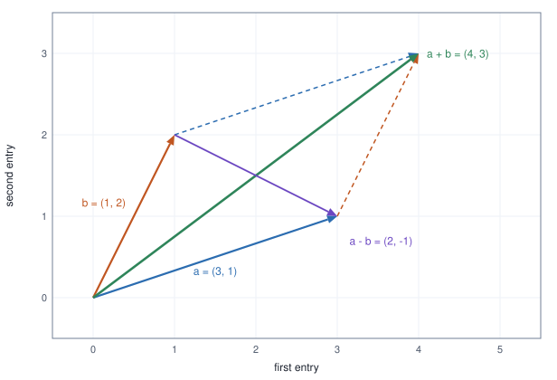
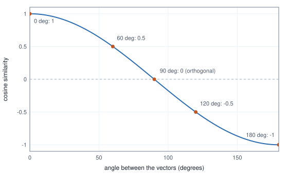

<!-- SPDX-License-Identifier: CC-BY-4.0 -->
<!-- Copyright (c) 2026 Martin Schröder <info@swedishembedded.com> -->

# Vectors: Lists of Numbers with Geometry

*How can a list of numbers have a length and a direction, and how do we measure how alike two lists are?*

## The problem

A real-estate site wants to find houses like the one you are looking at. Each
house is described by a few numbers: its area, its number of rooms, its age.
A search engine wants to find documents about the same thing as your query,
and has turned every document into a list of a few hundred numbers produced
by a trained model, so that documents about similar things get similar lists.
A model under test has produced an output of ten thousand numbers and we want
to know whether it agrees with a reference output produced by a trusted
implementation. Three different jobs, one shape: we have **lists of numbers**
and we need to ask how alike two of them are.

Chapter 2 gave us functions of one number. Everything it said about a
function that takes one input and returns one output stays true, but none of
it can describe these jobs, because the objects here are not single numbers.
We need three things.

1. **A name and a set of rules for a list of numbers as a single object.**
   We want to add two lists, scale a list, and say "the list" without
   naming its entries one at a time. A layer of a neural network takes a list
   in and gives a list out; we cannot even write that down without this.
2. **A notion of size and of closeness.** Is $(120, 4, 30)$ close to
   $(125, 4, 28)$? Is it closer than $(80, 3, 5)$ is? A list has no obvious
   "size", and the obvious candidates (the largest entry, the sum of the
   entries, something else) disagree. We need to choose one, know why, and
   know when another is better.
3. **A notion of direction.** Two embeddings produced by a model are often
   "the same" in what they mean while differing in their overall magnitude.
   We need a measure of alikeness that looks only at the pattern, and we need
   to know what it throws away, because what it throws away is exactly the
   kind of bug that slips through a test.

The answer to all three comes from a single operation, the **dot product**,
and from a picture: a list of numbers can be drawn as an arrow. The picture is
exact for lists of two and three numbers and, remarkably, the algebra that
follows from it works unchanged for lists of a thousand. This chapter builds
the picture, derives the algebra from it, and ends with a practical
warning about measuring similarity.

You may use from Chapter 1: real numbers and the notation for sums,
$\sum_{i=1}^{n}$. Chapter 2's ideas (functions, parameters) appear in a few
places and are named when they do. Trigonometry is not assumed: the one piece
we need, the cosine of an angle, is defined here from a circle. Matrices,
which are lists of lists, are the subject of the next chapter, and
derivatives, which give a vector a gradient, are Chapters 7 and 8.

## Before you begin

Three questions on ideas from Chapter 1, to answer from memory. The answers are at the end of the chapter. If one is hard, go back to the chapter named before reading on.

1. (Chapter 1, summation.) Evaluate $\sum_{i=1}^{3} i^2$.
2. (Chapter 1, summation.) Write the average of $n$ numbers $x_1, \dots, x_n$ using summation notation.
3. (Chapter 1, real numbers.) Evaluate $\sqrt{9 + 16}$. Is it equal to $\sqrt{9} + \sqrt{16}$?

## What a vector is

A **vector** with $n$ entries is an ordered list of $n$ real numbers. We
write it in bold, $\mathbf{x}$, and its entries with a subscript:

$$
\mathbf{x} = \begin{pmatrix} x_1 \\ x_2 \\ \vdots \\ x_n \end{pmatrix},
\qquad x_i \in \mathbb{R}.
$$

The set of all vectors with $n$ entries is written $\mathbb{R}^n$, and
$\mathbf{x} \in \mathbb{R}^n$ reads "$\mathbf{x}$ is a vector of $n$ real
numbers". The number $n$ is its **dimension**. In text we write a vector on a
line as $(x_1, x_2, \dots, x_n)$; the column form above is the same object and
is used when the shape matters. As in [Notation](../notation.md), the
mathematics counts entries from 1, so $x_1$ is the first. Array code counts
from 0, and the text says which it means when the two meet.

*Ordered* matters. $(3, 1)$ and $(1, 3)$ are different vectors, because the
position of a number says what it means. Two vectors are equal only if they
have the same dimension and every entry agrees. A vector is not a set (order
and repeats matter) and not a sum of its entries (we keep every entry
separate).

Two readings of a vector run through the rest of the book, and the skill is
moving between them.

**A vector as data.** A house is described by its area in square metres, its
number of rooms and its age in years. Writing the three numbers in a fixed
order gives one vector in $\mathbb{R}^3$, and a collection of houses is a
collection of vectors. The same works for the three colour values of a pixel,
the hundred recent prices of a stock, the logits a classifier assigns to its
$V$ classes, or the few hundred numbers a trained model assigns to a word: a
**word embedding**. An embedding is a vector whose entries were chosen by
training so that words used in similar ways get vectors that behave similarly
under the operations of this chapter. In every case the vector holds the
features of one thing, and the entry's position, not its value alone, says
which feature it is.

<!-- worked: vectors.features_and_geometry -->
| house | vector (area m2, rooms, age years) | n | x_1 | x_3 |
|---|---|---:|---:|---:|
| A | (120, 4, 30) | 3 | 120 | 30 |
| B | (80, 3, 5) | 3 | 80 | 5 |
| C | (200, 6, 12) | 3 | 200 | 12 |

The mean of the three vectors is (133.3, 4.333, 15.67).
<!-- /worked -->

The last line uses an operation we have not defined yet (adding vectors and
dividing by a number) and previews it: the mean of three houses is the
entry-by-entry average, again a vector with three entries.

**A vector as an arrow.** A vector with two entries $(x_1, x_2)$ can be drawn
as an arrow from the origin $(0, 0)$ to the point $x_1$ units right and $x_2$
units up. With three entries, the arrow lives in space. With four or more we
cannot draw it, but nothing in the algebra below depends on being able to
draw: it is the 2-D and 3-D arrows that supply the intuition, and the
algebra that carries it to a thousand dimensions. The arrow has two
properties, a **length** (how far the tip is from the origin) and a
**direction** (which way it points), and a main aim of this chapter is to
define both for any $n$.

A third reading ties back to Chapter 2: a vector $\mathbf{x} \in \mathbb{R}^n$
is a function from the indices $\{1, \dots, n\}$ to the reals, $i \mapsto x_i$.
That is the reading code uses: a vector is an array, and "the $i$-th entry" is
a function call.

The **zero vector** $\mathbf{0}$ has every entry equal to 0. It is the arrow
of length zero, and it is the only vector with no direction.

## Adding and scaling

Two operations make the set of vectors more than a set. Both are defined
entry by entry.

The **vector addition** of two vectors of the same dimension adds
corresponding entries:

$$
\mathbf{a} + \mathbf{b} = (a_1 + b_1, \; a_2 + b_2, \; \dots, \; a_n + b_n).
$$

Addition is defined only when the dimensions agree: you cannot add a house to
an embedding, and a program that tries should fail, not silently pad. The
**scalar multiplication** of a vector by a real number $c$ (a **scalar**, to
distinguish it from a vector) multiplies every entry:

$$
c\,\mathbf{a} = (c\,a_1, \; c\,a_2, \; \dots, \; c\,a_n).
$$

Subtraction is not a new operation: $\mathbf{a} - \mathbf{b}$ is
$\mathbf{a} + (-1)\mathbf{b}$, the entry-by-entry difference. Because these
act on each entry as ordinary arithmetic does, the rules of arithmetic carry
over. Addition is commutative and associative, $c(\mathbf{a} + \mathbf{b}) =
c\mathbf{a} + c\mathbf{b}$, $(c + d)\mathbf{a} = c\mathbf{a} + d\mathbf{a}$,
and $0\,\mathbf{a} = \mathbf{0}$; each follows by applying the matching rule of
real numbers to every entry separately.

<!-- worked: vectors.add_and_scale -->
| expression, a = (3, 1), b = (1, 2) | result |
|---|---:|
| a + b | (4, 3) |
| a - b | (2, -1) |
| b - a | (-2, 1) |
| 2a | (6, 2) |
| -b | (-1, -2) |
| 0.5 b | (0.5, 1) |
| 2a - 3b | (3, -4) |
| 0 a | (0, 0) |

In four dimensions the same rules hold entry by entry: the midpoint of cat = (0.9, 0.8, 0.1, 0) and dog = (0.8, 0.9, 0.2, 0.1) (vectors that the section on cosine similarity uses again) is (cat + dog)/2 = (0.85, 0.85, 0.15, 0.05).
<!-- /worked -->

**In the arrow picture.** Scaling by $c > 1$ stretches the arrow, by
$0 < c < 1$ shrinks it, and by $c < 0$ flips it to point the opposite way
(and scales it by $\lvert c \rvert$); $c = 0$ collapses it to the zero vector.
In every case the arrow stays on the same line through the origin: scaling
changes length and (for negative $c$) which way along the line, and nothing
else. To add, place the tail of $\mathbf{b}$ at the tip of $\mathbf{a}$: the
arrow from the origin to the new tip is $\mathbf{a} + \mathbf{b}$. Placing
$\mathbf{a}$ at the tip of $\mathbf{b}$ instead gives the same endpoint (that
is the commutativity of addition), so the two routes close a parallelogram.
The difference $\mathbf{a} - \mathbf{b}$ is the arrow that runs from the tip of
$\mathbf{b}$ to the tip of $\mathbf{a}$: add it to $\mathbf{b}$ and you arrive
at $\mathbf{a}$.



The drawing is computed with the same two functions as the table above: the
sum of $(3, 1)$ and $(1, 2)$ is $(4, 3)$, the diagonal, and the difference is
$(2, -1)$, the arrow from one tip to the other.

**Linear combinations.** Scaling and adding together give the most common
vector expression in the book, a **linear combination**: scale some vectors
and add the results,

$$
c_1 \mathbf{a}_1 + c_2 \mathbf{a}_2 + \dots + c_k \mathbf{a}_k
= \sum_{j=1}^{k} c_j \mathbf{a}_j .
$$

The sum is over vectors, using the notation of Chapter 1 unchanged. The
mean of $N$ data vectors is $\frac{1}{N}\sum_{n=1}^{N} \mathbf{x}_n$, a linear
combination with every weight equal to $1/N$; the midpoint of the two
four-dimensional vectors printed under the table above (they return in the
section on cosine similarity) is the combination with weights
$\tfrac12, \tfrac12$. A weight update in training, $\mathbf{w} - \eta
\mathbf{g}$ (the weights minus a learning rate times a gradient), is the
combination with weights $1$ and $-\eta$. Almost every step of training is a
linear combination of vectors.

## The dot product

Addition and scaling combine vectors into vectors. The next operation combines
two vectors into one number, and it is the central operation of the chapter.

The **dot product** of two vectors of the same dimension is the sum of the
products of their corresponding entries:

$$
\mathbf{a} \cdot \mathbf{b} = \sum_{i=1}^{n} a_i b_i
= a_1 b_1 + a_2 b_2 + \dots + a_n b_n .
$$

The result is a scalar. Written $\mathbf{a}^\top \mathbf{b}$ in the rest of the
book (the transpose, defined in the next chapter, turns a column into a row;
for now it is just another spelling of the same sum).

<!-- worked: vectors.dot_products -->
| dot product | terms x_i y_i | sum |
|---|---|---:|
| (2, 3) . (4, -1) | (8) + (-3) | 5 |
| (1, 2, 3) . (4, 5, 6) | (4) + (10) + (18) | 32 |
| (1, 0, 0) . (7, 8, 9) | (7) + (0) + (0) | 7 |
| (1, 1, 1, 1) . (5, 2, -3, 4) | (5) + (2) + (-3) + (4) | 8 |
| (3, 4) . (3, 4) | (9) + (16) | 25 |

Symmetry: a.b = 5, b.a = 5. Linearity with a = (2, 3), b = (4, -1), c = (1, 5): (a + b).c = 16 and a.c + b.c = 16.
<!-- /worked -->

Three algebraic facts follow at once from the definition, and every later use
depends on them.

- **Symmetry.** $\mathbf{a} \cdot \mathbf{b} = \mathbf{b} \cdot \mathbf{a}$,
  because $a_i b_i = b_i a_i$ for real numbers.
- **Linearity.** $(\mathbf{a} + \mathbf{b}) \cdot \mathbf{c} = \mathbf{a}
  \cdot \mathbf{c} + \mathbf{b} \cdot \mathbf{c}$ and
  $(\alpha\mathbf{a}) \cdot \mathbf{b} = \alpha(\mathbf{a} \cdot \mathbf{b})$.
  The first is
  $\sum_i (a_i + b_i)c_i = \sum_i a_i c_i + \sum_i b_i c_i$, splitting one
  sum into two; the second pulls a constant out of a sum. By symmetry the same
  holds in the second argument, so a dot product is linear in each argument.
- **Positivity.** $\mathbf{a} \cdot \mathbf{a} = \sum_i a_i^2 \ge 0$, and it
  is $0$ only when every entry is 0, that is, when $\mathbf{a} = \mathbf{0}$:
  a sum of squares of reals cannot be negative and vanishes only if each term
  does.

The worked block checked symmetry and linearity on one example; the proofs
above are what make the examples general.

**What the dot product computes.** Read as data, a dot product is a *weighted
sum*. Given a vector of weights $\mathbf{w}$ and a vector of inputs
$\mathbf{x}$, the number $\mathbf{w} \cdot \mathbf{x}$ says how much of
each input to count and adds it up. The line $wx + b$ of Chapter 2, with one
weight, becomes with $n$ inputs
$$
h(\mathbf{x}; \mathbf{w}, b) = \mathbf{w} \cdot \mathbf{x} + b = \sum_{i=1}^{n} w_i x_i + b .
$$
This is the first, and in a precise sense the only, building block of a neural
network layer: one neuron is a dot product plus a constant, and the next
chapter shows that a whole layer is many dot products sharing the same input.

<!-- worked: vectors.weighted_sum -->
| i | w_i | x_i | w_i x_i |
|---|---:|---:|---:|
| 1 | 0.5 | 4 | 2 |
| 2 | -1 | 3 | -3 |
| 3 | 2 | 1 | 2 |

w.x = 1, so w.x + b = 1.25 with b = 0.25. With w = (1, 1, 1) the dot product is the sum of the entries (8); with w = (0, 1, 0) it picks the middle entry (3).
<!-- /worked -->

Special weights read out special facts. The all-ones vector gives the sum of
the entries; a vector with a single 1 at position $i$ picks out entry $x_i$.
The first fact will matter when we compute means, the second when we say that
the entries themselves are dot products with the simplest vectors there are.

The algebra says nothing yet about a *length* or an *angle*, and that is the
point. The geometric meaning of $\sum a_i b_i$ is not obvious from the sum, so
we build it in three steps: lengths, then the cosine, then the link between
them.

## Length: norms

How long is the arrow $(3, 4)$? Its tip is 3 units right and 4 up, which is
the far corner of a right triangle with legs 3 and 4. For any right triangle
with legs $p$ and $q$ and long side $c$ the familiar **Pythagorean theorem**
says $c^2 = p^2 + q^2$, so the arrow has length $\sqrt{3^2 + 4^2} = 5$. The
same rule applied to a general 2-D vector gives $\sqrt{x_1^2 + x_2^2}$. In
three dimensions, apply the rule twice (the floor diagonal first, then the
climb) and the length is $\sqrt{x_1^2 + x_2^2 + x_3^2}$. We take the pattern
as the *definition* for any $n$. The **norm** of $\mathbf{x}$ (more exactly
its Euclidean, or **L2**, norm) is

$$
\lVert \mathbf{x} \rVert = \sqrt{\sum_{i=1}^{n} x_i^2} = \sqrt{\mathbf{x} \cdot \mathbf{x}} .
$$

The second form is the connection to the previous section: length is the
square root of the dot product of a vector with itself, so length is a
by-product of the dot product, not a separate idea. It is always $\ge 0$ and is
$0$ only for $\mathbf{0}$, by positivity above.

The norm has two properties used constantly. Scaling scales the length by the
size of the scalar,

$$
\lVert c\,\mathbf{x} \rVert = \sqrt{\sum_i (c x_i)^2} = \sqrt{c^2 \sum_i x_i^2} = \lvert c \rvert \, \lVert \mathbf{x} \rVert ,
$$

and the **triangle inequality** says the direct route is never longer than
the detour, $\lVert \mathbf{a} + \mathbf{b} \rVert \le \lVert \mathbf{a} \rVert
+ \lVert \mathbf{b} \rVert$. The inequality is proved in the section on
projection, once we have the tool it needs.

The L2 norm is one of several. Two others come up in machine learning, and
each answers a slightly different question about "size":

- The **L1 norm** $\lVert \mathbf{x} \rVert_1 = \sum_i \lvert x_i \rvert$ adds
  the sizes of the entries. It is the total amount, and it treats a
  difference of 1 in one entry the same as ten differences of 0.1 across ten.
- The **max norm** $\lVert \mathbf{x} \rVert_\infty = \max_i \lvert x_i
  \rvert$ is the size of the largest entry. It answers "what is the worst
  entry?", which is the question a tolerance (every entry must be within
  $10^{-5}$) asks.
- The **L2 norm** squares before it adds, so it weights large entries more
  than small ones: one entry of 10 contributes as much as a hundred entries of 1.
  It is also the only one of the three that comes from a dot product, which
  is why it is the one with angles, projections and the Pythagorean theorem.

<!-- worked: vectors.norms -->
| x | L1 = sum of abs(x_i) | L2 = sqrt(sum of x_i^2) | max of abs(x_i) | max <= L2 <= L1 |
|---|---:|---:|---:|---:|
| (3, 4) | 7 | 5 | 4 | yes |
| (3, -4, 0, 12) | 19 | 13 | 12 | yes |
| (1, 1, 1, 1) | 4 | 2 | 1 | yes |
| (0, 0, 5) | 5 | 5 | 5 | yes |
| (-2, 0.5) | 2.5 | 2.062 | 2 | yes |

Triangle inequality with a = (3, 4), b = (-1, 2): norm(a + b) = 6.325 <= norm(a) + norm(b) = 7.236. Scaling: norm(-2.5 a) = 12.5 = abs(-2.5) norm(a) = 12.5.
<!-- /worked -->

For every vector, $\lVert \mathbf{x} \rVert_\infty \le \lVert \mathbf{x}
\rVert_2 \le \lVert \mathbf{x} \rVert_1$, as the last column of the table shows
on each example. The L2 norm is at least the max norm because the sum of
squares includes the largest square; it is at most the L1 norm because
$(\sum_i \lvert x_i \rvert)^2$ expands to every $x_i^2$ plus nonnegative
cross terms. Unless a norm is named, $\lVert\cdot\rVert$ in this book means
L2.

A **unit vector** has norm 1. Any nonzero vector can be made one by dividing
by its own norm, which is **normalisation**:

$$
\hat{\mathbf{x}} = \frac{\mathbf{x}}{\lVert \mathbf{x} \rVert}, \qquad
\lVert \hat{\mathbf{x}} \rVert = \frac{1}{\lVert \mathbf{x} \rVert}\lVert \mathbf{x} \rVert = 1,
$$

by the scaling rule with $c = 1/\lVert\mathbf{x}\rVert$. Normalisation keeps
the direction and discards the length: the result points the same way as
$\mathbf{x}$ (it is a positive multiple of it) and has length 1. It is
undefined for $\mathbf{0}$, which has no direction to keep.

<!-- worked: vectors.normalisation -->
| x | L2 norm of x | x / norm(x) | norm of result |
|---|---:|---|---:|
| (3, 4) | 5 | (0.6, 0.8) | 1 |
| (1, 2, 2) | 3 | (0.3333, 0.6667, 0.6667) | 1 |
| (0, -6, 8, 0) | 10 | (0, -0.6, 0.8, 0) | 1 |
| (0.9, 0.8, 0.1, 0) | 1.208 | (0.7448, 0.6621, 0.08276, 0) | 1 |

The zero vector has norm 0 and cannot be normalised.
<!-- /worked -->

**Distance.** The length of the difference is the distance between two
points: $\lVert \mathbf{a} - \mathbf{b} \rVert$ is the length of the arrow from
the tip of $\mathbf{b}$ to the tip of $\mathbf{a}$ in the figure. "How close
is house A to house B" is answered by this number, and its square is the sum of
squared entry differences, $\sum_i (a_i - b_i)^2$. Distance is the first
measure of alikeness; the next sections build the second, which looks at
direction instead.

## Angles and the cosine

Distance depends on length: a vector and its double are far apart. Often we
want something that depends only on direction, and for that we need the idea
of the angle between two arrows and a way to compute it from numbers. Angles
need a little trigonometry, and this section supplies exactly what we use.

**The cosine from a circle.** Draw the circle of radius 1 centred at the
origin, the **unit circle**: the points $(x, y)$ with $x^2 + y^2 = 1$. Start
at the point $(1, 0)$ and walk counterclockwise along the circle until the
arrow from the origin to where you stand has turned through an angle
$\theta$. The coordinates of that point are, by definition, the **cosine** and
the **sine** of the angle:

$$
\text{point at angle } \theta = (\cos\theta, \; \sin\theta), \qquad \cos^2\theta + \sin^2\theta = 1 .
$$

The identity on the right is not an extra fact: it says only that the point
is on the unit circle. Angles are measured in degrees (a full turn is
360) or radians (a full turn is $2\pi$, so $180^\circ$ is $\pi$ radians);
this chapter uses degrees and the worked block shows both.

One more function is needed, to read an angle off a point. The function
`atan2(y, x)` returns the angle $\theta$ in $(-180^\circ, 180^\circ]$ (in
radians, $(-\pi, \pi]$) at which the unit circle meets the half-line from the
origin through the point $(x, y)$, measured anticlockwise from $(1, 0)$. So
`atan2(1, 1)` is $45^\circ$, `atan2(1, -1)` is $135^\circ$ and `atan2(-1, -1)`
is $-135^\circ$: unlike the plain ratio $y/x$, it uses the signs of both
coordinates to tell the quadrants apart.

<!-- worked: vectors.unit_circle -->
| angle (degrees) | angle (radians) | cos | sin | cos^2 + sin^2 |
|---|---:|---:|---:|---:|
| 0 | 0 | 1 | 0 | 1 |
| 30 | 0.5236 | 0.866 | 0.5 | 1 |
| 45 | 0.7854 | 0.7071 | 0.7071 | 1 |
| 60 | 1.047 | 0.5 | 0.866 | 1 |
| 90 | 1.571 | 0 | 1 | 1 |
| 120 | 2.094 | -0.5 | 0.866 | 1 |
| 135 | 2.356 | -0.7071 | 0.7071 | 1 |
| 180 | 3.142 | -1 | 0 | 1 |
| 270 | 4.712 | 0 | -1 | 1 |
<!-- /worked -->

Read the cosine column. At $0^\circ$ the point has not moved and $\cos = 1$.
At $90^\circ$ it is straight up, with $x$-coordinate 0. At $180^\circ$ it is at
$(-1, 0)$ and $\cos = -1$. In between, the cosine falls smoothly from 1 to
$-1$ and is positive for angles below $90^\circ$ and negative above. The same
definition works for any radius $r$: the point at angle $\theta$ on a circle of
radius $r$ is $(r\cos\theta, r\sin\theta)$, since scaling a point by $r$ scales
both coordinates by $r$. For a right triangle with one angle $\theta$, the
unit-circle definition says the same thing as the schoolbook ratio:
$\cos\theta$ is the length of the side next to the angle divided by the
length of the long side. We use both forms.



The curve is the whole story of how cosine reads an angle: it is not a
straight line, it is flat near $0^\circ$ and $180^\circ$ (small angles all give
cosines close to 1), and it is steepest at $90^\circ$.

**Linking the angle to the dot product.** We now have two things for a pair of
vectors $\mathbf{a}, \mathbf{b}$ in a plane: an algebraic number
$\mathbf{a}\cdot\mathbf{b}$ and a geometric angle $\theta$ between them. We
show that they are tied by

$$
\boxed{\;\mathbf{a} \cdot \mathbf{b} = \lVert \mathbf{a} \rVert \, \lVert \mathbf{b} \rVert \cos\theta\;}
$$

by computing the squared length of the third side of the triangle formed by
$\mathbf{a}$, $\mathbf{b}$ and $\mathbf{a} - \mathbf{b}$ in two ways.

*First way, from the geometry.* Rotate the whole picture, a rigid motion that
changes no length and no angle, until $\mathbf{b}$ lies along the positive
$x$-axis. Then $\mathbf{b} = (\lVert\mathbf{b}\rVert, 0)$, and $\mathbf{a}$,
which makes angle $\theta$ with it, is by the circle definition
$\mathbf{a} = (\lVert\mathbf{a}\rVert\cos\theta, \; \lVert\mathbf{a}\rVert\sin\theta)$.
Then

$$
\begin{aligned}
\lVert \mathbf{a} - \mathbf{b} \rVert^2
&= (\lVert\mathbf{a}\rVert\cos\theta - \lVert\mathbf{b}\rVert)^2 + (\lVert\mathbf{a}\rVert\sin\theta)^2 \\
&= \lVert\mathbf{a}\rVert^2 (\cos^2\theta + \sin^2\theta) - 2\lVert\mathbf{a}\rVert\lVert\mathbf{b}\rVert\cos\theta + \lVert\mathbf{b}\rVert^2 \\
&= \lVert\mathbf{a}\rVert^2 + \lVert\mathbf{b}\rVert^2 - 2\lVert\mathbf{a}\rVert\lVert\mathbf{b}\rVert\cos\theta .
\end{aligned}
$$

This is the **law of cosines**. It generalises the Pythagorean theorem: at
$\theta = 90^\circ$ the cosine is 0 and we are left with
$\lVert\mathbf{a}\rVert^2 + \lVert\mathbf{b}\rVert^2$.

*Second way, from the algebra.* Squaring a difference entry by entry, and
using the three rules of the dot product,

$$
\lVert \mathbf{a} - \mathbf{b} \rVert^2 = \sum_i (a_i - b_i)^2
= \sum_i a_i^2 - 2\sum_i a_i b_i + \sum_i b_i^2
= \lVert\mathbf{a}\rVert^2 - 2\,\mathbf{a}\cdot\mathbf{b} + \lVert\mathbf{b}\rVert^2 .
$$

The two results describe the same number, so the terms that differ must agree:
$-2\,\mathbf{a}\cdot\mathbf{b} = -2\lVert\mathbf{a}\rVert\lVert\mathbf{b}\rVert\cos\theta$, which is the boxed
formula. The numerical check is a table in which the angle is computed
independently, from the direction of each arrow, without any dot product:
the angle between $\mathbf{a}$ and $\mathbf{b}$ is
`atan2(b[1], b[0]) - atan2(a[1], a[0])`, taken in absolute value and, when it
exceeds $180^\circ$, replaced by $360^\circ$ minus itself.

<!-- worked: vectors.law_of_cosines -->
| a | b | angle by atan2 (deg) | norm(a-b)^2 | norm(a)^2 + norm(b)^2 - 2 norm(a) norm(b) cos | a.b | norm(a) norm(b) cos |
|---|---|---:|---:|---:|---:|---:|
| (3, 1) | (1, 2) | 45.00 | 5 | 5 | 5 | 5 |
| (4, 0) | (2, 2) | 45.00 | 8 | 8 | 8 | 8 |
| (-1, 2) | (3, 1) | 98.13 | 17 | 17 | -1 | -1 |
| (2, 1) | (-4, -2) | 180.00 | 45 | 45 | -10 | -10 |
<!-- /worked -->

Every row agrees: the three columns computed from the geometry match the
three computed from the algebra. The last row is a vector and its negative
multiple, at $180^\circ$, where the dot product is exactly minus the product of
the norms.

**From two dimensions to $n$.** Two arrows from the origin, in any dimension,
lie in a common plane (a plane is determined by two directions), so the
triangle argument applies within that plane. For a reader who cannot picture
this in 300 dimensions the next step is a definition, and it is justified by
the argument above: the **cosine of the angle** between two nonzero vectors
of any dimension is

$$
\cos\theta = \frac{\mathbf{a}\cdot\mathbf{b}}{\lVert\mathbf{a}\rVert\,\lVert\mathbf{b}\rVert},
$$

and the angle is the one between $0^\circ$ and $180^\circ$ with that cosine.
For this to make sense the right side must lie in $[-1, 1]$, the range of the
cosine. We prove that in the section on projection. For now we use it.

## Cosine similarity

The **cosine similarity** of two nonzero vectors is the right side above:

$$
\operatorname{cos\_sim}(\mathbf{a}, \mathbf{b}) = \frac{\mathbf{a}\cdot\mathbf{b}}{\lVert\mathbf{a}\rVert\,\lVert\mathbf{b}\rVert} = \hat{\mathbf{a}} \cdot \hat{\mathbf{b}} .
$$

The second form says that it is the dot product of the two normalised
vectors. It is 1 when they point the same way, 0 when they are at a right
angle, and $-1$ when they point opposite ways, and it varies smoothly in
between, following the curve of the previous section.

**It ignores length.** For a positive scalar $c$,

$$
\operatorname{cos\_sim}(c\,\mathbf{a}, \mathbf{b}) = \frac{c\,\mathbf{a}\cdot\mathbf{b}}{c\,\lVert\mathbf{a}\rVert\lVert\mathbf{b}\rVert} = \operatorname{cos\_sim}(\mathbf{a}, \mathbf{b}),
$$

since the $c$ cancels. Multiplying either vector by a positive number leaves
the similarity unchanged (a negative number flips the sign). That is the
point of the measure: two embeddings of the same meaning often differ in
overall magnitude (a long document accumulates larger numbers than a short
one), and the raw dot product would reward the longer one. The following
experiment uses small, made-up four-dimensional "embeddings" in which the
first two entries are an "animal" pattern and the last two a "vehicle"
pattern. The "kitten" vector is exactly half of "cat".

<!-- worked: vectors.embedding_cosines -->
| word | vector | L2 norm |
|---|---|---:|
| cat | (0.9, 0.8, 0.1, 0) | 1.208 |
| dog | (0.8, 0.9, 0.2, 0.1) | 1.225 |
| kitten | (0.45, 0.4, 0.05, 0) | 0.6042 |
| car | (0.1, 0, 0.9, 0.8) | 1.208 |
| truck | (0.2, 0.1, 0.8, 0.9) | 1.225 |

| cosine | cat | dog | kitten | car | truck |
|---|---:|---:|---:|---:|---:|
| cat | 1 | 0.987 | 1 | 0.123 | 0.23 |
| dog | 0.987 | 1 | 0.987 | 0.23 | 0.333 |
| kitten | 1 | 0.987 | 1 | 0.123 | 0.23 |
| car | 0.123 | 0.23 | 0.123 | 1 | 0.987 |
| truck | 0.23 | 0.333 | 0.23 | 0.987 | 1 |
<!-- /worked -->

Cat and kitten have cosine 1 (exactly, in mathematics; a computer may print
$0.9999999999999999$), though one is half as long as the other;
cat and dog are close (0.987); cat and car are nearly orthogonal (0.123). The
numbers are invented for the chapter and are not from a trained model, but the
behaviour is what trained embeddings are used for.

**Why the dot product alone misleads.** Take a query and four candidate
documents, ranked two ways.

<!-- worked: vectors.dot_vs_cosine_ranking -->
| document | vector | q . d | cos(q, d) |
|---|---|---:|---:|
| short, same direction | (0.5, 0.5, 0, 0) | 1 | 1 |
| long, off direction | (3, 2, 2, 2) | 5 | 0.772 |
| medium, same direction | (2, 2, 0, 0) | 4 | 1 |
| long, opposite | (-4, -4, 0, 0) | -8 | -1 |

Query q = (1, 1, 0, 0). Ranked by dot product: long, off direction > medium, same direction > short, same direction > long, opposite. Ranked by cosine: short, same direction > medium, same direction > long, off direction > long, opposite.
<!-- /worked -->

By dot product the winner is the long vector that is only partly aligned with
the query, because its length inflates the score, and the short vector pointing
exactly the query's way comes third. By cosine the two aligned vectors tie at
the top regardless of their length. Which ranking is right is a modelling
decision: if length carries meaning (how confident, how frequent), the dot
product keeps it; if it is an accident of how the vectors were produced,
cosine removes it.

**Cosine and distance agree on unit vectors.** If both vectors are unit
vectors, the second derivation above specialises: $\lVert\hat{\mathbf{a}} -
\hat{\mathbf{b}}\rVert^2 = 1 - 2\,\hat{\mathbf{a}}\cdot\hat{\mathbf{b}} + 1 = 2 - 2\cos\theta$. A
smaller distance is exactly a larger cosine, so the nearest neighbour by
distance and the most similar by cosine are the same vector once vectors are
normalised.

<!-- worked: vectors.distance_and_cosine -->
| pair (normalised first) | cosine | norm(u - v)^2 | 2 - 2 cos |
|---|---:|---:|---:|
| cat, dog | 0.98658 | 0.026847 | 0.026847 |
| cat, car | 0.12329 | 1.7534 | 1.7534 |
| car, truck | 0.98658 | 0.026847 | 0.026847 |
| cat, kitten | 1 | 0 | 0 |
<!-- /worked -->

This is why systems that store normalised embeddings can use a plain dot
product (cheaper, no norms to compute) and get exactly the ranking by cosine,
and why normalising once at write time is the usual choice.

**The zero vector.** The formula divides by the norm of each vector, so it is
undefined if either is $\mathbf{0}$. An implementation must say what it does,
and the answer is a policy, not mathematics: raise an error, return 0
(meaning "no direction, no agreement"), or return NaN. The pseudocode below
raises; the last section shows that real code in one repository chose
differently in different places and what that cost.

## Orthogonality

Two vectors are **orthogonal** when their dot product is zero:
$\mathbf{a}\cdot\mathbf{b} = 0$. For nonzero vectors that means
$\cos\theta = 0$, so the angle is $90^\circ$: they are perpendicular. The zero
vector is orthogonal to every vector, as a matter of the definition.
Orthogonality is the dot-product way to say "these two share nothing": the
products $a_i b_i$ cancel in total, so one vector tells you nothing about the
other along the direction of the first.

The worked block below tests four pairs; the last is not orthogonal, and it
is a good check that orthogonality is not just "different". The two right
columns show the Pythagorean theorem in $n$ dimensions:

<!-- worked: vectors.orthogonality -->
| a | b | a.b | norm(a)^2 + norm(b)^2 | norm(a + b)^2 |
|---|---|---:|---:|---:|
| (1, 1, 0) | (1, -1, 5) | 0 | 29 | 29 |
| (2, 1) | (-1, 2) | 0 | 10 | 10 |
| (1, 2, 3) | (3, 0, -1) | 0 | 24 | 24 |
| (1, 2) | (2, 1) | 4 | 10 | 18 |
<!-- /worked -->

For orthogonal vectors, $\lVert\mathbf{a} + \mathbf{b}\rVert^2 = \lVert\mathbf{a}\rVert^2
+ \lVert\mathbf{b}\rVert^2$. This is the Pythagorean theorem for vectors, and it
follows from the dot product: $\lVert\mathbf{a} + \mathbf{b}\rVert^2 =
\lVert\mathbf{a}\rVert^2 + 2\,\mathbf{a}\cdot\mathbf{b} + \lVert\mathbf{b}\rVert^2$,
and the middle term is 0. The pair that is not orthogonal has dot product 4 and
the squared length of the sum exceeds the sum of the squared lengths by exactly
$2 \cdot 4 = 8$.

Two uses will recur. Orthogonal vectors pull apart a quantity into pieces that
do not interfere: if $\mathbf{x}$ is written as a sum of mutually orthogonal
vectors, its squared length is the sum of the squared lengths of the pieces,
so the pieces' contributions to the total can be read off independently.
And in high dimensions orthogonality is the *default*: two arbitrary vectors
of a thousand entries are almost always nearly orthogonal, and that is worth
seeing in a number before we trust a similarity score (next section).

## Projection

A common question is how much of one vector lies along another. Given
$\mathbf{v}$ and a nonzero direction $\mathbf{u}$, find the vector on the line
through $\mathbf{u}$ that is closest to $\mathbf{v}$, and what is left over.

**Setting it up.** Every point on the line through $\mathbf{u}$ has the form
$t\,\mathbf{u}$ for some scalar $t$. We want the $t$ that makes $t\,\mathbf{u}$
as close to $\mathbf{v}$ as possible. Call what is left over the
**residual**, $\mathbf{r} = \mathbf{v} - t\,\mathbf{u}$.

**Two derivations, one answer.** First, geometry suggests the closest point is
where the residual meets the line at a right angle: any other point on the line
is a longer way from $\mathbf{v}$. Demanding that the residual be orthogonal to
$\mathbf{u}$ and using linearity,

$$
(\mathbf{v} - t\,\mathbf{u}) \cdot \mathbf{u} = 0
\;\Longrightarrow\;
\mathbf{v}\cdot\mathbf{u} - t\,(\mathbf{u}\cdot\mathbf{u}) = 0
\;\Longrightarrow\;
t = \frac{\mathbf{v}\cdot\mathbf{u}}{\mathbf{u}\cdot\mathbf{u}} .
$$

The second derivation needs no picture, so it proves what the first assumed.
Minimise the squared distance as a function of $t$. Expanding with the rules of
the dot product,

$$
f(t) = \lVert \mathbf{v} - t\mathbf{u} \rVert^2
= \lVert\mathbf{v}\rVert^2 - 2t\,(\mathbf{v}\cdot\mathbf{u}) + t^2 \lVert\mathbf{u}\rVert^2 .
$$

This is a parabola in $t$ (Chapter 2) opening upward, since
$\lVert\mathbf{u}\rVert^2 > 0$. Completing the square,

$$
f(t) = \lVert\mathbf{u}\rVert^2 \left(t - \frac{\mathbf{v}\cdot\mathbf{u}}{\lVert\mathbf{u}\rVert^2}\right)^2
+ \lVert\mathbf{v}\rVert^2 - \frac{(\mathbf{v}\cdot\mathbf{u})^2}{\lVert\mathbf{u}\rVert^2},
$$

the first term is never negative and is zero exactly at
$t = \mathbf{v}\cdot\mathbf{u} / \mathbf{u}\cdot\mathbf{u}$, the same $t$ as before.
So that $t$ is the unique closest point, and the smallest squared distance is the
constant term. The **projection** of $\mathbf{v}$ onto $\mathbf{u}$ is

$$
\operatorname{proj}_{\mathbf{u}}(\mathbf{v}) = \frac{\mathbf{v}\cdot\mathbf{u}}{\mathbf{u}\cdot\mathbf{u}}\,\mathbf{u},
\qquad
\mathbf{r} = \mathbf{v} - \operatorname{proj}_{\mathbf{u}}(\mathbf{v}),
\qquad
\mathbf{r}\cdot\mathbf{u} = 0 .
$$

<!-- worked: vectors.projection -->
| quantity, v = (3, 4), u = (2, 1) | value |
|---|---:|
| v . u | 10 |
| u . u | 5 |
| t = v.u / u.u | 2 |
| projection t u | (4, 2) |
| residual r = v - t u | (-1, 2) |
| r . u | 0 |
| norm(v)^2 | 25 |
| norm(t u)^2 + norm(r)^2 | 25 |
| scalar projection v.u / norm(u) | 4.472 |
| norm(v) cos(angle) | 4.472 |
<!-- /worked -->

The projection is the arrow $(4, 2)$, which is $t = 2$ times $\mathbf{u} = (2,
1)$. The residual is $(-1, 2)$, and its dot product with $\mathbf{u}$ is 0, as
the derivation says it must be. The squared lengths add up exactly as the
Pythagorean theorem for the orthogonal pieces demands, $25 = 20 + 5$. The last
two rows give a second reading: $\mathbf{v}\cdot\mathbf{u}/\lVert\mathbf{u}\rVert$ is
the signed length of the projection, and it equals
$\lVert\mathbf{v}\rVert\cos\theta$, the "next to the angle" side of the right
triangle that $\mathbf{v}$, its projection and its residual form.


The residual meets the line at a right angle (the small square marks it), and
the projection arrow lies along $\mathbf{u}$ (the green arrow covers the
shorter orange one). The distance $\lVert \mathbf{r} \rVert = \sqrt{5}$ is the
shortest from the tip of $\mathbf{v}$ to the line.

<!-- worked: vectors.projection_minimises -->
| t | v - t u | norm(v - t u)^2 | t = v.u/u.u |
|---|---:|---:|---|
| 0 | (3, 4) | 25 |  |
| 1 | (1, 3) | 10 |  |
| 1.5 | (0, 2.5) | 6.25 |  |
| 2 | (-1, 2) | 5 | yes |
| 2.5 | (-2, 1.5) | 6.25 |  |
| 3 | (-3, 1) | 10 |  |
| 4 | (-5, 0) | 25 |  |
<!-- /worked -->

The table verifies the minimum by brute force: every other $t$ is farther
from $\mathbf{v}$, symmetrically around $t = 2$, exactly as the parabola says.

The same formula works in any dimension, where nothing can be drawn:

<!-- worked: vectors.projection_four_dimensions -->
| quantity, v = (2, -1, 3, 1), u = (1, 1, 0, 2) | value |
|---|---:|
| v . u | 3 |
| u . u | 6 |
| t | 0.5 |
| projection | (0.5, 0.5, 0, 1) |
| residual | (1.5, -1.5, 3, 0) |
| r . u | 0 |
| norm(v)^2 | 15 |
| norm(projection)^2 + norm(residual)^2 | 15 |
| projecting again: t | 0.5 |
<!-- /worked -->

The residual is again orthogonal to $\mathbf{u}$, the squared lengths add up,
and projecting a projection changes nothing ($t$ comes out the same): once a
vector is on the line, the closest point on the line is itself.

**A bound that finishes three loose ends.** The squared length of the
residual is the constant term of $f(t)$, and it cannot be negative:

$$
0 \le \lVert\mathbf{r}\rVert^2 = \lVert\mathbf{v}\rVert^2 - \frac{(\mathbf{v}\cdot\mathbf{u})^2}{\lVert\mathbf{u}\rVert^2}
\;\Longrightarrow\;
(\mathbf{v}\cdot\mathbf{u})^2 \le \lVert\mathbf{v}\rVert^2\lVert\mathbf{u}\rVert^2
\;\Longrightarrow\;
\lvert\mathbf{v}\cdot\mathbf{u}\rvert \le \lVert\mathbf{v}\rVert\,\lVert\mathbf{u}\rVert .
$$

This is the **Cauchy-Schwarz inequality**. It settles the three things we left
open. First, the cosine similarity is a ratio of $\lvert\mathbf{a}\cdot\mathbf{b}\rvert$ to the
product of norms, so it lies in $[-1, 1]$ and an angle with that cosine
exists. Second, equality holds exactly when $\mathbf{r} = \mathbf{0}$, that is,
when $\mathbf{v}$ is a multiple of $\mathbf{u}$: cosine similarity is $\pm 1$ if
and only if the vectors lie on one line. Third, the triangle inequality:

$$
\lVert\mathbf{a}+\mathbf{b}\rVert^2 = \lVert\mathbf{a}\rVert^2 + 2\,\mathbf{a}\cdot\mathbf{b} + \lVert\mathbf{b}\rVert^2
\le \lVert\mathbf{a}\rVert^2 + 2\lVert\mathbf{a}\rVert\lVert\mathbf{b}\rVert + \lVert\mathbf{b}\rVert^2
= (\lVert\mathbf{a}\rVert + \lVert\mathbf{b}\rVert)^2,
$$

and taking square roots gives the claim. The table below shows the bound on
four pairs, including one with equality.

<!-- worked: vectors.cauchy_schwarz_check -->
| a | b | abs(a.b) | norm(a) norm(b) | cosine |
|---|---|---:|---:|---:|
| (3, 4) | (2, 1) | 10 | 11.18 | 0.8944 |
| (1, 2, 3) | (-3, -6, -9) | 42 | 42 | -1 |
| (1, 0) | (0, 5) | 0 | 5 | 0 |
| (0.9, 0.8, 0.1, 0) | (0.8, 0.9, 0.2, 0.1) | 1.46 | 1.48 | 0.9866 |
<!-- /worked -->

**Projection as decomposition.** The formula splits any $\mathbf{v}$ into two
orthogonal parts relative to a direction, $\mathbf{v} = \operatorname{proj}_\mathbf{u}(\mathbf{v}) + \mathbf{r}$,
the part along $\mathbf{u}$ and the part with nothing of $\mathbf{u}$ in it.
Two examples are worth keeping. Projecting onto the all-ones vector gives $t$
equal to the mean of the entries: the mean is the best constant approximation
of a vector, and the residual is the vector with its mean subtracted. And
repeating the process (project, subtract, project the residual onto a new
direction orthogonal to the first) builds a set of mutually orthogonal
directions, an idea that recurs in the chapter on decompositions and in every method that
breaks a signal into independent parts.

## The algorithms

The operations above, in the book's [pseudocode](../pseudocode.md). Every input
assumption is a `require`, and the zero-vector policy is explicit.

```text
function dot(a: array<real>[n], b: array<real>[n]) -> real:
    require a.shape == b.shape, "dot of different dimensions"
    acc = 0.0
    for i in 0 .. n:
        acc = acc + a[i] * b[i]
    return acc

function norm(a: array<real>[n]) -> real:
    return sqrt(dot(a, a))

function cosine_similarity(a: array<real>[n], b: array<real>[n]) -> real:
    require a.shape == b.shape, "cosine of different dimensions"
    na = norm(a)
    nb = norm(b)
    require na > 0 and nb > 0, "cosine of a zero vector is undefined"
    return dot(a, b) / (na * nb)

function unit(a: array<real>[n]) -> array<real>[n]:
    nrm = norm(a)
    require nrm > 0, "the zero vector has no direction"
    u = zeros(real, [n])
    for i in 0 .. n:
        u[i] = a[i] / nrm
    return u

function project(v: array<real>[n], u: array<real>[n])
        -> (t: real, p: array<real>[n], r: array<real>[n]):
    require v.shape == u.shape, "projection of different dimensions"
    uu = dot(u, u)
    require uu > 0, "projection onto the zero vector"
    t = dot(v, u) / uu
    p = zeros(real, [n])
    r = zeros(real, [n])
    for i in 0 .. n:
        p[i] = t * u[i]
        r[i] = v[i] - p[i]
    return (t, p, r)
```

The loop in `dot` is the only loop that matters: every other operation is
either an entry-by-entry loop with no interaction between entries or a few
`dot` calls. Its cost is $n$ multiplications and $n - 1$ additions, linear in
the dimension, and that fact, multiplied by the number of dot products a model
performs, is the cost of almost everything in Volume III.

## Making it work

**The order of a sum is a choice, and in finite precision it matters.** The
mathematical dot product does not depend on the order in which the products
are added, because addition of real numbers is associative. A computer's
addition of rounded numbers is not (Chapter 15 derives why). In the example
below, the products are exact in 32-bit arithmetic, and only the order of the
additions changes. Every sum is rounded to a 32-bit number before the next one,
with no wider intermediate (some processors use one silently; a 32-bit
reproduction must switch that off):

<!-- worked: vectors.summation_order -->
| x = (1e8, 1, -1e8, 1), y = (1, 1, 1, 1) | x . y |
|---|---:|
| left to right in 32-bit | 1 |
| (x1 y1 + x3 y3) + (x2 y2 + x4 y4) in 32-bit | 2 |
| exact rational arithmetic | 2 |
<!-- /worked -->

Adding left to right loses the small terms next to the huge ones and returns 1
instead of 2; adding the two large terms to each other first returns the exact
answer. The same effect is quiet and small in a real dot product (the last
digits of the result drift with the order), and it is why careful code
accumulates a long sum in a wider format than its inputs, as the last section shows brain doing.

**Near-orthogonality is the default.** How large is the cosine between two
unrelated vectors? In two dimensions it is often large: there are only so many
directions. In many dimensions it is almost always near 0. The table draws pairs
of vectors with entries $\pm 1$ from the book's generator (Chapter 17 builds
it; the seed and the order of the draws are printed under the table) and
reports the average absolute cosine, the largest one seen among 300 pairs, and
the value
$\sqrt{2/(\pi n)}$, which is what theory predicts for the average:

<!-- worked: vectors.random_directions -->
One generator, SplitMix64 with seed 760955756825205139 (0x0A8F753AA75AD993), used for the whole table. For each n in the order below and each of 300 pairs: draw n uniforms for the first vector, then n for the second; an entry is +1 when its uniform is below 0.5, otherwise -1.

| n | mean abs(cos) | largest abs(cos) | sqrt(2 / (pi n)) |
|---|---:|---:|---:|
| 2 | 0.497 | 1 | 0.564 |
| 8 | 0.272 | 0.75 | 0.282 |
| 32 | 0.145 | 0.5 | 0.141 |
| 128 | 0.0666 | 0.25 | 0.0705 |
| 512 | 0.0349 | 0.145 | 0.0353 |
| 2048 | 0.0177 | 0.0664 | 0.0176 |
<!-- /worked -->

The average absolute cosine falls like $1/\sqrt{n}$: about 0.50 at $n = 2$,
about 0.035 at $n = 512$ and below 0.02 at 2048. (The prediction column is a
fact from probability, Chapter 10, taken here without proof; the measured
column is the evidence.) So a cosine of 0.1 between two 2048-dimensional
embeddings is already far above chance, while the same 0.1 in two dimensions
means nothing. Always read a similarity against the dimension it was measured
in.

**Features on different scales.** The dot product and the norm add up
quantities entry by entry, so every entry must be in a unit that makes adding
sensible. The three houses of the opening vector example have area in square
metres, rooms as a count and age in years; the area dominates every distance
and every cosine simply because its numbers are bigger, not because it is more
important. Practice is to rescale each feature to a comparable range (the
chapter on statistics returns to this) before taking norms or dot products of data vectors.
Learned embeddings do not have this problem: all entries come out of the same
model and are on the same footing.

**The cost of scoring.** Scoring one query against $N$
stored embeddings of dimension $n$ costs $Nn$ multiply-adds with normalised
vectors (one dot product each) and about three times that if each cosine
recomputes both norms. Storing normalised vectors once removes the norms from
the query path.

## Cosine similarity cannot see scale

The property that makes cosine similarity useful, that it ignores length, is
also a blind spot, and in a test it is a dangerous one. Suppose you are
checking that a re-implementation of a model produces the same outputs as a
trusted reference, and you measure agreement by the cosine between the two
output vectors. A re-implementation that forgets a constant factor (a
dropped scale, a gain applied twice, a normalisation constant read wrongly)
produces an output that is the reference multiplied by a number. By the
cancellation shown above, its cosine with the reference is exactly 1.
The reference is the six-entry vector
$\mathbf{want} = (0.8, -1.2, 0.5, 2.0, -0.3, 1.1)$, and the candidates are
built from it: the exact copy; the noisy copy, with
$(0.001, -0.002, 0.001, 0, 0.002, -0.001)$ added to the entries; the copies
multiplied by 1.05, 1.001 and 0.5; and the copy with entry 3 (counting from 0)
changed from 2.0 to 1.0. The cosine is printed to nine decimals, the other
columns to three significant digits.

<!-- worked: vectors.scale_blindness -->
| candidate vs reference | cosine | relative L2 | max abs difference |
|---|---:|---:|---:|
| exact copy | 1.000000000 | 0 | 0 |
| tiny noise (about 1e-3) | 0.999999314 | 0.0012 | 0.002 |
| scaled by 1.05 | 1.000000000 | 0.05 | 0.1 |
| scaled by 1.001 | 1.000000000 | 0.001 | 0.002 |
| scaled by 0.5 | 1.000000000 | 0.5 | 1 |
| one entry wrong (2.0 -> 1.0) | 0.947230406 | 0.362 | 1 |
<!-- /worked -->

Four rows of the table have a cosine of 1.000000000: the exact copy and the
candidates scaled by 1.05, 1.001 and 0.5. A gate that asks only "is the cosine
above 0.999" passes all of them, though three outputs are off by a factor of 1.05, by a factor of
1.001 and by a factor of two. The two other columns catch what cosine cannot. The
**relative L2 error**
$\lVert\text{got} - \text{want}\rVert / \lVert\text{want}\rVert$ is
$0$, $0.05$, $0.001$ and $0.5$ in those four rows: it is a norm of the
difference, so it is sensitive to length. The maximum absolute difference is
the max norm of the difference and answers the tolerance question directly.
The last row, in which one entry is wrong by half of its value, is caught by
cosine too (0.947), because an isolated error changes the *pattern*; the noisy
row sits between (cosine 0.9999993, relative L2 0.0012). Cosine sees changes of
direction and is blind to changes of length, and a good gate has one
measurement for each.

This is not hypothetical. The last section of the chapter gives the knowledge entry and the
commit that closed such a gap in a parity test.

## Where this appears in brain

The operations of this chapter are some of the most repeated lines of the
repository. Four places show the idea at work, and one a lesson learned.

**Cosine as a parity metric.** A model imported into brain is gated against
its reference by comparing output vectors, and cosine is the first number
reported. Many parity tests define a small local `cosine` function, for
example in `crates/s3dit/tests/it/block_parity.rs`, which accumulates the dot
product and both squared norms in 64-bit floating point and divides, exactly
the formula of this chapter. The shared version lives in `crates/model/src/hostmath.rs`
as `cosine` and `l2_normalize`, added by commit `f94c9dcda` (31 July 2026).
Its message explains the design choices that this chapter predicted: it
accumulates in 64-bit because a 512-dimensional face embedding is gated at
seven digits of cosine against a reference and a 32-bit dot product loses the
last two of them to summation order alone, the floating-point effect of the
section above, and it returns 0.0 for a zero norm and panics on a length
mismatch, because a silent 0.0 there "would read as 'different identity'
rather than 'you passed the wrong tensor'". The same message records a policy
disagreement found along the way: two earlier copies disagreed about the
zero-norm case, one returning 1.0 and the other 0.0, so migrating them was
"a decision with a behavioural consequence, not a rename". Commit
`78352200d` (10 August 2026) did it, moving five hand-rolled copies onto the
shared one and choosing 0.0 ("no direction") over a vacuous 1.0. The unit
tests in `crates/model/src/hostmath.rs` state the contract as assertions:
`cosine_is_direction_only_and_zero_safe` checks that a vector and its multiple
score 1, a vector and its negative score $-1$, orthogonal vectors score 0, and
a zero vector scores 0, and `cosine_refuses_mismatched_lengths` checks the
panic.

**The scale blind spot, found and closed.** Knowledge #2 records the lesson
in one line: `got = 1.05 * want` scores cosine 1.0, so a dropped output scale,
a doubled attention scale or a mis-read normalisation gain all pass a
cosine-only ladder, and the fix is to gate a relative L2 or max absolute
difference alongside it. Commit `8835c9410` (24 August 2026) applied it to a
vocoder parity test that "asserted a cosine floor and nothing else". The
message says the gate was mutation-verified: a uniform gain of 1.001 on the output
left cosine at 1.000000000 and was caught only by the new relative-L2 ceiling
of $10^{-4}$. It also explains the choice of ceiling, which the arithmetic of
the previous section reproduces: both stages measured about $10^{-6}$ clean,
leaving about 60 times of headroom for reassociated sums, while a ceiling of
$10^{-3}$ would have put the mutation exactly on the line, "too close to call
a gate". The relative L2 of that 0.001 gain error is $10^{-3}$, as in the table. The
commit also notes why it lands first: the next change reassociated the
reduction, "and a gate blind to the failure mode of the change it guards is
decoration".

**Cosine similarity as retrieval.** `crates/sdk/src/embedding.rs` carries the
one piece of retrieval arithmetic the library owns: `Embedding::cosine_similarity`,
computed in 64-bit from the dot product and the two norms. Its documentation
states the zero-vector policy in this chapter's terms (a zero vector, or two
vectors of different lengths, scores 0.0, "no direction to compare") and
that cosine is "scale-invariant ... so this is meaningful whether or not the
pipeline that produced them normalizes". Its test
`cosine_similarity_of_a_vector_with_itself_is_one` in
`crates/sdk/tests/embedding_pipeline.rs` and the neighbouring tests on a
real checkpoint's output ("returns a unit norm vector") use the identity
$\lVert\hat{\mathbf{x}}\rVert = 1$. The sample `samples/text/retrieve`
embeds a corpus and a query and scores each passage with it (commit
`3dcca1817`, 21 September 2026); its README is plain that this is a flat scan,
linear in the number of passages per query, which is the $Nn$ cost of the
section above, and that a corpus beyond a few thousand passages needs an
approximate-nearest-neighbour index over the same vectors. Note that the
library's SDK policy (0.0 on mismatched lengths) differs from the host
helper's (panic), a choice each layer made for its own caller: a request path
that must keep serving versus a test that must fail loudly.

**Cosine inside attention.** Commit `7df678322` (16 July 2026) added
`crates/kernels/wgsl/l2norm_scale.wgsl`, a kernel that normalises each query
and key vector to unit length over the head dimension and multiplies by a
learned per-dimension scale before attention. The commit message calls it "the
cosine-similarity attention": with unit vectors the dot product of a query and
a key is their cosine. Its formula is the normalisation of this chapter,
`x * rsqrt(sum_k x[k]^2 + eps) * g`, with a small `eps` so that the zero
vector does not divide by zero. The kernel is checked by a host forward
parity test and by finite-difference gradient tests, tools of Volume III.

**The dot product as the inner loop.** The central loop of every linear layer
is the dot product. `crates/kernels/wgsl/matmul.wgsl` computes
`out[m, n] = sum_k x[m, k] * W[n, k]` with one thread per output element and a
serial inner loop, `acc = acc + x[x_base + i] * w[wi]` over $K$ terms: it is the
`dot` of the pseudocode above, run $M \times N$ times. The faster kernels in
the same directory change how the $K$ products are scheduled and what number
format they are stored in, not what they compute. `crates/kernels/wgsl/matmul_i8_dyn.wgsl`
uses the hardware instruction `dot4I8Packed`, which does four 8-bit
multiply-adds at once; it is the same sum, grouped four at a time and
accumulated in 32-bit integers. The next chapter shows that the matrix
product is exactly $M \times N$ dot products, and Volume IV is about
scheduling them.

## Check your understanding

Answers are at the end of the chapter.

1. **Predict.** For $\mathbf{a} = (1, 2, 2)$ and $\mathbf{b} = (2, 0, -1)$, compute $\mathbf{a} \cdot \mathbf{b}$ and $\lVert\mathbf{a}\rVert$. What does the first result say about the two vectors?
2. **Predict.** What is the cosine similarity of $(1, 0)$ and $(1, 1)$, and what angle is that?
3. **Predict.** Compute $2(1, 2) + (3, -1)$.
4. **Find the error.** "The cosine similarity of $\mathbf{a}$ and $1.05\,\mathbf{a}$ is $1.05$, so the second is even more similar to $\mathbf{a}$ than $\mathbf{a}$ itself." What is the value, and what does it imply for a check that a candidate vector matches a reference?
5. **Explain.** For $(3, 4)$, compute the L1, L2 and max norms and show they satisfy $\lVert\cdot\rVert_\infty \le \lVert\cdot\rVert_2 \le \lVert\cdot\rVert_1$.
6. **Find the error.** "The projection of $\mathbf{v} = (3, 4)$ onto $\mathbf{u} = (1, 0)$ is the number 3, and the rest of $\mathbf{v}$ points along $\mathbf{u}$ too." What is the projection, what is the residual, and how is the residual related to $\mathbf{u}$?
7. **Explain.** Two random vectors in 1000 dimensions have a cosine similarity close to 0. What does that say about reading a cosine of $0.1$ between two embeddings of that width?

## Exercises

1. **[Calculate]** For $\mathbf{a} = (2, -1, 3)$ and $\mathbf{b} = (1, 4, -2)$
   compute $\mathbf{a}+\mathbf{b}$, $3\mathbf{a} - 2\mathbf{b}$,
   $\mathbf{a}\cdot\mathbf{b}$, the three norms $\lVert\mathbf{a}\rVert_1$,
   $\lVert\mathbf{a}\rVert_2$, $\lVert\mathbf{a}\rVert_\infty$, and the unit
   vector $\hat{\mathbf{a}}$. Verify that $\lVert\hat{\mathbf{a}}\rVert = 1$.

2. **[Calculate]** Find the cosine of the angle between $(1, 2, 2)$ and
   $(2, -1, 2)$ and decide whether the angle is acute, a right angle or obtuse.
   Then find the value of $x$ for which $(x, 2, 1)$ is orthogonal to
   $(3, -1, 4)$.

3. **[Calculate]** Project $\mathbf{v} = (1, 2, 3)$ onto $\mathbf{u} = (1, 1, 1)$.
   Find $t$, the projection and the residual, check that the residual is
   orthogonal to $\mathbf{u}$, and say what $t$ is in terms of the entries of
   $\mathbf{v}$. Check $\lVert\mathbf{v}\rVert^2 = \lVert t\mathbf{u}\rVert^2 + \lVert\mathbf{r}\rVert^2$.

4. **[Calculate]** Two unit vectors are at distance 1 from each other. Using
   $\lVert\mathbf{a}-\mathbf{b}\rVert^2 = 2 - 2\cos\theta$, find the cosine and the
   angle. What distance corresponds to orthogonal unit vectors, and to
   opposite ones?

5. **[Calculate]** For $n = 4$, give a vector with $\lVert\mathbf{x}\rVert_1 =
   \lVert\mathbf{x}\rVert_2$ and a vector with $\lVert\mathbf{x}\rVert_1 =
   2\lVert\mathbf{x}\rVert_2$, both nonzero. In general, what shape of vector makes the L1
   norm as large as possible relative to the L2 norm, and what is the largest
   ratio? Use $(\sum_i \lvert x_i\rvert)^2 \le n \sum_i x_i^2$, which is Cauchy-Schwarz
   with one vector all ones.

6. **[Calculate]** A candidate output is $c$ times the reference. Show that its cosine with
   the reference is 1 for every $c > 0$, and that its relative L2 error is
   $\lvert c - 1\rvert$. What $c$ is the smallest over-scale that a relative L2
   ceiling of $10^{-4}$ rejects? What does the cosine of the same candidate with
   $c < 0$ say?

7. **[Implement]** Implement `dot`, `norm`, `unit` and `cosine_similarity` from
   the pseudocode in a language of your choice, with errors for mismatched
   dimensions and zero vectors, and reproduce `vectors.dot_products`,
   `vectors.norms`, `vectors.normalisation` and `vectors.embedding_cosines`.

8. **[Implement]** Implement `project` and reproduce `vectors.projection` and
   `vectors.projection_four_dimensions`. Then write a test that draws 100 pairs
   of vectors of dimension 8, entries uniform in $[-3, 3]$ from any generator,
   and checks that the residual is
   orthogonal to $\mathbf{u}$ to within $10^{-9}$ every time, and that
   projecting the projection returns it unchanged.

9. **[Implement]** Reproduce `vectors.scale_blindness`: implement cosine, relative
   L2 and max absolute difference. Add a candidate whose first entry is wrong
   by 0.2 and one with noise of up to 0.01 times each entry's size (entry
   $\times (1 + 0.01u)$, $u$ uniform in $[-1, 1]$), and state which
   of the three measurements flags each candidate, and at what ceiling you
   would gate on it.

10. **[Implement]** Reproduce `vectors.summation_order` in 32-bit floating point.
    Then draw two 1000-entry vectors with entries uniform in $[-1, 1]$ rounded
    to 32 bits, and compute their dot product with a 32-bit accumulator left to
    right, with a 64-bit accumulator (adding the exact products of the 32-bit
    entries), and with pairwise summation of the 32-bit products (a list of
    length 1 is its own sum; otherwise split it into the first $\lfloor n/2
    \rfloor$ entries and the rest, sum each, add). Compare the three against
    the exact dot product of the stored entries (rational arithmetic or the
    widest float your language has) and report the error of each. Expect the
    64-bit accumulator to be far the best and left to right the worst.

11. **[Investigate]** Reproduce `vectors.random_directions`, then replace the $\pm 1$
    entries with entries uniform in $[-1, 1]$. Does the average absolute cosine
    still follow $\sqrt{2/(\pi n)}$ closely? Explain why the number should depend
    on $n$ the way it does, using the fact that the dot product of two
    independent random sign vectors is a sum of $n$ terms each $\pm 1$.

12. **[Investigate]** Using the three houses of `vectors.features_and_geometry`,
    compute the cosine similarity between each pair as the data stand, and again
    after converting area from square metres to square kilometres (divide the
    first entry by $10^6$). How do the three cosines and the three distances
    change, and why? Then propose a rescaling of the features that makes
    neither unit choice matter.

## Summary

A **vector** is an ordered list of real numbers, read as data (the features of
one house, the embedding of one word) or as an arrow with a length and a
direction. **Vector addition** and **scalar multiplication** act entry by
entry, are the parallelogram and the stretch of the arrow picture, and combine
into linear combinations, which are the shape of every average and every
training update. The **dot product** $\sum_i a_i b_i$ is symmetric, linear in
each argument and positive on itself, is the weighted sum that a neuron
computes, and, through the law of cosines, equals $\lVert\mathbf{a}\rVert\lVert\mathbf{b}\rVert\cos\theta$.
The **norm** $\sqrt{\mathbf{a}\cdot\mathbf{a}}$ is length; the L1 and max norms
measure total and worst-entry size and satisfy $\lVert\cdot\rVert_\infty \le
\lVert\cdot\rVert_2 \le \lVert\cdot\rVert_1$. Dividing by the norm gives a unit
vector. **Cosine similarity** is the dot product of the normalised vectors: it
lies in $[-1, 1]$ by Cauchy-Schwarz, is 1 only for vectors on one line, and
ignores positive scaling, which is both its use (a long and a short document
about one subject agree) and its limit: a candidate multiplied by 1.05, or by
0.5, scores a perfect 1, so a parity gate must also look at a norm of the
difference. **Orthogonal** vectors have dot product 0 and obey the Pythagorean
theorem; in high dimensions two random vectors are nearly orthogonal, so a
similarity must be read against its dimension. The **projection** of $\mathbf{v}$
onto $\mathbf{u}$ is $(\mathbf{v}\cdot\mathbf{u}/\mathbf{u}\cdot\mathbf{u})\mathbf{u}$,
the closest point on the line through $\mathbf{u}$, and its residual is
orthogonal to $\mathbf{u}$.

What we have not done is combine many dot products at once. A layer of a
network takes one vector and computes a whole list of dot products with
different weight vectors, producing another vector, and the layers after it do the
same again. The next chapter gives that operation a name, the matrix, shows that
multiplying a matrix by a vector is exactly such a list of dot products, and
shows that it is the most general way to turn one vector into another that
respects addition and scaling.

## Key terms

- **vector**: an ordered list of real numbers, read as data (the features of one example) or as an arrow with a length and a direction. <!-- concept: vector -->
- **vector addition**: adding two vectors of the same length entry by entry; as arrows it is the parallelogram rule. <!-- concept: vector-addition -->
- **scalar multiplication**: multiplying every entry of a vector by one number, which stretches, shrinks or flips the arrow. <!-- concept: scalar-multiplication -->
- **dot product**: the number $\sum_i a_i b_i$ obtained from two vectors of equal length, equal to $\lVert\mathbf{a}\rVert\lVert\mathbf{b}\rVert\cos\theta$. <!-- concept: dot-product -->
- **norm**: the length of a vector; the L2 norm is $\sqrt{\mathbf{a}\cdot\mathbf{a}}$, and the L1 and max norms measure total and largest-entry size. <!-- concept: norm -->
- **cosine similarity**: the dot product of two vectors after dividing each by its norm, a number from $-1$ to $1$ that ignores positive scaling. <!-- concept: cosine-similarity -->
- **orthogonality**: the property of two vectors having dot product 0, that is, being at right angles. <!-- concept: orthogonality -->
- **projection**: the closest point to a vector $\mathbf{v}$ on the line through $\mathbf{u}$, namely $\frac{\mathbf{v}\cdot\mathbf{u}}{\mathbf{u}\cdot\mathbf{u}}\mathbf{u}$; what is left over is orthogonal to $\mathbf{u}$. <!-- concept: projection -->

## Answers

**Before you begin.**

1. $1 + 4 + 9 = 14$.
2. $\frac{1}{n}\sum_{i=1}^{n} x_i$.
3. $\sqrt{25} = 5$, while $\sqrt{9} + \sqrt{16} = 3 + 4 = 7$. They are not equal: a square root of a sum is not the sum of the square roots.

**Check your understanding.**

1. $\mathbf{a}\cdot\mathbf{b} = 2 + 0 - 2 = 0$ and $\lVert\mathbf{a}\rVert = \sqrt{1 + 4 + 4} = 3$. A zero dot product means the vectors are orthogonal.
2. $\frac{1}{1 \cdot \sqrt{2}} \approx 0.7071$, which is the cosine of $45^\circ$.
3. $(2, 4) + (3, -1) = (5, 3)$.
4. The cosine similarity is exactly 1, because it divides out the lengths and cannot exceed 1 (Cauchy-Schwarz). It ignores positive scaling, so a candidate that is 5% too large still scores a perfect 1; such a check must also look at a norm of the difference.
5. L1 is $3 + 4 = 7$, L2 is $\sqrt{9 + 16} = 5$, max is $4$, and $4 \le 5 \le 7$.
6. The projection is the vector $(3, 0)$; the number 3 is only its coefficient along $\mathbf{u}$. The residual is $(0, 4)$, which has dot product 0 with $\mathbf{u}$: it is orthogonal to $\mathbf{u}$, not along it.
7. In high dimensions unrelated vectors are nearly orthogonal, so the scale of cosines that count as "close" shrinks with the dimension. A value of $0.1$ may be far above chance at width 1000 and meaningless at width 3; a similarity must be read against its dimension.
