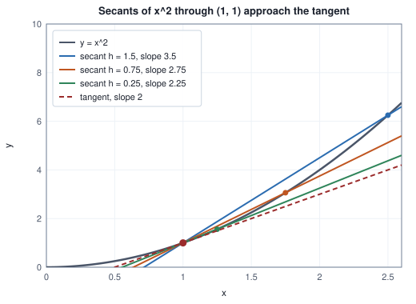
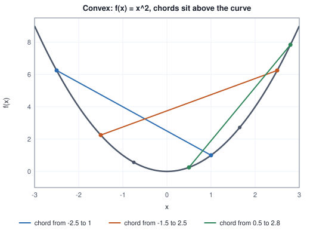
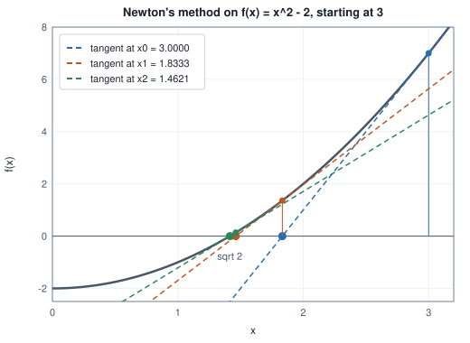

<!-- SPDX-License-Identifier: CC-BY-4.0 -->
<!-- Copyright (c) 2026 Martin Schröder <info@swedishembedded.com> -->

# Derivatives: The Mathematics of Change

*How do we measure how fast a function's output changes when its input moves a tiny bit?*

## The problem

You have a machine with one knob. The knob is a number $w$, the machine makes a
prediction from it, and a score $L(w)$ says how wrong the prediction is: zero
is perfect, larger is worse. Chapter 2 taught us to call $L$ a function and $w$
its parameter. You may turn the knob, but you cannot see inside the machine. The
only thing you can do is try a value and read the score. Which way should you
turn it?

Take a concrete machine. The input is $x = 2$, the target is $t = 3$, the
prediction is $2w$ and the score is the squared error,

$$
L(w) = (2w - 3)^2 .
$$

The knob sits at $w = 0.5$, where $L = 4$. Nudge it by a small amount $h$ and
read the score again.

<!-- worked: derivatives.nudge_loss -->
Loss L(w) = (2w - 3)^2 at w = 0.5: L = 4.0000.

| nudge h | new w | L(w + h) | change in L | change per unit of h |
|---|---:|---:|---:|---:|
| +0.5 | 1.000 | 1.000000 | -3.000000 | -6.0000 |
| +0.1 | 0.600 | 3.240000 | -0.760000 | -7.6000 |
| +0.01 | 0.510 | 3.920400 | -0.079600 | -7.9600 |
| +0.001 | 0.501 | 3.992004 | -0.007996 | -7.9960 |
| -0.1 | 0.400 | 4.840000 | +0.840000 | -8.4000 |
| -0.01 | 0.490 | 4.080400 | +0.080400 | -8.0400 |
<!-- /worked -->

Read the last column. Turning the knob up lowers the score, turning it down
raises it, and the **change per unit of nudge** is close to $-8$ in every row,
closer the smaller the nudge. That number answers both halves of the question at
once: its sign says which way to turn (up, since it is negative and we want the
score to fall) and its size says how much the score responds (a nudge of $0.01$
moves it by about $0.08$). It is the **rate of change** of $L$ at $w = 0.5$.

This chapter turns that observation into mathematics. Reading a rate off a table
of nudges is slow (every number costs one run of the machine) and it is only
approximate. A **derivative** is the exact value that the last column approaches,
and the rules in this chapter compute it from a formula without any nudging.
That matters for a reason that the rest of the book keeps returning to. A neural
network has millions of knobs, and training turns every knob a little at every
step, in the direction its own derivative recommends. Nudging each knob and
re-reading the score would cost millions of runs per step. A formula for the
derivative costs about one.

We build the idea in the order a reader needs it: the slope of a line through two
points of a curve, what happens when the two points merge, the rules for
differentiating sums, products, quotients and compositions, the exponential and
logarithm, what a slope of zero means, when that guarantees a single best answer,
a method that uses the slope to find roots and minima very fast, and the error you
make when you estimate a derivative numerically. You may use from earlier chapters: functions,
composition and polynomials (Chapter 2), the exponential function and its
inverse the logarithm (Chapters 1 and 2), and the number $e$ (Chapter 1).

## Before you begin

Six questions on ideas from earlier chapters, to answer from memory. The answers are at the end of the chapter. If one is hard, go back to the chapter named before reading on.

1. (Chapter 2, composition.) With $f(x) = x^2$ and $g(x) = 3x + 1$, compute $(f \circ g)(2)$ and $(g \circ f)(2)$.
2. (Chapter 2, polynomials.) Evaluate $p(x) = 2x^3 - 5x + 1$ at $x = 2$.
3. (Chapter 2, slope of a line.) What is the slope of the line through $(1, 3)$ and $(4, 9)$?
4. (Chapter 2, exponentials.) What are $e^0$ and $e^{a}\,e^{b}$ written as one power?
5. (Chapter 1, the number $e$.) What does $(1 + 1/n)^n$ approach as $n$ grows, and what does a computer print for it at $n = 10^{16}$ and why?
6. (Chapter 1, square roots by repeated improvement.) The fractions $1$, $3/2$, $17/12$, $577/408$ approach $\sqrt{2}$. What happened to the number of correct digits at each step?

## Slope: from a line to a curve

Chapter 2 defined the slope of a straight line as rise over run: through the
points $(x_1, y_1)$ and $(x_2, y_2)$ it is $(y_2 - y_1)/(x_2 - x_1)$, and it is
the same wherever on the line you measure it. A curve has no single slope; a
steep part and a flat part have different ones. What we can do is ask for the
slope *at a point*.

Take $f(x) = x^2$ at $x = 1$. Pick a second point $h$ to the right, at
$x = 1 + h$. The straight line through the two points $(1, f(1))$ and
$(1 + h, f(1 + h))$ is called a **secant** (from the Latin for "cutting": it
cuts the curve in two places). Its slope is the rise over the run,

$$
\frac{f(1 + h) - f(1)}{h} .
$$

Compute it for smaller and smaller $h$, from both sides.

<!-- worked: derivatives.secant_table -->
f(x) = x^2 at x = 1, f(1) = 1.

| h | f(1 + h) | secant slope | slope - 2 |
|---|---:|---:|---:|
| 1 | 4.000000000 | 3.000000 | +1.00e+00 |
| 0.5 | 2.250000000 | 2.500000 | +5.00e-01 |
| 0.1 | 1.210000000 | 2.100000 | +1.00e-01 |
| 0.01 | 1.020100000 | 2.010000 | +1.00e-02 |
| 0.001 | 1.002001000 | 2.001000 | +1.00e-03 |
| 1e-06 | 1.000002000 | 2.000001 | +1.00e-06 |
| -0.1 | 0.810000000 | 1.900000 | -1.00e-01 |
| -0.01 | 0.980100000 | 1.990000 | -1.00e-02 |
| -0.001 | 0.998001000 | 1.999000 | -1.00e-03 |
<!-- /worked -->

The pattern is exact, and we can see why. $f(1 + h) = 1 + 2h + h^2$, so the
secant slope is $(2h + h^2)/h = 2 + h$. The last column is just $h$. From the
right the slopes are above 2 and fall toward 2; from the left they are below 2
and rise toward 2. Both sides squeeze in on the same number, $2$.

The figure shows what the table says geometrically. As the second point slides
toward the first, the secant rotates, and its limiting position is the line that
touches the curve at $(1, 1)$ without cutting across it there: the
**tangent**. Its slope, $2$, is what we mean by the slope of the curve at $x = 1$.

## The limit

The words "squeeze in on" and "approach" have carried the argument so far. To
build on them we need to say precisely what they mean, because the secant slope
cannot simply be evaluated at $h = 0$: it is $0/0$ there, with no value. We
need a way to speak about what a quantity does as $h$ gets close to zero without
ever being zero.

A **limit** answers this. Say that a quantity $g(h)$ has the limit $L$ as $h$
approaches $0$, and write

$$
\lim_{h \to 0} g(h) = L ,
$$

when $g(h)$ can be brought as close to $L$ as anyone demands by taking $h$ small
enough (and nonzero). The demand comes first and the smallness of $h$ is our
answer to it. For $g(h) = 2 + h$ the game is easy to play: if you demand that
$g(h)$ be within $10^{-6}$ of $2$, we answer that any $h$ with
$0 < |h| \le 10^{-6}$ will do, and the table shows $h = 10^{-6}$ landing exactly
at the edge. Whatever tolerance you name, there is an $h$ that meets it, so
$\lim_{h \to 0} (2 + h) = 2$. Notice that the value of $g$ *at* $h = 0$ played no
part. A limit is about the neighbourhood of the point, never the point itself.

That is what makes limits useful for a $0/0$ expression. Take
$g(x) = (x^2 - 1)/(x - 1)$ near $x = 1$. At $x = 1$ it is $0/0$ and undefined;
nearby it behaves perfectly well.

<!-- worked: derivatives.limit_examples -->
g(x) = (x^2 - 1)/(x - 1) approaching x = 1 from both sides (g(1) itself is 0/0):

| h | g(1 - h) | g(1 + h) |
|---|---:|---:|
| 0.1 | 1.900000 | 2.100000 |
| 0.01 | 1.990000 | 2.010000 |
| 0.001 | 1.999000 | 2.001000 |
| 1e-06 | 1.999999 | 2.000001 |

The absolute value at x = 0:

| h | secant slope of abs(x) at 0 |
|---|---:|
| +0.1 | 1.000 |
| +0.001 | 1.000 |
| -0.1 | -1.000 |
| -0.001 | -1.000 |
<!-- /worked -->

The factorisation $x^2 - 1 = (x - 1)(x + 1)$ explains the first table: for
$x \ne 1$ the expression is $x + 1$, so its limit at $1$ is $2$, even though the
expression is not defined there.

A limit need not exist. The second table is the secant slope of the absolute
value $|x|$ at $x = 0$: it is $+1$ for every positive $h$ and $-1$ for every
negative one. The two sides disagree, so no single number is approached, and the
curve has a corner there with no tangent. (The ReLU function of Chapter 2 has
exactly such a corner at $0$; the later chapters that train networks with it
just choose a convention for that one point.)

## The derivative

Replace the particular curve and point of the secant table by any function $f$
and any point $x$. The slope of the secant through $(x, f(x))$ and
$(x + h, f(x + h))$ is the **difference quotient**
$\frac{f(x + h) - f(x)}{h}$. The **derivative** of $f$ at $x$ is its limit as
$h \to 0$, when that limit exists:

$$
f'(x) = \lim_{h \to 0} \frac{f(x + h) - f(x)}{h} .
$$

It is written $f'(x)$ or $\frac{df}{dx}$; the second form reads "the change in
$f$ per change in $x$" and is the form that survives when there are many
variables. The derivative is itself a function of $x$: at each point where it
exists it gives the slope of the curve there. For $f(x) = x^2$ we computed
$f'(1) = 2$, and the algebra of the table works at any $x$, since
$(x + h)^2 - x^2 = 2xh + h^2$ gives

$$
\frac{d}{dx}\,x^2 = \lim_{h \to 0} (2x + h) = 2x .
$$

At $x = 1$ this is $2$, at $x = 3$ it is $6$, at $x = 0$ it is $0$ (the bottom of
the parabola is flat) and at $x = -2$ it is $-4$ (the curve slopes down).
The loss of the opening problem is $L(w) = (2w - 3)^2 = 4w^2 - 12w + 9$, and the
same algebra will show in a moment that $L'(w) = 8w - 12$, which is $-8$ at
$w = 0.5$, the number the nudge table was approaching.

The derivative also gives a way to approximate. If $f'(x)$ is the slope of the
curve at $x$, then moving by $h$ should change $f$ by about $f'(x)\,h$:

$$
f(x + h) \approx f(x) + f'(x)\,h .
$$

The right side is the value on the **tangent line** at $x + h$, the **linear
approximation** of $f$ near $x$. How good is it? Take $f(x) = x^3$ at
$x = 1$, where $f(1) = 1$ and $f'(1) = 3$ (we derive this rule shortly).

<!-- worked: derivatives.tangent_error -->
f(x) = x^3 at x = 1, where f(1) = 1 and f'(1) = 3.

| h | f(1 + h) | tangent line 1 + 3h | error | error / h^2 |
|---|---:|---:|---:|---:|
| 1 | 8.000000 | 4.000000 | 4.000000 | 4.0000 |
| 0.5 | 3.375000 | 2.500000 | 0.875000 | 3.5000 |
| 0.1 | 1.331000 | 1.300000 | 0.031000 | 3.1000 |
| 0.01 | 1.030301 | 1.030000 | 0.000301 | 3.0100 |
| 0.001 | 1.003003 | 1.003000 | 0.000003 | 3.0010 |
<!-- /worked -->

The error does not merely shrink with $h$; it shrinks like $h^2$. The last
column settles at $3$. When $h$ is cut by ten, the error is cut by a hundred.
This is why derivatives are useful: close to the point, a curve is almost a
straight line, and the closer, the straighter. The number $3$ is not a
coincidence either; it is half of the curvature of the function at $x = 1$,
which the section on critical points explains.

One fact about derivatives is needed in a derivation below. If $f'(x)$ exists,
then $f$ cannot jump at $x$: $f(x + h) - f(x)$ equals the difference quotient
times $h$, and a quantity that tends to a finite number times a quantity that
tends to $0$ tends to $0$. So $f(x + h) \to f(x)$ as $h \to 0$. A function with
a derivative is **continuous** in this sense, and the converse is false, as
$|x|$ at $0$ shows.

## The rules of differentiation

Computing every derivative from the limit would be tedious. The limit is used
once, to establish a small set of **differentiation rules**, and every other
derivative is built from them. Each rule below is derived from the definition,
because a rule one has only memorised cannot be repaired when it is misapplied.

**Constants and multiples.** A constant $c$ never changes, so
$\frac{d}{dx}c = 0$. A constant multiple scales every difference quotient by the
same factor, so $(c\,f)' = c\,f'$.

**Sums.** The difference quotient of $f + g$ is the sum of the two difference
quotients, and the limit of a sum is the sum of the limits:

$$
(f + g)' = f' + g' .
$$

**Products.** The derivative of $f(x)\,g(x)$ is *not* $f'\,g'$. (Test it: for
$f = g = x$ the product is $x^2$ with derivative $2x$, but $f'g' = 1$.) Start
from the change of the product and split it by adding and subtracting
$f(x)\,g(x + h)$:

$$
f(x+h)g(x+h) - f(x)g(x)
= \big[f(x+h) - f(x)\big]\,g(x+h) + f(x)\,\big[g(x+h) - g(x)\big] .
$$

Check the right side: expanded, the two cross terms $\mp f(x)g(x+h)$ cancel and
what is left is the left side. Divide by $h$ and let $h \to 0$. The first
bracket over $h$ tends to $f'(x)$, the second to $g'(x)$, and $g(x + h) \to g(x)$
because $g$ has a derivative and is therefore continuous. Hence

$$
(f\,g)' = f'\,g + f\,g' .
$$

Each factor takes its turn changing while the other holds still, and the two
contributions add.

**Powers.** The rule for $x^n$ with $n = 1, 2, 3, \dots$ follows by induction from
the product rule. For $n = 1$ the difference quotient of $x$ is exactly $1$. If
$(x^n)' = n x^{n-1}$, then $x^{n+1} = x \cdot x^n$ has

$$
(x \cdot x^n)' = 1 \cdot x^n + x \cdot n x^{n-1} = (n + 1)\,x^n ,
$$

which is the rule for $n + 1$. So $\frac{d}{dx}x^n = n x^{n-1}$. Together with
the sum and multiple rules this differentiates every polynomial (Chapter 2): for
$p(x) = 2x^3 - 5x + 1$ we get $p'(x) = 6x^2 - 5$, and $p'(2) = 19$. It also
finishes the opening problem: $L(w) = 4w^2 - 12w + 9$ has $L'(w) = 8w - 12$.

<!-- worked: derivatives.power_rule -->
Derivative of x^n at x = 1.5, rule n x^(n-1) against a central difference with h = 1e-5.

| n | x^n | rule n x^(n-1) | central difference | abs difference |
|---|---:|---:|---:|---:|
| 1 | 1.500000 | 1.000000 | 1.000000 | 6.55e-12 |
| 2 | 2.250000 | 3.000000 | 3.000000 | 1.97e-11 |
| 3 | 3.375000 | 6.750000 | 6.750000 | 1.44e-10 |
| 4 | 5.062500 | 13.500000 | 13.500000 | 6.88e-10 |
| 5 | 7.593750 | 25.312500 | 25.312500 | 2.44e-09 |
| 6 | 11.390625 | 45.562500 | 45.562500 | 7.00e-09 |
<!-- /worked -->

The "central difference" column is the two-sided estimate
$\frac{f(x + h) - f(x - h)}{2h}$ with a small fixed $h$. We use it as an
independent check on every rule in this chapter; the last section studies how
accurate it is. Unless a table says otherwise, every central difference in this
chapter uses $h = 10^{-5}$ and 64-bit floats, and "abs difference" is the
absolute value of the rule minus the central difference.

**Reciprocals and quotients.** Start with $1/g$. Its change is
$\frac{1}{g(x+h)} - \frac{1}{g(x)} = \frac{g(x) - g(x+h)}{g(x)\,g(x+h)}$, so the
difference quotient is $-\frac{g(x+h) - g(x)}{h}\cdot\frac{1}{g(x)g(x+h)}$, and
in the limit

$$
\left(\frac{1}{g}\right)' = -\frac{g'}{g^2} .
$$

For $g(x) = x^n$ this is $-n x^{n-1}/x^{2n} = -n x^{-n-1}$, so the power rule
holds for negative integer powers too. A quotient is a product with a
reciprocal, $f/g = f \cdot (1/g)$, so the product rule gives
$f'\cdot\frac{1}{g} - f\,\frac{g'}{g^2}$, which over a common denominator is

$$
\left(\frac{f}{g}\right)' = \frac{f'\,g - f\,g'}{g^2} .
$$

Check every rule against the central difference, at $x = 2$.

<!-- worked: derivatives.derivative_rules -->
At x = 2, with f and g the two pieces of each expression.

| expression | f(2) | g(2) | f'(2) | g'(2) | rule | central difference |
|---|---:|---:|---:|---:|---:|---:|
| x^2 + x^3 (sum) | 4.00 | 8.00 | 4.00 | 12.00 | 16.000000 | 16.000000 |
| 5 x^3 (constant multiple) | 5.00 | 8.00 | 0.00 | 12.00 | 60.000000 | 60.000000 |
| x^2 (x + 1) (product) | 4.00 | 3.00 | 4.00 | 1.00 | 16.000000 | 16.000000 |
| 1 / (x + 1) (reciprocal) | 1.00 | 3.00 | 0.00 | 1.00 | -0.111111 | -0.111111 |
| x^2 / (x + 1) (quotient) | 4.00 | 3.00 | 4.00 | 1.00 | 0.888889 | 0.888889 |
<!-- /worked -->

Work one row by hand. For the product $x^2(x + 1)$ at $x = 2$:
$f'g + fg' = 4 \cdot 3 + 4 \cdot 1 = 16$.

## The exponential function and the number $e$

Chapter 1 met $e$ as the number that $(1 + 1/n)^n$ approaches, and said that the
derivatives chapter would explain why it is the natural base. Here is the
explanation. Differentiate $a^x$ for a base $a > 0$ straight from the
definition, using $a^{x+h} = a^x a^h$:

$$
\frac{a^{x+h} - a^x}{h} = a^x \cdot \frac{a^h - 1}{h} .
$$

The factor $a^x$ does not depend on $h$ and comes out of the limit. So the
derivative of $a^x$ is $a^x$ itself times a constant,

$$
c(a) = \lim_{h \to 0} \frac{a^h - 1}{h},
$$

the slope of $a^x$ at $x = 0$. Every exponential grows at a rate proportional to
its current size (the doubling story of Chapter 2 in different words), and
$c(a)$ is the constant of proportionality. What is it for different bases?

<!-- worked: derivatives.exp_base_slopes -->
The slope at 0 of a^x is the limit of (a^h - 1)/h.

| base a | h = 0.1 | h = 0.01 | h = 0.001 | h = 1e-6 | log a |
|---|---:|---:|---:|---:|---:|
| 2 | 0.71773 | 0.69556 | 0.69339 | 0.69315 | 0.69315 |
| 3 | 1.16123 | 1.10467 | 1.09922 | 1.09861 | 1.09861 |
| e | 1.05171 | 1.00502 | 1.00050 | 1.00000 | 1.00000 |
| 10 | 2.58925 | 2.32930 | 2.30524 | 2.30259 | 2.30259 |
<!-- /worked -->

The constant depends on the base: about $0.693$ for $2$, $1.099$ for $3$, $2.303$
for $10$. The row for $a = e$ is special: $c(e) = 1$, so $e^x$ is the exponential
whose rate of growth is *exactly* its size,

$$
\frac{d}{dx}\,e^x = e^x .
$$

This is the sense in which $e$ is natural. We can see why $c(e) = 1$ from the
definition of $e$ in Chapter 1. For large $n$, $(1 + 1/n)^n$ is close to $e$.
Take the $n$-th root of both sides: $1 + 1/n$ is close to $e^{1/n}$. With
$h = 1/n$ this says $e^h - 1$ is close to $h$, so $(e^h - 1)/h$ is close to $1$.

<!-- worked: derivatives.exp_limit -->
With h = 1/n, e^h - 1 over h should approach 1 if (1 + 1/n)^n approaches e.

| n | (1 + 1/n)^n | (e^h - 1)/h with h = 1/n |
|---|---:|---:|
| 1 | 2.000000 | 1.718282 |
| 10 | 2.593742 | 1.051709 |
| 100 | 2.704814 | 1.005017 |
| 1000 | 2.716924 | 1.000500 |
| 1000000 | 2.718280 | 1.000000 |
<!-- /worked -->

(This argument shows the claim along the sequence $h = 1/n$, and the table shows
both columns converging together; the full proof for every small $h$ belongs to
a course on analysis and is not needed here.)

There is a second way to meet $e$, which needs no limit of powers. Ask directly
for a function $E$ that equals its own derivative and starts at $E(0) = 1$, and
build it one power at a time with the power rule. The constant $1$ has
derivative $0$, not $1$, so it falls short by $1$. Add $x$: its derivative is
exactly the missing $1$, but the new term $x$ has itself a derivative $1$ that
the polynomial does not yet match. Add $x^2/2$, whose derivative is $x$, and so
on. Each term $x^k/k!$ has derivative $x^{k-1}/(k-1)!$, the previous term, so the
derivative of the polynomial $p_k = 1 + x + \dots + x^k/k!$ is $p_{k-1}$: it
always lags one term behind. At $x = 1$:

<!-- worked: derivatives.exp_poly -->
The polynomial p_k(x) = 1 + x + x^2/2! + ... + x^k/k! at x = 1, with its derivative by the power rule.

| degree k | p_k(1) | p_k'(1) (equals p_(k-1)(1)) | e - p_k(1) |
|---|---:|---:|---:|
| 0 | 1.000000000 | 0.000000000 | 1.718281828 |
| 1 | 2.000000000 | 1.000000000 | 0.718281828 |
| 2 | 2.500000000 | 2.000000000 | 0.218281828 |
| 3 | 2.666666667 | 2.500000000 | 0.051615162 |
| 4 | 2.708333333 | 2.666666667 | 0.009948495 |
| 5 | 2.716666667 | 2.708333333 | 0.001615162 |
| 6 | 2.718055556 | 2.716666667 | 0.000226273 |
| 7 | 2.718253968 | 2.718055556 | 0.000027860 |
| 8 | 2.718278770 | 2.718253968 | 0.000003059 |
| 9 | 2.718281526 | 2.718278770 | 0.000000303 |
| 10 | 2.718281801 | 2.718281526 | 0.000000027 |
<!-- /worked -->

The lag shrinks as fast as $1/k!$, and the values $p_k(1)$ approach $2.71828\ldots$,
the same $e$ that $(1 + 1/n)^n$ approached, more quickly. So the two definitions
agree: $e$ is the base for which the growth rate equals the size, and the
function $e^x$ is the function equal to its own derivative that starts at $1$ (we checked the series at $x = 1$; the same construction at any $x$ gives $e^x$).
For any other base $a = e^k$ the rate is $k$ times the size, $c(a) = k = \log a$;
the last column of the earlier table confirms it, and the chain rule below proves
it.

<!-- worked: derivatives.exp_self_derivative -->
| x | e^x | central difference of e^x |
|---|---:|---:|
| -1 | 0.367879 | 0.367879 |
| 0 | 1.000000 | 1.000000 |
| 1 | 2.718282 | 2.718282 |
| 2 | 7.389056 | 7.389056 |
<!-- /worked -->

The derivative of the logarithm needs one more rule, so we turn to it next.

## The chain rule

Most functions in machine learning are compositions: a network is a function
of a function of a function (Chapter 2). The derivative of a composition is the
rule this whole subject exists to support, so we build it with care.

**Rates multiply.** Picture a bicycle. One turn of the pedals turns the rear
wheel $3$ times (the gear ratio), and one turn of the wheel carries the bicycle
$2$ metres. How far does the bicycle move per pedal turn?

<!-- worked: derivatives.chain_gears -->
Three wheel turns per pedal turn, two metres per wheel turn.

| pedal turns p | wheel turns 3p | distance in metres 2 * 3p |
|---|---:|---:|
| 0 | 0 | 0 |
| 1 | 3 | 6 |
| 2 | 6 | 12 |
| 2.5 | 7.5 | 15 |
| 4 | 12 | 24 |
<!-- /worked -->

Six metres per pedal turn: the two rates, $3$ and $2$, multiplied. The
composition is $\text{distance} = f(\text{wheel turns})$ with
$\text{wheel turns} = g(\text{pedal turns})$, and the rate of the whole is the
rate of the outer link at the point where the inner one has brought us, times the
rate of the inner link. For straight lines this is exact everywhere. For curves
it is exact in the limit, because a curve is nearly straight when we look closely
enough (the previous table of tangent errors).

**The rule.** Let $u = g(x)$ and $y = f(u)$, so $y = f(g(x))$. Then

$$
\frac{dy}{dx} = f'(g(x))\cdot g'(x) = \frac{dy}{du}\cdot\frac{du}{dx} .
$$

The first factor is the derivative of the outer function *evaluated at the inner
value*, not at $x$. Forgetting that is the commonest mistake.

**Derivation.** Move $x$ to $x + h$. The inner value moves from $u = g(x)$ to
$u + \Delta$, where $\Delta = g(x + h) - g(x)$. Then

$$
f(g(x+h)) - f(g(x)) = f(u + \Delta) - f(u) .
$$

We would like to write this as "the rate of $f$ times $\Delta$", then "$\Delta$
is the rate of $g$ times $h$". The natural tool is to multiply and divide by
$\Delta$, but $\Delta$ can be zero (the inner function may be flat), so we avoid
the division. Define a helper that is the difference quotient of $f$ where that
makes sense and its derivative where it does not:

$$
q(\delta) = \begin{cases}
\dfrac{f(u + \delta) - f(u)}{\delta} & \delta \ne 0, \\[2ex]
f'(u) & \delta = 0 .
\end{cases}
$$

Then $f(u + \delta) - f(u) = q(\delta)\,\delta$ holds for every $\delta$, zero
included, and $q(\delta) \to f'(u)$ as $\delta \to 0$ by the definition of $f'(u)$.
Put $\delta = \Delta$ and divide by $h$:

$$
\frac{f(g(x+h)) - f(g(x))}{h} = q(\Delta)\cdot\frac{g(x+h) - g(x)}{h} .
$$

As $h \to 0$ the second factor tends to $g'(x)$. Also $\Delta \to 0$, because $g$
is continuous, so $q(\Delta) \to f'(u) = f'(g(x))$. The limit of the product is
the product of the limits, which is the chain rule.

**Numbers.** Take $(3x + 1)^2$ at $x = 1$, the composition of the inner link
$u = 3x + 1$ and the outer link $u^2$. Then a longer chain: the logistic
function $s(x) = 1/(1 + e^{-x})$, which in later chapters turns any number into
something between $0$ and $1$. Written as a composition it has four links, each
simple enough to differentiate with a rule we already have:
$u = -x$, then $v = e^u$, then $w = 1 + v$, then $s = 1/w$.

<!-- worked: derivatives.chain_numbers -->
Chain of two links, (3x + 1)^2:

| quantity | value at x = 1 |
|---|---:|
| inner u = 3x + 1 | 4.0000 |
| du/dx | 3.0000 |
| outer u^2 | 16.0000 |
| d(u^2)/du = 2u | 8.0000 |
| product (du/dx)(2u) | 24.0000 |
| expanded 9x^2 + 6x + 1, derivative 18x + 6 | 24.0000 |
| central difference of the whole | 24.0000 |

Chain of four links, s(x) = 1/(1 + e^(-x)) at x = 0.5:

| link | value | local derivative | derivative of this quantity w.r.t. x |
|---|---:|---:|---:|
| u = -x | -0.500000 | -1.000000 | -1.000000 |
| v = e^u | 0.606531 | 0.606531 | -0.606531 |
| w = 1 + v | 1.606531 | 1.000000 | -0.606531 |
| s = 1 / w | 0.622459 | -0.387456 | 0.235004 |

| quantity at x = 0.5 | value |
|---|---:|
| product of local derivatives | 0.235004 |
| s (1 - s) | 0.235004 |
| central difference of s(x) | 0.235004 |
<!-- /worked -->

The method in the second table is the one to remember. Compute the values of the
links from the input outward (the forward direction). At each link, take its
*local* derivative, which depends only on that link's own formula and its input
value. The derivative of the whole is the product of all the local derivatives.
Here the product is $(-1)(0.6065)(1)(-0.3875) = 0.2350$, and it matches both a
closed form and the central difference.

The closed form is worth deriving, because it is the reason the logistic
function is pleasant to train. With $s = 1/(1 + e^{-x})$, the product of local
derivatives is $(-1)\cdot e^{-x} \cdot 1 \cdot \left(-\frac{1}{(1 + e^{-x})^2}\right)
= \frac{e^{-x}}{(1 + e^{-x})^2}$. Now $s = \frac{1}{1 + e^{-x}}$ and
$1 - s = \frac{e^{-x}}{1 + e^{-x}}$, so this is exactly

$$
s'(x) = s(x)\,\big(1 - s(x)\big) .
$$

The slope is a function of the *value*: once $s(x)$ has been computed, its slope
costs one subtraction and one multiplication. It peaks at $x = 0$ where $s = 1/2$
and $s' = 1/4$, and it falls toward $0$ on both sides.

<!-- worked: derivatives.sigmoid_slope -->
| x | s(x) | s (1 - s) | central difference |
|---|---:|---:|---:|
| -4 | 0.017986 | 0.01766271 | 0.01766271 |
| -1 | 0.268941 | 0.19661193 | 0.19661193 |
| 0 | 0.500000 | 0.25000000 | 0.25000000 |
| 1 | 0.731059 | 0.19661193 | 0.19661193 |
| 4 | 0.982014 | 0.01766271 | 0.01766271 |
| 10 | 0.999955 | 0.00004540 | 0.00004540 |
<!-- /worked -->

**The logarithm.** The chain rule gives the derivative of $\log x$ with no
further limit. By definition $\log x$ undoes the exponential: $e^{\log x} = x$ for
$x > 0$. Differentiate both sides. The right side is $1$. The left is a
composition of $e^u$ and $u = \log x$, so by the chain rule it is
$e^{\log x}\cdot(\log x)' = x\,(\log x)'$. Thus $x\,(\log x)' = 1$ and

$$
\frac{d}{dx}\log x = \frac{1}{x} .
$$

<!-- worked: derivatives.log_derivative -->
| x | log x | 1/x | central difference of log x |
|---|---:|---:|---:|
| 0.5 | -0.693147 | 2.000000 | 2.000000 |
| 1 | 0.000000 | 1.000000 | 1.000000 |
| 2 | 0.693147 | 0.500000 | 0.500000 |
| 10 | 2.302585 | 0.100000 | 0.100000 |
<!-- /worked -->

The same trick settles the earlier loose end. Write any base as $a = e^{\log a}$,
so $a^x = e^{x\log a}$ and by the chain rule $(a^x)' = e^{x\log a}\cdot\log a =
a^x\log a$, which is why $c(a) = \log a$. And any power with a real exponent,
$x^r = e^{r\log x}$, has derivative $e^{r\log x}\cdot\frac{r}{x} = r\,x^{r-1}$:
the power rule holds for every real $r$, for instance
$\frac{d}{dx}\sqrt{x} = \frac{1}{2\sqrt{x}}$, which is $0.25$ at $x = 4$.

**Putting rules together.** A realistic function uses several rules at once. The
function $y = x\,s(x)$ is a product of $x$ and the logistic function, so
$y' = 1\cdot s + x\cdot s(1 - s) = s + x\,s\,(1 - s)$. Later chapters meet this
shape as an activation function; the point here is only that two rules we have
derived, the product rule and the logistic slope, differentiate it in one line.
The last section shows the same expression in a working kernel.

**Many links.** For a chain of $m$ links the rule extends by repetition: the
derivative is the product of $m$ local derivatives. A consequence that matters
for deep networks later: if every link has a local derivative of at most $1/4$,
as the logistic function does, a chain of ten such links has a derivative of at
most $(1/4)^{10} \approx 10^{-6}$. Rates multiply, and a product of small rates
vanishes. Later chapters return to this, and to the way this multiplication is
organised when there are millions of parameters
([Backpropagation](../v03-neural-networks/04-backpropagation.md) is built on the
chain rule exactly as derived here).

## Critical points and curvature

The derivative tells us which way to turn the knob: if $L'(w) < 0$, increasing
$w$ lowers $L$; if $L'(w) > 0$, decreasing $w$ does. A simple rule follows, to
move $w$ a little against the sign of the slope. (The later chapters on learning
call this gradient descent and study how big the step should be.) What happens
where the slope is zero? There the rule gives no direction at all. A point $x$
with $f'(x) = 0$ is a **critical point** of $f$: the tangent is horizontal and
a small step in either direction changes $f$ only by a quantity that is
smaller than the step (the error of the linear approximation).

A critical point can be one of three things: the bottom of a valley (a
**minimum**), the top of a hill (a **maximum**) or a flat shelf where the curve
passes through horizontal on its way up or down. To tell them apart, look at how
the slope itself changes. The **second derivative** $f''(x)$ is the derivative of
$f'$, the rate of change of the slope. Near a valley floor the slope goes from
negative to zero to positive: it is increasing, so $f'' > 0$. Near a hilltop the
slope is decreasing and $f'' < 0$. The **second-derivative test** says: at a
critical point, $f'' > 0$ means a minimum, $f'' < 0$ a maximum, and $f'' = 0$
means the test is silent.

<!-- worked: derivatives.critical_points -->
| function | x | f(x) | f'(x) | f''(x) | verdict |
|---|---:|---:|---:|---:|---|
| x^3 - 3x | -1 | 2.000 | 0.000 | -6.000 | maximum |
| x^3 - 3x | 1 | -2.000 | 0.000 | 6.000 | minimum |
| x^3 | 0 | 0.000 | 0.000 | 0.000 | neither (test silent) |
| x^4 | 0 | 0.000 | 0.000 | 0.000 | minimum (test silent) |
| -x^4 | 0 | 0.000 | 0.000 | 0.000 | maximum (test silent) |
<!-- /worked -->

For $f(x) = x^3 - 3x$ we have $f'(x) = 3x^2 - 3$, zero at $x = \pm 1$, and
$f''(x) = 6x$, which is $-6$ at $-1$ (a maximum) and $+6$ at $1$ (a minimum). The
last three rows show what a silent test means: $x^3$, $x^4$ and $-x^4$ all have
$f'(0) = f''(0) = 0$, and one is a shelf, one a valley and one a hill. When the
test is silent, look at the values on both sides (the last column does so with
$f(\pm 0.1)$).

The second derivative also explains the number $3$ from the tangent-error table.
For $x^3$, $f''(x) = 6x$, so $f''(1) = 6$ and half of it is $3$: near $x$, the
error of the linear approximation is about $\tfrac{1}{2}f''(x)\,h^2$. The second
derivative is the *curvature*, how quickly the tangent line is left behind.

## Convexity: when one minimum is the only one

Critical points matter because a learning procedure that moves against the
slope stops at one. The question that decides whether it finds *the* best
knob value or merely *a* good one is how many valleys the curve has. Step
against the slope on two curves, from several starting values:

<!-- worked: derivatives.descent_endpoints -->
Step against the slope, x <- x - eta f'(x), 2000 times. Left: f = x^4 - 3x^2 + x with eta = 0.01. Right: g = e^x - 2x with eta = 0.05 (log 2 = 0.6931).

| start | f ends at | f there | g ends at | g there |
|---|---:|---:|---:|---:|
| -2 | -1.3008 | -3.5139 | 0.6931 | 0.6137 |
| -1 | -1.3008 | -3.5139 | 0.6931 | 0.6137 |
| 0 | -1.3008 | -3.5139 | 0.6931 | 0.6137 |
| 0.5 | 1.1309 | -1.0702 | 0.6931 | 0.6137 |
| 1 | 1.1309 | -1.0702 | 0.6931 | 0.6137 |
| 2 | 1.1309 | -1.0702 | 0.6931 | 0.6137 |
<!-- /worked -->

The curve $g(x) = e^x - 2x$ sends every start to the same place, $\log 2$. The
curve $f(x) = x^4 - 3x^2 + x$ has two valleys, and where you end depends on
where you started: the outcome of the left column is $-3.51$ for three starts and
only $-1.07$ for the other three. Both procedures stop at a critical point; only
one of the curves guarantees it is the best. The property that separates them is
**convexity**.

**The chord definition.** Pick two points $a < b$ on the curve and draw the
straight segment between them, a **chord**. A function is convex when no chord
ever dips below the curve: for every $a$, $b$ and every $\lambda$ between $0$ and
$1$,

$$
f\big(\lambda a + (1 - \lambda) b\big) \;\le\; \lambda f(a) + (1 - \lambda) f(b) .
$$

The point $m = \lambda a + (1 - \lambda)b$ is a point between $a$ and $b$
($\lambda = 1/2$ is the midpoint); the right side is the height of the chord above
$m$, and the left is the height of the curve there. A concrete case with
$\lambda = 1/2$:

<!-- worked: derivatives.chord_example -->
| function | a | b | midpoint m | f(m) | chord value at m | result |
|---|---:|---:|---:|---:|---:|---|
| x^2 | -1 | 2 | 0.5 | 0.2500 | 2.5000 | chord above |
| x^4 - 3x^2 + x | -1 | 1 | 0 | 0.0000 | -2.0000 | curve above chord |
<!-- /worked -->

The parabola passes. For the quartic the chord from $-1$ to $1$ passes through
$-2$ at the midpoint while the curve is at $0$, so one violated chord is enough
to disprove convexity. The two figures show it: every chord of the parabola lies
above it; a chord joining the two valley floors of the quartic cuts through the
hill between them.

**Why a convex function has one valley.** Suppose $f$ is convex and $x^\ast$ is a
critical point, $f'(x^\ast) = 0$. Take any other $b$ and apply the chord
inequality to the pair $x^\ast$ and $b$, with weight $1 - t$ on $x^\ast$ and $t$
on $b$, for a number $t$ in $(0, 1]$. The point $m = x^\ast + t(b - x^\ast)$ is a
fraction $t$ of the way from $x^\ast$ to $b$, and the inequality reads
$f(m) \le (1 - t)f(x^\ast) + t f(b)$. Rearranged,

$$
\frac{f\big(x^\ast + t(b - x^\ast)\big) - f(x^\ast)}{t} \le f(b) - f(x^\ast).
$$

Let $t \to 0$. The left side is the difference quotient of $f$ at $x^\ast$ with
step $t(b - x^\ast)$, multiplied by $(b - x^\ast)$, and tends to
$f'(x^\ast)(b - x^\ast) = 0$. So $0 \le f(b) - f(x^\ast)$, that is,
$f(b) \ge f(x^\ast)$ for *every* $b$. Every critical point of a convex function
is a **global minimum**, the lowest value the function takes anywhere. (If two
critical points existed they would both be at the lowest value, so descent can
only end at the bottom, however many valleys we imagined.) The same argument at a
point where $f'(a) \ne 0$ shows that a convex function lies on or above each of its
tangent lines, which is the geometric content of convexity: a bowl.

**The second-derivative test for convexity.** Checking every chord is
impossible; checking a sign is easy. For a function that has a second
derivative, $f$ is convex exactly when $f''(x) \ge 0$ everywhere. The reason is
the slope-reading of $f''$: if $f''\ge 0$ the slope $f'$ never decreases, so the
curve bends upward and cannot cut below its tangents, and so never below its
chords; if $f''<0$ somewhere the slope decreases there and a short chord there
lies below. We take this equivalence as the working criterion; a rigorous proof
uses the mean value theorem, which this book does not need. The scan below tests
the criterion against the chord definition on a grid of $2460$ chords per
function. The rightmost column should be zero exactly when the second column is
positive.

<!-- worked: derivatives.convexity_scan -->
| function | interval | smallest f'' on a 41-point grid | chords with the curve above them |
|---|---|---:|---:|
| x^2 | [-3, 3] | 2.0000 | 0 of 2460 |
| e^x | [-3, 3] | 0.0498 | 0 of 2460 |
| -log x | [0.1, 4] | 0.0625 | 0 of 2460 |
| (2w - 3)^2 | [-3, 3] | 8.0000 | 0 of 2460 |
| x^4 - 3x^2 + x | [-2, 2] | -6.0000 | 1103 of 2460 |
| (s(w) - 1)^2 | [-6, 6] | -0.1200 | 968 of 2460 |
<!-- /worked -->

The first four are convex. In particular $L(w) = (2w - 3)^2$, the loss of the
opening problem, has $L'' = 8 > 0$: a squared error of a prediction that is a
linear function of $w$ is always convex in $w$ (its second derivative is
$2x^2 \ge 0$ for any input $x$), so descent on it reaches the single minimum.
The last row is the warning. Put the logistic function *inside* the square,
$(s(w) - 1)^2$, and the loss is no longer convex: its second derivative is
$-2\,s\,(1 - s)^2\,(1 - 3\,s)$ (by the chain and product rules), negative whenever
$s < 1/3$, which happens when $w < -0.69$. Models with composed nonlinearities
produce losses of this kind, and in the volumes ahead the loss of every real
network is non-convex; convexity is what makes the simple theory of a single
global minimum available, and what is lost when we leave it.

## Newton's method: using the tangent to jump

Gradient steps are cautious: they move a little against the slope and need many
steps. When the function is smooth we can do much better by asking a sharper
question: where would the tangent line, followed all the way, land?

**Finding a root.** A **root** of $f$ is a value $x$ with $f(x) = 0$. Suppose we
have a guess $x_n$. The tangent line there is
$y = f(x_n) + f'(x_n)(x - x_n)$, a good approximation of $f$ near $x_n$. Where
does this line cross zero? Solve $0 = f(x_n) + f'(x_n)(x - x_n)$:

$$
x_{n+1} = x_n - \frac{f(x_n)}{f'(x_n)} .
$$

This is **Newton's method**: replace the curve by its tangent, jump to the
tangent's zero, repeat. The figure follows three jumps for $f(x) = x^2 - 2$ from
$x_0 = 3$.

**Chapter 1's table explained.** For $f(x) = x^2 - 2$, $f'(x) = 2x$, so
$x_{n+1} = x_n - \frac{x_n^2 - 2}{2x_n} = \frac{1}{2}\left(x_n + \frac{2}{x_n}\right)$.
Starting at $x_0 = 1$: $\frac{1}{2}(1 + 2) = \frac{3}{2}$, then
$\frac{1}{2}\left(\frac{3}{2} + \frac{4}{3}\right) = \frac{17}{12}$, then
$\frac{577}{408}$: exactly the fractions of the first chapter, which averaged $x$
and $2/x$ without saying why. The reason is that this average is the tangent's
zero. Now the doubling of correct digits can be explained, and in fact computed
exactly. Let $r = \sqrt{2}$ and $e_n = x_n - r$ be the error. Then

$$
x_{n+1} - r = \frac{x_n^2 + 2}{2x_n} - r = \frac{x_n^2 - 2r x_n + 2}{2x_n}
= \frac{(x_n - r)^2}{2x_n},
$$

using $r^2 = 2$ so that $2 = r^2$ turns the numerator into $(x_n - r)^2$. That is,

$$
e_{n+1} = \frac{e_n^2}{2x_n} .
$$

The new error is the *square* of the old one, divided by $2x_n$, which is near
$2\sqrt{2}$ once $x_n$ is near the root. Squaring an error $10^{-3}$ gives
$10^{-6}$; squaring that gives $10^{-12}$. This is **quadratic convergence**:
the number of correct digits roughly doubles per step.

<!-- worked: derivatives.newton_sqrt2 -->
Newton's method for x^2 - 2 from x_0 = 1, fractions kept exact; 1/(2 sqrt 2) = 0.353553. Each error is computed as e_n = (x_n^2 - 2) / (x_n + sqrt 2) with x_n^2 - 2 an exact rational.

| n | x_n | error e_n | e_n^2 / (2 x_n) | error e_(n+1) | e_(n+1) / e_n^2 |
|---|---:|---:|---:|---:|---:|
| 0 | 1 | -4.142e-01 | 8.579e-02 | 8.579e-02 | 0.500000 |
| 1 | 3/2 | 8.579e-02 | 2.453e-03 | 2.453e-03 | 0.333333 |
| 2 | 17/12 | 2.453e-03 | 2.124e-06 | 2.124e-06 | 0.352941 |
| 3 | 577/408 | 2.124e-06 | 1.595e-12 | 1.595e-12 | 0.353553 |
| 4 | 665857/470832 | 1.595e-12 | 8.993e-25 | 8.993e-25 | 0.353553 |
<!-- /worked -->

The errors cannot be found by subtracting $\sqrt2$ from a 64-bit $x_n$: that
subtraction has an absolute error near $10^{-16}$ and would print $0$ for $e_5$.
Because $x_n = p/q$ is an exact fraction, use
$e_n = x_n - \sqrt2 = \dfrac{x_n^2 - 2}{x_n + \sqrt2}$ (multiply and divide by
$x_n + \sqrt2$). The numerator $(p^2 - 2q^2)/q^2$ is an exact rational that is
itself tiny, and only the harmless denominator is rounded; the table was computed
that way, with $\sqrt2$ to 80 digits. The numerator obeys its own recurrence: with
$p' = p^2 + 2q^2$ and $q' = 2pq$ (the next fraction), $p'^2 - 2q'^2 = (p^2 - 2q^2)^2$,
so the integer $p^2 - 2q^2$ is squared at every step.

The fourth and fifth columns are equal in every row: the identity
$e_{n+1} = e_n^2/(2x_n)$ is exact, not an approximation. The last column
$e_{n+1}/e_n^2$ tends to $1/(2\sqrt{2}) = 0.3536$. The error $1.6 \times 10^{-12}$
at step $4$ matches the $4.5\times10^{-12}$ residual $x^2 - 2$ in Chapter 1's
table (the residual is about $2\sqrt{2}\,e_n$).

**When it fails.** The method is only as good as the tangent. (In the table below the
update is computed exactly as derived, $x - f(x)/f'(x) = x - (x\cdot x - 2)/(2x)$ in
64-bit floats, and the distance is to the double nearest $\sqrt2$,
$1.4142135623730951$.) Three ways it
fails, the first two shown below. If the start is far from the root, the first
tangent can send us far away; the method then walks back at a *linear* pace (the
guess halves each step) until it gets close, and only then does squaring begin.
If the tangent is horizontal, $f'(x_n) = 0$ and the step divides by zero. And on
a curve with the wrong shape the iterates can cycle.

<!-- worked: derivatives.newton_failures -->
A far start for x^2 - 2, x_0 = 0.01, 64-bit floats, update x - f(x)/f'(x) = x - (x*x - 2)/(2*x), distance |x_n - 1.4142135623730951| (the double nearest sqrt 2):

| n | x_n | distance to sqrt 2 |
|---|---:|---:|
| 0 | 0.010000 | 1.40e+00 |
| 1 | 100.005000 | 9.86e+01 |
| 2 | 50.012500 | 4.86e+01 |
| 3 | 25.026245 | 2.36e+01 |
| 4 | 12.553080 | 1.11e+01 |
| 5 | 6.356202 | 4.94e+00 |
| 6 | 3.335428 | 1.92e+00 |
| 7 | 1.967525 | 5.53e-01 |
| 8 | 1.492015 | 7.78e-02 |
| 9 | 1.416242 | 2.03e-03 |
| 10 | 1.414215 | 1.45e-06 |
| 11 | 1.414214 | 7.46e-13 |
| 12 | 1.414214 | 0.00e+00 |
| 13 | 1.414214 | 2.22e-16 |

A cycle for g(x) = x^3 - 2x + 2, x_0 = 0:

| n | x_n | g(x_n) | g'(x_n) |
|---|---:|---:|---:|
| 0 | 0.0000 | 2.0000 | -2.0000 |
| 1 | 1.0000 | 1.0000 | 1.0000 |
| 2 | 0.0000 | 2.0000 | -2.0000 |
| 3 | 1.0000 | 1.0000 | 1.0000 |
| 4 | 0.0000 | 2.0000 | -2.0000 |
| 5 | 1.0000 | 1.0000 | 1.0000 |
| 6 | 0.0000 | 2.0000 | -2.0000 |
<!-- /worked -->

The first table shows the two phases. A start at $0.01$ is thrown to $100$ (the
tangent there is nearly flat), then the iterate halves almost exactly each step
(about $50, 25, 12.6, 6.4$) and, once it is within about $0.5$ of the root, the
errors $5.5\times10^{-1}$, $7.8\times10^{-2}$, $2.0\times10^{-3}$,
$1.5\times10^{-6}$, $7.5\times10^{-13}$ square from step to step. The last rows
reach the floor of 64-bit arithmetic: an error of exactly $0$ and then
$2.2\times10^{-16}$, the first appearance of the limit the floating-point chapter
studies. Which of the last two rows is exactly $0$ depends on the algebraic form
of the update: the equivalent averaging form $\tfrac12(x + 2/x)$ rounds
differently and shows $2.2\times10^{-16}$ already at $n = 12$. Only the digits at
the floor are form-dependent. The second table is a cycle: from $0$ the tangent lands at $1$, and from
$1$ it lands back at $0$, forever, although $g$ has a root near $-1.77$.

**Newton's method for a minimum.** A minimum of $f$ is a root of $f'$. Apply the
root-finding step to the function $f'$, whose derivative is $f''$:

$$
x_{n+1} = x_n - \frac{f'(x_n)}{f''(x_n)} .
$$

Equivalently, replace $f$ near $x_n$ by the quadratic that matches its value,
slope and curvature, and jump to the bottom of that quadratic. For an exact
quadratic one step lands on the minimum: for $f(x) = 3(x - 2)^2 + 1$ from
$x_0 = 10$, $f' = 48$, $f'' = 6$, and $10 - 48/6 = 2$. For $g(x) = e^x - 2x$,
with $g' = e^x - 2$ and $g'' = e^x$, compare Newton to steps of a fixed length
against the slope.

<!-- worked: derivatives.newton_minimize -->
Minimising g(x) = e^x - 2x from x = 0 (minimum at log 2 = 0.693147):

| step | Newton |x - log 2| | fixed step 0.1 | fixed step 0.5 |
|---|---:|---:|---:|
| 0 | 6.93e-01 | 6.93e-01 | 6.93e-01 |
| 1 | 3.07e-01 | 5.93e-01 | 1.93e-01 |
| 2 | 4.26e-02 | 5.04e-01 | 1.75e-02 |
| 3 | 8.95e-04 | 4.25e-01 | 1.52e-04 |
| 4 | 4.00e-07 | 3.55e-01 | 1.16e-08 |
| 5 | 8.02e-14 | 2.96e-01 | 0.00e+00 |
| 6 | 0.00e+00 | 2.44e-01 | 0.00e+00 |
| 7 | 0.00e+00 | 2.01e-01 | 0.00e+00 |

| method | steps until |x - log 2| <= 1e-10 |
|---|---:|
| Newton | 5 |
| fixed step 0.5 | 5 |
| fixed step 0.1 | 104 |

A quadratic, f(x) = 3(x - 2)^2 + 1:

| start x | f'(x) | f'' | Newton step x - f'/f'' |
|---|---:|---:|---:|
| 10 | 48.00 | 6.00 | 2.0000 |

Newton's method on the non-convex x^4 - 3x^2 + x from x = 0, where f'' < 0:

| step | x | f'(x) | f''(x) |
|---|---:|---:|---:|
| 0 | 0.000000 | 1.000000 | -6.000000 |
| 1 | 0.166667 | 0.018519 | -5.666667 |
| 2 | 0.169935 | 0.000021 | -5.653467 |
| 3 | 0.169938 | 0.000000 | -5.653451 |
| 4 | 0.169938 | 0.000000 | -5.653451 |
| 5 | 0.169938 | 0.000000 | -5.653451 |
<!-- /worked -->

Newton's errors square from step to step, as before. The fixed step $0.1$ crawls: near the minimum it removes only about a fifth of the
remaining distance per step (the factor is $1 - 0.1\,g'' \approx 0.8$), and needs
$104$ steps for the same accuracy. The fixed step $0.5$ happens to match Newton, and the reason
is instructive: at the minimum $g'' = e^{\log 2} = 2$, so $1/g'' = 0.5$. Newton's
step is "slope divided by curvature", a step length of $1/f''$ chosen afresh at
every point; a fixed step is right only if someone has already measured the
curvature and told us. Curvature sets the correct step size for a given curve,
which is why the study of step sizes returns to it.

The last table is the price of that sharper question. Newton's method looks for a
point where the slope is zero, with no regard to whether it is a valley. Started on
the non-convex curve where $f'' < 0$, it converges, quickly, to the *hilltop* at
$x = 0.1699$. The convergence is only toward a good answer where the curve bends
upward, $f'' > 0$, which is another way convexity matters. Newton's method also
needs $f''$ and a division per step; for a function of millions of variables the
second derivative is a matrix of trillions of entries, and the chapter on
many-variable derivatives that follows this one shows what is done about that.

## Numerical differentiation and its error

The central-difference column that has checked every rule in this chapter is
itself a method with an error, and the checks used it blindly. Two estimates of
$f'(x)$ from function values alone are:

$$
D_+(h) = \frac{f(x + h) - f(x)}{h}, \qquad D_0(h) = \frac{f(x + h) - f(x - h)}{2h},
$$

the **forward** and **central** differences. How wrong are they? The tangent-error
table showed the pattern, $f(x + h) = f(x) + f'(x)h + \tfrac{1}{2}f''(x)h^2 + \dots$,
where each further term is one power of $h$ smaller and carries one higher
derivative; the general statement is the Taylor expansion, derived in the chapter
on many variables. Take it as given for now, with the next term
$\tfrac{1}{6}f'''(x)h^3$. Then

$$
D_+(h) = f'(x) + \tfrac{1}{2}f''(x)\,h + \dots
$$

The error is proportional to $h$: it is of **first order**. For the central
difference, expand both $f(x + h)$ and $f(x - h)$; the even terms of the two
expansions are equal and the odd ones have opposite signs, so the subtraction
cancels the $h^2$ term and leaves $2f'(x)h + \tfrac{1}{3}f'''(x)h^3$, whence

$$
D_0(h) = f'(x) + \tfrac{1}{6}f'''(x)\,h^2 + \dots
$$

The error is proportional to $h^2$: **second order**. Cutting $h$ by $10$ cuts a
second-order error by $100$ at the cost of one extra function evaluation. For
$f = e^x$ at $x = 1$ every derivative equals $e$, so the predicted errors are
$e\,h/2$ and $e\,h^2/6$:

<!-- worked: derivatives.numdiff_errors -->
Derivative of e^x at x = 1 (exactly e), in 64-bit floating point.

| h | forward error | predicted e h / 2 | central error | predicted e h^2 / 6 |
|---|---:|---:|---:|---:|
| 1e-1 | 1.41e-01 | 1.36e-01 | 4.53e-03 | 4.53e-03 |
| 1e-2 | 1.36e-02 | 1.36e-02 | 4.53e-05 | 4.53e-05 |
| 1e-3 | 1.36e-03 | 1.36e-03 | 4.53e-07 | 4.53e-07 |
| 1e-4 | 1.36e-04 | 1.36e-04 | 4.53e-09 | 4.53e-09 |
| 1e-5 | 1.36e-05 | 1.36e-05 | 5.86e-11 | 4.53e-11 |
| 1e-6 | 1.36e-06 | 1.36e-06 | 1.63e-10 | 4.53e-13 |
| 1e-7 | 1.40e-07 | 1.36e-07 | 5.86e-11 | 4.53e-15 |
| 1e-8 | 6.60e-09 | 1.36e-08 | 6.60e-09 | 4.53e-17 |
| 1e-9 | 2.15e-07 | 1.36e-09 | 6.60e-09 | 4.53e-19 |
| 1e-10 | 1.55e-06 | 1.36e-10 | 6.73e-07 | 4.53e-21 |
| 1e-11 | 3.26e-05 | 1.36e-11 | 1.04e-05 | 4.53e-23 |
| 1e-12 | 4.32e-04 | 1.36e-12 | 2.10e-04 | 4.53e-25 |
| 1e-13 | 4.56e-04 | 1.36e-13 | 4.56e-04 | 4.53e-27 |
| 1e-14 | 9.34e-03 | 1.36e-14 | 9.34e-03 | 4.53e-29 |
| 1e-15 | 3.90e-01 | 1.36e-15 | 1.68e-01 | 4.53e-31 |
<!-- /worked -->

Here $h$ is the 64-bit float nearest to $10^{-k}$, and $e^x$ is the library's
64-bit exponential (the last digits of rows with $h \le 10^{-9}$ depend on its
rounding). From $h = 10^{-2}$ to $10^{-4}$ the errors agree with the predictions to three digits, and the central
difference is far more accurate at the same $h$: at $h = 10^{-4}$ it is off by
$4.5\times10^{-9}$ where the forward difference is off by $1.4\times10^{-4}$. But
shrinking $h$ further does not keep helping. The error stops falling, bottoms out,
and *rises*, to $0.39$ at $h = 10^{-15}$, worse than $h = 1$. The mathematics did
not change; the arithmetic did. Both $f(x + h)$ and $f(x)$ are stored with a
relative error of at most $u$, the **unit round-off** (half the gap
$\varepsilon = 2^{-52}$ between $1$ and the next number, so $u = 2^{-53}$ in 64 bits;
Chapter 1's sighting of $1 + 10^{-16} = 1$ is this limit); their difference is a
small number made of the digits where they disagree, and the error of those digits
is *divided by $h$*, so it grows like $u/h$ as $h$ shrinks. The total error is a falling
truncation term plus a rising round-off term. Balancing them gives the best step:
for the forward difference $h \approx \sqrt{u}$ and for the central
$h \approx u^{1/3}$, to within a constant.

<!-- worked: derivatives.numdiff_best_step -->
| format | unit round-off u | forward: sqrt(u) | central: u^(1/3) |
|---|---:|---:|---:|
| 64-bit (u = 2^-53) | 1.11e-16 | 1.05e-08 | 4.81e-06 |
| 32-bit (u = 2^-24) | 5.96e-08 | 2.44e-04 | 3.91e-03 |
<!-- /worked -->

The 64-bit values match the turning points of the figure (the forward error is
smallest at $10^{-8}$, the central at $10^{-5}$ and again at $10^{-7}$, where the
two errors tie at $5.86\times10^{-11}$; a turning point is only defined to within
about two decades). The 32-bit row
is the lesson for neural networks, whose arithmetic is usually single precision or
less: the best central step is around $4\times10^{-3}$, and the best achievable
error is then only a few digits. A derivative check in low precision must use a
step thousands of times larger than the textbook $10^{-5}$ and be read with a
correspondingly larger tolerance. The floating-point chapter derives the round-off
term properly; here the rule is that a finite-difference derivative has a best
step, that it is not "as small as possible", and that its size is set by the
number format.

## Making it work

- **Check a derivative against a central difference.** Every formula in this
  chapter was checked that way. Evaluate at a handful of points that are not
  special (not $0$, not $1$), take $h$ near $u^{1/3}$ times a scale of
  $|x|$ and compare with a relative tolerance. A mismatch means the formula (or the
  code) is wrong; agreement means only that it is right *at those points*.
- **Evaluate the outer derivative at the inner value.** In the chain rule the
  first factor is $f'(g(x))$. The classic bug is $f'(x)$.
- **Do not simplify a product of rates across links.** Keep each link's local
  derivative: reusing the forward value ($s$ for the logistic slope) is what makes
  derivatives cheap.
- **Check the domain.** $\frac{d}{dx}\log x = 1/x$ holds for $x > 0$ only; the
  quotient rule needs $g(x) \ne 0$; a derivative at a corner does not exist. A
  program evaluates the formula blindly.
- **Prefer central differences for checking, forward for cheapness.** A forward
  difference costs one extra evaluation per direction and has first-order error;
  a central difference costs two and has second-order error.

## Where this appears in brain

**Derivative formulas in backward kernels.** The rules of this chapter are what
each backward kernel in `crates/kernels/wgsl` implements, written out in its header
comment. `crates/kernels/wgsl/tanh_act_bwd.wgsl` computes $dx = dy\,(1 - \tanh^2 x)$,
the derivative $1 - \tanh^2$ that the central differences below confirm.
`crates/kernels/wgsl/silu_bwd.wgsl` computes $s + x\,s\,(1 - s)$ with
$s = 1/(1 + e^{-x})$, which is exactly the product-rule example of the chain-rule
section. `crates/kernels/wgsl/gelu_bwd.wgsl` differentiates $0.5\,x\,(1 + \tanh u)$ with
$u = k\,(x + 0.044715\,x^3)$, $k = \sqrt{2/\pi}$, by the product rule and the chain rule, giving
$0.5\,(1 + t) + 0.5\,x\,(1 - t^2)\,u'$. Each of the three formulas, recomputed
here from the rules and compared with a central difference of its forward function:

<!-- worked: derivatives.activation_derivatives -->
| function | x | value | formula | central difference | abs difference |
|---|---:|---:|---:|---:|---:|
| tanh | -2 | -0.964028 | 0.070651 | 0.070651 | 3.97e-12 |
| tanh | -0.5 | -0.462117 | 0.786448 | 0.786448 | 1.54e-11 |
| tanh | 0 | 0.000000 | 1.000000 | 1.000000 | 3.33e-11 |
| tanh | 1 | 0.761594 | 0.419974 | 0.419974 | 5.97e-12 |
| tanh | 3 | 0.995055 | 0.009866 | 0.009866 | 4.22e-13 |
| x s(x) | -2 | -0.238406 | -0.090784 | -0.090784 | 2.50e-12 |
| x s(x) | -0.5 | -0.188770 | 0.260039 | 0.260039 | 3.47e-12 |
| x s(x) | 0 | 0.000000 | 0.500000 | 0.500000 | 0.00e+00 |
| x s(x) | 1 | 0.731059 | 0.927671 | 0.927671 | 8.22e-12 |
| x s(x) | 3 | 2.857722 | 1.088104 | 1.088104 | 2.00e-11 |
| tanh-form GELU | -2 | -0.045402 | -0.086099 | -0.086099 | 1.71e-12 |
| tanh-form GELU | -0.5 | -0.154286 | 0.132630 | 0.132630 | 9.55e-12 |
| tanh-form GELU | 0 | 0.000000 | 0.500000 | 0.500000 | 1.11e-16 |
| tanh-form GELU | 1 | 0.841192 | 1.082964 | 1.082964 | 8.55e-12 |
| tanh-form GELU | 3 | 2.996363 | 1.011584 | 1.011584 | 1.53e-12 |
<!-- /worked -->

Note that `tanh_act_bwd.wgsl` takes the kernel's *input* $x$ and recomputes the
tanh, so it does not depend on the forward's output being kept (a trade the
backpropagation chapter returns to).

**The checker is a central difference.** `crates/gradcheck/src/lib.rs` is brain's
gate for whether a hand-written backward really is the derivative of its forward.
It compares the analytic directional derivative with the central difference
$\big(L(w + h\,v) - L(w - h\,v)\big)/2h$ along random directions
$v$, and the step follows exactly the rule of the previous section: the
documentation of `directional_check` says that a step of about
$5\times10^{-3}$ suits 32-bit floats, and the double-precision check of one model
uses $10^{-5}$. Compare $4\times10^{-3}$ and $5\times10^{-6}$ in the table of
best steps. The checker was introduced in commit `afbbae41d` (June 2026) as the
correctness gate of the first language model's backward.

**Story: two derivatives that agree to $10^{-3}$.** brain has two GELU
activation functions, an approximation built from $\tanh$ and an exact form built
from the error function $\mathrm{erf}$, each with its own forward kernel. For a
while only the $\tanh$ form had a backward kernel; the exact form, as commit
`afb291e1a` (July 2026) records, had none, so a model training through it would
have had to borrow the derivative of a *different function*. The commit added
`crates/kernels/wgsl/gelu_erf_bwd.wgsl` and a test, and its measurement is the
interesting part: the two derivatives are so close that the gradient gate cannot
tell them apart. The test is `crates/gradcheck/tests/it/gelu_erf_fd.rs`, whose
mispairing test asserts that the largest absolute gap between the two derivatives
sits below the gate's absolute tolerance. Recomputing it from the formulas:

<!-- worked: derivatives.gelu_pair_gap -->
Slope of the tanh-form GELU against the slope of the exact erf-form GELU, x from -4 to 4 in steps of 0.01.

| quantity | value | at x |
|---|---:|---:|
| largest absolute difference | 8.68e-04 | -2.02 |
| largest relative difference | 0.335 | -4 |
| grid points the gate rejects | 0 of 801 |  |
<!-- /worked -->

The gate accepts a derivative when $|a - n| \le \text{atol} + \text{rtol}\cdot\max(|a|, |n|)$
with $\text{atol} = 4\times10^{-3}$ and $\text{rtol} = 8\times10^{-2}$
(`Check::within` in `crates/gradcheck/src/lib.rs`; the values are the ones the test
uses). A difference of at most $8.7\times10^{-4}$ is far inside the absolute
tolerance, so the gate rejects none of the $801$ points: a model that mispaired
the two kernels would pass every gradient check while training on the wrong
derivative. The relative difference is larger (it reaches $0.34$ at $x = -4$) but
there the slopes themselves are tiny, and a relative tolerance scaled by the
slope does not see it. The commit's response was a dedicated kernel, plus a test
that fails if the derivative of the wrong GELU is ever reused and a test that would
also fail if the gate ever became sharp enough to see the gap. The general lesson
follows from this chapter: a finite-difference check has a tolerance set by
round-off and truncation error, and two *different* derivatives that agree within
that tolerance cannot be told apart by it. A numerical check proves a derivative is
right to within a stated accuracy, no further.

## Check your understanding

Answers are at the end of the chapter.

1. **Explain.** The secant slope of $x^2$ through $x = 1$ and $x = 1 + h$ is $2 + h$. Why does this show that the derivative at $1$ is $2$, even though the secant slope at $h = 0$ is $0/0$?
2. **Find the error.** "The derivative of $x^2 \cdot x^3$ is $2x \cdot 3x^2 = 6x^3$." What is wrong, and what is the correct derivative?
3. **Predict.** Use the chain rule to find the derivative of $(x^2 + 1)^3$ at $x = 1$, and of $e^{3x}$ at $x = 0$.
4. **Explain.** $f(x) = x^3$ has $f'(0) = 0$ but no minimum at $0$. What does the second-derivative test say there, and how would you decide what kind of point it is?
5. **Find the error.** "$f(x) = e^x$ has $f''(x) > 0$ everywhere, so it is convex and therefore has a minimum." What is true, and what is false?
6. **Predict.** Newton's method for $f(x) = x^2 - 9$ starts at $x_0 = 1$. Compute $x_1$, $x_2$ and $x_3$. Roughly how do the errors behave from step to step?
7. **Predict.** A central difference of a function in 64-bit floats is computed with $h = 10^{-15}$. Would you expect the result to be more or less accurate than with $h = 10^{-5}$? Why?
8. **Explain.** A chain has ten links and each link's derivative at the current point is $0.25$. What is the derivative of the whole chain, and what does that suggest about training a deep chain?

## Exercises

1. **[Calculate]** From the definition of the derivative, derive $\frac{d}{dx}x^3$ by expanding $(x + h)^3$, and derive $\frac{d}{dx}\frac{1}{x}$ from $\frac{1}{x+h} - \frac{1}{x}$. Check both against the rules at $x = 2$.

2. **[Calculate]** Differentiate $\frac{x^2 + 1}{x - 1}$, $e^{-x^2}$ and $\log(1 + x^2)$, and evaluate each derivative at $x = 2$. Then compute a central difference with $h = 10^{-5}$ for each and compare to six digits.

3. **[Calculate]** For $L(w) = (\sigma(2w) - 1)^2$, where $\sigma$ is the logistic function, write $L$ as a chain, find $L'(w)$ with the chain rule and the identity $\sigma' = \sigma(1 - \sigma)$, and evaluate it at $w = 0.3$. Is $L$ convex at $w = 0.3$? Use the second-derivative formula from the chapter (note the inner factor $2$).

4. **[Calculate]** Find every critical point of $f(x) = x^3 - 6x^2 + 9x$ and classify each. On the interval $[0, 5]$, what are the largest and smallest values of $f$? (Check the endpoints too.)

5. **[Calculate]** Show that $f(x) = \log(1 + e^x)$ is convex by computing $f'$ and $f''$ (you need the logistic slope identity), and that $f(x) = (wx - t)^2$ is convex in $w$ for any $x$ and $t$.

6. **[Calculate]** Show that Newton's method for $\sqrt{a}$ is $x \leftarrow \frac{1}{2}(x + a/x)$ and that $e_{n+1} = e_n^2/(2x_n)$ for any $a > 0$. Run three steps for $a = 5$ from $x_0 = 2$ and compare $e_{n+1}$ with $e_n^2/(2x_n)$.

7. **[Implement]** Implement the secant slope and reproduce `derivatives.secant_table` (the nine values of $h$) and `derivatives.limit_examples`. Add a column showing the secant slope of $x^3$ at $x = 1$ and check that it tends to $3$.

8. **[Implement]** Write a function `check_derivative(f, df, xs, h)` that compares an analytic derivative to a central difference at each point of `xs`. Use it to reproduce `derivatives.derivative_rules` and `derivatives.chain_numbers` (the four-link table at $x = 0.5$) with $h = 10^{-5}$ and the pass rule "largest absolute difference below $10^{-6}$", and then use it to find the bug in a deliberately wrong quotient rule $(f'g + fg')/g^2$.

9. **[Implement]** Implement Newton's method for roots with exact fractions and reproduce `derivatives.newton_sqrt2` (the iterates $1$, $3/2$, $17/12$, $577/408$, $665857/470832$ and the errors $e_n = (x_n^2 - 2)/(x_n + \sqrt2)$ from the exact numerators). Then reproduce the far-start table and the cycle of `derivatives.newton_failures`.

10. **[Implement]** Implement the forward and central differences of $e^x$ at $x = 1$ and reproduce `derivatives.numdiff_errors` for $h = 10^{-1}, \dots, 10^{-15}$ and `derivatives.numdiff_best_step`. Form $h$ as the 64-bit float nearest $10^{-k}$. Plot $\log_{10}$ of the error against $-\log_{10} h$ and read off the two slopes (about $-1$ and $-2$ over $h = 10^{-1}$ to $10^{-4}$) and the two turning points (the smallest error: $10^{-8}$ for the forward difference; $10^{-5}$ for the central, which ties with $10^{-7}$).

11. **[Investigate]** For $g(x) = x^3 - 2x + 2$ run Newton's method from $200$ starting values between $-3$ and $3$. Classify each by where it ends (the root near $-1.77$, the cycle $0 \leftrightarrow 1$, or elsewhere) and print the starts in order as a string of symbols. Describe the pattern of the starts that land in the cycle, and explain why a tiny change in a starting point can change the outcome.

12. **[Investigate]** Run Newton's method for the root of $f(x) = (x - 1)^2$ from $x_0 = 2$ and compute $e_{n+1}/e_n$ and $e_{n+1}/e_n^2$. Which one is constant? Explain why quadratic convergence is lost at a root where $f'(r) = 0$, using the formula for $e_{n+1}$ in terms of $f$ and $f'$.

## Summary

We asked which way to turn a knob and how much the score responds, and answered
with the **derivative**: the limit of the slope of a secant as the second point
merges with the first, $f'(x) = \lim_{h \to 0}\frac{f(x + h) - f(x)}{h}$, which is
the slope of the tangent and the best straight-line approximation of the function
near $x$, with an error that shrinks like $h^2$. A **limit** is what a quantity
approaches as $h$ gets small without being zero; it can fail to exist, as at the
corner of $|x|$. From the definition we derived the **differentiation rules**:
sums, constant multiples, products, reciprocals, quotients and the power rule.
The exponential $e^x$ is the function equal to its own derivative, which ties
Chapter 1's definition of $e$ as $\lim(1 + 1/n)^n$ to the polynomial series; the
logarithm has derivative $1/x$. The **chain rule**, $(f\circ g)'(x) = f'(g(x))\,g'(x)$,
says that rates multiply along a composition, with each local derivative taken at
its own link's input, and is the foundation of backpropagation. A **critical point**
is where the slope is zero; the second derivative, the rate of change of the slope,
tells valley from hill when it is not zero. A function is **convex** when no chord
dips below its curve, equivalently (for a function with a second derivative) when
$f'' \ge 0$, and every critical point of a convex function is a global minimum; the
squared error of a linear prediction is convex, and a loss with a nonlinearity
composed inside it is not. **Newton's method** jumps to the zero of the tangent,
$x \leftarrow x - f/f'$, for roots and $x \leftarrow x - f'/f''$ for minima; its
error is squared at each step, which explains the doubling of correct digits in
Chapter 1's square-root table, and it fails from a far start, from a flat tangent
and in cycles, and it finds hilltops as readily as valleys. Estimating a derivative
from function values has error $\tfrac{1}{2}f''h$ (forward) or $\tfrac{1}{6}f'''h^2$
(central) and, because of round-off, a best step near $\sqrt{u}$ or
$u^{1/3}$ rather than "as small as possible".

The limits of this chapter are the limits of one variable. A real model has
millions of parameters, so a score depends on them all at once; "the slope" becomes
a vector of slopes, one per parameter, and the chain rule becomes a product of
tables of slopes. The next chapter, *Gradients, Jacobians and Many Variables*,
extends every idea here to that case.

## Key terms

- **limit**: the value a quantity approaches as its input gets close to a point without reaching it; $\lim_{h\to 0} g(h) = L$ means $g(h)$ can be made as close to $L$ as we like by taking $h$ small enough and nonzero. <!-- concept: limit -->
- **derivative**: the limit of the difference quotient $\frac{f(x+h) - f(x)}{h}$ as $h \to 0$; the slope of the tangent to the curve of $f$ at $x$, and the rate at which $f$ changes when $x$ changes. <!-- concept: derivative -->
- **differentiation rules**: the short list (constants and multiples, sums, products, quotients, powers) from which the derivative of any formula built from simple pieces is computed without returning to the limit. <!-- concept: differentiation-rules -->
- **chain rule**: the derivative of a composition is the derivative of the outer function, evaluated at the inner value, times the derivative of the inner function: $(f\circ g)'(x) = f'(g(x))\,g'(x)$. <!-- concept: chain-rule -->
- **critical point**: a point where the derivative is zero, so the tangent is horizontal; it may be a minimum, a maximum or neither. <!-- concept: critical-point -->
- **convexity**: the property that no chord joining two points of the curve lies below the curve, equivalent for twice-differentiable functions to a non-negative second derivative; every critical point of a convex function is a global minimum. <!-- concept: convexity -->
- **Newton's method**: the iteration that replaces a function by its tangent line (or, for minimisation, by a quadratic with the same slope and curvature) and jumps to its zero (or bottom), $x \leftarrow x - f(x)/f'(x)$ or $x \leftarrow x - f'(x)/f''(x)$; its error is squared at each step near a simple root. <!-- concept: newtons-method -->

## Answers

**Before you begin.**

1. $(f\circ g)(2) = f(g(2)) = f(7) = 49$ and $(g\circ f)(2) = g(f(2)) = g(4) = 13$. The order matters.
2. $2 \cdot 8 - 5 \cdot 2 + 1 = 16 - 10 + 1 = 7$.
3. Rise over run: $(9 - 3)/(4 - 1) = 2$.
4. $e^0 = 1$, and $e^a e^b = e^{a+b}$.
5. It approaches $e = 2.71828\ldots$. At $n = 10^{16}$ the computer prints $1$, because $1 + 10^{-16}$ is rounded to $1$ in 64-bit floats, so the power is $1^n = 1$.
6. The number of correct digits roughly doubled at each step (the error went $2.5\times10^{-1}$, $6.9\times10^{-3}$, $6.0\times10^{-6}$, $4.5\times10^{-12}$ in the residual of $x^2 - 2$).

**Check your understanding.**

1. The derivative is defined by what the secant slope does for *nonzero* $h$ near $0$, not by its value at $0$. Since the slope equals $2 + h$ for every nonzero $h$, it can be brought as close to $2$ as we like by shrinking $h$, from either side: the limit is $2$.
2. The derivative of a product is not the product of the derivatives. The product rule gives $(x^2)'x^3 + x^2(x^3)' = 2x\cdot x^3 + x^2\cdot 3x^2 = 5x^4$, which also equals the derivative of $x^5$.
3. For $(x^2 + 1)^3$: outer derivative $3u^2$ at $u = 2$ is $12$, inner derivative $2x = 2$, so $24$. For $e^{3x}$: outer $e^{u}$ at $u = 0$ is $1$, inner $3$, so $3$.
4. $f''(0) = 6\cdot 0 = 0$, so the test is silent. Compare values on both sides: $f(0.1) = 0.001 > 0 > f(-0.1) = -0.001$, so $0$ is neither a minimum nor a maximum but a shelf.
5. True: $f'' = e^x > 0$ everywhere, so $e^x$ is convex. False: a convex function need not have a minimum. $e^x$ approaches $0$ as $x \to -\infty$ and never reaches it, and it has no critical point ($e^x \ne 0$). Convexity guarantees that *if* there is a critical point, it is a global minimum.
6. $x_1 = 1 - (1 - 9)/2 = 5$; $x_2 = 5 - 16/10 = 3.4$; $x_3 = 3.4 - 2.56/6.8 \approx 3.0235$. The errors are $2$, $0.4$ and $0.0235$; each is the previous one squared and divided by $2x$, as in $0.4^2/6.8 = 0.0235$, so from step $2$ on they square from step to step.
7. Less accurate. The two function values differ only in their last digits, so their difference is mostly round-off, and dividing by $2h = 2\times10^{-15}$ magnifies it; the table shows errors of $9.3\times10^{-3}$ at $h = 10^{-14}$ and $0.17$ to $0.39$ at $h = 10^{-15}$, against $5.9\times10^{-11}$ at $h = 10^{-5}$.
8. $(0.25)^{10} \approx 9.5\times10^{-7}$. A product of many small rates vanishes: a change at the start of a deep chain barely moves the end, so the derivative signal that would tell the start how to change is tiny. (Later chapters study this and its remedies.)

