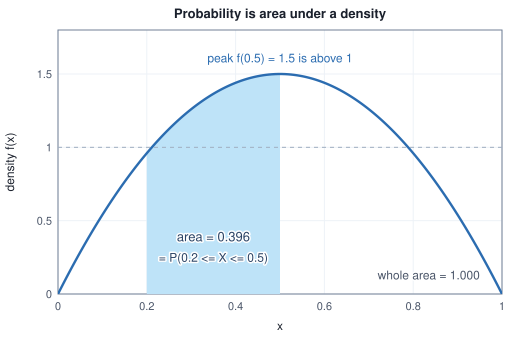
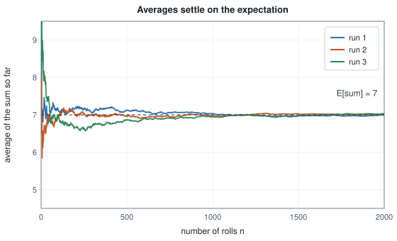

<!-- SPDX-License-Identifier: CC-BY-4.0 -->
<!-- Copyright (c) 2026 Martin Schröder <info@swedishembedded.com> -->

# Probability: Reasoning Under Uncertainty

*How do we put numbers on uncertainty and update them when we see evidence?*

A mail service runs a spam filter. To find out how good it is, someone reads
1000 emails, decides for each one whether it really was spam, and counts how the
filter's verdict (flagged or not flagged) lined up with the truth:

<!-- worked: probability.spam_counts -->
| filter said | spam | ham | total |
|---|---:|---:|---:|
| flagged | 180 | 40 | 220 |
| not flagged | 20 | 760 | 780 |
| total | 200 | 800 | 1000 |
<!-- /worked -->

Four numbers hold everything we know, and they already answer questions that
sound like opinions. If we pick one of the 1000 emails blindly, how likely is it
to be spam? If the filter flagged it, how likely is it really spam? If it did
not flag it, how worried should we be? If an email is spam, how likely is it
that the filter catches it? Each question is a ratio of two counts, and the
ratios are different even though they come from one table: $200$ of $1000$ are
spam, but $180$ of the $220$ flagged ones are, and $180$ of the $200$ spam ones
are flagged.

Probability turns such counting into a calculus: a vocabulary for experiments
and their results, a small set of rules that every probability obeys, and four
tools that carry the weight of machine learning: tables over two
quantities at once and the one-quantity tables that can be read off them, a rule
for turning "how likely is the evidence if the cause is present" into "how
likely is the cause given the evidence", and two numbers, a centre and a spread,
that summarise a whole distribution. Dice and coins come first, because every
probability in them can be counted; the rules are built from the counts and only
then used on the filter, on a defect detector for rare faults, and on the
average that training minimises.

The counting needs only sets, sums, functions and areas from earlier chapters,
and the five questions below bring each of them back; one that resists sends you
to the chapter it names, and the answers close the chapter.

1. (Chapter 1, set.) For $A = \{1, 2, 3, 4\}$ and $B = \{3, 4, 5\}$, what are $A \cap B$, $A \cup B$ and $\lvert A \cup B \rvert$?
2. (Chapter 1, summation notation.) Evaluate $\sum_{i=1}^{4} i/10$.
3. (Chapter 2, function.) The function $f(x) = x^2$ has domain $\{-2, -1, 0, 1, 2\}$. What is its range, and which inputs does it send to $4$?
4. (Chapter 9, integral.) What is $\int_0^1 2\,x\,dx$, and what area is it?
5. (Chapter 1, product of sets.) List the set $\{H, T\} \times \{1, 2\}$.

## Counting before axioms

We want a number between $0$ and $1$ for "how likely". The most honest source is
repetition: do the experiment many times and count. Flip a fair coin and record
the fraction of heads as the flips accumulate. The random choices come from the
book's own generator, SplitMix64, which Chapter 17 builds; `rng.uniform()` is its
call for a real number in $[0, 1)$. Every simulated table in this book prints the
generator's 64-bit seed and the order of its draws, so that once you have the
generator you reproduce the table digit for digit (the seed is the first eight
bytes of the SHA-256 hash of the example's name, read as a big-endian number, but
you only need the printed value):

<!-- worked: probability.coin_frequencies -->
Generator: the book's SplitMix64, seed 0x60a34a2606b2623c (6963490976026485308). Flip k is the k-th call of `rng.uniform()` and counts as heads when it is below 0.5; one run of 100,000 flips, read off at the flip counts listed.

| flips | heads | heads / flips | distance from 0.5 |
|---|---:|---:|---:|
| 10 | 6 | 0.6000 | 0.1000 |
| 100 | 58 | 0.5800 | 0.0800 |
| 1,000 | 511 | 0.5110 | 0.0110 |
| 10,000 | 4965 | 0.4965 | 0.0035 |
| 100,000 | 49941 | 0.4994 | 0.0006 |
<!-- /worked -->

After ten flips the fraction is far from one half; after a hundred thousand it is
within $0.001$. The fraction does not jump to $0.5$ and stay
there, and no single row proves anything. But the pattern is stable enough to
define the thing we are after: the **probability** of an outcome is the number
that its long-run relative frequency settles towards. Why it settles, and how
fast, follows from the expectation and the variance below.

For some experiments we do not need to flip anything, because the structure
gives the answer by counting. Roll two dice. Write each result as a pair
(first die, second die). There are $6 \times 6 = 36$ pairs, and unless the dice
are loaded each is equally likely. The sum of the two numbers is what many games
care about, and it is not equally likely across its values: a sum of $7$ can be
made six ways, a sum of $2$ only one way.

<!-- worked: probability.two_dice_sums -->
| sum | outcomes | fraction | probability | tally |
|---|---:|---:|---:|---|
| 2 | 1 | 1/36 | 0.0278 | # |
| 3 | 2 | 2/36 | 0.0556 | ## |
| 4 | 3 | 3/36 | 0.0833 | ### |
| 5 | 4 | 4/36 | 0.1111 | #### |
| 6 | 5 | 5/36 | 0.1389 | ##### |
| 7 | 6 | 6/36 | 0.1667 | ###### |
| 8 | 5 | 5/36 | 0.1389 | ##### |
| 9 | 4 | 4/36 | 0.1111 | #### |
| 10 | 3 | 3/36 | 0.0833 | ### |
| 11 | 2 | 2/36 | 0.0556 | ## |
| 12 | 1 | 1/36 | 0.0278 | # |
| total | 36 | 36/36 | 1.0000 |  |
<!-- /worked -->

The vocabulary for this is small. The **sample space**, written $\Omega$, is the
set of all things that can happen in one run of the experiment, here the $36$
pairs; each element is an **outcome**. An **event** is a set of outcomes: "the
sum is $7$" is the set $\{(1,6), (2,5), (3,4), (4,3), (5,2), (6,1)\}$, a subset of
$\Omega$ with six elements. When all outcomes are equally likely, the probability
of an event $A$ is the share of outcomes in it,

$$
P(A) = \frac{\lvert A \rvert}{\lvert \Omega \rvert},
$$

so $P(\text{sum is } 7) = 6/36 = 1/6$. Because events are sets, the set operations
of Chapter 1 have meanings: $A \cap B$ ("$A$ and $B$") is the outcomes in both,
$A \cup B$ ("$A$ or $B$") the outcomes in at least one, and the **complement**
$A^c$ ("not $A$") the outcomes of $\Omega$ not in $A$. Counting them for three
events of the two dice:

<!-- worked: probability.dice_events -->
| event | outcomes | probability |
|---|---:|---:|
| A: sum is 7 | 6 | 0.1667 |
| B: first die is even | 18 | 0.5000 |
| C: sum is at least 10 | 6 | 0.1667 |
| A and B (intersection) | 3 | 0.0833 |
| A or B (union) | 21 | 0.5833 |
| P(A) + P(B) - P(A and B) |  | 0.5833 |
| not C (complement) | 30 | 0.8333 |
| 1 - P(C) |  | 0.8333 |
<!-- /worked -->

Look at the union row. $P(A) + P(B)$ would be $6/36 + 18/36 = 24/36$, but the
union has only $21$ outcomes: the three outcomes with sum $7$ and an even first
die, $(2,5)$, $(4,3)$ and $(6,1)$, were counted once in $A$ and once in $B$.
Subtracting the intersection fixes it, and that is the general rule we derive
next.

## The rules every probability obeys

Counting works when outcomes are equally likely. The spam filter's outcomes are
not (there are far more not-flagged ham emails than flagged spam ones), and a
loaded die is not either. What survives in every case is a short list of
properties that the counting ratio has. A **probability** is an assignment
of a number $P(A)$ to each event $A$ such that:

1. $P(A) \ge 0$ for every event $A$;
2. $P(\Omega) = 1$: something happens;
3. if $A$ and $B$ have no outcome in common ($A \cap B = \varnothing$, they are
   **disjoint**), then $P(A \cup B) = P(A) + P(B)$.

The counting ratio satisfies all three: counts are not negative, $\lvert\Omega\rvert/\lvert\Omega\rvert = 1$,
and the elements of two disjoint sets are counted once each. (For sample spaces
with infinitely many outcomes, rule 3 is extended to any countable list of
disjoint events; we need only the version above and its repeated use.) Every
other rule is derived from these three. That is the point of choosing so few:
anything we prove from them holds for dice, filters and neural networks alike.

The complement comes first. $A$ and $A^c$ are disjoint and their union is $\Omega$, so by
rules 3 and 2, $P(A) + P(A^c) = 1$, hence $P(A^c) = 1 - P(A)$. In the table,
$P(\text{sum} < 10) = 1 - 6/36 = 30/36$, as counted. In particular $P(\varnothing) = 1 - P(\Omega) = 0$,
and, by rule 1 applied to $A^c$, no probability exceeds $1$.

The union is next. Split $A \cup B$ into the disjoint pieces $A$ and $B \setminus A$
(the part of $B$ outside $A$), and split $B$ into the disjoint pieces
$B \setminus A$ and $A \cap B$. Rule 3 twice gives
$P(A \cup B) = P(A) + P(B \setminus A)$ and $P(B) = P(B \setminus A) + P(A \cap B)$.
Eliminate $P(B \setminus A)$:

$$
P(A \cup B) = P(A) + P(B) - P(A \cap B).
$$

This is the inclusion-exclusion rule the table just confirmed: $6/36 + 18/36 - 3/36 = 21/36$.

One more consequence is used constantly. If events $B_1, \dots, B_k$ are pairwise disjoint and together
cover $\Omega$ (a **partition**), then repeated use of rule 3 gives
$\sum_i P(B_i) = 1$, and for any event $A$,
$P(A) = \sum_i P(A \cap B_i)$, because the pieces $A \cap B_i$ are disjoint and
their union is $A$. This sum over a partition is the single most used step in
the rest of the chapter.

## Random variables

An outcome like "tails, heads, heads" is awkward to compute with. What we usually
care about is a number computed from it: the number of heads, the sum of the
dice, whether the filter was right. A **random variable** is exactly that: a
function (Chapter 2) from the sample space to the real numbers. Despite the name
it is neither random nor a variable: it is a fixed rule, and the randomness is
in which outcome the experiment produces. Three coin flips have $2^3 = 8$
outcomes, and $X$, the number of heads, assigns a number to each:

<!-- worked: probability.three_coins -->
| outcome | X = heads |
|---|---:|
| TTT | 0 |
| TTH | 1 |
| THT | 1 |
| THH | 2 |
| HTT | 1 |
| HTH | 2 |
| HHT | 2 |
| HHH | 3 |

| x | outcomes with X = x | count | fraction | P(X = x) |
|---|---|---:|---:|---:|
| 0 | TTT | 1 | 1/8 | 0.125 |
| 1 | TTH, THT, HTT | 3 | 3/8 | 0.375 |
| 2 | THH, HTH, HHT | 3 | 3/8 | 0.375 |
| 3 | HHH | 1 | 1/8 | 0.125 |
<!-- /worked -->

The **probability distribution** of a random variable says how likely each of its
values is. It is computed by the same counting as before: the event "$X = x$" is
the set of outcomes that $X$ sends to $x$ (the preimage, the inputs of the
function that land on $x$), and $p(x) = P(X = x)$ is the probability of that set.
Above, the value $1$ comes from $\{\text{TTH}, \text{THT}, \text{HTT}\}$, so
$p(1) = 3/8$. For a variable with a finite list of values this is a table,
and the rules above force its properties: every $p(x) \ge 0$, and because the
events $\{X = x\}$ partition $\Omega$, $\sum_x p(x) = 1$. Notation: $P(\cdot)$
takes an event, $p(x)$ takes a value of a random variable; when the variable is
not obvious we write $p_X(x)$.

Two derived facts are used constantly. A function of a random variable is a
random variable (a composition, Chapter 2): $X^2$, and the sum $X + Y$ of two
variables defined on the same sample space, are computed outcome by outcome. And an
event $A$ becomes a number through its **indicator** $\mathbf{1}_A$, which is
$1$ on outcomes in $A$ and $0$ elsewhere. The indicator of "the filter was
right" is a random variable on the $1000$ emails, and the fraction of ones is the
accuracy.

## Continuous variables: density and area

Not every quantity has a list of values. The measured length of a part, the
reading of a sensor, the output of a network before it is rounded: these take any
value in an interval. For such a variable, "the probability that $X$ equals
$0.3$" has to be $0$. If every one of the infinitely many values in $[0,1]$ had a
positive probability, the probabilities would add to more than $1$. Probability
instead lives on intervals, and it is given by an area (Chapter 9).

A **density** is a function $f \ge 0$ with total area $1$, and the probability of
an interval is the area under $f$ over it:

$$
P(a \le X \le b) = \int_a^b f(x)\,dx, \qquad \int_{-\infty}^{\infty} f(x)\,dx = 1 .
$$

The three rules hold because areas are not negative, the whole area is $1$, and
the areas of disjoint intervals add. Take $f(x) = 6\,x\,(1-x)$ on $[0, 1]$ and zero
elsewhere, a hump with its peak at $x = 0.5$. Areas from Chapter 9's Simpson rule
agree with the exact antiderivative $3\,x^2 - 2\,x^3$:

<!-- worked: probability.density_area -->
| interval | area under f (Simpson) | exact 3 x^2 - 2 x^3 |
|---|---:|---:|
| 0 to 0.2 | 0.104000 | 0.104000 |
| 0.2 to 0.5 | 0.396000 | 0.396000 |
| 0.5 to 1 | 0.500000 | 0.500000 |
| 0 to 1 | 1.000000 | 1.000000 |
| 0.3 to 0.3 | 0.000000 | 0.000000 |

Largest value of the density, f(0.5) = 1.5.

| slice [0.5, 0.5 + w], w | P(slice) | f(0.5) x w | P(slice) / w |
|---|---:|---:|---:|
| 0.1 | 0.148000 | 0.150000 | 1.4800 |
| 0.01 | 0.014998 | 0.015000 | 1.4998 |
| 0.001 | 0.001500 | 0.001500 | 1.5000 |
<!-- /worked -->



Three things in the table deserve a pause.

The probability of the single point $0.3$ is the area of an interval of width
zero: $0$. This does not make $0.3$ impossible; some value must occur, and every
value has probability $0$. Probability zero is weaker than impossible when there
are infinitely many outcomes.

The density is not a probability. At $x = 0.5$ its value is $1.5$, larger than
$1$, which no probability can be. The second table shows what $f(0.5)$ does mean:
the probability of a thin slice starting at $0.5$ divided by its width $w$
approaches $1.5$ as the slice narrows. The density is probability *per unit
length*, in the way a speed is distance per unit time, and its values depend on
the unit: the same variable measured in centimetres instead of metres has a
density one hundred times smaller. A density can be as tall as it likes, provided
its area stays $1$:

<!-- worked: probability.density_exceeds_one -->
| interval length w | density height 1/w | area |
|---|---:|---:|
| 1 | 1.0 | 1.0000 |
| 0.5 | 2.0 | 1.0000 |
| 0.1 | 10.0 | 1.0000 |
| 0.01 | 100.0 | 1.0000 |
<!-- /worked -->

And the whole area is $1$: that is the property that makes $f$ a density, and
the reason Chapter 9 insisted on dividing the bell curve by its area. A function
that is non-negative with finite area $c$ becomes a density when divided by $c$.

## Joint distributions and marginals

Two random variables defined on the same experiment have a **joint distribution**:
the probability of each *pair* of values, $p(x, y) = P(X = x \text{ and } Y = y)$.
For finitely many values it is a table with one cell per pair. The spam counts of
the problem, divided by $1000$, are the joint distribution of $V$ (the filter's
verdict) and $K$ (the true kind). Every cell is non-negative, and all four sum to
$1$:

<!-- worked: probability.spam_joint -->
|  | spam | ham | P(verdict) |
|---|---:|---:|---:|
| flagged | 0.180 | 0.040 | 0.220 |
| not flagged | 0.020 | 0.760 | 0.780 |
| P(kind) | 0.200 | 0.800 | 1.000 |
<!-- /worked -->

The last row and column are sums, and they are distributions in their own right.
The column sum for "spam" is $P(K = \text{spam}) = 0.18 + 0.02 = 0.2$. Why is it
legitimate to add cells? The events $\{V = \text{flagged}\}$ and
$\{V = \text{not flagged}\}$ partition the sample space, so by the partition rule
of the previous section,

$$
p_K(k) = \sum_{v} p(v, k), \qquad p_V(v) = \sum_{k} p(v, k).
$$

This is **marginalisation**: to forget one variable, sum it out. The results are
called **marginals** because, in a table, they are written in the margins. They
answer questions about one variable alone, here that $22\%$ of the mail is
flagged and $20\%$ is spam.

A joint table with more cells is read the same way. A three-class classifier was
run on $1000$ images, and each was counted by its true class and its predicted
class:

<!-- worked: probability.classifier_joint -->
| true class | cat | dog | bird | P(true) |
|---|---:|---:|---:|---:|
| cat | 0.270 | 0.040 | 0.020 | 0.330 |
| dog | 0.030 | 0.300 | 0.010 | 0.340 |
| bird | 0.015 | 0.015 | 0.300 | 0.330 |
| P(predicted) | 0.315 | 0.355 | 0.330 | 1.000 |

Diagonal (correct) mass: 0.870. P(predicted = true given true): cat 0.818, dog 0.882, bird 0.909.
<!-- /worked -->


The diagonal is the probability of being right, $0.270 + 0.300 + 0.300 = 0.870$:
the accuracy is a single sum over cells of the joint. The right-hand column says
how the true classes are distributed; the bottom row says how often the
classifier predicts each class, which is not the same, since the classifier
predicts "dog" a little more often than dogs occur ($0.355$ against $0.340$).
The same table with counts in place of probabilities is what classification
reports call a confusion matrix, and every rate they quote is derived from it.

Two variables with a continuous joint distribution have a joint density
$f(x, y)$ whose volume is $1$, and the marginal is obtained by integrating one
variable out, $f_X(x) = \int f(x, y)\,dy$. The idea is unchanged, with the sum
replaced by the integral.

## Conditional probability

Given that the filter flagged an email, how likely is it spam? "Given" changes
the question: we no longer draw from all $1000$ emails but only from the $220$ that
were flagged. Among those, $180$ are spam, so the answer is $180/220$. The
reasoning is in the counts, and it pays to do it systematically:

<!-- worked: probability.spam_conditionals -->
| quantity | count ratio | value |
|---|---|---:|
| P(spam) | 200 / 1000 | 0.2000 |
| P(flagged) | 220 / 1000 | 0.2200 |
| P(spam and flagged) | 180 / 1000 | 0.1800 |
| P(spam given flagged) | 180 / 220 | 0.8182 |
| P(flagged given spam) | 180 / 200 | 0.9000 |
| P(spam given not flagged) | 20 / 780 | 0.0256 |
| P(flagged given ham) | 40 / 800 | 0.0500 |

Product rule: P(flagged) P(spam given flagged) = 0.1800, P(spam) P(flagged given spam) = 0.1800, both equal P(spam and flagged) = 0.1800.
<!-- /worked -->

The **conditional probability** of $A$ given $B$ is the share of $B$ that is also
$A$. When outcomes are equally likely this is $\lvert A \cap B\rvert / \lvert B \rvert$;
dividing the numerator and the denominator by $\lvert\Omega\rvert$ gives the
definition that holds in general,

$$
P(A \mid B) = \frac{P(A \cap B)}{P(B)}, \qquad P(B) > 0 .
$$

Both parts have a plain reading. Conditioning on $B$ throws away every outcome
outside $B$ (the numerator keeps only $A \cap B$), and it rescales what is left
so that the new total is $1$ (the division by $P(B)$). The condition $P(B) > 0$
is not a technicality: if $B$ never happens, there is no population to take a
share of, and the question has no answer.

Rearranged, the definition is the **product rule**,

$$
P(A \cap B) = P(A \mid B)\,P(B) = P(B \mid A)\,P(A).
$$

Both orders are valid because $A \cap B = B \cap A$. The last lines of the table
check this on the filter: $0.22 \times 0.8182 = 0.2 \times 0.9 = 0.18$.

The distributions of a variable given a value of another are read off the joint
table by keeping one row and dividing by its sum (the sum is exactly the
marginal):

<!-- worked: probability.spam_condition_on_verdict -->
| given | spam count | ham count | P(spam given row) | P(ham given row) | sum |
|---|---:|---:|---:|---:|---:|
| flagged | 180 / 220 | 40 / 220 | 0.8182 | 0.1818 | 1.0 |
| not flagged | 20 / 780 | 760 / 780 | 0.0256 | 0.9744 | 1.0 |
<!-- /worked -->

Each row now sums to $1$: a conditional distribution is a genuine distribution.
The two rows are strikingly different, which is the point of a useful filter: a
flagged email is spam with probability $0.818$, an unflagged one with probability
$0.026$.

Applying the product rule repeatedly gives the chain rule, for three events,

$$
P(A \cap B \cap C) = P(A)\,P(B \mid A)\,P(C \mid A \cap B),
$$

and for $n$ it is a product of $n$ conditionals, each given everything before it.
This is how a probability for a *sequence* is built: the probability of a
sentence $w_1 w_2 \dots w_n$ is $p(w_1)\,p(w_2 \mid w_1) \cdots p(w_n \mid w_1 \dots w_{n-1})$.
A language model is a machine that outputs one of these conditionals at a time,
and Chapter 1's observation that a product of many probabilities is awkward and a
sum of their logarithms is not is the reason it reports log-probabilities.

The most common error with conditionals is to swap the two sides.
$P(\text{flagged} \mid \text{spam}) = 0.9$ and $P(\text{spam} \mid \text{flagged}) = 0.818$
are different numbers answering different questions. They coincide only when
$P(A) = P(B)$. Bayes' rule, two sections on, converts one into the other.

## Independence

Sometimes learning $B$ tells us nothing about $A$: $P(A \mid B) = P(A)$. Two
events with this property are **independent**. By the product rule it is
equivalent to the symmetric statement

$$
P(A \cap B) = P(A)\,P(B),
$$

and this form is the one to check, since it needs no division and does not favour
either event. Two random variables are independent when every pair of events
$\{X = x\}$, $\{Y = y\}$ is, that is when the joint table is the product of its
marginals, $p(x, y) = p(x)\,p(y)$ in every cell. Test it on two fair dice:

<!-- worked: probability.independence_checks -->
| events A / B | P(A) | P(B) | P(A and B) | P(A) P(B) | verdict | mutually exclusive |
|---|---:|---:|---:|---:|---|---|
| first die is 6 / second die is 6 | 0.1667 | 0.1667 | 0.0278 | 0.0278 | independent | no |
| first die is 3 / sum is 7 | 0.1667 | 0.1667 | 0.0278 | 0.0278 | independent | no |
| first die is 3 / sum is 8 | 0.1667 | 0.1389 | 0.0278 | 0.0231 | dependent | no |
| first die is 1 / first die is 2 | 0.1667 | 0.1667 | 0.0000 | 0.0278 | dependent | yes |
| first die even / second die even | 0.5000 | 0.5000 | 0.2500 | 0.2500 | independent | no |
| first die even / sum even | 0.5000 | 0.5000 | 0.2500 | 0.2500 | independent | no |
<!-- /worked -->

The first row is the picture we have in mind: the dice do not influence each
other, and $1/36 = 1/6 \times 1/6$. The second row surprises: that the first die
is $3$ and that the sum is $7$ are independent, because whatever the first die
shows there is exactly one second value that makes $7$. The third row changes
only the target sum to $8$ and independence is lost: after a $3$, the sum $8$ is
possible (the second die must be $5$); after a $1$, it is impossible. Independence
is a numerical property of the probabilities, not something visible from the
story, so it has to be checked. The last two rows are another surprise: "first die
even" and "the sum is even" are independent, although the second is partly
determined by the first.

The fourth row is the most common confusion. Events are **mutually exclusive**
when they cannot both occur: $A \cap B = \varnothing$. "The first die is $1$" and
"the first die is $2$" are. This is the opposite of independence, not a form of
it: if $A$ and $B$ are exclusive and both have positive probability, then
$P(A \cap B) = 0 \ne P(A)P(B)$, and learning that $B$ happened tells us that $A$
did not. Exclusive means "knowing one rules out the other"; independent means
"knowing one tells nothing about the other".

The filter and the truth had better not be independent. The test is a comparison
of the joint with the product of the marginals:

<!-- worked: probability.spam_independence -->
| cell | joint p | product of marginals | ratio |
|---|---:|---:|---:|
| flagged, spam | 0.180 | 0.0440 | 4.09 |
| flagged, ham | 0.040 | 0.1760 | 0.23 |
| not flagged, spam | 0.020 | 0.1560 | 0.13 |
| not flagged, ham | 0.760 | 0.6240 | 1.22 |
<!-- /worked -->

A flagged spam email is $4.09$ times more frequent than independence would give
and a flagged ham email is $0.23$ times as frequent. The ratio between the joint
and the product of marginals is a measure of how much one variable tells about
the other; Chapter 13 turns it into a number of bits. Independence is the
assumption that makes large distributions manageable (a table over $n$ binary
variables has $2^n$ cells, a product of $n$ marginals has only $n$ numbers), and
it is also the assumption most often made wrongly.

## Bayes' rule

The filter's makers know how it behaves on mail of each kind: it flags $90\%$ of
spam and $5\%$ of ham. The user needs the other direction: given a flag, is it
spam? Write the product rule both ways and equate them,

$$
P(A \mid B)\,P(B) = P(B \mid A)\,P(A)
\quad\Longrightarrow\quad
P(A \mid B) = \frac{P(B \mid A)\,P(A)}{P(B)} .
$$

This is **Bayes' rule**. The denominator is rarely given, but it follows from
the partition rule: if $A$ and $A^c$ partition $\Omega$,
$P(B) = P(B \mid A)P(A) + P(B \mid A^c)P(A^c)$, the **law of total probability**:
the probability of the evidence is its probability under each cause weighted by
how likely the cause is. In the language used for learning, $P(A)$ is the
prior (belief before the evidence), $P(B \mid A)$ the chance of the
evidence under the cause, and $P(A \mid B)$ the **posterior** (belief after it). For the filter:

<!-- worked: probability.bayes_spam_two_ways -->
| quantity | value |
|---|---:|
| P(spam) | 0.2000 |
| P(flagged given spam) | 0.9000 |
| P(flagged given ham) | 0.0500 |
| P(flagged) = sum over kinds | 0.2200 |
| Bayes: 0.9 x 0.2 / P(flagged) | 0.8182 |
<!-- /worked -->

Bayes' rule from the manufacturer's numbers gives the same $0.8182$ that counting
the flagged emails gave. That agreement is the check that the rule is correct,
and it will matter when the data are not available as a table of counts.

The rule has a famous consequence, the base-rate fallacy. A factory inspects
parts with a detector. It raises an alarm on $90\%$ of defective parts and, by
mistake, on $10\%$ of good ones. Defects are rare: $1\%$ of parts. A part
triggers the alarm. How likely is it defective? Most people answer "about
$90\%$". Count it instead, on $100000$ parts:

<!-- worked: probability.bayes_rare_defect -->
|  | parts | alarm | no alarm |
|---|---:|---:|---:|
| defective | 1000 | 900 | 100 |
| good | 99000 | 9900 | 89100 |
| total | 100000 | 10800 | 89200 |

Of the 10800 alarms, 900 are real: P(defective given alarm) = 900/10800 = 0.0833. Of the 89200 silences, 89100 are good: P(good given no alarm) = 0.9989.
Bayes' rule directly: 0.0833.
<!-- /worked -->

A thousand parts are defective, and $900$ of them raise the alarm. Of the $99000$
good parts, $10\%$ raise it too: $9900$ false alarms, eleven for every real
one. Of the $10800$ alarms only $900$ are real: $8.3\%$. Bayes' rule says the
same in one line,

$$
P(\text{defective} \mid \text{alarm}) = \frac{0.9 \times 0.01}{0.9 \times 0.01 + 0.1 \times 0.99} = \frac{0.009}{0.108} .
$$

The intuition "the detector is $90\%$ right" confuses $P(\text{alarm} \mid \text{defective})$
with $P(\text{defective} \mid \text{alarm})$, and ignores the **base rate**, the
prior $P(\text{defective})$, which here dominates. Same detector, other base rates:

<!-- worked: probability.bayes_base_rate_sweep -->
| base rate P(defective) | P(alarm) | P(defective given alarm) | false alarms per real one |
|---|---:|---:|---:|
| 0.0001 | 0.1001 | 0.0009 | 1111.0 |
| 0.001 | 0.1008 | 0.0089 | 111.0 |
| 0.01 | 0.1080 | 0.0833 | 11.0 |
| 0.05 | 0.1400 | 0.3214 | 2.1 |
| 0.2 | 0.2600 | 0.6923 | 0.4 |
| 0.5 | 0.5000 | 0.9000 | 0.1 |
<!-- /worked -->

When defects are one in ten thousand, an alarm means a real defect less than one
time in a thousand; when half the parts are defective, the alarm is right $90\%$
of the time. A detector is only as informative as its base rate allows. Every
rare-event detector in machine learning (fraud, disease screening, a safety
monitor) faces this arithmetic, and a high accuracy figure reported without the
base rate says little.

The posterior of one piece of evidence is the prior for the
next. Suppose a second and then a third detector, each with the same $90\%$ and $10\%$
rates and with errors independent of the others' once we know the truth, also raise
an alarm:

<!-- worked: probability.bayes_two_detectors -->
Prior 0.01; each detector has sensitivity 0.9 and false-alarm rate 0.1, and they err independently given the truth.

| state | P(defective) |
|---|---:|
| before any alarm | 0.0100 |
| after alarm 1 (detector 1) | 0.0833 |
| after alarm 2 (detector 2) | 0.4500 |
| after alarm 3 (detector 3) | 0.8804 |
<!-- /worked -->

Each alarm multiplies the odds of "defective against good" by the same factor.
Odds start at $1/99$; the factor is $0.9/0.1 = 9$; so they become $1/11$, $9/11$
and $81/11$, which are the probabilities $0.0833$, $0.45$ and $0.8804$. Evidence
accumulates by multiplication of likelihood ratios, which is why log-probabilities
(sums) are the practical form. Be careful with the assumption: the two detectors
must err independently given the truth. If both are fooled by the same
reflections, the second alarm tells much less than this table says.

## Expectation

A distribution is a whole table or curve, and we often need one number that says
where it is centred. The tool is the **expectation**: the probability-weighted
average of the values. For a discrete variable and for one with a density,

$$
\mathbb{E}[X] = \sum_x x\,p(x), \qquad \mathbb{E}[X] = \int x\,f(x)\,dx .
$$

For one die every term of the sum is $x \cdot 1/6$; for the sum of two dice it is
the sum times the table of the previous section:

<!-- worked: probability.expectation_by_table -->
| x | p(x) | x p(x) |
|---|---:|---:|
| 1 | 1/6 | 0.1667 |
| 2 | 1/6 | 0.3333 |
| 3 | 1/6 | 0.5000 |
| 4 | 1/6 | 0.6667 |
| 5 | 1/6 | 0.8333 |
| 6 | 1/6 | 1.0000 |
| E[one die] |  | 3.5000 |

| s | p(s) | s p(s) |
|---|---:|---:|
| 2 | 1/36 | 0.0556 |
| 3 | 1/18 | 0.1667 |
| 4 | 1/12 | 0.3333 |
| 5 | 1/9 | 0.5556 |
| 6 | 5/36 | 0.8333 |
| 7 | 1/6 | 1.1667 |
| 8 | 5/36 | 1.1111 |
| 9 | 1/9 | 1.0000 |
| 10 | 1/12 | 0.8333 |
| 11 | 1/18 | 0.6111 |
| 12 | 1/36 | 0.3333 |
| E[sum] |  | 7.0000 |
<!-- /worked -->

The expectation of one die is $3.5$, a value the die can never show: the
expectation is a centre of mass of the table, not a likely outcome. For two dice
it is exactly $7$. The word "expectation" suggests a prediction, but it is better
read as a **long-run average**. Roll two dice $n$ times and average the sums; as
$n$ grows the average should approach $7$. Three independent runs (the same experiment
as the table below, each from its own generator seeded from the names
`probability.running_average_figure.0` to `.2`):



<!-- worked: probability.long_run_average -->
Generator: the book's SplitMix64, seed 0x2ef6cf49c8ba6c36 (3384120085822729270). Roll k uses two calls of `rng.integer(6)`, each plus 1: first the first die, then the second; the sum of the two is the roll. One run of 100,000 rolls, read off at the roll counts listed.

| rolls | average of the sum | distance from 7 |
|---|---:|---:|
| 10 | 8.0000 | 1.0000 |
| 100 | 6.9000 | 0.1000 |
| 1,000 | 7.0210 | 0.0210 |
| 10,000 | 7.0109 | 0.0109 |
| 100,000 | 7.0057 | 0.0057 |
<!-- /worked -->

The reason is visible in the definition. If the value $x$ occurs in a fraction
$p(x)$ of the rolls in the long run, then the average over $n$ rolls is
$\sum_x x\,(\text{count of } x)/n \to \sum_x x\,p(x)$. The convergence is not
guaranteed to be monotone (the table's run happens to get closer at every row,
but the figure's three runs wander back and forth), and the figure shows that the
early swings are large: ten rolls gave $8.0$ here. How quickly the error
shrinks is the business of the variance, below.

Expectation is not limited to $X$ itself. The average of $g(X)$ over the outcomes is
$\mathbb{E}[g(X)] = \sum_x g(x)\,p(x)$: group the outcomes by the value of $X$ and
use the probability of each group. The same formula covers every quantity we
care about. If $\mathbf{1}_A$ is the indicator of an event, its expectation is
$1 \cdot P(A) + 0 \cdot P(A^c) = P(A)$: the probability of an event is the expectation
of its indicator, and an accuracy is the expectation of the indicator of "right".
If $g$ is a cost, $\mathbb{E}[g]$ is the average cost per email. Suppose
that flagging a good email costs $10$ (a lost message), missing a spam email costs
$1$ (some annoyance), and correct verdicts cost nothing:

<!-- worked: probability.spam_cost_expectation -->
| outcome | p | correct | cost | correct x p | cost x p |
|---|---:|---:|---:|---:|---:|
| flagged, spam | 0.180 | 1 | 0 | 0.180 | 0.000 |
| not flagged, spam | 0.020 | 0 | 1 | 0.000 | 0.020 |
| flagged, ham | 0.040 | 0 | 10 | 0.000 | 0.400 |
| not flagged, ham | 0.760 | 1 | 0 | 0.760 | 0.000 |
| expectation | 1.000 |  |  | 0.940 | 0.420 |
<!-- /worked -->

The filter is right $94\%$ of the time and costs $0.42$ per email on average. The
two numbers disagree about which errors matter: of the $60$ errors in $1000$
emails, the $20$ missed spam emails account for only $0.02$ of the $0.42$, and
the $40$ lost good emails for $0.40$. Choosing the
quantity whose expectation we want is the design decision; computing it is a sum.

A dataset is a distribution too. The mean of the per-example losses of a dataset
of $N$ examples is an expectation: give each example probability $1/N$. Equal
values pool their weights:

<!-- worked: probability.dataset_mean_is_expectation -->
Losses of five examples: [0, 1, 1, 4, 9]; their mean is 3.00.

| loss value | probability | value x probability |
|---|---:|---:|
| 0 | 1/5 | 0.00 |
| 1 | 2/5 | 0.40 |
| 4 | 1/5 | 0.80 |
| 9 | 1/5 | 1.80 |
| E[loss] |  | 3.00 |
<!-- /worked -->

The sum of $0.00 + 0.40 + 0.80 + 1.80$ is the mean $3$ of the five losses. This is
the **empirical distribution** of the data, and it is why "the average loss over
the dataset" and "the expected loss" are the same operation on two distributions:
the empirical one and the unknown one the data came from.

The most useful property of expectation is its linearity: it respects sums,
whatever the relation between the variables:

$$
\mathbb{E}[X + Y] = \mathbb{E}[X] + \mathbb{E}[Y], \qquad \mathbb{E}[aX + b] = a\,\mathbb{E}[X] + b .
$$

To prove it, compute the expectation outcome by outcome. Grouping the outcomes by
the value of $X$ shows $\mathbb{E}[X] = \sum_{\omega} X(\omega)\,P(\{\omega\})$, a
sum over the sample space. Then

$$
\begin{aligned}
\mathbb{E}[X + Y] &= \sum_{\omega} \bigl(X(\omega) + Y(\omega)\bigr) P(\{\omega\})\\
&= \sum_{\omega} X(\omega) P(\{\omega\}) + \sum_{\omega} Y(\omega) P(\{\omega\})\\
&= \mathbb{E}[X] + \mathbb{E}[Y].
\end{aligned}
$$

Independence was never used; the proof only distributes a sum. The second identity
is the same distribution with $a$ and $b$ pulled out. For densities the identical
argument holds because integrals are also linear (Chapter 9). Test it on a case
chosen to look suspicious, where one variable is the sum that contains the other:

<!-- worked: probability.linearity_check -->
| pair | relation | E[X] | E[Y] | E[X + Y] | E[X Y] | E[X] E[Y] |
|---|---|---:|---:|---:|---:|---:|
| X = first die, Y = second die | independent | 3.5000 | 3.5000 | 7.0000 | 12.2500 | 12.2500 |
| X = first die, Y = sum of both | dependent | 3.5000 | 7.0000 | 10.5000 | 27.4167 | 24.5000 |
| X = first die, Y = 7 - first die | dependent | 3.5000 | 3.5000 | 7.0000 | 9.3333 | 12.2500 |
<!-- /worked -->

In every row $\mathbb{E}[X + Y] = \mathbb{E}[X] + \mathbb{E}[Y]$, even in the
second, where $Y$ includes $X$, and in the third, where $Y = 7 - X$ cancels $X$
exactly. Linearity does *not* extend to products. $\mathbb{E}[XY]$ equals
$\mathbb{E}[X]\,\mathbb{E}[Y]$ in the first row and differs in the others. The
equality holds for independent variables, by a short argument:

$$
\begin{aligned}
\mathbb{E}[XY] &= \sum_x\sum_y x\,y\,p(x, y) = \sum_x\sum_y x\,y\,p(x)\,p(y)\\
&= \Bigl(\sum_x x\,p(x)\Bigr)\Bigl(\sum_y y\,p(y)\Bigr) = \mathbb{E}[X]\,\mathbb{E}[Y].
\end{aligned}
$$

The converse fails: equal products do not imply independence. Let $X$ be $-1$, $0$ or
$1$ with probability $1/3$ each and $Y = X^2$. Then $\mathbb{E}[X] = 0$ and
$\mathbb{E}[XY] = \mathbb{E}[X^3] = (-1 + 0 + 1)/3 = 0 = \mathbb{E}[X]\,\mathbb{E}[Y]$, yet
$Y$ is determined by $X$: $P(X = 1, Y = 0) = 0$ while $P(X = 1)\,P(Y = 0) = 1/9$. The
next chapter returns to the gap. The asymmetry, that sums are always simple and products need
independence, is the key to the next section.

## Variance

Two sensors can both be right on average and still differ in how far a single
reading strays. The expectation does not see this: $0, 10$ with probability
$1/2$ each and the constant $5$ have the same mean. We need a number for the
**spread** around the mean. The natural attempt is the average deviation
$\mathbb{E}[X - \mathbb{E}[X]]$, and it is useless: by linearity it is always $0$,
the positive and negative deviations cancel. Square them first. The **variance** is
the expected squared deviation,

$$
\mathrm{Var}[X] = \mathbb{E}\bigl[(X - \mu)^2\bigr], \qquad \mu = \mathbb{E}[X],
$$

and the **standard deviation** $\sigma = \sqrt{\mathrm{Var}[X]}$ returns to the units
of $X$ (the square root of the squared unit). For one die:

<!-- worked: probability.variance_die -->
| x | x - E[X] | (x - E[X])^2 | p x (x - E[X])^2 |
|---|---:|---:|---:|
| 1 | -2.50 | 6.2500 | 1.0417 |
| 2 | -1.50 | 2.2500 | 0.3750 |
| 3 | -0.50 | 0.2500 | 0.0417 |
| 4 | 0.50 | 0.2500 | 0.0417 |
| 5 | 1.50 | 2.2500 | 0.3750 |
| 6 | 2.50 | 6.2500 | 1.0417 |
| Var by definition |  |  | 2.9167 |

E[X^2] = 91/6 = 15.1667, E[X]^2 = 12.2500, E[X^2] - E[X]^2 = 2.9167 = 35/12. Standard deviation sqrt(Var) = 1.7078.
<!-- /worked -->

The faces $1$ and $6$ are $2.5$ from the mean and contribute most; the variance
is $35/12 \approx 2.92$ and the standard deviation about $1.71$, so a roll is
typically within one to two units of $3.5$.

The definition has a shortcut. Expand the square and use linearity ($\mu$ is a constant):

$$
\mathbb{E}[(X - \mu)^2] = \mathbb{E}[X^2 - 2\mu X + \mu^2]
= \mathbb{E}[X^2] - 2\mu\,\mathbb{E}[X] + \mu^2
= \mathbb{E}[X^2] - \mu^2 .
$$

So $\mathrm{Var}[X] = \mathbb{E}[X^2] - \mathbb{E}[X]^2$, which needs only one pass
over the data to accumulate $\mathbb{E}[X]$ and $\mathbb{E}[X^2]$. The table
confirms it: $91/6 - 12.25 = 35/12$. Because a variance is an average of squares,
the shortcut also shows that $\mathbb{E}[X^2] \ge \mathbb{E}[X]^2$ always. (A warning for
Chapter 15: subtracting two large nearly equal numbers loses digits on a real
machine, so this formula is for algebra, not always for code.) The same two
integrals give the variance of a density: for $f(x) = 6\,x\,(1-x)$,

<!-- worked: probability.density_moments -->
| quantity | value |
|---|---:|
| E[X] = integral of x f(x) | 0.500000 |
| E[X^2] = integral of x^2 f(x) | 0.300000 |
| E[X^2] - E[X]^2 | 0.050000 |
| integral of (x - E[X])^2 f(x) | 0.050000 |
<!-- /worked -->

the expectation is $0.5$ by symmetry and the variance is $0.05$, by both routes.

How does the variance respond to shifting and scaling? Adding a constant moves the whole distribution and
changes no deviation, and multiplying by $a$ multiplies every deviation by $a$ and
so the variance by $a^2$:

$$
\mathrm{Var}[aX + b] = a^2\,\mathrm{Var}[X].
$$

<!-- worked: probability.variance_scaling -->
| variable | variance |
|---|---:|
| X | 2.9167 |
| X + 3 | 2.9167 |
| 2 X | 11.6667 |
| 2 X + 3 | 11.6667 |
| -X | 2.9167 |
<!-- /worked -->

The standard deviation scales by $\lvert a\rvert$, in the units of the data.

Expectations of sums are always sums. Variances are not.
Expand the square of the sum, with $\mu_X, \mu_Y$ the means:

$$
\begin{aligned}
\mathrm{Var}[X + Y] &= \mathbb{E}[X^2] + 2\,\mathbb{E}[XY] + \mathbb{E}[Y^2] - \mu_X^2 - 2\mu_X\mu_Y - \mu_Y^2\\
&= \mathrm{Var}[X] + \mathrm{Var}[Y] + 2\bigl(\mathbb{E}[XY] - \mu_X\mu_Y\bigr).
\end{aligned}
$$

The last bracket is zero when $\mathbb{E}[XY] = \mathbb{E}[X]\mathbb{E}[Y]$, which
the previous section proved for independent variables. So for independent
variables variances add. The bracket has a name, the covariance, which the next
chapter introduces; here it is only a gap that we can compute:

<!-- worked: probability.variance_of_sums -->
| pair | Var[X] | Var[Y] | sum of the two | Var[X + Y] | gap | 2(E[XY] - E[X]E[Y]) |
|---|---:|---:|---:|---:|---:|---:|
| independent: X = first, Y = second | 2.9167 | 2.9167 | 5.8333 | 5.8333 | 0.0000 | 0.0000 |
| equal: X = first, Y = first | 2.9167 | 2.9167 | 5.8333 | 11.6667 | 5.8333 | 5.8333 |
| opposite: X = first, Y = 7 - first | 2.9167 | 2.9167 | 5.8333 | 0.0000 | -5.8333 | -5.8333 |
| overlapping: X = first, Y = sum of both | 2.9167 | 5.8333 | 8.7500 | 14.5833 | 5.8333 | 5.8333 |
<!-- /worked -->

The first row is the independent case, and the gap is $0$. In the second, a
die added to itself, the variance of $2X$ is $4\,\mathrm{Var}[X]$, double what
independent dice give. In the third, $X + (7 - X) = 7$ is constant and the
variance is $0$. The last column, computed from the gap formula, matches the gap
in every row. Adding quantities that move together makes spread grow; adding
quantities that move oppositely cancels it.

The rules say how much averaging shrinks spread. Apply them to the mean of $n$ independent
rolls $\bar{X} = (X_1 + \dots + X_n)/n$, each with variance $\sigma^2$. Variances
of the independent sum add to $n\sigma^2$, and dividing by $n$ divides the variance
by $n^2$:

$$
\mathrm{Var}[\bar{X}] = \frac{n\,\sigma^2}{n^2} = \frac{\sigma^2}{n}, \qquad
\text{standard deviation } \frac{\sigma}{\sqrt{n}} .
$$

Check it by simulation: draw $4000$ such means for each $n$ and measure their
variance.

<!-- worked: probability.mean_variance_shrinks -->
Generator: the book's SplitMix64, seed 0x3cbfc3b94f57ea13 (4377432563494939155). One generator for the whole table. A roll is `rng.integer(6) + 1`. Rows in the order n = 1, 4, 16, 64, 256; within a row 4000 means in turn, each the average of its n rolls drawn in turn. Variance of the means: average squared deviation from their average (divisor 4000).

| rolls per mean n | average of the means | variance of the means | Var[X] / n | std of the means |
|---|---:|---:|---:|---:|
| 1 | 3.4515 | 2.8896 | 2.9167 | 1.6999 |
| 4 | 3.5248 | 0.7546 | 0.7292 | 0.8687 |
| 16 | 3.4849 | 0.1814 | 0.1823 | 0.4259 |
| 64 | 3.5004 | 0.0475 | 0.0456 | 0.2180 |
| 256 | 3.5011 | 0.0113 | 0.0114 | 0.1061 |
<!-- /worked -->

The averages cluster at $3.5$ in every row, since the expectation of the mean is
the expectation of a roll, but the spread of the mean shrinks like $\sigma/\sqrt{n}$: to halve
the error you need four times as many rolls. That is the rate at which the running
average in the figure settles, and it is why every estimate in the statistics
chapter comes with an uncertainty that falls only as the square root of the
sample size.

## Why training minimises an expectation

A model with parameters $\theta$ makes a prediction for an input $\mathbf{x}$, and
a loss $\ell(\theta;\mathbf{x}, y)$ says how bad it was against the true label $y$.
What we want is the loss on data the model will meet, which is the expectation
$L(\theta) = \mathbb{E}_{(\mathbf{x},y)\sim p}[\ell(\theta;\mathbf{x}, y)]$ over the
distribution $p$ the world draws pairs from. We do not know $p$. We have a dataset,
and the mean of the losses over it is the expectation under its empirical
distribution (the five-example table above). A minibatch of $B$ random
examples is a smaller average: its expectation is the dataset's, by linearity,
and its variance is $\sigma^2/B$, by the section just before. These three facts are the
whole reason training works with noisy gradients: the noisy average has the right
centre, and a larger batch buys precision at a square-root price. Volume II builds
the losses and Volume III the gradient, and both use "average" in exactly this
sense.

## Tables that must be valid, and drawing from one

A table passed around a
program is a distribution only if its entries are non-negative and sum to $1$.
Check this at the boundary with a tolerance (Chapter 15 explains why a float sum is
rarely exactly $1$). Marginalising and conditioning are one-liners on a joint
table, and both state their assumptions:

```text
function marginal_over_columns(p: array<real>[R, C]) -> array<real>[R]:
    require R > 0 and C > 0, "empty joint table"
    require min(p) >= 0.0 and close(sum(p), 1.0, 1e-6, 1e-6), "not a distribution"
    m = zeros(real, [R])
    for r in 0 .. R:
        for c in 0 .. C:
            m[r] = m[r] + p[r, c]
    return m

function condition_on_row(p: array<real>[R, C], r: int) -> array<real>[C]:
    require 0 <= r < R, "row out of range"
    s = 0.0
    for c in 0 .. C:
        s = s + p[r, c]
    require s > 0.0, "conditioning on an event of probability zero"
    q = zeros(real, [C])
    for c in 0 .. C:
        q[c] = p[r, c] / s          # keep the row, rescale to sum 1
    return q
```

A simulation often needs a random draw from a distribution given as a table. One uniform number is enough: lay the
probabilities end to end on $[0, 1)$ and see which segment the number lands in.

```text
function sample_discrete(p: array<real>[K], rng: Generator) -> int:
    require K > 0 and min(p) >= 0.0 and close(sum(p), 1.0, 1e-6, 1e-6)
    u = rng.uniform()               # u in [0, 1)
    acc = 0.0
    for k in 0 .. K:
        acc = acc + p[k]            # acc is the cumulative probability up to k
        if u < acc:
            return k
    return K - 1                    # rounding left acc just below 1
```

The final line matters: with real numbers the cumulative sum may end at
$0.99999\ldots$, and a $u$ above it must still return a valid index rather than
fall off the end. Check the sampler by counting:

<!-- worked: probability.sampling_a_table -->
Generator: the book's SplitMix64, seed 0xe8d9d1dc21d0d0bc (16778672630135836860). Each of the 20,000 draws is one `rng.uniform()` passed to the `sample_discrete` rule (first symbol whose cumulative probability exceeds u).

| symbol | p | cumulative p | draws of 20,000 | frequency |
|---|---:|---:|---:|---:|
| a | 0.50 | 0.50 | 9888 | 0.4944 |
| b | 0.30 | 0.80 | 6091 | 0.3045 |
| c | 0.20 | 1.00 | 4021 | 0.2011 |
<!-- /worked -->

The frequencies are close to $p$, differing by amounts consistent with the
$\sigma/\sqrt{n}$ rule. Chapter 17 builds the uniform generator itself.

## Six ways to misread a probability

The same few errors recur, each easy to make when a number is read aloud without
its condition.

- *Swapping the conditional.* $P(A \mid B) \ne P(B \mid A)$. Ask "given what?" of
  every probability read aloud.
- *Forgetting the base rate.* A detector's hit and false-alarm rates alone do not
  determine how often an alarm is right.
- *Assuming independence.* The product $P(A)P(B)$ is the joint only when it was
  checked; independence assumed wrongly in a chain of evidence overstates every
  posterior.
- *Treating a density as a probability.* A density may exceed $1$ and depends on
  units; only its integral over an interval is a probability.
- *Reading a small sample's average as the expectation.* The running average is
  within about $\sigma/\sqrt{n}$ of the expectation, no closer: the first row of
  the long-run table, ten rolls, is $1.0$ away.
- *Conditioning on an impossible event.* The division by $P(B)$ has no meaning at
  $0$; code that reaches it should stop.

## Token sampling, log-probabilities and a screening test in brain

Probability underlies most of Volume II onwards, and brain uses it in small,
concrete places.

Sampling a token is `sample_discrete`. A language model's output for one
position is a table of scores over the vocabulary; exponentiating and
normalising it (the softmax of the notation page) turns it into a distribution, and generating text means drawing from it. `sample_from_topk_impl`
in `crates/model/src/serve.rs` walks the cumulative sum as the pseudocode above
does. It scales the
candidate scores by a temperature, optionally keeps only the top $k$ or the
smallest set holding mass $p$ (so some probabilities are set to zero and the
rest are renormalised, which is conditioning on "the token is among the kept
ones"), draws `rng.next_f32() * kept_sum`, and walks the cumulative sum until it
passes the draw. Its sibling `sample_from_topk_with_logprob` also returns the log
of the drawn token's probability under that kept distribution, a number the
reinforcement-learning code needs. The tests in the same file pin the behaviour
to the definitions: `sample_from_topk_with_logprob_matches_a_manual_softmax_over_the_kept_set`
compares the returned value with an independent hand-written softmax, and
`sample_from_topk_is_reproducible_for_a_fixed_seed` checks that a fixed seed gives
the same draws, which is what makes a stochastic procedure testable.

A NaN is not a probability, and the sampler of `crates/qwen3/src/sample.rs`
once had to learn it: it used to crash when a score was NaN, because the sort that ranks candidates
panicked on it; commit `072148692` (August 2026) fixed that. The fix maps a NaN score to negative infinity where the
other scores are divided by the temperature (so its weight $e^{-\infty}$ is $0$, a probability
that cannot be drawn) and gives the sort an order in which NaN always loses. The
lesson is the table-validity rule above: a distribution must be made of
non-negative numbers, and an invalid entry has to be removed at the boundary
rather than allowed to poison the sum that normalises everything. Its regression
test is `nan_logit_does_not_panic_and_is_never_preferred`.

Log-probabilities are what a model actually reports. `row_logprob` in `crates/model/src/logprobs.rs`
returns $\log p(\text{target})$ for a row of scores, computed so that the tiny
probability itself is never formed. It was introduced as a shared primitive in
commit `78c381b52` (September 2026), replacing two hand-written copies of the same
three lines in the evaluation code of one model. The chain rule above is why
this single number is the building block: the log-probability of a whole
completion is the sum of one `row_logprob` per position.

Expectations over data appear as plain averages. `val_perplexity` in `crates/gpt2/src/eval.rs`
averages the loss of random validation batches and exponentiates the mean, which
is an estimate of an expectation by a sample average (the long-run table above),
so it carries the $\sigma/\sqrt{n}$ uncertainty of one. In
`crates/rlcd/src/metrics.rs`, `nll` is the mean of $-\ln p_i[\text{label}_i]$ over
a set, an expectation under the empirical distribution, and `ece` sums, over
confidence bins, the share of examples in each bin times the gap between the
bin's accuracy and its mean confidence: a weighted average whose weights are
probabilities of the bins.

Bayes' rule for a screening test lives in `predictive_values` in
`crates/survival/src/binary.rs`, which takes a screen's sensitivity and specificity and
a prevalence and returns the positive and negative predictive values by Bayes'
rule, the computation of the defect detector above. It arrived with the
binary-outcome evaluation code in commit `8d01f12f9` (October 2026). Its test
`predictive_values_follow_bayes_rule` uses the chapter's own numbers, $90\%$
sensitivity, $90\%$ specificity and $1\%$ prevalence, and expects
$0.009/0.108 = 0.0833$.

## Check your understanding

Answers are at the end of the chapter.

1. **Predict.** The spam filter of the opening ($90\%$ of spam flagged, $5\%$ of ham flagged) is deployed on a mailbox where only $1\%$ of mail is spam. Roughly what fraction of flagged mail is spam? Compare with $0.818$ and say why it changed.
2. **Find the error.** "A is the event that the sum of two dice is $7$ and B the event that the first die is even, so $P(A \cup B) = 6/36 + 18/36 = 2/3$." What was forgotten, and what is the correct value?
3. **Find the error.** "Events $A$ and $B$ cannot happen together, so they do not influence each other, so they are independent." Give the numerical reason it is wrong when both have positive probability.
4. **Explain.** A density has the value $3.2$ at some point. A student says this is impossible because probabilities cannot exceed $1$. What is the mistake, and what does the number $3.2$ mean?
5. **Predict.** $\mathrm{Var}[X] = 2$. What are $\mathrm{Var}[3X - 5]$ and the standard deviation of $3X - 5$?
6. **Explain.** Why does $\mathbb{E}[X + Y] = \mathbb{E}[X] + \mathbb{E}[Y]$ hold even for dependent variables, while $\mathrm{Var}[X + Y] = \mathrm{Var}[X] + \mathrm{Var}[Y]$ does not?
7. **Find the error.** "The detector is $99\%$ accurate, so a part that raises the alarm is defective with probability $99\%$." Which two quantities were confused, and what extra number is needed to answer the question?
8. **Predict.** One die has standard deviation $1.708$. The mean of $400$ independent rolls: roughly what standard deviation, and about how many rolls give half of it?

## Exercises

1. **[Calculate]** Three fair coins are flipped. Let $X$ be the number of heads and $A$ the event $X \ge 2$. Compute $P(A)$, the probability that the first coin is heads given $A$, and $\mathbb{E}[X]$. Check your $\mathbb{E}[X]$ against linearity applied to three indicators.
2. **[Calculate]** From the joint table of the three-class classifier, compute for each true class the probability that the classifier is right given that class, and for each predicted class the probability that it is right given that prediction. Which of the six numbers is largest, and why can the two lists differ?
3. **[Calculate]** A screening test has sensitivity $0.95$ and false-alarm rate $0.02$. For a prevalence of $0.5\%$ compute the posterior after one positive result and after two positives from independent tests, by counting $200000$ people and by Bayes' rule.
4. **[Calculate]** Let $X$ be uniform on $[0, 4]$ (density $1/4$ there). Compute $P(1 \le X \le 3)$, $\mathbb{E}[X]$ and $\mathrm{Var}[X]$ from the integrals, and then the same three for $Y = 5 - 2X$ without integrating again.
5. **[Calculate]** Two dice: let $X$ be the larger of the two values and $Y$ the smaller. Tabulate $p(x, y)$, find both marginals, check $\mathbb{E}[X] + \mathbb{E}[Y] = 7$, and decide whether $X$ and $Y$ are independent.
6. **[Calculate]** Prove that if $A$ and $B$ are independent then so are $A$ and $B^c$ (hint: $P(A) = P(A \cap B) + P(A \cap B^c)$).
7. **[Implement]** Implement the counting functions behind the spam table: the joint, the marginals, and the conditionals $P(\text{spam} \mid \text{verdict})$ and $P(\text{verdict} \mid \text{spam})$ with the product-rule check. Reproduce `probability.spam_joint`, `probability.spam_conditionals` and `probability.spam_condition_on_verdict` exactly.
8. **[Implement]** Implement Bayes' rule for a detector with a given prior, sensitivity and false-alarm rate, both by counting a population of $100000$ and by the formula, and reproduce `probability.bayes_rare_defect` (round each count to the nearest whole part), `probability.bayes_base_rate_sweep` and `probability.bayes_two_detectors` (a third detector with the same rates).
9. **[Implement]** Implement `sample_discrete`, then reproduce the exact-count tables `probability.two_dice_sums` and `probability.variance_of_sums` by enumerating all $36$ outcomes, and the simulated `probability.sampling_a_table` and `probability.mean_variance_shrinks`. With the generator of Chapter 17, the printed seeds and the stated draw order, the counts and the printed digits reproduce exactly; with another generator, a frequency should fall within about four standard errors $\sqrt{p(1-p)/n}$ of the printed one, and a mean within four of $\sigma/\sqrt{n}$.
10. **[Investigate]** Run the long-run average experiment (`probability.long_run_average`) for $20$ different generator seeds and record the distance from $7$ at $n = 100$, $1000$ and $10000$. Plot the typical distance against $n$ and compare with $\sigma/\sqrt{n}$, where $\sigma^2 = 35/6$ for the sum of two dice. How often is the distance more than $2\sigma/\sqrt{n}$?
11. **[Investigate]** In the defect detector, keep the false-alarm rate at $10\%$ but let the sensitivity range from $0.5$ to $1$. At prevalence $1\%$, how much does the posterior after one alarm change? Then keep the sensitivity and vary the false-alarm rate from $0.1$ to $0.001$. Which improvement is worth more at this base rate, and why?
12. **[Investigate]** Try to break the sampler: give `sample_discrete` a table that sums to $0.999$, then to $1.001$, then with a negative entry. Decide what the `require` line should do in each case, and what a silent clamp would have hidden.

## Summary

A **probability** is a number between $0$ and $1$ on events, which are sets of
outcomes, obeying three rules (non-negative, total $1$, additive over disjoint
events), from which the complement, union and partition rules follow. A **random
variable** is a function from outcomes to numbers; its **probability distribution**
is a table of probabilities for finitely many values or a **density** whose area
over an interval is the probability (and which can exceed $1$, being probability
per unit). A **joint distribution** is a table over pairs; **marginals** are its
row and column sums, and a **conditional probability** is the share of one event
within another, $P(A \mid B) = P(A \cap B)/P(B)$, which gives the product and chain
rules. Two events are **independent** when $P(A \cap B) = P(A)P(B)$, which is not
the same as being mutually exclusive. **Bayes' rule** converts $P(B \mid A)$ into
$P(A \mid B)$ using the prior, and the worked defect detector showed how a rare
event makes a good-looking detector mostly wrong. The **expectation** is the
probability-weighted average and the long-run average of repeated draws; it is
linear for any variables. The **variance** is the expected squared deviation,
$\mathbb{E}[X^2] - \mathbb{E}[X]^2$, scales by $a^2$ under multiplication, adds
over independent variables, and makes the mean of $n$ draws spread as
$\sigma/\sqrt{n}$. A training loss is an expectation, estimated by an average.

The limits are the ones we deferred. We met only a handful of tables and a single
hump; the distributions that recur in machine learning, such as the coin, the
categorical, the bell curve and its many-dimensional version, have names, formulas
and reasons for their popularity, which is the next chapter, *The Distributions
Machine Learning Uses*. We observed that averages converge and how fast, but did not
prove it or say what shape the error takes; Chapter 11 and the statistics chapter
that follows do. And we have yet to quantify "surprise" and the cost of believing
the wrong distribution, which is Chapter 13.

## Key terms

- **random variable**: a function from the outcomes of an experiment to numbers, such as the number of heads in three flips; the rule is fixed and the randomness is in which outcome occurs. <!-- concept: random-variable -->
- **probability distribution**: the assignment of a probability to each value of a random variable, written as a table for finitely many values or as a density whose area over an interval is the probability. <!-- concept: probability-distribution -->
- **joint distribution**: the probability $p(x, y)$ of each pair of values of two random variables on the same experiment, whose row and column sums are the marginal distributions. <!-- concept: joint-distribution -->
- **conditional probability**: the probability of an event within the part of the experiment where another event occurred, $P(A \mid B) = P(A \cap B)/P(B)$, defined when $P(B) > 0$. <!-- concept: conditional-probability -->
- **independence**: the property that $P(A \cap B) = P(A)P(B)$, so that knowing one event tells nothing about the other; it is not the same as being unable to occur together. <!-- concept: independence -->
- **Bayes' rule**: the identity $P(A \mid B) = P(B \mid A)P(A)/P(B)$ that turns the probability of evidence given a cause into the probability of the cause given the evidence, using the prior probability of the cause. <!-- concept: bayes-rule -->
- **expectation**: the probability-weighted average $\sum_x x\,p(x)$ (or $\int x f(x)\,dx$) of a random variable, the value its long-run average approaches; it is linear, $\mathbb{E}[X + Y] = \mathbb{E}[X] + \mathbb{E}[Y]$. <!-- concept: expectation -->
- **variance**: the expected squared deviation from the mean, $\mathbb{E}[X^2] - \mathbb{E}[X]^2$, which scales by $a^2$ under multiplication by $a$ and adds over independent variables; its square root is the standard deviation. <!-- concept: variance -->

## Answers

**Recall questions.**

1. $A \cap B = \{3, 4\}$, $A \cup B = \{1, 2, 3, 4, 5\}$, and $\lvert A \cup B \rvert = 5$.
2. $(1 + 2 + 3 + 4)/10 = 1$.
3. The range is $\{0, 1, 4\}$; the inputs $-2$ and $2$ both map to $4$.
4. It is $1$: the area of a triangle with base $1$ and height $2$.
5. $\{(H, 1), (H, 2), (T, 1), (T, 2)\}$, four pairs.

**Check your understanding**

1. About $0.15$: $0.9 \times 0.01 / (0.9 \times 0.01 + 0.05 \times 0.99) = 0.009/0.0585 = 0.1538$. The filter is unchanged, but the base rate fell from $0.2$ to $0.01$, so most flagged mail is now ham: the false alarms on the abundant class outnumber the hits on the rare one.
2. The overlap was counted twice. Three outcomes, $(2,5)$, $(4,3)$ and $(6,1)$, have sum $7$ and an even first die, so $P(A \cap B) = 3/36$ and $P(A \cup B) = 24/36 - 3/36 = 21/36 \approx 0.583$.
3. If $A \cap B = \varnothing$ then $P(A \cap B) = 0$, while $P(A)P(B) > 0$ when both have positive probability, so the product test fails. Knowing that $B$ occurred tells us that $A$ did not, which is information.
4. A density is probability per unit length, not a probability; only its area over an interval is a probability. Over a very short interval of width $w$ the probability is about $3.2\,w$, which is below $1$ for $w < 0.31$. A density can be tall where the variable is concentrated.
5. $\mathrm{Var}[3X - 5] = 9 \times 2 = 18$ (the shift of $-5$ does not matter), and the standard deviation is $\sqrt{18} \approx 4.24$, which is $3\sqrt{2}$.
6. Expectation is a sum over outcomes and a sum of two functions distributes with no assumption. The variance of a sum contains the cross term $2(\mathbb{E}[XY] - \mathbb{E}[X]\mathbb{E}[Y])$, which is zero for independent variables and nonzero when the variables move together or against each other (the worked table: $0$, $5.83$ and $-5.83$ for independent, equal and opposite dice).
7. $P(\text{alarm} \mid \text{defective})$ (the detector's sensitivity) was read as $P(\text{defective} \mid \text{alarm})$. The missing number is the base rate, the prior probability of a defect, together with the false-alarm rate on good parts; with those, Bayes' rule gives the answer, which for rare defects is far below $99\%$.
8. $1.708/\sqrt{400} = 1.708/20 \approx 0.085$. Half of it requires four times as many rolls, about $1600$.
