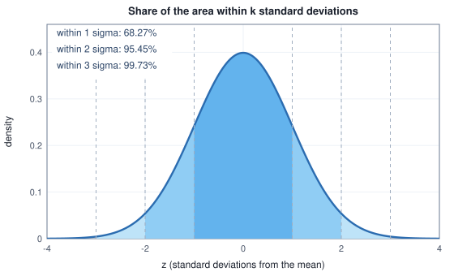
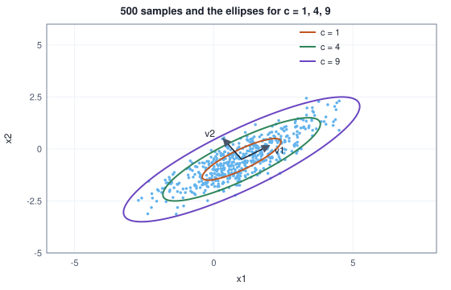
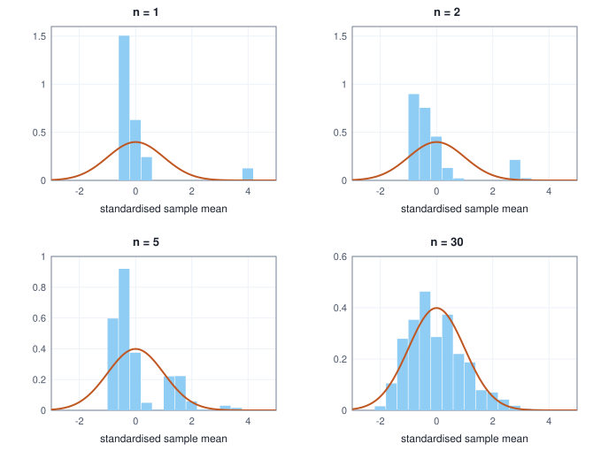

<!-- SPDX-License-Identifier: CC-BY-4.0 -->
<!-- Copyright (c) 2026 Martin Schröder <info@swedishembedded.com> -->

# The Distributions Machine Learning Uses

*Which few probability distributions keep appearing, and why?*

## The problem

Flip a fair coin $30$ times and count the heads. Do it $5000$ times, each run
fresh, and tally how often each count occurred:

<!-- worked: distributions.coin_sum_counts -->
Generator: the book's SplitMix64, seed 0x31c7c1ddde98256e (3587048786890335598). Run by run (5000 runs), each run is 30 flips; a flip is one `rng.uniform()` and is heads when it is below 0.5.

| heads in 30 flips | runs of 5000 | bar (one # per 20 runs) |
|---|---:|---|
| 8 | 25 | # |
| 9 | 70 | #### |
| 10 | 110 | ###### |
| 11 | 270 | ############## |
| 12 | 430 | ###################### |
| 13 | 525 | ########################## |
| 14 | 681 | ################################## |
| 15 | 710 | #################################### |
| 16 | 681 | ################################## |
| 17 | 540 | ########################### |
| 18 | 425 | ##################### |
| 19 | 268 | ############# |
| 20 | 147 | ####### |
| 21 | 51 | ### |
| 22 | 33 | ## |
| other (7 or fewer, 23 or more) | 34 |  |
<!-- /worked -->

Nothing in a single flip suggests this picture. One flip is $0$ or $1$ with equal
chance, a table of two numbers. Yet the counts pile up around $15$, thin out
symmetrically, and are almost never below $8$ or above $22$: a smooth hump that
did not exist in the flips themselves. Change the coin to a loaded one, or flip
$300$ times instead of $30$, and the hump moves and narrows but keeps its shape.

This chapter explains why a handful of distributions do most of the work in
machine learning. A yes/no outcome, such as a classifier being right or wrong on
one example, has the simplest distribution there is. A choice among a fixed list,
such as the next word of a sentence, generalises it. A sum or an average of many
small random effects, such as the thirty flips above, lands on the hump, and the
hump has a formula; extended to several measured quantities at once, it brings in
a new object, the covariance matrix, which records how quantities move together.
We build each distribution from small computed cases, derive its mean and
variance with the rules of the previous chapter, and then state and test the two
facts that explain the hump: averages settle down, and what they settle into has
a universal shape.

## Before you begin

Six questions on ideas from earlier chapters, to answer from memory. The answers
are at the end of the chapter. If one is hard, go back to the chapter named before
reading on.

1. (Chapter 10, variance.) $\mathrm{Var}[X] = 4$ and $Y$ is independent of $X$ with $\mathrm{Var}[Y] = 5$. What are $\mathrm{Var}[2X + 1]$ and $\mathrm{Var}[X + Y]$?
2. (Chapter 10, independence.) $X$ and $Y$ are independent with $\mathbb{E}[X] = 2$ and $\mathbb{E}[Y] = 3$. What is $\mathbb{E}[XY]$?
3. (Chapter 2, exponential function.) What are $e^{-x^2/2}$ at $x = 0$ and at $x = 2$, and is the function larger at $x = 1$ or at $x = -1$?
4. (Chapter 9, integral.) The area under $e^{-x^2/2}$ over the whole real line is about $2.5066$. By what number must the function be divided to become a density?
5. (Chapter 3, cosine similarity.) What is the cosine similarity of $(1, 2)$ and $(2, 4)$, and of $(1, 0)$ and $(0, 1)$?
6. (Chapter 6, eigenvector.) What are the eigenvalues and unit eigenvectors of the symmetric matrix $\begin{pmatrix}2&1\\1&2\end{pmatrix}$?

## One yes/no: the Bernoulli distribution

*What it is for: the building block of every count and every choice.*

A classifier is run on one test example and is either right or wrong. Encode right
as $1$ and wrong as $0$. The random variable $X$ takes the value $1$ with
probability $p$ and $0$ with probability $1 - p$; that table is the **Bernoulli
distribution** with parameter $p$. A training recipe that hides each token of a
sentence independently with probability $0.15$ draws, for every token, one
Bernoulli variable with $p = 0.15$: $1$ means hidden.

Its mean and variance follow from the definitions of Chapter 10, with two
values to sum over. The expectation is $0 \cdot (1-p) + 1 \cdot p = p$. For the
variance we need $\mathbb{E}[X^2]$, and here is the one observation worth
remembering: $0^2 = 0$ and $1^2 = 1$, so $X^2 = X$ and $\mathbb{E}[X^2] = p$ too.
Then

$$
\mathrm{Var}[X] = \mathbb{E}[X^2] - \mathbb{E}[X]^2 = p - p^2 = p(1 - p).
$$

<!-- worked: distributions.bernoulli_table -->
| p | E[X] | E[X^2] | Var[X] = E[X^2] - E[X]^2 | p(1-p) | std |
|---|---:|---:|---:|---:|---:|
| 0.1 | 0.10 | 0.10 | 0.0900 | 0.0900 | 0.3000 |
| 0.15 | 0.15 | 0.15 | 0.1275 | 0.1275 | 0.3571 |
| 0.3 | 0.30 | 0.30 | 0.2100 | 0.2100 | 0.4583 |
| 0.5 | 0.50 | 0.50 | 0.2500 | 0.2500 | 0.5000 |
| 0.9 | 0.90 | 0.90 | 0.0900 | 0.0900 | 0.3000 |
<!-- /worked -->

The mean of a $0/1$ variable is the chance of the $1$, so the average of many
such outcomes is a rate: the accuracy of a classifier over a test set is an
average of Bernoulli variables. The variance $p(1-p)$ is zero at $p = 0$ and
$p = 1$ (nothing is uncertain) and is largest at $p = 1/2$, where the derivative
$1 - 2p$ vanishes: the least predictable yes/no is the fair coin, with variance
$0.25$. A classifier that is right $90\%$ of the time has the same variance as one
that is right only $10\%$ of the time: the uncertainty of the outcome is the same,
only its direction differs.

**Counting successes.** Run the classifier on $n$ independent examples and let $K$
be the number it gets right. Then $K = X_1 + \dots + X_n$, a sum of $n$
independent Bernoulli variables, and Chapter 10's rules give the mean and
variance without any new work: by linearity $\mathbb{E}[K] = np$, and since the
variables are independent the variances add, $\mathrm{Var}[K] = np(1-p)$. The
whole table of $K$ can be built one example at a time. If after $j$ examples the
count is $k$ with probability $q_j(k)$, then after one more example the count is
$k$ if the new one was wrong (probability $1 - p$) and $k$ if the old count was
$k - 1$ and the new one was right (probability $p$):

$$
q_{j+1}(k) = q_j(k)\,(1 - p) + q_j(k - 1)\,p .
$$

Starting from "$0$ examples, count $0$ with probability $1$" and applying this
rule ten times for $p = 0.9$ gives the table below. The right column is the
closed form: any one pattern with $k$ rights and $n - k$ wrongs has probability
$p^k(1-p)^{n-k}$, and there are $\binom{n}{k}$ such patterns, where
$\binom{n}{k} = n!/(k!\,(n-k)!)$ counts the ways to choose which $k$ of the $n$
examples were right. The distribution of $K$ is called the **binomial**
distribution.

<!-- worked: distributions.binomial_from_bernoullis -->
| correct out of 10 | adding one Bernoulli at a time | C(10,k) p^k (1-p)^(10-k) |
|---|---:|---:|
| 0 | 0.000000 | 0.000000 |
| 1 | 0.000000 | 0.000000 |
| 2 | 0.000000 | 0.000000 |
| 3 | 0.000009 | 0.000009 |
| 4 | 0.000138 | 0.000138 |
| 5 | 0.001488 | 0.001488 |
| 6 | 0.011160 | 0.011160 |
| 7 | 0.057396 | 0.057396 |
| 8 | 0.193710 | 0.193710 |
| 9 | 0.387420 | 0.387420 |
| 10 | 0.348678 | 0.348678 |

From the table: mean 9.0000 (n p = 9), variance 0.9000 (n p (1-p) = 0.9000), total probability 1.000000.
<!-- /worked -->

Both columns agree to six digits, and the mean and variance read off the table
equal $np$ and $np(1-p)$. The coins of the opening are the case $n = 30$, $p = 1/2$:
mean $15$, variance $7.5$, standard deviation $2.74$. Counting how many of the
$5000$ runs landed within one, two and three standard deviations of $15$:

<!-- worked: distributions.coin_sum_sigma -->
Mean 15 heads, variance 7.5, standard deviation 2.7386. The same 5000 runs as the previous table (same generator and seed, 0x31c7c1ddde98256e). A window k sigma wide is the whole numbers within floor(k sigma) of 15.

| window | observed share of the 5000 runs | exact binomial share | bell-curve rule |
|---|---:|---:|---:|
| within 1 sigma: 13 to 17 heads | 0.6274 | 0.6384 | 0.6827 |
| within 2 sigma: 10 to 20 heads | 0.9574 | 0.9572 | 0.9545 |
| within 3 sigma: 7 to 23 heads | 0.9970 | 0.9986 | 0.9973 |
<!-- /worked -->

The observed shares sit close to the exact binomial shares (the gap is the
$\sigma/\sqrt{n}$ sampling noise of Chapter 10) and the last column holds the
shares of the bell curve we are about to construct. The first row differs by
$0.04$ because the counts are whole numbers: "within $2.74$ of $15$" means $13$
to $17$, which cuts off the partial steps at the edges. The hump is real, and it
is the reason for the next two sections.

## One choice among several: the categorical distribution

*What it is for: next words, classes, any outcome from a fixed list.*

A language model has read "the cat sat on the" and must say what comes next. For
a vocabulary of five words, its output is five scores, one per word, which the
softmax of the notation page turns into probabilities: exponentiate each score and
divide by the total, so that all five are positive and sum to $1$.

<!-- worked: distributions.categorical_softmax -->
| next token | score z | e^z | probability e^z / sum |
|---|---:|---:|---:|
| mat | 3 | 20.0855 | 0.6364 |
| floor | 2 | 7.3891 | 0.2341 |
| sofa | 1 | 2.7183 | 0.0861 |
| moon | -1 | 0.3679 | 0.0117 |
| the | 0 | 1.0000 | 0.0317 |
| total |  | 31.5608 | 1.0000 |
<!-- /worked -->

A table of $K$ probabilities $p_1, \dots, p_K$, non-negative and summing to $1$,
is the **categorical distribution** on $K$ outcomes. The Bernoulli distribution
is the case $K = 2$; a fair die is $K = 6$ with all $p_k = 1/6$. Drawing from it is
the `sample_discrete` of Chapter 10: lay the probabilities end to end on $[0, 1)$ and
see where one uniform number lands.

To do arithmetic with a categorical outcome, describe it as a list of $K$ numbers:
a $1$ in the position of the outcome that occurred and a $0$ in every other
position. If "floor" was drawn the list is $(0, 1, 0, 0, 0)$. Each position
on its own is then a Bernoulli variable, "was word $k$ drawn?", with parameter
$p_k$, so its mean is $p_k$ and its variance is $p_k(1-p_k)$. The average of these
lists over many draws is the table of frequencies, which is why the mean of the list
is the probability vector itself:

<!-- worked: distributions.categorical_sampling -->
Generator: the book's SplitMix64, seed 0xd3309acb11fd4fe5 (15217833337855758309). Each of the 20,000 draws is one `rng.uniform()` passed to the cumulative-table rule. Variance of the indicators: f(1 - f) for the frequency f.

| token | p | draws of 20,000 | frequency = mean of indicator | p(1-p) | variance of the indicators |
|---|---:|---:|---:|---:|---:|
| mat | 0.6364 | 12701 | 0.6351 | 0.2314 | 0.2318 |
| floor | 0.2341 | 4737 | 0.2369 | 0.1793 | 0.1808 |
| sofa | 0.0861 | 1695 | 0.0848 | 0.0787 | 0.0776 |
| moon | 0.0117 | 202 | 0.0101 | 0.0115 | 0.0100 |
| the | 0.0317 | 665 | 0.0333 | 0.0307 | 0.0321 |
<!-- /worked -->

The last two columns agree to within sampling noise. The positions are not
independent of each other, though: if "mat" was drawn, then "floor" was not.
Exactly how they move together is the subject of the covariance section below,
which returns to this table.

## The bell curve: the Gaussian distribution

*What it is for: the shape that sums of many small effects take, and the default
model of noise.*

### Building the shape

We want a smooth hump, symmetric about $0$, whose tails fall to zero fast. Take
$e^{-x^2/2}$. It is $1$ at $x = 0$, equal at $x$ and $-x$, positive everywhere,
and, because the exponent is quadratic, falls much faster than any simple power:

<!-- worked: distributions.gaussian_shape -->
| x | e^(-x^2/2) | density = e^(-x^2/2) / sqrt(2 pi) | second derivative (x^2 - 1) * density |
|---|---:|---:|---:|
| 0 | 1.00000 | 0.39894 | -0.39894 |
| 0.5 | 0.88250 | 0.35207 | -0.26405 |
| 1 | 0.60653 | 0.24197 | 0.00000 |
| 1.5 | 0.32465 | 0.12952 | 0.16190 |
| 2 | 0.13534 | 0.05399 | 0.16197 |
| 2.5 | 0.04394 | 0.01753 | 0.09202 |
| 3 | 0.01111 | 0.00443 | 0.03545 |
| 3.5 | 0.00219 | 0.00087 | 0.00982 |
| 4 | 0.00034 | 0.00013 | 0.00201 |
<!-- /worked -->

By Chapter 9 the area under $e^{-x^2/2}$ over the whole line is $\sqrt{2\pi} =
2.5066$ (a classical result that chapter stated and did not derive), so dividing
by that constant gives a curve of area $1$, a density:

$$
\varphi(x) = \frac{1}{\sqrt{2\pi}}\,e^{-x^2/2}.
$$

Why this constant and no other is fixed by the requirement that the total
probability be $1$; nothing in the shape itself prefers it.

Where is the "width" of the hump? Differentiate with the chain rule of Chapter 7:
$\varphi'(x) = -x\,\varphi(x)$, so the slope is zero only at $x = 0$ (a single peak)
and is negative to the right. Differentiate again with the product rule:
$\varphi''(x) = (x^2 - 1)\,\varphi(x)$. This is negative for $|x| < 1$, where the
curve bends downward like the top of a hill, and positive for $|x| > 1$, where it
bends upward and flattens into the tail; the last column of the table above
changes sign exactly at $x = 1$. The distance from the centre to the point where the
bending changes is $1$.

The mean and the variance are the two numbers of Chapter 10. The mean is $0$ by
symmetry: the contributions $x\,\varphi(x)$ at $x$ and at $-x$ cancel. For the
variance, $\mathbb{E}[X^2] = \int x^2 \varphi(x)\,dx$. Because $x\,\varphi(x) = -\varphi'(x)$,
integration by parts gives $\int x \cdot (x\varphi)\,dx = \bigl[-x\varphi(x)\bigr] +
\int \varphi(x)\,dx = 0 + 1$: the boundary term vanishes since $\varphi$ falls faster
than $x$ grows, and the remaining integral is the total area, $1$. So $\varphi$ has
mean $0$ and variance $1$. Simpson's rule (Chapter 9) confirms it numerically.

### Moving and stretching it

A measuring machine cuts rods meant to be $50.0$ mm long, and the lengths scatter
with a standard deviation of $0.2$ mm. To describe such data we need a bell that is
centred at any $\mu$ and has any spread $\sigma > 0$. Take $Z$ with density
$\varphi$ and define $Y = \mu + \sigma Z$. By the rules of Chapter 10 for shifting
and scaling, $\mathbb{E}[Y] = \mu$ and $\mathrm{Var}[Y] = \sigma^2$. Its density
comes from asking where the area goes: $P(Y \le y) = P\bigl(Z \le (y - \mu)/\sigma\bigr)$,
and differentiating in $y$ with the chain rule brings out a factor $1/\sigma$:

$$
f(y) = \frac{1}{\sigma}\,\varphi\!\left(\frac{y - \mu}{\sigma}\right)
= \frac{1}{\sigma\sqrt{2\pi}}\,\exp\!\left(-\frac{(y - \mu)^2}{2\sigma^2}\right).
$$

Every random variable with a density of this form is a **Gaussian distribution**
(also called a normal distribution), written $\mathcal{N}(\mu, \sigma^2)$. Its two
parameters are exactly its mean and variance, which is what makes it convenient.
The $1/\sigma$ keeps the area at $1$: a wider curve must be lower. The case
$\mu = 0$, $\sigma = 1$ is the **standard Gaussian**.

<!-- worked: distributions.gaussian_moments -->
Simpson's rule with 2000 intervals on [mu - 8 sigma, mu + 8 sigma] (the mean is the integral just computed; any interval count of 200 or more agrees to the printed digits).

| quantity from Simpson's rule, 8 sigma each side | mu = 0, sigma = 1 | mu = 50, sigma = 0.2 |
|---|---:|---:|
| area (should be 1) | 1.000000 | 1.000000 |
| mean (integral of x f(x)) | 0.000000 | 50.000000 |
| variance (integral of (x - mean)^2 f(x)) | 1.000000 | 0.040000 |
<!-- /worked -->

The reverse operation, **standardising**, turns any Gaussian measurement into a
standard one: $z = (x - \mu)/\sigma$ counts how many standard deviations $x$ is
from the mean. A rod of $50.3$ mm has $z = 1.5$. The practical consequence is that
a single table of areas, for the standard Gaussian, answers every question about
every Gaussian, as the second table shows by computing the same probability two
ways:

<!-- worked: distributions.gaussian_standardise -->
| x (mm) | z = (x - mu) / sigma | standard density at z | density of x = that / sigma |
|---|---:|---:|---:|
| 49.7 | -1.50 | 0.12952 | 0.64759 |
| 49.9 | -0.50 | 0.35207 | 1.76033 |
| 50.0 | 0.00 | 0.39894 | 1.99471 |
| 50.3 | 1.50 | 0.12952 | 0.64759 |
| 50.5 | 2.50 | 0.01753 | 0.08764 |

| probability that 49.8 <= X <= 50.3 | value |
|---|---:|
| integrating the density of x from 49.8 to 50.3 | 0.774538 |
| integrating the standard density from z = -1 to z = 1.5 | 0.774538 |
<!-- /worked -->

### The areas under the bell

There is no formula for an antiderivative of $e^{-x^2/2}$ (Chapter 9), so
probabilities for a Gaussian are areas computed numerically. Three of them are
worth knowing by heart, because they give a feeling for how far values stray from
the mean:

<!-- worked: distributions.sigma_rule -->
P(-k <= Z <= k) by Simpson's rule with 4000 intervals on [-k, k] for the standard Gaussian density.

| k | P(-k <= Z <= k) | P(outside) | outside once in about this many draws |
|---|---:|---:|---:|
| 1 | 0.682689 | 0.317311 | 3 |
| 1.645 | 0.900030 | 0.099970 | 10 |
| 1.96 | 0.950004 | 0.049996 | 20 |
| 2 | 0.954500 | 0.045500 | 22 |
| 2.5 | 0.987581 | 0.012419 | 81 |
| 2.576 | 0.990005 | 0.009995 | 100 |
| 3 | 0.997300 | 0.002700 | 370 |
| 4 | 0.999937 | 0.000063 | 15,787 |
<!-- /worked -->



About $68\%$ of the probability lies within one standard deviation of the mean,
$95\%$ within two and $99.7\%$ within three (the "68-95-99.7 rule"). The rod
machine therefore produces about $95\%$ of its rods within $0.4$ mm of $50.0$, and
a rod more than $0.6$ mm off, three standard deviations, about once in $370$. The
table also lists $1.645$, $1.96$ and $2.576$, the usual rounded multipliers for
$90\%$, $95\%$ and $99\%$: they enclose $0.90003$, $0.95000$ and $0.99001$, so they are
rounded values, and the multipliers that enclose exactly those shares are
$1.644854$, $1.959964$ and $2.575829$. The statistics chapter uses the rounded ones. Note how
quickly the tail thins: going from $3$ to $4$ standard deviations changes "one in
$370$" to "one in $15{,}787$".

### Gaussians stay Gaussian

Two more facts make the Gaussian easy to work with. If $X$ and $Y$ are independent
Gaussians, the mean of $X + Y$ is the sum of the means and its variance the sum of
the variances, by Chapter 10. The new fact, stated here without proof, is that
the sum is again a Gaussian: the shape is preserved. The same holds for any
shift and rescaling of a Gaussian, which we derived above for $\mu + \sigma Z$.

<!-- worked: distributions.gaussian_sum -->
Generator: the book's SplitMix64, seed 0x221e60acd1f15be3 (2458508741963766755). First the 40,000 values of X, each 1 + 2 z with z one `rng.normal()`; then the 40,000 values of Y, each -0.5 + 1.5 z; pair k of X and Y is summed. Sample variance: divisor 40,000.

| variable | sample mean | sample variance | mean predicted | variance predicted |
|---|---:|---:|---:|---:|
| X ~ N(1, 2^2) | 0.999 | 4.001 | 1 | 4 |
| Y ~ N(-0.5, 1.5^2) | -0.491 | 2.273 | -0.5 | 2.25 |
| X + Y | 0.508 | 6.289 | 0.5 | 6.25 |

Share of X + Y within one predicted standard deviation (2.5) of 0.5: 0.6805; the bell-curve rule says 0.6827.
<!-- /worked -->

The sample variance of the sum is close to the predicted $4 + 2.25 = 6.25$, and
the share of the sum within one predicted standard deviation is close to the
$0.6827$ of the bell curve. A neat use of both facts together is the noised
coordinate of a diffusion model: if $x_0$ is a number and $\varepsilon \sim
\mathcal{N}(0, 1)$, then $x = (1 - s)\,x_0 + s\,\varepsilon$ is a Gaussian with
mean $(1 - s)x_0$ and standard deviation $s$:

<!-- worked: distributions.noised_coordinate -->
Generator: the book's SplitMix64, seed 0xd99ff6d98e6f1575 (15681523841785337205). x0 = 2. The 20,000 noise values are `rng.normal()` calls, drawn once and reused for every noise level s: x = (1 - s) x0 + s * noise. Sample std: divisor 20,000.

| noise level s | predicted mean (1-s) x0 | sample mean | predicted std s | sample std |
|---|---:|---:|---:|---:|
| 0.1 | 1.800 | 1.799 | 0.1 | 0.099 |
| 0.3 | 1.400 | 1.397 | 0.3 | 0.298 |
| 0.5 | 1.000 | 0.995 | 0.5 | 0.497 |
| 0.9 | 0.200 | 0.190 | 0.9 | 0.895 |
<!-- /worked -->

## Moving together: covariance and correlation

*What it is for: measuring how two quantities vary jointly, which a pair of
variances cannot say.*

Two raters score the same five answers on a scale of $1$ to $5$. Do they tend to
agree? The average score and the spread of each rater say nothing about whether a
high score from one comes with a high score from the other. The tool is the
product of the two deviations from their means: positive when both are above or
both below, negative when one is above while the other is below.

<!-- worked: distributions.covariance_table -->
| answer | rater A | rater B | A - mean | B - mean | (A - mean)(B - mean) |
|---|---:|---:|---:|---:|---:|
| 1 | 1 | 2 | -2 | -1 | 2 |
| 2 | 2 | 1 | -1 | -2 | 2 |
| 3 | 3 | 4 | 0 | 1 | 0 |
| 4 | 4 | 3 | 1 | 0 | 0 |
| 5 | 5 | 5 | 2 | 2 | 4 |
| mean / sum | 3 | 3 |  |  | 8 |

Cov[A, B] = 8 / 5 = 1.6. Second form: E[AB] = 10.6, E[A] E[B] = 9, difference 1.6.
Var[A] = 2, Var[B] = 2, sum of the two plus 2 Cov = 7.2; Var[A + B] computed directly = 7.2.
<!-- /worked -->

The **covariance** of two random variables $X$ and $Y$ is the expected product of
their deviations from the means,

$$
\mathrm{Cov}[X, Y] = \mathbb{E}\bigl[(X - \mu_X)(Y - \mu_Y)\bigr] = \mathbb{E}[XY] - \mu_X\mu_Y.
$$

The second form follows by multiplying out and using linearity, exactly the
algebra of the variance of a sum in Chapter 10; the table verifies it: the five
products average to $1.6$ and $\mathbb{E}[AB] - \mathbb{E}[A]\mathbb{E}[B] = 10.6 - 9 = 1.6$. That
bracket is the "gap" that Chapter 10 left unnamed, and now we can write the rule it
was after:

$$
\mathrm{Var}[X + Y] = \mathrm{Var}[X] + \mathrm{Var}[Y] + 2\,\mathrm{Cov}[X, Y].
$$

In the table $2 + 2 + 2 \cdot 1.6 = 7.2$, and computing the variance of the
sums $A + B$ directly also gives $7.2$. Three properties follow at once from the
definition. $\mathrm{Cov}[X, X] = \mathrm{Var}[X]$, so covariance generalises
variance. $\mathrm{Cov}[X, Y] = \mathrm{Cov}[Y, X]$. And $\mathrm{Cov}[aX, bY] = ab\,
\mathrm{Cov}[X, Y]$, so the covariance carries the units of both variables and
changes when either is rescaled.

**Correlation.** To get a number that does not depend on units, divide by the
two standard deviations: the **correlation** is $\rho = \mathrm{Cov}[X, Y] /
(\sigma_X \sigma_Y)$. For the raters, $\rho = 1.6/(\sqrt 2 \sqrt 2) = 0.8$. It has a
geometric meaning from Chapter 3. For a data set of $N$ pairs, put the centred
$X$ values in one vector and the centred $Y$ values in another. The covariance is
$1/N$ times their dot product, the variances are $1/N$ times their squared lengths,
and the $1/N$ factors cancel in the quotient, so $\rho$ is the cosine similarity of the two centred
vectors. A cosine is between $-1$ and $1$, so $\rho$ is too, with $\rho = 1$ when
the vectors point the same way, $-1$ when opposite and $0$ when orthogonal.

<!-- worked: distributions.correlation_cosine -->
| data | covariance | correlation = Cov / (std A * std B) | cosine of the two centred vectors |
|---|---:|---:|---:|
| original scores | 1.6000 | 0.8000 | 0.8000 |
| A times 100, B plus 7 | 160.0000 | 0.8000 | 0.8000 |
<!-- /worked -->

The second row rescales one rater by $100$ and shifts the other; the covariance
changes by a factor of $100$ and the correlation does not. What correlation does
see is only the linear relationship:

<!-- worked: distributions.correlation_shapes -->
Generator: the book's SplitMix64, seed 0x896ea023049287a2 (9903028702895310754). x takes 2000 equally spaced values from -2 to 2 inclusive (step 4/1999). The noise is `rng.normal()`: 2000 values in order for the third relation, then 2000 more for the fourth. Covariance and variances use divisor 2000.

| relation between x and y | covariance | correlation |
|---|---:|---:|
| y = 2x + 1 | 2.6693 | 1.0000 |
| y = -x | -1.3347 | -1.0000 |
| y = x + noise (std 1) | 1.3255 | 0.7514 |
| y independent noise | 0.0099 | 0.0087 |
| y = x^2 | 0.0000 | 0.0000 |
<!-- /worked -->

A perfect line gives $\pm 1$; noise around the line gives something in between;
unrelated noise gives about zero; and the last row, where $y$ is completely
determined by $x$ through $y = x^2$, also gives zero. Zero correlation means there is no
straight-line trend, not that the variables have nothing to do with each other.

**Uncorrelated is not independent.** Chapter 10 proved that independent variables
satisfy $\mathbb{E}[XY] = \mathbb{E}[X]\mathbb{E}[Y]$, which says that their covariance is zero. The converse fails
(Chapter 10 gave this example in one line), and the smallest counterexample shows why. Let $X$ be $-1$, $0$ or $1$ with
probability $1/3$ each, and $Y = X^2$.

<!-- worked: distributions.uncorrelated_not_independent -->
| X | Y = X^2 | probability |
|---|---:|---:|
| -1 | 1 | 1/3 |
| 0 | 0 | 1/3 |
| 1 | 1 | 1/3 |

| quantity | value |
|---|---:|
| E[X], E[Y], E[XY] | 0, 2/3, 0 |
| Cov[X, Y] = E[XY] - E[X] E[Y] | 0 |
| P(Y = 1) | 2/3 |
| P(Y = 1 given X = 1) = P(X = 1, Y = 1) / P(X = 1) | 1 |
| P(X = 1) P(Y = 1) versus P(X = 1, Y = 1) | 2/9 versus 1/3 |
<!-- /worked -->

The covariance is zero: $\mathbb{E}[XY] = \mathbb{E}[X^3] = 0$ and $\mathbb{E}[X] = 0$. But
$Y$ is a function of $X$, and independence fails the product test: $P(X{=}1)\,P(Y{=}1) = 2/9$
while $P(X{=}1, Y{=}1) = 1/3$. Knowing that $X = 1$ settles $Y = 1$ with certainty.
The negative and positive values of $X$ cancel in the product with $Y$, which is
why the covariance cannot see the dependence. Independence is a statement about the
whole joint table; covariance is one number extracted from it.

**The covariance matrix.** With several variables, put every pairwise covariance
in a table. For a random vector $\mathbf{x} = (X_1, \dots, X_D)$ with mean
$\boldsymbol{\mu}$, the **covariance matrix** is the $D \times D$ matrix with entries
$\Sigma_{ij} = \mathrm{Cov}[X_i, X_j]$, that is,
$\boldsymbol{\Sigma} = \mathbb{E}\bigl[(\mathbf{x} - \boldsymbol{\mu})(\mathbf{x} - \boldsymbol{\mu})^\top\bigr]$.
Its diagonal holds the variances, and it is symmetric because $\mathrm{Cov}[X, Y]
= \mathrm{Cov}[Y, X]$. On a data matrix with $N$ rows (observations) and $D$
columns, subtract the column means to get the centred matrix $\mathbf{C}$ and
compute $\boldsymbol{\Sigma} = \mathbf{C}^\top\mathbf{C}/N$: entry $(i, j)$ of the
product is the dot product of centred columns $i$ and $j$, the same sum as
before.

<!-- worked: distributions.covariance_matrix -->
| Sigma | A | B |
|---|---:|---:|
| A | 2.00 | 1.60 |
| B | 1.60 | 2.00 |

Centred data C (5 x 2), then C^T C / 5:

| row | A - 3 | B - 3 |
|---|---:|---:|
| 1 | -2 | -1 |
| 2 | -1 | -2 |
| 3 | 0 | 1 |
| 4 | 1 | 0 |
| 5 | 2 | 2 |
<!-- /worked -->

The covariance matrix also answers a question that a list of variances cannot:
how much does a *weighted combination* of the variables vary? For a unit direction
$\mathbf{u}$, the number $\mathbf{u}\cdot\mathbf{x} = u_1 X_1 + u_2 X_2$ has, by the
variance-of-a-sum rule applied twice,

$$
\mathrm{Var}[\mathbf{u}\cdot\mathbf{x}] = u_1^2\Sigma_{11} + 2u_1u_2\Sigma_{12} + u_2^2\Sigma_{22}
= \mathbf{u}^\top\boldsymbol{\Sigma}\,\mathbf{u}.
$$

The right-hand side is the quadratic form of Chapter 8, where $\mathbf{u}^\top\mathbf{H}\mathbf{u}$
was the curvature along $\mathbf{u}$. The same fact from Chapter 6 applies: over
unit vectors, $\mathbf{u}^\top\boldsymbol{\Sigma}\mathbf{u}$ is largest along the
eigenvector of the largest eigenvalue and smallest along the other.

<!-- worked: distributions.direction_variance -->
| angle (degrees) | unit direction u | variance of u . x measured on the data | u^T Sigma u |
|---|---:|---:|---:|
| 0 | (1.0000, 0.0000) | 2.0000 | 2.0000 |
| 30 | (0.8660, 0.5000) | 3.3856 | 3.3856 |
| 45 | (0.7071, 0.7071) | 3.6000 | 3.6000 |
| 90 | (0.0000, 1.0000) | 2.0000 | 2.0000 |
| 135 | (-0.7071, 0.7071) | 0.4000 | 0.4000 |

Eigenvalues of Sigma: 3.6000 and 0.4000, with unit eigenvectors (0.7071, 0.7071) and (-0.7071, 0.7071).
<!-- /worked -->

The two columns agree: the variance measured by projecting the data matches the
quadratic form. For the raters, the combination "$A + B$" (direction $45^\circ$)
has variance $3.6$, the largest eigenvalue, because the raters agree, and
"$A - B$" (direction $135^\circ$) has only $0.4$, the smallest. A rule of thumb
follows: strongly correlated variables carry most of their spread in one
direction, and the eigenvectors of the covariance matrix point along it.

**Back to the categorical variable.** The indicator list of a categorical outcome has
$\mathbb{E}[e_j e_k] = 0$ for $j \ne k$, since the word drawn cannot be both $j$ and
$k$, so $\mathrm{Cov}[e_j, e_k] = -p_jp_k$. Its covariance matrix is
$\mathrm{diag}(\mathbf{p}) - \mathbf{p}\mathbf{p}^\top$:

<!-- worked: distributions.categorical_covariance -->
| Cov of indicators | mat | floor | sofa | moon | the | row sum |
|---|---:|---:|---:|---:|---:|---:|
| mat | 0.2314 | -0.1490 | -0.0548 | -0.0074 | -0.0202 | 0.0000 |
| floor | -0.1490 | 0.1793 | -0.0202 | -0.0027 | -0.0074 | 0.0000 |
| sofa | -0.0548 | -0.0202 | 0.0787 | -0.0010 | -0.0027 | 0.0000 |
| moon | -0.0074 | -0.0027 | -0.0010 | 0.0115 | -0.0004 | 0.0000 |
| the | -0.0202 | -0.0074 | -0.0027 | -0.0004 | 0.0307 | 0.0000 |
<!-- /worked -->

The off-diagonals are all negative: more of one word means less of the others. Every
row sums to zero, because the indicators always sum to the constant $1$ and a constant
has no spread. A covariance matrix whose rows sum to zero maps the all-ones vector
to zero; this is a first example of a covariance matrix with a zero eigenvalue,
which matters in the next section.

## Several dimensions: the multivariate Gaussian

*What it is for: the model of noise and of data clouds when more than one number
is measured at once.*

### From independent coordinates to a general covariance

Start from the simplest case and build up. Take two independent standard Gaussians
$z_1, z_2$ as the coordinates of a point $\mathbf{z}$. Every direction is alike, and
the cloud of such points is round. Apply a matrix $\mathbf{A}$ and add a mean:

$$
\mathbf{x} = \boldsymbol{\mu} + \mathbf{A}\mathbf{z}.
$$

Every coordinate of $\mathbf{x}$ is a weighted sum of independent Gaussians plus a
constant, hence a Gaussian by the previous section. What are the variances and
covariance? Write $x_1 = \mu_1 + a_{11}z_1 + a_{12}z_2$ and $x_2 = \mu_2 + a_{21}z_1 +
a_{22}z_2$. Since $z_1, z_2$ are independent with variance $1$:

$$
\mathrm{Var}[x_1] = a_{11}^2 + a_{12}^2, \quad \mathrm{Var}[x_2] = a_{21}^2 + a_{22}^2, \quad
\mathrm{Cov}[x_1, x_2] = a_{11}a_{21} + a_{12}a_{22}.
$$

(The covariance uses $\mathrm{Cov}[z_1, z_2] = 0$ and $\mathrm{Cov}[z_i, z_i] = 1$ to
reduce the four cross terms to two.) These three numbers are the entries of
$\mathbf{A}\mathbf{A}^\top$, so $\mathrm{Cov}[\mathbf{x}] = \mathbf{A}\mathbf{A}^\top$, the same rule in any
dimension: $\mathrm{Cov}[\mathbf{A}\mathbf{z}] = \mathbf{A}\,\mathrm{Cov}[\mathbf{z}]\,\mathbf{A}^\top =
\mathbf{A}\mathbf{A}^\top$.

A vector with this construction, with $\boldsymbol{\Sigma} = \mathbf{A}\mathbf{A}^\top$,
is a **multivariate Gaussian** (or multivariate normal), written
$\mathcal{N}(\boldsymbol{\mu}, \boldsymbol{\Sigma})$. A fact we state without proof is that
the distribution depends only on $\boldsymbol{\mu}$ and $\boldsymbol{\Sigma}$, not on
which $\mathbf{A}$ with $\mathbf{A}\mathbf{A}^\top = \boldsymbol{\Sigma}$ was used; the
sampling tables below check it. Each coordinate on its own is a Gaussian
with the matching diagonal entry as variance, and when $\boldsymbol{\Sigma}$ is
diagonal the coordinates are independent: for Gaussians, and only for them,
uncorrelated does imply independent.

### Two ways to make the factor

Sampling needs a matrix $\mathbf{A}$ with $\mathbf{A}\mathbf{A}^\top = \boldsymbol{\Sigma}$ for a
given symmetric $\boldsymbol{\Sigma}$. Two constructions are standard. We use
$\boldsymbol{\Sigma} = \begin{pmatrix}2&1.2\\1.2&1\end{pmatrix}$ throughout.

*A lower-triangular factor.* Ask for $\mathbf{L} = \begin{pmatrix}l_{11}&0\\l_{21}&l_{22}\end{pmatrix}$
with $\mathbf{L}\mathbf{L}^\top = \boldsymbol{\Sigma}$. Multiplying out gives three
equations, solved one at a time from the top:

$$
l_{11}^2 = \Sigma_{11}, \qquad l_{21}\,l_{11} = \Sigma_{21}, \qquad l_{21}^2 + l_{22}^2 = \Sigma_{22},
$$

so $l_{11} = \sqrt{\Sigma_{11}}$, $l_{21} = \Sigma_{21}/l_{11}$ and
$l_{22} = \sqrt{\Sigma_{22} - l_{21}^2}$. The square root in the last step is real only if
$\Sigma_{22} - \Sigma_{12}^2/\Sigma_{11} > 0$, that is $\det\boldsymbol{\Sigma} > 0$: a
real factor of this kind exists exactly when $\boldsymbol{\Sigma}$ is positive definite.
Here $l_{11} = 1.4142$, $l_{21} = 0.8485$, $l_{22} = \sqrt{1 - 0.72} = 0.5292$.
This is the **Cholesky factor**, and the same recipe works in any dimension, row
by row.

*The eigen-decomposition.* By the spectral theorem of Chapter 6,
$\boldsymbol{\Sigma} = \mathbf{Q}\boldsymbol{\Lambda}\mathbf{Q}^\top$ with orthonormal
eigenvector columns in $\mathbf{Q}$ and eigenvalues on the diagonal of
$\boldsymbol{\Lambda}$. Take $\mathbf{A} = \mathbf{Q}\boldsymbol{\Lambda}^{1/2}$, with the
square root of each eigenvalue; then $\mathbf{A}\mathbf{A}^\top =
\mathbf{Q}\boldsymbol{\Lambda}^{1/2}\boldsymbol{\Lambda}^{1/2}\mathbf{Q}^\top =
\boldsymbol{\Sigma}$. Both factors, checked:

<!-- worked: distributions.mvn_factors -->
| quantity | value |
|---|---|
| Sigma | [[2.0000, 1.2000], [1.2000, 1.0000]] |
| det Sigma | 0.5600 |
| eigenvalues | 2.8000, 0.2000 |
| unit eigenvectors | (0.8321, 0.5547), (-0.5547, 0.8321) |
| lower-triangular L | [[1.4142, 0.0000], [0.8485, 0.5292]] |
| L L^T | [[2.0000, 1.2000], [1.2000, 1.0000]] |
| eigen factor A = Q Lambda^(1/2) | [[1.3923, -0.2481], [0.9282, 0.3721]] |
| A A^T | [[2.0000, 1.2000], [1.2000, 1.0000]] |
<!-- /worked -->

The eigenvalues are $2.8$ and $0.2$, with eigenvectors along $(3, 2)$ and $(-2, 3)$
(normalised). An eigenvector is only fixed up to its sign, so the table follows a
convention: the eigenvalues come in descending order, the first unit eigenvector has a
positive first component, and the second is the first turned a quarter turn anticlockwise,
$(-q_{12}, q_{11})$, so that $\mathbf{Q}$ is a rotation. Another solver may return an
eigenvector negated, which negates the matching column of $\mathbf{A}$ but leaves
$\mathbf{A}\mathbf{A}^\top$ and the distribution of the samples unchanged. The two factors are different matrices, one triangular and one
built from a rotation and a stretch, and both multiply back to $\boldsymbol{\Sigma}$. The
pseudocode for sampling follows.

```text
function cholesky(s: array<real>[D, D]) -> array<real>[D, D]:
    require s.shape[0] == s.shape[1], "covariance matrix must be square"
    require close(s, transpose(s), rtol=1e-6, atol=1e-9), "covariance matrix must be symmetric"
    L = zeros(real, [D, D])
    for i in 0 .. D:
        for j in 0 ..= i:
            t = s[i, j]
            for k in 0 .. j:
                t = t - L[i, k] * L[j, k]
            if i == j:
                require t > 0.0, "covariance matrix is not positive definite"
                L[i, i] = sqrt(t)
            else:
                L[i, j] = t / L[j, j]
    return L

function sample_gaussian_cholesky(mu: array<real>[D], L: array<real>[D, D], rng: Generator) -> array<real>[D]:
    z = zeros(real, [D])
    for i in 0 .. D:
        z[i] = rng.normal()                  # independent N(0, 1)
    x = zeros(real, [D])
    for i in 0 .. D:
        t = mu[i]
        for j in 0 ..= i:                    # L is lower triangular
            t = t + L[i, j] * z[j]
        x[i] = t
    return x
```

For the eigen version, compute `(lam, Q) = eigh(s)` with a symmetric eigen-solver
(Chapter 6; for a symmetric $2\times2$ matrix with entries $a, b, b, c$ and $b \ne 0$
the closed form is $\lambda_{1,2} = \tfrac{a+c}{2} \pm \sqrt{(\tfrac{a-c}{2})^2 + b^2}$ with
eigenvector $(b, \lambda_1 - a)$ for $\lambda_1$, here $(1.2, 0.8)$, which is
along $(3, 2)$) and replace the inner loop by `t = t + Q[i, j] * sqrt(lam[j]) * z[j]`
summed over all `j`. Draw $20{,}000$ points both ways and compute their sample
mean and covariance matrix:

<!-- worked: distributions.mvn_sampling -->
Generator: the book's SplitMix64, seed 0x381299132efa1755 (4040460123376326485). One generator for the table: the Cholesky samples first, then the eigen samples. Each sample takes two `rng.normal()` calls, z1 then z2, and is mu + L z (Cholesky) or mu + A z (eigen); mu = (1, -0.5), Sigma = [[2, 1.2], [1.2, 1]]. Sample covariance: centre on the sample mean, divisor 20,000.

| method (20,000 samples) | sample mean | Sigma_11 | Sigma_12 | Sigma_22 |
|---|---:|---:|---:|---:|
| Cholesky | (1.014, -0.492) | 2.017 | 1.204 | 0.994 |
| eigen-decomposition | (1.001, -0.497) | 1.999 | 1.190 | 0.988 |
| target | (1, -0.5) | 2.000 | 1.200 | 1.000 |
<!-- /worked -->

Both samplers reproduce $\boldsymbol{\mu}$ and $\boldsymbol{\Sigma}$ to within sampling
noise, as the claim that only $\boldsymbol{\Sigma}$ matters predicts.

### The shape of the cloud



The figure shows that the cloud is elongated along the diagonal and that its
level curves are ellipses. This follows from the formula for the density. The standard
vector $\mathbf{z}$ has density $\prod_i \varphi(z_i) = (2\pi)^{-D/2}\,e^{-\lVert\mathbf{z}\rVert^2/2}$.
Substitute $\mathbf{z} = \mathbf{A}^{-1}(\mathbf{x} - \boldsymbol{\mu})$:
the squared length becomes $(\mathbf{x} - \boldsymbol{\mu})^\top\boldsymbol{\Sigma}^{-1}
(\mathbf{x} - \boldsymbol{\mu})$, since $(\mathbf{A}^{-1})^\top\mathbf{A}^{-1} =
(\mathbf{A}\mathbf{A}^\top)^{-1}$. Mapping by $\mathbf{A}$ stretches areas by
$\lvert\det\mathbf{A}\rvert = \sqrt{\det\boldsymbol{\Sigma}}$ (the determinant of
Chapter 6 is the area scaling factor), which dilutes the density by that factor:

$$
p(\mathbf{x}) = \frac{1}{(2\pi)^{D/2}\sqrt{\det\boldsymbol{\Sigma}}}\,
\exp\!\Bigl(-\tfrac12(\mathbf{x} - \boldsymbol{\mu})^\top\boldsymbol{\Sigma}^{-1}(\mathbf{x} - \boldsymbol{\mu})\Bigr).
$$

The density is constant where the quadratic form $(\mathbf{x} - \boldsymbol{\mu})^\top
\boldsymbol{\Sigma}^{-1}(\mathbf{x} - \boldsymbol{\mu})$ is constant, equal to some
$c$. In the eigenvector coordinates $y_i = \mathbf{q}_i\cdot(\mathbf{x} - \boldsymbol{\mu})$
the form is $\sum_i y_i^2/\lambda_i$, because $\boldsymbol{\Sigma}^{-1} = \mathbf{Q}
\boldsymbol{\Lambda}^{-1}\mathbf{Q}^\top$. The set $\sum_i y_i^2/\lambda_i = c$ is an
ellipse with its axes along the eigenvectors and half-lengths $\sqrt{c\,\lambda_i}$.
For our $\boldsymbol{\Sigma}$ and $c = 1$ the half-lengths are $\sqrt{2.8} = 1.67$ along the
long axis and $\sqrt{0.2} = 0.45$ along the short one: eigenvalues are variances along
the axes, so a larger eigenvalue gives a longer axis.

How much of the probability lies inside the ellipse for a given $c$? In terms of
$\mathbf{z}$ the ellipse is the disc $z_1^2 + z_2^2 \le c$, and in polar
coordinates the integral of the density over a disc of radius $\sqrt{c}$ is
$\int_0^{\sqrt{c}} e^{-r^2/2}\,r\,dr = 1 - e^{-c/2}$, since the derivative of
$-e^{-r^2/2}$ is $r\,e^{-r^2/2}$ (the angle integrates to $2\pi$, which cancels the
$1/2\pi$). The one-dimensional "within one, two, three standard deviations" has this
two-dimensional analogue:

<!-- worked: distributions.mvn_ellipse_mass -->
Generator: the book's SplitMix64, seed 0xcb8f069a102c7b73 (14667949770135075699). The 20,000 samples are the Cholesky samples of the previous table's recipe (two `rng.normal()` calls each, z1 then z2); the quadratic form uses the explicit 2x2 inverse of Sigma (adjugate divided by the determinant), which is safe for a fixed 2x2.

| c in (x-mu)^T Sigma^-1 (x-mu) <= c | half-length along v1 | half-length along v2 | share of 20,000 samples inside | 1 - e^(-c/2) |
|---|---:|---:|---:|---:|
| 1 | 1.6733 | 0.4472 | 0.3972 | 0.3935 |
| 4 | 3.3466 | 0.8944 | 0.8689 | 0.8647 |
| 9 | 5.0200 | 1.3416 | 0.9891 | 0.9889 |
<!-- /worked -->

The one-standard-deviation ellipse ($c = 1$) holds only $39\%$ of the samples,
not $68\%$: in two dimensions, being within one standard deviation in every
direction at once is more restrictive. The $c = 4$ and $c = 9$ ellipses hold $86\%$
and $99\%$.

### Many coordinates at once

A tensor of $D$ independent $\mathcal{N}(0, 1)$ entries is a multivariate Gaussian
with $\boldsymbol{\Sigma} = \mathbf{I}$: the round cloud in $D$ dimensions. Its
squared length $\lVert\mathbf{z}\rVert^2 / D$ is the mean of $D$ numbers $z_i^2$,
each with mean $1$ and variance $2$ (a fact about the Gaussian that we measure
rather than derive). By the variance of a mean in Chapter 10, that average has
variance $2/D$:

<!-- worked: distributions.high_dim_norm -->
Generator: the book's SplitMix64, seed 0x32ffccfba4ec6fa0 (3674881202133430176). One generator for the table, rows in the order d = 1, 10, 100, 1000, 10000. A row makes 400 vectors (100 for d = 10000); a vector is d calls of `rng.normal()`. Std: divisor equal to the number of vectors.

| dimension d | mean of squared length / d | std of squared length / d | sqrt(2/d) | mean length | sqrt(d) |
|---|---:|---:|---:|---:|---:|
| 1 | 1.0478 | 1.3639 | 1.4142 | 0.825 | 1.000 |
| 10 | 0.9877 | 0.4291 | 0.4472 | 3.065 | 3.162 |
| 100 | 1.0011 | 0.1437 | 0.1414 | 9.980 | 10.000 |
| 1000 | 0.9993 | 0.0458 | 0.0447 | 31.603 | 31.623 |
| 10000 | 1.0015 | 0.0131 | 0.0141 | 100.071 | 100.000 |
<!-- /worked -->

The squared length per coordinate sits at $1$ with a spread of $\sqrt{2/D}$, so in
high dimension the length of a standard Gaussian vector is almost exactly
$\sqrt{D}$: the sample is not near the origin, where the density is highest, but
on a thin shell around it. The vector's direction is arbitrary; its length is
nearly fixed. This is a consequence of the first of the two facts of the next
section.

## Averages settle: the law of large numbers

*What it is for: the reason that a sample average can stand in for an
expectation.*

Chapter 10 observed that the running average of repeated draws settles at the
expectation, and measured its spread as $\sigma/\sqrt{n}$. We can now state it and
say why. Let $X_1, X_2, \dots$ be independent draws from one distribution with mean
$\mu$ and finite variance $\sigma^2$, and let $\bar{X}_n$ be the average of the first
$n$. The **law of large numbers** says that for every tolerance $\varepsilon > 0$,

$$
P\bigl(\lvert\bar{X}_n - \mu\rvert > \varepsilon\bigr) \to 0 \quad \text{as } n \to \infty.
$$

The proof is short under the finite-variance assumption. Chapter 10 gave
$\mathrm{Var}[\bar X_n] = \sigma^2/n$. For any variable $W$ with mean $\mu_W$, split the
expectation $\mathbb{E}[(W - \mu_W)^2]$ over the outcomes where $\lvert W - \mu_W\rvert >
\varepsilon$ and the rest; the first part is at least $\varepsilon^2$ times the probability
of that event, and the second part is not negative, so

$$
P\bigl(\lvert W - \mu_W\rvert > \varepsilon\bigr) \le \frac{\mathrm{Var}[W]}{\varepsilon^2}
\qquad \text{(Chebyshev's inequality)}.
$$

Apply it to $W = \bar X_n$: the probability of being more than $\varepsilon$ from $\mu$ is
at most $\sigma^2/(n\varepsilon^2)$, which goes to $0$ as $n$ grows. Check it on a
Bernoulli variable with $p = 0.3$, so $\sigma^2 = 0.21$, taking $300$ repeats of each
average:

<!-- worked: distributions.lln_bernoulli -->
Generator: the book's SplitMix64, seed 0xa1936518d852eccb (11642760619065797835). One generator, rows in the order n = 10, 100, 1000, 10000. A row makes 300 means; a mean is n calls of `rng.uniform()`, each counted as 1 when below p = 0.3, averaged. RMS error: root of the mean squared distance of the 300 means from 0.3.

| n draws per mean | RMS error of the mean over 300 repeats | sigma / sqrt(n) | share of repeats with error > 0.05 | Chebyshev bound sigma^2 / (n * 0.05^2) |
|---|---:|---:|---:|---:|
| 10 | 0.1499 | 0.1449 | 0.7500 | 1.0000 |
| 100 | 0.0474 | 0.0458 | 0.2200 | 0.8400 |
| 1000 | 0.0157 | 0.0145 | 0.0033 | 0.0840 |
| 10000 | 0.0048 | 0.0046 | 0.0000 | 0.0084 |
<!-- /worked -->

The root-mean-square error matches $\sigma/\sqrt{n}$, and the observed share of
averages more than $0.05$ away is below the Chebyshev bound in every row. The bound
is loose (at $n = 1000$ it allows $8\%$ and reality is $0.3\%$), because it assumes nothing
about the shape of the distribution; the next section shows what the shape really is.

The finite-variance assumption is needed. Take a ratio of two independent standard
Gaussians. Its draws are usually moderate but occasionally enormous, when the
denominator lands near zero, and its expectation does not exist. Averages of such
draws never settle:

<!-- worked: distributions.lln_heavy_tail -->
Generator: the book's SplitMix64, seed 0x931fa52fd9201077 (10601373672778240119). One generator; run 1, then run 2, then run 3, each a continuous sequence of 100,000 steps read off at the listed n. A step makes three `rng.normal()` calls in this order: g (added to the Gaussian sum), then d (the denominator), then q; the ratio q/d is added to the ratio sum (nothing is added if d is exactly 0).

| n | Gaussian, run 1 | run 2 | run 3 | ratio of two Gaussians, run 1 | run 2 | run 3 |
|---|---:|---:|---:|---:|---:|---:|
| 100 | -0.0942 | 0.0724 | 0.0700 | 1.592 | -1.575 | 0.276 |
| 1,000 | -0.0275 | 0.0504 | 0.0301 | 0.899 | -4.402 | -0.764 |
| 10,000 | -0.0042 | 0.0064 | 0.0015 | 0.711 | -36.053 | 1.497 |
| 100,000 | -0.0032 | -0.0012 | 0.0014 | 2.040 | 0.242 | -1.536 |
<!-- /worked -->

The Gaussian averages (the left three columns) shrink toward $0$ as the law promises.
The ratio averages (the right three columns) never settle: they stay of order one or
larger and jump (run 2 is at $-36$ for $n = 10{,}000$ and back at $0.24$ for $n = 100{,}000$), because one
extreme draw can outweigh all the others combined, however many have been taken.

## The shape of the average: the central limit theorem

*What it is for: the reason that sums and averages of many small effects look
Gaussian whatever the effects are.*

The law of large numbers says where the average goes. It does not say what the error
looks like, but the opening coin counts suggested the answer: a Gaussian hump. To see how
general this is, choose a variable that does not look like a bell at all. Its lopsidedness is
measured by the **skewness**, the average of the cube of the standardised value,
$\mathbb{E}\bigl[((X - \mu)/\sigma)^3\bigr]$: $0$ for any symmetric distribution, positive
for a long tail to the right and negative for a long tail to the left.

<!-- worked: distributions.clt_setup -->
| value of X | probability |
|---|---:|
| 0 | 0.6 |
| 1 | 0.25 |
| 2 | 0.1 |
| 10 | 0.05 |

E[X] = 0.95, Var[X] = 4.7475, standard deviation 2.1789, skewness 3.5442.
<!-- /worked -->

The variable $X$ is lopsided: usually small, rarely $10$. Draw $n$ values, average
them, and standardise by subtracting the true mean $\mu = 0.95$ and dividing by
$\sigma/\sqrt{n}$, the spread that the average must have by Chapter 10. Repeat
$10{,}000$ times for each $n$ and look at the distribution of the standardised
averages.



For $n = 1$ the histogram is the lopsided table itself, four spikes. At $n = 2$ and $5$ the
spikes merge but the long right tail is obvious. By $n = 30$ the histogram is already
close to the Gaussian curve. The statement that this always happens is the
**central limit theorem**: for independent draws with mean $\mu$ and finite variance
$\sigma^2$, the standardised average $(\bar{X}_n - \mu)/(\sigma/\sqrt{n})$ has a
distribution that approaches the standard Gaussian as $n$ grows, whatever the
distribution of the draws. We state it without proof. The numbers say how fast:

<!-- worked: distributions.clt_table -->
Generator: the book's SplitMix64, seed 0x5b3b5029b5ecfb0b (6573936221153458955). One generator, sizes in the order n = 1, 2, 5, 30, 100. For each n: 10,000 sample means in turn, each the average of n draws of X, one `rng.uniform()` per draw mapped through the cumulative table (0.6, 0.85, 0.95, 1.0). z = (mean - E[X]) / (std[X] / sqrt(n)). Std and skewness of z use divisor 10,000 (skewness: the average of z cubed).

| n | mean of z | std of z | skewness of z | skewness of X / sqrt(n) | share with z in [-1, 1] | share with z in [-2, 2] |
|---|---:|---:|---:|---:|---:|---:|
| 1 | -0.002 | 1.000 | 3.544 | 3.544 | 0.950 | 0.950 |
| 2 | -0.002 | 0.998 | 2.506 | 2.506 | 0.903 | 0.903 |
| 5 | -0.013 | 0.981 | 1.442 | 1.585 | 0.777 | 0.971 |
| 30 | -0.001 | 0.991 | 0.613 | 0.647 | 0.678 | 0.963 |
| 100 | 0.016 | 1.000 | 0.370 | 0.354 | 0.674 | 0.956 |
| bell curve | 0 | 1 | 0 | 0 | 0.683 | 0.954 |
<!-- /worked -->

The first two numeric columns confirm the standardisation (mean $0$ and standard
deviation $1$ at every $n$), as Chapter 10's rules require. The skewness of the
standardised average, the average cubed standardised value (a number that is $0$ for
any symmetric distribution and large for a long one-sided tail), falls in step with
$1/\sqrt{n}$ times the skewness of one draw: $3.54$, $2.51$, $1.58$, $0.65$ and $0.35$
(the measured values, $3.54$, $2.51$, $1.44$, $0.61$ and $0.37$, differ for $n \ge 5$ because the
measured skewness is itself noisy: it is dominated by the few rare large values). The shares within $1$ and $2$ standard
deviations reach $0.68$ and $0.96$ by $n = 30$, close to the $0.683$ and $0.954$ of the
Gaussian. The skewed variable needed about $30$ draws; a symmetric one, such as the
coin flip of the opening, needs far fewer, and a variable with very heavy tails can
need far more or, if its variance is infinite, never gets there.

This explains the opening. The head count of $30$ flips is a sum of $30$ Bernoulli
variables, so its shape is the Gaussian one, with mean $np = 15$ and variance
$np(1-p) = 7.5$. It also explains why Gaussians are the default model of noise: a
measurement error is typically the sum of many small independent disturbances, and
the central limit theorem says that the total looks Gaussian, whatever the
individual disturbances were. And it is why the statistics chapter can build error
bars for any average with the table of areas computed above.

## Why Gaussians appear in initialisation and noise

Two uses in later volumes follow from what this chapter derived, and each is a
computation the reader can already do.

**Starting values of weights.** A layer computes $y = \sum_{i=1}^n w_ix_i$ from $n$
inputs, with the weights $w_i$ drawn independently from $\mathcal{N}(0, \sigma_w^2)$
before training. For a fixed input $\mathbf{x}$, $y$ is a Gaussian with mean $0$ and, by the
variance of an independent sum and the scaling rule of Chapter 10,

$$
\mathrm{Var}[y] = \sum_{i=1}^n x_i^2\,\sigma_w^2 = \sigma_w^2\,\lVert\mathbf{x}\rVert^2 .
$$

If the inputs are standard-sized numbers, $\lVert\mathbf{x}\rVert^2 \approx n$, so the
output's variance grows with the width $n$ unless $\sigma_w^2$ shrinks like $1/n$:

<!-- worked: distributions.init_variance -->
Generator: the book's SplitMix64, seed 0xfaaff9906e080491 (18063931029122974865). One generator for the table. For n = 16, 64, 256, 1024 in turn: the input x is n calls of `rng.normal()`; then for weight std 1 and then 1/sqrt(n), 1500 outputs y = sum_i w_i x_i, each with n fresh weights w_i = std * `rng.normal()` drawn for i = 0, 1, ... in order. Measured variance: divisor 1500.

| inputs n | weight std | sum of x_i^2 | predicted Var[y] = std^2 * sum of x_i^2 | measured Var[y], 1500 weight draws |
|---|---:|---:|---:|---:|
| 16 | 1 | 11.4 | 11.42 | 11.10 |
| 16 | 1/sqrt(n) | 11.4 | 0.71 | 0.72 |
| 64 | 1 | 58.7 | 58.65 | 58.74 |
| 64 | 1/sqrt(n) | 58.7 | 0.92 | 0.91 |
| 256 | 1 | 267.4 | 267.39 | 266.79 |
| 256 | 1/sqrt(n) | 267.4 | 1.04 | 1.12 |
| 1024 | 1 | 1057.4 | 1057.41 | 1021.47 |
| 1024 | 1/sqrt(n) | 1057.4 | 1.03 | 1.01 |
<!-- /worked -->

With $\sigma_w = 1$ the output variance is about $n$ times the input's, and a stack
of wide layers would multiply that growth at every layer; with $\sigma_w = 1/\sqrt{n}$ it stays near
$1$. The initialisation chapter of Volume III builds a full recipe on this one
computation.

**Noise in generative models.** The table of the noised coordinate above is the
forward process of the diffusion models in Volume VIII: a clean value is mixed with
Gaussian noise of known standard deviation. Because a Gaussian shifted and scaled
stays Gaussian, the distribution of the noised value at any level is known in
closed form, and the high-dimensional table above says that a noise tensor of $D$ entries
has length almost exactly $\sqrt{D}$ however it is seeded.

## Making it work

**Covariance matrices must be symmetric and positive definite** to be used as
$\boldsymbol{\Sigma}$. A matrix estimated from data is symmetric by construction but
can be singular: the centred rows sum to the zero vector, so $\mathbf{C}$ has rank at
most $N - 1$, and with fewer observations than variables the estimated
$\boldsymbol{\Sigma}$ cannot be inverted. The `cholesky` pseudocode above checks
positive definiteness and stops with a message rather than taking the square root of
a negative number and returning garbage.

**Work with the logarithm of a density.** The density of a Gaussian in $D = 1000$
dimensions is a product of a thousand factors, each less than $1$, which underflows
(Chapter 15 explains why). The logarithm of the formula above is a plain sum,
$-\tfrac12\bigl[(\mathbf{x}-\boldsymbol{\mu})^\top\boldsymbol{\Sigma}^{-1}(\mathbf{x}-\boldsymbol{\mu})
+ \log\det\boldsymbol{\Sigma} + D\log 2\pi\bigr]$, and Volume II uses it
as the log-likelihood of Gaussian data.

**Do not invert to solve.** The quadratic form is computed from the Cholesky factor by
solving the triangular system $\mathbf{L}\mathbf{s} = \mathbf{x} - \boldsymbol{\mu}$, which gives
$(\mathbf{x}-\boldsymbol{\mu})^\top\boldsymbol{\Sigma}^{-1}(\mathbf{x}-\boldsymbol{\mu}) =
\lVert\mathbf{s}\rVert^2$, so the factor computed once for sampling also serves for
evaluation.

**Common mistakes.**

- *Reading zero correlation as independence.* The counterexample above is a
  deterministic relationship with covariance $0$. Only for jointly Gaussian
  variables does zero covariance imply independence.
- *Using the standard deviation where the variance is expected.* $\mathcal{N}(\mu,
  \sigma^2)$ is written with the variance. A library that takes the standard deviation, as most
  random-number functions do, needs $\sigma$, not $\sigma^2$; a mix-up scales the noise
  by the wrong factor and nothing fails loudly.
- *Believing that a large sample makes the data Gaussian.* The central limit theorem is about
  the distribution of the average. The raw draws stay as lopsided as they were.
- *Expecting the one-dimensional percentages in higher dimensions.* The one-standard-deviation
  ellipse holds $39\%$ in two dimensions, not $68\%$.
- *Testing a random generator with a tolerance in absolute numbers.* The mean of $n$
  standard Gaussian draws has standard deviation $1/\sqrt{n}$, so a test must allow several
  of those, as the next section shows.

## Where this appears in brain

**The noise that diffusion models start from.** The header of `crates/diffusion/src/lib.rs`
describes the flow-matching forward process as $x_\sigma = (1 - \sigma)\,x_0 + \sigma\,\epsilon$,
the noised coordinate of this chapter, with $\epsilon$ standard Gaussian. In
`crates/s3dit/src/pipeline.rs` the text-to-image path starts from `randn(n, seed)`, a vector of
independent standard Gaussians (a seeded round cloud in $n$ dimensions), and an
image-to-image path re-noises an encoded latent with the same formula. How a uniform
generator becomes a Gaussian one is the subject of Chapter 17.

**Three Gaussian generators, deliberately.** `crates/model/src/hostmath.rs` has two
Gaussian generators, `randn` and `gaussian`, and `crates/data/src/rng.rs` has a third,
`Rng::next_gaussian`. All three produce $\mathcal{N}(0, 1)$ draws. Commit `7ee9cb205`
(July 2026) moved `randn` into the shared model crate and documented it as statistically
equivalent to a reference framework's generator but not bit-identical. Commit `0f1809375` (August 2026)
factored out the `gaussian` helper that two crates each carried a copy of, and wrote into its
message, and into the doc comment in the source, why the three are not unified: unifying them would change
which picture a given `--seed` reproduces for the models that use each one. The lesson for this chapter is the
difference between two kinds of equality. As distributions the three generators are
the same thing; as streams they are different, and a product that promises
"the same seed gives the same picture" depends on the stream, which the distribution
does not determine.

**Initial weights.** The `init.rs` files of several crates draw weights as
`std * rng.next_gaussian()`: `crates/yolov8/src/init.rs` draws convolution weights with
`std = 0.1` and the normalisation scale as $1 + 0.1\,\mathcal{N}(0, 1)$, and
`crates/sam1/src/init.rs`, `crates/supir/src/init.rs` and `crates/toyautoencoder/src/init.rs` follow the same shape. A comment in
`init_model` of the YOLO file records the reason for that small standard deviation: larger
weights made a deep stack too curved for the finite-difference gradient check. That is
the link this chapter's computation predicts between the spread of the initial weights
and the size of what comes out of a layer.

**A statistical test of a generator.** `normal_is_roughly_standard` in
`crates/fcbench/src/rng.rs` draws $20{,}000$ values and asserts that the mean is within
$0.05$ of $0$ and the variance within $0.1$ of $1$. The standard deviation of the mean of $20{,}000$ standard draws is
$1/\sqrt{20000} = 0.0071$, so the first tolerance is about seven standard errors, and the
variance of the sample variance is $2/20000$, a standard deviation of $0.01$, so the
second is ten. Commit `7984303bf` (October 2026) changed this test, and its neighbours,
from a hand-picked seed to a drawn seed. That is only sound because the tolerances are
counted in standard errors: a test that passes by luck of one seed would eventually fail
for some other, and the arithmetic of this chapter is what says how wide the tolerance
must be for that never to happen.

**Choosing a token.** The sampler `sample_from_topk_impl` in `crates/model/src/serve.rs`, which
Chapter 10 discussed, draws from a categorical distribution: the table of scores is the softmax
of this chapter, and the draw walks the cumulative sum exactly as `_draw` does in the
worked module.

## Check your understanding

Answers are at the end of the chapter.

1. **Predict.** A classifier is right on each example independently with probability $0.8$. On a test set of $100$ examples, what are the mean and standard deviation of the number right, and roughly what range holds $95\%$ of outcomes?
2. **Find the error.** "The Bernoulli variable with $p = 0.9$ has variance $0.9 \times 0.9 = 0.81$." Which step of the derivation was skipped, and what is the correct value?
3. **Predict.** Rod lengths are $\mathcal{N}(50.0, 0.2^2)$ mm. A rod measures $50.5$ mm. What is its $z$ value, and about how often does a rod this far or farther from $50.0$ occur, in either direction?
4. **Find the error.** "The correlation of $X$ and $Y$ is $0$, so they are independent, and therefore $\mathrm{Var}[X + Y] = \mathrm{Var}[X] + \mathrm{Var}[Y]$." Which of the two conclusions is justified, and which is not?
5. **Explain.** Two variables have covariance $12$ when measured in metres and kilograms. They are re-measured in centimetres and kilograms. What happens to the covariance and to the correlation, and why?
6. **Predict.** $\boldsymbol{\Sigma} = \begin{pmatrix}4&0\\0&1\end{pmatrix}$. Which direction do the long axes of the ellipses point in, and what are the half-lengths of the $c = 1$ ellipse? What would a Cholesky factor look like?
7. **Explain.** The average of $n$ draws of a lopsided variable is nearly Gaussian for large $n$. Does this mean a histogram of the individual draws becomes Gaussian as more are collected?
8. **Find the error.** "The law of large numbers says that after $1000$ fair coin flips the number of heads is $500$." What does it say instead, and how large is the typical deviation?

## Exercises

1. **[Calculate]** For $p = 0.2$ and $n = 4$ examples, build the table of the count of successes by the rule $q_{j+1}(k) = q_j(k)(1-p) + q_j(k-1)p$, one example at a time, and check the total is $1$ and the mean is $np$.
2. **[Calculate]** A Gaussian has $\mu = 10$ and $\sigma = 2$. Using the 68-95-99.7 table, give the probabilities of $8 \le X \le 12$, of $X \ge 14$ and of $X \le 4$, and the value $x$ above which $2.5\%$ of the probability lies.
3. **[Calculate]** For the data $x = (1, 2, 3, 4)$, $y = (2, 1, 4, 3)$, compute the covariance, the correlation, the covariance matrix, and $\mathrm{Var}[X + Y]$ both directly and by the sum rule.
4. **[Calculate]** Find a Cholesky factor of $\begin{pmatrix}9&6\\6&5\end{pmatrix}$, check that $\mathbf{L}\mathbf{L}^\top$ reproduces it, and give the eigenvalues. Which ellipse axis is longer, and by what ratio?
5. **[Calculate]** A variable has mean $3$ and variance $16$. How large must $n$ be for Chebyshev's inequality to guarantee that the average of $n$ independent draws is within $0.5$ of $3$ with probability at least $0.95$? Compare with the $n$ for which $\sigma/\sqrt{n}$ is a quarter of $0.5$.
6. **[Calculate]** Show that for independent $X \sim \mathcal{N}(\mu_1, \sigma_1^2)$ and $Y \sim \mathcal{N}(\mu_2, \sigma_2^2)$ the difference $X - Y$ has mean $\mu_1 - \mu_2$ and variance $\sigma_1^2 + \sigma_2^2$. Why does the variance not subtract?
7. **[Implement]** Implement the covariance matrix, correlation as cosine similarity and the direction-variance check, and reproduce `distributions.covariance_table`, `distributions.correlation_cosine`, `distributions.covariance_matrix` and `distributions.direction_variance` exactly.
8. **[Implement]** Implement the repeated-addition binomial table and the Gaussian areas by Simpson's rule (2000 intervals over $\pm 8$ standard deviations for the moments, 4000 over $[-k, k]$ for the areas), and reproduce `distributions.binomial_from_bernoullis`, `distributions.sigma_rule` and `distributions.gaussian_moments` exactly.
9. **[Implement]** Implement the two-dimensional Cholesky factor and the eigen factor, and the two samplers, and reproduce `distributions.mvn_factors` exactly. Follow the eigenvector convention stated under `distributions.mvn_factors`. With the generator of Chapter 17, the printed seeds and the stated draw order (two `rng.normal()` calls per sample, $z_1$ then $z_2$), `distributions.mvn_sampling` and `distributions.mvn_ellipse_mass` reproduce to the printed digits; with another generator the sample covariance entries should fall within five standard errors of the target ($\sqrt{2/N}\,\Sigma_{ii}$ for a diagonal entry, $\sqrt{(\Sigma_{11}\Sigma_{22} + \Sigma_{12}^2)/N}$ for the off-diagonal one) and the ellipse shares within five standard errors $\sqrt{q(1-q)/N}$ of $q = 1 - e^{-c/2}$.
10. **[Investigate]** Using `distributions.clt_table` as a guide, replace the lopsided variable by one with two values, $0$ with probability $0.99$ and $1$ with probability $0.01$. How large must $n$ be before the skewness of the standardised average falls below $0.5$? Use the $1/\sqrt{n}$ law first and then check by simulation.
11. **[Investigate]** Repeat `distributions.high_dim_norm` for the vector $\mathbf{z}$ drawn uniformly from $[-\sqrt{3}, \sqrt{3}]$ instead of Gaussian. What are the mean and variance of one coordinate squared, and does the norm still concentrate at $\sqrt{D}$? What does that say about which facts of the section used the Gaussian shape and which used only the mean and variance?
12. **[Investigate]** Modify `distributions.init_variance` to apply two layers in sequence, each with $n = 256$ inputs, with $\sigma_w = 1$ and then with $\sigma_w = 1/\sqrt{n}$. What is the output variance after the second layer in each case, and how does it compare with the prediction from the first layer alone?

## Summary

We asked which few distributions recur and why. The **Bernoulli distribution**
is one yes/no with probability $p$, mean $p$ and variance $p(1-p)$; a count of
successes among $n$ independent trials is a binomial variable with mean $np$ and
variance $np(1-p)$. The **categorical distribution** generalises it to $K$ outcomes,
with probabilities from a softmax of scores; its indicator coordinates have means $p_k$ and
covariance matrix $\mathrm{diag}(\mathbf{p}) - \mathbf{p}\mathbf{p}^\top$. The
**Gaussian distribution** $\mathcal{N}(\mu, \sigma^2)$ is the shifted and scaled
bell $e^{-x^2/2}/\sqrt{2\pi}$, with $68\%$, $95\%$ and $99.7\%$ of its probability
within one, two and three standard deviations; it stays Gaussian under sums and
affine maps. **Covariance** $\mathbb{E}[XY] - \mathbb{E}[X]\mathbb{E}[Y]$ measures how
two variables move together, completes the variance of a sum, and, divided by the standard
deviations, becomes a correlation, the cosine of the centred data. Zero covariance does
not imply independence. A **multivariate Gaussian** is $\boldsymbol{\mu} + \mathbf{A}\mathbf{z}$
with $\mathbf{A}\mathbf{A}^\top = \boldsymbol{\Sigma}$, sampled through a Cholesky or
eigen factor; its level sets are ellipses along the eigenvectors of $\boldsymbol{\Sigma}$.
The **law of large numbers** says averages converge to the expectation, with error
$\sigma/\sqrt{n}$, and the **central limit theorem** says that the error, standardised, is
Gaussian whatever the draws, which is why sums of many small effects are modelled as Gaussian.

The limits are the ones we carried. The law and the theorem both assumed finite
variance, and we saw that the first fails without it. We stated the central limit
theorem and the preservation of Gaussians under sums without proof, and used
the Gaussian generator without building one (Chapter 17 does). And we treated the
parameters of every distribution as known; in practice they must be estimated from
a finite sample, with a quantified uncertainty and a way to tell whether a difference
is real. That is the next chapter, *Statistics: Learning Facts from Samples*.

## Key terms

- **Bernoulli distribution**: the distribution of a single yes/no outcome coded as $1$ or $0$, equal to $1$ with probability $p$; its mean is $p$ and its variance is $p(1-p)$. <!-- concept: bernoulli-distribution -->
- **categorical distribution**: a table of $K$ non-negative probabilities summing to $1$, one per outcome of a choice among $K$ possibilities such as the next word; the case $K = 2$ is the Bernoulli distribution. <!-- concept: categorical-distribution -->
- **Gaussian distribution**: the bell-shaped distribution with density $\frac{1}{\sigma\sqrt{2\pi}}e^{-(x-\mu)^2/(2\sigma^2)}$, fixed by its mean $\mu$ and variance $\sigma^2$, written $\mathcal{N}(\mu, \sigma^2)$ and also called the normal distribution. <!-- concept: gaussian-distribution -->
- **multivariate Gaussian**: the distribution of a vector $\boldsymbol{\mu} + \mathbf{A}\mathbf{z}$ built from independent standard Gaussians $\mathbf{z}$, fixed by its mean vector and covariance matrix $\boldsymbol{\Sigma} = \mathbf{A}\mathbf{A}^\top$; its level curves are ellipses along the eigenvectors of $\boldsymbol{\Sigma}$. <!-- concept: multivariate-gaussian -->
- **law of large numbers**: the statement that the average of $n$ independent draws with finite variance converges to their expectation, with the probability of an error above any fixed amount going to zero as $n$ grows. <!-- concept: law-of-large-numbers -->
- **central limit theorem**: the statement that the average of many independent draws with finite variance, shifted by the mean and divided by $\sigma/\sqrt{n}$, has a distribution that approaches the standard Gaussian whatever the distribution of the draws. <!-- concept: central-limit-theorem -->
- **covariance**: the expected product of the deviations of two variables from their means, $\mathbb{E}[XY] - \mathbb{E}[X]\mathbb{E}[Y]$, positive when they tend to move together; it is the cross term in the variance of a sum and the entry of the covariance matrix. <!-- concept: covariance -->

## Answers

**Before you begin**

1. $\mathrm{Var}[2X + 1] = 4 \cdot 4 = 16$ (the $+1$ shifts but does not spread), and $\mathrm{Var}[X + Y] = 4 + 5 = 9$ since the variables are independent.
2. $\mathbb{E}[XY] = \mathbb{E}[X]\mathbb{E}[Y] = 6$.
3. It is $1$ at $x = 0$ and $e^{-2} \approx 0.1353$ at $x = 2$; the function is even, so the values at $1$ and $-1$ are equal, $e^{-1/2} \approx 0.6065$.
4. By $\sqrt{2\pi} \approx 2.5066$, so that the total area becomes $1$.
5. $(1, 2)\cdot(2, 4) = 10$ and the lengths are $\sqrt{5}$ and $\sqrt{20}$, so the cosine is $10/(\sqrt5\sqrt{20}) = 1$ (parallel). The cosine of $(1, 0)$ and $(0, 1)$ is $0$ (orthogonal).
6. Eigenvalue $3$ with unit eigenvector $(1, 1)/\sqrt{2}$, and eigenvalue $1$ with $(1, -1)/\sqrt{2}$ (check: $\mathbf{A}(1,1) = (3,3)$ and $\mathbf{A}(1,-1) = (1,-1)$).

**Check your understanding**

1. Mean $np = 80$, variance $np(1-p) = 16$, standard deviation $4$. By the 68-95-99.7 rule (the count is close to Gaussian), about $95\%$ of outcomes lie within two standard deviations, $72$ to $88$.
2. The step $X^2 = X$ for a $0/1$ variable was skipped: $\mathbb{E}[X^2] = p$, not $p^2$, so $\mathrm{Var}[X] = p - p^2 = p(1-p) = 0.9 \times 0.1 = 0.09$. The value $0.81$ is $\mathbb{E}[X]^2$.
3. $z = (50.5 - 50.0)/0.2 = 2.5$. The probability of $|Z| \ge 2.5$ is about $1 - 0.9876 \approx 0.012$ (the $2.5$ row of the table), so about once in $80$ rods.
4. The first conclusion, independence, is not justified: zero correlation allows dependence (the $Y = X^2$ example). The second conclusion is justified, but for a different reason than the one given: zero covariance alone is enough for the variances to add, since $\mathrm{Var}[X+Y] = \mathrm{Var}[X] + \mathrm{Var}[Y] + 2\,\mathrm{Cov}[X, Y]$ and the covariance is $0$.
5. Centimetres are $100$ times metres, so $\mathrm{Cov}[aX, Y] = a\,\mathrm{Cov}[X, Y]$ gives $1200$. The correlation is unchanged: the factor $100$ appears in the covariance and in the standard deviation of the rescaled variable, and cancels. Correlation is unit-free.
6. The matrix is diagonal, so the ellipse axes lie along the coordinate axes; the eigenvalues are $4$ and $1$, the half-lengths of the $c = 1$ ellipse are $2$ (along $x_1$) and $1$ (along $x_2$). The Cholesky factor is $\begin{pmatrix}2&0\\0&1\end{pmatrix}$: for a diagonal matrix, the factor is the diagonal of standard deviations, so that independent coordinates are scaled.
7. No. The theorem is about the distribution of the average. The individual draws keep their own distribution (the lopsided table), and their histogram converges to that table, not to a Gaussian.
8. It says that the average $\bar X_n$ of the flips approaches $0.5$: for every $\varepsilon$, the chance of the fraction of heads being more than $\varepsilon$ from $0.5$ goes to zero. The count itself is not pinned: its standard deviation is $\sqrt{1000 \cdot 0.25} = 15.8$, so typical deviations from $500$ are about $16$, and the fraction's deviation, $0.0158$, shrinks as $1/\sqrt{n}$.
