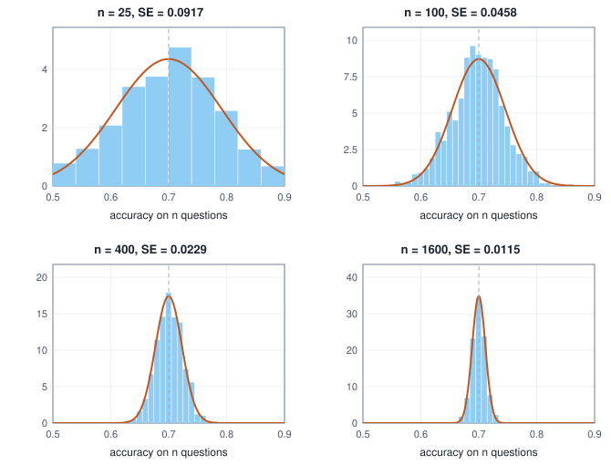
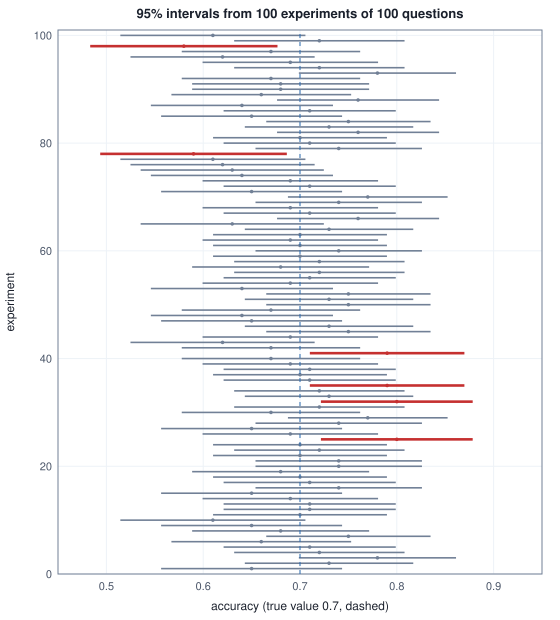
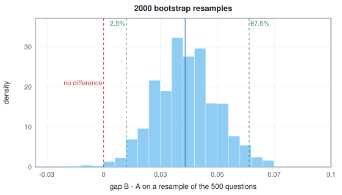

<!-- SPDX-License-Identifier: CC-BY-4.0 -->
<!-- Copyright (c) 2026 Martin Schröder <info@swedishembedded.com> -->

# Statistics: Learning Facts from Samples

*How much can a finite sample tell us, and how do we know whether a difference is real?*

Two language models answer the same $500$ multiple-choice questions. Model A gets
$352$ right, $70.4\%$. Model B gets $356$ right, $71.2\%$. B is ahead by four questions,
eight tenths of a point. Is B the better model?

The honest first reaction is that nobody knows yet, because the $500$ questions are
only some of the questions that could have been asked. Ask a different $500$ and the
scores move. To see how much they move, suppose the two models are exactly equal:
each answers any question right with the same probability, $0.708$ (the pooled
accuracy of the two real scores). Give each equal model its own $500$ questions, many
times over, and look at the gap.

<!-- worked: statistics_ch.chance_gaps -->
Generator: the book's SplitMix64, seed 0xe7fba0d33eee59c0 (16716131271070079424). Each of the 2000 runs draws A's 500 questions, then B's 500, one `rng.uniform()` per question (right when below 0.708); the first eight runs are listed.

| run | A right | A % | B right | B % | B - A (points) |
|---|---:|---:|---:|---:|---:|
| 1 | 349 | 69.8 | 368 | 73.6 | +3.8 |
| 2 | 347 | 69.4 | 337 | 67.4 | -2.0 |
| 3 | 357 | 71.4 | 346 | 69.2 | -2.2 |
| 4 | 364 | 72.8 | 361 | 72.2 | -0.6 |
| 5 | 358 | 71.6 | 367 | 73.4 | +1.8 |
| 6 | 355 | 71.0 | 368 | 73.6 | +2.6 |
| 7 | 351 | 70.2 | 356 | 71.2 | +1.0 |
| 8 | 335 | 67.0 | 362 | 72.4 | +5.4 |

| over all 2000 runs of two equal models | share of runs |
|---|---:|
| B ahead by 4 questions (0.8 points) or more | 0.4120 |
| A ahead by 4 questions or more | 0.3920 |
| one of them ahead by 4 or more | 0.8040 |
<!-- /worked -->

Two models that are identical by construction produce gaps of several points in
either direction, and in about four runs out of five one of them leads by at least the
four questions we observed. The observed difference is the kind of thing chance alone
produces. It is not evidence that B is better, and it is not evidence that B is not
better: it is a measurement too coarse to say.

That situation is the daily one for anyone who evaluates models. Every score on a
finite test set is an **estimate** of a quantity we cannot observe, the accuracy the
model would show on all questions of the kind, and an estimate is only as useful as our
knowledge of its error. So the chapter starts with one estimate and the way its error
shrinks as examples are added, widens that into an interval we can trust, and turns the
interval into a rule for deciding whether a gap between two scores is real. Two models
asked the same questions carry more information than two separate totals, and the
chapter spends it. Last comes the quiet trap of trying twenty things and reporting the
best. The two models and their $500$ questions stay as the running example, first as
the puzzle and then as the case every tool is applied to.

The arguments below use six ideas from earlier chapters, one of them from the first.
Answer them from memory; each names the chapter that taught it, to go back to if the
answer will not come.

1. (Chapter 10, probability.) Ten independent measurements each have variance $4$. What is the variance of their average?
2. (Chapter 11, distributions.) $X$ and $Y$ each have variance $1$ and their covariance is $0.8$. What is $\mathrm{Var}[X - Y]$?
3. (Chapter 11.) State the central limit theorem in one sentence. About what share of a Gaussian lies within two standard deviations of its mean?
4. (Chapter 11.) A fair coin is flipped $4$ times. What is the probability of at least $3$ heads?
5. (Chapter 3, vectors.) The points $(1000, 2)$ and $(1010, 5)$ describe two examples with two features. What is the Euclidean distance between them, and which feature does it mostly measure?
6. (Chapter 1, notation.) Write the sum of the squared deviations of $x_1, \dots, x_n$ from their mean $\bar{x}$ in summation notation, and evaluate it for the data $2, 4, 9$.

## Estimating a quantity from a sample

Before a test score's error can be measured, we have to say what the score is an estimate of. We ask about a model's **true accuracy** $p$: the probability that it answers a
question drawn from the kind of questions we care about correctly. We cannot see $p$.
We see a **sample**, here $n = 500$ questions, and on each the model is right ($1$) or
wrong ($0$). The score $\hat{p} = 352/500 = 0.704$ is our best guess at $p$. The hat marks
an estimate (notation page). A quantity of the underlying world that we want to know,
like $p$, is a parameter; a number computed from the sample as a guess of it, like
$\hat{p}$, is an **estimate**.

The rule that turns a sample into a number is an **estimator**. "Add up the right
answers and divide by $n$" is an estimator. So is "take the accuracy on the first
$100$ questions only", and so is "always say $0.5$". All three give a number for any
sample; they differ in how good the number is, and the point of this chapter is to make
"how good" a computable quantity.

The key step is to notice that an estimate is the outcome of a random experiment. The
sample was drawn at random, so $\hat{p}$ is a random variable, and like any random
variable it has a distribution, called its **sampling distribution**: the values the
estimate would take over all the samples that could have been drawn. Chapter 10's
expectation and variance describe it. Two numbers matter. The expectation of the
estimate minus the parameter,

$$
\mathrm{bias} = \mathbb{E}[\hat{\theta}] - \theta,
$$

is its **bias** (here $\theta$ is any parameter and $\hat{\theta}$ its estimator): the
error that remains even when averaging over every possible sample. An estimator with
bias $0$ is **unbiased**. The spread of the sampling distribution says how far a single
estimate is likely to be from its own centre. Both are needed. "Always say $0.5$" has
zero spread and large bias. A sensible estimator has little of either.

### The sample mean

The estimator behind every accuracy, loss and average in machine learning is the
simplest one. Given $n$ observations $x_1, \dots, x_n$ the **sample mean** is their average,

$$
\bar{x} = \frac{1}{n}\sum_{i=1}^{n} x_i .
$$

An accuracy is a sample mean of $0/1$ values, a mean loss is a sample mean of per-example
losses, and a minibatch gradient is a sample mean of per-example gradients. Treat the
observations as independent draws $X_1, \dots, X_n$ of one distribution with mean $\mu$ and
variance $\sigma^2$. Then $\bar{X}$ is itself random, and Chapter 10 gives its two numbers
directly. By linearity of expectation,

$$
\mathbb{E}[\bar{X}] = \frac{1}{n}\sum_{i=1}^n \mathbb{E}[X_i] = \frac{n\mu}{n} = \mu,
$$

so the sample mean is unbiased. And because the variance of an independent sum is the sum
of the variances and scaling by $1/n$ scales the variance by $1/n^2$,

$$
\mathrm{Var}[\bar{X}] = \frac{n\sigma^2}{n^2} = \frac{\sigma^2}{n}.
$$

The standard deviation of an estimator has its own name, the **standard error**:
the typical size of the error of one estimate. For the sample mean,

$$
\mathrm{SE}[\bar{X}] = \frac{\sigma}{\sqrt{n}} .
$$

For an accuracy, each $X_i$ is a Bernoulli variable (Chapter 11) with variance $p(1-p)$,
so $\mathrm{SE}[\hat{p}] = \sqrt{p(1-p)/n}$. We do not know $p$, but we can plug in the
estimate $\hat{p}$ (a small approximation that costs very little once $n$ is not tiny).
For model A, $\sqrt{0.704 \times 0.296 / 500} = 0.0204$: two points. Here is how it moves
with the number of questions:

<!-- worked: statistics_ch.standard_errors -->
| questions n | standard error | 95% half-width (points) |
|---|---:|---:|
| 100 | 0.0456 | 8.95 |
| 500 | 0.0204 | 4.00 |
| 2000 | 0.0102 | 2.00 |
| 10000 | 0.0046 | 0.89 |

Accuracy 0.704. Questions needed for a 95% half-width of 1 point: (1.960 / 0.01)^2 x 0.704 x 0.296 = 8005.
<!-- /worked -->

Quadrupling the questions halves the error: $\sqrt{4} = 2$, the same square-root law
Chapter 10 showed for dice. To pin an accuracy of about $0.70$ to within a point
(a $95\%$ half-width, the multiplier $1.96$ coming from the next section) takes about
eight thousand questions, sixteen times as many as the $500$ we had. This is the
first practical fact of the chapter: precision is bought at a square-root price, so small
differences are expensive to resolve.

The standard error is not the standard deviation of the data. Each answer is $0$ or $1$
with a standard deviation of $\sqrt{0.704 \times 0.296} = 0.456$, and that does not
shrink however many answers we collect; only the standard error of their average does.
We can watch the sampling distribution narrow. A model that is truly $70\%$ accurate is
tested on $n$ questions, and the experiment is repeated $1000$ times:

<!-- worked: statistics_ch.sampling_distribution -->
Generator: the book's SplitMix64, seed 0x2e06fcb21770fbd8 (3316616017432607704). True accuracy p = 0.7. One generator, rows in the order n = 25, 100, 400, 1600; a row makes 1000 accuracies, each over n questions drawn in turn (one `rng.uniform()` per question, right when below 0.7). Spread: standard deviation with divisor 1000.

| questions n | average of 1000 accuracies | spread of the 1000 accuracies | sqrt(p(1-p)/n) | ratio |
|---|---:|---:|---:|---:|
| 25 | 0.7020 | 0.0924 | 0.0917 | 1.009 |
| 100 | 0.6979 | 0.0451 | 0.0458 | 0.983 |
| 400 | 0.7004 | 0.0231 | 0.0229 | 1.006 |
| 1600 | 0.7000 | 0.0118 | 0.0115 | 1.027 |
<!-- /worked -->



The measured spread of the accuracies matches $\sqrt{p(1-p)/n}$ to within the noise of a
$1000$-repeat simulation (a standard deviation estimated from $1000$ values is itself
uncertain by about $2\%$). The histograms also show the central limit theorem at work:
already at $n = 100$ the bars follow a Gaussian curve, and at $n = 25$ they are coarse
only because an accuracy over $25$ questions can take just $26$ values.

### Why the sample variance divides by $n - 1$

The standard error needs $\sigma$, and for a general quantity we do not know it. We
estimate it from the sample. The obvious estimator is the average squared deviation from
the sample mean, $\frac{1}{n}\sum(x_i - \bar{x})^2$. It turns out to be biased, and the
bias is small enough to miss, so we compute a case in which it cannot be missed. Take the
die of Chapter 10, whose true variance is $35/12$, and samples of just $n = 2$ rolls. There
are only $36$ samples, so we can list them all and average the estimator over every one:

<!-- worked: statistics_ch.variance_divisors -->
| sample size n | divisor | average over all 6^n samples | true variance 35/12 | average / true |
|---|---:|---:|---:|---:|
| 2 | n | 1.4583 | 2.9167 | 0.5000 |
| 2 | n - 1 | 2.9167 | 2.9167 | 1.0000 |
| 3 | n | 1.9444 | 2.9167 | 0.6667 |
| 3 | n - 1 | 2.9167 | 2.9167 | 1.0000 |

| sample size n | average of s (divisor n - 1) | true standard deviation |
|---|---:|---:|
| 2 | 1.3749 | 1.7078 |
| 3 | 1.5562 | 1.7078 |
<!-- /worked -->

Dividing by $n$ gives on average exactly half the true variance for $n = 2$ and
two thirds of it for $n = 3$; dividing by $n - 1$ gives the true variance exactly, both
times. The ratio $(n-1)/n$ suggests a general law. To derive it, write each deviation from
the sample mean in terms of the deviation from the true mean $\mu$, $x_i - \bar{x} = (x_i - \mu)
- (\bar{x} - \mu)$, and square and sum:

$$
\sum_{i=1}^n (x_i - \mu)^2 = \sum_{i=1}^n (x_i - \bar{x})^2 + n(\bar{x} - \mu)^2 .
$$

(The cross term is $-2(\bar{x} - \mu)\sum_i (x_i - \bar{x})$, and the deviations from
their own mean sum to zero, so it vanishes.) Now take expectations. The left side is
$n\sigma^2$, because each term has expectation $\sigma^2$. The last term is $n$ times the
variance of the sample mean, $n\cdot\sigma^2/n = \sigma^2$. Therefore

$$
\mathbb{E}\Bigl[\sum_{i=1}^n (x_i - \bar{x})^2\Bigr] = n\sigma^2 - \sigma^2 = (n-1)\,\sigma^2 .
$$

The deviations from the sample mean add up to less than the deviations from the true mean,
because the sample mean is by construction the point closest to the sample; it has been
fitted to these very values, and one degree of freedom of the $n$ numbers is used up
by that fit. Dividing by $n - 1$ instead of $n$ repairs the shortfall exactly. The
**sample variance** is

$$
s^2 = \frac{1}{n-1}\sum_{i=1}^n (x_i - \bar{x})^2, \qquad \mathbb{E}[s^2] = \sigma^2,
$$

and the standard error of the mean is estimated by $s/\sqrt{n}$. A simulation shows the
law holding for larger samples, where the effect shrinks:

<!-- worked: statistics_ch.variance_divisor_simulation -->
Generator: the book's SplitMix64, seed 0x02efca81066ce338 (211610363017093944). One generator, rows in the order n = 2, 5, 10, 50. Each row makes 20,000 samples; a sample is n rolls, each `rng.integer(6) + 1`, drawn in turn; the variance of a sample is computed with each divisor and the 20,000 values averaged.

| n | average, divisor n | average, divisor n - 1 | true variance | (n - 1)/n x true variance |
|---|---:|---:|---:|---:|
| 2 | 1.4714 | 2.9427 | 2.9167 | 1.4583 |
| 5 | 2.3475 | 2.9344 | 2.9167 | 2.3333 |
| 10 | 2.6189 | 2.9099 | 2.9167 | 2.6250 |
| 50 | 2.8579 | 2.9162 | 2.9167 | 2.8583 |
<!-- /worked -->

The divisor-$n$ column follows $(n-1)/n$ times the true variance, and the divisor-$(n-1)$
column stays at it. One caution: $s = \sqrt{s^2}$ is still very slightly too small on
average, as the second table of the exact computation shows ($1.37$ against $1.71$ at
$n = 2$), because a square root bends downward. Unbiasedness is a property of one
estimator of one quantity, not something that survives applying a function to it.

### Putting the sample mean to work: standardising features

Chapter 3 promised a remedy for features of different scales, to be applied before
distances and dot products are taken, and the sample mean and variance now supply it. Chapter 3 noticed that if one feature is measured in large numbers, it dominates every
distance. Here are eight houses described by area in square metres and age in years:

<!-- worked: statistics_ch.feature_scales -->
| house | area (m^2) | age (years) |
|---|---:|---:|
| 1 | 62 | 12 |
| 2 | 85 | 40 |
| 3 | 120 | 7 |
| 4 | 74 | 25 |
| 5 | 150 | 3 |
| 6 | 95 | 33 |
| 7 | 58 | 55 |
| 8 | 108 | 18 |

| feature | mean | standard deviation (divisor n - 1) |
|---|---:|---:|
| area | 94.00 | 31.19 |
| age | 24.12 | 17.76 |

| raw features, houses 1 and 2 | squared difference | share of squared distance |
|---|---:|---:|
| area: 62 - 85 | 529 | 0.403 |
| age: 12 - 40 | 784 | 0.597 |
| distance | 36.24 |  |
<!-- /worked -->

The distance between houses 1 and 2 is $36.2$, and $60\%$ of its squared length comes
from age, not because age matters more but because the age numbers happened to spread
more than the area numbers in that pair. A feature in dollars would swamp both. The fix
is to measure each feature in units of its own spread. The **z-score** of a value $x$ of
a feature is

$$
z = \frac{x - \bar{x}}{s},
$$

with $\bar{x}$ and $s$ the sample mean and standard deviation of that feature. This moves
the average of the feature to $0$ and its standard deviation to $1$, whatever the original
unit, so a $z$ of $1.8$ means "$1.8$ standard deviations above the typical value":

<!-- worked: statistics_ch.feature_zscores -->
| house | z of area | z of age |
|---|---:|---:|
| 1 | -1.026 | -0.683 |
| 2 | -0.289 | 0.894 |
| 3 | 0.834 | -0.964 |
| 4 | -0.641 | 0.049 |
| 5 | 1.795 | -1.189 |
| 6 | 0.032 | 0.500 |
| 7 | -1.154 | 1.738 |
| 8 | 0.449 | -0.345 |

| check | area | age |
|---|---:|---:|
| mean of z | 0.0000 | 0.0000 |
| standard deviation of z (divisor n - 1) | 1.0000 | 1.0000 |

| standardised features, houses 1 and 2 | squared difference | share of squared distance |
|---|---:|---:|
| area | 0.544 | 0.180 |
| age | 2.485 | 0.820 |
| distance | 1.740 |  |

| new house, scaled with the eight-house statistics | raw | z |
|---|---:|---:|
| area | 100 | 0.192 |
| age | 20 | -0.232 |

| n | ratio of the two standard deviations, sqrt(n/(n-1)) |
|---|---:|
| 8 | 1.0690 |
| 100 | 1.0050 |
| 10000 | 1.0001 |
<!-- /worked -->

The two columns now have mean $0$ and standard deviation $1$ exactly, and the distance
between houses 1 and 2 is $1.74$, now split $18\%$ and $82\%$ between area and age. Neither
feature dominates by units. (Which split is right depends on the task, but it no longer
depends on whether somebody measured the area in square feet.) Three points of method
follow from the earlier sections.

The mean and standard deviation are estimates, computed from a sample, and a new
example must be scaled with the numbers estimated from the data used to fit the model, not
with its own batch. The last table does this for a new house of $100\ \mathrm{m}^2$ and
$20$ years: it is scaled with the eight-house statistics, giving $0.19$ and $-0.23$.
Computing the statistics over training and test data together lets the test set influence
the scaling, and a test score is then no longer a measurement on unseen data; Volume II
returns to this as data leakage.

The divisor matters little in practice. The two common conventions differ by the factor
$\sqrt{n/(n-1)}$, which is $1.07$ for eight houses and $1.0001$ for ten thousand. Pick one and
use it consistently: here we use $n - 1$ because that is the unbiased one.

A feature with zero spread cannot be scaled, and the algorithm must refuse it rather than
divide by zero:

```text
function fit_scaler(X: array<real>[N, F]) -> (array<real>[F], array<real>[F]):
    require N >= 2, "a spread needs at least two examples"
    mean = zeros(real, [F])
    std = zeros(real, [F])
    for j in 0 .. F:
        total = 0.0
        for i in 0 .. N:
            total = total + X[i, j]
        mean[j] = total / N
        ss = 0.0
        for i in 0 .. N:
            ss = ss + (X[i, j] - mean[j]) * (X[i, j] - mean[j])
        std[j] = sqrt(ss / (N - 1))                    # unbiased variance, then the root
        require std[j] > 0.0, "a constant feature has no scale"
    return (mean, std)

function standardise(X: array<real>[N, F], mean: array<real>[F], std: array<real>[F])
        -> array<real>[N, F]:
    Z = zeros(real, [N, F])
    for i in 0 .. N:
        for j in 0 .. F:
            Z[i, j] = (X[i, j] - mean[j]) / std[j]     # mean and std broadcast over the rows
    return Z
```

## Confidence intervals: how far off can the estimate be?

A score without its uncertainty invites misreading. Start from the computed case. Each
model's accuracy comes with its standard error, and the interval that extends $1.96$
standard errors on either side, an estimate plus and minus a multiple of its standard
error, called a **Wald interval**:

<!-- worked: statistics_ch.accuracy_intervals -->
| model | right of 500 | accuracy % | standard error | 95% lower % | 95% upper % |
|---|---:|---:|---:|---:|---:|
| A | 352 | 70.4 | 0.0204 | 66.4 | 74.4 |
| B | 356 | 71.2 | 0.0203 | 67.2 | 75.2 |
<!-- /worked -->

A reader of these two rows sees at once what the problem section only suggested: the
interval of A, from $66.4\%$ to $74.4\%$, and that of B, from $67.2\%$ to $75.2\%$, overlap
over nearly their whole length. (Overlap of two intervals is not itself the test of the
next section, but wide, mostly shared intervals are a warning that the data cannot separate the
models.)

Where does $1.96$ come from? The central limit theorem of Chapter 11 says that the sample
mean, standardised, is nearly Gaussian:

$$
\frac{\bar{X} - \mu}{\sigma/\sqrt{n}} \approx \mathcal{N}(0, 1).
$$

A standard Gaussian puts $95\%$ of its probability between $-1.96$ and $1.96$, a number we
compute from the areas of Chapter 11:

<!-- worked: statistics_ch.central_areas -->
| z | area within -z and z |
|---|---:|
| 1.0 | 0.6827 |
| 1.645 | 0.9000 |
| 1.96 | 0.9500 |
| 2.576 | 0.9900 |
| 3.0 | 0.9973 |
<!-- /worked -->

So with probability about $0.95$ the sample mean falls within $1.96$ standard errors of
the true mean, $\lvert\bar{X} - \mu\rvert \le 1.96\,\mathrm{SE}$. That event can be read from
the other side. It is the same event as "$\mu$ lies within $1.96$ standard errors of
$\bar{X}$". The **confidence interval** of level $95\%$ is the range

$$
\bar{x} \pm 1.96\,\mathrm{SE},
$$

and the reason it is called $95\%$ is a statement about the recipe, not about any one
interval: if you repeated the whole experiment many times and built an interval each time,
about $95\%$ of the intervals would contain the true value. The parameter does not move; the
intervals do. Here is that statement made visible. Take a model whose true accuracy is
$0.7$ and run one hundred separate experiments of $100$ questions each:



<!-- worked: statistics_ch.coverage_figure_summary -->
Generator: the book's SplitMix64, seed 0xe7a106b2ff4ba985 (16690629059868862853). 100 experiments in turn, each 100 questions (one `rng.uniform()` each, right when below 0.7), 95 percent Wald intervals as in the previous table.

| experiments | questions each | true accuracy | intervals that missed it |
|---|---:|---:|---:|
| 100 | 100 | 0.7 | 6 |
<!-- /worked -->

The intervals jump around the dashed line, because each rests on a different sample, and
the red ones are those that missed. The share of intervals that contain the true value is
the interval's **coverage**. With a hundred experiments the count of misses is itself
random, so it is better to measure coverage on more experiments and to ask when the
recipe holds up:

<!-- worked: statistics_ch.coverage_table -->
Generator: the book's SplitMix64, seed 0xfede0426393a6c94 (18365120892678859924). One generator, rows in the order listed (p = 0.7 then 0.1; n = 20, 100, 500 within each). A row makes 2000 experiments; an experiment draws its n questions in turn (one `rng.uniform()` each, right when below p) and forms the 95 percent Wald interval with z = 1.959964; 'contains it' is lower <= p <= upper.

| true accuracy | questions n | share of 2000 intervals containing it | share with zero width |
|---|---:|---:|---:|
| 0.7 | 20 | 0.949 | 0.000 |
| 0.7 | 100 | 0.943 | 0.000 |
| 0.7 | 500 | 0.951 | 0.000 |
| 0.1 | 20 | 0.889 | 0.110 |
| 0.1 | 100 | 0.932 | 0.000 |
| 0.1 | 500 | 0.932 | 0.000 |
<!-- /worked -->

For a model that is right $70\%$ of the time the recipe covers about $95\%$ at every size,
even $20$ questions. For a model that is right only $10\%$ of the time the central
limit theorem needs more data: at $20$ questions the coverage is $89\%$, and $11\%$ of the
experiments see no correct answer at all, so $\hat{p} = 0$, the standard error is $0$ and the
interval has zero width and cannot contain $0.1$. This is the failure of a Gaussian
approximation: the sample mean of a very lopsided variable is not yet Gaussian at small
$n$. By $100$ questions the coverage is $93\%$.

When the standard error itself is estimated by $s/\sqrt{n}$ from a small sample, there is a
second source of error: $s$ is noisy, and the standardised mean is then not Gaussian but
follows a somewhat wider curve called Student's t distribution. For a data set of $n$
numbers the multiplier $1.96$ is replaced by a larger one that depends on the
**degrees of freedom**, here $n - 1$ (the number of values free to vary once their average is
fixed, the "one degree of freedom used up by the fit" of the variance section):

<!-- worked: statistics_ch.t_multipliers -->
| degrees of freedom (n - 1) | multiplier for 95% |
|---|---:|
| 1 | 12.706 |
| 2 | 4.303 |
| 5 | 2.571 |
| 10 | 2.228 |
| 30 | 2.042 |
| infinite (Gaussian) | 1.960 |
<!-- /worked -->

With $2$ degrees of freedom (three observations) the interval is $2.2$ times wider than the
Gaussian one, with $30$ it is only $4\%$ wider, and in the limit the two agree. The
numbers are computed from the density of Student's t distribution with $\nu$ degrees of
freedom,

$$
f_\nu(t) = \frac{\Gamma\!\left(\frac{\nu+1}{2}\right)}{\sqrt{\nu\pi}\;\Gamma\!\left(\frac{\nu}{2}\right)}
\left(1 + \frac{t^2}{\nu}\right)^{-(\nu+1)/2},
$$

where $\Gamma$ is the gamma function, $\Gamma(x) = \int_0^\infty u^{x-1} e^{-u}\,du$. For
the values needed here it follows from $\Gamma(1) = 1$, $\Gamma(\tfrac12) = \sqrt{\pi}$ and
$\Gamma(x+1) = x\,\Gamma(x)$ (so $\Gamma(n) = (n-1)!$). The two-sided $95\%$ multiplier
$m_\nu$ is the number with $\int_{-m}^{m} f_\nu(t)\,dt = 0.95$, found for
$\nu = 1, 2, 5, 10, 30$ as follows: the area $2\int_0^m f_\nu$ is computed by Simpson's rule
with $4000$ equal intervals on $[0, m]$, and $m$ is found by bisection on $[0, 200]$ with $60$
halvings (raise the lower end when the area is below $0.95$, otherwise lower the upper end;
the answer is the midpoint). The last row is the Gaussian multiplier $1.959964$. The chapter
does not need the distribution beyond the fact that few observations call for a wider
interval.

Two further points. A confidence level is a choice, not a law: $90\%$ and $99\%$ intervals
use the multipliers $1.645$ and $2.576$ of the table above, and a wider interval is more
likely to contain the truth and less informative. And the interval's width is the
quantity to plan with: width $\approx 2\times 1.96\sqrt{p(1-p)/n}$, which is the source of the
eight thousand questions of the last section.

## Hypothesis tests: is the difference real?

Now the problem's question. Is the four-question gap between A and B real? A
**hypothesis test** answers a question of this kind by asking how surprising the data would
be in a world where nothing is going on. It has four parts.

1. A **null hypothesis**, the claim that nothing is going on: both models have the same true
   accuracy.
2. A **test statistic**, a number computed from the data that measures how far the data lie
   from that claim. Here we use the difference of the accuracies divided by its standard
   error under the null.
3. A **p-value**: the probability, computed in the null world, of a test statistic at least
   as extreme as the one observed.
4. A decision rule: declare the difference real if the p-value is below a threshold
   $\alpha$ fixed in advance, conventionally $0.05$.

In the null world both models share one accuracy, estimated by the pooled score
$(352 + 356)/1000 = 0.708$. The difference of two independent accuracies has variance
$2p(1-p)/n$ (the variances of independent quantities add, Chapter 10), so its standard error
under the null is $\sqrt{2 \times 0.708 \times 0.292/500} = 0.0288$. The observed gap is
$0.008$, which is $0.278$ standard errors. By the central limit theorem the statistic $z$
is nearly standard Gaussian under the null, so the probability of a gap at least this
large in either direction is the area outside $\pm 0.278$:

<!-- worked: statistics_ch.unpaired_test -->
The simulated share uses the 2000 runs of the first table of this chapter (same generator, seed 0xe7fba0d33eee59c0).

| quantity | value |
|---|---|
| accuracy A, B | 0.704, 0.712 |
| difference B - A | 0.0080 |
| pooled accuracy (the null world) | 0.708 |
| standard error of the difference under the null | 0.02876 |
| test statistic z | 0.278 |
| two-sided p-value from the Gaussian | 0.781 |
| share of 2000 simulated null experiments with |gap| >= 4 questions | 0.804 |
<!-- /worked -->

The p-value is $0.78$, and the last row checks it against the experiment of the problem
section, an independent measurement of the same probability: in $80\%$ of the simulated null
experiments the gap was at least four questions. (The $0.78$ and $0.80$ differ because a
count of questions is discrete and the Gaussian is a continuous approximation; both say
"about four in five".) A p-value is therefore a computed probability, in a world we can
simulate.

A p-value of $0.78$ is nowhere near $0.05$. We do not reject the null. The next question is
what a test can and cannot do. It makes two kinds of mistake. If the models really are
equal, the test declares a difference with probability $\alpha$ by construction; if one is
really better, it can still fail to notice. The chance of noticing a real difference of a
given size is the test's **power**. Both can be measured by simulation, and the power also
follows from the Gaussian approximation (the difference of two accuracies shifted by the
true gap $\delta$ has $z$ centred at $\delta$ divided by the standard error):

<!-- worked: statistics_ch.test_error_rates -->
Generator: the book's SplitMix64, seed 0x728bde2f9b4f2901 (8253935038137051393). One generator; first row, then second. An experiment draws A's 500 questions, then B's 500 (one `rng.uniform()` each, right when below the model's true accuracy), and declares the models different when |z| > 1.959964 for the pooled-accuracy z-test (pooled accuracy = (pA + pB) / 2, z = (pB - pA) / sqrt(2 pooled (1 - pooled) / 500)); 1000 experiments per row. "3 points better" means B's true accuracy is 0.730 against A's 0.700. Second table, analytic: both accuracies taken as 0.70, so the standard error of the difference is sqrt(2 * 0.7 * 0.3 / n); the chance of detecting is the two-sided power P(|z| > 1.959964) when z is Gaussian with mean 0.03 / standard error and standard deviation 1, that is 1 - Phi(1.959964 - shift) + Phi(-1.959964 - shift) with shift = 0.03 / standard error.

| truth | questions | share of 1000 experiments declared different |
|---|---:|---:|
| both truly 0.700 | 500 | 0.060 |
| B truly 3 points better | 500 | 0.187 |

| questions n | standard error of the difference | chance of detecting a 3-point gain |
|---|---:|---:|
| 500 | 0.0290 | 0.179 |
| 2000 | 0.0145 | 0.544 |
| 8000 | 0.0072 | 0.985 |
<!-- /worked -->

With equal models the test fires about $5\%$ of the time (the simulated $6.0\%$ is within
the noise of $1000$ experiments). With a model that is truly three points better, $500$
questions detect it only about $18\%$ of the time ($19\%$ in the simulation): the standard error $0.029$ is almost as
large as the gain. Detecting a three-point gain reliably takes thousands of questions, and
the table shows $98\%$ power at $8000$. The consequence for the problem: a non-significant
result on $500$ questions is not a finding that the models are equal. It says the test was
too weak to tell.

The p-value invites a common misreading. It is not the probability that the null hypothesis is
true, nor that B is better. It is the probability of data like these if the null were
true, which is a different conditional probability (Chapter 10's Bayes' rule is the bridge,
and it needs the share of ideas that were really null to start with). To see how different,
suppose a team tests $1000$ candidate improvements, $90\%$ of which are no better than the
baseline, with a test at $\alpha = 0.05$ and power $0.5$:

<!-- worked: statistics_ch.false_discoveries -->
| step | count |
|---|---:|
| ideas tested | 1000 |
| no better than the baseline (90 percent) | 900 |
| really better (10 percent) | 100 |
| false positives: 900 x 0.05 | 45 |
| true positives: 100 x 0.5 | 50 |
| significant results | 95 |
| share of significant results that are false | 0.474 |
<!-- /worked -->

Almost half of the "significant" improvements are false, although each passed a $0.05$ test.
A small p-value is evidence against the null; how much depends on how plausible the
alternative was before the test.

## Paired tests: the same questions, a better comparison

So far we treated the two scores as independent measurements, each with its own questions.
But in a real evaluation both models see the same $500$, and we know much more than two
totals: we know, question by question, who was right. Here is the full picture behind
the problem's two scores. The first row is the problem's data; the second row is a
variant with a larger gap that the chapter returns to:

<!-- worked: statistics_ch.table_two_by_two -->
| scenario | both right | only A right | only B right | both wrong | A right | B right | discordant |
|---|---:|---:|---:|---:|---:|---:|---:|
| 1 | 332 | 20 | 24 | 124 | 352 | 356 | 44 |
| 2 | 338 | 14 | 32 | 116 | 352 | 370 | 46 |
<!-- /worked -->

In scenario 1 the models agree on $456$ questions ($332$ both right, $124$ both wrong)
and disagree on $44$: A alone is right on $20$ and B alone on $24$. The totals of the
problem, $352$ and $356$, are the margins of this table. The $456$ questions on which they
agree carry no information about which is better. All the information about the gap is in
the $44$ on which they differ.

Pairing shrinks the error for a reason that can be written down. The unpaired test treats $\bar{A}$ and $\bar{B}$ as
independent and adds their variances. They are not independent: a hard question is hard for
both models. Define the per-question difference $D_i = B_i - A_i$, which is $+1$, $0$ or
$-1$. The gap is the sample mean $\bar{D}$, so the standard error of the gap is the
standard error of a sample mean, $\sqrt{\mathrm{Var}[D]/n}$, and the variance of a difference
(Chapter 11's covariance) is

$$
\mathrm{Var}[D] = \mathrm{Var}[A] + \mathrm{Var}[B] - 2\,\mathrm{Cov}[A, B].
$$

When the two models' answers are independent the covariance is $0$ and this is the sum of
variances the unpaired test used. When they tend to be right together the covariance is
positive and the variance of the difference is smaller. The table computes it for both
scenarios from the $0/1$ vectors:

<!-- worked: statistics_ch.paired_standard_errors -->
Variances and covariance of the 0/1 answer vectors use divisor n = 500 (the observed questions as the whole distribution); 'SE if unpaired' is sqrt((Var A + Var B) / n) with those variances; 'SE paired' is sqrt(s_D^2 / n) with s_D^2 the unbiased variance of the per-question differences (divisor n - 1), so it is larger than sqrt(Var of difference / n) by the factor sqrt(n / (n - 1)) = 1.001.

| scenario | acc A | acc B | Cov[A, B] | correlation | Var A + Var B | Var A + Var B - 2 Cov | Var of per-question difference | SE if unpaired | SE paired |
|---|---:|---:|---:|---:|---:|---:|---:|---:|---:|
| 1 | 0.704 | 0.712 | 0.1628 | 0.787 | 0.4134 | 0.0879 | 0.0879 | 0.0288 | 0.0133 |
| 2 | 0.704 | 0.740 | 0.1550 | 0.774 | 0.4008 | 0.0907 | 0.0907 | 0.0283 | 0.0135 |
<!-- /worked -->

The correlation of the models' answers is $0.79$ in scenario 1, so the per-question
difference has variance $0.0879$ where the sum of the two variances is $0.4134$, and the
standard error of the gap falls from $0.0288$ to $0.0133$, less than half. The column
$\mathrm{Var}[A] + \mathrm{Var}[B] - 2\,\mathrm{Cov}[A, B]$ and the column computed directly from the
differences agree, as the derivation says. Two divisors appear in this table and the reason is worth stating. The variances and the
covariance describe the $500$ observed $0/1$ answers themselves and divide by $n$ (this is
the convention of Chapter 11). The paired standard error estimates the spread of the
differences in the wider population, so it uses the unbiased variance $s_D^2$ with divisor
$n - 1$, as the `paired_z` algorithm below does: $\sqrt{0.0879 \cdot \tfrac{500}{499}/500} =
0.0133$ in both conventions to four digits, but the $p$-values differ in the fourth digit
and the book uses $n - 1$ whenever a standard error is estimated from a sample. The
"SE if unpaired" column is $\sqrt{(\mathrm{Var}\,A + \mathrm{Var}\,B)/n}$, which differs
slightly from the pooled null standard error of the hypothesis test ($0.02876$), built from
the single pooled accuracy; the two agree to four digits here only because the two accuracies
are so close.

The effect grows with the correlation. For two
models that are each right $70\%$ of the time, the variance of the difference is
$2p(1-p)(1-\rho)$ for a correlation $\rho$ of their answers, so
$\mathrm{SE} = \sqrt{2p(1-p)(1-\rho)/n}$:

<!-- worked: statistics_ch.pairing_vs_correlation -->
Generator: the book's SplitMix64, seed 0x56ea512605656f61 (6262907455553236833). Two models of accuracy 0.7 each, answers correlated with coefficient rho; the four cells of one question (both right, A only, B only, neither) have probabilities 0.49 + 0.21 rho, 0.21 (1 - rho), 0.21 (1 - rho), 0.09 + 0.21 rho. One generator, rows in the order rho = 0, 0.3, 0.6, 0.9. A row makes 1000 experiments of 500 questions; a question is one `rng.uniform()` u: both right if u is below the first cell's probability, A only if below the sum of the first two, B only if below the sum of the first three, else neither. The gap is (B-only count minus A-only count) / 500; spread = standard deviation with divisor 1000.

| correlation of the two models' answers | share of questions where they disagree | SE of the gap, formula | spread of 1000 simulated gaps |
|---|---:|---:|---:|
| 0.0 | 0.420 | 0.0290 | 0.0283 |
| 0.3 | 0.294 | 0.0242 | 0.0240 |
| 0.6 | 0.168 | 0.0183 | 0.0186 |
| 0.9 | 0.042 | 0.0092 | 0.0090 |
<!-- /worked -->

At a correlation of $0.9$ the standard error is a third of what an unpaired analysis would
claim. Two models fine-tuned from the same base, or one model before and after a small
change, are strongly correlated, and for them ignoring the pairing throws away most of
the evidence. Comparing two models on the same examples through the per-example
differences is a **paired test**.

Two paired tests follow. The first is the one the unpaired test already was, with the paired
standard error: the statistic is $\bar{D}$ divided by $s_D/\sqrt{n}$, where $s_D$ is the
sample standard deviation of the differences (the unbiased one, from the earlier section).
It is the form of Student's test for paired data; with hundreds of questions the Gaussian
and t multipliers agree.

The second is the **sign test**, which uses only who won each disagreement. Under the null
the two models have the same accuracy, which means $P(\text{A only right}) = P(\text{B only
right})$; the questions on which they agree say nothing, and each of the $n$ disagreements
is a fair coin flip: B wins with probability $1/2$. If B wins $k$ of the $n$ disagreements,
the p-value is the probability that a fair coin gives at least $k$ heads of $n$,

$$
p = P(K \ge k) = \sum_{i=k}^{n} \binom{n}{i} 2^{-n},
$$

a sum of the binomial probabilities of Chapter 11. It is exact: no Gaussian approximation,
no assumption about the size of any difference, only that each disagreement is a fair coin
under the null. (This is a one-sided p-value, "is B better?". The two-sided value, "do they
differ?", is twice the smaller of the two tails $P(K \ge k)$ and $P(K \le k)$, capped at $1$;
the algorithm below computes both.) For scenario 1, $n = 44$ and $k = 24$.
Putting the three analyses side by side (the p-values of the two z-tests come from the
Gaussian; with $500$ questions the t multiplier is the same to three digits):

<!-- worked: statistics_ch.three_tests -->
Unpaired z: the gap divided by sqrt((Var A + Var B) / n) of the previous table. Paired z: the algorithm `paired_z` (divisor n - 1). All p-values of the two z-tests are two-sided areas of the standard Gaussian; the sign tests are exact binomial (one-sided: B better; two-sided: `sign_test`).

| scenario | accuracy A / B % | B - A | unpaired z | unpaired p | paired z | paired p | B wins of discordant | sign test one-sided p | sign test two-sided p |
|---|---:|---:|---:|---:|---:|---:|---:|---:|---:|
| 1 | 70.4 / 71.2 | 0.008 | 0.28 | 0.781 | 0.60 | 0.5467 | 24 of 44 | 0.3258 | 0.6516 |
| 2 | 70.4 / 74.0 | 0.036 | 1.27 | 0.204 | 2.67 | 0.0076 | 32 of 46 | 0.0057 | 0.0114 |
<!-- /worked -->

For scenario 1 every analysis says that the gap is not established: unpaired $p = 0.78$,
paired $p = 0.55$ and sign test $p = 0.65$ (two-sided). Pairing is not a way to make a
small gap significant; the gap of four questions is too small for $500$ questions
either way. Scenario 2 shows what pairing does for a larger gap. B is right on $370$
questions, $74.0\%$, a $3.6$-point lead. The unpaired test cannot confirm it ($z = 1.27$,
$p = 0.20$), the paired test and the sign test both can (paired $z = 2.67$, $p = 0.008$; B wins $32$
of the $46$ disagreements, sign-test $p = 0.011$). The data is the same in both analyses; the
paired one used the information that the questions were shared. To resolve the gap of scenario 1
at a paired standard error of $0.004$ would take $(0.0133/0.004)^2 \approx 11$ times as many questions,
which is about $5500$.

The sign test has a floor: with few disagreements it cannot be significant at all, even if
every disagreement goes one way.

<!-- worked: statistics_ch.sign_test_floor -->
| discordant pairs n | smallest k with p <= 0.05 | p at that k | share of wins needed |
|---|---:|---:|---:|
| 3 | none |  |  |
| 4 | none |  |  |
| 5 | 5 | 0.0312 | 1.000 |
| 6 | 6 | 0.0156 | 1.000 |
| 8 | 7 | 0.0352 | 0.875 |
| 10 | 9 | 0.0107 | 0.900 |
| 20 | 15 | 0.0207 | 0.750 |
| 44 | 28 | 0.0481 | 0.636 |
| 100 | 59 | 0.0443 | 0.590 |
<!-- /worked -->

Fewer than $5$ disagreements can never give $p \le 0.05$ ($0.5^4 = 0.0625$). With $8$
disagreements $7$ must favour B; with $44$, $28$ of them ($64\%$) must; with $100$, $59$.
The share of wins needed falls toward one half as evidence accumulates. Algorithms for
both paired tests:

```text
function paired_z(a: array<real>[n], b: array<real>[n]) -> real:
    require n >= 2, "a paired test needs at least two pairs"
    d = zeros(real, [n])
    for i in 0 .. n:
        d[i] = b[i] - a[i]                              # per-example difference
    m = mean(d)
    s2 = 0.0
    for i in 0 .. n:
        s2 = s2 + (d[i] - m) * (d[i] - m)
    s2 = s2 / (n - 1)                                   # unbiased variance of the differences
    require s2 > 0.0, "the differences have no spread"
    return m / sqrt(s2 / n)                             # compare with the Gaussian, or t for small n

function half_binomial_tail(m: int, lo: int, hi: int) -> real:
    # P(lo <= K <= hi) for K the number of heads in m flips of a fair coin
    require 0 <= lo and hi <= m, "tail limits outside 0 .. m"
    p = 0.0
    for i in lo ..= hi:
        c = 1.0                                         # binomial coefficient by a running
        for j in 0 .. min(i, m - i):                    # product, never through factorials
            c = c * (m - j) / (j + 1)
        p = p + c / 2 ^ m
    return p

function sign_test(a: array<real>[n], b: array<real>[n]) -> (int, int, real, real):
    disagreements = 0                                   # pairs with a[i] != b[i]
    b_wins = 0
    for i in 0 .. n:
        if b[i] > a[i]:
            disagreements = disagreements + 1
            b_wins = b_wins + 1
        else if b[i] < a[i]:
            disagreements = disagreements + 1
    upper = half_binomial_tail(disagreements, b_wins, disagreements)   # P(K >= k): B better
    lower = half_binomial_tail(disagreements, 0, b_wins)               # P(K <= k)
    two_sided = min(1.0, 2.0 * min(upper, lower))
    return (disagreements, b_wins, upper, two_sided)    # both p are 1.0 when there are no disagreements
```

## The bootstrap: an interval without a formula

The standard error $\sigma/\sqrt{n}$ is a fact about the mean. Many quantities we report are
not means: the median latency of a service, the ratio of two scores, a percentile, an
F-score. Their sampling distributions have no formula in this book. The idea of the
**bootstrap** is to estimate the sampling distribution by simulation, using the sample
itself as a stand-in for the population. We cannot draw new samples from the world, but we
can draw new samples from the sample: pick $n$ values from our $n$ with replacement, so that
some appear twice and some not at all, and recompute the statistic. Do it thousands of times
and the spread of the recomputed statistics estimates the spread the statistic would have
shown across real samples. The interval from the middle $95\%$ of them is a bootstrap
confidence interval.

A concrete case. Twenty-five request latencies in milliseconds are measured and we want the
median and an interval for it:

<!-- worked: statistics_ch.bootstrap_median -->
Latencies (ms): 25 values, value k = exp(4.0 + 0.6 z) rounded to one decimal with z the k-th `rng.normal()` of the generator below; sorted ascending: 19.9, 27.1, 27.4, 28.6, 35.9, 36.0, 37.3, 38.0, 39.7, 41.6, 46.2, 48.4, 54.0, 58.4, 60.5, 60.6, 62.7, 66.5, 73.6, 74.4, 97.8, 99.2, 103.1, 122.5, 152.4.
Latency generator: seed 0x8bde34327b21b500 (10078550407520564480).
Bootstrap generator: seed 0x0e5e536ef546e792 (1035356700368365458). 10,000 resamples; a resample is 25 calls of `rng.integer(25)`, each the index into the ascending latencies above. The median of 25 values is the 13th smallest. Interval ends: the 2.5th and 97.5th percentiles of the sorted replicates by linear interpolation at position q (R - 1). The Gaussian row for the mean is the estimate plus or minus 1.959964 times s/sqrt(25), s the standard deviation with divisor n - 1. The mean and the median rows share the same resamples: each of the 10,000 resamples yields both its mean and its median.

| statistic | estimate (ms) | lower end of 95 percent interval | upper end | how |
|---|---:|---:|---:|---|
| mean | 60.5 | 47.6 | 73.3 | standard error s/sqrt(n) |
| mean | 60.5 | 48.7 | 73.9 | bootstrap |
| median | 54.0 | 38.0 | 66.5 | bootstrap |
<!-- /worked -->

The latencies are generated and the bootstrap runs as the table's caption states
(generator, seed, $10{,}000$ resamples). The median of $25$ values takes one of only
$25$ values or a midpoint, so the ends of its interval move by whole sorted values from
one run of resamples to the next unless the number of resamples is large, which is why
this example uses $10{,}000$ where the accuracy-gap intervals below use $2000$.

The first two rows are a check on the method where an answer is known: for the mean, the
formula $\bar{x} \pm 1.96\,s/\sqrt{n}$ gives $47.6$ to $73.3$ and the bootstrap gives $48.7$ to $73.9$.
The third row is the new capability: the median's interval, $38.0$ to $66.5$, needs no
formula. (It is wide, and rightly so: a median from $25$ values is a rough estimate.)

```text
function bootstrap_interval(x: array<real>[n], statistic: function(array<real>[n]) -> real,
                            resamples: int, level: real, rng: Generator)
        -> (real, real):
    require n >= 2 and resamples >= 1000, "too few values or resamples"
    require 0.0 < level and level < 1.0, "level must lie strictly between 0 and 1"
    rep = zeros(real, [resamples])
    for r in 0 .. resamples:
        y = zeros(real, [n])
        for i in 0 .. n:
            y[i] = x[rng.integer(n)]                    # draw with replacement
        rep[r] = statistic(y)
    sort rep ascending
    tail = (1.0 - level) / 2.0
    return (percentile(rep, tail), percentile(rep, 1.0 - tail))
        # percentile(v, q): the value at fraction q of a sorted array, by
        # linear interpolation between neighbours: position q * (len(v) - 1)
```

An accuracy gap goes through the same machinery as any paired comparison. Resample the $500$
questions with replacement and recompute the gap $\bar{D}$ each time. The figure shows the
second scenario:



<!-- worked: statistics_ch.bootstrap_intervals -->
Generator: the book's SplitMix64, seed 0x6f5a53555ca2574d (8023817312205428557). One generator: scenario 1's 2000 resamples, then scenario 2's. A resample of a scenario's 500 questions makes 500 calls of `rng.integer(500)`, each giving the index of a question (questions in the order: both right, only A right, only B right, both wrong); its replicate is the average of the chosen B - A differences. The interval ends are the 2.5th and 97.5th percentiles of the sorted replicates by linear interpolation at position q (R - 1) for R replicates; the standard error is the standard deviation of the replicates (divisor R). The Gaussian rows use the paired standard error with divisor n - 1 for the differences and z = 1.959964.

| scenario | method | B - A | standard error | 95% lower | 95% upper |
|---|---|---:|---:|---:|---:|
| 1 | paired, Gaussian | 0.0080 | 0.0133 | -0.0180 | 0.0340 |
| 1 | bootstrap, 2000 resamples | 0.0080 | 0.0134 | -0.0180 | 0.0340 |
| 2 | paired, Gaussian | 0.0360 | 0.0135 | 0.0096 | 0.0624 |
| 2 | bootstrap, 2000 resamples | 0.0360 | 0.0136 | 0.0100 | 0.0640 |
<!-- /worked -->

The bootstrap and the Gaussian formula agree closely: standard errors $0.0136$ and $0.0135$
in scenario 2, intervals $0.0100$ to $0.0640$ and $0.0096$ to $0.0624$. Scenario 1's interval
contains $0$ in both methods, and scenario 2's excludes it, as the tests said. A confidence
interval and a hypothesis test are two views of one computation: a difference is
significant at level $0.05$ exactly when the null value lies outside the $95\%$ interval
(they agree to the extent the standard errors under and outside the null agree, as they
do here). The interval is the more useful report, because it also says how large the gain
could be, here between one and six points, where a p-value alone says only that it is not
zero.

The bootstrap also inherits the assumption of
everything in this chapter: the resampled units must be independent draws. Frames of a
video are near-duplicates, and a model that is right on one frame of a clip is usually right
on its neighbours. The right unit to resample is the clip, with all its frames. To see
the difference, take $15$ sequences of $16$ frames, each sequence with its own success
probability. The true spread of the accuracy is measured by repeating the whole
experiment $2000$ times, and compared with the standard error that each of the two ways
of bootstrapping reports, averaged over $100$ such data sets (a single data set could be
lucky or unlucky):

<!-- worked: statistics_ch.cluster_bootstrap -->
Generator: the book's SplitMix64, seed 0x7334c5097e1edaf0 (8301476657711995632). One generator. Experiment: 15 sequences of 16 frames; per sequence one `rng.uniform()` u gives its success probability 0.3 + 0.6 u, then 16 `rng.uniform()` calls give its frames (1 when below that probability). First 2000 fresh experiments (the target is the standard deviation of their overall accuracy, divisor 2000). Then 100 more experiments in turn, each a data set; each data set is generated immediately before its own 200 rounds (data set 1, its rounds, data set 2, its rounds, ...); a round makes 240 calls of `rng.integer(240)` over its frames in order, sequence by sequence ('frames': accuracy of the resampled frames) and then 15 calls of `rng.integer(15)` over its sequences ('whole sequences': accuracy of the resampled sequences). Each data set's standard error is the standard deviation of its 200 accuracies (divisor 200); the table averages the 100 standard errors.

| method | standard error of the accuracy | ratio to the target |
|---|---:|---:|
| spread of the accuracy over 2000 fresh experiments (the target) | 0.0539 |  |
| bootstrap resampling frames, average over 100 data sets | 0.0316 | 0.59 |
| bootstrap resampling whole sequences, average over 100 data sets | 0.0523 | 0.97 |
<!-- /worked -->

Resampling frames as if they were independent reports a standard error $0.59$ times the
true one, an interval about two fifths too narrow: it counts one clip's evidence sixteen
times. Resampling whole sequences gets close ($0.97$ of the true value with only $15$
clusters to resample). The bootstrap is not free of limits: it cannot make a small sample
larger, it does badly on statistics that depend on the extremes (the maximum of the
sample never exceeds what was observed), and it needs enough resamples that its own
simulation noise is small. A thousand or two is the usual order for a standard error
of a smooth statistic such as a mean; the ends of a $95\%$ interval and discrete
statistics such as a median of few values need more, and ten thousand resamples cost
little at this size.

## Many comparisons: the best of twenty

Everything so far compared two models once. Machine learning practice rarely does. A
researcher tries $20$ learning rates, or $20$ random seeds, or $20$ prompt variants, tests
each against the baseline, and reports the one that won. Suppose, to see what that
produces, that all $20$ configurations are really identical to the baseline. Each test at
$\alpha = 0.05$ has a $5\%$ chance of a false positive. If the tests were independent, the
chance that at least one fires is one minus the chance that none does:

<!-- worked: statistics_ch.family_error -->
| tests m | chance of at least one false positive at 0.05 each | Bonferroni level 0.05/m | z needed | chance of at least one at that level |
|---|---:|---:|---:|---:|
| 1 | 0.050 | 0.0500 | 1.96 | 0.0500 |
| 2 | 0.098 | 0.0250 | 2.24 | 0.0494 |
| 5 | 0.226 | 0.0100 | 2.58 | 0.0490 |
| 10 | 0.401 | 0.0050 | 2.81 | 0.0489 |
| 20 | 0.642 | 0.0025 | 3.02 | 0.0488 |
| 50 | 0.923 | 0.0010 | 3.29 | 0.0488 |
<!-- /worked -->

With $20$ tests, $1 - 0.95^{20} = 0.64$. This is the problem of **multiple comparisons**:
the more comparisons are made, the more likely some pass by luck, and a result chosen
after looking at all of them carries the significance of one test only if it was the only
test. Here is the experiment itself: a baseline and $20$ configurations, all truly $70\%$
accurate, each configuration compared with the baseline on the same $500$ questions, with
a paired test, repeated $400$ times:

<!-- worked: statistics_ch.best_of_twenty -->
Generator: the book's SplitMix64, seed 0xff4c3acb934cc04a (18396143223925686346). One generator, 400 repeats in turn. A repeat draws the baseline's 500 answers (one `rng.uniform()` each, right when below 0.7), then for each of the 20 configurations its 500 answers in the same question order. A test is one (repeat, configuration) pair, so 'a single test: share declared different' is the share over all 400 x 20 = 8000 tests. 'Best-looking' is the configuration with the largest signed gap (B wins minus A wins, divided by 500). The Bonferroni z is the exact two-sided quantile for the level 0.05/20, 3.0233 (the Gaussian value holding 1 - 0.0025 within -z and z). The test per configuration is the paired z (B wins minus A wins over discordant pairs; variance with divisor n - 1 of the per-question differences), compared with 1.959964, or with the Bonferroni z for the level 0.05/20.

| 400 repeats of: baseline and 20 configurations, all truly 0.70 | simulated | independent-tests formula |
|---|---:|---:|
| a single test: share declared different | 0.049 | 0.050 |
| 20 tests, any declared different at 0.05 | 0.420 | 0.642 |
| 20 tests, any declared different at 0.05/20 (z > 3.0233) | 0.045 | 0.049 |
| average gap of the best-looking of 20 configurations (points) | 3.71 | 0 (true gap) |
<!-- /worked -->

A single test fires $4.9\%$ of the time, as designed. Yet in $42\%$ of the repeats at least
one of the $20$ configurations was declared significantly different from a baseline that it
equals. The simulated $0.42$ is below the independent-tests formula $0.64$ because the $20$
configurations share one baseline: a baseline that happened to get lucky on its
questions makes all $20$ comparisons move together, and correlated tests fire together
instead of separately. Even so, the chance of a spurious "win" is nearly nine times that
of a single test. The last row is the cost of the habit of reporting the best: the
best-looking configuration beat the baseline by $3.71$ points on average, when the true gap
of every one of them is zero. Selecting the maximum of noisy estimates is biased upward, and
the estimate of the winner is not an estimate of what the winner will do on new data.

The simplest repair, Bonferroni's, is to hold the whole family to the level $\alpha$ by
testing each of the $m$ comparisons at $\alpha/m$. The **Bonferroni correction** needs no
assumption about how the tests relate. Let $E_j$ be the event that test $j$ fires falsely.
The probability that any fires is at most the sum of the individual probabilities, a
general fact of probability (Chapter 10),

$$
P\Bigl(\bigcup_{j=1}^m E_j\Bigr) \le \sum_{j=1}^m P(E_j) = m \cdot \frac{\alpha}{m} = \alpha .
$$

For $m = 20$ each test must reach $0.0025$, a $z$ of $3.02$ instead of $1.96$ (table above).
In the experiment, a false positive anywhere in the family happened in $4.5\%$ of the
repeats, under the promised $5\%$. The price is power: a real gain must now clear a higher
bar, and the bar grows with $m$.

Holm's step-down refinement keeps the same guarantee and loses less power. Sort the
$m$ p-values from smallest to largest; multiply the $r$-th smallest ($r = 1, 2, \dots$) by
$m - r + 1$, force the results to be non-decreasing along the order, and compare each with
$\alpha$. The smallest p-value is held to Bonferroni's standard, but the later ones are held to
a less strict one:

<!-- worked: statistics_ch.holm_example -->
| rank | p-value | Holm multiplier m - rank + 1 | Bonferroni p x m | significant (Bonferroni) | Holm adjusted | significant (Holm) |
|---|---:|---:|---:|---:|---:|---:|
| 1 | 0.001 | 5 | 0.005 | yes | 0.005 | yes |
| 2 | 0.012 | 4 | 0.060 | no | 0.048 | yes |
| 3 | 0.018 | 3 | 0.090 | no | 0.054 | no |
| 4 | 0.040 | 2 | 0.200 | no | 0.080 | no |
| 5 | 0.300 | 1 | 1.000 | no | 0.300 | no |
<!-- /worked -->

Bonferroni finds one of the five comparisons significant, Holm two, with the same
guarantee that a false positive anywhere is no more than $5\%$ likely.

Neither correction rescues an analysis that does not know how many comparisons it made. The
number $m$ must count everything looked at: every configuration, seed, checkpoint, prompt
and metric that could have been reported if it had looked good. A discipline that makes
this honest is to fix the family of comparisons and the decision rule before seeing the
results; a family chosen afterwards can be made as small as you like.

## Habits that keep an error bar honest

These tools fail quietly, so a few habits are worth stating. Every standard error in this chapter assumes the
examples are independent draws. Several questions about one document, frames of one clip,
the same prompt in several phrasings, and cross-validation folds that share most of their
training data are not independent, and the naive error bar is too small, as the clustered
bootstrap showed. Resample or group by the dependent unit.

Two sources of noise are easily confused. The standard error of a paired comparison measures
how much the result would change with a different draw of the test questions, for these
two trained models. It says nothing about how much the result would change if a model were
trained again from another random seed. That is a different quantity, estimated only by
training several times, and a comparison of two single training runs has both.

The test set must not be spent on choices. Each time the test set is used to choose a
configuration it becomes one of the $m$ comparisons above. Choose on separate validation
data and use the test set once (Volume II).

The interval belongs beside the p-value. A p-value says "unlikely to be zero". The
interval says how large the difference could be, and a significant difference too small
to matter should not change a decision. A decision rule is better with both: significant,
and a gap of at least a stated size.

Small samples need care in two places. With few examples use the t multipliers, and
remember the sign test's floor: with three comparisons the smallest attainable one-sided
p-value is $1/8$.

Six mistakes recur:

- *Reading "95% confidence" as "95% probability that the true value is in this interval".* The $95\%$ describes the recipe over repeated experiments, as the figure of a hundred intervals shows.
- *Reading "not significant" as "no difference".* A test with $18\%$ power fails to see a real three-point gain four times in five.
- *Dividing by $n$ and calling it unbiased.* The variance estimator that divides by $n$ is low by the factor $(n-1)/n$.
- *Comparing two models on the same data with an unpaired test.* It discards the covariance and can overstate the standard error of the gap by a factor of two or three.
- *Reporting the best of many and calling it the result.* Its significance level and its size are both inflated, by the count of things tried.
- *Computing normalisation statistics on the test set.* The test set then helps fit the model it is meant to judge.

## Sign tests, thresholds and honest seeds in brain's gates

Despite its name, `crates/stats` is not a statistics library. It is
brain's runtime statistics subsystem: a self-describing snapshot of a running engine
(accelerators, loaded models, the executor, requests, connections) that a live
monitor renders; its header in `crates/stats/src/lib.rs` says so, and the later chapter
on running and observing an engine is where it belongs. None of the estimation of
this chapter is there, with one exception that is instructive. `crates/stats/src/latency.rs`
keeps every latency sample in full and reports exact nearest-rank percentiles rather than
a bucketed histogram, and its `BestOf` type reports the best of several repeated runs of
a measurement together with the observed spread, `(max - min) / max`. Why report the best
and not the mean? Its doc comment calls the best value the stable signal on a shared or
thermally throttled machine, and the reason is the shape of the noise: other work on the
machine only adds time, so the mean of repeated runs is pulled upward by noise that is
not the quantity being measured, while the fastest run is least affected; the spread
says how far to trust it.
That is an estimator chosen for the shape of its noise, which is the first
section's lesson. The code arrived in the performance suite (commit `43b968c65`, July 2026)
and moved to `crates/stats` with commit `bca395aa1` (October 2026), which removed three
upward crate dependencies.

The real statistical estimation lives in
`crates/promote`. `crates/promote/src/stats.rs` holds `sign_test`, an exact one-sided
paired binomial test over the discordant pairs, the algorithm of this chapter, with the
binomial coefficient written as a running product. It was introduced as
`bench::metrics::sign_test` in commit `7158b9200` (September 2026), hoisted from a copy
inlined in one model's fine-tuning test, and the commit message names two defects of that copy,
both of which the diff confirms. The old code summed the binomial tail over every pair, not just the
discordant ones, so tied pairs counted as evidence against the candidate and diluted a real
win; and its binomial coefficient computed `n - k` on an unsigned integer before checking
`k <= n`, which underflows. The first is exactly the lesson of the paired-test section,
that agreeing questions carry no information, and its regression test is
`sign_test_conditions_on_discordant_pairs_only`; `sign_test_mixed_discordant_pairs_matches_hand_binomial_tail`
checks $4$ disagreements with $3$ wins against the hand value $5/16 = (4 + 1)/16$.
Commit `71c2a9ef1` (September 2026) then moved the function into the new leaf crate
`crates/promote`. The reason was architectural: the gate that uses it also had to be reachable from a model
crate, while the benchmarking crate that held it links every model it benchmarks, so
keeping it there made a Cargo dependency cycle. The arithmetic needs nothing, so it moved to
the lowest layer that could host it, and `bench` re-exports it, leaving one implementation.
The lesson is that a small pure statistic belongs below the code that consumes it.

The gate in `crates/promote/src/gate.rs` shows how a test becomes a decision. Promotion
requires the sign test at $\alpha = 0.05$ and also a minimum effect size, an anchor
suite that did not regress, and a candidate whose output entropy has not collapsed:
significant is not enough, which is the interval-not-p-value point of the previous section
in code. The sign-test floor appears directly: the document study requires at least
`MIN_HELD_OUT_PROBES = 48` held-out probes in `crates/promote/src/document.rs`, so that
the test can reach significance at all (the smallest case is five disagreements, all in the
candidate's favour; see the floor table above).

A threshold can be derived from a standard error instead of chosen. Commit `d6f7adc0f` (September 2026) fixed a
blind spot of the gate. Its pooled anchor mean was the only retention check, and a
pooled mean over $k$ earlier blocks moves by only $d/k$ when one block falls by $d$:

<!-- worked: statistics_ch.block_drop_arithmetic -->
| quantity | value |
|---|---:|
| largest standard error of a mean of 48 pass/fail probes: sqrt(0.5 x 0.5 / 48) | 0.0722 |
| a block drop of 0.20 in standard errors | 2.77 |

| earlier cycles k | pooled mean drop when one cycle falls by 0.30 | within the 0.02 budget (the pooled bar is silent) |
|---|---:|---:|
| 5 | 0.0600 | no |
| 10 | 0.0300 | no |
| 15 | 0.0200 | yes |
| 20 | 0.0150 | yes |
| 50 | 0.0060 | yes |
<!-- /worked -->

With the default budget of $0.02$, a block falling by $0.30$ goes unseen once there are $15$
earlier cycles. The commit added a per-block bar, `MAX_BLOCK_DROP = 0.20` in
`crates/promote/src/document.rs`, and its doc comment derives the value rather than
choosing it: the mean of $48$ pass/fail probes has a standard error of at most
$0.5/\sqrt{48} = 0.072$, so the bar sits $2.8$ standard errors out, beyond ordinary
wobble and yet short of a fifth of an earlier cycle's facts lost. Two tests make a pair
on purpose: `one_earlier_cycle_collapsing_behind_a_healthy_pooled_mean_does_not_promote`
and `ordinary_per_block_wobble_still_promotes_under_the_document_gate_config`, so the bar is
shown both to fire and not to fire on noise. This is the chapter's central habit: a
threshold is meaningful only in units of the noise of the quantity it guards.

Bootstrap, paired comparison and a seed-noise rule come together elsewhere. `crates/survival/src/compare.rs`
holds `corrected_resampled_t` and a cluster bootstrap. The first is the paired t-test across
cross-validation folds with a variance correction (the module notes that folds share most of
their training data, so their results are positively correlated and the naive standard
error is too small), and the second resamples whole units so within-unit correlation is
respected; both arrived with commit `332bc236e` (October 2026), and the general
statistic form with commit `ab3fbb140`. `crates/yolov8/src/detection_report.rs` dumps every
image's ground truth and predictions so that a clustered bootstrap can be run offline.
The most complete worked case is a sample, `samples/shell/imagegen/rgb-to-ir/rir_bootstrap.py`
(commit `bfd7f3c1c`, October 2026): a paired bootstrap of the mAP difference between
detector arms in which the resampled unit is the video sequence, because frames of
a sequence are near-duplicates, and whose module docstring states the three conditions
for a difference to count: its interval excludes zero, it exceeds twice the seed noise of a
difference of two single trainings (measured apart, as the sample standard deviation over
seeds), and its bootstrap p-value survives Holm's correction over the pre-registered family
of comparisons. That is the advice on honest error bars above, the sign-test and the corrections
of this chapter combined in one rule.

An honest three-seed result shows the other side. Knowledge #292 records a pre-registered ablation in
`crates/rl/tests/continual_study.rs` (`reduced_ablation_of_the_ratio_basis_and_dynamic_sampling`).
Three seeds, two arms, final scores $0.135, 0.161, 0.250$ for arm A and $0.313, 0.276, 0.193$ for
arm B. The registered rule was that B must beat A on every seed; it did not (it lost on
the third), and the entry says that a loss of $0.06$ on one seed and wins of $0.12$ and
$0.18$ on two cannot be told apart from noise. The chapter's tools put numbers on that
sentence:

<!-- worked: statistics_ch.seed_ablation -->
| three seeds, final score of arm B minus arm A | value |
|---|---|
| per-seed difference B - A | 0.178, 0.115, -0.057 |
| mean difference | 0.0787 |
| sample standard deviation (n - 1) | 0.1216 |
| standard error | 0.0702 |
| 95 percent interval with the Gaussian 1.960 | -0.059 to 0.216 |
| 95 percent interval with the 2-degree-of-freedom multiplier 4.303 | -0.224 to 0.381 |
| best possible one-sided sign-test p with 3 pairs | 0.125 |
<!-- /worked -->

The mean gain is $0.079$ with a standard error of $0.070$; the interval at two degrees of
freedom runs from $-0.22$ to $0.38$, wide enough to contain every story. A sign test over three
seeds could never go below $0.125$. A three-seed ablation can only say "not established", and
the knowledge entry says so.

Not every comparison in brain carries a standard error. The
comparison grid of `crates/fcbench` (`Comparison` in `crates/fcbench/src/harness.rs`)
averages each model's score over a number of windows and reports one value per model,
scenario and metric, and its negative-control check flags a model that beats the naive
baseline by more than a fixed relative margin. A grid of means is a set of estimates; the
tools of this chapter are what turn two entries of it into a claim, and the exercises
ask for that step.

The trend line that `crates/bench/src/metrics.rs` fits over the cycles of a continual
study (`ols_slope_ci`, introduced in commit `05446791a`, September 2026) is a
standard-error computation of the same kind: a slope, its standard error and a $95\%$
interval from a t multiplier. Its hard-coded table of multipliers for $1$ to $30$
degrees of freedom has $12.706$ at one, $4.303$ at two, $2.571$ at five, $2.228$ at ten
and $2.042$ at thirty, the values the t-multiplier table above computes, and its documentation states the right reading of the result: an
interval containing $0$ means that no trend can be distinguished at that resolution, which
is not the claim that there is no trend.

## Check your understanding

Answers are at the end of the chapter.

1. **Find the error.** "The accuracy on $500$ questions is $70.4\%$ with a $95\%$ interval from $66.4\%$ to $74.4\%$, so there is a $95\%$ probability that the true accuracy lies between $66.4\%$ and $74.4\%$." What does the $95\%$ actually describe?
2. **Predict.** An evaluation on $1000$ questions has a standard error of $1.5$ points. Roughly how many questions are needed for $0.75$ points, and what does it cost in the number of model runs?
3. **Find the error.** "To get an unbiased variance estimate, divide the sum of squared deviations by $n$; dividing by $n - 1$ makes the estimate too large." Which direction is the bias of the divisor-$n$ estimator, and for one die with $n = 2$ by what factor?
4. **Explain.** Two models score $62.0\%$ and $62.4\%$ on the same $1000$ questions, and disagree on $30$. What does the sign test conclude, and what would an unpaired test's standard error be?
5. **Predict.** Twenty seed-variants of a configuration, all equal to the baseline, are each tested at $0.05$ and independent. What is the probability that at least one appears significantly better, and what level does Bonferroni give each test?
6. **Find the error.** "I resampled $4000$ frames with replacement from $40$ videos $2000$ times; the interval for the accuracy is narrow, so the model is reliably good." What is wrong with the resampling, and in which direction does it mislead?
7. **Explain.** Why does a paired comparison have a smaller standard error than an unpaired comparison of the same two models on the same data? Compute it for two models of accuracy $0.7$ whose answers have correlation $0.5$ on $500$ questions.
8. **Explain.** A feature scaler is fitted on the training and test sets together. Why does this make the test score optimistic, even though no test label was used?

## Exercises

1. **[Calculate]** A model is right on $180$ of $200$ questions. Give its accuracy, the standard error, the $95\%$ interval, and the number of questions that would halve the half-width.
2. **[Calculate]** For the data $3, 5, 10, 6$ compute the sample mean, the sample variance with divisor $n - 1$, and the standard error of the mean. Show that the squared deviations from the sample mean sum to less than those from the value $5$.
3. **[Calculate]** Two models on $1000$ questions: $800$ both right, $30$ only A right, $50$ only B right, $120$ both wrong. Compute both accuracies, the paired standard error from the per-question differences, the paired $z$, and the sign-test numbers $n$ and $k$ (leave the tail sum as an expression).
4. **[Calculate]** Find the smallest $k$ for which the one-sided sign test with $n = 12$ disagreements gives $p \le 0.05$, by summing binomial tails by hand.
5. **[Calculate]** A researcher compares $12$ configurations with a baseline. What per-test level does Bonferroni require? What is the chance of at least one false positive if each is tested at $0.05$ and the tests are independent?
6. **[Calculate]** Two models of equal variance $v$ have answers with correlation $\rho$. Show that $\mathrm{Var}[D] = 2v(1 - \rho)$. For which $\rho$ is the paired standard error one third of the unpaired one?
7. **[Implement]** Implement the exact enumeration and the simulation of the two variance estimators, and reproduce `statistics_ch.variance_divisors` exactly and `statistics_ch.variance_divisor_simulation` with the printed seed and draw order (exactly with the generator of Chapter 17; with another generator, within five standard errors of the exact targets).
8. **[Implement]** Implement the paired standard error (variances with divisor $n$ in the table, divisor $n - 1$ in `paired_z`), the paired $z$, and the exact sign test with its one- and two-sided $p$-values, and reproduce `statistics_ch.paired_standard_errors`, `statistics_ch.three_tests` and `statistics_ch.sign_test_floor` exactly.
9. **[Implement]** Implement `fit_scaler` and `standardise`, and the Wald interval (estimate $\pm 1.959964$ standard errors), and reproduce `statistics_ch.feature_zscores`, `statistics_ch.accuracy_intervals` and `statistics_ch.central_areas` exactly.
10. **[Implement]** Implement the percentile bootstrap (resampling indices with `rng.integer`, percentiles by linear interpolation at position $q(R-1)$) and reproduce `statistics_ch.bootstrap_intervals` ($2000$ resamples per scenario) and `statistics_ch.bootstrap_median` ($10{,}000$ resamples of the ascending latencies) exactly with the generator of Chapter 17 and the printed seeds. With another generator the interval ends of the accuracy gaps should agree with the printed ones to within one standard error of the bootstrap, $0.0135$ divided by $\sqrt{2000}$ times a factor of about three, that is $0.001$, plus the grid step $0.002$ of the statistic; the median's ends move by whole sorted values, so check that they lie within one order statistic of the printed ones.
11. **[Investigate]** Using `statistics_ch.coverage_table` as a guide, find how large $n$ must be for the Wald interval to cover about $94\%$ when the true accuracy is $0.02$. Relate your answer to the number of correct answers expected in the sample.
12. **[Investigate]** Modify `statistics_ch.best_of_twenty` to give each configuration its own independent baseline. Does the chance of at least one false positive move to the formula's $0.64$? Then change the number of configurations to $5$ and $50$ and compare with the formula and with Bonferroni.

## Summary

We asked how much a finite sample can tell us. A test score is an **estimator** of a
quantity we cannot see, a random variable with its own sampling distribution, judged by
its bias and spread. The **sample mean** is unbiased with **standard error**
$\sigma/\sqrt{n}$, estimated by $s/\sqrt{n}$ with the unbiased variance that divides by
$n - 1$, and precision comes at a square-root price. The same mean and spread standardise
the features of a data set, with the statistics fitted on training data only. The central
limit theorem turns the standard error into a **confidence interval**, $\bar{x} \pm 1.96\,\mathrm{SE}$,
whose $95\%$ describes the coverage of the recipe over repeated experiments, and which
fails for lopsided variables at small $n$. A **hypothesis test** computes the probability
of data at least this extreme in a world where nothing is going on; it controls false
positives at its level and can lack the power to see real gains, and its p-value is not the
probability that the null is true. A **paired test** compares two models through the
per-example differences on shared questions: the covariance subtracts from the variance
of the gap, and the sign test makes the comparison exact with nothing but binomial
tails over the disagreements. The **bootstrap** estimates a standard error or interval for
any statistic by resampling the sample, provided the resampled units are independent. And
**multiple comparisons** inflate false positives with every configuration tried, which
Bonferroni and Holm control at the cost of power, and which no correction repairs if the
number of comparisons is not honestly counted.

The limits are the ones we carried. Everything assumed independent examples drawn from the
population that matters; a test set that does not resemble deployment gives precise
answers to the wrong question. The Gaussian approximations need enough data, and we stated
the central limit theorem and the shape of Student's t without proof. And we treated each
comparison as a decision about one number, without asking what a score means: a model
that is right $70\%$ of the time is in one sense summarised by that number and in another
sense hardly described. The next chapter, *Information, Entropy and Surprise*, gives
the quantities that models are actually trained on, the cross-entropy and its relatives,
and with them a way to measure how far a model's predicted probabilities are from what
happens.

## Key terms

- **estimator**: a rule that turns a sample into a number meant to approximate a quantity of the underlying world; because the sample is random, the number is a random variable with its own distribution, judged by its bias and spread. <!-- concept: estimator -->
- **sample mean**: the average of the observations in a sample; it is an unbiased estimator of the true mean, and the accuracy, the mean loss and a minibatch gradient are all sample means. <!-- concept: sample-mean -->
- **standard error**: the standard deviation of an estimator over repeated samples, the typical size of its error; for the sample mean it is $\sigma/\sqrt{n}$, estimated by $s/\sqrt{n}$. <!-- concept: standard-error -->
- **confidence interval**: a range computed from a sample, $\bar{x} \pm 1.96\,\mathrm{SE}$ at level $95\%$, built by a recipe that contains the true value in about that share of repeated experiments. <!-- concept: confidence-interval -->
- **hypothesis test**: a rule for deciding whether data are consistent with a claim that nothing is going on (the null hypothesis), by computing the probability, assuming the claim, of a test statistic at least as extreme as the one observed (the p-value) and comparing it with a threshold fixed in advance. <!-- concept: hypothesis-test -->
- **paired test**: a comparison of two systems scored on the same examples through the per-example differences, whose standard error is smaller than an unpaired one when the systems' answers are correlated; the paired z-test and the exact sign test are two of them. <!-- concept: paired-test -->
- **bootstrap**: a method that estimates the sampling distribution of a statistic by repeatedly drawing a sample of the same size with replacement from the sample itself and recomputing the statistic, giving a standard error or interval without a formula. <!-- concept: bootstrap -->
- **multiple comparisons**: the problem that testing many hypotheses makes some significant by chance, so that the chance of at least one false positive grows with their number, controlled by tests at a smaller level such as the Bonferroni correction. <!-- concept: multiple-comparisons -->

## Answers

**Recall questions.**

1. The variance of the average of $n$ independent values is $\sigma^2/n = 4/10 = 0.4$.
2. $\mathrm{Var}[X - Y] = 1 + 1 - 2(0.8) = 0.4$. The positive covariance makes the difference less variable than the sum of variances.
3. The average of many independent draws with finite variance, shifted by the mean and divided by $\sigma/\sqrt{n}$, is approximately standard Gaussian whatever the draws. About $95\%$ of a Gaussian lies within two standard deviations.
4. There are $16$ equally likely sequences, with $\binom{4}{3} + \binom{4}{4} = 5$ giving at least three heads: $5/16 = 0.3125$.
5. $\sqrt{10^2 + 3^2} = \sqrt{109} = 10.44$. The first feature, which differs by $10$, makes up $100/109$ of the squared distance; the second hardly matters.
6. $\sum_{i=1}^{n}(x_i - \bar{x})^2$. With $\bar{x} = 5$: $(2-5)^2 + (4-5)^2 + (9-5)^2 = 9 + 1 + 16 = 26$.

**Check your understanding**

1. It describes the recipe: if the experiment were repeated many times and an interval built each time, about $95\%$ of the intervals would contain the true accuracy. The true accuracy is a fixed number, and this particular interval either contains it or does not.
2. The standard error scales as $1/\sqrt{n}$, so halving it from $1.5$ to $0.75$ points takes $(1.5/0.75)^2 = 4$ times the questions, $4000$. Each model must answer four times as many questions, so the inference cost is four times as large.
3. The divisor-$n$ estimator is too small, by the factor $(n-1)/n$: for a die with $n = 2$ the average is exactly half the true variance ($1.4583$ against $2.9167$). Dividing by $n - 1$ is the unbiased estimator, not an inflation.
4. The disagreements are $30$ with a gap of $4$ questions, so B wins $17$ and A wins $13$. The two-sided sign-test p-value is $0.585$ (the one-sided tail is $0.292$): no evidence of a difference. The paired $z$ gives $0.73$, $p = 0.47$. An unpaired test would use a standard error $\sqrt{0.62 \times 0.38/1000 + 0.624 \times 0.376/1000} = 0.0217$ for the gap of $0.004$, a $z$ of only $0.18$, weaker than the paired $0.73$ (paired standard error $0.0055$). Either way the gap is far too small to establish.
5. $1 - 0.95^{20} = 0.642$. Bonferroni gives each test $0.05/20 = 0.0025$. (If the variants share one baseline the first number is lower, as the simulation showed, about $0.42$.)
6. The frames of one video are not independent, so resampling frames counts each video's evidence about sixteen times too often; the resampled accuracies vary too little, the interval is too narrow, and the model looks more reliably good than the evidence supports. Resample whole videos instead.
7. The two models' answers are correlated (a hard question is hard for both), so $\mathrm{Cov}[A, B] > 0$ and $\mathrm{Var}[B - A] = \mathrm{Var}[A] + \mathrm{Var}[B] - 2\mathrm{Cov}[A, B]$ is smaller than the unpaired sum. With $p = 0.7$, $\rho = 0.5$, $n = 500$: $\sqrt{2 \times 0.21 \times 0.5/500} = 0.0205$, against $0.0290$ unpaired.
8. The test examples then influence the mean and standard deviation the model sees, so the test set is no longer data that the fitting process has not touched. The effect is usually small for a simple scaler and large for anything fitted more heavily; the principle is that anything estimated from data belongs to the training side.
