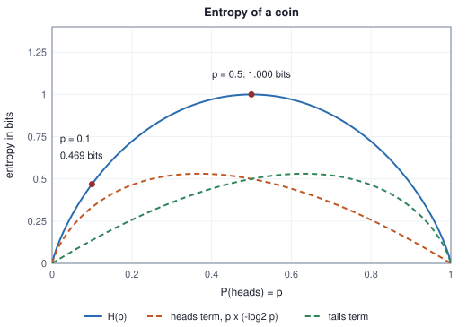
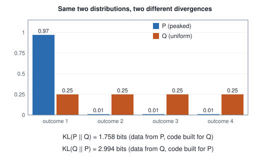

<!-- SPDX-License-Identifier: CC-BY-4.0 -->
<!-- Copyright (c) 2026 Martin Schröder <info@swedishembedded.com> -->

# Information, Entropy and Surprise

*How many bits does it take to describe what we expect to see, and what does it cost to expect the wrong thing?*

## The problem

A friend lays out eight cards face down, picks one in secret, and lets you ask
yes/no questions until you can name it. The cards are equally likely. Each
question can at best cut the remaining candidates in half, so the best strategy
is to ask exactly that, and the card is found after three questions:

<!-- worked: information.eight_items_halving -->
| question | asked | answer | candidates left |
|---|---|---|---|
| 1 | is it in {A, B, C, D}? | no | {E, F, G, H} |
| 2 | is it in {E, F}? | yes | {E, F} |
| 3 | is it E? | no | {F} |
<!-- /worked -->

Three is no accident. Every answer is one yes/no choice, so $k$ questions can
tell apart at most $2^k$ cards, and $2^3 = 8$ is exactly enough. The number of
questions is the exponent that turns $2$ into the number of items, which is the
base-2 logarithm of Chapter 1:

<!-- worked: information.twenty_questions -->
| items n | questions needed (ceil of log_2 n) | log_2 n |
|---|---:|---:|
| 2 | 1 | 1.0000 |
| 8 | 3 | 3.0000 |
| 20 | 5 | 4.3219 |
| 1,000 | 10 | 9.9658 |
| 1,048,576 | 20 | 20.0000 |
<!-- /worked -->

A million items need twenty questions, which is why the party game called
twenty questions can narrow down almost anything. The count of questions is a
measure of how much we did not know before the game: eight equally likely cards
leave three yes/no choices of ignorance, a million leave twenty.

This chapter turns that observation into a tool with three uses in machine
learning. First, a number for the *uncertainty* of a distribution, so that "this
next-word prediction is nearly certain" and "this one is a coin toss" are
quantities and not feelings. Second, a number for the *cost of being wrong*: if
the world follows one distribution and a model believes another, how many extra
yes/no questions per observation does the mistake cost? Third, a number for the
*dependence* between two quantities, in the same units as the others. These are
entropy, cross-entropy with its close relative the divergence, and mutual
information. The averages of surprise that training minimises and that
evaluation reports (the loss of a classifier, the perplexity of a language
model) are special cases, and this chapter explains where those numbers come
from before later chapters use them.

We start with one event and what it tells us, then average over a distribution,
connect the average to the length of messages, and finally compare two
distributions.

## Before you begin

Six questions on ideas from earlier chapters, to answer from memory. The
answers are at the end of the chapter. If one is hard, go back to the chapter
named before reading on.

1. (Chapter 1, logarithm.) What are $\log_2 8$, $\log_2 \tfrac{1}{4}$ and $\log_2 1$? Write $\log(u v)$ in terms of $\log u$ and $\log v$.
2. (Chapter 1, logarithm.) A product of $400$ factors, each $0.1$, underflows to zero on a computer. What is the sum of the base-10 logarithms, and why is the sum safe?
3. (Chapter 7, derivative.) What is the derivative of $\ln x$, and what is the equation of the tangent line to $\ln x$ at $x = 1$?
4. (Chapter 10, expectation.) A fair die is rolled and you are paid the number shown. What is the expected payout, and how do you compute it from the table of probabilities?
5. (Chapter 10, conditional probability.) In the spam table of Chapter 10, $180$ of the $220$ flagged emails were spam. What is $P(\text{spam} \mid \text{flagged})$?
6. (Chapter 11, categorical distribution.) Three scores $(0, 0, 0)$ are turned into probabilities by exponentiating and dividing by the total. What distribution results, and what two conditions must any categorical distribution satisfy?

## Surprise: what one event tells us

*What it is for: a number for how unexpected a single outcome is.*

A fair coin lands heads: mildly interesting. A fair die shows a six: a bit
more. An event with probability one in a million: remarkable. Before averaging
anything we need a number for "how much does it tell me to learn that this
happened?". Call it the **information content** or *surprise* of an event with
probability $p$, and write it $f(p)$. Four requirements pin it down:

1. A certain event teaches nothing: $f(1) = 0$.
2. The rarer the event, the larger the surprise: $f$ decreases as $p$ increases.
3. Independent events add their surprises. If two events do not influence one
   another, the probability of both is the product $p\,q$ (Chapter 10), and
   learning both should be worth the sum of learning each: $f(p\,q) = f(p) + f(q)$.
4. A tiny change in $p$ gives a tiny change in surprise (continuity).

Requirement 3 already says that $f$ turns products into sums, which is the
defining property of a logarithm, and requirement 2 says it must decrease, so
the negative of a logarithm is the natural candidate. It is also the only one.
To see why, apply requirement 3 repeatedly: $f(p^2) = 2f(p)$ and in general
$f(p^n) = n f(p)$. Taking an $n$-th root, $f(p^{1/n}) = f(p)/n$ (apply the
previous line to $p^{1/n}$), hence $f(p^{m/n}) = \tfrac{m}{n} f(p)$ for every
fraction $m/n$, and by continuity $f(p^t) = t\,f(p)$ for every real $t \ge 0$.
Any probability can be written $p = (1/2)^t$ with $t = \log_2(1/p)$, so

$$
f(p) = f\bigl((1/2)^t\bigr) = t\,f(1/2) = f(1/2)\,\log_2 \frac{1}{p} .
$$

The only freedom left is the value $f(1/2)$, the surprise of a fair coin
landing heads, which fixes the unit. Choosing $f(1/2) = 1$ gives

$$
I(x) = -\log_2 p(x) \quad \text{bits}.
$$

A **bit** is the surprise of one fair coin toss. (Chapter 1 used the word for a
binary digit of storage; the two meanings agree, because a pattern of $n$ bits
drawn uniformly has probability $2^{-n}$ and a surprise of exactly $n$ bits.)
Choosing the natural logarithm instead, $I(x) = -\ln p(x)$, measures surprise
in **nats**. The table shows both for events of different rarity:

<!-- worked: information.surprise_table -->
| event | probability p | surprise in bits, -log_2 p | surprise in nats, -ln p |
|---|---:|---:|---:|
| certain | 1 | 0.0000 | 0.0000 |
| fair coin lands heads | 0.5 | 1.0000 | 0.6931 |
| a die shows 1 or 2 | 0.333333 | 1.5850 | 1.0986 |
| a fair die shows 6 | 0.166667 | 2.5850 | 1.7918 |
| a one-in-ten event | 0.1 | 3.3219 | 2.3026 |
| a one-in-a-hundred event | 0.01 | 6.6439 | 4.6052 |
| a one-in-a-million event | 0.000001 | 19.9316 | 13.8155 |
<!-- /worked -->

Two features of the table matter later. Surprise grows slowly: a one-in-a-million
event is $19.9$ bits, only about twice the surprise of a one-in-a-thousand one.
And it has no upper limit: as $p \to 0$, $-\log p \to \infty$, so an event the
model called impossible is infinitely surprising. We will meet that as a
practical hazard.

Requirement 3 is easy to check on a coin and a die. Heads has probability
$1/2$, a six has probability $1/6$, and both together $1/12$:

<!-- worked: information.surprise_adds -->
| event | probability | surprise in bits |
|---|---:|---:|
| coin lands heads | 0.5000 | 1.0000 |
| die shows 6 | 0.1667 | 2.5850 |
| sum of the two surprises |  | 3.5850 |
| both together (p = 1/12) | 0.0833 | 3.5850 |
<!-- /worked -->

Bits and nats measure the same thing in different units, in the ratio of the
change-of-base rule of Chapter 1:

<!-- worked: information.bits_and_nats -->
| quantity | value |
|---|---:|
| 1 bit in nats | 0.6931 |
| 1 nat in bits | 1.4427 |
| a loss of 2.3026 nats in bits | 3.3219 |
| a loss of 3.0 bits in nats | 2.0794 |
| error of reading nats as bits (1/ln 2 - 1) | 0.4427 |
<!-- /worked -->

Programs use the natural logarithm by default, so a loss printed by a training
program is in nats; a table in a paper may be in bits. The last row of the table
is the cost of confusing them: a number read as bits that is really in nats is
off by $44$ percent. This chapter writes $\log_2$ where the unit is bits and
$\ln$ where it is nats, and every worked table names its unit.

## Entropy: expected surprise

*What it is for: one number for the uncertainty of a whole distribution.*

Back to the guessing game, now with unequal cards. Four items have probabilities
$\tfrac12, \tfrac14, \tfrac18, \tfrac18$. Halving the number of items is no
longer the best question, because the first item alone has half of the
probability. Ask "is it a?" first, then "is it b?", then "is it c?":

<!-- worked: information.skewed_guessing -->
| item | probability | questions to identify it | probability x questions |
|---|---:|---:|---:|
| a | 1/2 | 1 | 0.500 |
| b | 1/4 | 2 | 0.500 |
| c | 1/8 | 3 | 0.375 |
| d | 1/8 | 3 | 0.375 |
| expected | 1 |  | 1.750 |
<!-- /worked -->

On average $1.75$ questions suffice, fewer than the $2$ needed if the four items
were equally likely. Notice what the questions cost: item $a$ takes $1$ question,
and its surprise is $-\log_2 \tfrac12 = 1$ bit; item $b$ takes $2$ and has surprise
$2$ bits; item $c$ takes $3$ and has surprise $3$ bits. The number of questions
it takes to identify an item equals its surprise, so the average number of
questions is the average surprise. The average of a quantity over a
distribution is the expectation of Chapter 10, which gives the central
definition. For a categorical distribution $p = (p_1, \dots, p_K)$ the
**entropy** is the expected surprise,

$$
H(p) = \mathbb{E}_{x \sim p}\bigl[-\log_2 p(x)\bigr] = -\sum_{k=1}^{K} p_k \log_2 p_k ,
$$

measured in bits (with $\ln$ in nats). A term with $p_k = 0$ is dropped, which
is the convention $0 \log 0 = 0$: an outcome that never happens contributes
nothing to the average, even though its own surprise would be infinite.

The entropy of a few small distributions, in both units (the column `outcomes` counts
the entries of the list, including a zero-probability one, so it is also the $K$ whose
$\log_2 K$ is in the last column):

<!-- worked: information.entropy_examples -->
| distribution | outcomes | H in bits | H in nats | log_2 of outcome count |
|---|---:|---:|---:|---:|
| certain outcome (1, 0) | 2 | 0.0000 | 0.0000 | 1.0000 |
| fair coin | 2 | 1.0000 | 0.6931 | 1.0000 |
| coin with P(heads) = 0.9 | 2 | 0.4690 | 0.3251 | 1.0000 |
| fair die | 6 | 2.5850 | 1.7918 | 2.5850 |
| die with P(6) = 0.5, others 0.1 | 6 | 2.1610 | 1.4979 | 2.5850 |
| eight equally likely items | 8 | 3.0000 | 2.0794 | 3.0000 |
| five-word next-token distribution | 5 | 1.4427 | 1.0000 | 2.3219 |
<!-- /worked -->

Read the table with the guessing game in mind. A certain outcome has entropy
$0$: no question is needed. A fair coin has entropy $1$ bit: one question. Eight
equally likely items have $3$ bits, the three questions of the opening. A coin
that lands heads $90$ percent of the time has only $0.469$ bits, because you can
usually guess right without asking. A fair die is not $2$ bits and not $3$ bits
but $\log_2 6 = 2.585$, a number that is not a whole count of questions: it is
the *average* over many rolls once questions are shared between rolls, a point
the next section makes precise. Loading the die so that a six is as likely as all
other faces together lowers the entropy to $2.161$ bits.

### The entropy of a coin

The simplest family is the coin with $P(\text{heads}) = p$. Then
$H(p) = -p\log_2 p - (1-p)\log_2(1-p)$ and the table follows the curve as $p$
moves from $0$ to $\tfrac12$:

<!-- worked: information.binary_entropy_table -->
| P(heads) = p | surprise of heads | surprise of tails | H(p) in bits |
|---|---:|---:|---:|
| 0.00 | inf | 0.0000 | 0.0000 |
| 0.01 | 6.6439 | 0.0145 | 0.0808 |
| 0.05 | 4.3219 | 0.0740 | 0.2864 |
| 0.10 | 3.3219 | 0.1520 | 0.4690 |
| 0.20 | 2.3219 | 0.3219 | 0.7219 |
| 0.30 | 1.7370 | 0.5146 | 0.8813 |
| 0.40 | 1.3219 | 0.7370 | 0.9710 |
| 0.50 | 1.0000 | 1.0000 | 1.0000 |
<!-- /worked -->



The curve is a symmetric arch. It is $0$ at both ends, where the outcome is
certain, and $1$ bit at $p = \tfrac12$, where no outcome is favoured. The dashed
curves are the two terms of the sum, the heads term $p\log_2(1/p)$ and the tails
term. Each is a product of a probability and a surprise: moving $p$ from $0$
upward, the probability factor grows while the surprise factor shrinks, so each
term rises and then falls, and the two together peak in the middle. Note how
steep the curve is near $0$: the step from $p = 0$ to $p = 0.01$ adds $0.081$
bits, and from $0.01$ to $0.05$ another $0.206$. A coin that is merely
*slightly* unfair is already noticeably less uncertain than the fair one.

### Entropy is largest when everything is equally likely

For a fixed number of outcomes, the entropy is largest for the uniform
distribution. Check it on four outcomes, comparing hand-picked distributions with
ten thousand random ones (each drawn by normalising four exponential random
numbers, a recipe that gives every distribution on four outcomes an equal
chance):

<!-- worked: information.uniform_is_largest -->
| distribution over 4 outcomes | H in bits |
|---|---:|
| uniform | 2.0000 |
| (0.4, 0.3, 0.2, 0.1) | 1.8464 |
| (0.7, 0.1, 0.1, 0.1) | 1.3568 |
| (0.97, 0.01, 0.01, 0.01) | 0.2419 |
| (0.25, 0.25, 0.5, 0) | 1.5000 |
| best of 10,000 random distributions | 1.9991 |
| mean of those 10,000 | 1.5637 |
<!-- /worked -->

Generator: the book's SplitMix64, seed 0x54010653beeb681d. Each of the 10,000 random distributions takes four calls of `rng.uniform()` in turn, `u`, and turns each into the exponential weight `-ln(1 - u)`; the four weights are divided by their sum. Entropies are in bits.

No random distribution reaches $2$ bits, and the best of ten thousand comes
within $0.0009$ of it. The picture of the coin says the same for two outcomes: the
arch peaks in the middle. Why should it be true for any number of outcomes? An
exchange argument gives the intuition. Take two outcomes with probabilities
$a < b$ and move a small amount of probability from the larger to the smaller.
The two surprises move toward each other, and the average becomes harder to
predict. Repeating the move ends only when no pair differs, which is the uniform
distribution. A short exact proof comes after the divergence is defined, below;
it shows that $\log_2 K - H(p)$ is itself a divergence and so cannot be negative.
So the largest entropy on $K$ outcomes is $\log_2 K$ bits, the entropy of the
$K$ equally likely items of the guessing game, and a distribution that is not
uniform is always more predictable.

### The entropy of a next-token distribution

A language model that has read "the cat sat on the" assigns probabilities to the
next word. Take the five-word distribution of Chapter 11 (obtained from the
scores $(3, 2, 1, -1, 0)$ by the softmax) and two other contexts over the same
five words (the scores are listed in the table; probabilities are printed to five
decimals, entropies are computed from the unrounded probabilities), from a model that is nearly sure to one that cannot decide:

<!-- worked: information.next_token_entropy -->
| context | scores z | mat | floor | sofa | moon | the | H in bits |
|---|---|---:|---:|---:|---:|---:|---:|
| confident context | (6, 1, 0, -2, -1) | 0.98964 | 0.00667 | 0.00245 | 0.00033 | 0.00090 | 0.0973 |
| the chapter's context | (3, 2, 1, -1, 0) | 0.63641 | 0.23412 | 0.08613 | 0.01166 | 0.03168 | 1.4427 |
| undecided context | (0.4, 0.3, 0.2, -0.1, 0) | 0.24997 | 0.22619 | 0.20466 | 0.15162 | 0.16756 | 2.2979 |
| uniform guess | (0, 0, 0, 0, 0) | 0.20000 | 0.20000 | 0.20000 | 0.20000 | 0.20000 | 2.3219 |
<!-- /worked -->

The entropy tells the three contexts apart in one number. The confident context
has $0.0973$ bits: the answer is "mat", almost always. The undecided one has
$2.2979$ bits, just under the $\log_2 5 = 2.3219$ of a uniform guess. The context
of Chapter 11 sits in between at $1.4427$ bits, about one and a half yes/no
questions per word. Entropy is a property of the *distribution* the model
outputs, not of the word that then occurs: it measures how much the model
itself is unsure, before the next word is revealed.

## Entropy as the length of a message

*What it is for: why the unit is bits, and what the formula guarantees.*

So far "bits" is a unit of surprise. It is also, literally, the length of a
message. Suppose a weather station reports each day as one of four symbols,
*sun*, *cloud*, *rain*, *snow*, with probabilities $0.4, 0.3, 0.2, 0.1$, and
must send the reports over a wire carrying one bit at a time. A **code** assigns
each symbol a string of bits. A **prefix code** is one in which no code word is
the beginning of another, so a received stream of bits can be cut into words
without separators: read bits until they match a word, emit its symbol, and start
again. The fixed code ($00, 01, 10, 11$) is a prefix code costing $2$ bits per
day. Can the average cost be lower if frequent symbols get shorter words?

A way to build such a code by hand is the following, due to Huffman. Start with
the symbols as leaves, each labelled with its probability. Repeatedly take the two
nodes of smallest probability, join them under a new node whose probability is
their sum, and label the branch to the node taken *first* with $0$ and the
branch to the node taken *second* with $1$. When several nodes have the same
probability, the one created earlier is taken first (the symbols count as
created in the order *sun*, *cloud*, *rain*, *snow*, before any merged node).
Stop when one node remains; the code word of a symbol is the sequence of branch
labels from the root to its leaf. For the weather this joins the two rarest symbols first ($0.1 + 0.2$), then
the result with *cloud* ($0.3 + 0.3$), then everything with *sun*. The second merge is a genuine tie: the leaf *cloud*
and the node made by merge 1 both have probability $0.3$, so by the rule the
older one, *cloud*, is taken first and gets the branch $0$:

<!-- worked: information.code_weather -->
| merge | least likely | next least likely | new node |
|---|---:|---:|---:|
| 1 | 0.1 | 0.2 | 0.3 |
| 2 | 0.3 | 0.3 | 0.6 |
| 3 | 0.4 | 0.6 | 1.0 |

| symbol | probability | code | length | -log_2 p | p x length |
|---|---:|---|---:|---:|---:|
| sun | 0.4 | 0 | 1 | 1.322 | 0.40 |
| cloud | 0.3 | 10 | 2 | 1.737 | 0.60 |
| rain | 0.2 | 111 | 3 | 2.322 | 0.60 |
| snow | 0.1 | 110 | 3 | 3.322 | 0.30 |
| average | 1.0 |  |  |  | 1.90 |

Entropy H = 1.8464 bits; average code length = 1.90 bits; fixed 2-bit code = 2.00 bits; sum of 2^-length = 1.
<!-- /worked -->


The code words have lengths $1, 2, 3, 3$: short for the likely symbol, long for
the unlikely ones. The average length is the expectation of the length, a sum of
the table's last column, $0.40 + 0.60 + 0.60 + 0.30 = 1.90$ bits per day, better
than the fixed $2.00$. The code is a prefix code because the symbols are the
leaves of the tree: no leaf lies on the path to another. Reading the table from the second merge on, *snow* (taken first at merge 1)
gets $0$ and *rain* gets $1$ under their node. Try it on ten days:

<!-- worked: information.encode_message -->
|  |  |
|---|---|
| message | sun sun sun sun cloud cloud cloud rain rain snow |
| encoded | 0000101010111111110 |
| bits used | 19 (fixed 2-bit code: 20) |
| decoded equals message | True |
<!-- /worked -->

The ten days cost $19$ bits instead of $20$ and decode back to the original, one
word at a time. Taking the *merged* node first at the tie would give *cloud* $11$,
*rain* $101$ and *snow* $100$: different words, the same lengths $1, 2, 3, 3$ and
the same average $1.90$ (Exercise 8 asks for this check).

Compare the average length $1.90$ with the entropy $1.846$ of the same
distribution (column $-\log_2 p$ in the table gives the ideal length of each
word). The code lengths $1, 2, 3, 3$ are close to the surprises
$1.32, 1.74, 2.32, 3.32$ but cannot equal them, because a code word has a whole
number of bits and a surprise need not. When all probabilities are powers of
$\tfrac12$ the match is exact:

<!-- worked: information.code_dyadic -->
| symbol | probability | code | length | -log_2 p | p x length |
|---|---:|---|---:|---:|---:|
| a | 1/2 | 0 | 1 | 1.000 | 0.500 |
| b | 1/4 | 10 | 2 | 2.000 | 0.500 |
| c | 1/8 | 110 | 3 | 3.000 | 0.375 |
| d | 1/8 | 111 | 3 | 3.000 | 0.375 |
| average | 1 |  |  |  | 1.750 |

Entropy H = 1.750 bits; average code length = 1.750 bits.
<!-- /worked -->

Here the code length of every symbol is exactly its surprise, the average length
is the entropy, $1.750$ bits, and this is the same $1.75$ as the average number of
questions in the guessing game: each question is one bit of a code word. A
fuller statement, which we use and do not prove here, is the *source coding
theorem*: no prefix code can have an average length below the entropy, and Huffman's
construction always gets within one bit of it,

$$
H(p) \;\le\; \bar L \;<\; H(p) + 1 .
$$

Why can no code go below $H$? A code with word lengths $\ell_1, \dots, \ell_K$
can be a prefix code only if $\sum_k 2^{-\ell_k} \le 1$ (the Kraft inequality, the
condition that the words fit in a binary tree; the weather code gives exactly
$1$, as the table reports). Words of length $\ell_k = -\log_2 q_k$ use up a share
$q_k$ of the tree, so a code is, in effect, a probability distribution $q$ over
the symbols, and its price on data from $p$ is the average $\sum p_k \ell_k$.
The next section shows that this price is never below $H(p)$.

The "within one bit" slack disappears if symbols are coded in blocks: send ten
days at a time, and the overhead of one bit is spread over ten days. That is why
entropy, not the integer-length Huffman average, is the right measure of
"bits per symbol": it is the cost that long messages approach. This is also why
the fair die has the non-integer entropy $2.585$ bits: it is the cost per roll
for long sequences of rolls.

## Cross-entropy: the price of expecting the wrong thing

*What it is for: how many bits a model's beliefs cost on data it did not choose.*

The weather code was designed for the distribution $p = (0.4, 0.3, 0.2, 0.1)$.
Suppose instead the designer believed some other distribution $q$ and built the
code that gives symbol $k$ a word of ideal length $-\log_2 q_k$ (ignoring the
whole-bit rounding, as above). The real weather still follows $p$. Each day, the
code spends $-\log_2 q_k$ bits on symbol $k$, which occurs a share $p_k$ of the
time. The average cost is the expectation, *under $p$*, of the surprise
*under $q$*. This is the **cross-entropy** of $q$ relative to $p$:

$$
H(p, q) = \mathbb{E}_{x \sim p}\bigl[-\log_2 q(x)\bigr] = -\sum_{k} p_k \log_2 q_k .
$$

Take a designer who believed the opposite of the truth, $q = (0.1, 0.2, 0.3, 0.4)$:
they expect snow, not sun. The sums, symbol by symbol, next to those of the
entropy $H(p) = H(p, p)$:

<!-- worked: information.cross_entropy_breakdown -->
| symbol | p | q | -log_2 q | p x (-log_2 q) | -log_2 p | p x (-log_2 p) |
|---|---:|---:|---:|---:|---:|---:|
| sun | 0.4 | 0.1 | 3.3219 | 1.3288 | 1.3219 | 0.5288 |
| cloud | 0.3 | 0.2 | 2.3219 | 0.6966 | 1.7370 | 0.5211 |
| rain | 0.2 | 0.3 | 1.7370 | 0.3474 | 2.3219 | 0.4644 |
| snow | 0.1 | 0.4 | 1.3219 | 0.1322 | 3.3219 | 0.3322 |
| total | 1.0 | 1.0 |  | 2.5049 |  | 1.8464 |
<!-- /worked -->

Sun is the most common day yet gets the longest code word ($3.32$ bits) in this
design, so the average rises from $1.846$ to $2.505$ bits. Try several beliefs:

<!-- worked: information.cross_entropy_models -->
| belief q | H(p, q) | H(p) | H(p, q) - H(p) | KL(p || q) from its formula |
|---|---:|---:|---:|---:|
| q = p (the right belief) | 1.8464 | 1.8464 | 0.0000 | 0.0000 |
| q uniform | 2.0000 | 1.8464 | 0.1536 | 0.1536 |
| q = (0.7, 0.1, 0.1, 0.1) | 2.1990 | 1.8464 | 0.3525 | 0.3525 |
| q reversed, (0.1, 0.2, 0.3, 0.4) | 2.5049 | 1.8464 | 0.6585 | 0.6585 |
<!-- /worked -->

The first row is a model that believes the truth; the cost is the entropy
$1.846$. Every other belief costs more: the uniform one by $0.154$ bits per day,
the over-confident $(0.7, 0.1, 0.1, 0.1)$ by $0.353$, the reversed one by
$0.659$. The cross-entropy $H(p, q)$ is never below $H(p)$, and the last two
columns of the table anticipate why: the excess over the entropy can be computed
in two ways that agree.

Two details of the definition deserve attention. The roles of $p$ and $q$ are
not symmetric: the weights are the *true* probabilities, the logarithms use the
*believed* ones. And if $q_k = 0$ for some symbol that $p$ allows, the term
$-p_k \log_2 q_k$ is infinite: a code with no word for a symbol that then occurs
has infinite cost. A model that declares an event impossible and then sees it
pays infinitely.

## KL divergence: the excess cost

*What it is for: a distance-like measure of how far a belief is from the truth.*

The extra bits per symbol, cross-entropy minus entropy, get their own name. The
**KL divergence** (Kullback-Leibler divergence, also called relative entropy) of
$q$ from $p$ is

$$
D_{\mathrm{KL}}(p \,\Vert\, q) = H(p, q) - H(p) = \sum_k p_k \log_2 \frac{p_k}{q_k} ,
$$

where the second form follows by writing $-p_k \log_2 q_k + p_k \log_2 p_k =
p_k\bigl(\log_2 p_k - \log_2 q_k\bigr)$ and combining the logarithms by the
quotient rule of Chapter 1. (With the convention that a term with $p_k = 0$ is
dropped, and the divergence is $+\infty$ when some $q_k = 0$ and $p_k > 0$.) It
is the average number of extra bits per symbol paid for coding data from $p$ with
a code built for $q$. In the table above, the fifth column computes it directly
from the quotient form and matches the difference of the two columns before it.

### It is never negative

Is $D_{\mathrm{KL}}(p \,\Vert\, q) \ge 0$, with equality only when $q = p$, for
every pair of distributions? The table already suggests yes (Gibbs' inequality),
and a quick experiment supports it. Draw $5000$ random pairs of distributions on
five outcomes, three times with increasingly lopsided draws (the exponent
sharpens each draw by raising the random weights to a power before
normalising):

<!-- worked: information.gibbs_random -->
| sharpening exponent | pairs | smallest KL | mean KL | largest KL | negative values |
|---|---:|---:|---:|---:|---:|
| 1.0 | 5000 | 0.0010 | 1.1631 | 7.2592 | 0 |
| 2.0 | 5000 | 0.0230 | 3.0880 | 18.2272 | 0 |
| 4.0 | 5000 | 0.0024 | 6.8402 | 45.1569 | 0 |

KL(p || p) for one random p: 0.0000.
<!-- /worked -->

Generator: the book's SplitMix64, seed 0x53316817d2c2f7a6. One generator, rows in the order exponent 1, 2, 4. A distribution on five outcomes takes five calls of `rng.uniform()` in turn; each `u` gives the weight `(-ln(1 - u))^s` for the row's exponent `s`, and the weights are divided by their sum. A pair is `p` drawn first, then `q`; each row uses 5000 pairs in turn. The last line draws one more `p` (exponent 1) from the same generator after the third row. KL is in bits.

No pair is negative; the smallest values are tiny, and the divergence of a
distribution from itself is exactly $0$. An experiment is evidence, not proof.
The proof is short and rests on one inequality about the logarithm.

**Claim.** For every $x > 0$, $\ln x \le x - 1$, with equality only at $x = 1$.
The numbers show it:

<!-- worked: information.log_below_tangent -->
| x | ln x | x - 1 | (x - 1) - ln x |
|---|---:|---:|---:|
| 0.10 | -2.3026 | -0.9000 | 1.4026 |
| 0.25 | -1.3863 | -0.7500 | 0.6363 |
| 0.50 | -0.6931 | -0.5000 | 0.1931 |
| 0.90 | -0.1054 | -0.1000 | 0.0054 |
| 1.00 | 0.0000 | 0.0000 | 0.0000 |
| 1.10 | 0.0953 | 0.1000 | 0.0047 |
| 2.00 | 0.6931 | 1.0000 | 0.3069 |
| 4.00 | 1.3863 | 3.0000 | 1.6137 |
| 10.00 | 2.3026 | 9.0000 | 6.6974 |
<!-- /worked -->

To prove it, let $g(x) = (x - 1) - \ln x$. Its derivative (Chapter 7) is
$g'(x) = 1 - 1/x$, which is negative for $x < 1$ and positive for $x > 1$, so $g$
decreases up to $x = 1$ and increases afterwards, and its minimum is
$g(1) = 0$. The line $y = x - 1$ is the tangent to $\ln x$ at $x = 1$, and the
logarithm lies below its tangent everywhere.

**Proof of Gibbs' inequality.** Work in nats and sum over the outcomes with
$p_k > 0$. Apply the claim to $x = q_k / p_k$:

$$
-D_{\mathrm{KL}}(p \,\Vert\, q) = \sum_{k:\,p_k > 0} p_k \ln \frac{q_k}{p_k}
\;\le\; \sum_{k:\,p_k > 0} p_k \Bigl(\frac{q_k}{p_k} - 1\Bigr)
= \sum_{k:\,p_k > 0} q_k - \sum_{k:\,p_k > 0} p_k \;\le\; 1 - 1 = 0 .
$$

The first sum on the right is at most $1$, because it adds only some of the
probabilities of $q$, and the second is exactly $1$. Hence
$D_{\mathrm{KL}}(p \,\Vert\, q) \ge 0$ in nats, and so in bits, which differ by a
positive factor. Equality needs equality in the claim for every $k$, meaning
$q_k = p_k$, so $q = p$. $\blacksquare$

Because $H(p, q) = H(p) + D_{\mathrm{KL}}(p \,\Vert\, q)$, the cross-entropy is
never below the entropy, which closes the argument of the previous section: the
price of coding with the wrong distribution can only be a price, never a gain.

The same inequality gives the promised proof that the uniform distribution
maximises entropy. Let $u = (1/K, \dots, 1/K)$. Then
$D_{\mathrm{KL}}(p \,\Vert\, u) = \sum p_k \log_2(p_k K) = \log_2 K - H(p)$, so

$$
H(p) = \log_2 K - D_{\mathrm{KL}}(p \,\Vert\, u) \;\le\; \log_2 K ,
$$

with equality only for $p = u$. The table checks the identity on three
distributions:

<!-- worked: information.entropy_below_log_n -->
| p | H(p) | KL(p || uniform) | 2 - KL(p || uniform) |
|---|---:|---:|---:|
| (0.4, 0.3, 0.2, 0.1) | 1.8464 | 0.1536 | 1.8464 |
| (0.7, 0.1, 0.1, 0.1) | 1.3568 | 0.6432 | 1.3568 |
| uniform | 2.0000 | 0.0000 | 2.0000 |
<!-- /worked -->

### It is not symmetric

A distance would satisfy $d(a, b) = d(b, a)$. The divergence does not. Take a
sharply peaked $P = (0.97, 0.01, 0.01, 0.01)$ and the uniform $Q$:



<!-- worked: information.kl_asymmetry -->
| pair | KL(P || Q) in bits | KL(Q || P) in bits |
|---|---:|---:|
| P = (0.97, 0.01, 0.01, 0.01), Q uniform | 1.7581 | 2.9939 |
| P = (0.5, 0.5, 0), Q = (0.5, 0.25, 0.25) | 0.5000 | inf |
<!-- /worked -->

The first row is the figure. Coding data from $P$ with a code built for the
uniform costs $1.758$ extra bits per symbol, since the data is mostly outcome $1$
and the uniform code gives it a $2$-bit word. Coding data from $Q$ with a code
built for $P$ costs $2.994$ bits, since a quarter of the data is each of outcomes
$2$, $3$ and $4$, and a code built for $P$ gives each of those a word of about
$6.6$ bits. The two directions answer different questions: *what does it cost to
believe $Q$ when the truth is $P$*, and the reverse. The second row shows the
extreme case. $P$ puts no probability on the third outcome and $Q$ puts $0.25$
there: $D_{\mathrm{KL}}(P \,\Vert\, Q) = 0.5$, finite, because $Q$ is merely
wasteful about a symbol that never comes. In the other direction the truth
sometimes produces the third outcome, which $P$ forbids, so the cost is infinite.

The rule of thumb that follows: in $D_{\mathrm{KL}}(p \,\Vert\, q)$, a belief $q$
that gives too little probability to something that does happen is punished
severely; a belief that gives probability to things that never happen is punished
only mildly. Every use of cross-entropy as a training signal is of the first form,
with $p$ the data and $q$ the model, so a model is pushed hard toward covering
everything that occurs in the data.

A pseudocode for the three quantities, in the conventions of
[Pseudocode Conventions](../pseudocode.md). All three use `log`, the natural logarithm, so
they return **nats**; divide by `log(2)` for bits:

```text
function entropy(p: array<real>[K]) -> real:
    require K > 0 and min(p) >= 0.0 and close(sum(p), 1.0, 1e-6, 1e-6)
    h = 0.0
    for k in 0 .. K:
        if p[k] > 0.0:                     # 0 * log 0 is 0
            h = h - p[k] * log(p[k])
    return h

function cross_entropy(p: array<real>[K], q: array<real>[K]) -> real:
    require K > 0 and min(p) >= 0.0 and min(q) >= 0.0
    require close(sum(p), 1.0, 1e-6, 1e-6)
    require close(sum(q), 1.0, 1e-6, 1e-6)
    c = 0.0
    for k in 0 .. K:
        if p[k] > 0.0:
            if q[k] == 0.0:
                return infinity            # the belief forbids what happens
            c = c - p[k] * log(q[k])
    return c

function kl_divergence(p: array<real>[K], q: array<real>[K]) -> real:
    return cross_entropy(p, q) - entropy(p)
```

The last function mirrors the definition; a production version would sum
$p_k\log(p_k/q_k)$ term by term, which avoids subtracting two nearly equal
numbers when $q \approx p$ (Chapter 15 explains why that subtraction loses
digits).

## Cross-entropy on observed labels

*What it is for: the number a classifier or language model reports.*

In practice nobody has the true $p$. What exists is a list of observations: five
emails with their true kinds, a million words of text with the word that actually
came next. Chapter 10 showed how to treat a dataset as a distribution: give each
observed example probability $1/N$. For one example with the observed label $y$,
this empirical distribution puts probability $1$ on $y$ and $0$ on everything
else, a *one-hot* distribution. Its entropy is zero (a certain outcome). Plug it
into the cross-entropy against the model's predicted distribution $q$ over the
labels:

$$
H(p_{\text{one-hot at } y},\, q) = -\sum_k p_k \ln q_k = -\ln q_y .
$$

Only the term of the observed label survives. The cross-entropy of a model on a
dataset is the average of this over the examples, the **average negative
log-probability of the observed labels**. Five examples with three classes:

<!-- worked: information.label_cross_entropy -->
| example | label | model probabilities | probability of the label | -ln p(label) |
|---|---:|---:|---:|---:|
| 1 | 0 | (0.70, 0.20, 0.10) | 0.70 | 0.3567 |
| 2 | 1 | (0.10, 0.80, 0.10) | 0.80 | 0.2231 |
| 3 | 2 | (0.30, 0.30, 0.40) | 0.40 | 0.9163 |
| 4 | 2 | (0.05, 0.05, 0.90) | 0.90 | 0.1054 |
| 5 | 1 | (0.60, 0.30, 0.10) | 0.30 | 1.2040 |

Mean over the five examples: 0.5611 nats = 0.8095 bits.
<!-- /worked -->

The mean is $0.561$ nats, or $0.810$ bits. Each row is the surprise of the model
when it learns the true label. The model that gave the label probability $0.90$ is
barely surprised ($0.105$ nats) and the one that gave $0.30$ is more so
($1.204$). Because the entropy of a one-hot distribution is zero, here the
cross-entropy and the KL divergence coincide:
$H(p, q) = H(p) + D_{\mathrm{KL}}(p \,\Vert\, q) = 0 + D_{\mathrm{KL}}$. Training a model
to reduce its average surprise on the labels is the same as reducing the
divergence from the data distribution. This is the quantity that the loss of a
classifier and of a language model reduces; later chapters define those losses
and derive their gradients, and this chapter only supplies the meaning of the
number.

How the average is dominated is worth a table:

<!-- worked: information.label_cross_entropy_sensitivity -->
| probability of the true label | -ln p in nats | -log_2 p in bits |
|---|---:|---:|
| 0.900 | 0.1054 | 0.1520 |
| 0.500 | 0.6931 | 1.0000 |
| 0.100 | 2.3026 | 3.3219 |
| 0.010 | 4.6052 | 6.6439 |
| 0.001 | 6.9078 | 9.9658 |
<!-- /worked -->

A label given probability $0.9$ costs $0.105$ nats; one given $0.01$ costs
$4.605$, about forty-four times more. A few confidently wrong predictions can outweigh
many good ones, and a label given probability $0$ would cost infinity. Real
implementations never form the probability $q_y$ at all, because it may
underflow; they compute $\ln q_y$ directly from the model's raw scores, a
technique the floating-point chapter (Chapter 15) develops.

## Perplexity: the effective number of choices

*What it is for: a cross-entropy in units a human can picture.*

A cross-entropy of $1.65$ nats means little to most readers. Exponentiating
undoes the logarithm and returns a count. The **perplexity** of a model on data
is

$$
\mathrm{PPL} = \exp\bigl(H(p, q)\bigr) = 2^{H_2(p, q)},
$$

the same number whichever unit is used, as long as the exponentiation matches the
logarithm: $e$ to a nats value, $2$ to a bits value. To see the meaning start
with the case where $q$ is uniform over $k$ choices. Then every observation costs
$\ln k$ nats and the perplexity is exactly $k$:

<!-- worked: information.perplexity_uniform -->
| k equally likely tokens | cross-entropy in nats | in bits | perplexity exp(CE) |
|---|---:|---:|---:|
| 1 | 0.0000 | 0.0000 | 1.00 |
| 2 | 0.6931 | 1.0000 | 2.00 |
| 6 | 1.7918 | 2.5850 | 6.00 |
| 50,000 | 10.8198 | 15.6096 | 50000.00 |
<!-- /worked -->

A model that has no idea about a $50{,}000$-word vocabulary has perplexity
$50{,}000$; a model that always puts all its probability on the right word has
perplexity $1$. A model with perplexity $12$ is, on average, as uncertain as a
model that picks uniformly among $12$ choices: the **effective number of
choices**. The same reading works for the entropy of a distribution on its own:
$\exp H(p)$ is the number of equally likely outcomes that would be as
unpredictable.

<!-- worked: information.perplexity_effective_choices -->
| distribution | outcomes | H in nats | exp(H) = effective choices |
|---|---:|---:|---:|
| fair die | 6 | 1.7918 | 6.000 |
| coin with P(heads) = 0.9 | 2 | 0.3251 | 1.384 |
| die with P(6) = 0.5, others 0.1 | 6 | 1.4979 | 4.472 |
| five-word next-token distribution | 5 | 1.0000 | 2.718 |
| confident context | 5 | 0.0674 | 1.070 |
<!-- /worked -->

The coin that lands heads $90$ percent of the time behaves like $1.38$ equally
likely choices; the confident next-word context behaves like $1.07$.

For a sequence, take the average surprise per token. Six tokens, with the
probability a model gave each one:

<!-- worked: information.perplexity_sentence -->
| token | probability the model gave it | -ln p |
|---|---:|---:|
| the | 0.20 | 1.6094 |
| cat | 0.05 | 2.9957 |
| sat | 0.10 | 2.3026 |
| on | 0.50 | 0.6931 |
| the | 0.40 | 0.9163 |
| mat | 0.25 | 1.3863 |

Mean -ln p = 1.6506 nats; perplexity exp(mean) = 5.2100.
Probability of the whole sentence = 5.000e-05; (1 / probability)^(1/6) = 5.2100.
In bits: mean = 2.3813, 2^mean = 5.2100.
<!-- /worked -->

The mean surprise is $1.651$ nats and the perplexity $5.21$. The last line shows
the same number as the inverse of the geometric mean of the token probabilities:
the sentence as a whole has probability $5.0 \times 10^{-5}$ (the product of the
six), and $(1/5.0\times 10^{-5})^{1/6} = 5.21$. Perplexity is the per-token
branching factor that would produce the same sentence probability. Because it is
an exponential of a mean, it is large when a few tokens are very surprising: the
token $0.05$ costs $2.996$ nats, about $30$ percent of the total of $9.90$.

Perplexity does not go below the entropy of the data: with data from $p$, the
best model is $q = p$ and its perplexity is $\exp H(p)$, not $1$. The same four
beliefs as before, scored this way:

<!-- worked: information.perplexity_of_a_wrong_model -->
| belief q | H(p, q) in nats | perplexity |
|---|---:|---:|
| q = p (the right belief) | 1.2799 | 3.596 |
| q uniform | 1.3863 | 4.000 |
| q = (0.7, 0.1, 0.1, 0.1) | 1.5242 | 4.592 |
| q reversed, (0.1, 0.2, 0.3, 0.4) | 1.7363 | 5.676 |
<!-- /worked -->

The true belief gives $3.596$ choices, the floor for this data; every other belief
gives more. Two cautions follow from the definition. A perplexity is meaningful
only for the same data and the same tokenisation: a model that splits text into
characters and one that splits it into words predict different things, and their
perplexities are not comparable. And differences are easier to read in the
logarithm: perplexity $50$ versus $52$ is a difference of $\ln(52/50) = 0.039$
nats per token.

## Mutual information: what one quantity says about another

*What it is for: the dependence between two quantities, in bits.*

Chapter 10 compared the joint table of two variables with the product of its
marginals. For the spam filter, a flagged spam email has probability $0.18$ and
independence would predict $0.22 \times 0.20 = 0.044$, a ratio of $4.09$.
Independence means all ratios are $1$; how far they are from $1$ measures how much
the filter's verdict says about the true kind. A single number comes from
averaging the logarithm of the ratio over the joint distribution. The
**mutual information** of two variables $X$ and $Y$ with joint distribution
$p(x, y)$ and marginals $p(x)$, $p(y)$ is

$$
I(X; Y) = \sum_{x, y} p(x, y)\,\log_2 \frac{p(x, y)}{p(x)\,p(y)} .
$$

This is exactly the divergence of the joint distribution from the product of the
marginals, $D_{\mathrm{KL}}\bigl(p(x, y) \,\Vert\, p(x)p(y)\bigr)$: the excess cost of
coding pairs as if the two quantities were independent. By Gibbs' inequality
$I(X; Y) \ge 0$, and it is $0$ exactly when $p(x, y) = p(x)p(y)$ everywhere, that
is when $X$ and $Y$ are independent. Computing it for the filter, cell by cell:

<!-- worked: information.mutual_information_table -->
| cell | p(x, y) | p(x) p(y) | ratio | log_2 ratio | p(x, y) x log_2 ratio |
|---|---:|---:|---:|---:|---:|
| flagged, spam | 0.180 | 0.044 | 4.091 | 2.032 | 0.3658 |
| flagged, ham | 0.040 | 0.176 | 0.227 | -2.138 | -0.0855 |
| not flagged, spam | 0.020 | 0.156 | 0.128 | -2.963 | -0.0593 |
| not flagged, ham | 0.760 | 0.624 | 1.218 | 0.284 | 0.2162 |
| I(verdict; kind) |  |  |  |  | 0.4373 |
<!-- /worked -->

The two main cells (flagged spam and not-flagged ham) are more frequent than
independence would give, so their log-ratio is positive; the two error cells are
less frequent, so theirs is negative. Weighted by how often each cell occurs, they
sum to $0.437$ bits. Seeing the filter's verdict is worth $0.437$ bits about the
email's kind.

There is a second, more intuitive reading. Before seeing the verdict, the kind
of the email has some entropy; after seeing it, less is left. The average
entropy left is the **conditional entropy**
$H(X \mid Y) = \sum_y p(y)\,H(X \mid Y = y)$, where $H(X \mid Y = y)$ is the
entropy of the conditional distribution (Chapter 10) of $X$ given that $Y = y$.
Then

$$
I(X; Y) = H(X) - H(X \mid Y) .
$$

To see it, write $p(x, y)/(p(x)p(y)) = p(x \mid y)/p(x)$ and split the logarithm:
$I = -\sum p(x, y)\log p(x) + \sum p(x, y)\log p(x \mid y) = H(X) - H(X \mid Y)$.
For the spam filter:

<!-- worked: information.mutual_information_entropies -->
| situation | probability | (P(spam), P(ham)) there | entropy of kind, bits |
|---|---:|---:|---:|
| before seeing the verdict | - | - | 0.7219 |
| verdict = flagged | 0.220 | (0.818, 0.182) | 0.6840 |
| verdict = not flagged | 0.780 | (0.026, 0.974) | 0.1720 |
| average after the verdict | 1.000 |  | 0.2847 |

Reduction: 0.7219 - 0.2847 = 0.4373 bits.
Joint entropy H(verdict, kind) = 1.0448; H(verdict) + H(kind) - H(verdict, kind) = 0.7602 + 0.7219 - 1.0448 = 0.4373 bits.
<!-- /worked -->

The kind of email has entropy $0.722$ bits ($20$ percent spam). If the filter
flags the email the kind is spam with probability $0.818$, so the entropy is still
$0.684$ bits; if it does not, the kind is nearly certainly ham and the entropy is
$0.172$. The average over the two verdicts is $0.285$ bits, a reduction of $0.437$
bits, the same number as the cell-by-cell sum. The second line shows a third
form, $I = H(X) + H(Y) - H(X, Y)$ with the entropy $H(X, Y)$ of the joint table
itself. Mutual information is symmetric: the verdict says as much about the kind
as the kind says about the verdict.

Three extreme cases fix the scale:

<!-- worked: information.mutual_information_extremes -->
| pair (X, Y) | H(X) | I(X; Y) |
|---|---:|---:|
| independent fair bits | 1.0000 | 0.0000 |
| a perfect copy of a fair bit | 1.0000 | 1.0000 |
| a copy that is wrong 10% of the time | 1.0000 | 0.5310 |
| a perfect copy of a 20/80 bit | 0.7219 | 0.7219 |
<!-- /worked -->

Independent fair bits share nothing. A perfect copy shares everything: $I(X; Y) =
H(X)$, the whole uncertainty of $X$, which is also the upper bound of mutual
information. A copy that is wrong ten percent of the time shares $0.531$ bits of
the $1$ bit; the errors cost almost half of it. Mutual information, unlike
covariance (Chapter 11), which can be zero for variables that depend on each
other, is zero only for independence and detects any kind of dependence, not
only a straight line.

## Making it work

**Keep the unit.** Every quantity in this chapter is in bits if the logarithm is
base 2 and in nats if it is natural. Mixing them is silent: a cross-entropy of
$2.30$ nats equals $3.32$ bits (the bits-and-nats table above) and
perplexity is the same either way. State the unit wherever a number is reported,
and exponentiate with the matching base.

**Zeros.** $0 \log 0 = 0$ is a convention that makes entropy continuous; in code
it needs an explicit check, because $0 \times (-\infty)$ is NaN. A probability
$q_k = 0$ where the data has $p_k > 0$ gives an infinite cross-entropy: the
correct reaction is to find out why the model forbade a possible event, not to
hide it. Some code clamps probabilities to a tiny floor before taking logarithms,
which converts infinity into a large finite number; know that the clamp, and not
the model, then decides the size of the loss on such an example.

**Which direction.** $D_{\mathrm{KL}}(p \,\Vert\, q)$ and $D_{\mathrm{KL}}(q \,\Vert\, p)$ differ, and so
do the behaviours they encourage. In a program, argument order is part of the
meaning. A reported "KL" should come with the statement of which distribution is
the data (or the reference) and which is the model.

**Entropy is not the loss.** Cross-entropy on data of positive entropy has a
floor at $H(p)$, not at $0$. A cross-entropy of $1.28$ nats on the weather data
is as good as any model can do; reading it as "far from zero, so bad" is an
error. The divergence is the excess over the floor, and it does reach $0$.

**Estimated entropies.** All the tables here used exact probabilities. Entropy
computed from the frequencies of a finite sample is itself an estimate (Chapter
12 shows how a finite sample carries uncertainty); an exercise below asks you to
see how it behaves.

## Where this appears in brain

This chapter is background for the losses and metrics of later volumes, and in
brain its quantities appear in a few concrete places.

**Perplexity is an exponentiated mean cross-entropy.** `gpt_val_perplexity` in
`crates/eval/src/lib.rs` loads a checkpoint and a held-out token stream, draws
random batches of windows, adds up the model's mean cross-entropy over each batch
and returns the exponential of the average. It is the perplexity of this chapter,
estimated from a sample of validation windows (so it carries the sampling
uncertainty of Chapter 12), and it was introduced as a same-input comparison metric
in commit `8c26af5e0` (June 2026). Because the loss comes from natural-logarithm
kernels, the exponential is `exp`, matching the nats.

**The cross-entropy kernels compute $-\ln q_y$ without forming $q_y$.**
`crates/kernels/wgsl/ce_value.wgsl` writes, for each position, the log-sum-exp of
the row of scores minus the score of the target; that is $-\ln q_y$ for the
softmax distribution $q$ of the scores, the surprise of the observed label. The
host sums these and divides by the number of rows to get the mean cross-entropy.
Its sibling `crates/kernels/wgsl/ce_grad.wgsl` writes the gradient with respect
to the scores, $(q - \text{onehot}(y))/n$, which a later chapter derives.

**KL divergence in distillation and in policy training.** The comment at the top
of `crates/rl/src/objective/distill.rs` derives that distilling a teacher
distribution $q$ into a student $p$ by minimising $D_{\mathrm{KL}}(q \,\Vert\, p)$ has
the same gradient as cross-entropy with the teacher as target, because
$D_{\mathrm{KL}} = H(q, p) - H(q)$ and the entropy of the teacher does not depend
on the student. The summed pass losses are therefore the cross-entropy
$H(q, p)$, and `neg_entropy` adds $-H(q)$ so that the reported number is the
actual divergence (commit `9e0b8a619`, September 2026). Its test
`distill_topk_at_k_equals_vocab_reproduces_exact_kl` in
`crates/rl/tests/distill_full_kl.rs` compares the result with the textbook
$\sum_v q_v(\ln q_v - \ln p_v)$ computed independently. In
`crates/rl/src/objective/grpo_term.rs`, `k3_kl` estimates the divergence of a
policy from a frozen reference from the log-probabilities of one sampled token as
$e^u - u - 1$ with $u = \ln(\text{ref}) - \ln(\text{new})$, a quantity that, by
the inequality $\ln x \le x - 1$ of this chapter, is never negative.

**Knowing the floor.** Commit `07191ec88` (September 2026) changed the calibration
metrics of `crates/rlcd/src/metrics.rs` after they had been scored against the
hard (argmax) label, which rewarded a model for moving toward certainty even when
the data-generating process was uncertain. `soft_nll` scores against the oracle's
whole distribution and documents that its floor is the oracle's entropy, not zero;
`posterior_kl` is the same quantity minus that entropy and does floor at zero. The
test `an_exact_oracle_scores_zero_on_every_soft_metric` checks both statements on
an oracle model: KL is zero, and the soft cross-entropy equals the mean entropy.
The lesson is the one of the previous section: when the data are uncertain, the
cross-entropy has a floor, and only the divergence says how far the model is from
the best possible.

## Check your understanding

Answers are at the end of the chapter.

1. **Find the error.** "The distribution $(0.5, 0.5, 0)$ has three outcomes, so its entropy is $\log_2 3$." What is its entropy and why?
2. **Predict.** A model gives each of four test labels probability $0.25$. What are its cross-entropy in nats and its perplexity? What would a perplexity of $1$ mean?
3. **Explain.** Why can no code, however clever, have an average length below the entropy of the data when the code is designed for the true distribution? Why is $H(p, q) \ge H(p)$?
4. **Find the error.** "$D_{\mathrm{KL}}(p \,\Vert\, q)$ measures how different $p$ and $q$ are, so $D_{\mathrm{KL}}(p \,\Vert\, q) = D_{\mathrm{KL}}(q \,\Vert\, p)$." Use the example of this chapter to refute it.
5. **Predict.** Two independent fair coins, $X$ and $Y$: what is $I(X; Y)$? Now $Y$ is a perfect copy of $X$: what is $I(X; Y)$?
6. **Find the error.** "A paper reports a loss of $3.32$ and our training run reports $2.30$, so the paper's model is worse." What might be going on, and what should be checked?
7. **Explain.** A language model has perplexity $50$ on a vocabulary of $50{,}000$. In what sense is it "$1000$ times better than chance", and why does the logarithm give a better picture of the gain?

## Exercises

1. **[Calculate]** Compute the surprise, in bits and in nats, of an event with probability $1/1024$, and the entropy of the uniform distribution on $32$ outcomes.
2. **[Calculate]** For $p = (\tfrac12, \tfrac14, \tfrac18, \tfrac1{16}, \tfrac1{16})$, compute $H(p)$ and build a prefix code by hand whose average length equals it.
3. **[Calculate]** Build the Huffman code for $(0.5, 0.2, 0.2, 0.1)$ by hand. What is its average length, how does it compare with the entropy, and what is the average length of the fixed $2$-bit code?
4. **[Calculate]** For $p = (0.9, 0.1)$ and $q = (0.5, 0.5)$ compute $D_{\mathrm{KL}}(p \,\Vert\, q)$ and $D_{\mathrm{KL}}(q \,\Vert\, p)$ in bits, and check that $H(p, q) = H(p) + D_{\mathrm{KL}}(p \,\Vert\, q)$ for the first.
5. **[Calculate]** A language model reaches a mean cross-entropy of $4.6$ nats per token on a vocabulary of $50{,}000$. What is its perplexity, and what is the perplexity of a uniform guess? Express the improvement in bits per token.
6. **[Calculate]** Two binary variables have the joint table $p(0,0) = 0.4$, $p(0,1) = 0.1$, $p(1,0) = 0.1$, $p(1,1) = 0.4$. Compute $I(X; Y)$ from the definition and as $H(X) - H(X \mid Y)$.
7. **[Implement]** Write `entropy`, `cross_entropy` and `kl_divergence` (with the zero conventions) in your language and reproduce `information.entropy_examples`, `information.cross_entropy_models` and `information.perplexity_effective_choices`.
8. **[Implement]** Implement Huffman's construction with a priority queue and reproduce `information.code_weather` (merges, code lengths $1, 2, 3, 3$ and average length $1.90$). Show that a different tie-breaking rule can change the code words but not the average length.
9. **[Implement]** Compute the mutual information of the spam table (the counts of Chapter 10 are $1000$ times the probabilities in this chapter's tables: $180$ flagged spam, $40$ flagged ham, $20$ unflagged spam and $760$ unflagged ham) and reproduce `information.mutual_information_table` and `information.mutual_information_entropies`, including the identity $I = H(X) + H(Y) - H(X, Y)$.
10. **[Investigate]** Estimate the entropy of the weather distribution from $n$ random days for $n = 5, 20, 100, 1000$ by computing the entropy of the observed frequencies, repeating each $n$ many times. Is the estimate too high or too low on average? Does it approach the true $1.846$ bits, and how fast?
11. **[Investigate]** Divide the scores $(3, 2, 1, -1, 0)$ of the five-word example by a number $T$ before the softmax and compute the entropy for $T = 0.1, 0.5, 1, 2, 10$. What happens as $T \to 0$ and as $T \to \infty$, and why does it follow from this chapter?
12. **[Investigate]** Fix $p = (0.5, 0.5)$ and $q = (0.5 + \epsilon,\ 0.5 - \epsilon)$ and compute both KL directions for small $\epsilon$. Then do it for $p = (0.99, 0.01)$ and $q = (1 - \delta, \delta)$ as $\delta \to 0$. Which direction blows up, and what does the answer say about a model that gives too little probability to a rare but real event?

## Summary

We asked how many bits it takes to describe what we expect to see, and what it
costs to expect the wrong thing. The **information content** of an event is
$-\log_2 p$ bits, forced by three requirements (certain events teach nothing,
rare events surprise more, independent surprises add) and a unit (a fair coin
toss is one bit; with natural logarithms the unit is the nat, and the two differ
by a factor $\ln 2$). The **entropy** of a distribution is the expected surprise,
$-\sum p_k \log_2 p_k$; it is $0$ for a certain outcome and largest, $\log_2 K$,
for the uniform distribution on $K$ outcomes. It is the average number of yes/no
questions to identify an outcome and, as the source coding theorem states, the
lower bound on the average length of a prefix code; the Huffman code built by
hand stays within one bit of it. The **cross-entropy** $H(p, q)$ is the average
surprise under a belief $q$ of data from $p$, which is the code length paid for
believing $q$; the **KL divergence** is its excess over the entropy,
$\sum p_k \log_2(p_k/q_k)$, non-negative by Gibbs' inequality (proved from
$\ln x \le x - 1$), zero only for $q = p$, infinite when $q$ forbids what happens,
and asymmetric. The cross-entropy of a model on observed labels is the average
negative log-probability of those labels, and the **perplexity** $\exp H(p, q)$
turns that average into an effective number of equally likely choices. The
**mutual information** is the divergence of a joint distribution from the product
of its marginals, equal to the reduction in entropy from learning one variable,
and zero only for independence.

The limits are plain. We treated discrete distributions with known probabilities;
continuous variables bring an entropy that can be negative and depends on the
units of the variable, and we avoided them. We stated the source coding theorem
without proof and computed only small codes. And we defined the cross-entropy
without saying how a model with millions of parameters is made to reduce it:
that is a learning problem, which later volumes take up, building the loss of a
classifier from the average negative log-probability met here. First, the
chapters that follow finish the mathematics the loss needs: a way to write any
signal as a sum of waves (Chapter 14), the arithmetic of a real machine, which
decides whether a loss of $-\ln$ of a tiny number can be computed at all
(Chapter 15), and the cost of the computation (Chapter 16).

## Key terms

- **information content**: the surprise of an event, $-\log_2 p$ bits (or $-\ln p$ nats) for an event of probability $p$, the only measure for which certain events carry zero, rarer events carry more and independent events add. <!-- concept: information-content -->
- **entropy**: the expected surprise of a distribution, $H(p) = -\sum_k p_k \log p_k$; it is $0$ for a certain outcome, at most $\log K$ for $K$ outcomes, and the lower bound on the average length of a code for data from the distribution. <!-- concept: entropy -->
- **cross-entropy**: the expected surprise under a belief $q$ of data drawn from $p$, $H(p, q) = -\sum_k p_k \log q_k$, the average code length paid for believing $q$; it is never below $H(p)$. <!-- concept: cross-entropy -->
- **KL divergence**: the excess of the cross-entropy over the entropy, $D_{\mathrm{KL}}(p \,\Vert\, q) = \sum_k p_k \log(p_k/q_k)$; it is never negative, zero only when $q = p$, and not symmetric in its arguments. <!-- concept: kl-divergence -->
- **mutual information**: the divergence of the joint distribution of two variables from the product of their marginals, $I(X; Y) = H(X) - H(X \mid Y)$, the amount by which learning one reduces the uncertainty of the other; it is zero only for independent variables. <!-- concept: mutual-information -->
- **perplexity**: the exponential of the cross-entropy, $\exp H(p, q)$ with natural logarithms, the number of equally likely choices that would give the same average surprise. <!-- concept: perplexity -->

## Answers

**Before you begin**

1. $\log_2 8 = 3$, $\log_2 \tfrac14 = -2$, $\log_2 1 = 0$; $\log(uv) = \log u + \log v$.
2. $400 \times (-1) = -400$. The product $10^{-400}$ is below the smallest number the machine can hold, but $-400$ is an ordinary number, so the sum of logarithms never leaves the representable range.
3. $\dfrac{d}{dx}\ln x = 1/x$; at $x = 1$ the value is $0$ and the slope is $1$, so the tangent line is $y = x - 1$.
4. $\mathbb{E} = \sum_{k=1}^{6} k \cdot \tfrac16 = 3.5$: multiply each value by its probability and add.
5. $180/220 = 0.818$.
6. $e^0 = 1$ for each, divided by the total $3$: the uniform $(\tfrac13, \tfrac13, \tfrac13)$. A categorical distribution has non-negative entries that sum to $1$.

**Check your understanding**

1. The entropy is $-0.5\log_2 0.5 - 0.5\log_2 0.5 = 1$ bit. An outcome of probability $0$ contributes nothing ($0 \log 0 = 0$), so only the two possible outcomes count; $\log_2 K$ is the *maximum* for $K$ outcomes and is reached only by the uniform distribution.
2. Each label costs $-\ln 0.25 = 1.386$ nats, so the cross-entropy is $1.386$ nats and the perplexity is $e^{1.386} = 4$: as uncertain as a uniform choice among four. A perplexity of $1$ means a cross-entropy of $0$, that the model gave every observed label probability $1$.
3. A code of lengths $-\log_2 q_k$ is in effect a belief $q$ (the Kraft inequality says its word lengths use up at most the whole tree), and its average length on data from $p$ is $H(p, q)$. By Gibbs' inequality $H(p, q) = H(p) + D_{\mathrm{KL}}(p \,\Vert\, q) \ge H(p)$, with equality only for $q = p$.
4. For $P = (0.97, 0.01, 0.01, 0.01)$ and the uniform $Q$, $D_{\mathrm{KL}}(P \,\Vert\, Q) = 1.758$ bits but $D_{\mathrm{KL}}(Q \,\Vert\, P) = 2.994$ bits. With $P = (0.5, 0.5, 0)$ and $Q = (0.5, 0.25, 0.25)$ one direction is $0.5$ and the other infinite.
5. Independent coins: $I = 0$ (the table of products equals the joint table). A perfect copy: $I = H(X) = 1$ bit.
6. The units. $2.30$ nats is $2.30/\ln 2 = 3.32$ bits, so the two numbers may be the same loss. Check that both use the same logarithm base, and also the same data and tokenisation, before comparing.
7. The perplexity is $50$ against $50{,}000$ for a uniform guess, a ratio of $1000$ in the number of effective choices. In bits per token it is $\log_2 50{,}000 - \log_2 50 = 15.61 - 5.64 = 9.97$ bits saved per token, which is $\log_2 1000$. The logarithm makes the gain an amount of information (bits) that adds over tokens, where the ratio is a multiplier of a count of choices that does not.
