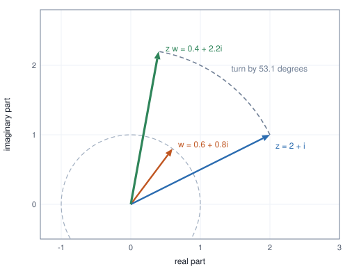
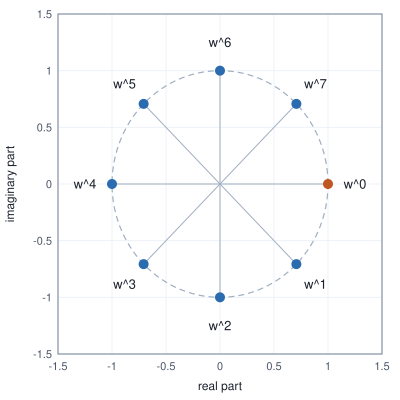
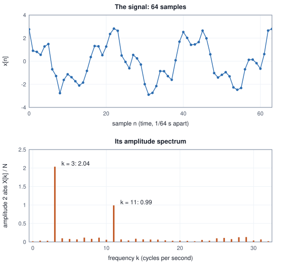

<!-- SPDX-License-Identifier: CC-BY-4.0 -->
<!-- Copyright (c) 2026 Martin Schröder <info@swedishembedded.com> -->

# Complex Numbers, Frequencies and the Fourier Transform

*How can any signal be written as a sum of waves, and why does that make convolution cheap?*

## The problem

A sensor reports how far a machine's casing moves, sixteen times a second. One
second of its output is sixteen numbers:

<!-- worked: fourier.signal_samples -->
16 samples taken over one second, x[n] = 0.5 + 3 cos(2 pi 2 n/16) + 1.5 sin(2 pi 5 n/16).

| n | x[n] | n | x[n] |
|---|---:|---:|---:|
| 0 | 3.5 | 8 | 3.5 |
| 1 | 4.007 | 9 | 1.236 |
| 2 | -0.5607 | 10 | 1.561 |
| 3 | -2.195 | 11 | -1.047 |
| 4 | -1 | 12 | -4 |
| 5 | -2.195 | 13 | -1.047 |
| 6 | -0.5607 | 14 | 1.561 |
| 7 | 4.007 | 15 | 1.236 |
<!-- /worked -->

The numbers wander up and down, and no pattern is visible by eye. Yet an
engineer who knows the machine suspects two causes of vibration: a slow hum
somewhere near two cycles per second, and a faster tone near five. The
question is concrete: which frequencies are in this list of numbers, and how
strong is each?

A frequency can be tested for by asking how well the signal agrees with a wave
of that frequency, and Chapter 3 gave us the tool for agreement: the dot
product. Take the wave that completes $k$ cycles in the sixteen samples,
$\cos(2\pi k n/16)$ at sample $n$, write it as a list of sixteen numbers, and
take its dot product with the signal. Do the same with $\sin(2\pi k n/16)$:

<!-- worked: fourier.cosine_correlations -->
Dot products of the signal with the sampled cosine and sine that complete k cycles in 16 samples.

| k (cycles) | x . cos | x . sin | sqrt(cos^2 + sin^2) |
|---|---:|---:|---:|
| 0 | 8 | 0 | 8 |
| 1 | 0 | 0 | 0 |
| 2 | 24 | 0 | 24 |
| 3 | 0 | 0 | 0 |
| 4 | 0 | 0 | 0 |
| 5 | 0 | 12 | 12 |
| 6 | 0 | 0 | 0 |
| 7 | 0 | 0 | 0 |
| 8 | 0 | 0 | 0 |
<!-- /worked -->

Read the table. At $k = 2$ the cosine correlation is $24$: there is a
two-cycle cosine in the signal. At $k = 0$ the correlation is $8$, a constant
level. At $k = 5$ the cosine correlation is $0$, yet the sine correlation is
$12$: a five-cycle wave is there, but it is a sine, a quarter of a cycle
shifted from a cosine, so the cosine is blind to it. A frequency test that
uses only a cosine can declare a strong tone absent merely because of when the
tone happens to start.

The repair is to test every frequency with a *pair* of waves, a cosine and a
sine, and keep both numbers. A pair of numbers is a point in the plane. Its
distance from the origin says how much of that frequency is present whatever
the starting time, and its angle says where in its cycle the wave starts. The
pair of correlations, $(24, 0)$ at $k = 2$ and $(0, 12)$ at $k = 5$, is the
answer to the question, and the rest of this chapter makes it systematic and
fast.

Three things are needed. First, a way to treat a point in the plane as a
number that can be multiplied, so that "a cosine and a sine at once" becomes
one object that a rotation acts on: the complex numbers. Second, the
transform that computes the whole table of pairs for every frequency at once,
the discrete Fourier transform, and a way to compute it quickly, the
fast Fourier transform. Third, the reason the same machinery makes
convolution (a sliding weighted sum, the operation inside every filter and
later inside convolutional layers) cheap: the convolution theorem.

## Before you begin

Six questions on ideas from earlier chapters, to answer from memory. The
answers are at the end of the chapter. If one is hard, go back to the chapter
named before reading on.

1. (Chapter 1, summation notation.) Evaluate $\sum_{n=0}^{3} 2^n$. How many terms does $\sum_{n=0}^{N-1}$ have?
2. (Chapter 2, exponential function and the cosine schedule.) The decay piece of the cosine learning-rate schedule is $\tfrac12(1 + \cos \pi u)$ for $u$ from $0$ to $1$. What are its values at $u = 0$, $\tfrac12$ and $1$?
3. (Chapter 3, the unit circle.) What are $\cos 90^\circ$, $\sin 90^\circ$ and $\cos 180^\circ$, and what point of the plane does the angle $\theta$ select on the circle of radius 1?
4. (Chapter 3, projection and orthogonality.) Project $\mathbf{v} = (3, 4)$ onto $\mathbf{u} = (2, 1)$: what coefficient $t$ gives the closest multiple $t\mathbf{u}$, and what is the dot product of the residual with $\mathbf{u}$?
5. (Chapter 6, rotation matrices.) Write the matrix $\mathbf{R}(\theta)$ that turns the plane by $\theta$. What is $\mathbf{R}(\alpha)\mathbf{R}(\beta)$?
6. (Chapters 2 and 7, the exponential function.) What does $e^a e^b$ equal? Which function equals its own derivative and starts at 1, and what polynomial series did Chapter 7 build for it?

## Complex numbers: points in the plane that multiply

*What it is for: one object that carries a cosine and a sine at once, and that a rotation can act on.*

We already know how to add points of the plane: add them coordinate by
coordinate, as vectors (Chapter 3). The new ingredient is a multiplication of
two points that gives a point, designed to do what Chapter 6 showed rotations
do. Write a point as a pair $(a, b)$ and ask for a product with this property:
multiplying $(a, b)$ by the point $(\cos t, \sin t)$ on the unit circle must
turn $(a, b)$ by the angle $t$. Chapter 6 gives the map that does this,

$$
\mathbf{R}(t)\begin{pmatrix} a \\ b \end{pmatrix}
= \begin{pmatrix} a\cos t - b\sin t \\ a\sin t + b\cos t \end{pmatrix}.
$$

The matrix has $c = \cos t$ on the diagonal and $d = \sin t$ below it, and minus
$d$ above. So define, for any point $(c, d)$ (not only for points on the
circle), the product of $(a, b)$ by $(c, d)$ as the matrix
$\begin{pmatrix} c & -d \\ d & c \end{pmatrix}$ applied to the vector
$(a, b)$:

$$
(a, b)\cdot(c, d) = (ac - bd,\; ad + bc).
$$

A point $(c, d)$ at distance $r = \sqrt{c^2 + d^2}$ from the origin is $r$ times
a point of the unit circle, so its matrix is $r$ times a rotation: the product
by $(c, d)$ **turns by the angle of $(c, d)$ and stretches by its length**.
Adding the pairs as vectors and multiplying them by this rule gives the
**complex numbers**. We write the point $(a, b)$ as $a + bi$, where $i$ is the
name of the point $(0, 1)$ and the real numbers are the points $(a, 0)$
on the horizontal axis, for which the rule is the ordinary product (take
$b = d = 0$: $(a, 0)\cdot(c, 0) = (ac, 0)$). The horizontal axis is the
real axis, the vertical axis the imaginary axis. The table computes five
products two ways, by the formula and by the matrix, and then measures lengths
and angles:

<!-- worked: fourier.complex_products -->
Products from the rule (ac - bd) + (ad + bc)i, the same product as the matrix [[c, -d], [d, c]] applied to (a, b), and the lengths and angles (degrees) of the three numbers.

| z | w | z w by the rule | by the matrix | lengths of z, w, z w | angles of z, w, z w |
|---|---|---|---|---|---:|
| 2 + i | 0.6 + 0.8i | 0.4 + 2.2i | (0.4, 2.2) | 2.236, 1, 2.236 | 26.57, 53.13, 79.7 |
| 3 | i | 3i | (0, 3) | 3, 1, 3 | 0, 90, 90 |
| 1 + i | 1 + i | 2i | (0, 2) | 1.414, 1.414, 2 | 45, 45, 90 |
| i | i | -1 | (-1, 0) | 1, 1, 1 | 90, 90, 180 |
| -1 + 2i | 2 - 0.5i | -1 + 4.5i | (-1, 4.5) | 2.236, 2.062, 4.61 | 116.6, -14.04, 102.5 |
<!-- /worked -->

Check the first row against the rule: $(2 + i)(0.6 + 0.8i) = (1.2 - 0.8) +
(1.6 + 0.6)i = 0.4 + 2.2i$. The second number has length $1$ and angle
$53.13^\circ$, so the product has the length of $2 + i$ ($2.236$, unchanged)
and an angle $26.57^\circ + 53.13^\circ = 79.7^\circ$. In every row the third
length is the product of the first two, and the third angle is the sum of the
first two. The figure shows the first row:



### Why i squared is minus one

The name $i$ was given to the point $(0, 1)$: one quarter turn from the point
$(1, 0)$. Multiplying by $i$ therefore turns by $90^\circ$ and does not
stretch, and multiplying by it twice turns by $180^\circ$, which takes $(1, 0)$ to
$(-1, 0)$. So

$$
i \cdot i = -1,
$$

which the rule confirms directly: $(0, 1)\cdot(0, 1) = (0\cdot 0 - 1\cdot 1,\;
0\cdot 1 + 1\cdot 0) = (-1, 0)$. This is not an extra assumption added to
arithmetic. It is a consequence of what we asked the product to do, and it
explains the word "imaginary", which is only an old name: no real number
squares to $-1$ (a real square is never negative), but a quarter turn applied
twice is a half turn. The powers of $i$ walk around the circle in quarter turns
and repeat every four steps:

<!-- worked: fourier.powers_of_i -->
Powers of i = (0, 1), each a further quarter turn.

| k | i^k | angle (degrees) |
|---|---:|---:|
| 0 | 1 | 0 |
| 1 | i | 90 |
| 2 | -1 | 180 |
| 3 | -i | 270 |
| 4 | 1 | 0 |
| 5 | i | 90 |
| 6 | -1 | 180 |
| 7 | -i | 270 |
| 8 | 1 | 0 |
<!-- /worked -->

### Length, conjugate and division

The **modulus** of $z = a + bi$ is its length, $|z| = \sqrt{a^2 + b^2}$ (the norm
of Chapter 3). Its **conjugate** is the mirror image across the real axis,
$\bar z = a - bi$. Multiplying a number by its conjugate removes the
imaginary part: $(a + bi)(a - bi) = a^2 + b^2 = |z|^2$, by the rule
$(a, b)\cdot(a, -b) = (a^2 + b^2,\; -ab + ba)$. That identity gives division,
the one operation not yet defined: $1/z = \bar z / |z|^2$, because
$z \cdot \bar z/|z|^2 = 1$. (Geometrically, divide by $z$ by turning back through
its angle and shrinking by its length.)

<!-- worked: fourier.conjugate_and_inverse -->
| quantity | value |
|---|---|
| z | 3 + 4i |
| conjugate of z | 3 - 4i |
| z times its conjugate | 25 |
| abs(z)^2 | 25 |
| 1/z = conjugate / abs(z)^2 | 0.12 - 0.16i |
| z * (1/z) | 1 |
<!-- /worked -->

### Polar form

A point can also be given by its distance $r$ and angle $\theta$ instead of
its two coordinates: $z = r(\cos\theta + i\sin\theta)$, the **polar form**,
with $r = |z|$ and $\theta = \operatorname{atan2}(b, a)$ (the angle of the point
$(a, b)$, with the sign conventions that put it in the right quarter of the
plane). In polar form the product we designed is a one-line statement: radii
multiply and angles add. This is exactly Chapter 6's rule that composing
rotations adds angles, plus the stretch:

$$
r_1(\cos\theta_1 + i\sin\theta_1)\; r_2(\cos\theta_2 + i\sin\theta_2)
= r_1 r_2\,\bigl(\cos(\theta_1 + \theta_2) + i\sin(\theta_1 + \theta_2)\bigr).
$$

<!-- worked: fourier.polar_form -->
| quantity | value |
|---|---|
| z | 3 + 4i |
| radius r = sqrt(3^2 + 4^2) | 5 |
| angle theta = atan2(4, 3), degrees | 53.13 |
| r (cos theta + i sin theta) | 3 + 4i |
| z1 = 2 at 30 degrees, rectangular | 1.732 + i |
| z2 = 3 at 45 degrees, rectangular | 2.121 + 2.121i |
| z1 z2 multiplying the rectangular forms | 1.553 + 5.796i |
| z1 z2 as radius 2 x 3 = 6 at angle 30 + 45 = 75 degrees | 1.553 + 5.796i |
<!-- /worked -->

Multiplying the rectangular forms of $2$ at $30^\circ$ and $3$ at $45^\circ$
gives the same point as the single polar step $6$ at $75^\circ$. Rectangular
form is better for adding, polar form for multiplying, and the transform of
this chapter needs both.

## Euler's formula: the exponential of a turn

*What it is for: a compact name for "a point on the unit circle at angle $t$" that obeys the laws of exponents.*

Give the point of the unit circle at angle $t$ a name: $E(t) = \cos t + i \sin t$.
By the polar rule above, two of them multiply by adding angles:

$$
E(a)\,E(b) = E(a + b), \qquad E(0) = 1.
$$

We have seen this before. Chapter 2 introduced the exponential functions as
those with $f(a)f(b) = f(a + b)$ and $f(0) = 1$: multiplying the outputs adds
the inputs. $E$ has the same property, so it behaves like a power of some
base, with the angle as the exponent. Which base? Chapter 7 characterised $e^x$
as the function equal to its own derivative that starts at $1$, and more
generally $e^{kt}$ as the function whose derivative is $k$ times itself. So
differentiate $E$ and see what multiple of itself it is.

The derivatives of cosine and sine come from the angle-addition formulas of
Chapter 6. For sine,

$$
\frac{\sin(t + h) - \sin t}{h}
= \sin t \,\frac{\cos h - 1}{h} + \cos t\,\frac{\sin h}{h}.
$$

Two ratios of $h$ remain, and the table shows what they approach as $h$ shrinks:

<!-- worked: fourier.sine_cosine_limits -->
| h | sin(h) / h | (cos(h) - 1) / h |
|---|---:|---:|
| 0.5 | 0.95885108 | -0.24483488 |
| 0.1 | 0.99833417 | -0.04995835 |
| 0.01 | 0.99998333 | -0.00499996 |
| 0.001 | 0.99999983 | -0.00050000 |
| 0.0001 | 1.00000000 | -0.00005000 |
<!-- /worked -->

The first approaches $1$ and the second approaches $0$ (proportionally to $h$,
here about $-h/2$). So the derivative of $\sin$ is $\cos$, and the same
argument gives the derivative of $\cos$ as $-\sin$. Therefore

$$
E'(t) = -\sin t + i\cos t = i\,(\cos t + i\sin t) = i\,E(t).
$$

(The middle step multiplies out: $i\cos t + i^2 \sin t = i\cos t - \sin t$.)

<!-- worked: fourier.euler_derivative -->
| quantity | value |
|---|---|
| E(t) = cos t + i sin t at t = 0.9 | 0.62161 + 0.783327i |
| i E(t) | -0.783327 + 0.62161i |
| central difference (E(t+h) - E(t-h)) / 2h, h = 1e-6 | -0.783327 + 0.62161i |
| -sin t + i cos t | -0.783327 + 0.62161i |
<!-- /worked -->

The function $E$ starts at $1$ and its derivative is $i$ times itself. The
exponential $e^{kt}$ has derivative $k$ times itself, so with $k = i$ this is
$e^{it}$. That is **Euler's formula**:

$$
e^{it} = \cos t + i\sin t.
$$

The argument above is a matching of properties. A second check does not rely on
guessing which function has which derivative: build $e^{it}$ the way Chapter 7
built $e^x$, term by term. The polynomial $p_k(x) = 1 + x + x^2/2! + \dots +
x^k/k!$ has derivative $p_{k-1}(x)$, one term behind, so as $k$ grows it
approaches a function equal to its own derivative. The construction uses only the
power rule and works unchanged for $x = it$, where each term's derivative with
respect to $t$ is $i$ times the previous term. The powers of $i$ cycle
$1, i, -1, -i$, so the real terms collect as $1 - t^2/2! + t^4/4! - \dots$ and
the imaginary terms as $t - t^3/3! + t^5/5! - \dots$, which are the series of
$\cos t$ and $\sin t$ (the general statement is the Taylor expansion of
Chapter 8). Numerically, at $t = 1$:

<!-- worked: fourier.euler_series_one -->
Partial sums p_k(it) = 1 + (it) + (it)^2/2! + ... + (it)^k/k! at t = 1; the target is cos 1 + i sin 1 = 0.54030231 + 0.84147098i.

| degree k | p_k(i) | distance to cos 1 + i sin 1 |
|---|---:|---:|
| 0 | 1 | 9.59e-01 |
| 1 | 1 + i | 4.86e-01 |
| 2 | 0.5 + i | 1.64e-01 |
| 3 | 0.5 + 0.83333333i | 4.11e-02 |
| 4 | 0.54166667 + 0.83333333i | 8.25e-03 |
| 5 | 0.54166667 + 0.84166667i | 1.38e-03 |
| 6 | 0.54027778 + 0.84166667i | 1.97e-04 |
| 7 | 0.54027778 + 0.84146825i | 2.47e-05 |
| 8 | 0.54030258 + 0.84146825i | 2.74e-06 |
| 9 | 0.54030258 + 0.84147101i | 2.75e-07 |
| 10 | 0.5403023 + 0.84147101i | 2.50e-08 |
<!-- /worked -->

The distance to $\cos 1 + i \sin 1$ falls by roughly a factor of $k$ per added
term, as for $e^x$ in Chapter 7, and the partial sums are within $3 \times 10^{-8}$
of the target by degree $10$. At $t = \pi$ the formula claims
$e^{i\pi} = -1$, half a turn:

<!-- worked: fourier.euler_series_pi -->
Partial sums p_k(i pi); the target is e^{i pi} = -1 + 0i.

| degree k | real part | imaginary part |
|---|---:|---:|
| 1 | 1 | 3.1415927 |
| 2 | -3.9348022 | 3.1415927 |
| 4 | 0.12390993 | -2.0261201 |
| 8 | -0.97602221 | -0.075220616 |
| 12 | -0.99989953 | -0.00044516024 |
| 16 | -0.99999986 | -7.7278589e-07 |
| 20 | -1 | -5.2891838e-10 |
| 24 | -1 | 0 |
<!-- /worked -->

The early partial sums are wild (the terms $\pi^k/k!$ grow before they shrink)
and then settle on $-1 + 0i$. A few consequences, all computed:

<!-- worked: fourier.euler_identities -->
| expression | value | modulus |
|---|---:|---:|
| e^{i pi/2} | i | 1 |
| e^{i pi} | -1 | 1 |
| e^{2 pi i} | 1 | 1 |
| e^{i pi/4} | 0.7071 + 0.7071i | 1 |
| e^{-i pi/2} | -i | 1 |
| e^{0.7 i} e^{1.1 i} | -0.2272 + 0.9738i | 1 |
| e^{1.8 i} | -0.2272 + 0.9738i | 1 |
| e^{1 + i pi/2} = e^1 e^{i pi/2} | 2.718i | 2.718 |
<!-- /worked -->

The first rows are the quarter turn, half turn and full turn; the product row
shows the law of exponents $e^{ia}e^{ib} = e^{i(a+b)}$ that started the section,
now agreeing with the angle-addition formulas without ever writing them. The
last row shows how a general complex exponent splits: $e^{x + iy} = e^x e^{iy}$
has length $e^x$ and angle $y$. (Values below $10^{-12}$ in magnitude print as
$0$ in this chapter's tables: they are rounding error.) Euler's formula also
gives polar form its short spelling, $z = r e^{i\theta}$, and the product rule
becomes $r_1 e^{i\theta_1}\,r_2 e^{i\theta_2} = r_1 r_2 e^{i(\theta_1 + \theta_2)}$,
which is nothing but the law of exponents.

### The roots of unity

Set $N$ equal to the number of samples in a window and let
$\omega = e^{-2\pi i/N}$: the point on the unit circle a clockwise
$N$-th of a turn from $1$. Its powers $\omega^0, \omega^1, \dots,
\omega^{N-1}$ are the $N$ equally spaced points of the circle starting at $1$,
and $\omega^N = e^{-2\pi i} = 1$, so the powers repeat: $\omega^m$ depends only on
$m$ modulo $N$. These are the **roots of unity**: each satisfies $z^N = 1$. The
clockwise direction is the convention of the transform below, chosen so that the
formulas come out without signs in awkward places. For $N = 8$:

<!-- worked: fourier.roots_of_unity -->
| m | angle (degrees) | real part of w^m | imaginary part of w^m |
|---|---:|---:|---:|
| 0 | 0 | 1 | 0 |
| 1 | -45 | 0.7071 | -0.7071 |
| 2 | -90 | 0 | -1 |
| 3 | -135 | -0.7071 | -0.7071 |
| 4 | -180 | -1 | 0 |
| 5 | -225 | -0.7071 | 0.7071 |
| 6 | -270 | 0 | 1 |
| 7 | -315 | 0.7071 | 0.7071 |

Sum of all eight: 0. w^3 w^6 = 0.7071 - 0.7071i = w^9 = w^1 = 0.7071 - 0.7071i. (w^4)^2 = 1.
<!-- /worked -->



The table shows three facts used below. The eight points sum to $0$ (they are
symmetric about the origin). $\omega^4 = -1$: half a turn. And
$\omega^3\omega^6 = \omega^9 = \omega^1$: exponents add, and reduce modulo $8$.

## Sinusoids: amplitude, frequency and phase

*What it is for: naming the three numbers that describe a wave, so that "which frequencies, how strong" has units.*

A **sinusoid** is a function of time of the form

$$
x(t) = A\cos(2\pi f t + \varphi),
$$

with three parameters. The **amplitude** $A \ge 0$ is the largest value it
reaches. The **frequency** $f$ is the number of full cycles per second, so the
period (time of one cycle) is $1/f$ seconds. The **phase** $\varphi$ is the
angle, in radians, at which the cycle stands at $t = 0$: a positive phase shifts the
wave earlier in time, so that the peak a pure cosine would have at $t = 0$ occurs
$\varphi/(2\pi f)$ seconds before it. (Sines are
sinusoids too: $\sin\theta = \cos(\theta - \pi/2)$.)

<!-- worked: fourier.sinusoid_parameters -->
| amplitude A | frequency f (cycles/s) | phase phi (rad) | period 1/f (s) | value at t = 0 | first peak (s) |
|---|---:|---:|---:|---:|---:|
| 3 | 2 | 0 | 0.5 | 3 | 0 |
| 1.5 | 5 | -1.571 | 0.2 | 0 | 0.05 |
| 2 | 1 | 1.047 | 1 | 1 | 0.8333 |
| 1 | 0.5 | 3.142 | 2 | -1 | 1 |
<!-- /worked -->

The problem's opening exposed the difficulty: the cosine and the sine are the
same shape shifted by a quarter period, and a test with one of them misses the
other. Both are handled at once by writing a general sinusoid as a combination
of the two. By the angle-addition formula,

$$
A\cos(\theta + \varphi) = A\cos\varphi\,\cos\theta - A\sin\varphi\,\sin\theta
= a\cos\theta + b\sin\theta,
$$

with $a = A\cos\varphi$ and $b = -A\sin\varphi$. Reading it backwards: any
combination $a\cos\theta + b\sin\theta$ is a single sinusoid with amplitude
$A = \sqrt{a^2 + b^2}$ and phase $\varphi = \operatorname{atan2}(-b, a)$. Two numbers
$(a, b)$ in, amplitude and phase out:

<!-- worked: fourier.amplitude_phase -->
| a | b | A = sqrt(a^2 + b^2) | phi = atan2(-b, a) | c = a - bi | a cos 1 + b sin 1 | A cos(1 + phi) |
|---|---:|---:|---:|---:|---:|---:|
| 3 | 0 | 3 | 0 | 3 | 1.621 | 1.621 |
| 0 | 1.5 | 1.5 | -1.571 | -1.5i | 1.262 | 1.262 |
| 2 | -2 | 2.828 | 0.7854 | 2 + 2i | -0.6023 | -0.6023 |
| -1 | 1 | 1.414 | -2.356 | -1 - i | 0.3012 | 0.3012 |
| 1 | 1 | 1.414 | -0.7854 | 1 - i | 1.382 | 1.382 |
<!-- /worked -->

Now bring in the complex numbers. By Euler's formula, $A\cos(\theta + \varphi)
= \operatorname{Re}\bigl(A e^{i\varphi}\,e^{i\theta}\bigr)$, where $\operatorname{Re}$
takes the real part. The single complex number

$$
c = A e^{i\varphi} = a - bi
$$

(the last equality follows from $a = A\cos\varphi$, $b = -A\sin\varphi$) carries
both the amplitude, as its modulus, and the phase, as its angle. It is the
point $(a, -b)$ of the plane. This is the pair of the problem section, stored
as one number, and the table shows the same cases: for $(a, b) = (0, 1.5)$, which
is $1.5\sin\theta$, the complex amplitude is $-1.5i$, modulus $1.5$ and angle
$-90^\circ$.

**A sinusoid from Chapter 2.** The cosine learning-rate schedule's decay piece is
$\tfrac12(1 + \cos\pi u)$. Compare with a sinusoid of amplitude $\tfrac12$,
offset $\tfrac12$ and frequency $\tfrac12$ cycle per unit of $u$, so that
$2\pi f u = \pi u$:

<!-- worked: fourier.cosine_decay_sinusoid -->
| u (fraction of the decay) | 0.5 (1 + cos(pi u)) | offset 0.5 + amplitude 0.5 at 1/2 cycle per unit |
|---|---:|---:|
| 0 | 1 | 1 |
| 0.25 | 0.8536 | 0.8536 |
| 0.5 | 0.5 | 0.5 |
| 0.75 | 0.1464 | 0.1464 |
| 1 | 0 | 0 |
<!-- /worked -->

The two columns are the same numbers: the schedule is half a period of a
sinusoid, from its peak to its trough, shifted up so it ends at the floor.

**Sampling a sinusoid.** A computer holds a sinusoid only at sample times
$t_n = n/f_s$, where $f_s$ is the **sampling rate** (samples per second). Over a
window of $N$ samples the window lasts $N/f_s$ seconds, and a wave that
completes $k$ whole cycles in the window has frequency $f = k f_s/N$ and samples

$$
x[n] = A\cos\!\Bigl(\frac{2\pi k n}{N} + \varphi\Bigr), \qquad n = 0, \dots, N-1.
$$

We use the integer $k$, the number of cycles per window, as the frequency from
now on. In the opening, $N = 16$ samples at $f_s = 16$ per second make each $k$
exactly $k$ hertz. One caution that later volumes treat fully: with only $N$
samples some different frequencies give literally the same numbers.

<!-- worked: fourier.same_samples_different_frequencies -->
Eight samples of cosines and sines that complete k cycles in the window.

| n | cos k=1 | cos k=7 | cos k=9 | sin k=1 | sin k=7 |
|---|---:|---:|---:|---:|---:|
| 0 | 1.0000 | 1.0000 | 1.0000 | 0.0000 | 0.0000 |
| 1 | 0.7071 | 0.7071 | 0.7071 | 0.7071 | -0.7071 |
| 2 | 0.0000 | 0.0000 | 0.0000 | 1.0000 | -1.0000 |
| 3 | -0.7071 | -0.7071 | -0.7071 | 0.7071 | -0.7071 |
| 4 | -1.0000 | -1.0000 | -1.0000 | 0.0000 | 0.0000 |
| 5 | -0.7071 | -0.7071 | -0.7071 | -0.7071 | 0.7071 |
| 6 | 0.0000 | 0.0000 | 0.0000 | -1.0000 | 1.0000 |
| 7 | 0.7071 | 0.7071 | 0.7071 | -0.7071 | 0.7071 |
<!-- /worked -->

In a window of eight samples the cosines with $k = 1$, $7$ and $9$ cannot be
told apart, and the sines at $k = 1$ and $k = 7$ differ only by a sign. Only
frequencies up to $N/2$ are distinguishable, and a wave faster than that is
indistinguishable from a slower one. Volume IX (Audio) states exactly which
frequencies a sampled signal can carry and what happens to the others; here it
is enough to know that $k$ and $N - k$ mirror each other and that the useful
range is $0 \le k \le N/2$.

## The discrete Fourier transform

*What it is for: the pair of correlations of the signal with the cosine and sine at every frequency, computed at once and stored as complex numbers.*

### From a pair of correlations to one complex number

At each frequency $k$ the problem section computed two dot products, with the
cosine and the sine at that frequency. Call them $C_k = \sum_n x[n]\cos(2\pi k n/N)$
and $S_k = \sum_n x[n]\sin(2\pi k n/N)$. Store the pair as the complex number
$C_k - i S_k$. By Euler's formula, with the sum over the $N$ samples,

$$
C_k - iS_k = \sum_{n=0}^{N-1} x[n]\,\bigl(\cos\tfrac{2\pi k n}{N} - i\sin\tfrac{2\pi k n}{N}\bigr)
= \sum_{n=0}^{N-1} x[n]\,e^{-2\pi i k n/N}
= \sum_{n=0}^{N-1} x[n]\,\omega^{kn}.
$$

That number, for each $k = 0, \dots, N-1$, is the **discrete Fourier transform**
(DFT) of the signal $x$:

$$
X[k] = \sum_{n=0}^{N-1} x[n]\,\omega^{kn}, \qquad \omega = e^{-2\pi i/N}.
$$

Read it as a correlation with a pointer that turns: for each $n$ the pointer
$\omega^{kn}$ sits at a different angle, $-2\pi kn/N$, and the sum adds up the
samples, each multiplied by the pointer's position. If the signal turns in step
with the pointer the contributions line up and the sum is large; if the signal
has no component at that frequency, they point everywhere and cancel. (The
minus sign in $\omega$ is a convention: with it, a component $e^{+2\pi i k n/N}$ of
the signal produces $X[k] = N$ at exactly $k$, as the orthogonality below shows.)

The problem's table gave $C_2 = 24$, $S_2 = 0$, so $X[2] = 24$, and $C_5 = 0$,
$S_5 = 12$, so $X[5] = -12i$. The next paragraph shows how to turn these numbers
into amplitudes and phases.

### What X[k] tells us

Take a real signal that is a single sinusoid at frequency $k$ with $0 < k < N/2$:
$x[n] = A\cos(2\pi k n/N + \varphi)$. Write the cosine as two complex
exponentials, $\tfrac{A}{2}\bigl(e^{i\varphi}e^{2\pi i kn/N} + e^{-i\varphi}e^{-2\pi i kn/N}\bigr)$.
The first term is a pointer turning exactly opposite to $\omega^{kn}$, so
multiplied by $\omega^{kn}$ it is the constant $\tfrac{A}{2}e^{i\varphi}$ for every
$n$, and the sum over $N$ samples is $\tfrac{N}{2}Ae^{i\varphi}$. The second term
turns in the same sense as $\omega^{kn}$, so it contributes nothing at frequency
$k$ (the next section proves this, by showing the sum of such a pointer over a
whole window is zero). Therefore

$$
X[k] = \frac{N}{2}\,A e^{i\varphi}, \qquad\text{so}\qquad
A = \frac{2\,|X[k]|}{N},\quad \varphi = \text{the angle of } X[k].
$$

The modulus of $X[k]$ is the amplitude (times $N/2$) and its angle is the
phase. In the problem, $X[2] = 24$ gives $A = 2 \cdot 24/16 = 3$ and phase $0$: the
hum is $3\cos(2\pi \cdot 2n/16)$. And $X[5] = -12i$ gives $A = 1.5$ and phase
$-90^\circ$: the tone is $1.5\cos(2\pi \cdot 5n/16 - \pi/2) = 1.5\sin(2\pi \cdot 5n/16)$.
The signal was built as exactly these, with an offset of $0.5$ (which appears as
$X[0]/N$). The question of the opening is answered.

Real measurements are noisy, and the method still finds the frequencies. The figure
shows 64 samples over one second: a hum at $3$ Hz of amplitude $2$, a tone at $11$ Hz of
amplitude $1$, and Gaussian noise of standard deviation $0.3$ (Chapter 11), drawn from a
frozen random stream. In the time domain nothing is evident. In the spectrum, two
stems stand far above a low floor, at the planted frequencies and with
amplitudes close to the planted ones ($2.01$ and $0.96$): the noise is spread evenly
over all frequencies, and each frequency receives only a little of it.



Two special frequencies have simple meanings. $X[0] = \sum_n x[n]$ is the sum of
all samples, $N$ times the average level. And for even $N$, $X[N/2] = \sum_n
(-1)^n x[n]$, because $\omega^{N n/2} = e^{-i\pi n} = (-1)^n$: the alternating
sum, the fastest wiggle a sampled signal can have.

### A small case, all the way through

Use $N = 8$ and the signal $\mathbf{x} = (3, 1, 4, 1, 5, 9, 2, 6)$, with nothing special
about it. A power $\omega^{kn}$ depends only on $kn \bmod 8$, so the whole
table of $N^2 = 64$ pointers is a table of exponents:

<!-- worked: fourier.dft_exponent_table -->
| k \ n | 0 | 1 | 2 | 3 | 4 | 5 | 6 | 7 |
|---|---:|---:|---:|---:|---:|---:|---:|---:|
| 0 | 0 | 0 | 0 | 0 | 0 | 0 | 0 | 0 |
| 1 | 0 | 1 | 2 | 3 | 4 | 5 | 6 | 7 |
| 2 | 0 | 2 | 4 | 6 | 0 | 2 | 4 | 6 |
| 3 | 0 | 3 | 6 | 1 | 4 | 7 | 2 | 5 |
| 4 | 0 | 4 | 0 | 4 | 0 | 4 | 0 | 4 |
| 5 | 0 | 5 | 2 | 7 | 4 | 1 | 6 | 3 |
| 6 | 0 | 6 | 4 | 2 | 0 | 6 | 4 | 2 |
| 7 | 0 | 7 | 6 | 5 | 4 | 3 | 2 | 1 |
<!-- /worked -->

Row $k = 1$ lists the pointers $\omega^0, \omega^1, \dots, \omega^7$ in turn, the
points of the roots-of-unity figure. Here is $X[1]$, one term per sample:

<!-- worked: fourier.dft_terms_k1 -->
x = (3, 1, 4, 1, 5, 9, 2, 6), k = 1, so the exponent is k n mod 8 = n.

| n | x[n] | exponent | w^exponent | x[n] w^exponent |
|---|---:|---:|---:|---:|
| 0 | 3 | 0 | 1 | 3 |
| 1 | 1 | 1 | 0.7071 - 0.7071i | 0.7071 - 0.7071i |
| 2 | 4 | 2 | -i | -4i |
| 3 | 1 | 3 | -0.7071 - 0.7071i | -0.7071 - 0.7071i |
| 4 | 5 | 4 | -1 | -5 |
| 5 | 9 | 5 | -0.7071 + 0.7071i | -6.364 + 6.364i |
| 6 | 2 | 6 | i | 2i |
| 7 | 6 | 7 | 0.7071 + 0.7071i | 4.243 + 4.243i |
| sum |  |  |  | X[1] = -4.121 + 7.192i |
<!-- /worked -->

By hand, $X[2]$ is easier, since $\omega^2 = -i$ and the pointers are powers of $-i$:
$1, -i, -1, i, 1, -i, -1, i$. So $X[2] = 3 - i - 4 + i + 5 - 9i - 2 + 6i
= 2 - 3i$. And $X[0] = 31$ (the sum) and $X[4] = 3 - 1 + 4 - 1 + 5 - 9 + 2 - 6 = -3$
(the alternating sum). All eight outputs:

<!-- worked: fourier.dft_eight_points -->
The DFT of x = (3, 1, 4, 1, 5, 9, 2, 6).

| k | real part | imaginary part | abs X[k] | phase (degrees) | conjugate of X[8-k] |
|---|---:|---:|---:|---:|---:|
| 0 | 31 | 0 | 31 | 0 | 31 |
| 1 | -4.121 | 7.192 | 8.289 | 119.8 | -4.121 + 7.192i |
| 2 | 2 | -3 | 3.606 | -56.31 | 2 - 3i |
| 3 | 0.1213 | 11.19 | 11.19 | 89.38 | 0.1213 + 11.19i |
| 4 | -3 | 0 | 3 | 180 | -3 |
| 5 | 0.1213 | -11.19 | 11.19 | -89.38 | 0.1213 - 11.19i |
| 6 | 2 | 3 | 3.606 | 56.31 | 2 + 3i |
| 7 | -4.121 | -7.192 | 8.289 | -119.8 | -4.121 - 7.192i |
<!-- /worked -->

The last column is a check on a symmetry: for a real signal, $X[N - k]$ is the
complex conjugate of $X[k]$. The reason is that $\omega^{(N-k)n} = \omega^{Nn}
\omega^{-kn} = \omega^{-kn}$, the conjugate of $\omega^{kn}$ (a pointer's
conjugate turns the other way), and the samples $x[n]$ are real. So the half of
the table above $N/2$ carries no new information when $x$ is real: $N$ real
numbers in, $N/2 + 1$ independent complex numbers out ($X[0]$ and $X[N/2]$ are
real).

As a matrix, $\mathbf{X} = \mathbf{F}\mathbf{x}$ where $\mathbf{F}$ is the
$N \times N$ matrix with entries $F_{kn} = \omega^{kn}$ (Chapter 4's matrix times
vector, with complex entries). Computing it from the definition takes $N$
multiplications for each of $N$ outputs: $N^2$ complex multiplications. For
$N = 8$ that is $64$; for a second of audio at $16{,}000$ samples a second, a
quarter of a billion. We will bring that down after finishing what the transform
means.

### The pointers are orthogonal

The transform is more than a table of correlations: it is a *change of
coordinates*, and the reason is that the $N$ pointers are mutually
orthogonal. For complex vectors the dot product needs one adjustment. The
**inner product** of $\mathbf{u}$ and $\mathbf{v}$ is
$\langle \mathbf{u}, \mathbf{v}\rangle = \sum_n \bar u_n v_n$, with a conjugate on the first
vector, so that $\langle \mathbf{u}, \mathbf{u}\rangle = \sum_n |u_n|^2$ is
the squared length (without the conjugate, a vector such as $(1, i)$ would have
"squared length" $1 + i^2 = 0$). Take two pointers, the rows $k$ and $l$ of $\mathbf{F}$:

$$
\sum_{n=0}^{N-1} \overline{\omega^{kn}}\;\omega^{ln}
= \sum_{n=0}^{N-1} \bigl(\omega^{\,l-k}\bigr)^n
= \sum_{n=0}^{N-1} r^n, \qquad r = \omega^{\,l-k}.
$$

(The conjugate of $\omega^{kn}$ is $\omega^{-kn}$, so the exponents combine.) A
geometric sum has a closed form: multiplying out,
$(1 - r)(1 + r + \dots + r^{N-1}) = 1 - r^N$. If $l = k$ then $r = 1$ and the sum is
$N$ (each term is $1$). If $l \neq k$ (with both in $0, \dots, N-1$) then
$r = \omega^{l-k} \neq 1$, and $r^N = \omega^{N(l-k)} = (\omega^N)^{l-k} = 1$, so the
product is $0$ and since $1 - r \neq 0$ the sum is $0$:

$$
\sum_{n=0}^{N-1} \overline{\omega^{kn}}\;\omega^{ln} = \begin{cases} N & k = l, \\ 0 & k \neq l. \end{cases}
$$

<!-- worked: fourier.dft_orthogonality -->
| pair of rows (k, l) | sum over n of conj(w^{kn}) w^{ln} |
|---|---|
| (0, 0) | 8 |
| (1, 1) | 8 |
| (4, 4) | 8 |
| (1, 2) | 0 |
| (1, 7) | 0 |
| (2, 6) | 0 |
| (3, 5) | 0 |
| (0, 4) | 0 |

All eight diagonal entries of F F^H: (8, 8, 8, 8, 8, 8, 8, 8). Largest off-diagonal magnitude: below 1e-12.
<!-- /worked -->

The eight pointers of the $N = 8$ transform are pairwise orthogonal and each has
squared length $8$. In matrix form $\mathbf{F}\mathbf{F}^{H} = N\mathbf{I}$, where
$\mathbf{F}^H$ is the conjugate transpose, the complex counterpart of the
orthogonal matrices of Chapter 6 (up to the factor $N$).

### The inverse transform

Orthogonality gives the inverse at once. Start from the definition of $X[k]$,
multiply by $\omega^{-kn}$, and sum over $k$:

$$
\sum_{k=0}^{N-1} X[k]\,\omega^{-kn}
= \sum_{k=0}^{N-1}\sum_{m=0}^{N-1} x[m]\,\omega^{k m}\omega^{-kn}
= \sum_{m=0}^{N-1} x[m]\sum_{k=0}^{N-1}\omega^{k(m-n)} = N\,x[n],
$$

because the inner sum is $N$ if $m = n$ and $0$ otherwise (the geometric sum, now
over $k$). Dividing by $N$:

$$
x[n] = \frac{1}{N}\sum_{k=0}^{N-1} X[k]\,\omega^{-kn}.
$$

The signal is rebuilt as a sum of $N$ pointers turning in the opposite
direction, each scaled by $X[k]/N$. In the vocabulary of Chapter 3 this is the
statement that a vector is the sum of its projections onto an orthogonal set
of directions: the coefficient of $\mathbf{x}$ along the $k$-th direction is
$\langle \mathbf{w}_k, \mathbf{x}\rangle / \langle \mathbf{w}_k, \mathbf{w}_k\rangle
= X[k]/N$, where $\mathbf{w}_k[n] = \omega^{-kn}$. The Fourier transform
re-expresses the same signal in a different basis, one made of waves.

<!-- worked: fourier.dft_inverse_roundtrip -->
| quantity | value |
|---|---|
| x | (3, 1, 4, 1, 5, 9, 2, 6) |
| (1/N) sum_k X[k] w^{-kn} | (3, 1, 4, 1, 5, 9, 2, 6) |
| largest difference from x | below 1e-12 |
| conj(DFT(conj(X))) / N | (3, 1, 4, 1, 5, 9, 2, 6) |
| largest difference from x (conjugate trick) | below 1e-12 |
| sum of x[n]^2 | 173 |
| (1/N) sum of abs(X[k])^2 | 173 |
<!-- /worked -->

The table shows three things. The round trip returns the signal to within
rounding. The inverse can also be computed with the *forward* transform: take the
conjugate of the spectrum, transform, conjugate the result and divide by $N$
(because $\overline{\omega^{kn}} = \omega^{-kn}$, conjugating turns a forward
transform into an inverse one), the **conjugate trick** that lets one forward routine
serve both directions. And the energy is preserved up to the factor $N$:
$\sum_n |x[n]|^2 = \tfrac{1}{N}\sum_k |X[k]|^2$ (here both sides are $173$), the
Parseval relation, which is the Pythagorean theorem for this orthogonal basis.

### Keeping the low frequencies

A direct use of the change of basis is to keep only some of the coefficients and
discard the rest. Zero every $X[k]$ whose frequency $\min(k, N - k)$ exceeds a limit
$K$ and invert:

<!-- worked: fourier.truncated_reconstruction -->
Keep only the coefficients with frequency at most K (and their mirror images), set the rest to zero, and invert.

| K | coefficients kept | reconstruction | relative error | predicted from the dropped coefficients |
|---:|---:|---|---:|---:|
| 0 | 1 | (3.88, 3.88, 3.88, 3.88, 3.88, 3.88, 3.88, 3.88) | 0.5528 | 0.5528 |
| 1 | 3 | (2.84, 1.87, 2.08, 3.33, 4.91, 5.88, 5.67, 4.42) | 0.4542 | 0.4542 |
| 2 | 5 | (3.34, 2.62, 1.58, 2.58, 5.41, 6.62, 5.17, 3.67) | 0.4331 | 0.4331 |
| 3 | 7 | (3.37, 0.625, 4.38, 0.625, 5.38, 8.62, 2.38, 5.62) | 0.08064 | 0.08064 |
| 4 | 8 | (3, 1, 4, 1, 5, 9, 2, 6) | 0 | 0 |
<!-- /worked -->

With only the average ($K = 0$) the reconstruction is a constant. As more
frequencies are kept, the reconstruction approaches the signal, and at
$K = N/2$ it is exact. The last column is the Parseval relation again: the
relative error of a truncation is the square root of the energy in the
discarded coefficients, divided by the signal's own, so one can read the cost of
a truncation off the spectrum without reconstructing anything. Keeping the
largest $|X[k]|$ is the best choice by this measure, and for signals that vary
slowly those are the low frequencies.

### Frequencies between the bins

Everything above assumed that each wave completes a whole number of cycles in
the window. A wave that does not still has a transform, but it is spread:

<!-- worked: fourier.dft_leakage -->
Amplitude estimate 2 abs(X[k])/N for a cosine with 3 whole cycles and one with 3.5 cycles in 16 samples.

| k | 3 cycles | 3.5 cycles |
|---|---:|---:|
| 0 | 0 | 0.0625 |
| 1 | 0 | 0.1412 |
| 2 | 0 | 0.2131 |
| 3 | 1 | 0.6282 |
| 4 | 0 | 0.6528 |
| 5 | 0 | 0.2357 |
| 6 | 0 | 0.1588 |
| 7 | 0 | 0.1321 |
| 8 | 0 | 0.0625 |
<!-- /worked -->

The cosine with $3$ whole cycles is a single clean entry, amplitude $1$ at $k = 3$.
The one with $3.5$ cycles falls between bins $3$ and $4$ and leaks into every bin,
with its largest values at the two neighbours and slowly decaying tails. The
window of $N$ samples resolves frequencies only to the spacing of the bins,
$f_s/N$; two tones closer than that cannot be separated without a longer window.
Shaping the window to tame the leakage is the business of the audio volumes.

### A real basis for real signals

The complex pointers $\omega^{kn}$ are convenient, but a real signal might as well
be expressed in real functions. Combining each pair $k$ and $N - k$ gives
the cosine and sine at frequency $k$. For even $N$, scale them to unit length and
collect: the constant $1/\sqrt{N}$, then for $k = 1, \dots, N/2 - 1$ the pair
$\sqrt{2/N}\cos(2\pi k n/N)$ and $\sqrt{2/N}\sin(2\pi k n/N)$, and finally the
alternation $(-1)^n/\sqrt{N}$. These $N$ real functions are orthonormal, so the
matrix $\mathbf{S}$ whose columns they are satisfies $\mathbf{S}^\top\mathbf{S} = \mathbf{I}$
and its transpose is its inverse, exactly like a rotation of Chapter 6. The
coefficients $\mathbf{z} = \mathbf{S}^\top\mathbf{x}$ are, up to those scale factors, the real
and imaginary parts of the complex transform:

<!-- worked: fourier.real_fourier_basis -->
| i | basis function | z[i] = column i . x | from the complex DFT |
|---:|---|---:|---:|
| 0 | constant | 10.96 | 10.96 |
| 1 | cos, k=1 | -2.061 | -2.061 |
| 2 | sin, k=1 | -3.596 | -3.596 |
| 3 | cos, k=2 | 1 | 1 |
| 4 | sin, k=2 | 1.5 | 1.5 |
| 5 | cos, k=3 | 0.06066 | 0.06066 |
| 6 | sin, k=3 | -5.596 | -5.596 |
| 7 | alternating | -1.061 | -1.061 |

Largest deviation of the Gram matrix from the identity: below 1e-12. Largest difference between the two columns of z: below 1e-12. Length of z: 13.15; length of x: 13.15.
<!-- /worked -->

The coefficients computed as dot products with the real basis and the same numbers
read off the complex DFT, $z_0 = \operatorname{Re}X[0]/\sqrt{N}$, $z_{2k-1} =
\sqrt{2/N}\operatorname{Re}X[k]$, $z_{2k} = -\sqrt{2/N}\operatorname{Im}X[k]$, agree, and the
length of $\mathbf{z}$ equals the length of $\mathbf{x}$ (the orthonormal scaling
makes the transform length-preserving). The last section of the chapter shows where
a machine learning engine uses exactly this basis.

## The fast Fourier transform

*What it is for: bringing the cost of the transform from $N^2$ to about $N\log_2 N$, which is what makes it usable on long signals.*

### Splitting into even and odd samples

The transform of $N$ samples costs $N^2$ multiplications by the definition. The
fast method splits the sum into the even-numbered and the odd-numbered samples.
Assume $N$ is even and write $n = 2m$ for even samples and $n = 2m + 1$ for odd
samples, with $m = 0, \dots, N/2 - 1$:

$$
X[k] = \sum_{m=0}^{N/2-1} x[2m]\,\omega^{2km} + \omega^{k}\sum_{m=0}^{N/2-1} x[2m+1]\,\omega^{2km}.
$$

Now $\omega^2 = e^{-4\pi i/N} = e^{-2\pi i/(N/2)}$ is exactly the primitive root
for a transform of length $N/2$. So each sum is itself a DFT of length $N/2$: the
first, $E[k]$, of the even-indexed samples, the second, $O[k]$, of the odd-indexed
ones. Writing it out,

$$
X[k] = E[k] + \omega^{k}\,O[k].
$$

This holds for every $k$ from $0$ to $N - 1$, but $E$ and $O$ are transforms of
length $N/2$ and repeat with period $N/2$, so only the first $N/2$ values of each
need computing. For the outputs in the upper half, put $k + N/2$ in place of $k$:
$E$ and $O$ are unchanged, and the twiddle factor changes sign, because
$\omega^{N/2} = e^{-i\pi} = -1$, so $\omega^{k + N/2} = -\omega^k$. Hence

$$
\boxed{\;X[k] = E[k] + \omega^{k}O[k], \qquad X[k + N/2] = E[k] - \omega^{k}O[k], \qquad k = 0, \dots, N/2 - 1.\;}
$$

One complex multiplication, $t = \omega^k O[k]$, and two additions produce two outputs.
This pair of lines, called a **butterfly**, is the entire trick. The multiplier
$\omega^k$ is called a **twiddle factor**. For the signal of the small case,
split into the even samples $(3, 4, 5, 2)$ and the odd samples $(1, 1, 9, 6)$:

<!-- worked: fourier.fft_split -->
Even samples (3, 4, 5, 2), odd samples (1, 1, 9, 6).

| k | E[k] | O[k] | w^k | w^k O[k] | X[k] = E + w^k O | X[k+4] = E - w^k O |
|---|---|---|---|---|---|---|
| 0 | 14 | 17 | 1 | 17 | 31 | -3 |
| 1 | -2 - 2i | -8 + 5i | 0.7071 - 0.7071i | -2.121 + 9.192i | -4.121 + 7.192i | 0.1213 - 11.19i |
| 2 | 2 | 3 | -i | -3i | 2 - 3i | 2 + 3i |
| 3 | -2 + 2i | -8 - 5i | -0.7071 - 0.7071i | 2.121 + 9.192i | 0.1213 + 11.19i | -4.121 - 7.192i |

Largest difference from the direct 8-point DFT: below 1e-12.
<!-- /worked -->

The first two columns are two $4$-point transforms. Each of the four rows turns
them into two outputs, $X[k]$ and $X[k + 4]$, and the results are those of the
direct $8$-point transform above, to within rounding. (Check row $k = 2$ by hand: the twiddle factor is $\omega^2 = -i$, so
$t = -i\cdot 3 = -3i$, and $X[2] = 2 - 3i$, $X[6] = 2 + 3i$.)

### Recursion, and what it costs

The two half-length transforms can be split again, and again, until length $1$,
where the transform of a single sample is the sample itself ($\omega^0 = 1$ and the
sum has one term). This needs $N$ to be a power of two, $N = 2^p$, for the splitting
to continue all the way down. In the book's pseudocode, with `complex` meaning a pair
of reals as defined in this chapter:

```text
function fft(x: array<complex>[N]) -> array<complex>[N]:
    require N >= 1 and N is a power of two, "radix-2 FFT needs a power-of-two length"
    if N == 1:
        return copy(x)
    even = zeros(complex, [N / 2])
    odd = zeros(complex, [N / 2])
    for m in 0 .. N / 2:
        even[m] = x[2 * m]
        odd[m] = x[2 * m + 1]
    E = fft(even)
    O = fft(odd)
    X = zeros(complex, [N])
    for k in 0 .. N / 2:
        t = exp(-2 * pi * i * k / N) * O[k]        # one twiddle multiplication
        X[k] = E[k] + t
        X[k + N / 2] = E[k] - t
    return X
```

Count the multiplications. Let $T(N)$ be the number for a length-$N$ transform. The
recursion makes two calls of half the length and then $N/2$ twiddle multiplications:

$$
T(N) = 2\,T(N/2) + \frac{N}{2}, \qquad T(1) = 0.
$$

Unroll it level by level. At the top level there is one problem of size $N$
costing $N/2$. At the next there are two problems of size $N/2$, each costing $N/4$:
a total of $N/2$ again. At level $j$ there are $2^j$ problems of size $N/2^j$ each
costing $N/2^{j+1}$, a total of $N/2$ per level. The sizes halve until they reach
$1$ after $p = \log_2 N$ levels, so

$$
T(N) = \frac{N}{2}\log_2 N \text{ complex multiplications}, \qquad
\text{and } N\log_2 N \text{ complex additions}
$$

(two additions per butterfly and $N/2$ butterflies per level). The counters in
the reference implementation count the operations actually performed and agree
exactly with these formulas:

<!-- worked: fourier.operation_counts -->
Complex multiplications by the definition (N rows of N products), and multiplications and additions counted while the recursive FFT ran; they equal (N/2) log2 N and N log2 N exactly.

| N | DFT multiplications N^2 | FFT multiplications | FFT additions | N^2 / FFT multiplications |
|---|---:|---:|---:|---:|
| 8 | 64 | 12 | 24 | 5.33 |
| 16 | 256 | 32 | 64 | 8 |
| 64 | 4,096 | 192 | 384 | 21.3 |
| 256 | 65,536 | 1,024 | 2,048 | 64 |
| 1,024 | 1,048,576 | 5,120 | 10,240 | 205 |
| 4,096 | 16,777,216 | 24,576 | 49,152 | 683 |
<!-- /worked -->

At $N = 8$ the saving is a factor of $5$; at $N = 1024$ it is a factor of $205$; at
$N = 4096$, $683$. The ratio $N^2 / (\tfrac{N}{2}\log_2 N) = 2N/\log_2 N$ grows almost
linearly with $N$, because $\log_2 N$ grows so slowly. Doubling the length of the
signal multiplies the DFT's cost by $4$ but the FFT's by only a little more than
$2$: from $\tfrac{N}{2}\log_2 N$ to $N \log_2 (2N) = 2 \cdot \tfrac{N}{2}\log_2 N
\,(1 + 1/\log_2 N)$. This is the arithmetic behind the statement "the FFT is
nearly linear in the length".

### The in-place butterfly network

The recursion can be unrolled into loops, which is how it is run in practice. The
even/odd split, applied all the way down, reorders the input: the sample that ends
up in slot $i$ is the one whose index is the **bit reversal** of $i$ (write $i$ in
$p$ binary digits and read the digits backwards: for $N = 8$, slot $1 = 001_2$ takes
sample $100_2 = 4$). After that permutation, each stage combines slots that are
$1, 2, 4, \dots, N/2$ apart, in place, with the butterfly above:

```text
function fft_in_place(x: inout array<complex>[N]):
    require N >= 2 and N is a power of two, "radix-2 FFT needs a power-of-two length"
    p = log2(N)
    for i in 0 .. N:                                # bit-reversal permutation
        j = reverse_bits(i, p)                      # p-bit reversal
        if i < j: swap x[i], x[j]
    size = 2
    while size <= N:                                # stage: blocks of `size` slots
        for b in 0 .. N / size:
            start = b * size
            for k in 0 .. size / 2:
                u = x[start + k]
                t = exp(-2 * pi * i * k / size) * x[start + k + size / 2]
                x[start + k] = u + t
                x[start + k + size / 2] = u - t
        size = size * 2
```

The wiring for $N = 8$ is small enough to list in full. Writing each twiddle as a
power of the length-$8$ root, the exponent at position $k$ of a block of $\text{size}$ is
$k\cdot 8/\text{size}$:

<!-- worked: fourier.butterfly_schedule -->
Slot i starts with sample x[0], x[4], ... in bit-reversed order: (0, 4, 2, 6, 1, 5, 3, 7).

| stage | butterflies (top, bottom) with twiddle |
|---:|---|
| 1 | (0,1) w^0; (2,3) w^0; (4,5) w^0; (6,7) w^0 |
| 2 | (0,2) w^0; (1,3) w^2; (4,6) w^0; (5,7) w^2 |
| 3 | (0,4) w^0; (1,5) w^1; (2,6) w^2; (3,7) w^3 |

Running this schedule on x = (3, 1, 4, 1, 5, 9, 2, 6) differs from the direct DFT by an amount below 1e-12.
<!-- /worked -->


In the figure, each pair of crossing lines is one butterfly: the lower input is
first multiplied by the twiddle factor written on its wire (an unlabelled wire is
multiplied by $\omega^0 = 1$), the upper output is $u + t$ and the lower output
$u - t$. Three stages of four butterflies give $12$ multiplications, as the
operation-count table said. The transform needs no memory beyond the array
itself, and the stages touch memory in regular patterns, which is why it maps
well onto hardware.

The fast transform is the same function as the slow one, not an approximation
of it. The two differ only by rounding:

<!-- worked: fourier.fft_accuracy -->
Random Gaussian signals; largest difference in double precision.

| N | recursive FFT vs DFT | iterative FFT vs DFT | inverse DFT of the FFT vs signal |
|---|---:|---:|---:|
| 8 | below 1e-12 | below 1e-12 | below 1e-12 |
| 64 | below 1e-12 | below 1e-12 | below 1e-12 |
| 256 | below 1e-12 | below 1e-12 | below 1e-12 |
| 1024 | below 1e-12 | below 1e-12 | below 1e-12 |
<!-- /worked -->

Every disagreement is below $10^{-12}$ in double precision, on signals whose
entries have size about $1$. The inverse is obtained by the conjugate trick
above, so one routine does both directions, and a real signal's transform can
be computed with roughly half the work by exploiting the symmetry $X[N-k] =
\overline{X[k]}$. A length that is not a power of two can be split by any of
its factors (a length $1920 = 2^7 \cdot 3 \cdot 5$ splits into smaller transforms
by the same idea with three- and five-way splits), or an arbitrary length can be
turned into a power-of-two job by the convolution route at the end of the next
section.

## Convolution and the convolution theorem

*What it is for: the sliding weighted sum behind every filter, and the reason it can be computed in the frequency domain with a pointwise product.*

### The sliding weighted sum

Take a signal $x$ of length $N$ and a short list of weights $h$ of length $M$, the
**kernel**. The **convolution** of $x$ with $h$ is the signal whose value at $n$
is a weighted sum of the samples of $x$ around $n$:

$$
y[n] = \sum_{m=0}^{M-1} h[m]\,x[n - m].
$$

Sample $x[n - m]$ is $m$ steps in the past of position $n$, and $h[m]$ is the
weight given to it; terms whose index falls outside the signal are taken as zero.
Take $x = (1, 3, 2, 0, -1, 2, 0, -2)$ and the smoothing kernel $h = (1, 2, 1)$, which
replaces each sample by itself plus a double weight on the previous one plus the one
before that:

<!-- worked: fourier.linear_convolution -->
x = (1, 3, 2, 0, -1, 2, 0, -2), h = (1, 2, 1); y[n] = sum over m of h[m] x[n - m] (terms outside x are zero).

| n | terms h[m] x[n-m] | y[n] |
|---:|---|---:|
| 0 | 1*1 | 1 |
| 1 | 1*3 + 2*1 | 5 |
| 2 | 1*2 + 2*3 + 1*1 | 9 |
| 3 | 1*0 + 2*2 + 1*3 | 7 |
| 4 | 1*-1 + 2*0 + 1*2 | 1 |
| 5 | 1*2 + 2*-1 + 1*0 | 0 |
| 6 | 1*0 + 2*2 + 1*-1 | 3 |
| 7 | 1*-2 + 2*0 + 1*2 | 0 |
| 8 | 2*-2 + 1*0 | -4 |
| 9 | 1*-2 | -2 |
<!-- /worked -->

Each output is a short dot product of the kernel with a window of the signal,
sliding along. The output has $N + M - 1 = 10$ entries: the kernel overhangs the
signal at both ends, so there are two more outputs than inputs. By the definition,
the cost is $N M$ multiplications (each of $N$ outputs needs $M$). (The
convolutional layers of a later volume slide the kernel without reversing it, a
variant called correlation; the arithmetic is otherwise the same, and the theorem
below covers it with a conjugate.)

### Circular convolution

For a signal that lives on a circle, such as one window of $N$ samples regarded as
repeating forever, the natural version wraps around. The **circular convolution** of
two length-$N$ signals takes the index $n - m$ modulo $N$:

$$
y[n] = \sum_{m=0}^{N-1} h[m]\,x[(n - m) \bmod N].
$$

Pad the kernel $(1, 2, 1)$ with zeros to length $8$ and compare it with the linear
convolution above:

<!-- worked: fourier.circular_convolution -->
Circular convolution with indices taken modulo 8, beside the linear convolution of the previous table.

| n | linear y[n] | linear y[n+8] | sum of the two | circular y[n] |
|---|---:|---:|---:|---:|
| 0 | 1 | -4 | -3 | -3 |
| 1 | 5 | -2 | 3 | 3 |
| 2 | 9 | 0 | 9 | 9 |
| 3 | 7 | 0 | 7 | 7 |
| 4 | 1 | 0 | 1 | 1 |
| 5 | 0 | 0 | 0 | 0 |
| 6 | 3 | 0 | 3 | 3 |
| 7 | 0 | 0 | 0 | 0 |
<!-- /worked -->

The two differ only where the kernel overhung the end of the signal. The linear
outputs at positions $8$ and $9$ have nowhere to go in a window of $8$, so they wrap
around and are added to positions $0$ and $1$: circular $y[0] = 1 + (-4) = -3$. Where
nothing overhangs, the two agree.

### The convolution theorem

The reason to bring convolution into a chapter on the Fourier transform: the
transform turns a circular convolution into a pointwise product. Let $X$, $H$ and
$Y$ be the DFTs of $x$, $h$ and $y$. Starting from the definition,

$$
Y[k] = \sum_{n=0}^{N-1} y[n]\,\omega^{kn}
= \sum_{m=0}^{N-1} h[m]\sum_{n=0}^{N-1} x[(n-m) \bmod N]\,\omega^{kn}.
$$

In the inner sum put $p = (n - m) \bmod N$. As $n$ runs over $0, \dots, N-1$, so does
$p$ (in a different order), and $n \equiv p + m \pmod N$. Because $\omega^N = 1$, a
power $\omega^{kn}$ depends only on $n$ modulo $N$, so $\omega^{kn} = \omega^{kp}\omega^{km}$.
The inner sum becomes $\omega^{km}\sum_p x[p]\omega^{kp} = \omega^{km}X[k]$, and

$$
Y[k] = X[k]\sum_{m=0}^{N-1} h[m]\,\omega^{km} = X[k]\,H[k].
$$

This is the **convolution theorem**: the DFT of a circular convolution is the
pointwise product of the DFTs. Every wave component of the signal is scaled and
shifted by the complex number $H[k]$, independently of all the others. The
verification on the example:

<!-- worked: fourier.convolution_theorem -->
| k | X[k] | H[k] | X[k] H[k] | DFT of the circular convolution |
|---|---|---|---|---|
| 0 | 5 | 4 | 20 | 20 |
| 1 | 1.293 - 4.121i | 2.414 - 2.414i | -6.828 - 13.07i | -6.828 - 13.07i |
| 2 | -2 - 7i | -2i | -14 + 4i | -14 + 4i |
| 3 | 2.707 - 0.1213i | -0.4142 - 0.4142i | -1.172 - 1.071i | -1.172 - 1.071i |
| 4 | -1 | 0 | 0 | 0 |
| 5 | 2.707 + 0.1213i | -0.4142 + 0.4142i | -1.172 + 1.071i | -1.172 + 1.071i |
| 6 | -2 + 7i | 2i | -14 - 4i | -14 - 4i |
| 7 | 1.293 + 4.121i | 2.414 + 2.414i | -6.828 + 13.07i | -6.828 + 13.07i |

Largest difference between X[k] H[k] and the DFT of the convolution: below 1e-12.
<!-- /worked -->

The third and fourth columns are the same numbers: the DFT of the circular
convolution and the product of the two separate DFTs agree to within rounding.

### Linear convolution through the transform

The theorem is about circular convolution, and the wrap-around is the problem if a
linear convolution is wanted. The cure is to give the output room: pad both signals
with zeros to a length $L \ge N + M - 1$ (and, to use the radix-2 FFT, a power of
two). Then the linear convolution's $N + M - 1$ outputs fit without wrapping, and
the circular and linear convolutions coincide:

<!-- worked: fourier.convolution_via_fft -->
| quantity | value |
|---|---|
| length of x, length of h, length of the full linear convolution | 8, 3, 10 |
| transform length used (a power of two, at least 10) | 16 |
| inverse transform of the product, first 10 entries | (1, 5, 9, 7, 1, 0, 3, 0, -4, -2) |
| direct linear convolution | (1, 5, 9, 7, 1, 0, 3, 0, -4, -2) |
| largest difference over all 16 entries | below 1e-12 |
<!-- /worked -->

So the recipe for a long convolution is: transform both signals (two FFTs of length
$L$), multiply the results pointwise ($L$ complex multiplications), and transform
back (one more FFT, with the conjugate trick or the inverse formula). That is
$3\cdot\tfrac{L}{2}\log_2 L + L$ complex multiplications in all, against $NM$ real
multiplications for the sliding sum. Counting a complex product as four real ones
and a signal of $N = 4096$:

<!-- worked: fourier.convolution_cost -->
Signal length N = 4096. Direct: N M real multiplications. Through the FFT: three transforms of length L and L pointwise complex products, a complex product counted as 4 real multiplications.

| kernel length M | direct | transform length L | FFT route | direct / FFT route |
|---|---:|---:|---:|---:|
| 3 | 12,288 | 8,192 | 671,744 | 0.0183 |
| 9 | 36,864 | 8,192 | 671,744 | 0.0549 |
| 33 | 135,168 | 8,192 | 671,744 | 0.201 |
| 129 | 528,384 | 8,192 | 671,744 | 0.787 |
| 513 | 2,101,248 | 8,192 | 671,744 | 3.13 |
| 4,096 | 16,777,216 | 8,192 | 671,744 | 25 |
<!-- /worked -->

The table is the honest picture. For a short kernel such as $3$ or $9$ weights,
sliding is far cheaper: the transform route pays for three whole transforms
regardless of how short the kernel is. As the kernel grows the balance tips: here
somewhere between $129$ and $513$ weights, and at a kernel as long as the signal the
transform route is $25$ times cheaper. This is what "makes convolution cheap"
means: for long kernels the cost drops from the product $NM$ to about $L\log_2 L$.
(Counts of multiplications ignore memory traffic and the extra work of padding,
which matters on real hardware, a theme of Volume IV.)

### Convolution as a gain on each frequency

The theorem also says what convolution *does*, and this closes the loop with the
question that opened the chapter. Since $Y[k] = H[k]X[k]$, a convolution
multiplies the component at frequency $k$ by the complex number $H[k]$: it scales
the amplitude by $|H[k]|$ and shifts the phase by the angle of $H[k]$. The kernel
$h$ is a *filter*, and its DFT is its frequency response. Apply the three-point
moving average $h = (\tfrac13, \tfrac13, \tfrac13)$ to the signal of the opening, circularly:

<!-- worked: fourier.filter_gain -->
A 3-point moving average h = (1/3, 1/3, 1/3), applied circularly to the 16-sample signal of the opening.

| k | input amplitude | abs H[k] from the DFT | abs(1 + 2 cos(2 pi k/16)) / 3 | output amplitude | input x gain |
|---|---:|---:|---:|---:|---:|
| 0 | 0.5 | 1 | 1 | 0.5 | 0.5 |
| 2 | 3 | 0.8047 | 0.8047 | 2.414 | 2.414 |
| 5 | 1.5 | 0.07821 | 0.07821 | 0.1173 | 0.1173 |
<!-- /worked -->

The gain at frequency $k$ has a formula, $|H[k]| = |1 + 2\cos(2\pi k/N)|/3$ (the kernel's DFT is $\tfrac13(1 + \omega^{k} + \omega^{2k}) = \tfrac13\omega^{k}(\omega^{-k} + 1 + \omega^{k})$,
and $\omega^{-k} + \omega^{k} = 2\cos(2\pi k/N)$, while the factor $\omega^k$ has modulus $1$), and
the table checks it against the transform of the kernel. The hum at $k = 2$ passes
with most of its amplitude ($3 \to 2.41$), the constant level passes untouched,
and the tone at $k = 5$ is nearly erased ($1.5 \to 0.117$). The moving average is a
low-pass filter: slow waves survive and fast ones are averaged away. The measured
amplitudes of the output equal the input amplitudes times the gain, which is the
convolution theorem seen one frequency at a time.

The converse use appears in the audio front ends: an arbitrary-length DFT can be
rewritten as a convolution (a rearrangement known as the chirp-z or Bluestein
method) and then done with power-of-two FFTs, so convolution and the transform
can each compute the other.

## Making it work

*What it is for: the choices that decide whether a transform is correct and fast in practice.*

**Normalisation is a convention, and it must be stated.** The forward transform
as defined here has no scale factor and the inverse carries $1/N$. Another
convention puts $1/\sqrt N$ in both directions: then the transform preserves
length (Parseval without the $N$), is itself an orthogonal (unitary) change of
basis, and its adjoint is its inverse. The real basis above is of this kind. When
comparing a result with a reference implementation, the first check is which
convention each uses, since an error of a factor $N$ or $\sqrt N$ is the commonest
mismatch.

**Lengths.** The radix-2 algorithm needs a power of two. Real signals have a
conjugate-symmetric spectrum, so only the bins $0, \dots, N/2$ need storing: for a
window of $N$ samples, $N/2 + 1$ complex numbers.

**Rounding.** The FFT and the DFT agree to rounding error, and the error of the
fast version grows slowly with the length because each output is built from only
$\log_2 N$ stages of additions. The twiddle factors can be computed fresh at each
butterfly, or generated by repeated multiplication from the first one; the second
is cheaper and lets rounding accumulate along a block. A test of a transform
should compare it with the slow definition on random input at several lengths, as
the tables here do, and state a tolerance that grows with the length.

**Resolution and leakage.** A window of $N$ samples separates frequencies $f_s/N$
apart, and a frequency between bins smears across all of them. Lengthening the
window sharpens the resolution; shaping it softens the leakage.

## Where this appears in brain

This chapter's ideas appear in three places in the engine, from the smallest to the
most structural.

**Rotary position embeddings are complex multiplications.**
`crates/kernels/wgsl/rope_base.wgsl` rotates each pair of channels
$(x_m, x_{m + \text{half}})$ by an angle that grows with the token's position $p$:
$\text{out}_m = x_m\cos\theta - x_{m+\text{half}}\sin\theta$ and
$\text{out}_{m+\text{half}} = x_{m+\text{half}}\cos\theta + x_m\sin\theta$. With the
pair read as the complex number $x_m + i\,x_{m+\text{half}}$ this is exactly the product by
$e^{i\theta}$, and the kernel computes the formula of this chapter's multiplication
rule:

<!-- worked: fourier.rope_as_complex -->
q = 0.6 + 0.8i, k = 1 + 0.5i, omega = 0.5.

| position p | pair rotated by the RoPE formulas | (x + iy) e^{i p omega} |
|---|---:|---:|
| 0 | 0.6 + 0.8i | 0.6 + 0.8i |
| 3 | -0.7556 + 0.6551i | -0.7556 + 0.6551i |
| 10 | 0.9373 - 0.3484i | 0.9373 - 0.3484i |

| p | s | offset s - p | dot product of the rotated pairs | Re(conj(q) k e^{i (s-p) omega}) |
|---|---:|---:|---:|---:|
| 2 | 5 | 3 | 0.5695 | 0.5695 |
| 10 | 13 | 3 | 0.5695 | 0.5695 |
| 100 | 103 | 3 | 0.5695 | 0.5695 |
| 7 | 3 | -4 | -0.8708 | -0.8708 |
| 50 | 50 | 0 | 1 | 1 |
<!-- /worked -->

The first table agrees entry for entry. The second reproduces the property
Chapter 6 derived with matrices, now in one line: the dot product of two rotated
pairs is the real part of $\bar q\,k\,e^{i(s-p)\omega}$, which depends on the two
positions only through the offset $s - p$. The angle is $\theta_m = p\,\omega_m$ with
rates $\omega_m = \text{base}^{-2m/d}$, so every pair is a sinusoid of position at its
own frequency, from one turn in about six positions to one turn in many thousands:

<!-- worked: fourier.rope_rates -->
Rotation rate omega_m = base^(-2m/d) radians per position for head size d = 8, and the number of positions per full turn, 2 pi / omega_m.

| pair m | omega, base 10^4 | positions per turn | omega, base 10^6 | positions per turn |
|---|---:|---:|---:|---:|
| 0 | 1 | 6.283 | 1 | 6.283 |
| 1 | 0.1 | 62.83 | 0.03162 | 198.7 |
| 2 | 0.01 | 628.3 | 0.001 | 6283 |
| 3 | 0.001 | 6283 | 3.162e-05 | 198692 |
<!-- /worked -->

This is a forward pointer: the chapter on positional information (Volume V) builds
the position encoding from these frequencies. The backward kernel
`crates/kernels/wgsl/rope_base_bwd.wgsl` states "the gradient is the transpose
(inverse) rotation, i.e. rotate by $-\theta$", multiplication by $e^{-i\theta}$, the
conjugate of the forward factor.

**A Fourier basis as a model's coordinates.** Commit `78c842f18` (25 October 2026)
introduced `crates/spectrallm`, a decoder whose residual stream is not the usual
vector of $D$ channels but the lowest $m$ coefficients of the real orthonormal Fourier
basis of a virtual signal of $D$ samples, the basis built in this chapter's real-basis
section. `real_fourier_basis` in `crates/model/src/hostmath.rs` builds it
($1/\sqrt D$ constant, pairs $\sqrt{2/D}\cos$ and $\sqrt{2/D}\sin$, then the Nyquist
alternation) and its test `real_fourier_basis_is_orthonormal_and_frequency_ordered`
checks $\mathbf{S}^\top\mathbf{S} = \mathbf{I}$ for several widths. Its feed-forward
"mixer" multiplies the coefficients by per-mode filters (the convolution theorem's
gain per frequency, learned), moves to the signal domain with the synthesis
$\mathbf{S}\mathbf{z}$, applies a gated product there (where multiplication couples
frequencies) and returns with the analysis $\mathbf{S}^\top$. Those two products are
the expensive part, three $D \times m$ products per channel, and the sibling commit
`04f26375a` (the same day) added kernels that compute them by radix-2 FFT:
`crates/kernels/wgsl/rdft_synth.wgsl` and `rdft_analysis.wgsl`. The analysis kernel's
header states the relation between the real coefficients and the complex transform,
$z_{2k-1} = \sqrt{2/D}\operatorname{Re}X[k]$ and $z_{2k} = -\sqrt{2/D}\operatorname{Im}X[k]$,
which is the identity the real-basis table above verifies. The kernel runs one
workgroup per row, in-place decimation-in-time butterflies in workgroup memory after a
bit-reversal load, precisely the iterative algorithm of this chapter, and the signal
length is limited to a power of two up to $2048$ by the size of that memory
(`FFT_MAX_SIGNAL` in `crates/spectrallm/src/config.rs`). The test
`fft_kernels_compute_the_basis_products` in `crates/spectrallm/tests/it/model.rs`
checks both kernels against the dense basis product at six combinations of
length, width and row count, including the edge cases (an odd band, the full basis
with its Nyquist mode, the largest length), and a second test requires the model's
logits to agree between the two paths. The lesson is the chapter's own: the fast
transform is a different computation of the same function, and the slow definition
is kept as the oracle. The roadmap ledger for the model
(`.agents/roadmap/spectrallm.md`) also records a limit of the operation count: the FFT
pair ran far below the tuned matrix multiplication on the same card, so $N\log N$ is
the right trend and not a promise of speed at the sizes of interest, and a variant
that shared a twiddle table across rows measured slower than computing the twiddles
in each butterfly. A later chapter in Volume VI (the research architecture
chapter) takes up the model.

**The audio front ends and a transform for every length.**
`crates/audio/src/mel.rs` is the short-time Fourier front end of the speech models:
for each window of samples it computes a spectrum, the amplitudes $|X[k]|$ of this
chapter, on its way to a spectrogram (Volume IX builds that). Its `fft_radix2` is
the in-place algorithm above: a bit-reversal permutation, then stages of
butterflies with the twiddles generated by repeated multiplication. Originally
it took only powers of two, and commit `dc9315c44` (21 August 2026) added a
Bluestein path because the speech synthesiser's front end needs a window of
$1920 = 2^7\cdot 3\cdot 5$ samples; the ASR front ends had already needed a window
of $400$ (commit `91a20b963`, 28 July 2026). The method is the one the previous
section ended on: write the length-$n$ transform as a convolution of two sequences
and compute that convolution with three power-of-two FFTs, the recipe of this
chapter, of length $\ge 2n - 1$. The commit's gate is the chapter's own check: an
FFT is compared with a naive DFT oracle (whose table is indexed by $kn \bmod n$,
the exponent table above) at power-of-two sizes and at composite sizes including
$1920$, with a tolerance that scales with $n$ because a sum of $n$ terms of size $1$
carries $O(n)$ single-precision rounding. Commit `220594174` (the same day) added
the inverse, `crates/audio/src/istft.rs`, which reuses that one forward routine via
the conjugate trick: negate the imaginary part, transform, scale by $1/n$.

## Check your understanding

Answers are at the end of the chapter.

1. **Find the error.** "The correlation of the signal with $\cos(2\pi\cdot 5n/16)$ is $0$, so the signal has no component at $5$ cycles per window." Using the opening example, say what is wrong and what must be computed instead.
2. **Explain.** Why is $i^2 = -1$ a consequence of how complex multiplication was defined, not an added rule? What is $i^3$, and what is $i^{4}$?
3. **Predict.** A real signal of $16$ samples has $X[3] = 2 - 5i$. What is $X[13]$? What are the amplitude and phase of its component of $3$ cycles per window?
4. **Find the error.** "The FFT is an approximation of the DFT: it gives up a little accuracy in exchange for speed." Correct the claim, and say what the two computations do differ by.
5. **Predict.** How many complex multiplications does a radix-2 FFT of length $1024$ need, and how many does the definition need? If the length is doubled, by what factor does each count grow?
6. **Explain.** A signal of $4096$ samples is to be smoothed with a kernel of $3$ weights. Would the FFT route be cheaper than sliding the kernel? What changes for a kernel of $4096$ weights?
7. **Find the error.** "To get the linear convolution of an $8$-sample signal with a $3$-weight kernel, take the $8$-point DFT of each, multiply, and invert." What does this compute, which outputs are wrong, and what is the fix?

## Exercises

1. **[Calculate]** Compute $(3 + 2i)(1 - 4i)$ by the rule and verify that $|zw| = |z||w|$. Then compute $1/(1 + i)$ using the conjugate and check by multiplying back.
2. **[Calculate]** Write $-1 + i$ in polar form and use it to compute $(-1 + i)^8$ without multiplying out. Sketch the first four powers $(-1+i)^k$, $k = 0, \dots, 3$, and describe the path.
3. **[Calculate]** Expand $(\cos\theta + i\sin\theta)^2$ by the multiplication rule and by $e^{2i\theta}$, and read off the double-angle formulas for $\cos 2\theta$ and $\sin 2\theta$. Check at $\theta = 30^\circ$.
4. **[Calculate]** Compute by hand the $4$-point DFT of $(1, 0, -1, 0)$ and of $(1, 1, 1, 1)$, using $\omega = e^{-2\pi i/4} = -i$. Invert the first with the inverse formula. Which frequencies does each contain?
5. **[Calculate]** Use the even/odd split to compute the $4$-point DFT of $(1, 2, 3, 4)$: two $2$-point DFTs, then two butterflies with $\omega_4^k = 1, -i$. Check against the definition. How many multiplications did the split use?
6. **[Calculate]** Convolve $x = (1, 2, 3)$ with $h = (1, -1)$ linearly. Pad both to length $4$ and compute the circular convolution. Verify the convolution theorem at $k = 0$ (the DFT of the output at $k = 0$ is the sum of the output; the product is $X[0]H[0]$).
7. **[Implement]** Write `dft`, `idft` (from the formula, with exponents reduced modulo $N$) and the complex inner product. Reproduce `fourier.dft_eight_points`, `fourier.dft_orthogonality` and `fourier.dft_inverse_roundtrip`, including the conjugate trick.
8. **[Implement]** Write the recursive radix-2 FFT with a counter of multiplications and additions. Reproduce `fourier.fft_split` and `fourier.operation_counts`, and then write the in-place version with bit reversal and reproduce `fourier.butterfly_schedule`.
9. **[Implement]** Implement convolution through the transform with zero padding to a power of two. Reproduce `fourier.convolution_theorem`, `fourier.convolution_via_fft` and `fourier.convolution_cost`, and then find the kernel length at which the transform route first beats sliding for a signal of $4096$ samples.
10. **[Investigate]** Reproduce `fourier.dft_leakage`, then sweep the frequency of a cosine from $3.0$ to $4.0$ cycles per window in steps of $0.1$ and plot the amplitude estimate at $k = 3$ and $k = 4$. Where does the leakage vanish, and how does the width of the spread depend on the window length $N$?
11. **[Investigate]** Compute $|H[k]|$ for moving averages of $3$, $5$ and $9$ weights and for the difference kernel $(1, -1)$, and plot them against $k$. Which are low-pass and which high-pass? Relate the difference kernel to a derivative (Chapter 7) and explain why it amplifies fast waves.
12. **[Investigate]** Following `fourier.truncated_reconstruction`, keep only the lowest $K$ frequencies of (a) a slow ramp of $64$ samples and (b) a signal that jumps from $0$ to $1$ halfway. How quickly does the error fall with $K$ for each, and what does that say about when keeping low frequencies is a good approximation?

## Summary

We asked how a signal can be written as a sum of waves, and why that makes
convolution cheap. To test a frequency without caring when its wave starts, the
signal must be compared with a cosine and a sine, and the pair of results is one
point of the plane. Giving the plane a product that rotates and stretches (the
matrix of Chapter 6, with $i$ a quarter turn, so $i^2 = -1$) made the
**complex numbers**; in polar form radii multiply and angles add. That the
product of two turns is a turn through the sum of the angles is the law of
exponents, and checking it against derivatives and the series of Chapter 7 gave
**Euler's formula** $e^{it} = \cos t + i\sin t$. A **sinusoid**
$A\cos(2\pi f t + \varphi)$ is the real part of $Ae^{i\varphi}e^{2\pi i f t}$, and
its complex amplitude holds amplitude and phase in one number. The **discrete Fourier
transform** $X[k] = \sum_n x[n]\omega^{kn}$ is the correlation of $N$ samples with
$N$ turning pointers: it is an orthogonal change of basis with the inverse
$x[n] = \tfrac1N\sum_k X[k]\omega^{-kn}$, it preserves energy up to the factor $N$,
and for a sinusoid it returns amplitude $2|X[k]|/N$ and phase as its angle. Computing
it from the definition costs $N^2$ complex multiplications, but splitting into even
and odd samples gives the butterfly $X[k] = E[k] + \omega^k O[k]$,
$X[k + N/2] = E[k] - \omega^k O[k]$ and, recursively, the **fast Fourier transform**
with $\tfrac N2\log_2 N$ multiplications, the same result to within rounding. The
**convolution theorem** says that the transform of a circular convolution is the
pointwise product of the transforms: a convolution scales each frequency by one
complex number, and a long one can be computed with three FFTs and a pointwise
product instead of $NM$ multiplications.

The limits are as important as the results. We worked with power-of-two lengths,
and other lengths need extra machinery (mentioned, not derived). Whole numbers of
cycles per window are exact and anything else leaks, which windows tame; why a
sampled signal can only carry frequencies up to half the number of samples, and
what happens beyond, is a matter for the audio volume. The transform route wins
only when the kernel is long, and counts of multiplications are not
running times. The chapters ahead return to the machine the computation runs on:
the next one, floating point, explains the rounding error these tables keep
calling "rounding", why it is small here, and when it is not.

## Key terms

- **complex number**: a point of the plane written $a + bi$, added like a vector and multiplied by the rule $(ac - bd) + (ad + bc)i$, which turns by the angle of one factor and stretches by its length; $i = (0, 1)$ is a quarter turn and $i^2 = -1$. <!-- concept: complex-number -->
- **Euler's formula**: the identity $e^{it} = \cos t + i\sin t$, which names the point of the unit circle at angle $t$ and turns the law of exponents into the addition of angles. <!-- concept: eulers-formula -->
- **sinusoid**: a wave $A\cos(2\pi f t + \varphi)$ described by an amplitude $A$ (its largest value), a frequency $f$ (cycles per second) and a phase $\varphi$ (where in its cycle it stands at time zero); a cosine and a sine are the same sinusoid a quarter period apart. <!-- concept: sinusoid -->
- **discrete Fourier transform**: the list $X[k] = \sum_{n=0}^{N-1} x[n]e^{-2\pi i kn/N}$ of correlations of $N$ samples with turning pointers, one per frequency $k$; its modulus gives the amplitude and its angle the phase of the component at that frequency, and the original samples are recovered by the inverse transform. <!-- concept: discrete-fourier-transform -->
- **fast Fourier transform**: an algorithm for the discrete Fourier transform that splits the samples into even and odd indices and combines the two half-size transforms with one twiddle multiplication per output pair, using about $\tfrac N2\log_2 N$ multiplications instead of $N^2$ and giving the same result up to rounding. <!-- concept: fast-fourier-transform -->
- **convolution theorem**: the fact that the discrete Fourier transform of a circular convolution of two signals is the pointwise product of their transforms, so that convolution acts independently on each frequency and a long convolution can be computed with three fast transforms. <!-- concept: convolution-theorem -->

## Answers

**Before you begin**

1. $1 + 2 + 4 + 8 = 15$. The sum $\sum_{n=0}^{N-1}$ has $N$ terms.
2. At $u = 0$: $\tfrac12(1 + 1) = 1$. At $u = \tfrac12$: $\tfrac12(1 + 0) = \tfrac12$. At $u = 1$: $\tfrac12(1 - 1) = 0$. The schedule falls from its peak to the floor.
3. $\cos 90^\circ = 0$, $\sin 90^\circ = 1$, $\cos 180^\circ = -1$. The angle $\theta$ selects the point $(\cos\theta, \sin\theta)$ of the circle of radius $1$.
4. $t = \mathbf{v}\cdot\mathbf{u} / \mathbf{u}\cdot\mathbf{u} = 10/5 = 2$. The residual is $(3, 4) - 2(2, 1) = (-1, 2)$, and its dot product with $\mathbf{u}$ is $-2 + 2 = 0$.
5. $\mathbf{R}(\theta) = \begin{pmatrix}\cos\theta & -\sin\theta \\ \sin\theta & \cos\theta\end{pmatrix}$, and $\mathbf{R}(\alpha)\mathbf{R}(\beta) = \mathbf{R}(\alpha + \beta)$: composing rotations adds angles.
6. $e^a e^b = e^{a+b}$. The function equal to its own derivative with value $1$ at $0$ is $e^x$, and Chapter 7 built it as the limit of the polynomials $p_k(x) = 1 + x + x^2/2! + \dots + x^k/k!$, each of whose derivatives is the previous polynomial.

**Check your understanding**

1. The wave at $5$ cycles in the signal is a *sine*, a quarter cycle out of step with the cosine, and the dot product with a cosine of the same frequency is $0$ for a sine. The cosine correlation is half the information: compute the sine correlation too (the table gives $12$) and combine them, $\sqrt{C^2 + S^2}$, or keep the complex number $X[5] = C_5 - iS_5$.
2. The product by $(0, 1)$ was defined to turn by a quarter turn and not stretch; applying it twice turns by a half turn, which takes $(1, 0)$ to $(-1, 0)$, and the rule gives $(0,1)\cdot(0,1) = (-1, 0)$. $i^3 = i^2 \cdot i = -i$ (three quarter turns) and $i^4 = 1$.
3. For a real signal $X[N - k] = \overline{X[k]}$, so $X[13] = 2 + 5i$. The component of $3$ cycles has amplitude $2|X[3]|/16 = 2\sqrt{29}/16 = 0.673$ and phase $\operatorname{atan2}(-5, 2) = -68.2^\circ$.
4. The FFT computes exactly the same function as the DFT; it re-orders the same sum so that shared work is done once. The results differ only by floating-point rounding, which the accuracy table puts below $10^{-12}$ on signals of size $1$.
5. FFT: $\tfrac{1024}{2}\log_2 1024 = 512 \cdot 10 = 5120$. Definition: $1024^2 = 1{,}048{,}576$. Doubling the length multiplies the definition's count by $4$ and the FFT's by $2(1 + 1/10) = 2.2$ here (tending to $2$ for longer signals).
6. No: for $3$ weights, sliding costs $4096 \cdot 3 = 12{,}288$ real multiplications, against $671{,}744$ for the transform route in the table (three transforms of length $8192$ plus a pointwise product). For $4096$ weights, sliding costs about $16.8$ million against the same $671{,}744$: the FFT route is about $25$ times cheaper.
7. The product of $8$-point transforms is the transform of the *circular* convolution of length $8$. The linear convolution has $10$ outputs; the last two wrap around and are added to the first two outputs, which are therefore wrong. Pad both signals with zeros to a length of at least $10$ (a power of two, $16$) before transforming.
