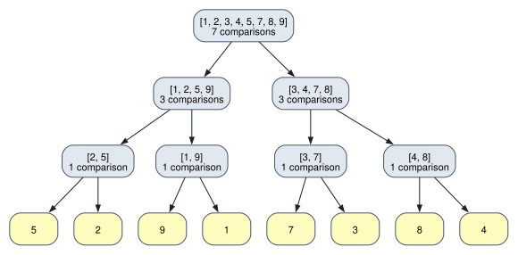

<!-- SPDX-License-Identifier: CC-BY-4.0 -->
<!-- Copyright (c) 2026 Martin Schröder <info@swedishembedded.com> -->

# Algorithms, Cost and Complexity

*How do we predict how long a computation will take and how much memory it needs before we run it?*

## The problem

A training set is a long list of token ids, and before it is used someone has to check it. One check is easy to state: *does this list of ids contain a repeat?* A repeated id inside a short window can mean a corrupted sample, a duplicated line in a document, or a degenerate generation. The question has a perfectly clear answer, and there is more than one way to compute it.

Here is a list of twelve ids. Three programs answer the question: one compares every id with every later one, one sorts the list and compares neighbours, one remembers each id in a hash table as it goes. All three find a repeated id; the table counts the elementary steps each took.

<!-- worked: algorithms.duplicates_small -->
The list, in order, has n = 12 ids: [4021, 87, 15032, 9, 87, 311, 40022, 7, 311, 12, 6, 15032]. The ids that occur twice are [87, 311, 15032]. The methods may report different repeated ids because they visit the list in different orders; each reported id really is repeated. The hash table has m = 32 buckets (2n = 24 rounded up to a power of two) and the hash of the chapter; the all-pairs count is the number of pairs (i, j) with i < j visited up to and including the first equal pair. The sort count is the element comparisons of the chapter's merge sort of the whole list (30) plus the neighbour tests in the sorted list up to and including the first equal pair (5 here, not all n - 1 = 11). The hash count is one hash evaluation per lookup, plus the key comparisons along the chain, and the loop stops when a lookup finds the id; an insertion costs one more evaluation and no comparison.

| method | reports | operations counted | what is counted |
|---|---|---:|---|
| compare all pairs | 87 | 14 | stops at the first equal pair it meets |
| sort, then compare neighbours | 87 | 35 | merge sort comparisons plus neighbour tests up to the first equal pair |
| remember ids in a hash table | 87 | 10 | hash evaluations plus key comparisons; stops at the first repeat |
<!-- /worked -->

The counts differ, but on twelve ids nobody would care which method was used. The question is what happens when the list has a million ids, or a billion. To find out without waiting, we run the same three programs on lists of $n$ distinct ids, for $n$ doubling from $16$ to $4096$, and count their steps. The lists have no repeat, so no method can stop early: this is the longest each one can run.

<!-- worked: algorithms.duplicates_growth -->
Operations counted on n distinct token ids (no repeat, so no method can stop early). The ids: 50,000 possible values 0 to 49999; one list of 4,096 distinct ids is made by calling `integer(50000)` repeatedly and discarding any value already drawn, and the list for n is its first n ids. Generator: the book's SplitMix64, seed 0x8e881ca7c8138b1e (the seed of the name `algorithms.duplicates_growth`). All pairs counts one comparison per pair (i, j), i < j. Sort counts the element comparisons of the merge sort of the chapter (a merge compares only while both halves are non-empty) plus the n - 1 tests of neighbours in the sorted list. The hash set has m buckets, the smallest power of two that is at least 2n (exactly 2n here, because n is a power of two), chaining and the multiplicative hash; for each id it evaluates the hash once for the lookup, compares the id with every entry of that bucket's chain, and evaluates the hash once more to insert, which costs no comparison. The count is hash evaluations plus key comparisons.

| n | all pairs: comparisons | sort: comparisons | hash set: evaluations + comparisons |
|---|---:|---:|---:|
| 16 | 120 | 64 | 34 |
| 32 | 496 | 157 | 72 |
| 64 | 2,016 | 376 | 142 |
| 128 | 8,128 | 868 | 295 |
| 256 | 32,640 | 1,986 | 588 |
| 512 | 130,816 | 4,490 | 1,161 |
| 1,024 | 523,776 | 9,984 | 2,333 |
| 2,048 | 2,096,128 | 22,029 | 4,580 |
| 4,096 | 8,386,560 | 48,129 | 9,053 |
<!-- /worked -->

Each time $n$ doubles, the first column of counts is multiplied by about $4$, the second by a little more than $2$ and the third by about $2$. At $n = 4096$ comparing all pairs takes about $174$ times as many steps as sorting and about $930$ times as many as hashing, and the gap widens with every doubling. On log-log axes (a power law $n^p$ is a straight line of slope $p$ there, because $\log n^p = p \log n$) the same counts look like this:


Nothing about the machine decided that; it is a property of the three *procedures*. This chapter is about learning to read such a property off a procedure before running it: to say how many steps it takes as a function of the size of its input, how much memory it needs, and what that implies for the sizes it can handle at all.

This is the tool for a question every later volume asks: will it fit, and will it finish? A matrix product, a Fourier transform and a sort are all procedures with a cost, and Chapters 4 and 14 already counted two of them informally. Here the counting becomes a method, and we use it to study the building blocks that every machine learning system is made of: reductions, prefix sums, sorting and hashing.

## Before you begin

Six questions on ideas from earlier chapters, to answer from memory. The answers are at the end of the chapter.

1. (Chapter 1, summation notation.) Write $\sum_{i=0}^{n-1} i$ in closed form. Evaluate it for $n = 5$ by adding and by the formula.
2. (Chapter 1, logarithms.) How many times can you halve $1024$ before you reach $1$? How does that number relate to $\log_2 1024$? What is $\log_2 10^6$, roughly?
3. (Chapter 2, functions.) For $f(n) = n^2$ and $g(n) = 3n$, compute $f(2n)/f(n)$ and $g(2n)/g(n)$. What does each say about what doubling the input does to the output?
4. (Chapter 4, matrices as linear maps.) How many multiply-adds does the product of an $[m, k]$ and a $[k, n]$ matrix take? How does that scale with $n$ when all three sizes equal $n$?
5. (Chapter 5, tensors and memory.) How many bytes does an array of shape $[1000, 1000]$ of 32-bit numbers occupy?
6. (Chapter 15, floating point.) Is $(a + b) + c = a + (b + c)$ in floating-point arithmetic? What did the chapter's pairwise summation use that fact for?

## What an algorithm is

The three duplicate checkers above are instances of one idea, and we should define it before measuring it.

An **algorithm** is a finite list of definite steps that turns any input of a stated kind into an output of a stated kind. Each word of that definition carries a requirement:

- *Finite.* It always stops, after a number of steps that is bounded for each input.
- *Definite.* Each step is unambiguous and is something the machine can do with the operations it has: compare two numbers, add two numbers, read or write one cell of an array, jump back.
- *Input and output stated.* There is a precondition on what may be given and a postcondition on what must come out, so that "correct" has a meaning. The `require` lines of the book's pseudocode are the precondition.

A recipe that says "stir until it looks right" is not an algorithm; a loop with a stopping rule is. The book's pseudocode (see [Pseudocode Conventions](../pseudocode.md)) is a notation for writing algorithms down without committing to a machine.

**Correctness by an invariant.** How do we know that an algorithm does what its postcondition says, for every input and not just the ones we tried? The standard argument is an **invariant**: a statement about the state of the algorithm that is true before the loop starts, stays true after every pass, and implies the postcondition when the loop ends. It is induction (Chapter 1) on the number of passes.

Take the simplest reduction, the maximum of a list `x` of length $n \ge 1$.

```text
function maximum(x: array<real>[N]) -> real:
    require N > 0, "the maximum of nothing is undefined"
    m = x[0]
    for i in 1 .. N:
        if x[i] > m:
            m = x[i]
    return m
```

The invariant is: *after the pass for index $i$, `m` equals $\max(x_0, \dots, x_i)$.* Before the loop it holds for $i = 0$ because `m = x[0]`. If it holds after pass $i - 1$, then pass $i$ either leaves `m` alone because $x_i \le m$, which is the maximum of the first $i + 1$ elements, or replaces it with $x_i$, which is larger than everything before it; either way the invariant holds after pass $i$. When the loop ends $i = n - 1$ and the invariant says `m` is the maximum of the whole list. The loop runs exactly $n - 1$ times, so the algorithm is finite. Here is the invariant checked, step by step, on a list of five:

<!-- worked: algorithms.invariant_max -->
Maximum of x = [3, 7, 2, 9, 4], checking the invariant after every step.

| step | elements examined | m | x[0 .. examined] | m = max of examined? |
|---|---:|---:|---|---:|
| start | 1 | 3 | [3] | True |
| after i = 1 | 2 | 7 | [3, 7] | True |
| after i = 2 | 3 | 7 | [3, 7, 2] | True |
| after i = 3 | 4 | 9 | [3, 7, 2, 9] | True |
| after i = 4 | 5 | 9 | [3, 7, 2, 9, 4] | True |
<!-- /worked -->

Every algorithm in this chapter has such an invariant, and we will state it for each one. It is also the best way to find a bug: when an implementation is wrong, some pass breaks the invariant, and the first pass where the invariant fails is where to look.

## Counting operations

**Why count.** Time on a real machine depends on the machine, the language, what else is running and the state of its caches. A count of elementary operations depends on none of these, and it predicts how the time *grows* with the size of the input, which is the part we need before running anything. We fix a **cost model**: a list of the operations we count and agree to treat each as one unit. For the duplicate checkers the unit is an element comparison (plus a hash evaluation for the hash set). For numerical code it is usually a multiply-add, as in Chapter 4.

**A count is a function of the input size.** For an input of size $n$ the algorithm performs $T(n)$ steps in the worst case, the largest over all inputs of that size. Counting is a summation (Chapter 1), and the all-pairs method shows it. The outer index $i$ runs over $0, \dots, n-1$ and the inner index $j$ over $i + 1, \dots, n - 1$, one comparison for each pair:

$$
T_{\text{pairs}}(n) = \sum_{i=0}^{n-1} (n - 1 - i) = (n-1) + (n-2) + \dots + 1 + 0 = \frac{n(n-1)}{2}.
$$

The last step is the closed form you recalled in Before you begin: the sum of the first $n - 1$ whole numbers. For $n = 4096$ it is $4096 \cdot 4095 / 2 = 8{,}386{,}560$, exactly the entry of the growth table. The instrumented program counted every comparison, and the formula agrees with it.

**The dominant term.** Real counts have several parts. A dense layer with $n$ inputs and $n$ outputs, $\mathbf{y} = \max(0, \mathbf{W}\mathbf{x} + \mathbf{b})$ with $\mathbf{W}$ of shape $[n, n]$, performs $n^2$ multiply-adds for the matrix-vector product (Chapter 4), $n$ additions for the bias and $n$ evaluations of the maximum: in total $n^2 + 2n$. The table counts these inside the loops and divides:

<!-- worked: algorithms.dominant_term -->
One dense layer with n inputs and n outputs, operations counted inside the loops.

| n | multiply-adds | bias adds + activations | total | share of the n^2 term |
|---|---:|---:|---:|---:|
| 4 | 16 | 8 | 24 | 66.6667% |
| 16 | 256 | 32 | 288 | 88.8889% |
| 64 | 4,096 | 128 | 4,224 | 96.9697% |
| 256 | 65,536 | 512 | 66,048 | 99.2248% |
| 1,024 | 1,048,576 | 2,048 | 1,050,624 | 99.8051% |
<!-- /worked -->

By $n = 1024$ the $n^2$ term is $99.8$ percent of the total and the rest does not change what we would conclude. The **dominant term** is the part of a count that outgrows all the others, and for large $n$ it is the only part that matters. Constants matter too, but differently: halving the work of every step makes a program twice as fast at every size, while changing the *shape* of the count, from $n^2$ to $n \log n$, changes what sizes are possible. We want a notation that keeps the shape and discards the rest.

## Asymptotic notation

Look at the counts again. The all-pairs count is $\tfrac12 n^2 - \tfrac12 n$. The sorted-neighbours count is, on random lists, about $n \log_2 n$ minus a multiple of $n$. The hash count is about $2.2\,n$. We say that the three are of order $n^2$, $n \log n$ and $n$. Here is the definition that makes "of order" precise.

**Definition.** For functions $T, f : \mathbb{N} \to \mathbb{R}_{\ge 0}$:

- $T(n) = O(f(n))$ if there are constants $c > 0$ and $n_0$ such that $T(n) \le c\, f(n)$ for all $n \ge n_0$. ($f$ is an upper bound up to a constant.)
- $T(n) = \Omega(f(n))$ if there are constants $c > 0$ and $n_0$ such that $T(n) \ge c\, f(n)$ for all $n \ge n_0$. (A lower bound up to a constant.)
- $T(n) = \Theta(f(n))$ if both hold: $c_1 f(n) \le T(n) \le c_2 f(n)$ for all $n \ge n_0$. ($T$ is *squeezed* between two multiples of $f$.)

The equals sign is a historical habit; read "$T$ is in the family $O(f)$". The constants $c$ and $n_0$ are called *witnesses*, and a claim is proved by exhibiting them. For the all-pairs count, $T(n) = \tfrac{n(n-1)}{2} \le \tfrac12 n^2$ for every $n \ge 1$, so $c = \tfrac12$, $n_0 = 1$ prove $T = O(n^2)$. For the lower side, $\tfrac{n(n-1)}{2} \ge \tfrac{1}{4} n^2$ once $n \ge 2$, because $n - 1 \ge n/2$ there; so $c_1 = \tfrac14$, $n_0 = 2$ prove $T = \Omega(n^2)$ and hence $T = \Theta(n^2)$.

**Checking a claim on the tables.** The definition says the ratio $T(n)/f(n)$ stays between two positive constants. That is a statement we can read off the counted data: divide each count by the candidate growth rate and look at the column.

<!-- worked: algorithms.asymptotic_ratios -->
Each count divided by the candidate growth rate. A column that stays between two positive constants shows that the candidate fits.

| n | pairs / n^2 | sort / (n log2 n) | hash / n |
|---|---:|---:|---:|
| 16 | 0.4688 | 1.0000 | 2.1250 |
| 32 | 0.4844 | 0.9812 | 2.2500 |
| 64 | 0.4922 | 0.9792 | 2.2188 |
| 128 | 0.4961 | 0.9688 | 2.3047 |
| 256 | 0.4980 | 0.9697 | 2.2969 |
| 512 | 0.4990 | 0.9744 | 2.2676 |
| 1,024 | 0.4995 | 0.9750 | 2.2783 |
| 2,048 | 0.4998 | 0.9778 | 2.2363 |
| 4,096 | 0.4999 | 0.9792 | 2.2102 |
| smallest ratio | 0.4688 | 0.9688 | 2.1250 |
| largest ratio | 0.4999 | 1.0000 | 2.3047 |
<!-- /worked -->

The first column approaches $0.5$ from below, and its smallest entry (at $n = 16$) is $0.4688$; the witnesses $c_1 = 0.46$, $c_2 = 0.5$, $n_0 = 16$ work for the whole table, which is consistent with $\Theta(n^2)$. The second column stays between $0.96$ and $1.00$, so the sorting method is consistent with $\Theta(n \log n)$; the third stays between $2.1$ and $2.3$, consistent with $\Theta(n)$. A table is evidence, not a proof, because it covers only finitely many $n$: the proof is the algebra above for the pairs, and the analysis of merge sort below. But a column that is not flat rules a candidate out, and that is the useful direction. Dividing the same counts by the wrong rates shows what a failing fit looks like:

<!-- worked: algorithms.wrong_fits -->
| n | pairs / n | pairs / n^3 | sort / n | sort / n^2 |
|---|---:|---:|---:|---:|
| 16 | 7.5 | 0.02930 | 4.00 | 0.25000 |
| 64 | 31.5 | 0.00769 | 5.88 | 0.09180 |
| 256 | 127.5 | 0.00195 | 7.76 | 0.03030 |
| 1,024 | 511.5 | 0.00049 | 9.75 | 0.00952 |
| 4,096 | 2047.5 | 0.00012 | 11.75 | 0.00287 |
<!-- /worked -->

The count over $n$ grows without bound, so $n$ is too slow a rate for the pairs; the count over $n^3$ shrinks toward zero, so $n^3$ is too fast. Only the right rate gives a flat column. The same holds for the sorting counts against $n$ (growing) and $n^2$ (shrinking).

**Four facts used constantly.**

1. *Constants and lower-order terms vanish.* $3n^2 + 5n + 7 = \Theta(n^2)$: for $n \ge 1$ the whole is at most $15 n^2$ and at least $3 n^2$.
2. *Logarithm bases do not matter.* $\log_2 n = \log_{10} n / \log_{10} 2$ differs from $\log_{10} n$ by a constant factor, so $O(\log n)$ needs no base.
3. *Sums and products.* Doing a step of cost $O(f)$ and then one of cost $O(g)$ costs $O(f + g)$, which is the larger of the two. Repeating a step of cost $O(f)$ a number of times $O(g)$ costs $O(f \cdot g)$.
4. *Upper bounds are not claims about every input.* $O$ says nothing about a particular input. Insertion sort on an already sorted list takes $n - 1$ comparisons although its worst case is $\Theta(n^2)$. We therefore always say which case we mean: the **worst case** (the largest over all inputs of size $n$), or the **average case** (over a stated distribution of inputs, such as all orderings equally likely).

The word **asymptotic complexity** names the growth rate of the cost as the input size grows, $\Theta(f)$ or $O(f)$ for the cost of the best known way to do a task. Complexity says how an algorithm *scales*; it does not say which of two algorithms is faster at a given $n$. A $\Theta(n)$ method with a large constant can lose to a $\Theta(n^2)$ method with a small one for every $n$ below a crossover. That is why the chapter measured as well as classified.

## How fast is "fast": growth rates

Which growth rates occur, and what do they allow? Here are the usual ones, evaluated at four sizes:

<!-- worked: algorithms.growth_values -->
| n | log2 n | n | n log2 n | n^2 | n^3 | 2^n |
|---|---:|---:|---:|---:|---:|---:|
| 10 | 3.3 | 10.0 | 33.2 | 100 | 1,000 | 1,024 |
| 20 | 4.3 | 20.0 | 86.4 | 400 | 8,000 | 1,048,576 |
| 40 | 5.3 | 40.0 | 213 | 1,600 | 64,000 | 1.10e+12 |
| 80 | 6.3 | 80.0 | 506 | 6,400 | 512,000 | 1.21e+24 |
<!-- /worked -->

Between $n = 10$ and $n = 80$ the logarithm moves from $3.3$ to $6.3$, the linear cost grows eightfold, the quadratic sixty-four-fold, the cubic five hundred and twelve-fold, and $2^n$ goes from a thousand to a number with twenty-five digits. To say what these mean in time we need a rate. We take, as an **assumption** to make the table concrete, that the machine performs $10^9$ simple operations per second; real machines are faster or slower by factors that depend on the operation and on memory, but the conclusions below survive a factor of a hundred either way. The largest $n$ that fits in a budget is the $n$ at which the cost reaches the number of operations the budget allows:

<!-- worked: algorithms.growth_budget -->
| cost | largest n in 1 second | in 1 hour | in 1 day |
|---|---:|---:|---:|
| n | 1,000,000,000 | 3.60e+12 | 8.64e+13 |
| n log2 n | 39,620,077 | 98,574,774,544 | 2.11e+12 |
| n^2 | 31,622 | 1,897,366 | 9,295,160 |
| n^3 | 1,000 | 15,326 | 44,208 |
| 2^n | 29 | 41 | 46 |

Time for 2^n operations at the same rate:

| n | time |
|---|---:|
| n = 30 | 1.07 seconds |
| n = 50 | 13 days |
| n = 70 | 3.74e+04 years |
| n = 100 | 4.02e+13 years |
<!-- /worked -->

A linear algorithm handles $10^9$ items in a second. A $\Theta(n \log n)$ algorithm handles about forty million. A quadratic one stops near $3 \times 10^4$ items: this is why all-pairs duplicate detection is hopeless on a corpus. A cubic algorithm stops near $1000$, which is why matrix products of large matrices are the thing that must be done on dedicated hardware (Chapter 4: $n^3$ multiply-adds). And an exponential algorithm stops at $29$: adding *one* element to the input doubles its running time, so a day of computation buys seventeen extra elements over a second. No hardware improvement changes that picture.

Two costs from earlier chapters are now exact. The product of an $[m, k]$ and a $[k, n]$ matrix takes $mkn$ multiply-adds, which for three sizes equal to $n$ is $\Theta(n^3)$. The discrete Fourier transform of Chapter 14, by its definition, takes $n^2$ complex multiplications, and the fast Fourier transform takes $\tfrac n2 \log_2 n$:

<!-- worked: algorithms.known_costs -->
| n | DFT multiplications n^2 | FFT multiplications (n/2) log2 n | ratio | matrix-vector multiply-adds n^2 | matrix-matrix multiply-adds n^3 |
|---|---:|---:|---:|---:|---:|
| 1,024 | 1,048,576 | 5,120 | 205 | 1,048,576 | 1,073,741,824 |
| 4,096 | 16,777,216 | 24,576 | 683 | 16,777,216 | 68,719,476,736 |
<!-- /worked -->

The fast transform turns a $\Theta(n^2)$ task into a $\Theta(n \log n)$ one. At $n = 4096$ it does the work of $16.8$ million multiplications with $24{,}576$ of them. That is the reason the Fourier transform exists as an algorithm and not only as a formula, and the reason Chapter 14's convolution theorem was worth stating.

## Memory complexity

Time is half the cost. A computation also needs space: the numbers it must keep. The **memory complexity** of an algorithm is the amount of memory it needs as a function of the input size, counted in the same style as time, in cells (elements) and usually *extra* cells beyond the input and output. It is measured at the peak, the largest amount held at the same moment, because a machine must have that much at that instant.

The three duplicate checkers differ in memory as sharply as in time. Comparing all pairs keeps a few loop variables, $O(1)$. Merge sort needs a second array of the size of the input to merge into, $\Theta(n)$ extra cells. The hash set keeps a table twice as large as the number of items and the items themselves, again $\Theta(n)$:

<!-- worked: algorithms.duplicates_memory -->
| n | all pairs: extra cells | merge sort: extra cells | hash set: extra cells |
|---|---:|---:|---:|
| 16 | O(1): 3 variables | 16 | 48 |
| 256 | O(1): 3 variables | 256 | 768 |
| 4,096 | O(1): 3 variables | 4,096 | 12,288 |
<!-- /worked -->

So the slowest method is the leanest. That is the first example of a **time-memory tradeoff**, a choice that recurs through the whole book: spend memory to remember a result so that it need not be computed again, or spend time to recompute it so that it need not be kept. The hash method buys speed with memory. A larger example, and the most important one for training neural networks, runs the other way.

**Store or recompute.** Think of a chain of $L$ layers, each computing a new array from the previous one: $a_i = f_i(a_{i-1})$ for $i = 1, \dots, L$, starting from an input $a_0$. Volume III will show that training must walk the chain *backwards*, and that the backward step of layer $i$ needs the value $a_{i-1}$ which the forward pass produced. The plain way keeps every $a_i$ from the forward pass until the backward pass needs it: the peak memory is $L$ arrays and the cost is $L$ layer evaluations. The other extreme keeps only the input and recomputes whatever the backward step needs from scratch: almost no memory and about $L^2/2$ evaluations.

In between there is a dial, the stride $s$: keep every $s$-th array during the forward pass, and when the backward pass enters a segment of $s$ layers, recompute that segment's arrays from its checkpoint, use them, and drop them. We can simulate this and count. The simulation stores sets of array indices, records the peak size and counts every layer evaluation, forward and recomputed:

<!-- worked: algorithms.checkpoint_tradeoff -->
A chain of 64 layers a_1 ... a_64, input a_0. Stride s keeps the checkpoints a_0, a_s, a_2s, ... during the forward pass (the output a_64 is never stored); entering a segment of the backward pass the arrays between its checkpoint and the next are recomputed from the checkpoint, and the segment's arrays, checkpoint included, are dropped when its backward step is finished. The last segment is shorter when s does not divide 64. The peak counts the arrays held at the same moment, a_0 included.

| stride s | peak stored activations | layer evaluations | relative to a plain forward pass |
|---|---:|---:|---:|
| 1 | 64 | 64 | 1.00 |
| 2 | 33 | 96 | 1.50 |
| 4 | 19 | 112 | 1.75 |
| 6 | 15 | 117 | 1.83 |
| 8 | 15 | 120 | 1.88 |
| 16 | 19 | 124 | 1.94 |
| 32 | 33 | 126 | 1.97 |
| 64 | 64 | 127 | 1.98 |

Over every stride from 1 to 64, the smallest peak is 15 stored activations, first reached at s = 6.
<!-- /worked -->

With every array kept ($s = 1$) the peak is $64$ arrays at $64$ evaluations. At $s = 8 = \sqrt{64}$, the peak falls to $15$ arrays, about a quarter, at the price of $120$ evaluations: fewer than twice the work of a plain forward pass. The reason is visible in the count: the peak is at most $\lceil L/s \rceil + s - 1$: the checkpoints held when the backward pass reaches the segment (a checkpoint is dropped when its segment is finished, so the last segments hold fewer) plus the $s - 1$ arrays recomputed inside it (the segment's checkpoint is already stored). For $s = 8$ that is $8 + 7 = 15$, the entry of the table. The bound $\lceil L/s \rceil + s - 1$ is smallest when $s \approx \sqrt L$, at about $2\sqrt L - 1$ arrays; for $s = 6$ the last segment is shorter ($64 = 10 \cdot 6 + 4$) and the peak is $15$ as well, one below the bound $\lceil 64/6 \rceil + 5 = 16$. Memory for a deep chain has fallen from $\Theta(L)$ to $\Theta(\sqrt L)$ for a constant factor of at most two in time. Beyond $\sqrt L$ the peak rises again, because the segment being recomputed becomes the larger part. Volume III's treatment of backpropagation shows which arrays the backward pass needs, and Volume XIII's treatment of training at scale builds this dial into a training run; both are applications of the tradeoff counted here.

## Reductions

The most common algorithm in machine learning is also the simplest: take a long list and combine it into one number. A sum, a maximum, the position of a maximum, a product of probabilities. Each of them has the same shape, and the shape is worth naming.

**Folding.** Given a list $x_0, \dots, x_{n-1}$ and a binary operation $\oplus$ (a rule that combines two values of the list's type into one), the *left fold* is

$$
\big(\cdots\big((x_0 \oplus x_1) \oplus x_2\big) \oplus \cdots \big) \oplus x_{n-1}.
$$

A **reduction algorithm** is an algorithm that combines the $n$ elements of an array into one value by repeated application of one binary operation. It performs $n - 1$ applications of $\oplus$, a cost of $\Theta(n)$ time, and keeps $O(1)$ extra memory: the running value. Sum is $\oplus = +$ (starting from the first element); maximum is $\oplus = \max$; the maximum's *position* uses pairs, $(x_i, i)$, with the operation "keep the pair with the larger value, and on a tie keep the smaller index":

```text
function argmax_combine(a: (real, int), b: (real, int)) -> (real, int):
    if b[0] > a[0]:
        return b
    return a              # on a tie, a came first in the list
```

This is the algorithm behind greedy decoding in Volume V: the next token is the index of the largest logit.

**Why associativity matters.** A left fold fixes one order of evaluation, strictly sequential: every step waits for the one before it, $n - 1$ steps deep. But the answer of a fold does not have to be computed that way, *if* the operation is **associative**: $(a \oplus b) \oplus c = a \oplus (b \oplus c)$ for all values (Chapter 4 met this for matrices). With associativity the parentheses can be placed anywhere. In particular they can group neighbours in pairs, then pairs of pairs, in layers: a *tree*. A tree of $n$ leaves has $\lceil \log_2 n \rceil$ layers, and all the combinations inside one layer are independent of one another:

<!-- worked: algorithms.tree_depth -->
| n | left-to-right steps in sequence | tree layers | additions in the tree |
|---|---:|---:|---:|
| 8 | 7 | 3 | 7 |
| 1,000 | 999 | 10 | 999 |
| 1,024 | 1,023 | 10 | 1,023 |
| 1,000,000 | 999,999 | 20 | 999,999 |
| 1,048,576 | 1,048,575 | 20 | 1,048,575 |
<!-- /worked -->

The total number of combinations is the same, $n - 1$, but the longest chain of *dependent* combinations falls from $n - 1$ to $\lceil \log_2 n \rceil$: from a million steps in sequence to twenty. This is the idea behind the parallel reductions of Volume IV, where many processors each take a part of every layer; we only record here that it works if and only if the operation allows the regrouping. The sum, the maximum and the argmax pair operation above are all associative on exact values, so they give the same result however they are grouped. Subtraction is not associative, and regrouping it changes the answer. The table at the end of this section shows both.

**The floating-point catch.** Floating-point addition is *not* associative (Chapter 15: $(0.1 + 0.2) + 0.3 \ne 0.1 + (0.2 + 0.3)$). Each addition rounds, and different groupings round different intermediate sums. So the tree reduction of a floating-point sum is a different computation from the left fold: not wrong, but different, and the two give different 32-bit answers. The table sums 4096 signed 32-bit numbers of mixed magnitude in four orders; the "exact" value is the sum of the stored numbers computed in exact rational arithmetic.

<!-- worked: algorithms.reduction_orders -->
Sum of 4096 signed 32-bit numbers of mixed magnitude (exact value of the stored numbers: 18471.4975). Generator: the book's SplitMix64, seed 0xbb9d131a4996afad (the seed of the name `algorithms.reduction_orders`). Each number draws a = `uniform()` then k = `integer(7)` and is f32((2a - 1) * 10^(k - 3)); the 1024 integers that follow, from the same generator, are `integer(2001)` - 1000. The orders: left to right; the tree of the chapter (adjacent pairs layer by layer, an odd last element carried up); L interleaved lanes, meaning lane j (0 <= j < L) adds the elements j, j + L, j + 2L, ... left to right and the L lane totals are then added left to right. Every addition is rounded to 32 bits. The relative error is against the exact rational sum.

| order | 32-bit sum | relative error |
|---|---:|---:|
| left to right | 18471.5156 | 9.83e-07 |
| tree (pairs, layer by layer) | 18471.4961 | 7.43e-08 |
| 4 interleaved lanes | 18471.4883 | 4.97e-07 |
| 32 interleaved lanes | 18471.4922 | 2.86e-07 |

The same orders (left to right, tree, 32 lanes) on 1024 integers in [-1000, 1000] and on an operator that is not associative:

| reduction | orders tried | distinct results |
|---|---:|---:|
| integer sum | 3 | 1 |
| max | 3 | 1 |
| (max, index) with ties to the smaller index | 3 | 1 |
| subtraction on [10, 3, 2, 1]: left to right, tree | 2 | 2 |

Subtraction gives 4 left to right and 6 as a tree.
The largest integer is 1000; it occurs 2 times, and every order reports the first occurrence, at index 6.
<!-- /worked -->

All four answers are within the error bound of Chapter 15, but they are not equal, and in this run the tree is the closest to the exact value (its bound is $\lceil \log_2 n \rceil u$ against $(n-1)u$: Chapter 15's pairwise summation is exactly this tree). Integer sums, maxima and the argmax pair do not round, and give one result however grouped; subtraction gives $4$ left to right and $6$ as a tree because it is not associative at all. The consequence, to carry forward: *a reduction that is reordered for speed changes the low digits of a floating-point sum.* Two runs of a parallel program that reduce in different orders can differ in their last digits, and a test that expects bit-for-bit equality across such runs is a test of the order and not of the arithmetic. Volume IV returns to this, and Volume XIII makes it a requirement (determinism) for training.

## Prefix sums

Sometimes we need not only the total but every partial total. The **prefix sum** (also called a *scan*) of $x_0, \dots, x_{n-1}$ is the list of running totals. There are two conventions, and both are in use:

- the **inclusive scan**: $y_i = x_0 + x_1 + \dots + x_i$, which includes the element at $i$;
- the **exclusive scan**: $y_i = x_0 + \dots + x_{i-1}$, with $y_0 = 0$, which stops just before $i$.

The exclusive scan is the inclusive scan shifted right by one place. Both generalize to any associative $\oplus$, but the sum is the case we need.

<!-- worked: algorithms.scan_basics -->
|  | i=0 | i=1 | i=2 | i=3 | i=4 | i=5 | i=6 | i=7 |
|---|---:|---:|---:|---:|---:|---:|---:|---:|
| x | 3 | 1 | 4 | 1 | 5 | 9 | 2 | 6 |
| inclusive scan | 3 | 4 | 8 | 9 | 14 | 23 | 25 | 31 |
| exclusive scan | 0 | 3 | 4 | 8 | 9 | 14 | 23 | 25 |

The doubling scan: each round adds the element `offset` places to the left, all at once.

| after | i=0 | i=1 | i=2 | i=3 | i=4 | i=5 | i=6 | i=7 | additions |
|---|---:|---:|---:|---:|---:|---:|---:|---:|---:|
| offset 1 | 3 | 4 | 5 | 5 | 6 | 14 | 11 | 8 | 7 |
| offset 2 | 3 | 4 | 8 | 9 | 11 | 19 | 17 | 22 | 6 |
| offset 4 | 3 | 4 | 8 | 9 | 14 | 23 | 25 | 31 | 4 |

Total additions: 17 in 3 rounds, against 7 additions in 7 sequential steps for the left-to-right scan.
<!-- /worked -->

The sequential algorithm is one pass with one running total, $n - 1$ additions. Its invariant: after step $i$ the running total is $x_0 + \dots + x_i$ and $y_i$ has been written. The second table above is a different algorithm that gives the same answer: in round $k$ every position $i$ adds the value that was $2^k$ places to its left, all positions at once. After rounds with offsets $1, 2, 4$, position $i$ has accumulated every element within $1 + 2 + 4 = 7$ places to its left, so with eight elements three rounds suffice: $\lceil \log_2 n \rceil$ rounds, each of which has no dependency inside it. The price is more work, $17$ additions instead of $7$: the same total is bought in fewer sequential steps at the cost of doing more additions in all. The picture follows the arrows:


Work against depth is the pattern that Volume IV develops for parallel scans, with schemes that do less work than the doubling form. A scan that is *blocked* is already within reach, and it is what a processor with limited sharing between its parts does: scan each block of a fixed size independently, scan the list of block totals, then add each block's offset back into its block.

<!-- worked: algorithms.block_scan -->
The array has 16 elements and the block size is 4, so there are 4 blocks; when the length is not a multiple of the block size the last block is shorter and is scanned in the same way.

| block | input | 1: scan inside the block | block total | 2: scan of totals | 3: add it back |
|---|---|---|---:|---:|---|
| 0 | [2, 7, 1, 8] | [0, 2, 9, 10] | 18 | 0 | [0, 2, 9, 10] |
| 1 | [2, 8, 1, 8] | [0, 2, 10, 11] | 19 | 18 | [18, 20, 28, 29] |
| 2 | [2, 8, 4, 5] | [0, 2, 10, 14] | 19 | 37 | [37, 39, 47, 51] |
| 3 | [9, 0, 4, 5] | [0, 9, 9, 13] | 18 | 56 | [56, 65, 65, 69] |

Concatenated, the last column is [0, 2, 9, 10, 18, 20, 28, 29, 37, 39, 47, 51, 56, 65, 65, 69], the exclusive scan of the whole array.
<!-- /worked -->

The three phases give exactly the exclusive scan of the whole array. Phase two is itself a scan, on a list $1/4$ as long, so the scheme applies recursively until the list of totals fits in one block.

**Use 1: sampling a token.** Chapter 10's sampler laid the probabilities end to end on $[0, 1)$ and walked along them until the drawn number $u$ was passed. The walk is a prefix sum in disguise. Compute the inclusive scan of the probabilities, the *cumulative distribution* $F_i = p_0 + \dots + p_i$, once; a draw is then the first index $i$ with $F_i > u$. Because $F$ is non-decreasing it can be searched by halving the range each time: a binary search takes at most $\lceil \log_2 K \rceil$ steps, $K$ the number of tokens, instead of up to $K$ (the table counts the steps of the exact rule it states). The scan costs $\Theta(K)$ once and each further draw from the same distribution costs $\Theta(\log K)$.

<!-- worked: algorithms.scan_cdf -->
| token | probability | cumulative (inclusive scan) |
|---|---:|---:|
| token 0 | 0.10 | 0.10 |
| token 1 | 0.35 | 0.45 |
| token 2 | 0.05 | 0.50 |
| token 3 | 0.25 | 0.75 |
| token 4 | 0.15 | 0.90 |
| token 5 | 0.10 | 1.00 |

Binary search for the first index i with F_i > u. The search interval [lo, hi] starts as [0, K - 1] with K = 6 (the last index always qualifies, because F_(K-1) = 1 > u). One step is one pass of the loop "while lo < hi": mid = (lo + hi) // 2; if F_mid > u then hi = mid, else lo = mid + 1. The answer is lo when the loop ends, and the table counts the passes.

| u | token drawn | binary-search steps |
|---|---:|---:|
| 0.02 | 0 | 3 |
| 0.12 | 1 | 3 |
| 0.50 | 3 | 3 |
| 0.70 | 3 | 3 |
| 0.97 | 5 | 2 |

20,000 draws, each `uniform()` from the book's SplitMix64 with seed 0x2409684ba20f2fb6, taken in order:

| token | probability | draws | frequency |
|---|---:|---:|---:|
| token 0 | 0.10 | 1,946 | 0.0973 |
| token 1 | 0.35 | 7,019 | 0.3509 |
| token 2 | 0.05 | 1,014 | 0.0507 |
| token 3 | 0.25 | 5,084 | 0.2542 |
| token 4 | 0.15 | 2,977 | 0.1489 |
| token 5 | 0.10 | 1,960 | 0.0980 |
<!-- /worked -->

The frequencies of the $20{,}000$ draws match the probabilities to about the sampling error (a standard deviation of about $0.003$ for a probability of $0.25$). When the draws come from a distribution of tens of thousands of tokens, the saving of a logarithm is real; it is also why top-p sampling in Volume V, which needs the cumulative sum of the sorted probabilities, is a scan.

**Use 2: packing variable-length sequences.** A batch of sequences of different lengths is wasteful to store as a rectangle padded to the longest sequence. Pack them end to end instead, in one array, and keep for each sequence its *offset*, where it starts. The offset of sequence $s$ is the sum of the lengths of the sequences before it: an exclusive scan of the lengths. The last inclusive sum is the total size of the buffer.

<!-- worked: algorithms.scan_offsets -->
| sequence | length | offset (exclusive scan) | end |
|---|---:|---:|---:|
| 0 | 5 | 0 | 5 |
| 1 | 3 | 5 | 8 |
| 2 | 7 | 8 | 15 |
| 3 | 2 | 15 | 17 |

The packed buffer has 17 slots; slot k holds (sequence.position):

`0.0 0.1 0.2 0.3 0.4 1.0 1.1 1.2 2.0 2.1 2.2 2.3 2.4 2.5 2.6 3.0 3.1`
<!-- /worked -->

Each sequence can now be written to its slot independently, without waiting for the others, because the scan has told it where to go. This use, scan as "where does each item's output start", appears again below in sorting and again in Volume IV's kernels.

## Sorting

**Sorting** is the algorithm that rearranges a list into non-decreasing order, so that $x_0 \le x_1 \le \dots \le x_{n-1}$, with the output a permutation of the input. A sorted list can be searched by halving (the binary search above), the neighbours of a value are adjacent to it, and equal values are next to each other. The duplicate detector used the last property: after sorting, a repeat can only be a neighbour. Sorting is also how the $k$ largest logits are found, how the nucleus of a distribution is selected, and how items are grouped by key.

**Merge sort.** A divide-and-conquer algorithm. To sort a list: if it has one element it is sorted; otherwise cut it in two halves, sort each, and *merge* the two sorted halves into one sorted list.

```text
function merge_sort(x: array<int>[N]) -> array<int>[N]:
    if N <= 1:
        return copy(x)
    mid = N // 2                    # integer division, rounded down (docs/book/pseudocode.md)
    left = merge_sort(x[0:mid])
    right = merge_sort(x[mid:N])
    return merge(left, right)

function merge(a: array<int>[P], b: array<int>[Q]) -> array<int>[P + Q]:
    require a is non-decreasing and b is non-decreasing
    out = zeros(int, [P + Q])
    i = 0
    j = 0
    for k in 0 .. P + Q:
        if i < P and (j >= Q or a[i] <= b[j]):     # one comparison of two elements
            out[k] = a[i]
            i = i + 1
        else:
            out[k] = b[j]
            j = j + 1
    return out
```

The operator `//` in `merge_sort` is the integer division of the pseudocode page (`7 // 2` is `3`), so the left half is the smaller one when the length is odd. The invariant of the merge loop: after $k$ steps, `out[0:k]` holds the $k$ smallest elements of `a` and `b` together, in order. The next smallest is the smaller of the two fronts `a[i]` and `b[j]`, because each list is sorted, so the invariant holds after step $k + 1$. The tie rule `a[i] <= b[j]` takes from the left list first, so equal elements keep their input order: the sort is **stable**, a property that radix sort will need.

Each merge of two lists with $P + Q$ elements in all takes at most $P + Q - 1$ comparisons (once one list is exhausted the rest is copied without comparing). The recursion can be drawn as a tree, whose nodes are the sorts of ranges and whose edges are the cut into halves. Here it is for eight numbers, with the result and the comparisons used at every merge:



<!-- worked: algorithms.merge_sort_trace -->
Merges in the order the algorithm performs them (the left half is sorted before the right half).

| merge of the range | result | comparisons |
|---|---|---:|
| [5, 2] | [2, 5] | 1 |
| [9, 1] | [1, 9] | 1 |
| [5, 2, 9, 1] | [1, 2, 5, 9] | 3 |
| [7, 3] | [3, 7] | 1 |
| [8, 4] | [4, 8] | 1 |
| [7, 3, 8, 4] | [3, 4, 7, 8] | 3 |
| [5, 2, 9, 1, 7, 3, 8, 4] | [1, 2, 3, 4, 5, 7, 8, 9] | 7 |

Total: 17 comparisons for n = 8.
<!-- /worked -->

The tree has about $\log_2 n$ levels, because each level halves the range, and the merges on any one level together touch every element once, costing at most $n$ comparisons. So the total is at most $n \log_2 n$ times a constant. Writing it exactly: if $W(n)$ is the worst-case number of comparisons, then

$$
W(1) = 0, \qquad W(n) = W(\lfloor n/2 \rfloor) + W(\lceil n/2 \rceil) + n - 1,
$$

and for $n = 2^k$ unrolling the recursion level by level gives $W(n) = n \log_2 n - n + 1$: level $j$ has $2^j$ merges of lists of size $n / 2^{j+1}$ each costing $n / 2^j - 1$ comparisons, and summing $n - 2^j$ over $j = 0, \dots, k-1$ gives $kn - (2^k - 1)$. For $n = 8$ this is $8 \cdot 3 - 8 + 1 = 17$, and the table above shows $17$ comparisons for this particular list. Merge sort is thus $\Theta(n \log n)$ in the worst case, and, since the merge needs somewhere to put its output, $\Theta(n)$ in memory.

**A lower bound: no comparison sort can do better.** Is $n \log n$ merge sort's weakness, or a limit for the whole task? For algorithms that learn about the order only by comparing two elements at a time, it is a limit, and the argument is short enough to give. Consider sorting three distinct numbers. There are $3! = 6$ possible orderings of the input, and the algorithm must output a different rearrangement for each. Every comparison has two outcomes, so after $d$ comparisons the algorithm can distinguish at most $2^d$ cases: it is a binary *decision tree* of depth $d$ whose leaves are the possible answers. To tell six orderings apart the tree needs at least six leaves, so $2^d \ge 6$ and $d \ge 3$. Merge sort on all six inputs:

<!-- worked: algorithms.decision_tree3 -->
| input order | comparisons used by merge sort |
|---|---:|
| [1, 2, 3] | 2 |
| [1, 3, 2] | 2 |
| [2, 1, 3] | 3 |
| [2, 3, 1] | 3 |
| [3, 1, 2] | 3 |
| [3, 2, 1] | 3 |

Fewest comparisons: 2, most: 3. There are 6 inputs, so a tree of depth 2 (at most 4 leaves) cannot separate them.

| n | orderings n! | log2 n! | ceil(log2 n!) |
|---|---:|---:|---:|
| 2 | 2 | 1.000 | 1 |
| 3 | 6 | 2.585 | 3 |
| 4 | 24 | 4.585 | 5 |
| 5 | 120 | 6.907 | 7 |
| 8 | 40,320 | 15.299 | 16 |
| 16 | 20,922,789,888,000 | 44.250 | 45 |
<!-- /worked -->

Some inputs finish in two comparisons, but the worst takes three: exactly the bound $\lceil \log_2 6 \rceil = 3$. In general there are $n!$ orderings, so a tree for sorting $n$ distinct numbers has at least $n!$ leaves and depth at least $\lceil \log_2 n! \rceil$. Since $n! \ge (n/2)^{n/2}$ (the top half of the factors are each at least $n/2$), $\log_2 n! \ge \tfrac n2 \log_2 \tfrac n2$, which is $\Omega(n \log n)$. Merge sort's worst case $n \log_2 n - n + 1$ sits just above this bound, so it is optimal among comparison sorts up to lower-order terms. Here are the numbers over larger lists: the bound, the mean and worst counts of merge sort, and the quadratic insertion sort (insert each element into the sorted prefix by comparing from the right):

<!-- worked: algorithms.sorting_counts -->
Mean of 20 random permutations per row. The lower bound is the smallest number of comparisons any comparison sort needs in the worst case: ceil(log2 n!). Generator: the book's SplitMix64, seed 0xf521ce7ee9c7800c (the seed of the name `algorithms.sorting_counts`). Rows in the order of the table, 20 permutations each: the permutation starts as [0, 1, ..., n - 1] and is shuffled with the book's `shuffle` (Fisher-Yates from the end, one `integer(i + 1)` per position i = n - 1 down to 1). Insertion sort inserts each element into the sorted prefix by comparing from the right and stops at the first element not larger; every such comparison counts. The same permutations feed merge sort and insertion sort.

| n | lower bound ceil(log2 n!) | merge sort (mean) | merge sort worst W(n) | n log2 n | insertion sort (mean) |
|---|---:|---:|---:|---:|---:|
| 8 | 16 | 16 | 17 | 24 | 19 |
| 16 | 45 | 46 | 49 | 64 | 72 |
| 64 | 296 | 305 | 321 | 384 | 1,095 |
| 256 | 1,684 | 1,726 | 1,793 | 2,048 | 16,634 |
| 1,024 | 8,770 | 8,949 | 9,217 | 10,240 | 262,458 |
| 4,096 | 43,251 | 43,999 | 45,057 | 49,152 | not run |
<!-- /worked -->

The mean count of merge sort lies between the bound and its worst case, as the argument says it must. Insertion sort is the same task at a different shape: $\Theta(n^2)$ comparisons on average, fine for sixteen elements and useless for a thousand.

**Beating the bound by not comparing.** The lower bound holds only for algorithms whose sole information about the order is a comparison. When the keys are integers of bounded size, other information is available: the *value* of a key can be used as an address. **Counting sort** sorts keys in $0, \dots, b - 1$ in three steps: count how many keys have each value, take the exclusive scan of the counts (this gives the position where each value's block begins), then place each key at its position and increment it. The scan appears again, now as the offsets of the output. Here is one pass on pairs of a key and a tag, to show that the placement is stable: equal keys keep their input order.

<!-- worked: algorithms.radix_stability -->
Input [(2, 'a'), (1, 'b'), (2, 'c'), (1, 'd'), (0, 'e'), (2, 'f')]; output of one counting pass: [(0, 'e'), (1, 'b'), (1, 'd'), (2, 'a'), (2, 'c'), (2, 'f')].
<!-- /worked -->

Counting sort costs $\Theta(n + b)$. For large keys, $b$ is too big for a table, and the standard answer is to sort digit by digit, **least significant digit first**, with a stable counting sort for each digit. The stability is what makes it correct: after the pass on the ones digit, the list is sorted by ones; a stable pass on the tens digit then keeps equal tens digits in ones order, so the list is sorted by the last two digits, and so on. The invariant is that after the pass on digit $d$ the list is sorted by its lowest $d + 1$ digits. Here it is with base $10$:

<!-- worked: algorithms.radix_trace -->
| pass | input order | digits | count per digit 0..9 | exclusive scan | output order |
|---|---|---|---|---|---|
| ones digit | [170, 45, 75, 90, 802, 24, 2, 66] | [0, 5, 5, 0, 2, 4, 2, 6] | [2, 0, 2, 0, 1, 2, 1, 0, 0, 0] | [0, 2, 2, 4, 4, 5, 7, 8, 8, 8] | [170, 90, 802, 2, 24, 45, 75, 66] |
| tens digit | [170, 90, 802, 2, 24, 45, 75, 66] | [7, 9, 0, 0, 2, 4, 7, 6] | [2, 0, 1, 0, 1, 0, 1, 2, 0, 1] | [0, 2, 2, 3, 3, 4, 4, 5, 7, 7] | [802, 2, 24, 45, 66, 170, 75, 90] |
| hundreds digit | [802, 2, 24, 45, 66, 170, 75, 90] | [8, 0, 0, 0, 0, 1, 0, 0] | [6, 1, 0, 0, 0, 0, 0, 0, 1, 0] | [0, 6, 7, 7, 7, 7, 7, 7, 7, 8] | [2, 24, 45, 66, 75, 90, 170, 802] |
<!-- /worked -->

With 32-bit keys cut into four 8-bit digits, each pass uses a table of $256$ counters, and a sort is four passes of $\Theta(n + 256)$: in all $\Theta(w (n + b))$ for $w$ digits of base $b$, which is *linear* in $n$ for fixed key width. It is called radix sort. Counting the elementary steps (counter increments, scan steps and moves) and comparing them with the comparisons of merge sort on the same random 32-bit keys:

<!-- worked: algorithms.radix_vs_merge -->
Generator: the book's SplitMix64, seed 0x782c9b0f36f59cd2 (the seed of the name `algorithms.radix_vs_merge`). Each key is the top 32 bits of one raw draw (`next()` shifted right by 32); the keys for n are the first n of 65,536 drawn in order. Radix sort: four passes of 8 bits starting from the least significant, each pass making one counter increment per key, 256 scan steps and one move per key, so 4 (2n + 256) steps in all. Merge sort: comparisons of the chapter's algorithm on the same keys. The ratio column is merge-sort comparisons divided by radix-sort steps.

| n | radix sort: counter increments + scan steps + moves | merge sort: comparisons | ratio |
|---|---:|---:|---:|
| 1,024 | 9,216 | 8,939 | 0.97 |
| 16,384 | 132,096 | 208,693 | 1.58 |
| 65,536 | 525,312 | 965,754 | 1.84 |
<!-- /worked -->

At $n = 1024$ the fixed cost of four 256-entry tables makes radix sort no cheaper; as $n$ grows the ratio of merge sort's comparisons to radix sort's steps rises, as it must when one grows like $n \log n$ and the other like $n$. This is not a free lunch: the keys must be integers (or be converted to them), and a step of radix sort is a memory access to a scattered location, where a comparison is a cheaper operation. Whether the saving is real on a given machine is a question for Volume IV. We carry the structure forward: a radix sort is a histogram (counting), a scan (offsets) and a scatter (placement), repeated per digit, and each of the three parts parallelizes.

## Hashing

The third duplicate checker did not compare ids with each other at all. It computed from each id an *address* and looked there. **Hashing** is the technique of turning a value, by a fixed rule, into a number of fixed size that is used as an address or fingerprint of the value. The rule is a **hash function** $h$. We will see it in two roles that need different properties: as the address in a table (this section) and as the identity of a file (the next).

**A hash table.** Choose $m$ buckets, numbered $0, \dots, m - 1$, each holding a short list (a *chain*). To store a key $x$, append it to bucket $h(x)$. To look a key up, search only bucket $h(x)$. For $m = 2^b$ and a 32-bit key, one workable function is multiplicative: multiply by a fixed odd constant, keep the low 32 bits, and take the top $b$ of them,

$$
h(x) = \big( (x \cdot A) \bmod 2^{32} \big) \gg (32 - b), \qquad A = 2654435761,
$$

where $\gg$ shifts right and $A$ is about $2^{32}$ divided by the golden ratio (a choice due to Knuth, which spreads nearby keys apart). The duplicate checker is then: for each id, look it up; if present, report; else insert. The invariant is that the table contains exactly the ids seen so far.

**Collisions.** Two different keys with the same $h$ share a bucket: a **collision**. They cannot be avoided: with more keys than buckets the pigeonhole principle forces some, and even with fewer, random-looking placement produces them (among $n$ keys thrown into $m$ buckets the expected number of colliding pairs is $\binom n2 / m$, since each of the $\binom n2$ pairs has probability $1/m$ of landing together). A lookup therefore costs one evaluation of $h$ plus a scan of the chain.

**Expected cost.** Let $\alpha = n/m$ be the **load**, the average chain length. If $h$ spreads keys evenly, a lookup of a key *not* in the table scans a whole chain, whose expected length is $\alpha$ comparisons. A lookup of a key that *is* present scans the chain up to that key: the key itself (one comparison) plus on average half of the other $\alpha$ keys that share its bucket, so about $1 + \alpha/2$. Both are independent of $n$ when $\alpha$ is held constant by keeping $m$ proportional to $n$. This is why hashing is called **expected $O(1)$** per operation: the expectation is over the keys, and the worst case is still $O(n)$, a single chain holding everything. We measure both predictions on a table of $1024$ buckets as the number of keys grows:

<!-- worked: algorithms.hash_loads -->
A table of 1,024 buckets with chaining and the multiplicative hash of the chapter (b = 10); n random 24-bit keys. Generator: the book's SplitMix64, seed 0xd3bd911f079cb32a (the seed of the name `algorithms.hash_loads`). Keys are `integer(2^24)` draws in order with repeats discarded: the stored keys of a row are the first n of them, and the 2,000 absent keys are the 4,097th to 6,096th distinct keys (the draws that repeat an earlier key are skipped and not numbered), the same for every row. Comparisons are counted for looking up every stored key (found) or every absent key (absent), one per chain entry visited up to and including the match; the chain is in insertion order. The prediction columns are 1 + alpha/2 and alpha.

| n keys | load alpha = n/m | comparisons to find a stored key | prediction 1 + alpha/2 | comparisons for an absent key | prediction alpha | longest chain |
|---|---:|---:|---:|---:|---:|---:|
| 256 | 0.25 | 1.098 | 1.125 | 0.259 | 0.250 | 3 |
| 512 | 0.50 | 1.252 | 1.250 | 0.501 | 0.500 | 4 |
| 1024 | 1.00 | 1.491 | 1.500 | 0.993 | 1.000 | 6 |
| 2048 | 2.00 | 2.026 | 2.000 | 1.966 | 2.000 | 9 |
| 4096 | 4.00 | 3.039 | 3.000 | 3.936 | 4.000 | 12 |
<!-- /worked -->

The measured comparisons agree with the predictions $\alpha$ and $1 + \alpha/2$ within the sampling variation of one random draw, and the longest chain grows only slowly (twelve at load $4$). Hence the third column of the first growth table: the hash set did about $2.2$ steps per id, whatever $n$ was: two hash evaluations (one for the lookup and one for the insertion) and a fraction of a comparison.

**What a bad hash function does.** The expectation assumed that $h$ spreads the keys. A function that does not turns the table into a list. Take $256$ token ids that are all multiples of $64$, in $64$ buckets, and hash by the remainder $x \bmod 64$, which looks natural:

<!-- worked: algorithms.hash_bad_function -->
256 token ids, the multiples of 64 from 64 to 16384 (ids 64 k for k = 1 .. 256), in a table of 64 buckets (load 4.0). Each id is inserted in this order, then every id is looked up once; x mod 64 is the bucket of the first row, the multiplicative hash of the chapter with b = 6 the second; comparisons are counted as in the table of loads above.

| hash function | longest chain | buckets used (of 64) | mean comparisons per lookup |
|---|---:|---:|---:|
| x mod 64 | 256 | 1 | 128.50 |
| multiplicative | 6 | 64 | 2.55 |
<!-- /worked -->

Every key lands in bucket $0$. The chain has length $256$ and a lookup compares with half of it on average; the multiplicative function, on the same keys and the same table, uses all $64$ buckets, longest chain $6$. The function must mix the bits of its key so that structure in the data, such as a common factor, does not carry over to the addresses. The cost of the hash table is therefore a joint property of the data and the function, which is also why it is a *design* choice, not an automatic one.

**Content hashing.** There is a second role for hash functions, for which the property wanted is stronger. A **fingerprint** (or digest) of a file is a short, fixed-size number computed from all of its bytes, in such a way that a change to any byte, however small, changes the fingerprint, in a way that looks unrelated to the change, and no one can in practice find two different files with the same fingerprint. SHA-256 is a function of this kind; it maps any sequence of bytes to $256$ bits, written as $64$ hexadecimal digits. We use it as a black box with these properties and do not derive it. Flipping the lowest bit of one byte of a message, or changing one character, changes about half of the $256$ output bits:

<!-- worked: algorithms.fingerprints -->
The original message is the 26 ASCII bytes `token ids: 1 2 3 4 5 6 7 8`; the second message flips the lowest bit of its first byte; the third replaces the last character `8` by `9`. SHA-256 is the standard function, used as a black box.

| message (SHA-256 of the bytes, first 32 of 64 hex digits) | fingerprint | bits differing from the original (of 256) |
|---|---|---:|
| original | 6b9204e2c745ebfcd0e9d7197911903e... | 0 |
| first byte, lowest bit flipped | be4214372a9be5e8116a41d3f4b320c9... | 128 |
| last character 8 -> 9 | 6e0c0c14dbaaac65e4f2e1ef683bbab3... | 132 |

The 1 MiB buffer is 131,072 raw draws of the book's SplitMix64 (seed 0xb70e4523b2389da2), each written as 8 bytes, most significant byte first. Hashed whole and in 16 chunks of 64 KiB it gives the same fingerprint: True.

The manifest files: weights.bin is the first 4096 bytes of that buffer, config.json is the 28 bytes `{"layers": 24, "width": 512}`, vocab.txt is the 6 bytes `a`, newline, `b`, newline, `c`, newline. Then the highest bit of the first byte of weights.bin is flipped. A three-file manifest before and after one bit of weights.bin changes (first 16 hex digits shown):

| file | before | after |  |
|---|---|---|---|
| weights.bin | 44690edff2694762 | e40563cf85eceb27 | changed |
| config.json | 7aab239ab87d4f11 | 7aab239ab87d4f11 | same |
| vocab.txt | 880553fca8fcea94 | 880553fca8fcea94 | same |
<!-- /worked -->

Three uses follow from what the table shows. *Identity.* Two files have the same bytes if and only if (for practical purposes) they have the same fingerprint, so a fingerprint can name a checkpoint or a dataset: "the model I trained on" becomes a string that someone else can check. *Integrity.* After a download or a crash, recompute the fingerprint and compare with the recorded one: a truncated or corrupted file does not match. *Streaming.* The computation consumes its input in chunks, so a file of any size can be fingerprinted with a small buffer, and the whole-file fingerprint equals the fingerprint built from chunks, as the table's second line shows. A *manifest*, a list of file names with their fingerprints, then pins an entire directory: change one bit of the weights and only that entry differs.

A hash table's function and a fingerprint differ in what they promise. The table's function only needs to spread keys and to be fast; a collision costs a little time. The fingerprint's function makes collisions practically undiscoverable, and the price is that it is slower per byte. The names are the same because the mechanism, a fixed-size summary of a value, is the same.

## Putting it together: choosing an algorithm

Look back at the three duplicate checkers with the vocabulary of the chapter. All pairs: $\Theta(n^2)$ time, $O(1)$ memory, works for any type that can be tested for equality. Sort and compare: $\Theta(n \log n)$ time, $\Theta(n)$ memory, needs an order. Hash set: expected $\Theta(n)$ time, $\Theta(n)$ memory, needs a good hash function and gives up the worst-case guarantee. There is no best method independent of the situation: the order or the hash may not exist, memory may be the constraint, and the sizes decide whether the quadratic method is even considered. What the analysis gives is the ability to see this before writing the program.

**Common mistakes.**

- *Reading $O$ as "the time".* $O(n^2)$ is an upper bound, not a prediction for a given input. Say worst or average, and say which input.
- *Comparing algorithms by exponent at small $n$.* The crossover between a $\Theta(n)$ and a $\Theta(n \log n)$ method may be far above the sizes in use; measure at the real $n$ as well.
- *Counting the wrong operation.* Comparisons and memory accesses cost very different amounts on real hardware, and a cost model that counts only the cheap one can misjudge. State what is counted.
- *Reordering a floating-point reduction and expecting the same bits.* It is a different computation.
- *Assuming hashing is $O(1)$ without a good function.* The bound is an expectation under a spreading hash.

## Where this appears in brain

**A quadratic hiding in a tokenizer.** Byte-pair encoding turns text into token ids by repeatedly merging the adjacent pair of symbols with the lowest *rank* in a table; Volume V derives it. The table is a hash table from a pair of symbols to its rank, `ranks: HashMap<(String, String), u32>` in `crates/data/src/bpe.rs`. The textbook loop rescans every adjacent pair after each merge, and that is the same count as the "all pairs" method: for a piece of $n$ symbols that merge one at a time, $n(n-1)/2$ rank lookups. Commit `c13603044` (October 2026) records the consequence. A prompt with no whitespace, such as random text, base64 or a minified file, reaches the tokenizer as one piece, and the quadratic loop held a serving thread for seconds while the GPU sat idle; the commit message describes how it was found, serving a large model to a load generator that sent random prompts. The fix keeps the symbols in a linked list and the candidate pairs in a min-heap ordered by rank then position, so each merge updates only the two pairs it touches; the doc comment of `bpe_merge` states the cost as $O(n \log n)$ instead of $O(n^2)$ and says that the result is the textbook loop's. The test beside it pins the new code to the textbook loop on small alphabets and requires a $100{,}000$-symbol piece to finish. The worked module has both versions as independent implementations and counts their rank lookups on a merge table that forces one merge at a time:

<!-- worked: algorithms.bpe_scan_counts -->
The piece is the n symbols 0, 1, ..., n - 1. The merge table has n - 1 entries: for k = 0 .. n - 2 the pair (A_k, k + 1) has rank k and merges into the new symbol A_(k+1) = n + k, where A_0 = 0 (so only the leftmost symbol ever merges, one merge at a time). For n = 4 the table is: (0, 1) -> 4 (rank 0); (4, 2) -> 5 (rank 1); (5, 3) -> 6 (rank 2). A pair lookup is one read of this table for one ordered pair of adjacent symbols (found or not). Textbook loop: each round looks up every adjacent pair of the current piece, merges the pair of lowest rank (every non-overlapping occurrence, left to right), and stops after a round in which no pair is found; it ends with one symbol. Heap + linked list: the pieces are a doubly linked list of symbols; one lookup for each of the n - 1 initial pairs, then after each merge one lookup for the new pair with the left neighbour (if any) and one for the new pair with the right neighbour (if any); a found pair is pushed on a min-heap ordered by (rank, position); popping the heap and discarding stale entries costs no lookup.

| symbols n | textbook loop: pair lookups | n(n-1)/2 | heap + linked list: pair lookups |
|---|---:|---:|---:|
| 16 | 120 | 120 | 29 |
| 64 | 2,016 | 2,016 | 125 |
| 256 | 32,640 | 32,640 | 509 |
| 1,024 | 523,776 | 523,776 | 2,045 |
<!-- /worked -->

The textbook count equals $n(n-1)/2$ exactly; the heap version does exactly $2n - 3$ lookups ($2045$ at $n = 1024$). The lesson is the chapter's, not a trick of tokenizers: a quadratic loop on an input whose size the user controls is a denial of service, and nothing in a short test shows it.

**Top-k selection in sampling.** Sampling needs the best few logits of a vocabulary of $V$ tokens, not the whole ordering. `crates/model/src/serve.rs` documents the default of the trait method `admit_topk`: sort the full vocabulary vector on the host and truncate, $\Theta(V \log V)$ comparisons. The Qwen3 serving engine in `crates/qwen3/src/serve.rs` overrides it with an on-device top-$k$ that repeats an argmax reduction $k$ times and masks the winner out each time (`topk_extract_step`, `crates/kernels/wgsl/topk_extract_step.wgsl`), so only $k$ index and value pairs travel back to the host. In comparisons, that is $k(V-1)$, which for large $k$ is *more* than sorting. The table counts the three ways on a vocabulary of $16{,}384$ and also the bytes that cross back:

<!-- worked: algorithms.topk_costs -->
Logits of a vocabulary of 16,384 tokens: the first 16,384 `normal()` draws of the book's SplitMix64, seed 0x7b1a8bc829fc61cb. Comparisons to find the k largest. Sort everything: the comparisons of the chapter's merge sort. k scans: k (V - 1), each scan finds the maximum of the remaining logits with V - 1 comparisons. Heap of size k: a binary min-heap holding the k largest so far; a logit is first compared with the smallest (the root) once the heap is full and replaces it only if larger, and every comparison made while moving an element up or down the heap counts (sifting up: one comparison with the parent per level; sifting down: one comparison between the two children and one of the smaller child with the element, per level).

| k | sort everything | k scans for a maximum | heap of size k | bytes to read back, full row (4 per logit) | bytes to read back, k (index, value) pairs |
|---|---:|---:|---:|---:|---:|
| 1 | 208,643 | 16,383 | 16,383 | 65,536 | 8 |
| 8 | 208,643 | 131,064 | 16,628 | 65,536 | 64 |
| 64 | 208,643 | 1,048,512 | 20,029 | 65,536 | 512 |
<!-- /worked -->

A heap of size $k$ is the cheapest in comparisons (tied with the scan at $k = 1$), and the repeated argmax is the cheapest in data moved. Which cost dominates depends on where the logits live: on a device that evaluates the reduction in parallel, the $k$ scans are $k$ short steps and the cost that matters is not shipping the row to the host. This is the lesson that a cost model has to name what is counted.

**Scan and radix sort without atomics.** `crates/kernels/wgsl/scan_block.wgsl` and `scan_add.wgsl` implement the blocked exclusive scan of this chapter: each invocation scans one block of $256$ elements in place and writes the block total; the host scans the totals recursively and applies `scan_add`. `sort_hist.wgsl` and `sort_scatter.wgsl` are one pass of an LSD radix sort on $8$-bit digits: a per-chunk histogram of the digit, written column-major so that *one* exclusive scan of the whole histogram array yields, for each chunk and digit, the global position at which that chunk's keys with that digit begin; then a stable scatter. Commit `bd714622f` (July 2026) introduced them as the engine's first sort and scan primitives; its message says the point was a sort under the constraints of no atomics, no subgroups and a fixed workgroup size, with the multi-pass dispatch replacing what other platforms do with a library and atomics. Commit `8eb2d2196` (November 2026) moved the host orchestration to `crates/gpu-core/src/sort.rs` (`ScanKernels`, `SortKernels`) so that the grouped mixture-of-experts forward and the Gaussian splatting renderer share one copy; the tests in `crates/gpu-core/tests/it/scan_sort.rs` check scans and sorts of random inputs on both the CPU and the GPU. The structure is the chapter's: histogram, scan for offsets, stable scatter. Volume IV derives why this shape suits a GPU.

**SHA-256 as the identity of a checkpoint.** `crates/modelstore/src/fetch.rs` computes the digest of a file by streaming it through SHA-256 in chunks (`sha256_file`) and spells it `sha256:<hex>`. The training-provenance record in `crates/checkpoint/src/st.rs` (`TrainingProvenance`) keeps the digest of the base checkpoint a fine-tune was trained against (`base_digest`), so that a server can check that an adapter is applied to the base it was made for. Commit `3e11bacb9` (October 2026) makes a distributed training step *committed* by a manifest, `CheckpointCommit` in `crates/model/src/job.rs`, which lists every file with its length and SHA-256 and is written to a temporary file, flushed and renamed; a reader verifies every named file against the manifest and does not trust a directory listing. The test `a_crashed_commit_leaves_the_previous_generation_and_a_tampered_file_is_refused` in the same file covers both a crash and a changed byte. Commit `f516738d5` is the cost-model side: hashing a multi-gigabyte base is a full sequential read, and every rank of a distributed fine-tune repeated it on every save, so the digest is cached in a sidecar file that records the length and modification time and is reused only while both still match. A fingerprint costs $\Theta(\text{bytes})$ time and $O(1)$ memory (streaming), and the way to avoid paying it repeatedly is to remember it: the time-memory tradeoff again, with a validity check on what is remembered.

## Check your understanding

1. **Explain.** Method A does $3n^2$ steps and method B does $1000\, n \log_2 n$. A programmer says "A is faster, because $3 < 1000$". For which $n$ is that true, and what does asymptotic notation say about the two?
2. **Predict.** The duplicate checker by sorting has $\Theta(n \log n)$ comparisons. If $n$ goes from $10^6$ to $10^7$, by what factor does the cost grow? By what factor for the all-pairs method?
3. **Find the error.** "A hash table lookup takes $O(1)$ time, so a hash set of a billion token ids can be checked in constant time even if every key is a multiple of $2^{20}$ and the table has $2^{20}$ buckets with $h(x) = x \bmod 2^{20}$." What is wrong?
4. **Explain.** Why does a tree reduction of a floating-point sum give a different answer from a left fold, and why is that not a bug? Which of sum, max and argmax-pair reductions would give a different answer when regrouped?
5. **Predict.** In the prefix-sum table the doubling scan uses $17$ additions for $8$ elements where the sequential scan uses $7$. About how many additions will the doubling scan use for $n = 1024$, and how many rounds?
6. **Find the error.** "Radix sort is $\Theta(n)$, so it beats every comparison sort by the lower bound proof." Where is the argument going wrong?
7. **Explain.** Why must the passes of a least-significant-digit radix sort be stable? Give an input on which an unstable pass breaks the result.
8. **Explain.** A file's SHA-256 fingerprint is recorded in a manifest. A single bit of the file flips on disk. What happens when the fingerprint is recomputed, and why does the whole-file comparison need no knowledge of where the damage is?

## Exercises

1. **[Calculate]** Prove from the definition that $5n^2 + 3n + 1 = \Theta(n^2)$ by giving constants $c_1, c_2, n_0$. Then show that $n \log_2 n$ is not $O(n)$ by showing that for every constant $c$ there is an $n$ with $n \log_2 n > c n$.
2. **[Calculate]** A $\Theta(n^2)$ algorithm needs $t$ seconds for $n = 10^4$. Predict the time for $n = 10^5$ and $n = 10^6$. At $10^9$ operations per second and about $\tfrac12 n^2$ steps, how large can $n$ be for a one-minute budget?
3. **[Calculate]** Solve $T(n) = T(n/2) + 1$ with $T(1) = 0$ for $n = 2^k$, and identify the algorithm (a binary search). Solve $T(n) = 2T(n/2) + 1$ with $T(1) = 0$: what does it count?
4. **[Calculate]** Compute the inclusive and exclusive scans of $(2, 7, 1, 8, 2, 8)$. Then perform the blocked scan with block size $3$ and show the three phases.
5. **[Calculate]** For a chain of $L = 100$ layers with checkpoint stride $s$, the peak is at most $\lceil L/s \rceil + s - 1$ and the total evaluations $L + (L - \lceil L/s \rceil)$. Find the $s$ that minimises the peak and compute both quantities. What is the ratio of evaluations to a plain forward pass?
6. **[Implement]** Instrument the three duplicate checkers (all pairs, merge sort plus neighbour test, chained hash table with the multiplicative hash of this chapter) and reproduce `algorithms.duplicates_growth` for one size. Use the ids, the hash table size and the counting rules printed above `algorithms.duplicates_growth`, with the generator of Chapter 17 seeded as printed, to reproduce the table exactly; with your own random ids, check the pairs column exactly ($n(n-1)/2$) and, for $n \ge 64$, that the sort count divided by $n \log_2 n$ lies between $0.9$ and $1.0$ and the hash count divided by $n$ between $2.0$ and $2.5$ (a single random list at $n = 16$ can fall a little outside).
7. **[Implement]** Implement the prefix sum three ways (sequential, the doubling form, the blocked form with block size $4$) and check that all three agree on random integer lists of length $1$, $7$, $8$ and $100$. Reproduce `algorithms.scan_basics` and `algorithms.block_scan`.
8. **[Implement]** Implement the LSD radix sort with a stable counting pass and reproduce `algorithms.radix_trace` and `algorithms.radix_stability`. Then sort random 32-bit keys with four passes of 8 bits and check against your language's sort.
9. **[Implement]** Implement a hash table with chaining and the multiplicative hash of the chapter and reproduce the shape of `algorithms.hash_loads`: comparisons for a found key against $1 + \alpha/2$ and for an absent key against $\alpha$, at load $1$ and $4$.
10. **[Implement]** Simulate the store-or-recompute chain of the section on memory complexity and reproduce `algorithms.checkpoint_tradeoff` for $L = 64$ including the stride at which the peak is smallest. Follow the simulation rules printed above that table exactly (which arrays are checkpoints, when they are dropped, the shorter last segment); a different convention gives different peaks.
11. **[Investigate]** Compute the sum of $10^6$ random 32-bit numbers (uniform in $[0, 1)$) with a left fold, a pairwise tree and sixteen interleaved lanes, against an exact sum, and report the three relative errors. Then repeat with the elements sorted ascending and descending before a left fold. What does the experiment say about which order a fast reduction should use?
12. **[Investigate]** Time (in your own language) the three duplicate checkers for $n$ doubling from $2^8$ upward until the slowest takes ten seconds. Does the wall-clock time double or quadruple per step, as the counts predict? Where does the prediction fail, and what in the machine (caches, allocation, constant factors) would explain it?

## Summary

A procedure's cost is a function of the size of its input, and counting its operations, which means finding the dominant term and saying what is counted, predicts how it scales before it runs. Asymptotic notation, $O$, $\Omega$ and $\Theta$, keeps the shape of the count and drops the constants, and tables of counted data can refute a claimed rate or support it. Growth rates separate what is possible from what is not: at about $10^9$ operations a second (an assumption) a linear method handles a billion items in a second, a quadratic one tens of thousands, a cubic one a thousand, an exponential one thirty. Memory has its own complexity, and time and memory trade: a hash table buys speed with space, and recomputing activations buys memory with time, down to about $\sqrt L$ stored arrays for $L$ layers at less than twice the work.

Four families of algorithms carry most of the weight in what follows. Reductions fold a list with an associative operator, which allows a tree of depth $\lceil \log_2 n \rceil$, but in floating point regrouping changes the digits. The prefix sum gives every partial total, and its uses (the cumulative distribution for sampling, the offsets for packing) are the reason it recurs. Sorting costs $\Theta(n \log n)$ by merge sort and no comparison sort can beat that, while radix sort, which uses a histogram, a scan and a stable scatter, avoids comparing and is linear in $n$ for fixed-width keys. Hashing gives expected constant-time lookup, provided the function spreads its keys, and in its content-fingerprint form gives files and checkpoints an identity that changes with any byte.

The next chapter asks a question that this chapter assumed away: where do the random numbers come from. Sampling a token, shuffling a dataset and initialising weights all draw random values, and they must be reproducible. A deterministic machine can only compute, so Chapter 17 shows how a computation can stand in for chance and how to control it.

## Key terms

- **algorithm**: a finite list of definite steps that turns any input of a stated kind into an output of a stated kind, whose correctness can be argued with an invariant that holds before and after every pass of its loops. <!-- concept: algorithm -->
- **asymptotic complexity**: the growth rate of an algorithm's cost as the size of its input grows, stated with $O$, $\Omega$ and $\Theta$ so that constants and lower-order terms are dropped and only the shape (such as $n$, $n \log n$ or $n^2$) remains. <!-- concept: asymptotic-complexity -->
- **memory complexity**: the amount of memory, counted in cells and measured at the peak, that an algorithm needs as a function of its input size; it can be traded against time by storing a result instead of recomputing it, or the reverse. <!-- concept: memory-complexity -->
- **reduction algorithm**: an algorithm that combines the elements of an array into one value by repeated use of a binary operation, as a sum, a maximum or an argmax does; it takes $n - 1$ applications, and if the operation is associative they can be regrouped into a tree of depth $\lceil \log_2 n \rceil$. <!-- concept: reduction-algorithm -->
- **prefix sum**: the list of running totals of an array, either inclusive (including the element at each position) or exclusive (stopping just before it), used to turn probabilities into a cumulative distribution and lengths into offsets. <!-- concept: prefix-sum -->
- **sorting**: rearranging a list into non-decreasing order; comparison sorts need $\Omega(n \log n)$ comparisons in the worst case and merge sort achieves it, while sorts that use the values of integer keys as addresses can be linear. <!-- concept: sorting -->
- **hashing**: computing from a value, by a fixed rule, a fixed-size number used as the address of the value in a table (giving expected constant-time lookup when the rule spreads the keys) or as a fingerprint that changes if any byte of the value changes. <!-- concept: hashing -->

## Answers

**Before you begin**

1. $\sum_{i=0}^{n-1} i = n(n-1)/2$. For $n = 5$: $0 + 1 + 2 + 3 + 4 = 10$ and $5 \cdot 4 / 2 = 10$.
2. Ten times: $1024 \to 512 \to \dots \to 1$ is ten halvings, and $\log_2 1024 = 10$: the logarithm counts halvings. $\log_2 10^6 \approx 19.9$, since $10^6 \approx 2^{20}$.
3. $f(2n)/f(n) = 4n^2/n^2 = 4$ and $g(2n)/g(n) = 6n/3n = 2$. Doubling the input quadruples the output of $n^2$ and doubles the output of $3n$.
4. $mkn$ multiply-adds. With all three equal to $n$ that is $n^3$: doubling $n$ multiplies the work by eight.
5. $1000 \cdot 1000 \cdot 4 = 4{,}000{,}000$ bytes, about $3.8$ MiB.
6. No: each addition rounds, so the grouping changes the rounding, as with $0.1 + 0.2 + 0.3$. The pairwise summation grouped the terms as a tree, each term then passing through about $\log_2 n$ additions rather than up to $n - 1$, which makes its worst-case error bound much smaller.

**Check your understanding**

1. $3n^2 < 1000\, n \log_2 n$ is the same as $3n < 1000 \log_2 n$, which holds until $n$ is about $3{,}985$ (at $n = 3990$ the left side, $11{,}970$, has overtaken the right, $11{,}962$). Below that A is faster; above it B is, and by a factor that grows without bound. Asymptotically $3n^2 = \Theta(n^2)$ and $1000\, n \log_2 n = \Theta(n \log n)$, so the notation ranks B as the better scaling; it says nothing about the crossover, which is where the constants matter.
2. $n \log_2 n$: $10^7 \log_2 10^7 / (10^6 \log_2 10^6) = 10 \cdot 23.25 / 19.93 \approx 11.7$, a little over $10$. All pairs: $n^2$, a factor $100$.
3. The $O(1)$ is an expectation that assumes the function spreads the keys. Every key is a multiple of $2^{20}$, so $x \bmod 2^{20} = 0$ for all of them: one bucket holds all the keys and a lookup is $O(n)$. A hash that mixes the bits (such as the multiplicative function) restores the expectation.
4. Each addition rounds, and a different grouping rounds a different intermediate sum, so the two orders disagree in the low digits. Both are within the rounding bound; the tree is usually the closer. Sum with exact (integer) arithmetic, max and the argmax pair (with the tie rule) give the same result in every grouping; only the floating-point sum changes.
5. Rounds: $\lceil \log_2 1024 \rceil = 10$. Additions: round $k$ does $n - 2^k$ additions, $k = 0, \dots, 9$: $10 \cdot 1024 - (2^{10} - 1) = 10{,}240 - 1023 = 9217$, against $1023$ for the sequential scan, about nine times as many.
6. The lower bound is for algorithms that learn about the order *only* by comparing two elements. Radix sort reads the digits of the keys and uses them as addresses, which is extra information, so the bound does not apply. It is $\Theta(w(n + b))$, linear in $n$ only for keys of fixed width $w$ and base $b$; it applies to integers, not to arbitrary objects with an order.
7. After a pass on the lower digits the list is ordered by them, and keys with equal higher digits must stay in that order in every later pass, because that order is the only record of the lower digits. Take the keys $12, 11$. The ones pass gives $11, 12$. Both keys have tens digit $1$, so a stable tens pass leaves $11, 12$; an unstable pass is free to output $12, 11$, which is not sorted.
8. The recomputed fingerprint is completely different from the recorded one (about half the bits differ), so the comparison fails. The fingerprint depends on every byte, so no knowledge of where the damage is needed: a mismatch of the whole says that something changed, and that is sufficient to refuse the file.
