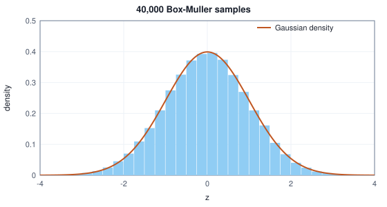
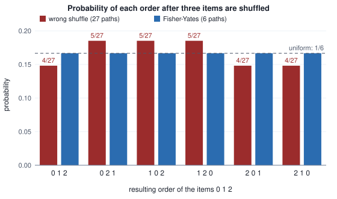

<!-- SPDX-License-Identifier: CC-BY-4.0 -->
<!-- Copyright (c) 2026 Martin Schröder <info@swedishembedded.com> -->

# Randomness on a Deterministic Machine

*How does a deterministic computer produce random numbers, and how do we make random experiments repeatable?*

Fit a line $y = w x$ to eight points by stepping through them one at a time and nudging $w$ after each. The points, the loss, the update rule and the learning rate are fixed, and the block below lists them. Two things are left to chance: where $w$ starts (a number in $[-1, 1)$) and in what order the eight points are visited in each of two passes (called epochs). Run the program three times. The first and third runs are given the same seed, a 64-bit number defined properly further on, and the second a different one.

Every worked example below that draws random numbers prints its seed: to reproduce a table, start the generator built below at the printed seed and draw in the printed order. The seeds themselves are arbitrary; any other seed gives a table of the same kind with different digits.

<!-- worked: randomness.toy_runs -->
Points (x, y): (0.5, 1.4), (1.0, 2.1), (1.5, 4.6), (2.0, 5.8), (2.5, 7.9), (3.0, 9.3), (3.5, 10.2), (4.0, 12.4). Model y = w x. Loss: L(w) = (1/8) sum over the eight points of (w x - y)^2. Each visited point (x, y) updates w <- w - 0.01 * 2 (w x - y) x. Learning rate 0.01, 2 epochs of eight steps each. Generator: the book's SplitMix64 started at the printed seed (state = seed before the first draw). Draw order: first w0 = 2 uniform() - 1; then, once per epoch, the array is rebuilt as [0, 1, ..., 7] (a fresh identity, not the previous epoch's order) and shuffled in place with the same generator (epoch 1 first) and the points are visited in that order. Final loss is L at the final w; "last epoch order" is the order of epoch 2.

| run | seed | initial w | last epoch order | final w | final loss |
|---|---|---:|---|---:|---:|
| run 1 | 0xee43491424935bca | 0.9472 | 1 4 2 7 3 0 6 5 | 2.815481 | 0.445964 |
| run 2 | 0xcc6c60b3b12a1973 | 0.0696 | 2 4 1 0 5 6 7 3 | 2.730141 | 0.719833 |
| run 3 (seed of run 1 again) | 0xee43491424935bca | 0.9472 | 1 4 2 7 3 0 6 5 | 2.815481 | 0.445964 |
<!-- /worked -->

The first two runs end at different weights and different losses ($0.45$ and $0.72$), so a number such as "the loss of this method is $0.45$" is already a statement about one draw of the dice, not about the method. The third run ends exactly where the first did, to every printed digit, in the initial weight, the order of the visits and the loss. Chance that one number reproduces exactly is what a deterministic machine can offer, and it turns out to be what experiments need.

Why would a learning program want chance at all? It enters machine learning in at least five places, each for a different reason. The initial weights are drawn at random so that the units of a layer do not all compute the same thing (Volume III). The order of the training examples is shuffled so that each step sees a varied mix. Dropout (Volume III) zeroes a random subset of activations to stop units from co-adapting. A language model chooses its next word by drawing from a probability table, so that the same prompt can have several answers. Image generators start from a cloud of Gaussian noise. In every case the code needs numbers that behave as if they were drawn by chance, and a computer, which does exactly what its instructions say, has no chance in it.

The apparent contradiction resolves in three steps. First, a deterministic recipe can produce a sequence that passes every test of randomness we can state, so long as nobody looks at the recipe: that recipe is a pseudo-random generator. We build two of them by hand, a classical one that fails in instructive ways and a modern one that does not, and measure their quality by counting. Second, one stream of uniform numbers can be turned into whatever else we need: a fair integer, a draw from a table, a draw from an exponential or a Gaussian distribution, a shuffled list. Each conversion has a correct form and a tempting wrong form, and each wrong form is shown to be wrong by an exact count. Third, the recipe is deterministic only if the seed that starts it is controlled, and the controls (what to fix, what to record, what never to hard-code) decide whether an experiment can be repeated or only repeated by luck.

The recipes below lean on six older ideas, from remainders to prefix sums: clock arithmetic for the first generator, bit patterns for its state, a table walk and a polar integral for turning bits into distributions, and the spacing of doubles for the trap hidden in $[0, 1)$. A question that will not come back is a signal to reread the chapter it names; the answers close this one.

1. (Chapter 1, division with remainder.) Write $38 = 16 q + r$ with $0 \le r < 16$. What are $q$ and $r$? With the floor convention, what is the remainder of $-7$ divided by $5$?
2. (Chapter 1, bits.) How many different patterns can $64$ bits hold, and what is the largest unsigned integer in $64$ bits?
3. (Chapter 10, drawing from a table.) The probabilities of three symbols are $(0.5, 0.3, 0.2)$ and the uniform number drawn is $u = 0.83$. Which symbol does the cumulative-sum walk of `sample_discrete` return?
4. (Chapter 11, the Gaussian in polar coordinates.) What share of a two-dimensional cloud of independent standard Gaussians lies within a circle of radius $2$ around the origin? (The share within radius $\sqrt{c}$ is $1 - e^{-c/2}$.)
5. (Chapter 15, floating point.) A $64$-bit floating-point number has $53$ significant bits. What is the spacing of the representable numbers just below $1$?
6. (Chapter 16, prefix sums.) What is the inclusive prefix sum of $(0.5, 0.3, 0.2)$, and what does its last entry say about a probability table?

## A generator is a state machine

Start with the smallest possible machine. It holds one number, its **state**, an integer from $0$ to $15$. To produce a new number it applies a fixed rule to the state, keeps the result as the new state, and also hands it out. Take the rule "multiply by $5$, add $3$, and keep only the remainder after dividing by $16$". We write the remainder operation $\bmod$ as in Chapter 1: $38 \bmod 16 = 6$.

<!-- worked: randomness.tiny_lcg -->
| step i | state x_i | a x_i + c | mod 16 = x_(i+1) |
|---|---:|---:|---:|
| 0 | 7 | 5 * 7 + 3 = 38 | 6 |
| 1 | 6 | 5 * 6 + 3 = 33 | 1 |
| 2 | 1 | 5 * 1 + 3 = 8 | 8 |
| 3 | 8 | 5 * 8 + 3 = 43 | 11 |
| 4 | 11 | 5 * 11 + 3 = 58 | 10 |
| 5 | 10 | 5 * 10 + 3 = 53 | 5 |

The first 18 states from the seed 7: 7 6 1 8 11 10 5 12 15 14 9 0 3 2 13 4 7 6

Period of this generator from every possible seed: [16].
<!-- /worked -->

Starting from the state $7$ the machine prints $6, 1, 8, 11, 10, 5, 12, \dots$, a sequence that looks scrambled. Nothing in it is chance: the number after $6$ is always $1$. After $16$ steps the state returns to $7$ and the whole sequence repeats, because the next state depends only on the current one, and the current one has been seen before. This is the general shape of every generator in this chapter.

> A **pseudo-random generator** is a state machine: a state $s$, a rule $s \leftarrow f(s)$ that advances it, and an output rule $o = g(s)$ that turns the state into a number. The sequence of outputs is determined completely by the starting state, and its quality is judged by how closely it resembles draws from a uniform distribution, never by unpredictability to someone who knows the rule.

The starting state is chosen by the caller. The number the starting state is computed from is the **seed**: two generators of the same kind started from the same seed produce the same sequence, and different seeds give different sequences. (For the toy machine the seed is the state itself. For the generators below the state is larger than the seed, or computed from it, and the seed is the thing a person writes down.)

Two properties of the machine matter at once. The **period** is the length of the cycle the sequence eventually enters, that is, the number of steps after which it repeats for good (when the seed itself lies on the cycle, as in the table above, this is the number of steps until the seed returns); a generator with a period of $16$ cannot supply $17$ distinct draws. And the quality of the outputs, which is subtler, depends on what $f$ and $g$ do. We study the first through the oldest family of generators.

## Arithmetic on a clock: the linear congruential generator

The rule used above has the form

$$
x_{i+1} = (a\,x_i + c) \bmod m ,
$$

with a **multiplier** $a$, an **increment** $c$ and a **modulus** $m$ (here $5$, $3$ and $16$). A generator of this form is a **linear congruential generator**, or LCG. The remainder is what makes it work, and it deserves a short explanation from scratch. A clock face has twelve positions: five hours after $9$ o'clock it is $2$ o'clock, because $9 + 5 = 14$ and $14$ minus one lap of $12$ is $2$. Arithmetic modulo $m$ is clock arithmetic on a clock with $m$ positions: after each operation, subtract laps until the number is in $0, \dots, m - 1$. Adding, multiplying and subtracting then stay inside the finite set of $m$ values, which is exactly what a machine with a fixed number of bits does by itself when an operation overflows. A $64$-bit unsigned integer wraps modulo $2^{64}$ without being asked.

Which pairs $(a, c)$ make a good LCG? The first requirement is a long period. With $m = 16$ there are only $16$ states, so the best conceivable period is $16$, called the **full period**: every state appears once per lap. The table tries some choices from the seed $1$.

<!-- worked: randomness.tiny_lcg_periods -->
The period is the length of the cycle the sequence eventually enters (the number of steps after which it repeats forever). For a = 4, c = 3 the sequence from seed 1 is 1, 7, 15, 15, 15, ...: it settles on the single state 15, so its period is 1 although the seed itself is never visited again.

| a | c | period from seed 1 |
|---|---:|---:|
| 5 | 3 | 16 |
| 5 | 2 | 8 |
| 4 | 3 | 1 |
| 3 | 1 | 8 |
| 9 | 7 | 16 |
| 1 | 1 | 16 |
| 13 | 1 | 16 |
| 5 | 0 | 4 |

Of the 256 pairs (a, c), 32 reach the full period 16 from seed 1; the pairs with c odd and a - 1 divisible by 4 number 32, and the two sets are identical.
<!-- /worked -->

Read it row by row. With $a = 5, c = 2$ the period is $8$: the increment is even, so the parity of the state never changes (an odd $a$ times an odd state is odd, plus an even $c$ stays odd), and a state of the wrong parity is never visited. With $a = 4$ the multiplier shares a factor with the modulus and the machine collapses into a state it cannot leave (period $1$). With $c = 0$ the state $0$ is a trap: $a \cdot 0 + 0 = 0$ forever, and the other cycles are short. The pairs that reach the full period are exactly those with an odd $c$ and an $a$ one more than a multiple of $4$; that is what the brute-force count shows for $m = 16$ ($32$ of $256$ pairs). For a modulus that is a power of two, $m = 2^k$, this is the general rule, a theorem of Hull and Dobell (references); we have checked it by exhaustion for $m = 16$ and take it on trust beyond.

Real LCGs use a large $m$ so that the period is long: $m = 2^{32}$ or $2^{64}$ gives $4$ billion or $1.8 \times 10^{19}$ states. That is the whole generator: one multiplication, one addition and the free wrap of the machine word. It is also the whole problem.

## Where the first generators fail

A long period is necessary and far from sufficient. Two flaws of the LCG family are worth seeing, because the second is the model for how every generator fails.

### The low bits are not random

Consider a full-period LCG modulo $2^{16}$ and look not at the number but at one bit of it. The lowest bit of $x_{i+1} = (a x_i + c) \bmod 2^{16}$ depends only on the lowest bit of $x_i$: multiplication and addition never move information from a higher bit into a lower one. With $a$ odd and $c$ odd the lowest bit flips every step: $0, 1, 0, 1, \dots$. The same argument shows the lowest two bits depend only on the lowest two of the previous state, so they are a machine with $4$ states, and bit $k$ is a machine with $2^{k+1}$ states. The measurement agrees.

<!-- worked: randomness.low_bits -->
First 16 values of bit k of the sequence x_0, x_1, ... of the generator with a = 25173, c = 13849, m = 65536 started at 1.

| bit k | period of bit k | first 16 values |
|---:|---:|---|
| 0 | 2 | 1010101010101010 |
| 1 | 4 | 0110011001100110 |
| 2 | 8 | 0111100001111000 |
| 3 | 16 | 0110111010010001 |
| 7 | 256 | 0011100110110010 |
| 15 | 65536 | 0110100100000111 |
<!-- /worked -->

A program that takes `x % 2` to flip a coin gets $1, 0, 1, 0, \dots$, an alternating sequence that no coin would produce. Taking `x % 6` for a die throws away the better bits as well: for any even modulus, such as $6$, the remainder has the parity of $x$, so bit $0$ of the result is the alternating bit. The remedy is to use the **top** bits, which depend on all the lower ones; bit $15$ above has the full period $65536$. This is why every generator below hands out its high bits, and why brain's test generator `Lcg` in `crates/data/src/rng.rs` hands out the top bits of its state.

### The pairs fall on lines

Take consecutive outputs in pairs, $(x_i, x_{i+1})$, and scale each to $[0, 1)$ by dividing by $m$. If the generator were random the pairs would fill the unit square evenly. For an LCG they do not, and there is a short derivation of why. Suppose $y \equiv a x + c \pmod m$ and choose integers $s, t$ with $s + a t \equiv 0 \pmod m$. Then

$$
s x + t y \equiv s x + t(a x + c) = (s + a t)\,x + t c \equiv t c \pmod m ,
$$

so the number $s x + t y$ takes the same value modulo $m$ for every pair. In the unit square ($u = x/m$, $v = y/m$) that says $s u + t v$ differs from a fixed value by a whole number: every point lies on one of a family of parallel lines $s u + t v = k + \text{const}$, spaced $1/\sqrt{s^2 + t^2}$ apart. The smaller the vector $(s, t)$, the wider the empty gaps between the lines. Computing the shortest such vector for a few multipliers (this is called the **spectral test**) is a loop.

<!-- worked: randomness.lattice_lines -->
| modulus m | multiplier a | shortest (s, t) | length | line spacing 1/length |
|---|---:|---:|---:|---:|
| 65,536 | 5 | (-5, 1) | 5.1 | 0.19612 |
| 65,536 | 4097 | (-16, 16) | 22.6 | 0.04419 |
| 65,536 | 25173 | (-35, 151) | 155.0 | 0.00645 |
| 4,096 | 257 | (-16, 16) | 22.6 | 0.04419 |
<!-- /worked -->

The multiplier $a = 5$ gives lines $0.196$ apart: five stripes across the square. The multiplier $a = 4097 = 1 + 2^{12}$ gives lines $0.044$ apart. The multiplier $a = 25173$ is much better ($0.0065$) but still has a lattice; it is a lattice that is fine enough for $16$-bit outputs not to notice. A smaller modulus with the same shape, $a = 257 = 1 + 4096/16$ modulo $4096$, is the last row, and its picture is the left panel below, next to the same number of pairs from the generator of the next section.


Three-dimensional triples fall on planes in the same way (the title of Marsaglia's 1968 paper is "Random numbers fall mainly in the planes"), and a simulation that uses pairs or triples of draws as coordinates samples the lines, not the square. The general lesson is that a generator is good only against the questions asked of it, and that the questions of machine learning (dropout masks, weights drawn in groups, pairs for a Gaussian) ask for exactly this joint structure.

## Mixing instead of stepping: SplitMix64

The LCG's two weaknesses have one cause: the output is a very simple function of the state, and a very simple function of a simple state keeps simple structure. The modern remedy is to separate the two jobs. Let the state advance in the simplest possible way (it only has to visit many different values), and make the output a thorough scramble of the state.

For the advance, add a fixed odd constant modulo $2^{64}$. An odd increment has no common factor with $2^{64}$, so adding it repeatedly visits all $2^{64}$ states before returning: a period of $1.8 \times 10^{19}$ with no conditions to check. The constant used here is `GAMMA`, in hexadecimal `0x9E3779B97F4A7C15`, which is $2^{64}$ divided by the golden ratio and rounded to an odd integer; its job is to be an odd number whose binary digits look irregular.

For the scramble we need three small operations, all native to a processor. A **shift** $z \gg k$ moves every bit $k$ places toward the low end and drops the bits that fall off, so $z \gg 30$ brings the top $34$ bits of a $64$-bit word down to the bottom. **Exclusive or** $p \oplus q$ compares two words bit by bit and writes $1$ where the bits differ and $0$ where they agree. And a multiplication modulo $2^{64}$ by an odd constant mixes each bit into all the bits above it (a bit at position $j$ appears, shifted, in every position at or above $j$, through the carries). Alone each is weak: a shift-xor mixes only downward, a multiplication only upward. Alternating them spreads every input bit over every output bit. The recipe, named SplitMix64 (Steele, Lea and Flood, 2014), is

```text
GAMMA = 0x9E3779B97F4A7C15
C1    = 0xBF58476D1CE4E5B9
C2    = 0x94D049BB133111EB

function splitmix_next(state: inout int) -> int:     # state and result lie in 0 .. 2^64 - 1
    state = (state + GAMMA) mod 2^64                 # advance: add an odd constant
    z = state
    z = ((z xor (z >> 30)) * C1) mod 2^64            # mix: shift-xor, then multiply
    z = ((z xor (z >> 27)) * C2) mod 2^64
    return z xor (z >> 31)
```

A generator started from a seed $s$ holds the state $s$ before its first call, so the first call computes $s + \text{GAMMA}$ and mixes it. Here is one call traced, from a given seed (the numbers are printed in hexadecimal, sixteen digits for $64$ bits):

<!-- worked: randomness.splitmix_trace -->
| step | 64-bit value |
|---|---:|
| seed | 0x60c83be1b42d7c66 |
| state + GAMMA | 0xfeffb59b3377f87b |
| z ^ (z >> 30), times C1 | 0xe55682ce31d8e19f |
| z ^ (z >> 27), times C2 | 0xe92b6ffcc94822b3 |
| z ^ (z >> 31) = output | 0xe92b6ffd1b1efd4a |

The first four outputs from that seed: `0xe92b6ffd1b1efd4a`, `0x274e6231dd55a008`, `0xd868879f36a23b89`, `0x27a75603fc701fcc`.
<!-- /worked -->

The scramble is judged by an **avalanche** test: flip one bit of the input and count how many bits of the output change. A good scramble changes about half of the $64$, whichever bit was flipped. For the LCG step the count is about $17$ (a flipped bit at position $k$ can only change positions $k$ and above), and for the neighbouring seeds $s$ and $s + 1$ the outputs of the LCG differ by the same amount, $a$, every single time:

<!-- worked: randomness.avalanche -->
Generator: the book's SplitMix64, seed 0x48216c57116d4892 (5197554566172592274), used as the state before the first draw. Over 2000 trials; each trial draws a seed s = `next()` and then a bit position k = `integer(64)`. SplitMix64's first output is the output of the first call of a generator whose state is s. The LCG step is x -> (a x + c) mod 2^64 with a = 6364136223846793005 and c = 1442695040888963407, applied to s. The first column averages the number of differing output bits between s and s with bit k flipped; the second counts the distinct values of (output for s + 1) - (output for s) modulo 2^64.

| generator | average number of the 64 output bits that change when one random seed bit is flipped | distinct values of (output for s + 1) - (output for s) |
|---|---:|---:|
| SplitMix64 first output | 31.98 | 2000 |
| one LCG step (64-bit modulus) | 17.22 | 1 |
<!-- /worked -->

Two properties follow that are the reason this generator is the workhorse of the engine in the case study. Its finalizer is a hash function in the sense of Chapter 16, so seeds that are close together (seed $1$ and seed $2$, which people really do type) give streams that have nothing to do with each other. And a state of $0$ is harmless, because the advance adds `GAMMA` before anything is mixed: an LCG with $c = 0$ is trapped by the state zero; this generator is not.

### Testing a generator by counting

How do we know the scramble works? We cannot prove randomness, but we can ask a specific question of a long run and compare the answer with what a fair source gives. The simplest question is a **bucket count**: divide the range of the output into $k$ equal buckets, draw $n$ numbers, and count how many fall in each. A fair source puts $n/k$ in each bucket on average, with chance fluctuation. To summarise how far the counts $O_j$ stray from the expectation $E = n/k$ in one number, add up the squared deviations, each scaled by the expectation:

$$
X^2 = \sum_{j=1}^{k} \frac{(O_j - E)^2}{E} .
$$

Squaring makes deviations in both directions count and large ones count more; dividing by $E$ makes the scale independent of the size of the experiment. How big should $X^2$ be for a fair source? Statistics texts derive that its mean is $k - 1$ and, for large $n$, its spread is $\sqrt{2(k - 1)}$ (this is Pearson's chi-square statistic). We do not need to take that on trust: simulate a fair source many times and look. The fair source here is the generator of this section itself, one separately seeded stream per row, each draw being `integer(k)` (the next section defines it); any good generator would do, and the means and spreads are what a reader's own generator should reproduce.

<!-- worked: randomness.bucket_calibration -->
Each row is a fair source: a generator started at the printed seed (state = seed), whose experiments follow one another; one draw is `integer(k)` and adds one to that cell's count, and an experiment is n draws. The spread is the sample standard deviation (divisor experiments - 1) of the X^2 values.

| cells k | draws n | experiments | seed | mean of X^2 | k - 1 | spread of X^2 | sqrt(2(k - 1)) | alarm: k - 1 + 5 sqrt(2(k - 1)) |
|---|---:|---:|---:|---:|---:|---:|---:|---:|
| 4 | 400 | 3000 | 0x4280bbeed351bf5e | 3.0 | 3 | 2.5 | 2.4 | 15 |
| 16 | 1600 | 2000 | 0xb7cdc7f8b5ff12c8 | 15.1 | 15 | 5.5 | 5.5 | 42 |
| 256 | 25600 | 150 | 0xc53f9039f6222a22 | 253.6 | 255 | 22.1 | 22.6 | 368 |
<!-- /worked -->

The measured means match $k - 1$ and the measured spreads match the formula. A value more than five spreads above the mean is a failure that chance does not produce. From here on the **alarm level** is the value $k - 1 + 5\sqrt{2(k - 1)}$, which the last column computes (the measured mean plus five measured spreads of the third row, $253.6 + 5 \cdot 22.1 = 364$, is close to the formula's $368$; the formula is used because $150$ experiments measure a spread only roughly). Three questions then put the generators to the test, asked of one sequence of outputs $x_1, x_2, \dots$ per generator (the first $1600$ values for the first question, the next $1601$ for the second, the next $25{,}601$ for the third). Is the top nibble (4 bits) of the output evenly spread over $16$ buckets? Are the pairs of the lowest two bits of consecutive outputs evenly spread over their $16$ combinations? Here a pair means two **overlapping** neighbours $(x_i, x_{i+1})$, so $1601$ values give $1600$ pairs, and the pair goes to cell $4\,(x_i \bmod 4) + (x_{i+1} \bmod 4)$. And are the pairs of top nibbles of consecutive outputs evenly spread over their $256$ combinations (cell $16 \cdot \text{nibble}(x_i) + \text{nibble}(x_{i+1})$, with $25{,}600$ pairs)? The table gives each generator's seed; an LCG starts from the initial state $x_0$ listed and yields $x_1 = (a x_0 + c) \bmod m$ first, SplitMix64 yields its first output first. The $b$-bit values of the LCGs are used whole: $b = 32$ for the first, $16$ for the others.

<!-- worked: randomness.bucket_tests -->
Alarm levels (calibration table): 42 for 16 cells, 368 for 256 cells. Each generator yields the values x_1, x_2, ... (a b-bit integer each; an LCG starts from x_0 and the first value it yields is x_1 = (a x_0 + c) mod m; SplitMix64's x_1 is its first output). One sequence per row feeds the three tests one after the other: the first 1600 values, the next 1601, the next 25601. Top 4 bits: cell = x >> (b - 4) for a b-bit value. Pairs of low 2 bits: with the 1601 consecutive values x_i, the 1600 overlapping pairs (x_i, x_(i+1)) go to the cell 4 (x_i and 3) + (x_(i+1) and 3). Pairs of top 4 bits: the 25600 overlapping pairs of 25601 consecutive values go to the cell 16 (x_i >> (b - 4)) + (x_(i+1) >> (b - 4)).

| generator | start | top 4 bits, 16 cells (alarm 42) | pairs of low 2 bits, 16 cells (alarm 42) | pairs of top 4 bits, 256 cells (alarm 368) |
|---|---|---:|---:|---:|
| SplitMix64 (64 bits) | seed 0x05e6b08e7421fe7d | 14.2 | 12.5 | 268.3 |
| LCG a = 1664525, c = 1013904223, m = 2^32 | x_0 = 3829122784 (seed 0x645067a3e43bc6e0 mod 2^32) | 23.8 | 4800.0 | 246.2 |
| LCG a = 25173, c = 13849, m = 2^16 | x_0 = 3006 (seed 0x3ec115d024300bbe mod 2^16) | 15.1 | 4800.0 | 135.4 |
| LCG a = 4097, c = 1, m = 2^16 | x_0 = 63379 (seed 0x4d92b36e5ab6f793 mod 2^16) | 0.0 | 4800.0 | 4860.7 |
<!-- /worked -->

SplitMix64 passes all three, well below the alarm levels. All three LCGs put the $1600$ overlapping pairs of low bit pairs into only $4$ of the $16$ cells (each of the four cells that occur receives $400$ pairs, the others none), a statistic of exactly $4800 = 3n$ whatever the seed: that is the period-$4$ cycle of the low two bits made visible. The multiplier $4097$ spreads its top nibbles almost perfectly evenly, and its statistic of $0.0$ is so low that chance would not produce it either: a sequence can be too regular as well as not regular enough. And when pairs of its top nibbles are tested, it fails by a factor of $13$ over the alarm level ($4860.7$ against $368$), which is the line structure of the picture seen from the counting side. No single test settles quality; each exposes a different kind of structure, and a generator earns trust by passing the ones that resemble how it will be used.

## Uniform numbers and integers

A generator yields $64$ random bits. The pseudocode of this book promises `rng.uniform()`, a real number in $[0, 1)$, and `rng.integer(n)`, an integer in $0 \dots n - 1$. Both are built from the bits, and both have a trap.

### A real number in $[0, 1)$

The obvious recipe is to divide the $64$-bit integer by $2^{64}$. It fails for a reason from Chapter 15. A double-precision number has only $53$ significant bits, so converting a $64$-bit integer to a double rounds it, and an integer just below $2^{64}$ rounds up to $2^{64}$, giving exactly $1.0$ after the division. Counting exactly: doubles just below $2^{64}$ are $2^{11} = 2048$ apart, so the $1024$ raw values `0xfffffffffffffc00` to `0xffffffffffffffff` (the exact half-way value rounds to the even neighbour, which is $2^{64}$) all convert to $2^{64}$, and the quotient is $1.0$ with probability $1024 / 2^{64} = 2^{-54}$. The convention says $1$ is excluded; code that takes $\ln(1 - u)$ or indexes an array with $\lfloor u\,n \rfloor$ breaks whenever the raw value is one of the $1024$ largest. The correct recipe keeps exactly the bits a double can hold: shift off the low $11$ bits and divide the remaining $53$-bit integer by $2^{53}$.

<!-- worked: randomness.uniform_from_bits -->
| raw 64-bit value | top 53 bits / 2^53 | float(raw) / 2^64 |
|---|---:|---:|
| 0x0000000000000000 | 0.0 | 0.0 |
| 0x8000000000000000 | 0.5 | 0.5 |
| 0xfffffffffffff800 | 0.9999999999999999 | 0.9999999999999999 |
| 0xfffffffffffffc00 | 0.9999999999999999 | 1.0 |
| 0xffffffffffffffff | 0.9999999999999999 | 1.0 |

The smallest raw value for which float(raw) / 2^64 equals 1.0 is 0xfffffffffffffc00: the 1024 raw values 0xfffffffffffffc00 to 0xffffffffffffffff all convert to 2^64, so the quotient is 1.0 with probability 1024 / 2^64 = 2^-54. The spacing of the grid of values (raw >> 11) / 2^53 is 2^-53 = 1.110e-16; the largest value is 1 - 2^-53 = 0.9999999999999999. For a 32-bit float the same recipe takes the top 24 bits: the grid is 2^-24 = 5.960e-08 and the largest value 0.9999999403953552.
<!-- /worked -->

The top-$53$-bit recipe avoids this: the numerator $\text{raw} \gg 11$ is an integer of at most $2^{53} - 1$, which a double holds exactly, and dividing by $2^{53}$ only changes the exponent, so no rounding happens at all. Every value is a multiple of $2^{-53}$ in $[0, 1 - 2^{-53}]$, exactly representable, evenly spaced, never $1$. It uses the high bits, which is also what the section on LCGs recommended. For a $32$-bit float the same recipe takes $24$ bits: the grid is $2^{-24}$, coarse enough that its smallest step limits the tails below.

### An integer in $0 \dots n - 1$ and the remainder trap

For an integer the obvious recipe is `raw mod n`. A generator small enough to count shows what it does: pretend the generator emits $3$ random bits, so $8$ equally likely values $0, \dots, 7$, and we want a fair die of $n = 6$ faces. The remainders of $0, \dots, 7$ modulo $6$ are $0, 1, 2, 3, 4, 5, 0, 1$.

<!-- worked: randomness.modulo_bias_small -->
| result k | probability of r mod 6 = k | probability after rejecting r < 2 |
|---|---:|---:|
| 0 | 2/8 | 1/6 |
| 1 | 2/8 | 1/6 |
| 2 | 1/8 | 1/6 |
| 3 | 1/8 | 1/6 |
| 4 | 1/8 | 1/6 |
| 5 | 1/8 | 1/6 |

Plain remainder: the values 6 and 7 wrap around to 0 and 1, so those two results are twice as likely as the rest. Rejecting the first 2 values leaves 6 that divide evenly into 6 results of 1 each; the probability that a draw is kept is 6/8 = 0.75, so the expected number of draws per result is 1.3333.
<!-- /worked -->

Eight values cannot be divided evenly into six results: two results must get two raw values and four get one. The faces $0$ and $1$ are twice as likely as the others. The repair is to refuse the raw values that cause the imbalance, and to ask again. This is our first example of **rejection sampling**: draw a candidate from an easy distribution, test it against a rule, throw it away if it fails and draw again; what is kept has the distribution that the rule selects. Here the easy distribution is the raw bits, and the rule is "$r \ge 2^b \bmod n$", which discards exactly the first $2^b \bmod n$ raw values and leaves a number of values divisible by $n$:

```text
function integer(rng: Generator, n: int) -> int:               # uniform in 0 .. n-1
    require 0 < n and n <= 2^64, "no integer in an empty range"   # n = 2^64 is allowed
    threshold = 2^64 mod n                          # the raw values below this cause the bias
    loop:
        r = rng.next()                              # 64 random bits as an integer
        if r >= threshold:
            return r mod n
```

Here `2^64` is an exact integer, as the pseudocode page defines (in a language whose integers stop at $2^{64} - 1$, compute $2^{64} \bmod n$ as $(2^{64} - n) \bmod n$, which is the wrapped value `(-n) mod n` of the unsigned type, and treat $n = 2^{64}$ separately: its threshold is $0$ and the result is the raw value itself). Two edge cases: $n = 1$ has threshold $0$, so it consumes one raw value and returns $0$; and $n = 2^{64}$ never rejects. Every result $k$ is reached by the same number of kept raw values, $(2^{64} - \text{threshold})/n$, so every result has the same probability. The probability that a draw is kept is $(2^{64} - \text{threshold})/2^{64}$, which is more than one half: if $n \le 2^{63}$ the threshold is below $n$, hence below $2^{63}$, and if $n > 2^{63}$ the threshold is $2^{64} - n < 2^{63}$ as well. So the expected number of draws per result is below $2$. Check the bookkeeping by running the die on the $3$-bit generator, with and without rejection:

<!-- worked: randomness.rejection_integer_counts -->
Generator: the book's SplitMix64, seed 0x1969228bc9a64304 (1831032707281732356), used as the state before the first draw. Each draw is r = `next()` >> 61 (the top 3 bits, a value in 0 .. 7); the remainder-only column counts r mod 6 for every draw, the rejection column counts r mod 6 only for draws with r >= 2; drawing stops at 60,000 kept.

| result | remainder only (79,671 draws) | with rejection (60,000 kept) |
|---|---:|---:|
| 0 | 19896 | 10015 |
| 1 | 19739 | 9949 |
| 2 | 10069 | 10069 |
| 3 | 10067 | 10067 |
| 4 | 9993 | 9993 |
| 5 | 9907 | 9907 |

The rejecting sampler used 79,671 draws for 60,000 results, 1.3278 per result (the prediction is 1.3333).
<!-- /worked -->

Without rejection two faces get twice the counts; with it all six agree, at the cost of $1.33$ draws per result instead of $1$ (the prediction is $8/6$). With a $64$-bit generator the picture changes in degree, not in kind:

<!-- worked: randomness.modulo_bias_by_n -->
| n | 2^64 mod n | relative excess of the likelier results | chance a draw is kept | expected draws |
|---|---:|---:|---:|---:|
| 6 | 4 | 3.253e-19 | 1.000000 | 1.000000 |
| 1,000 | 616 | 5.421e-17 | 1.000000 | 1.000000 |
| 1,000,000 | 551,616 | 5.421e-14 | 1.000000 | 1.000000 |
| 4,294,967,297 | 1 | 2.328e-10 | 1.000000 | 1.000000 |
| 13,835,058,055,282,163,712 | 4,611,686,018,427,387,904 | 1.000e+00 | 0.750000 | 1.333333 |
<!-- /worked -->

For $n = 1000$ the likelier results are only a factor $5.4 \times 10^{-17}$ more likely, far below anything a test could measure, and rejection almost never fires. Bias is a property of $n$ relative to $2^{64}$, so it is invisible for the usual sizes (a vocabulary, a batch) and complete for a range near $2^{64}$: for $n = 3 \cdot 2^{62}$ the first third of the results is twice as likely as the rest. Code that takes the remainder is wrong in principle and harmless in practice for small $n$; code that rejects is right in both, and the cost of being right is a comparison.

## Drawing from a distribution

We now have $\text{uniform}() \in [0, 1)$. To **sample from a distribution** means to produce values whose long-run frequencies follow that distribution. There are two classical constructions, one for tables and one for curves, and a third, rejection, for everything else.

### A table: the cumulative sum

A probability table $p_0, \dots, p_{K-1}$ is a distribution on $K$ outcomes (Chapter 10). Lay the probabilities end to end on $[0, 1)$: outcome $0$ owns $[0, p_0)$, outcome $1$ owns $[p_0, p_0 + p_1)$, and so on. A uniform number $u$ lands in outcome $k$'s segment with probability equal to the segment's length, which is $p_k$. The segment boundaries are the prefix sums of Chapter 16, and a lookup is a search in that sorted array. Here are six next-token candidates with logits $(2, 1, 0.5, 0, -1, -2)$ turned into probabilities by the softmax of Volume III, their cumulative sums, and $20{,}000$ draws:

<!-- worked: randomness.discrete_sampling -->
Generator: the book's SplitMix64, seed 0x38f7077b452d44f7 (4104757811394462967), used as the state before the first draw. Each of the 20,000 draws is one `uniform()`; the outcome is the first token whose cumulative p is above it (the last token if rounding leaves none).

| token | logit | p | cumulative p | draws of 20,000 | frequency |
|---|---:|---:|---:|---:|---:|
| 0 | 2.0 | 0.5573 | 0.5573 | 11317 | 0.5658 |
| 1 | 1.0 | 0.2050 | 0.7623 | 3959 | 0.1979 |
| 2 | 0.5 | 0.1243 | 0.8866 | 2510 | 0.1255 |
| 3 | 0.0 | 0.0754 | 0.9620 | 1484 | 0.0742 |
| 4 | -1.0 | 0.0277 | 0.9898 | 532 | 0.0266 |
| 5 | -2.0 | 0.0102 | 1.0000 | 198 | 0.0099 |
<!-- /worked -->

The frequencies agree with the probabilities to within a few standard errors (Chapter 12); for token $0$ the standard error $\sqrt{p(1-p)/n}$ is $0.0035$. The walk of Chapter 10 costs up to $K$ comparisons; a binary search over the prefix sums costs $\lceil \log_2 K \rceil$. For a vocabulary of $50{,}000$ tokens a flat distribution makes the walk average $25{,}000$ comparisons against $16$ for the search, which is why a sampler that sorts or scans per token is an implementation decision, not a detail. The last entry of the prefix sum should be $1$ up to rounding; a draw above it (possible by rounding) must still return a valid outcome, as the pseudocode of Chapter 10 handled.

### A curve: invert the cumulative distribution

For a continuous variable the same idea works with area instead of length. The **cumulative distribution function** $F(x)$ is the probability of a value at most $x$, the area under the density up to $x$ (Chapter 10). It rises from $0$ to $1$. If $u$ is uniform on $[0, 1)$ and $F$ is strictly increasing, define $X = F^{-1}(u)$. Then

$$
P(X \le x) = P\bigl(F^{-1}(u) \le x\bigr) = P\bigl(u \le F(x)\bigr) = F(x),
$$

where the middle step applies the increasing function $F$ to both sides and the last uses that a uniform number is at most $F(x)$ with probability $F(x)$. $X$ has exactly the cumulative distribution $F$, hence the density. This is **inverse-transform sampling**: to sample from a distribution, invert its cumulative distribution and feed it a uniform number. It is the continuous twin of the table walk: the table walk inverts a staircase.

Try it on the exponential distribution with rate $\lambda$, density $\lambda e^{-\lambda x}$ for $x \ge 0$, which models waiting times. Its cumulative distribution is the integral $F(x) = 1 - e^{-\lambda x}$ (Chapter 9). Solve $u = 1 - e^{-\lambda x}$ for $x$:

$$
x = -\frac{\ln(1 - u)}{\lambda} .
$$

Because $u \in [0, 1)$, the argument $1 - u$ lies in $(0, 1]$ and the logarithm is always defined: this is exactly why the half-open convention of the previous section matters.

<!-- worked: randomness.inverse_cdf_exponential -->
| u | x = -ln(1 - u) / 2 | F(x) = 1 - e^(-2x), which equals u |
|---|---:|---:|
| 0.00 | 0.0000 | 0.00 |
| 0.10 | 0.0527 | 0.10 |
| 0.50 | 0.3466 | 0.50 |
| 0.90 | 1.1513 | 0.90 |
| 0.99 | 2.3026 | 0.99 |

Generator: the book's SplitMix64, seed 0x85d82ee874243deb (9644510177929739755), used as the state before the first draw. The second table uses 50,000 draws, each x = -ln(1 - uniform()) / 2; the variance divisor is 50,000.

| quantity | 50,000 draws | exact |
|---|---:|---:|
| mean | 0.4968 | 0.5000 |
| variance | 0.2450 | 0.2500 |
| share above 1 | 0.1335 | 0.1353 |
<!-- /worked -->

The mean $1/\lambda$, the variance $1/\lambda^2$ and the share above $1$, $e^{-\lambda}$, are reproduced by $50{,}000$ draws within the usual noise. The method needs an invertible $F$ in closed form, and the Gaussian's cumulative distribution is not one: its integral has no closed form. A different idea is needed.

### The Gaussian: Box-Muller

Chapter 11 computed the share of a two-dimensional cloud of independent standard Gaussians that lies within radius $\sqrt{c}$ of the origin: $1 - e^{-c/2}$. Read that as a cumulative distribution. If $z_1, z_2$ are independent standard Gaussians and $R^2 = z_1^2 + z_2^2$, then $P(R^2 \le c) = 1 - e^{-c/2}$: the squared radius is exponential with rate $1/2$, and we just inverted that: $R^2 = -2 \ln(1 - u_1)$. The joint density $\frac{1}{2\pi}e^{-(z_1^2 + z_2^2)/2}$ depends on the point only through its distance from the origin, so rotating the plane does not change it: the **angle** of $(z_1, z_2)$ is uniform on $[0, 2\pi)$ and independent of the radius. A point in the plane is determined by its radius and angle, so we can build a point with the right radius and the right angle, and it has the right joint distribution:

$$
R = \sqrt{-2 \ln(1 - u_1)}, \qquad \theta = 2\pi u_2, \qquad z_1 = R\cos\theta, \qquad z_2 = R\sin\theta .
$$

This is the **Box-Muller transform** (Box and Muller, 1958). Two uniform numbers give two independent standard Gaussians. Each row checks itself: $z_1^2 + z_2^2$ must equal $R^2$.

<!-- worked: randomness.box_muller_one_pair -->
Generator: the book's SplitMix64, seed 0x6c45941368405ed7 (7801804740563590871), used as the state before the first draw. Three pairs, each u1 = `uniform()` then u2 = `uniform()`; the columns are computed from the unrounded u1 and u2, and shown to 4 decimals.

| u1 | u2 | R^2 = -2 ln(1 - u1) | R | angle = 2 pi u2 | z1 = R cos | z2 = R sin | z1^2 + z2^2 |
|---|---:|---:|---:|---:|---:|---:|---:|
| 0.8987 | 0.8836 | 4.5792 | 2.1399 | 5.5517 | 1.5925 | -1.4294 | 4.5792 |
| 0.2399 | 0.2886 | 0.5486 | 0.7407 | 1.8131 | -0.1777 | 0.7191 | 0.5486 |
| 0.5187 | 0.4021 | 1.4627 | 1.2094 | 2.5263 | -0.9876 | 0.6981 | 1.4627 |
<!-- /worked -->

A table of three pairs says little about a distribution. Draw $20{,}000$ pairs and compare with the exact values:

<!-- worked: randomness.box_muller_check -->
Generator: the book's SplitMix64, seed 0xf2783749d741705c (17471775544667369564), used as the state before the first draw. 20,000 pairs, 40,000 values: each pair is u1 = `uniform()`, u2 = `uniform()`, then z1 = R cos, z2 = R sin as in the formulas. Variance divisor n = 40,000 (about the mean); covariance = the mean of z1 z2 over the pairs.

| quantity | measured | exact |
|---|---:|---:|
| mean | 0.0003 | 0 |
| variance | 0.9984 | 1 |
| covariance of z1 and z2 | -0.0043 | 0 |
| share with absolute value at most 1 | 0.6815 | 0.6827 |
| share with absolute value at most 2 | 0.9557 | 0.9545 |
| share with absolute value at most 3 | 0.9977 | 0.9973 |
<!-- /worked -->

The mean and variance are $0$ and $1$ within noise, the two coordinates of a pair are uncorrelated, and the shares within one, two and three standard deviations match $\operatorname{erf}(k/\sqrt{2})$. The histogram shows the same thing as a picture:



There is a limit worth knowing. A generator cannot produce a value it cannot represent: the largest $R$ is reached when $1 - u_1$ is the smallest possible number. With $53$-bit uniform numbers that is $2^{-53}$, and the tail beyond is not sampled at all. A cruder source cuts the tail much earlier. The first three rows below use the formula of this section, $R = \sqrt{-2\ln(1 - u_1)}$. The last row is the variant that takes $R = \sqrt{-2 \ln u}$ and, because $u = 0$ is possible there, clamps $u$ to at least $10^{-12}$ before the logarithm (the variant used in the case study below). Every probability in the table is a two-sided tail $P(|Z| > R)$.

<!-- worked: randomness.tail_reach -->
The largest radius is R = sqrt(-2 ln t) for the smallest argument t the logarithm can receive. The "Gaussian probability beyond that" is the two-sided tail P(|Z| > R) = erfc(R / sqrt(2)) in every row.

| uniform source | radius uses | smallest argument t of the logarithm | largest absolute z it can produce | Gaussian probability beyond that |
|---|---|---:|---:|---:|
| 53-bit uniform, 1 - u in [2^-53, 1] | ln(1 - u) | 1.110e-16 | 8.572 | 1.02e-17 |
| 32-bit uniform, 1 - u in [2^-32, 1] | ln(1 - u) | 2.328e-10 | 6.660 | 2.73e-11 |
| 24-bit uniform (float32 grid), 1 - u in [2^-24, 1] | ln(1 - u) | 5.960e-08 | 5.768 | 8.02e-09 |
| 53-bit uniform, radius from ln u with u clamped to at least 10^-12 | ln u | 1.000e-12 | 7.434 | 1.05e-13 |
<!-- /worked -->

With $53$ bits the Gaussian reaches $8.6$ standard deviations and the missing tail has probability $10^{-17}$, irrelevant. With a $24$-bit float grid it stops at $5.8$ and cuts a probability of $8 \times 10^{-9}$, which a rare-event simulation drawing a billion values would notice. The clamp of the last row cuts at $7.43$ standard deviations, a probability of $10^{-13}$. Any bound on the generator is a bound on the events the simulation can see.

### The call `rng.normal()`

The pseudocode calls `rng.normal()` for one standard Gaussian at a time, and every table in this book that draws Gaussians depends on exactly which value that call returns. The rule is the Box-Muller pair above, consumed one value per call. A generator carries one extra piece of state besides its 64-bit state: a **held value**, initially empty.

```text
function normal(rng: Generator) -> real:
    if rng holds a value z:
        clear the held value
        return z                                      # no uniform number is drawn
    u1 = rng.uniform()                                # first draw of the pair
    u2 = rng.uniform()                                # second draw of the pair
    R = sqrt(-2 * log(1 - u1))                        # 1 - u1 is in (0, 1], so log is defined
    hold R * sin(2 * pi * u2)                         # the sine half waits for the next call
    return R * cos(2 * pi * u2)                       # the cosine half is returned now
```

So the first call after a fresh seed consumes two uniform numbers (the first is `u1`, the second `u2`) and returns $R\cos\theta$; the second call consumes nothing and returns the held $R\sin\theta$ of the same pair; the third call starts a new pair. Calling `uniform()` or `next()` between two `normal()` calls does not disturb the held value; it only moves the position in the stream. A table that draws an odd number of Gaussians therefore leaves a held value behind, and the next table sharing the generator starts with it; the worked examples use one generator per example, so nothing is held across examples.

### What each call consumes

All draws consume raw values from `rng.next()` in order; two generators started at the same state give identical results. In the table `r` is one raw 64-bit value.

| call | result | raw values consumed |
|---|---|---|
| `rng.next()` | the next raw `u64`: add `GAMMA` to the state, then mix the new state (the state before the first draw is the seed) | 1 |
| `rng.uniform()` | `(r >> 11) / 2^53`, a multiple of $2^{-53}$ in $[0, 1 - 2^{-53}]$ | 1 |
| `rng.integer(n)` | `r mod n` for the first raw `r >= 2^64 mod n` (rejection as above), a value in `0 .. n-1` | 1 plus one per rejected value |
| `rng.normal()` | as above: $R\cos\theta$ with `u1` then `u2`, then the held $R\sin\theta$ | 2 on every other call, else 0 |
| `shuffle(a, rng)` | for `i` from `n-1` down to `1`: `j = rng.integer(i + 1)`, swap `a[i]` and `a[j]` | 1 per position at least |

## Rejection sampling in general

Rejection, which fixed the integers, is also the general-purpose tool for a density with no invertible cumulative distribution. Suppose the density $f$ on $[0, 1]$ has a largest value $M$. Throw darts uniformly into the rectangle $[0, 1] \times [0, M]$: draw $x$ uniform on $[0, 1]$ and $y$ uniform on $[0, M]$, and keep $x$ only if the dart landed under the curve, $y < f(x)$. The point $(x, y)$ is uniform in a region of area $M$, so the probability of landing under the curve is the area under the curve divided by $M$, namely $1/M$ (the area under a density is $1$). The kept $x$ values have a density proportional to the height of the curve at $x$: that is $f(x)$ itself, because the chance of a dart at $x$ being kept is $f(x)/M$. The cost is $M$ proposals per accepted value, on average.

Try it on $f(x) = 6x(1 - x)$, which has $M = 1.5$ at $x = 1/2$ and whose cumulative distribution $3x^2 - 2x^3$ lets us check the answer exactly:

<!-- worked: randomness.rejection_general -->
Generator: the book's SplitMix64, seed 0x11c9f6ccc8bf3833 (1281826928365353011), used as the state before the first draw. Each proposal draws x = `uniform()` and then y = 1.5 `uniform()`; x is kept when y < 6 x (1 - x), until 40,000 are kept. An interval is [lo, hi).

| interval | share of accepted | exact probability | share if the proposal were kept as is |
|---|---:|---:|---:|
| [0.0, 0.2) | 0.1053 | 0.1040 | 0.2 |
| [0.2, 0.4) | 0.2500 | 0.2480 | 0.2 |
| [0.4, 0.6) | 0.2951 | 0.2960 | 0.2 |
| [0.6, 0.8) | 0.2470 | 0.2480 | 0.2 |
| [0.8, 1.0) | 0.1026 | 0.1040 | 0.2 |

59,964 proposals gave 40,000 accepted values: acceptance 0.6671 against the predicted 1/M = 0.6667. The accepted values have mean 0.4981 (exact 0.5000).
<!-- /worked -->

The accepted values follow the density, and the acceptance rate is the predicted $1/M = 2/3$. The method's weakness is that $M$ can be large (a sharply peaked density wastes almost every dart) and, in many dimensions, the rectangle becomes nearly all empty: this is the problem of Exercise 5.

A second use for rejection is a way to build Gaussians without sine and cosine. Draw $(v_1, v_2)$ uniformly in the square $[-1, 1]^2$ and keep the point only if it lies inside the unit disc, $s = v_1^2 + v_2^2 < 1$. The accepted point is uniform in the disc, so its angle is uniform and independent of its radius, and $s$, the squared radius, has cumulative distribution $P(s \le c) = \pi c / \pi = c$ (area of the sub-disc over area of the disc): it is itself uniform on $[0, 1)$. So $s$ can play the part of $1 - u_1$ in Box-Muller, and $v_1/\sqrt{s}$ and $v_2/\sqrt{s}$ are the cosine and sine of the angle without computing an angle:

$$
z_1 = v_1\sqrt{\frac{-2\ln s}{s}}, \qquad z_2 = v_2\sqrt{\frac{-2\ln s}{s}} .
$$

This is the polar method (Marsaglia and Bray, 1964).

<!-- worked: randomness.disc_and_polar -->
Generator: the book's SplitMix64, seed 0x9bd5dfec27663a18 (11229127451284486680), used as the state before the first draw. Each try draws v1 = 2 `uniform()` - 1 and then v2 = 2 `uniform()` - 1; it is kept when 0 < s = v1^2 + v2^2 < 1, giving the two outputs v1 k and v2 k with k = sqrt(-2 ln(s) / s); tries continue until 40,000 outputs exist. Variance divisor n = 40,000 (about the mean).

| quantity | measured | exact |
|---|---:|---:|
| pairs tried | 25,454 |  |
| pairs inside the unit disc | 20,000 |  |
| acceptance | 0.7857 | pi/4 = 0.7854 |
| mean of the 40,000 outputs | -0.0011 | 0 |
| variance | 1.0012 | 1 |
| share with absolute value at most 2 | 0.9552 | 0.9545 |
<!-- /worked -->

A proposal lands in the disc with probability $\pi/4 = 0.785$, as measured, so about a fifth of the proposals are discarded; in exchange no trigonometric function is evaluated. Box-Muller spends a logarithm, a square root, a sine and a cosine per pair; the polar method spends a logarithm, a square root and a division per accepted pair plus $4/\pi \approx 1.27$ proposals of two uniform numbers each. Which costs less depends on the relative cost of those operations on a given machine; both give the same distribution, and both are used.

## Shuffling

To **shuffle** a list is to rearrange it into an order chosen uniformly at random among all $n!$ orders. It is what turns a dataset into an epoch of training. The correct algorithm is two lines, and it is easy to write a plausible one that is wrong.

```text
function shuffle(a: inout array<T>[n], rng: Generator) -> none:
    for i in n-1 down to 1:
        j = rng.integer(i + 1)          # uniform in 0 .. i
        swap a[i] and a[j]              # a[i] is now final
```

This is the Fisher-Yates shuffle in the form of Durstenfeld (references). Position $n - 1$ receives a uniformly chosen one of the $n$ items; position $n - 2$ a uniformly chosen one of the remaining $n - 1$; and so on. The loop never touches a finished position again.

Why is it uniform? Count the random choices. The loop makes the choices $j_{n-1} \in \{0, \dots, n-1\}$, $j_{n-2} \in \{0, \dots, n-2\}$, down to $j_1 \in \{0, 1\}$: $n \cdot (n-1) \cdots 2 = n!$ equally likely sequences. Every order of the items can be produced: to build a wanted order, take the item that should sit at position $n - 1$, choose $j_{n-1}$ to be its current position, then repeat for position $n-2$ among the rest. Producing every one of $n!$ orders from $n!$ sequences means each order comes from exactly one sequence, and so has probability exactly $1/n!$.

The tempting alternative is to swap every position with a random position anywhere:

```text
for i in 0 .. n:
    j = rng.integer(n)                  # uniform in 0 .. n-1, not 0 .. i
    swap a[i] and a[j]
```

This looks as if it should be more random, and it is wrong. It makes $n^n$ equally likely choices, and $n^n$ cannot be divided evenly among $n!$ orders: the factor $n - 1$ divides $n!$ but shares no factor with $n$ (for $n \ge 3$, $n - 1 \ge 2$), so it does not divide $n^n$. Some orders must be more likely than others. Count exactly for three items: $27$ paths against $6$ orders.

<!-- worked: randomness.shuffle_n3 -->
| resulting order | wrong shuffle: paths of 27 | probability | Fisher-Yates: paths of 6 | probability |
|---|---:|---:|---:|---:|
| 0 1 2 | 4/27 | 0.1481 | 1/6 | 0.1667 |
| 0 2 1 | 5/27 | 0.1852 | 1/6 | 0.1667 |
| 1 0 2 | 5/27 | 0.1852 | 1/6 | 0.1667 |
| 1 2 0 | 5/27 | 0.1852 | 1/6 | 0.1667 |
| 2 0 1 | 4/27 | 0.1481 | 1/6 | 0.1667 |
| 2 1 0 | 4/27 | 0.1481 | 1/6 | 0.1667 |
<!-- /worked -->

Fisher-Yates reaches each order by exactly one path of its six; the wrong shuffle reaches three orders by $4$ paths and three by $5$. The order $0\,1\,2$ the items started in is among the three least likely, and the orders $0\,2\,1$, $1\,0\,2$ and $1\,2\,0$ are the three favoured ones. Here is the same table as a picture:



The bias is small for three items; it grows with the length of the list.

<!-- worked: randomness.shuffle_bias_by_n -->
| n | paths n^n | orders n! | paths per order | most / fewest paths | ratio | total variation from uniform | Fisher-Yates: every order exactly once |
|---|---:|---:|---:|---:|---:|---:|---:|
| 3 | 27 | 6 | 4.50 | 5/4 | 1.25 | 0.0556 | yes |
| 4 | 256 | 24 | 10.67 | 15/8 | 1.88 | 0.0651 | yes |
| 5 | 3,125 | 120 | 26.04 | 47/16 | 2.94 | 0.0842 | yes |
| 6 | 46,656 | 720 | 64.80 | 159/32 | 4.97 | 0.0980 | yes |
| 7 | 823,543 | 5,040 | 163.40 | 543/64 | 8.48 | 0.1123 | yes |
<!-- /worked -->

By seven items the likeliest order is more than eight times as likely as the least likely. Running the correct algorithm on a real generator reproduces the flat table of probabilities:

<!-- worked: randomness.shuffle_empirical -->
Generator: the book's SplitMix64, seed 0x89eb90b1d7bdacd9 (9938196096226274521), used as the state before the first draw. 60,000 shuffles one after the other: each shuffles a fresh array [0, 1, 2] with the same generator, and the final array is the order.

| order | count in 60,000 shuffles | frequency |
|---|---:|---:|
| 0 1 2 | 9979 | 0.1663 |
| 0 2 1 | 9891 | 0.1648 |
| 1 0 2 | 9908 | 0.1651 |
| 1 2 0 | 10198 | 0.1700 |
| 2 0 1 | 10040 | 0.1673 |
| 2 1 0 | 9984 | 0.1664 |
<!-- /worked -->

A shuffle can also pick $k$ distinct items from $n$ (sampling without replacement): run only the first $k$ steps from the front and keep the prefix. And it can be made reproducible per epoch, which the case study shows below.

## Seeds and reproducibility

A run is **reproducible** when running it again from its recorded inputs gives the same results, exactly, not merely similar ones. The seed is one of those inputs, and it is the only place where chance enters. Controlling it is necessary. It is not sufficient, and the failures come in two kinds.

### What determinism requires

Three things must be the same. The seed, obviously. The **order and number of draws**: a generator is a stream, and the value you receive is the one at your position in it. And the **arithmetic**: the same floating-point operations in the same grouping, which Chapters 15 and 16 showed is not automatic once a sum is split across threads or a reduction is reordered. The last is demonstrated by the same draws summed three ways:

<!-- worked: randomness.float_order -->
Generator: the book's SplitMix64, seed 0x5b21607a8d99f741 (6566635811160848193), used as the state before the first draw. The 100,000 values are x_i = `uniform()` - 0.5 + 0.001 (i mod 7) for i = 0 .. 99999, one draw each in order. Left to right adds x_0 first; right to left adds x_99999 first (both start from 0.0); the pairwise tree sums a list of length at most 2 directly and otherwise sums its first floor(len/2) values and the rest separately, then adds the two results. The exact sum is the correctly rounded sum of the stored doubles (Python `math.fsum`).

| order of the additions | sum | difference from exact |
|---|---:|---:|
| left to right | 275.67544289206563 | -2.56e-12 |
| right to left | 275.67544289206427 | -3.92e-12 |
| pairwise tree | 275.6754428920682 | +0.00e+00 |
| exact (fsum) | 275.6754428920682 | 0 |
<!-- /worked -->

Nothing random is left in that table once the draws are fixed, and the plain sums still differ from the exact sum, and from each other, in the twelfth digit, because floating-point addition is not associative (the pairwise tree happens to land on the correctly rounded value here). A training run whose loss reductions are scheduled differently from one execution to the next cannot be reproduced to the last bit however carefully it is seeded.

The order of draws is the subtler requirement. Suppose a program draws its initial weights and its data order from one generator, in that order. Add a fifth weight to the model and the data order, which comes after the weights in the stream, changes, though nothing about the data changed. The cure is a **stream per purpose**: derive a separate generator for each use from the run's seed and a name. A simple derivation hashes the seed with the purpose's name through the mixing function of the previous section, and the result seeds a new SplitMix64. The rule used for the tables below is exact. Let `mix(z)` be the three scrambling lines of `splitmix_next` (from `z = state` on, without the advance). Then

```text
function derive_seed(run_seed: int, name: text) -> int:    # result in 0 .. 2^64 - 1
    h = mix(run_seed)
    for b in the bytes of name (UTF-8, in order):
        h = mix(h xor b)
    return h
```

and the stream called `name` is a generator whose state is `derive_seed(run_seed, name)` before its first draw. This is one rule among many. A reader reproducing the tables below needs only this rule and the printed run seed; the derived-seed columns are data produced by it, and Exercise 10 asks for a derivation of the reader's own. The later volumes of this book name every stream their examples draw from and seed it with a second rule that needs no run seed at all, `seed_of(name)`: the first 8 bytes of the SHA-256 digest of the stream's name, read big-endian (defined on the pseudocode page). Each example prints the seed it used, so a reader can check an implementation of `seed_of` against those printed values, or skip it and start from them.

<!-- worked: randomness.shared_vs_split -->
Run seed 0x2cf0edac0fb8a8a3 (3238349455333304483). A generator "seeded with s" has state s before its first draw. One shared generator: seeded with the run seed; the weights come first (each weight is 2 `uniform()` - 1, in order), then the data order is `shuffle` of a fresh array [0, 1, 2, 3, 4, 5] with the same generator. One stream per purpose: the weights come from a generator seeded with derive_seed(run seed, "init") and the data order from a different generator seeded with derive_seed(run seed, "order") (rule in the chapter). The weights column shows the first four weights.

| design | weights drawn | first four weights | data order |
|---|---:|---|---|
| one shared generator | 4 | -0.561 +0.609 +0.237 -0.822 | 0 3 1 4 5 2 |
| one shared generator | 5 | -0.561 +0.609 +0.237 -0.822 | 1 2 5 0 3 4 |
| one stream per purpose | 4 | -0.963 -0.521 +0.579 +0.883 | 5 3 1 4 0 2 |
| one stream per purpose | 5 | -0.963 -0.521 +0.579 +0.883 | 5 3 1 4 0 2 |
<!-- /worked -->

With one shared generator, adding one weight rearranged the data order from $0\,3\,1\,4\,5\,2$ to $1\,2\,5\,0\,3\,4$. With a stream per purpose the order did not move, and the first four weights did not either, for any number of extra weights. Any component can now be changed, added or removed without disturbing the others. It also makes parallel work safe: give worker $i$ the stream derived from the seed and $i$, rather than letting the workers race for a shared generator, whose draw order then depends on thread scheduling.

Can derived streams overlap? SplitMix64's state only ever grows by `GAMMA`, so every stream is a walk along the same cycle of $2^{64}$ states; a stream started from the state $s + 3\,\text{GAMMA}$ (modulo $2^{64}$) is the stream started from $s$, three draws later.

<!-- worked: randomness.streams_are_positions -->
State s = run seed = 0xbca1e2da8a00ca54 (13592394578626923092); a generator seeded with s has state s before its first draw. The first stream draws six raw values; the second is seeded with (s + 3 GAMMA) mod 2^64 and draws three.

| draw | stream from state s | stream from state s + 3 GAMMA |
|---:|---|---|
| 0 | 0x163c0d6a9059274e |  |
| 1 | 0xff57d27242b8663c |  |
| 2 | 0xd0d88c139bf63299 |  |
| 3 | 0x864b5e873368c9c0 | 0x864b5e873368c9c0 |
| 4 | 0x5ff2215a0db24776 | 0x5ff2215a0db24776 |
| 5 | 0x1eac6ef347ddef0d | 0x1eac6ef347ddef0d |

The second stream is the first one three positions later: yes.

Derived seeds under the same run seed s, by derive_seed(s, name) of the chapter; the first draw is that of a generator seeded with the derived seed.

| stream name | derived seed | first draw |
|---|---:|---:|
| `init` | 0xe427cfcb744afb00 | 0x2982955f81c85287 |
| `order` | 0x12900f07d7d64e47 | 0x5acd03ca38d8e490 |
| `dropout` | 0xa9c25a5e5856ba9c | 0xfc93e756a3562c1f |
| `init2` | 0x58d146c4c6a38ab9 | 0x131a3f545f8df768 |
<!-- /worked -->

Two streams collide only if their starting positions on the cycle lie within the number of draws of each other. Streams placed pseudo-randomly by hashing the seed and a name are far apart with overwhelming probability: for a billion draws each, the chance of overlap between two streams is about $2 \times 10^9 / 1.8 \times 10^{19} \approx 10^{-10}$. Different names give unrelated derived seeds, as the last table shows (the names `init` and `init2` differ by one character and give unrelated streams).

### The opposite failure: a hard-coded seed

If seeds make runs repeatable, why not fix one in the code and be done? Because repeatability is not truth. The first table of this chapter showed that one draw of the dice is one sample, and a method compared with another on one seed compares two samples. Run the toy problem over $400$ seeds:

<!-- worked: randomness.hidden_luck -->
Generator: the book's SplitMix64, seed 0x127f7caae1c3c010 (1332921088098942992), used as the state before the first draw. The run seeds come from this generator: pair k (k = 0 .. 399) is its raw draws 2k and 2k + 1 (`next()`), run A uses the first as its seed and run B the second (or the first again in the last row). Each run is the toy run of the first table with the learning rate stated; the loss is its final loss. Standard error = sample standard deviation (divisor n - 1) of the differences over sqrt(n).

Final loss of the toy run over 400 seeds (the A runs): mean 0.7725, standard deviation (divisor n - 1) 0.2284, smallest 0.3930, largest 1.2787.

| comparison (400 pairs) | share of pairs where B has the lower loss | mean of (loss B - loss A) | standard error of that mean |
|---|---:|---:|---:|
| B = A's procedure, own seed | 0.532 | -0.0253 | 0.0154 |
| B = learning rate 0.0105, own seed | 0.700 | -0.1615 | 0.0138 |
| B = learning rate 0.0105, A's seed | 1.000 | -0.1425 | 0.0026 |

The first five identical-procedure pairs:

| loss A | loss B | winner |
|---:|---:|---|
| 0.8091 | 0.4411 | B |
| 0.5728 | 0.4027 | B |
| 0.6849 | 0.7694 | A |
| 0.7425 | 0.4978 | B |
| 0.8802 | 1.1781 | A |
<!-- /worked -->

The final loss of an identical procedure varies from $0.39$ to $1.28$ across seeds (a standard deviation of $0.23$), so a difference of $0.1$ between two methods on one seed each is within the noise: in the second table identical methods give a "winner" in exactly the way the first five rows show, $B$ ahead in about half the pairs. A real change of the learning rate from $0.01$ to $0.0105$ shows up as a mean gap of $0.162 \pm 0.014$ over $400$ seeds each, but not in every pair ($B$ wins in $0.700$ of the pairs): a single pair of runs would have given the wrong answer about three times in ten. Running both arms on the same seed (the last row) removes the seed's contribution from the difference (this is the **common random numbers** device): $B$ wins every pair and the standard error of the gap shrinks from $0.014$ to $0.0026$. That is a legitimate use of a fixed seed: *both arms* share it, deliberately, and the experiment is also run over many seeds.

A hard-coded seed that hides the noise is the failure. A default of "seed 0" or "seed 1234" makes every run of a program byte-identical, so two runs that were meant to be independent samples are one sample counted twice, and an unlucky or lucky draw gets baked into results and tests for years. The engine in this book takes the opposite policy, stated plainly: **every default seed is random.** A run that was not given a seed draws one from the operating system and the clock, prints it at the start, and records it in its output; to reproduce the run, the caller passes that number back.

```text
function resolve_seed(given: optional int) -> int:
    if given is present:
        require 0 <= given < 2^64, "not a seed"       # refuse, never clamp
        return given
    s = os_entropy()         # clock, process id, a counter, bytes from the operating system, mixed
    print "seed", s          # shown at the boundary ...
    record s in the run's output   # ... and stored, so that passing it back reproduces the run
    return s
```

The operating-system entropy source, `os_entropy()` (named so that it cannot be mistaken for the entropy of a distribution, Chapter 13), is the one place where the machine leaves determinism, and it is deliberately outside the generator: it is where the seed comes from, not how the stream is made. Accepting the seed back needs care. A seed uses the whole range $0 \dots 2^{64} - 1$ and must survive the trip at both ends:

<!-- worked: randomness.seed_parse -->
| text given as a seed | value | result |
|---|---:|---|
| `42` | 42 | accepted |
| `0` | 0 | accepted |
| `0xff` | 255 | accepted |
| `0XFF` | 255 | accepted |
| ` 7 ` | 7 | accepted |
| `18446744073709551615` | 18446744073709551615 | accepted |
| `18446744073709551616` | - | refused |
| `-1` | - | refused |
| `1.5` | - | refused |
| `` | - | refused |
| `abc` | - | refused |
| `0x` | - | refused |

The seeds above the largest signed 64-bit integer, 9,223,372,036,854,775,807, are the share 1/2 of all 18,446,744,073,709,551,616 possible seeds. Round trip of seeds through a signed 64-bit field:

| seed | read back as a signed 64-bit integer | survives |
|---:|---:|---|
| 4,611,686,018,427,387,904 | 4,611,686,018,427,387,904 | yes |
| 9,223,372,036,854,775,807 | 9,223,372,036,854,775,807 | yes |
| 9,223,372,036,854,775,808 | -9,223,372,036,854,775,808 | no |
| 18,446,744,073,709,551,615 | -1 | no |
<!-- /worked -->

A caller who passes back what was printed, in decimal or in hexadecimal, gets the same run; a malformed seed is refused by name; and a system that stores the seed in a signed $64$-bit field loses exactly half of all seeds (those above $2^{63} - 1$), which turn negative, as the round-trip table shows.

## Traps that pass a smoke test

Three defects survive a quick look at the output and are worth a test each.

The first is the seed zero. An LCG with $c = 0$ never leaves the state $0$, and generators built from shifts and xors alone (the xorshift family) are stuck on $0$ as well. SplitMix64 advances before mixing and has no such state, but the habit is worth having: state in a test that a zero seed gives a working stream.

The second is that a good generator is not a secret one. The scramble is a bijection (each step, xor-shift or odd multiplication, is undone by an inverse), so one output reveals the state and every later output follows. A generator in this chapter is a statistical tool, not a cryptographic one; secrets and tokens need a generator designed to resist this.

<!-- worked: randomness.predict_from_output -->
Generator: the book's SplitMix64, seed 0x7a6a91fc7815f2f0 (8821023333691028208), used as the state before the first draw. Draw 1 is the observed output; draws 2 to 4 are the later ones. One observed output `0xdfc8cf78de53244f` was undone step by step (xor-shift, multiply by the inverse of C2 modulo 2^64, xor-shift, multiply by the inverse of C1, xor-shift) to the state `0x18a20bb5f7606f05`.

| draw number | predicted from the one output | actual | equal |
|---:|---|---|---:|
| 2 | 0x4f49155d4958bca1 | 0x4f49155d4958bca1 | yes |
| 3 | 0x831530d8b8fb33fc | 0x831530d8b8fb33fc | yes |
| 4 | 0xac6e3131049293f7 | 0xac6e3131049293f7 | yes |
<!-- /worked -->

The prediction is exact. It is also why "deterministic" and "unpredictable" are different properties: experiments need determinism and good statistics, not unpredictability.

The third is a range that is wrong on one side, which passes every smoke test because the output still varies. A value meant to lie in $[-1, 1)$ is made from the top bits of a $64$-bit state by taking the top $31$ bits, dividing by $2^{31}$ and subtracting $1$. The top $31$ bits divided by $2^{31}$ lie in $[0, 1)$, so after subtracting $1$ every value is in $[-1, 0)$:

<!-- worked: randomness.one_sided_range -->
Generator: the book's SplitMix64, seed 0x0211c0af4a94b35f (149112121783006047), used as the state before the first draw. The LCG state s starts as the first draw `next()`; then each of the 100,000 steps sets s = (a s + c) mod 2^64 with a = 6364136223846793005, c = 1442695040888963407 and reads the new s with both recipes (same s for both rows).

| recipe for a value meant to lie in [-1, 1) | smallest of 100,000 | largest of 100,000 | share below 0 |
|---|---:|---:|---:|
| top 31 bits (shift by 33), divided by 2^31, minus 1 | -1.000000 | -0.000005 | 1.0000 |
| top 32 bits (shift by 32), divided by 2^31, minus 1 | -1.000000 | 0.999990 | 0.5017 |
<!-- /worked -->

The fix is one shift: keep $32$ bits, and divide by $2^{31}$. The lesson is to test the range and sign of a generator, not just that its output varies.

## SplitMix64 in brain, and its departures

brain, the engine of the case study, uses the SplitMix64 built above, with a few departures that are visible once you know what to look for, and several of the lessons above arrived there as defects found and fixed.

**The generator.** `crates/data/src/rng.rs` holds the SplitMix64 of this chapter, `Rng`, as a state and four lines of mixing: add `GAMMA`, then the two shift-xor-multiply rounds with `0xBF58476D1CE4E5B9` and `0x94D049BB133111EB`, then the last xor-shift. `Rng::next_f64` takes the top $53$ bits and divides by $2^{53}$, the recipe above. `Rng::new` starts the state at the seed plus `GAMMA`, one step further along the cycle than the plain description above, where the state starts at the seed. The offset is not needed for quality, since the finalizer mixes every state including seed $0$; it stays because every dataset on disk was generated from this stream. So the brain stream for a seed is the stream above for that seed with its first draw skipped, and the printed values above cannot be compared with `Rng::new` draw for draw. `Rng::state` and `Rng::from_state` expose the state so an interrupted training run can continue its stream exactly; a unit test resumes from a saved state and checks eight draws against the original, and commit `5b3ecc51d` (September 2026) added them for the sake of a fine-tune that resumes "bit for bit". Two further choices each avoid a quiet distortion. `gen_range_inclusive` draws below its span by rejection: a raw $64$-bit value in the partial block at the top of the range, the values that would make the small residues once more likely than the rest, is discarded and drawn again, so every result is exactly equally likely. The bias that `% span` would leave is about $5 \times 10^{-17}$ at a span of $1000$, immeasurable, but exact uniformity costs one comparison, and a value outside the partial block gives the same result as the plain remainder, so the stream differs only at the draws that were rejected (a probability of span over $2^{64}$ per call). `next_gaussian` evaluates only the cosine half of Box-Muller and discards the sine partner, so each call consumes two uniform numbers; a first uniform of exactly $0$, which has no logarithm, is drawn again instead of being raised to a floor, so no output is capped and the tail is that of the normal distribution down to the resolution of the $53$-bit uniform grid. Chapter 11 told how the three Gaussian generators in the workspace differ as streams while agreeing as distributions.

**Sampling a token.** `sample_logits` in `crates/data/src/sample.rs` applies the temperature, optionally keeps only the top-$k$ logits, subtracts the maximum before exponentiating, draws one uniform number scaled by the sum, and walks the running total until it passes the draw: the cumulative-sum sampler of this chapter without a division. Greedy decoding is the temperature-zero branch and draws nothing.

**The LCG and a test generator that never went positive.** Before `Lcg` existed in the same file, about forty test files carried their own copy of `*s >> 33` divided by $2^{31}$ minus $1$, and that expression lies in $[-1, 0)$, the one-sided range of the last table. No test had ever fed a positive value to a ReLU or a max-style kernel. Commit `55eb76184` (August 2026) gave the copies one home, `data::rng::Lcg`, whose `signed()` shifts by $32$; the unit test `signed_covers_both_halves_of_minus_one_to_one` fails on the old recipe (it saw no non-negative values at all). Knowledge #11 records the second consequence: fixing the generator made a gradient check fail that the broken stream had been hiding, and the cause was a step size, a real finding that a defective test generator had been masking. The type is separate from `Rng` on purpose: `Rng` defines the on-disk datasets and its stream must never move.

**Seeds as policy.** `crates/seed` is a leaf crate of one file and no dependencies. `random_seed` mixes the clock, the process id, an atomic per-process counter and, on Unix, eight bytes from `/dev/urandom` through the SplitMix64 finalizer; the counter makes two calls in the same tick differ as a guarantee, and a unit test asserts it. `parse_seed` reads decimal or `0x` hexadecimal over the full $64$-bit range and refuses a negative number, a value above the maximum, an empty string and anything else with a message that quotes the text: the table above, row by row, is its test. Commit `24d9aeaf8` (October 2026) created the crate by moving the entropy source out of the data crate, so that crates that depend on no other brain crate could resolve an unset seed the same way, and made the shared argument parser exit with an error naming the flag when a seed is malformed and print the drawn seed in a form that reproduces the run; its message states the reason in one sentence: an unseeded run must differ from the last one and say which seed it drew, or it cannot be reproduced.

**A gate for the rule.** The rule "every default seed is random" is enforced, not trusted: `scripts/gates/check-seed-literals.sh` (commit `c20e9be68`, with a wider detector in commit `575f5c265`) fails the build when a literal seed appears in production code unless it is on a per-crate allowlist under `scripts/gates/seed-literals.allow.d/` with a stated reason: a *salt* mixed into a caller's seed to make an independent stream, a *world* constant of the problem, a *frozen* artifact read back instead of drawn, a *greedy* generator never consulted, a *test double*, or a *bench input*; a literal seed in a test needs a `// seed:` comment saying why that stream is needed. The gate also fails on a stale entry, so the allowlist only shrinks. Commits that followed it changed defaults one crate at a time from a fixed number to a drawn one.

**The round trip that lost half the seeds.** Knowledge #321 is the signed-field failure of the seed round-trip table. The server drew a $64$-bit seed for an unseeded request and echoed it in its reply so the decode could be repeated, but the HTTP layer read the echoed number as a signed $64$-bit integer, so about half of all drawn seeds were left out of the reply and refused with an error when sent back. A test now checks that a seed over the whole range is accepted back, and the entry's lesson is general: a value echoed so it can be sent back must use the full range of its type at both ends.

**Shuffling per epoch, resumably.** `epoch_order` in `crates/model/src/train.rs` returns the order of the training examples in a given epoch. It is a Fisher-Yates loop (`for i in (1..examples).rev()`, swapping with `gen_range_inclusive(0, i)`) driven by a generator seeded from the run seed combined with the epoch number, which is the stream-per-purpose idea with the epoch as the purpose. Because the order depends only on the seed and the epoch, a run resumed at draw $k$ rebuilds the same order and continues from position $k$: the unit test `the_examples_are_drawn_in_epochs_without_replacement_and_a_resume_continues_the_order` checks that every epoch holds each example once, that epochs differ, and that a resume at draw $8$ equals the tail of the straight run. Commit `c2a048cbf` (October 2026) introduced the epochs, replacing drawing uniformly with replacement.

## Check your understanding

1. **Predict.** The generator $x_{i+1} = (5 x_i + 3) \bmod 16$ starts at $x_0 = 7$. What is $x_{12}$, and what is $x_{1000}$ (use the period)?
2. **Find the error.** A function returns `floor(u * n)` as a random index in $0 \dots n - 1$, with `u = raw / 2^64` converted to a double. It works for a billion test runs and then crashes with an index error. What is the draw, and what is the fix?
3. **Explain.** A coin is flipped by taking the lowest bit of an LCG modulo $2^{32}$ with an odd multiplier and an odd increment. What does the sequence of flips look like, and why does using bit $31$ fix it?
4. **Find the error.** "To shuffle three cards I swap each position with a random position in $0 \dots 2$. There are $27$ equally likely outcomes, and $27$ is a multiple of three, so every arrangement is equally likely." What is wrong?
5. **Predict.** Sixteen buckets receive $1600$ draws, and every bucket gets exactly $100$. What is $X^2$, and is the generator passing? How does the answer compare with the reference mean and spread?
6. **Explain.** Box-Muller uses $\ln(1 - u_1)$ rather than $\ln u_1$ here. Why is the first the safe choice when $u_1 \in [0, 1)$, and why is the second still correct as a distribution?
7. **Explain.** A paper reports that method $A$ beats method $B$ on "seed 0", and the code's default seed is $0$. Give two reasons the claim is weak and two things the authors should have done.
8. **Predict.** For $n = 3 \cdot 2^{62}$ the rejecting integer sampler keeps a $64$-bit draw with probability $3/4$. What is the expected number of draws per result, and what would the plain remainder have done to the results?

## Summary

A deterministic machine produces random-looking numbers from a state and a rule. The linear congruential generator, $x_{i+1} = (a x_i + c) \bmod m$, needs odd $c$ and $a \equiv 1 \pmod 4$ (for a power-of-two modulus) to visit every state, yet its low bits cycle with period $2^{k+1}$ and its pairs lie on a lattice of lines whose spacing the spectral test measures. Separating the advance from the output, adding an odd constant and scrambling the state with shift-xors and multiplications (SplitMix64), removes both flaws and passes the bucket tests that expose them. Quality is judged by counting against a calibrated reference, never by a proof, and each test finds one kind of structure.

From uniform bits come the rest. The top $53$ bits give a double in $[0, 1)$ without ever reaching $1$. An integer in $0 \dots n - 1$ needs rejection of the raw values that would make some results likelier; the bias is $n/2^{64}$ and invisible for small $n$, complete near $2^{64}$. A table is sampled by walking its prefix sums, a curve with an invertible cumulative distribution by inverting it (the exponential), the Gaussian by the Box-Muller transform derived from the polar integral of Chapter 11, and any bounded density by throwing darts at its rectangle. The Fisher-Yates shuffle is exactly uniform because it makes $n!$ equally likely choices that reach each order once; the natural alternative makes $n^n$ choices and cannot be.

Reproducibility needs the same seed, the same order and number of draws, and the same arithmetic. A stream per purpose, derived from the seed and a name, makes draws independent of unrelated code, and makes parallel work safe. The opposite error is a hard-coded seed, which turns a sample into a fact: methods must be compared over many seeds, with shared seeds as a deliberate variance reduction, and the case-study engine makes every default seed random, prints it, records it and refuses a malformed one, over the full $64$-bit range. The limits are those of the tool: the generators here are statistical, predictable from one output, and the numbers they make are only as good as the questions we have tested. The next chapter, the project that closes this volume, uses the generator for its own tests of a numerical library, each of which will need a seed that is drawn, printed and reproducible.

## References

- Box, G. E. P. and Muller, M. E., "A Note on the Generation of Random Normal Deviates", *Annals of Mathematical Statistics*, 1958.
- Durstenfeld, R., "Algorithm 235: Random Permutation", *Communications of the ACM*, 1964.
- Hull, T. E. and Dobell, A. R., "Random Number Generators", *SIAM Review*, 1962.
- Marsaglia, G., "Random Numbers Fall Mainly in the Planes", *Proceedings of the National Academy of Sciences*, 1968.
- Marsaglia, G. and Bray, T. A., "A Convenient Method for Generating Normal Variables", *SIAM Review*, 1964.
- Steele, G. L., Lea, D. and Flood, C. H., "Fast Splittable Pseudorandom Number Generators", *OOPSLA*, 2014.

## Exercises

1. **[Calculate]** For the generator $x_{i+1} = (5 x_i + 3) \bmod 16$ start at $x_0 = 2$ and write the first $8$ states. Then find the period of the generator $x_{i+1} = (3 x_i + 1) \bmod 16$ from $x_0 = 1$ and explain from the parity of the states why it is shorter than $16$.
2. **[Calculate]** For a full-period LCG modulo $2^{k}$ the lowest bit alternates. Prove that bit $1$ has period $4$: write $x_{i+1} \bmod 4$ as a function of $x_i \bmod 4$ and trace the cycle for $a = 5, c = 3$.
3. **[Calculate]** A $5$-bit generator ($32$ equally likely values) is used for a die of $n = 7$ faces by remainder. Give the probability of each face, the threshold of the rejecting sampler, the share of draws kept and the expected draws per result.
4. **[Calculate]** The density $f(x) = 2x$ on $[0, 1]$ has cumulative distribution $F(x) = x^2$. Give the inverse-transform sampler, and compute the three quartiles of the distribution from it. Then give the acceptance rate of rejection sampling for the same density with a uniform proposal.
5. **[Calculate]** The unit ball in $d$ dimensions has volume $\pi^{d/2}/\Gamma(d/2 + 1)$. By rejection from the cube $[-1, 1]^d$, what is the acceptance rate for $d = 2$ (it is $\pi/4$), $d = 3$, $d = 10$? What does this say about drawing uniform points in a high-dimensional ball by rejection?
6. **[Implement]** Implement SplitMix64 and reproduce `randomness.splitmix_trace`: starting from the printed seed (state = seed), your four outputs must equal the printed four. Implement `uniform` (top $53$ bits), `integer(n)` with rejection and `shuffle`, and reproduce `randomness.modulo_bias_small` (exact counts) and `randomness.toy_runs` (initial weight, last-epoch order, final weight and loss from the printed seeds).
7. **[Implement]** Implement the bucket test and reproduce `randomness.bucket_calibration` (with the printed seeds the rows match digit for digit; with your language's own generator as the reference, the means and spreads should match $k - 1$ and $\sqrt{2(k-1)}$) and the rows of `randomness.bucket_tests` from the printed seeds and initial states (they reproduce digit for digit, the LCG low-bit pair rows being exactly $4800.0$). Then run the low-bit pair test on your language's own generator: is it at the alarm level?
8. **[Implement]** Implement Box-Muller and reproduce `randomness.box_muller_check`: the mean, variance, covariance and the three shares must agree with the exact column to within the noise of $40{,}000$ values. Then implement the polar method and reproduce the acceptance rate of `randomness.disc_and_polar`.
9. **[Implement]** Enumerate both shuffles exactly for $n = 3$ and $n = 4$ and reproduce `randomness.shuffle_n3` and the first two rows of `randomness.shuffle_bias_by_n` (counts, ratio of most to fewest paths, total variation distance).
10. **[Implement]** Reproduce `randomness.shared_vs_split` and `randomness.streams_are_positions` from the printed run seed with the chapter's `derive_seed` (the derived seeds must match digit for digit). Then do it again with your own derivation of a stream from a seed and a name (any mixing function; the printed derived-seed columns are given data, not something your derivation has to match): with one shared generator the data order changes when a weight is added, with one stream per purpose it does not.
11. **[Investigate]** Reproduce the three comparisons of `randomness.hidden_luck` on a toy model of your own. How many seeds per arm do you need before the change of learning rate from $0.01$ to $0.0105$ is detected with a standard error well below the gap? Does the pairing of arms on the same seed change the number?
12. **[Investigate]** Make the broken LCG of `randomness.lattice_lines` ($a = 4097$, $c = 1$, $m = 65536$) a Gaussian source by feeding pairs of it into Box-Muller and plot or count the output. What structure survives the transform, and what does that say about using a poor generator under a good transform?

## Key terms

- **pseudo-random generator**: a deterministic state machine (a state, a rule that advances it, and a rule that turns it into a number) whose outputs are judged by how closely they resemble draws from a uniform distribution, not by being unpredictable to someone who knows the rule. <!-- concept: pseudo-random-generator -->
- **seed**: the number from which a generator's starting state is computed; the same seed gives the same stream, and a seed used by a run must be recorded for the run to be repeated. <!-- concept: seed -->
- **reproducibility**: the property that running again from the same recorded inputs (seed, data, code, settings) gives the same results exactly, which requires the same draws in the same order and the same floating-point arithmetic. <!-- concept: reproducibility -->
- **sampling from a distribution**: producing values whose long-run frequencies follow a given distribution from uniform random numbers, by a cumulative-sum lookup for a table, inverting the cumulative distribution, a transform such as Box-Muller, or rejection. <!-- concept: sampling-from-distribution -->
- **rejection sampling**: drawing a candidate from an easy distribution, keeping it only if it passes a test and otherwise drawing again, so that the kept values have the distribution the test selects; it gives unbiased integers and samples from densities with no invertible cumulative distribution, at the cost of the discarded draws. <!-- concept: rejection-sampling -->
- **shuffling**: rearranging a list into an order chosen uniformly among all $n!$ orders, correctly done by swapping each position from the end with a uniformly chosen position at or before it (Fisher-Yates). <!-- concept: shuffling -->

## Answers

**Recall questions.**

1. $38 = 16 \cdot 2 + 6$, so $q = 2$ and $r = 6$. With the floor convention $-7 = 5 \cdot (-2) + 3$, so the remainder is $3$.
2. $2^{64} = 18{,}446{,}744{,}073{,}709{,}551{,}616$ patterns; the largest unsigned integer is $2^{64} - 1 = 18{,}446{,}744{,}073{,}709{,}551{,}615$.
3. The cumulative sums are $0.5, 0.8, 1.0$. The walk returns the first index whose cumulative sum exceeds $u$: $0.83 > 0.8$ and $0.83 < 1.0$, so symbol $2$ (the third, with probability $0.2$).
4. Radius $2$ is $c = 4$: $1 - e^{-2} = 0.8647$, about $86\%$.
5. The doubles just below $1$ are spaced $2^{-53} \approx 1.1 \times 10^{-16}$ apart (the numbers between $1/2$ and $1$ carry $52$ fraction bits after a leading $1$ at $2^{-1}$).
6. The inclusive prefix sum is $(0.5, 0.8, 1.0)$. The last entry is the total probability and must be $1$; it is also the right edge of the last segment in the sampler.

**Check your understanding**

1. From the table $x_0, \dots, x_{12} = 7, 6, 1, 8, 11, 10, 5, 12, 15, 14, 9, 0, 3$, so $x_{12} = 3$. The period is $16$, so $x_{1000} = x_{1000 \bmod 16} = x_8 = 15$ since $1000 = 62 \cdot 16 + 8$.
2. Converting a raw value just below $2^{64}$ to a double rounds it up to $2^{64}$, so $u = 1.0$ exactly (the table shows this for the largest raw value) and the index is $n$, out of range, at probability $2^{-54}$ per draw (the $1024$ largest raw values). The fix is to build $u$ from the top $53$ bits divided by $2^{53}$, never reaching $1$ (or to use the rejection sampler of `integer(n)`, which has no floats at all).
3. The lowest bit alternates $1, 0, 1, 0, \dots$ (odd multiplier and odd increment: the parity flips every step), so the coin alternates heads and tails strictly. Bit $31$ depends on every lower bit through the carries, so it has the full period of the generator.
4. There are six arrangements of three cards, not three, and $27$ is not divisible by $6$ ($4.5$ paths per arrangement), so the paths cannot be split equally; the exact counts are $4, 5, 5, 5, 4, 4$ paths. That $27$ is a multiple of three is irrelevant: the number of paths must be divisible by the number of arrangements.
5. Every term is $(100 - 100)^2/100 = 0$, so $X^2 = 0$. The reference mean is $15$ with spread $5.5$: $0$ is $2.7$ spreads below the mean, and a fair source almost never lands there. The counts are suspiciously regular, which suggests a structured sequence (as for $a = 4097$ in the table); a failure at the low end is as informative as one at the high end.
6. With $u_1 \in [0, 1)$ the value $u_1 = 0$ is possible, and $\ln 0$ is undefined; $1 - u_1$ is in $(0, 1]$ and its logarithm always exists. The distribution is the same either way, because $1 - u_1$ is itself uniform: the map $u \mapsto 1 - u$ preserves the uniform distribution.
7. A single seed is one sample of a noisy quantity: the seed-to-seed standard deviation of a loss can exceed the difference between methods, and a default of $0$ shared with the baseline means the result may be a feature of that stream rather than the method. The authors should have run both methods over many seeds and reported the mean and its standard error (or the share of seeds on which one wins), and if they paired arms on a shared seed, said so and still repeated over seeds.
8. The expected number of draws is $1/(3/4) = 4/3$. The plain remainder would have used $2^{64} \bmod n = 2^{62}$ surplus raw values to make the first third of the results ($0 \dots 2^{62} - 1$) twice as likely as the others.
