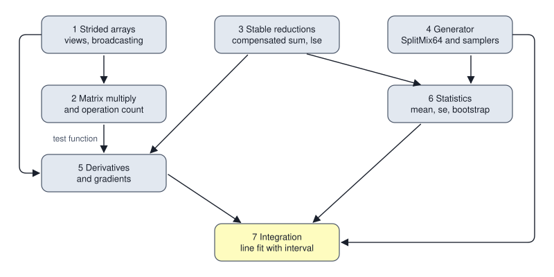

<!-- SPDX-License-Identifier: CC-BY-4.0 -->
<!-- Copyright (c) 2026 Martin Schröder <info@swedishembedded.com> -->

# Project: A Numerical Library from Nothing

*Can you build the numerical toolkit every later chapter relies on, and prove each piece correct?*

## The goal

Seventeen chapters have taught ideas. This one asks you to turn them into a program. You will write, in a language of your choice and using nothing but its standard library, a small numerical library with seven parts:

1. A **strided array** with views (transpose, slice) and explicit broadcasting.
2. Matrix multiplication, checked against a naive reference, with an operation count.
3. **Reductions** that survive hard input: compensated summation and log-sum-exp.
4. A seeded **random generator** (SplitMix64) with uniform numbers, unbiased integers, Gaussian numbers and the Fisher-Yates shuffle.
5. **Numerical derivatives and gradients**, with a step chosen from the arithmetic and a check against an analytic gradient.
6. A small **statistics** module: mean, standard error and a bootstrap confidence interval.
7. One **integration task** that uses all of it: generate noisy points, find a straight line through them by repeated small steps against a checked gradient, and report an interval for the slope.

None of this is new. Every part was derived in an earlier chapter; the project asks whether you can make it work, which is a different thing from following a derivation. Expect some of the parts to fail on the first run in ways the earlier chapters warned about. That is the purpose: the failures are cheap now and expensive in Volume III.

The library is also what the rest of the book quietly assumes. Volume III checks every gradient it derives against a numerical one, Volume IV spends whole chapters on making the matrix product and the reductions fast, and every experiment from Volume II onward starts from a seeded generator. Having your own version of these pieces, verified to the bit where bits can be verified, gives you a trusted base to compare everything else against.

How the project is organised. Each milestone says what to build (in the book's pseudocode, which fixes the interface and nothing else), why it matters later, a check you run before moving on, and the mistakes that readers actually make. The **acceptance tests** at the end give concrete inputs and the exact outputs a correct library produces, written so that any implementation in any language can be tested against them. Every expected value was computed by a second, independent implementation, `scripts/book/worked/project_numlib.py`, and is regenerated whenever the book is built.



The figure shows which milestone calls which, so the order 1 to 7 is a valid build order. Build and test each before starting the next; a failure in milestone 7 that traces back to milestone 1 costs an afternoon, and the same failure caught by milestone 1's own check costs a minute.

## Before you begin

These questions reach across the whole volume. Answer each from memory before reading on; the answers are at the end.

1. (Chapter 5, [Arrays, Shapes, Strides and Broadcasting](05-arrays.md)) A row-major array of shape $[3, 4]$ has strides $(4, 1)$. What are the shape and strides of its transpose, and does transposing move any number?
2. (Chapter 4, [Matrices as Linear Maps](04-matrices.md), and Chapter 16, [Algorithms, Cost and Complexity](16-algorithms.md)) How many multiplications and additions does the product of an $[m, k]$ matrix and a $[k, n]$ matrix take, counted as multiply-adds?
3. (Chapter 15, [Floating Point and Numerical Error](15-floating-point.md)) Why does log-sum-exp subtract the largest score before exponentiating, and what does Kahan's variable $c$ hold?
4. (Chapter 17, [Randomness on a Deterministic Machine](17-randomness.md)) A generator yields 3 random bits and you want a die with 6 faces. Why is `raw mod 6` wrong, and what repairs it?
5. (Chapter 7, [Derivatives](07-derivatives.md), and Chapter 15) A central difference has two competing errors. Name them, and say how the best step scales with the machine epsilon.
6. (Chapter 12, [Statistics](12-statistics.md)) What does a bootstrap do with a sample of $n$ values, and why must the unit it resamples be an independent one?

## Milestones

A note on language and style. The pseudocode below follows [Pseudocode Conventions](../pseudocode.md): 0-indexed, row-major, explicit broadcasts, explicit randomness, `require` for every input assumption. Use 64-bit floats throughout unless a milestone says otherwise, and integers wide enough for 64 unsigned bits where the generator needs them (a language without them can use a pair of 32-bit halves, or a big-integer type, at some cost in speed). Use only your language's standard library, and write the checks as a test file that you can rerun after every change. The tolerances in the acceptance tests assume 64-bit floats.

### Milestone 1: a strided array with views and explicit broadcasting

**What to build.** An `Array` is flat shared storage plus an offset, a shape and a list of strides (equation (1) of Chapter 5: element $(i_0, \dots, i_{R-1})$ lives at $o_0 + \sum_k i_k s_k$). Views share storage; only `copy` and `reshape` of a non-contiguous view move numbers.

```text
record Array:
    storage: array<real>[S]        # shared flat numbers
    offset:  int
    shape:   array<int>[R]
    strides: array<int>[R]         # in elements; 0 for a broadcast axis

function make(values: array<real>[S], shape: array<int>[R]) -> Array     # row-major strides, offset 0
function get(a: Array, index: array<int>[R]) -> real                    # require every index in bounds
function set(a: inout Array, index: array<int>[R], value: real) -> none
function transpose(a: Array, i: int, j: int) -> Array                     # swap two axes of shape and strides
function slice(a: Array, start, stop, step: array<int>[R]) -> Array      # half-open, step >= 1
function broadcast_shape(p: array<int>[P], q: array<int>[Q]) -> array<int>[max(P, Q)]
function broadcast_to(a: Array, shape: array<int>[R]) -> Array           # stride 0 on stretched axes
function add(a: Array, b: Array) -> Array                                # require equal shapes
function to_list(a: Array) -> array<real>[numel]                         # elements in row-major order of the view
function reshape(a: Array, shape: array<int>[Q]) -> Array                # view if contiguous, else copy
```

`add` accepts only equal shapes. To add a column to a row you call `broadcast_to` on both, which is Chapter 5's explicit-broadcast policy. This is not a limitation to be fixed later; it is the design, because a silent broadcast is the origin of the attention-heads bug of that chapter.

**Why it matters later.** Every tensor in Volumes III to XVI is this record. The transpose that costs nothing, the slice that aliases, and the reshape that sometimes copies explain why a model's layout change is free in one place and a copy of gigabytes in another (Volume IV), and why a kernel needs the strides as arguments.

**Check.** Reproduce the table below by hand for its first two rows, then run your library on all rows.

<!-- worked: project_numlib.array_views -->
| view | shape | strides | offset | elements in row-major order | contiguous |
|---|---|---|---:|---|---|
| base, shape [3, 4], storage 0 .. 11 | [3, 4] | [4, 1] | 0 | [0, 1, 2, 3, 4, 5, 6, 7, 8, 9, 10, 11] | yes |
| transpose of base | [4, 3] | [1, 4] | 0 | [0, 4, 8, 1, 5, 9, 2, 6, 10, 3, 7, 11] | no |
| base, rows 1:3, columns 0:4 step 2 | [2, 2] | [4, 2] | 4 | [4, 6, 8, 10] | no |
| transpose of base, rows 0:4 step 2, columns 1:3 | [2, 2] | [2, 4] | 4 | [4, 8, 6, 10] | no |
| [3, 1] column (10, 20, 30) broadcast to [3, 4] | [3, 4] | [1, 0] | 0 | [10, 10, 10, 10, 20, 20, 20, 20, 30, 30, 30, 30] | no |

Write through a view: set element (1, 1) of the last transposed slice to 99 in a fresh copy of base; the storage becomes [0, 1, 2, 3, 4, 5, 6, 7, 8, 9, 99, 11].

Reshape of the transpose to shape [12] reads [0, 4, 8, 1, 5, 9, 2, 6, 10, 3, 7, 11] and does not share storage with base; reshape of base itself to [2, 6] shares storage.
<!-- /worked -->

<!-- worked: project_numlib.array_broadcasting -->
| shape a | shape b | broadcast shape |
|---|---|---:|
| [3, 4] | [4] | [3, 4] |
| [3, 1] | [1, 4] | [3, 4] |
| [2, 1, 5] | [3, 1] | [2, 3, 5] |
| [] | [5] | [5] |
| [3, 4] | [3] | error |
| [3, 4] | [2, 4] | error |
| [1] | [0] | [0] |

Column (10, 20, 30) of shape [3, 1] plus row (1, 2, 3, 4) of shape [1, 4], both broadcast to [3, 4]: [[11, 12, 13, 14], [21, 22, 23, 24], [31, 32, 33, 34]].

The same sum without the explicit broadcast is refused.
<!-- /worked -->

**Common mistakes.**

- Computing the shape and the strides of a slice but forgetting to move the offset by `start[k] * strides[k]`; the view then reads the right pattern from the wrong place.
- Letting `reshape` return a view of a transposed array. The numbers are in the wrong order, and no error is raised. `reshape` must copy unless the view is contiguous.
- Treating an axis of size $1$ as having a meaningful stride in the contiguity test. An axis of size $1$ is never stepped, so its stride is irrelevant (Chapter 5, "Contiguity").
- Letting `broadcast_shape` accept the pair $[3, 4]$ and $[3]$. Alignment is from the right: $[3]$ is compared with the $4$.

### Milestone 2: matrix multiplication with a check and a count

**What to build.** Two functions with the same result, and the number of multiply-adds each performed.

```text
function matmul_naive(a: Array, b: Array) -> (Array, int):
    require len(a.shape) == 2 and len(b.shape) == 2 and a.shape[1] == b.shape[0], "inner dimensions differ"
    # C[i, j] = sum over p of A[i, p] * B[p, j], reading every element with get()
    # returns C with shape [m, n] and the count m * k * n

function matmul(a: Array, b: Array) -> (Array, int):
    # the same product with loops in the order i, p, j and element offsets
    # computed from the strides directly; must accept transposed views
```

The point of the pair is the standard method for checking an optimised routine: keep the slow obvious one as the oracle, and compare on inputs that exercise the awkward cases, here transposed (non-contiguous) operands. Compare exactly on integer-valued inputs, where every sum is exact in floating point, and with a tolerance on real-valued ones, where changing the loop order changes the rounding (Chapter 15). Add a function that, given three shapes, returns the cost of each of the two ways to bracket a product of three matrices; this is the same count used for sizing real models.

**Why it matters later.** The matrix product is the dominant cost of everything in Volumes III to VI. Volume IV, "Making Matrix Multiplication Fast", starts from exactly this loop nest and asks what the memory system does with it. The method of keeping a naive oracle beside a fast kernel returns in every kernel chapter.

**Check.**

<!-- worked: project_numlib.matmul_cases -->
A = [[1, 2, 3], [4, 5, 6]], B = [[7, 8], [9, 10], [11, 12]]: A B = [[58, 64], [139, 154]], 12 multiply-adds.

Generated inputs A[i, j] = (3 i + 2 j) mod 5 - 2 with shape [4, 3] and B[j, k] = (j + 5 k) mod 4 - 1 with shape [3, 5]:

- A = [[-2, 0, 2], [1, -2, 0], [-1, 1, -2], [2, -1, 1]]
- B = [[-1, 0, 1, 2, -1], [0, 1, 2, -1, 0], [1, 2, -1, 0, 1]]
- A B = [[4, 4, -4, -4, 4], [-1, -2, -3, 4, -1], [-1, -3, 3, -3, -1], [-1, 1, -1, 5, -1]], 60 multiply-adds
- both orders of the loops give the same product: True, with 60 multiply-adds
- transpose(A) times Q, where Q[i, k] = (2 i + k) mod 3 - 1 has shape [4, 2], multiplied through the transposed view without copying: [[1, -2], [-1, 3], [-3, -2]], identical in both loop orders: True
<!-- /worked -->

<!-- worked: project_numlib.matmul_float_agreement -->
Two [16, 16] matrices with entries uniform in [-0.5, 0.5) from the seed 0x0a0f4a8b93cf06ab (A first, then B, row-major). The largest difference between the two loop orders is below 1e-14: True.
<!-- /worked -->

<!-- worked: project_numlib.operation_counts -->
| product | multiply-adds m k n |
|---|---:|
| [2, 3] by [3, 2] | 12 |
| [4, 3] by [3, 5] | 60 |
| [64, 64] by [64, 64] | 262,144 |
| [128, 256] by [256, 512] | 16,777,216 |

Chain of A [10, 100], B [100, 5], C [5, 50]: (A B) C costs 10*100*5 + 10*5*50 = 7,500; A (B C) costs 100*5*50 + 10*100*50 = 75,000; the ratio is 10.0.
<!-- /worked -->

**Common mistakes.**

- Counting the additions that initialise the accumulator, or only the multiplications; fix the unit (one multiply-add) and document it.
- Testing only square, contiguous, small-integer inputs. A routine that reads `b.strides[0]` where it meant `b.strides[1]` passes on a symmetric matrix.
- Comparing floating-point results with `==` after changing the loop order. Use `close` (Pseudocode Conventions) with a tolerance derived from the bound of Chapter 15: for a sum of $k$ products of numbers of size $1$, a few times $k \cdot 1.1 \times 10^{-16}$.

### Milestone 3: reductions that survive: compensated sum and log-sum-exp

**What to build.**

```text
function kahan_sum(x: array<real>[N]) -> real          # Chapter 15: running total s and lost-part c
function logsumexp(z: array<real>[N]) -> real:
    require N > 0, "the log-sum-exp of nothing is undefined"
    # m = max(z); if m is minus infinity return minus infinity (all terms are zero)
    # return m + log(sum(exp(z[i] - m)))
```

Two details beyond the chapter. First, the language must not be allowed to "optimise" the compensation away: if your compiler has a fast-math mode, leave it off for this file, and let the acceptance test be the proof. Second, define what happens at the edges of `logsumexp`: a list of $-\infty$ must return $-\infty$ without computing $-\infty - (-\infty)$, which is not a number.

**Why it matters later.** Log-sum-exp is the denominator of the softmax and the core of the loss every classifier and language model in Volumes III and V trains on. Kahan summation is the cheapest repair for the sums of millions of terms that appear in losses, norms and statistics (Volume IV, "Parallel Reductions, Scans and Sorting", asks how to get the same accuracy when the sum is spread over thousands of workers).

**Check.**

<!-- worked: project_numlib.compensated_sums -->
| input | exact sum | left to right | error / sum of absolute values | compensated | error / sum of absolute values |
|---|---:|---:|---:|---:|---:|
| 1.0 followed by 10^6 copies of 1e-16 | 1.0000000001 | 1.0 | 1.000e-10 | 1.0000000001 | 0.000e+00 |
| 10^6 copies of 0.1 | 100000.0 | 100000.00000133288 | 1.333e-11 | 100000.0 | 0.000e+00 |
| 1.0, then 1e-8 repeated 10^6 times, then -1.0 | 0.01 | 0.00999999993922529 | 3.024e-11 | 0.010000000000000009 | 4.315e-18 |

The exact sum is the correctly rounded sum of the stored 64-bit numbers. The compensated error divided by the sum of absolute values must stay below 2.3e-16 (twice the unit round-off of 1.1e-16), whatever the length.
<!-- /worked -->

<!-- worked: project_numlib.logsumexp_cases -->
| z | log(sum(exp(z))) | logsumexp(z) |
|---|---:|---:|
| [1.0, 2.0, 3.0] | 3.4076059644443806 | 3.4076059644443806 |
| [88.0, 88.0, 88.0] | 89.09861228866811 | 89.09861228866811 |
| [1000.0, 1000.0, 1000.0] | fails | 1001.0986122886682 |
| [1000.0, 0.0, -1000.0] | fails | 1000.0 |
| [-1000.0, -1000.0, -1000.0] | fails | -998.9013877113318 |
| [-800.0, -801.0] | fails | -799.6867383124818 |
| [0.0, -inf] | 0.0 | 0.0 |
| [-inf, -inf] | fails | -inf |
| [0.0] | 0.0 | 0.0 |

Cross-entropy by lse(z) - z[t] for z = [1000.0, 998.0, 990.0, 0.0, -5.0], t = 1: 2.1269679983689684.

The naive column shows only whether the formula as written survives: its failures (overflow, or the logarithm of zero) are the point. The empty list must be refused with an error.
<!-- /worked -->

The first case is the clearest: each of the $10^6$ terms $10^{-16}$ is smaller than half the gap above $1$ ($1.1 \times 10^{-16}$), so a left-to-right sum never moves off $1.0$, and loses all $10^{-10}$ of the true excess. The compensated sum recovers it. The third case adds $10^6$ small terms to a large one and then cancels the large one (Chapter 15, "Cancellation"): the left-to-right sum is off by about $6 \times 10^{-11}$ on an answer of $0.01$, a relative error near $6 \times 10^{-9}$, while the compensated sum is exact to the last digit shown.

**Common mistakes.**

- Writing Kahan's update as `c = t - s - y` and letting an optimiser reassociate it. The test with $10^6$ copies of $10^{-16}$ catches this at once.
- Subtracting the maximum of the absolute values rather than the maximum of the values. For $z = (-1000, 0)$ the shift is $1000$, the exponents become $-2000$ and $-1000$, both underflow to zero, and the logarithm of zero follows.
- Returning `log(0)` for a list of $-\infty$ and getting a silent $-\infty$ by accident in one language and an exception in another; test the case.

### Milestone 4: a seeded generator and its samplers

**What to build.** SplitMix64 (Chapter 17) and four samplers built only on its `next` function, so that a test can replace `next` with a script.

```text
record Generator:
    state: int                                   # 64 bits

function seed(s: int) -> Generator               # state = s mod 2^64; the state zero is allowed
function next(g: inout Generator) -> int         # the 64-bit output: advance by GAMMA, then mix
function uniform(g: inout Generator) -> real     # (next(g) >> 11) / 2^53, in [0, 1)
function integer(g: inout Generator, n: int) -> int:
    require 0 < n and n <= 2^64, "no integer in an empty range"
    threshold = 2^64 mod n
    loop:
        r = next(g)
        if r >= threshold: return r mod n
function normal(g: inout Generator) -> real      # Box-Muller; the sine half of a pair is kept for the next call
function shuffle(a: inout array<T>[n], g: inout Generator) -> none     # Fisher-Yates, i = n-1 down to 1, j = integer(g, i+1)
```

The constants are in Chapter 17: $\gamma$ = `0x9E3779B97F4A7C15`, and the two multipliers `0xBF58476D1CE4E5B9` and `0x94D049BB133111EB`; the mixing steps are shifts by $30$, $27$ and $31$. Two choices are fixed here so that every implementation produces the same numbers. `normal` uses $u_1$ then $u_2$ as the two uniforms of a pair, computes $R = \sqrt{-2\ln(1 - u_1)}$ with angle $2\pi u_2$, returns $R\cos$ first and holds $R\sin$ for the next call. `shuffle` draws exactly one `integer(g, i + 1)` per position, from the last position down to position $1$.

**Why it matters later.** Every experiment in Volumes II to XVI starts from a seed, and a result you cannot reproduce is a result you cannot debug. The tests below are bit-exact on purpose: unlike almost everything else in this volume, the generator's output is an integer sequence that either matches or does not, and a match is a strong sign that the shifts, the constants and the order of operations are all right.

**Check.** First the raw outputs, then each sampler.

<!-- worked: project_numlib.splitmix_vectors -->
| seed | value | the first four next_u64 outputs |
|---|---|---:|
| zero (the edge case) | 0x0000000000000000 | 0xe220a8397b1dcdaf 0x6e789e6aa1b965f4 0x06c45d188009454f 0xf88bb8a8724c81ec |
| a drawn seed | 0xeee92eed57282b7f | 0x93379858eda86297 0x939d0883af1d4726 0xa832c83cb81404be 0xde42c506dd64e365 |

From the drawn seed, uniform() x 4: [0.5750670640096884, 0.5766148873800505, 0.6570248745193368, 0.8682063237914863].

From the drawn seed, integer(6) x 12: [1, 0, 0, 3, 4, 0, 2, 1, 0, 5, 2, 1].

From the drawn seed, normal() x 5: [-1.1596169234912463, -0.6057527805223613, 0.9893695432072155, -1.0776560753760402, 0.9246539343033024].

From the drawn seed, shuffle of 0 .. 9: [5, 8, 9, 7, 3, 4, 2, 6, 0, 1].
<!-- /worked -->

The samplers are tested apart from the mixing by feeding them chosen raw values, so that a failure points at the right function:

<!-- worked: project_numlib.sampler_scripts -->
| call | rule | result |
|---|---|---|
| integer(13835058055282163712) on raw values 0, 4611686018427387903, 4611686018427387904 | threshold = 2^64 mod n = 4611686018427387904 | returns 4611686018427387904 after consuming 3 raw values |
| integer(3) on raw values 0, 1, 2, 3 | threshold = 2^64 mod 3 = 1 | returns 1 after consuming 2 raw values |
| uniform() on raw value 2^64 - 1 | top 53 bits / 2^53 | returns 0.9999999999999999 |
| uniform() on raw values 2^63, 0 |  | returns 0.5 then 0.0 |
| normal() twice on the uniforms u1 = 0.5, u2 = 0.25 | radius sqrt(-2 ln 0.5), angle pi / 2 | returns 7.209557076787946e-17 then 1.1774100225154747 using 2 raw values |

Tolerance for the two normal values: 1e-12 absolute.
<!-- /worked -->

<!-- worked: project_numlib.shuffle_scripts -->
shuffle of 0, 1, 2, 3 when the three calls integer(4), integer(3), integer(2) are all fed the raw value 4 (the remainders are 0, 1, 0, so the swaps are with j = 0, 1, 0): [2, 3, 1, 0], using 3 raw values.

Six orders of three items, 60,000 shuffles from the seed 0x946ba0054de053f3; each count must lie within 5 standard deviations (456) of 10,000:

| order | count | frequency |
|---|---:|---:|
| 0 1 2 | 10063 | 0.1677 |
| 0 2 1 | 9975 | 0.1663 |
| 1 0 2 | 10044 | 0.1674 |
| 1 2 0 | 9909 | 0.1651 |
| 2 0 1 | 10070 | 0.1678 |
| 2 1 0 | 9939 | 0.1656 |
<!-- /worked -->

The statistical test is a safeguard, not a proof: it checks that the mean and variance of the Gaussian are right to within what chance allows, and the share within one standard deviation matches $\operatorname{erf}(1/\sqrt{2})$.

<!-- worked: project_numlib.normal_moments -->
100,000 values from normal(), seed 0x1b2d73cf7089ac50. The measured column is what this reference produced; your values must equal it to 1e-9 if your generator is bit-exact, and must in any case lie within the stated distance of the exact value.

| quantity | measured | exact | allowed distance |
|---|---:|---:|---:|
| mean | -0.001638 | 0 | 0.0126 (4 standard errors) |
| variance | 0.992686 | 1 | 0.0179 |
| share with absolute value at most 1 | 0.68638 | 0.68269 | 0.0066 |
<!-- /worked -->

**Common mistakes.**

- Dividing the 64-bit output by $2^{64}$ in a 64-bit float. The result can round to exactly $1.0$ (Chapter 17); the shift by $11$ avoids it. The scripted test with the raw value $2^{64} - 1$ catches this.
- Using `raw mod n` without the threshold. The scripted test with $n = 3 \cdot 2^{62}$ fails, and the test with `integer(3)` shows whether the first raw value $0$ was refused.
- Shuffling with `j = integer(n)` instead of `integer(i + 1)`. The scripted test fails and the frequencies of the six orders of three items drift to the $4/27$ and $5/27$ of Chapter 17.
- A signed 64-bit integer type: the multiplications and the right shifts then act on negative numbers. Use an unsigned type or mask after each operation.
- Seeding by the system clock. The point of this milestone is that the same seed gives the same numbers on every machine.

### Milestone 5: derivatives and gradients, checked

**What to build.** A central difference with a step chosen from the arithmetic, a gradient built from it, and the comparison rule.

```text
function derivative(f: function(real) -> real, x: real) -> real:
    h  = eps^(1/3) * max(1, abs(x))           # eps = 2^-52, so h is about 6.06e-6 at x = 1
    xp = x + h; xm = x - h                    # the points actually used
    return (f(xp) - f(xm)) / (xp - xm)        # divide by the step the arithmetic took

function gradient(f: function(array<real>[N]) -> real, x: array<real>[N]) -> array<real>[N]:
    # one central difference per coordinate, perturbing only that coordinate

function close(a: array<real>[N], b: array<real>[N], rtol: real, atol: real) -> bool
```

The rule $h \propto \varepsilon^{1/3}$ is Chapter 15's: truncation error shrinks as $h^2$, round-off error grows as $1/h$, and they balance at the cube root of the machine epsilon, times the scale of the argument. Dividing by $x_p - x_m$ rather than $2h$ removes the error from the rounding of $x \pm h$ itself.

The gradient check has a fixed shape. Take a function that uses the earlier milestones, so that the check also tests them: the function
$$f(\mathbf{x}) = \log \sum_{i} e^{z_i} + \tfrac{1}{2}\lVert \mathbf{x} \rVert^2, \qquad \mathbf{z} = A\mathbf{x},$$
with $A$ of shape $[3, 2]$. Its gradient, derived with the chain rule of Chapter 8, is $A^{\mathsf T}\mathbf{p} + \mathbf{x}$, where $p_i = e^{z_i - \mathrm{lse}(\mathbf{z})}$ are weights that sum to $1$. Compute $f$ with your `matmul` and `logsumexp`, the analytic gradient with `matmul` of the transposed view, and compare the analytic gradient to `gradient(f, x)`.

**Why it matters later.** In Volume III, every layer's backward pass is written by hand and every one is checked this way ("Proving Gradients Correct"); the habit of keeping a numerical gradient beside an analytic one is what makes a network trainable in practice, and the step rule and the tolerance are the same. The check you build here is the same idea as brain's gradient checker in `crates/gradcheck/src/lib.rs`, at a scale you can read in one sitting.

**Check.**

<!-- worked: project_numlib.derivative_cases -->
| function | x | step h | analytic derivative | relative error of the check |
|---|---:|---:|---:|---:|
| exp | 1.0 | 6.055e-06 | 2.718281828459045 | 7.889e-13 |
| sin | 0.7 | 6.055e-06 | 0.7648421872844885 | 2.524e-13 |
| x^3 | 2.0 | 1.211e-05 | 12.0 | 1.222e-11 |
| log | 0.01 | 6.055e-06 | 100.0 | 1.222e-07 |
| tanh | -1.5 | 9.083e-06 | 0.18070663892364858 | 3.839e-11 |
| exp at a large point | 20.0 | 1.211e-04 | 485165195.4097903 | 2.444e-09 |

The step is eps^(1/3) max(1, |x|) with eps = 2^-52. The check passes when the relative error is below 1e-6. The log row at x = 0.01 has the largest error because the step (6.06e-6) is not small next to the distance 0.01 to the singularity of the function; the last row has the step scaled up with |x|, as the rule demands.
<!-- /worked -->

<!-- worked: project_numlib.gradient_check -->
| i | analytic gradient | numerical gradient | relative error |
|---|---:|---:|---:|
| 0 | 0.6892220180660255 | 0.6892220180730584 | 1.020e-11 |
| 1 | -2.2263357081885093 | -2.2263357081568453 | 1.422e-11 |

f(x) = log(exp(z_0) + exp(z_1) + exp(z_2)) + (1/2)(x_0^2 + x_1^2), where z = A x for A = [[1.0, 2.0], [-1.0, 0.5], [0.5, -2.0]], at x = [0.3, -0.7]: f(x) = 2.006746197705487. The analytic gradient is A^T p + x, where p_i = exp(z_i - lse(z)).

With close(analytic, numerical, rtol = 1e-6, atol = 1e-8): the correct gradient passes; the gradient with the + x term forgotten (A^T p alone, [0.38922201806602547, -1.5263357081885092]) fails.
<!-- /worked -->

The second half of that last paragraph is the more important test. A check that passes a correct gradient proves little unless it also rejects a wrong one. Here the wrong one forgets the term $\mathbf{x}$ contributed by the half squared norm, a realistic omission, and it must fail.

**Common mistakes.**

- A step that is too small. A step of $10^{-12}$ looks like a precise choice and gives an error near $10^{-4}$ on the exponential of the table in Chapter 15; the rule gives $10^{-12}$ relative error.
- Perturbing all coordinates at once and calling the result a gradient; it is a directional derivative and can pass a gradient with two compensating bugs (Chapter 8).
- A relative error with no floor. When the true derivative is near $0$ the relative error divides by nearly nothing; `close` uses an absolute floor `atol` for exactly this reason.
- Checking only at the origin or at points where the function is symmetric. Pick a generic point, like the one in the table.

### Milestone 6: mean, standard error and a bootstrap interval

**What to build.**

```text
function mean(x: array<real>[n]) -> real                        # kahan_sum(x) / n
function sample_variance(x: array<real>[n]) -> real             # divisor n - 1, on centred values
function standard_error(x: array<real>[n]) -> real:
    require n >= 2, "a standard error needs at least two values"
    return sqrt(sample_variance(x) / n)
function percentile(v: array<real>[m], q: real) -> real         # v sorted ascending; position q * (m - 1), linear interpolation
function bootstrap_interval(x: array<T>[n], statistic: function(array<T>[n]) -> real,
                            resamples: int, level: real, g: inout Generator) -> (real, real):
    require n >= 2 and resamples >= 1000, "too few values or resamples"
    require 0.0 < level and level < 1.0, "level must lie strictly between 0 and 1"
    # for each resample: n draws integer(g, n) in order, each choosing the next value; record the statistic
    # sort the recorded statistics; return percentile at (1 - level) / 2 and at 1 - (1 - level) / 2
```

Note that `bootstrap_interval` takes a statistic as a function and a list of units of any type: in the integration task the units are pairs of numbers, which keeps the two values of a point together when it is resampled.

**Why it matters later.** From Volume II on, every number reported about a model, an accuracy, a gap between two models, a latency, is an estimate from a sample, and Chapter 12's discipline is the difference between a finding and an accident. The bootstrap is the tool you reach for when the statistic has no formula, which is most statistics of interest.

**Check.** The data are the twenty-five latencies of Chapter 12.

<!-- worked: project_numlib.statistics_cases -->
Twenty-five latencies in milliseconds: [18.9, 19.8, 22.7, 23.5, 25.9, 27.5, 28.3, 36.4, 37.2, 37.8, 38.8, 46.9, 52.3, 56.1, 57.4, 58.5, 62.9, 67.0, 72.8, 77.3, 79.2, 81.2, 84.1, 90.0, 116.7]

| quantity | value |
|---|---:|
| mean | 52.768 |
| sample variance (divisor n - 1) | 677.2381 |
| standard error of the mean | 5.2047597446952345 |
| normal-formula 95 percent interval mean -+ 1.96 se | [42.56667090039734, 62.96932909960266] |
| median (position 0.5 (n - 1), interpolated) | 52.3 |
| bootstrap interval of the mean, 2000 resamples, seed 0xaf99f7c164fe2124 | [43.2677, 63.04159999999999] |
| bootstrap interval of the median, same seed | [36.4, 67.0] |

Ten identical values (3.0): standard error 0.0, bootstrap interval [3.0, 3.0].

The bootstrap draws, for each resample, n indices in order from integer(n), each used as the next value of the resample; the sorted statistics are read at positions 0.025 (R - 1) and 0.975 (R - 1) with linear interpolation. Tolerance: 1e-9 for a bit-exact generator.
<!-- /worked -->

The normal-formula interval and the bootstrap interval of the mean agree to within about a unit, as they did in Chapter 12; the difference is simulation noise plus the mild skew of the data. The interval of the median is wide, and is the same interval as in Chapter 12, for the same reason.

**Common mistakes.**

- A variance with divisor $n$: the standard error comes out about $2\%$ small at $n = 25$ (Chapter 12).
- Resampling without replacement. Every resample is then a permutation of the data, and the statistic of a mean never varies.
- Drawing the $n$ indices once and reusing them for every resample; the resamples are then identical.
- Resampling the values of a pair independently, which destroys the relationship you want an interval for.
- Reading the percentile at index $\lfloor q (m - 1) \rfloor$ with no interpolation: the error is small but the acceptance test is not met.

### Milestone 7: putting it together

**What to build.** One program, using only the six modules above, that carries out the following.

1. Generate $n = 50$ points. Seed the generator with the given seed; for $i = 0, \dots, 49$ let $x_i = 4 i / 49$ and $y_i = 2 x_i + 1 + 0.5\, z_i$, where $z_i$ is the $i$-th call of `normal`. (The calls are in order: the cosine half of a pair for even $i$, the sine half for odd $i$.)
2. Define the mean squared residual of a line $y = a x + b$:
$$
L(a, b) = \frac{1}{n}\sum_{i=0}^{n-1} (a x_i + b - y_i)^2,
$$
with the analytic gradient
$$
\frac{\partial L}{\partial a} = \frac{2}{n}\sum_i (a x_i + b - y_i)\,x_i, \qquad
\frac{\partial L}{\partial b} = \frac{2}{n}\sum_i (a x_i + b - y_i).
$$
Check the analytic gradient against `gradient` at the starting point $(0, 0)$ with `close`, `rtol = 1e-6`, `atol = 1e-8`, and stop with an error if the check fails. (Never step against a gradient you have not checked.)
3. From $(a, b) = (0, 0)$ take $3000$ steps, each replacing $(a, b)$ by $(a, b) - 0.05\,\nabla L(a, b)$. This is the direction in which $L$ falls fastest (Chapter 8), taken with a small fixed step.
4. Compare the result with the closed-form straight line through the points: slope $\sum_i (x_i - \bar x)(y_i - \bar y) \big/ \sum_i (x_i - \bar x)^2$ and intercept $\bar y - \text{slope}\cdot\bar x$. These are the values at which both partial derivatives vanish, and the stepped values must agree to $10^{-6}$.
5. Report a $95\%$ bootstrap interval for the slope. The units are the $(x_i, y_i)$ pairs, the statistic is the closed-form slope, there are $2000$ resamples, and the generator is a second one with the given second seed. The closed form is used inside the resamples because it is the quantity step 3 converges to, as step 4 has just verified, and it is $3000$ times cheaper.

**Why it matters later.** This is the shape of every experiment in the rest of the book, in miniature: generate data from a known truth, fit by following a checked gradient, and report the answer with its uncertainty. Volume II names the pieces and generalises them. The fact that the true slope $2$ is known lets you ask whether the interval does its job; the extension below asks for that over many repetitions.

**Check.**

<!-- worked: project_numlib.integration_run -->
Data: n = 50 points, x_i = 4 i / 49, y_i = 2 x_i + 1 + 0.5 z_i, where z_0, z_1, ... are the first fifty normal() draws of the generator seeded with 0x40828d277338dad3.

- first three points: [0.0, 0.8663724171920144], [0.08163265306122448, 0.8784860821574205], [0.16326530612244897, 1.5834288408267119]
- mean of y: 4.953031710134613
- gradient of the mean squared residual at (0, 0): analytic [-25.37503930582669, -9.906063420269225], numerical [-25.37503930581351, -9.906063420474158], check passes: True
- after 3000 steps of size 0.05 against the gradient from (0, 0): slope 2.0042846382288526, intercept 0.944462433676907, mean squared residual 0.301953443212281
- the closed-form slope and intercept (slope = sum (x - mean x)(y - mean y) / sum (x - mean x)^2): 2.004284638228851, 0.944462433676911; largest difference from the stepped values 3.997e-15 (must be below 1e-6)
- gradient at the stepped values: [3.0198066269804257e-15, -9.192646643896295e-16] (both entries below 1e-6 in absolute value)
- 95 percent bootstrap interval of the slope, resampling whole (x, y) pairs, 2000 resamples, generator seeded with 0x57bc835c1a222ba7: [1.882669969129146, 2.136087609065885]; it contains the true slope 2.
<!-- /worked -->

**Common mistakes.**

- Using the same generator for the data and the bootstrap. It works, but then the interval depends on how many numbers the data generation consumed, and a harmless change to step 1 changes step 5; give each job its own seed (Chapter 17, "Seeds and reproducibility").
- Taking a step that is too large. With $x$ running to $4$, the curvature of $L$ is large enough that the step $0.2$ makes the iteration diverge (try it); if the gradient check passes and $L$ rises, the step is the suspect.
- Bootstrapping the $y$ values alone while the $x$ values stay in place. The resamples then describe a different experiment.
- Reporting the interval without saying that it describes the uncertainty from the $50$ points only, under the assumption that the points are independent draws.

## Acceptance tests

The tests are the blocks printed in the milestones above, collected here as a checklist. A library passes when every statement below holds. "Bit-exact" means integers or text equal; "to $t$" means the stated absolute tolerance.

| milestone | test | expected | tolerance |
|---|---|---|---|
| 1 | views table: shapes, strides, offsets, element order | as printed | exact |
| 1 | write through a view; reshape of a transpose | as printed (storage changed in place; not shared) | exact |
| 1 | broadcast shapes; sum of column and row | as printed; `add` of unequal shapes refused | exact |
| 2 | products of the two integer cases, both loop orders, transposed operand | as printed | exact |
| 2 | multiply-add counts, chain costs | as printed | exact |
| 2 | two $[16, 16]$ random matrices, naive against fast | largest difference below $10^{-14}$ | stated |
| 3 | compensated sums of the three inputs | error divided by sum of absolute values below $2.3 \times 10^{-16}$ | stated |
| 3 | log-sum-exp table | as printed | $10^{-12}$ relative |
| 3 | empty list | error raised | |
| 4 | SplitMix64 outputs, seed $0$ and the drawn seed | as printed | bit-exact |
| 4 | uniform, integer, shuffle sequences from the drawn seed | as printed | exact (floats to $10^{-15}$) |
| 4 | normal sequence from the drawn seed; the scripted normal | as printed | $10^{-12}$ |
| 4 | scripted integer, uniform and shuffle calls | as printed, including the number of raw values consumed | exact |
| 4 | counts of the six orders of three items | each within five standard deviations | stated |
| 4 | moments of $10^5$ normal values | as printed for a bit-exact generator | $10^{-9}$; otherwise stated distance |
| 5 | derivative table | relative error below $10^{-6}$ in every row | stated |
| 5 | gradient check | correct gradient passes; gradient with a term missing fails | stated |
| 6 | mean, variance, standard error, median | as printed | $10^{-9}$ |
| 6 | bootstrap intervals, identical values | as printed | $10^{-9}$ for a bit-exact generator |
| 7 | the integration run | as printed | $10^{-9}$ for the data and first fit; $10^{-6}$ between stepped and closed form |

Two conventions apply to the whole list. A number printed with a seed was computed from a generator started at that seed and fed through your own generator, so a mismatch in a sampler's numbers with a matching raw sequence points at the sampler, and a mismatch in the raw sequence points at the mixing; test in that order. And where the table says "stated", the criterion is part of the test, not a number to copy: those are the statements that remain true on any correct implementation, including one that uses a different generator.

## Summary

A library that you have built, tested against stated numbers and used for one end-to-end task is a different kind of knowledge from a chapter you followed. If every acceptance test passes, you have built and verified: a strided array whose views share storage and whose broadcasts are explicit, a matrix product that agrees with its naive definition and knows its own operation count, two reductions that survive input that breaks the obvious versions, a generator whose output agrees with the reference to the bit, a derivative and gradient check that accepts a correct gradient and rejects a wrong one, and the statistics to put an interval on an answer. The integration run showed them cooperating: the straight line was found by following a gradient the numerical check had approved, and the interval around its slope contains the value the data were generated from.

Where this stops. The array is one-dimensional storage with views, with no devices and no types other than one float; the matrix product is a plain triple loop; the gradient is checked, not computed automatically; and the statistics assume independent draws. Each limit is the subject of a later volume. Volume II turns the end-to-end task into the general problem of learning from examples, and gives the fitted straight line, the squared-residual measure and the bounded steps their proper names. Volume III replaces the hand-derived gradient with a method that produces one for any composition of functions, and then uses your numerical check to prove that method right.

## Extensions

These are optional. Each is a bigger test of the same ideas.

1. **Coverage.** Repeat the integration task for $200$ different seeds (derive them from one master seed) and count how often the true slope $2$ lies inside the $95\%$ bootstrap interval. What fraction do you expect, and what do you see? Repeat with $n = 8$ points and explain the difference (Chapter 12).
2. **Beyond Kahan.** Implement Neumaier's variant (which also compensates when the new term is larger than the running total) and find an input of three numbers on which Kahan's sum is wrong and Neumaier's is right.
3. **One-pass log-sum-exp.** Rewrite `logsumexp` to read the data once, keeping a running maximum and rescaling the running sum when the maximum changes. Verify it against the table, and against the two-pass version on random inputs.
4. **Strides for free.** Add `permute(a, order)` for any axis order, and `reshape` that returns a view whenever the strides allow it (Chapter 5, "Which reshapes are free?"). Test with the transposed slice of Milestone 1.
5. **A faster product.** Block the matrix product in tiles of $8 \times 8$ and confirm that the answers agree with the naive version and that the operation count is unchanged. Time the three versions on your machine and explain the order of the timings; you have just met the subject of Volume IV.
6. **A second generator.** Replace SplitMix64 by the LCG of Chapter 17, run the Milestone 4 statistical tests on it, and report which tests it fails.

## Answers

**Before you begin.**

1. The transpose has shape $[4, 3]$ and strides $(1, 4)$. No number moves: it is a new description of the same storage (Chapter 5).
2. $m k n$ multiply-adds: $k$ for each of the $m n$ outputs.
3. Subtracting the maximum $m$ makes every exponent at most $0$, so no term overflows and the sum is at least $1$, so the logarithm is finite; the identity $\log \sum e^{z_i} = m + \log \sum e^{z_i - m}$ keeps the value unchanged. Kahan's $c$ holds the negative of the part of the last addition that was lost to rounding, so that it can be fed into the next addition.
4. Eight equally likely values cannot be divided into six equal groups: the remainders $0$ and $1$ occur twice and the others once. Repair: refuse the first $2^3 \bmod 6 = 2$ values and draw again.
5. Truncation error (from the formula, falling as $h^2$) and round-off error (from the arithmetic, rising as $1/h$). Their sum is smallest at $h$ of order $\varepsilon^{1/3}$ times the scale of the argument, about $6 \times 10^{-6}$ for 64-bit floats.
6. It draws $n$ values with replacement from the $n$ values, recomputes the statistic, repeats thousands of times, and reads an interval off the spread of the recomputed statistics. The units must be independent draws; if they are not (frames of one clip) the interval comes out too narrow (Chapter 12).
