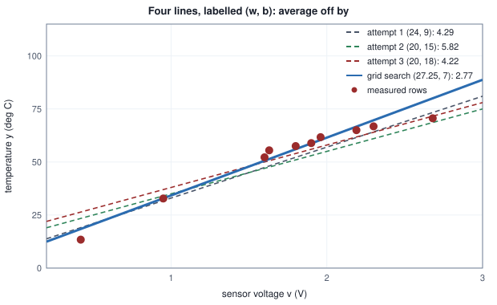
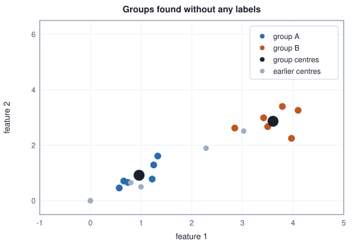

<!-- SPDX-License-Identifier: CC-BY-4.0 -->
<!-- Copyright (c) 2026 Martin Schröder <info@swedishembedded.com> -->

# The Learning Problem

*What exactly is a model, what is it learning, and from what?*

A small electronics workshop builds a temperature sensor. It is a cheap
component that puts out a voltage, and the voltage depends on the temperature
of the thing it touches, but nobody has a formula that turns one into the
other. The datasheet gives a rough curve, the parts vary from one batch to the
next, and the workshop wants the real relationship for the real parts.

So someone does the obvious experiment. Ten times, they warm the sensor to some
temperature, read its voltage, and read the temperature on a trusted reference
thermometer at the same moment. Here are the ten measurements.

<!-- worked: learning_problem.sensor_table -->
N = 10 measured rows (sorted by voltage; the source that produced them and the order of its draws are written out in the section "Too small, too big").

| row n | voltage v (V) | temperature y (deg C) |
|---|---:|---:|
| 1 | 0.42 | 13.4 |
| 2 | 0.95 | 32.8 |
| 3 | 1.60 | 52.2 |
| 4 | 1.63 | 55.5 |
| 5 | 1.80 | 57.5 |
| 6 | 1.90 | 58.9 |
| 7 | 1.96 | 61.7 |
| 8 | 2.19 | 65.0 |
| 9 | 2.30 | 66.8 |
| 10 | 2.68 | 70.6 |
<!-- /worked -->

The sensors will soon be installed in machines where there is no reference
thermometer, only the voltage. The question the workshop actually has is this:
a sensor reads $1.75$ V. What temperature is it?

There is no row in the table with $1.75$ V. Row 4 says that $1.63$ V was
$55.5$ degrees and row 5 says that $1.80$ V was $57.5$, so the answer is
somewhere near $57$, and you can say that without being able to
write down a rule for how you got there. That small act, producing an answer
for an input you have never seen from a handful of inputs you have, is what
machine learning does. Saying it precisely takes a vocabulary: what the table
is, what a model is, what it means for a model to be chosen using data, what
makes a choice good, and the three broad situations (with labels, without
them, and with only rewards) in which the same idea appears.

Everything from fitting a line to training a model with billions of numbers
in it is a refinement of that vocabulary, and here each part is shown at a
size where every number can be checked by hand.

The vocabulary is built from four ideas of Volume I: functions with
parameters (chapter 2), vectors (chapter 3), probability and its
distributions (chapters 10 and 11), and the fact that a measurement taken
from a sample estimates a number about the whole source (chapter 12). Five
questions test whether they are at hand; each names its chapter, and the
answers are under "Recall questions" at the end.

1. (Chapter 2, "Functions and Their Shapes", families and parameters.) The line $f(x) = w x + b$ has the numbers $w = 3$ and $b = 1$ set. What is $f(2)$, and which of $w$, $b$, $x$ is changed to move from one member of the family of lines to another?
2. (Chapter 2, "Functions and Their Shapes", polynomials.) How many points with different $x$ values determine exactly one parabola through them, and what happens to the count for a family with $k$ parameters?
3. (Chapter 3, "Vectors: Lists of Numbers with Geometry".) The vector $\mathbf{x} = (84, 3, 12)$ has how many entries, and what is the distance between $(0, 0)$ and $(3, 4)$?
4. (Chapter 10, "Probability: Reasoning Under Uncertainty", a dataset is a distribution.) Five examples have errors $0, 1, 1, 4, 9$. What is their mean, and what probability does each example get when the mean is read as an expectation?
5. (Chapter 12, "Statistics: Learning Facts from Samples", estimates.) A model's average error is measured on a sample of examples. Why is that number an estimate, and what makes it more trustworthy?

## Examples, features and labels

Look at one row of the table: a voltage of $1.80$ V and a temperature of
$57.5$ degrees. The two numbers play different roles, and the vocabulary is
about telling the roles apart.

The voltage is what we will always have: it is the thing that is measured
at the moment of use. It is a **feature** of the example, one measurable
property that the prediction is allowed to depend on. The temperature is what
we want to know and, for these ten rows only, have been told by the reference
thermometer. It is the **label** of the example: the answer attached to it.
One row, a feature together with its label, is an **example**.

A real problem rarely has just one feature. A house has an area, a number of
rooms and an age, and the thing to predict is its selling price. Write the
features of one example as a list of numbers, a vector $\mathbf{x}$ with
$d$ entries (here $d = 3$), and its label as $y$. A collection of such
examples looks like this.

<!-- worked: learning_problem.feature_vectors -->
N = 5 examples, d = 3 features each: the feature matrix has shape [5, 3] and the labels have shape [5].

| n | area (m^2) | rooms | age (years) | price (thousand SEK) |
|---|---:|---:|---:|---:|
| 1 | 84 | 3 | 12 | 3150 |
| 2 | 52 | 2 | 41 | 1980 |
| 3 | 126 | 5 | 7 | 5240 |
| 4 | 67 | 3 | 25 | 2470 |
| 5 | 95 | 4 | 3 | 4110 |
<!-- /worked -->

The **dataset** is the collection of $N$ examples, written as pairs,

$$
\mathcal{D} = \{(\mathbf{x}_1, y_1), (\mathbf{x}_2, y_2), \dots, (\mathbf{x}_N, y_N)\}
= \{(\mathbf{x}_n, y_n)\}_{n=1}^{N},
$$

as the notation page has it. For the sensor $N = 10$ and $d = 1$: each
$\mathbf{x}_n$ is a vector with a single entry, the voltage, which we simply
write $x_n$ or $v_n$. For the houses $N = 5$ and $d = 3$. Stacking the
vectors $\mathbf{x}_n$ as rows gives a matrix $\mathbf{X}$ of shape $[N, d]$
(the layout of Volume I, chapter 5: the first axis counts examples), and the
labels form a vector $\mathbf{y}$ of shape $[N]$. Every dataset from here on
is held in memory this way, and it is why the first axis of an array is so
often called the batch dimension: it is the axis of examples.

Two things about labels are worth saying early. First, a label does not have
to be a number measured on a scale. It can be one choice out of a short list
(a message is spam or it is not; a photograph shows one of a thousand kinds of
object), and the later chapters handle that case with its own tools. Second,
a label does not have to be written by a person. In the calculator task that
brain uses for tests, each line of the data is an arithmetic problem and its
answer, like `12+7=19`. Everything before the equals sign is the feature and
everything after it is the label, and a program that knows arithmetic wrote
both. A line of English text can be cut the same way: the words so far are the
features and the next word is the label, a source of an enormous number of
labelled examples that needs no one to label anything.

What counts as a feature is a decision, and much of the history of the field
is about moving that decision from people to the model. Here it is a measured
voltage. For an image it could be a few hand-chosen numbers (average
brightness, the length of the longest edge) or it could be every pixel and
nothing else, leaving the model to find what matters; the models of the later
volumes take the second choice.

## A model is a function with parameters

With that vocabulary the task can be stated exactly. Given a dataset of examples, produce a
function that takes the features of a new example, one the dataset has not
seen, and returns a good guess for its label. The function is the **model**,
and the guess is a **prediction**, written $\hat{y}$ (the hat means "an
estimate of").

Volume I, chapter 2, showed how to describe whole collections of functions
with a few numbers: the line $f(x) = wx + b$ is a family, and choosing $w$
and $b$ picks one member. A model is always such a thing. It is a function
whose rule has a shape fixed in advance and whose behaviour is set by a list of
numbers, the **parameters**, written together as one vector $\theta$. We write
the model as $f_\theta$:

$$
\hat{y} = f_\theta(\mathbf{x}).
$$

For the sensor, take the family of lines, $f_\theta(v) = w v + b$ with
$\theta = (w, b)$. Choose $\theta = (24, 9)$. Then the model answers any
voltage we ask it about.

<!-- worked: learning_problem.line_predictions -->
The model f(v) = w v + b with parameters theta = (w, b) = (24, 9).

| new voltage v | arithmetic | prediction (deg C) |
|---|---:|---:|
| 0.50 | 24 * 0.50 + 9 | 21.0 |
| 1.20 | 24 * 1.20 + 9 | 37.8 |
| 2.00 | 24 * 2.00 + 9 | 57.0 |
| 2.60 | 24 * 2.60 + 9 | 71.4 |
<!-- /worked -->

The distinction between the two kinds of number matters in everything that
follows. The feature $v$ changes from question to question: it is the input.
The parameters $w$ and $b$ do not change between questions; they are the
settings of the model, fixed while it predicts. Learning will be the activity
of changing the parameters, and nothing else, so that the predictions improve.

A line has two parameters. Real models have the same form with more. A
network that reads text can have seven billion numbers in $\theta$ (the
notation page writes this as a 7B model), and every one of them is a
parameter in exactly the sense above: a setting that the data is going to pick.
The rule that turns $\mathbf{x}$ and $\theta$ into $\hat{y}$ is much more
elaborate in such a model, and Volume III builds it, but the picture is
unchanged: a function with a shape fixed in advance and numbers left open.

## The hypothesis space

Before choosing parameters it helps to ask what choices are available at all.
If the model is a line, every possible choice of $(w, b)$ gives a different
line, and the set of all of them is everything the model can ever say. This set
of functions is the **hypothesis space**: all the functions $f_\theta$ that can
be reached by varying $\theta$,

$$
\mathcal{H} = \{ f_\theta \;:\; \theta \text{ any allowed list of numbers} \}.
$$

(The word hypothesis is the traditional one: each member of $\mathcal{H}$ is a
hypothesis about how labels depend on features.) Choosing a model family
chooses $\mathcal{H}$, before a single row of data has been looked at, and the
choice limits what can ever be learned. Three spaces for the sensor problem
show how.

- **Lines**, $f_\theta(v) = w v + b$. Two parameters. Every member is straight,
  so no setting of $(w, b)$ can bend.
- **Parabolas**, $f_\theta(v) = a v^2 + w v + b$. Three parameters. A parabola
  can curve once; setting $a = 0$ recovers the lines, so $\mathcal{H}$ for
  parabolas contains $\mathcal{H}$ for lines.
- **Lookup tables.** Keep the ten rows. To answer a new voltage, find the
  stored row with the closest voltage and return its temperature. The numbers
  that define this model are the ten stored voltages and the ten stored
  temperatures: twenty parameters. (In general, $N$ stored examples of $d$
  features each are $N$ feature vectors of $d$ numbers and $N$ labels, so
  $N(d + 1)$ parameters.) Its members are staircases that jump from one stored
  label to the next.

By the counting of Volume I, chapter 2 (a family with $k$ parameters can pass
through $k$ chosen points), the lookup table can reproduce any ten points
exactly. A line cannot even reproduce three that do not lie on one. Bigger
spaces can say more, and that sounds like a pure advantage. It is not, and
choosing the size of $\mathcal{H}$ is one of the main design decisions in the
field.

## Learning: choosing parameters with data

We now have a model with open parameters and a dataset. **Learning** is the use
of the dataset to choose the parameters. For that, we need a way to say
whether a particular choice is good, and the simplest sensible one is to ask
how far off the predictions are on the examples we have.

Take a line drawn by eye through the cloud of the ten points: $\theta = (24, 9)$,
the same one as above. For each of the ten rows, the model predicts a temperature
from the voltage, and we put the prediction next to the label. The difference
between them, ignoring its sign, is how far off the prediction is on that row,
and the average of those ten numbers is how far off the model is on this
dataset.

<!-- worked: learning_problem.first_attempt -->
Attempt 1: w = 24, b = 9.

| v | label y | prediction | prediction - y | off by |
|---|---:|---:|---:|---:|
| 0.42 | 13.4 | 19.1 | +5.7 | 5.7 |
| 0.95 | 32.8 | 31.8 | -1.0 | 1.0 |
| 1.60 | 52.2 | 47.4 | -4.8 | 4.8 |
| 1.63 | 55.5 | 48.1 | -7.4 | 7.4 |
| 1.80 | 57.5 | 52.2 | -5.3 | 5.3 |
| 1.90 | 58.9 | 54.6 | -4.3 | 4.3 |
| 1.96 | 61.7 | 56.0 | -5.7 | 5.7 |
| 2.19 | 65.0 | 61.6 | -3.4 | 3.4 |
| 2.30 | 66.8 | 64.2 | -2.6 | 2.6 |
| 2.68 | 70.6 | 73.3 | +2.7 | 2.7 |
|  |  |  | total | 42.9 |
|  |  |  | average over N = 10 | 4.29 |
<!-- /worked -->

Writing that average as a function of the parameters,

$$
E(\theta) = \frac{1}{N} \sum_{n=1}^{N} \bigl| f_\theta(\mathbf{x}_n) - y_n \bigr| ,
$$

the first attempt scores $E(24, 9) = 4.29$ degrees. This number, a single
measure of how well one setting of the parameters explains the data, is what
makes the search for parameters a well-defined problem: **learning is finding
$\theta$ for which $E(\theta)$ is small.** The next chapter gives such
measures a name, asks which of the many possible ones to use (there is a good
reason to square the difference instead of ignoring its sign), and derives a
method that finds the best parameters of a line without trying them. Here the
only requirement is that a smaller $E$ means a better fit to these rows.

Improving on it by hand is the obvious next try. The table showed where the line is wrong: it
is below the data through the middle (eight of the ten predictions are too low)
and above it at the two ends. Three attempts,
each a change a person might try after reading the previous score: the second
lowers $w$ to pull the right-hand end down and raises $b$ to lift the middle,
and the third keeps that $w$ and raises $b$ a little more.

<!-- worked: learning_problem.hand_tuning -->
| attempt | w | b | average off by (deg C) |
|---|---:|---:|---:|
| 1 | 24 | 9 | 4.29 |
| 2 | 20 | 15 | 5.82 |
| 3 | 20 | 18 | 4.22 |
<!-- /worked -->

The second attempt is worse than the first. Both knobs moved at once, and their
effects interact: a lower $w$ with a higher $b$ is a different line that pivots
through a different point, and here it ended up below the data on eight of the
ten rows and far above it at the lowest voltage. The third attempt, with $w$
held and only $b$ raised, is better than the first, though only just ($4.22$
against $4.29$). This is
the character of the problem: with two parameters one can still tune by eye,
with a table of errors and some patience; with seven billion nobody can, and a
procedure has to do it.

The simplest procedure is to try many settings and keep the best one. For a
line, lay a grid over the plausible values of each parameter and compute $E$
at every point of the grid.

```text
function best_on_grid(x: array<real>[N], y: array<real>[N],
                      w_values: array<real>[P], b_values: array<real>[Q])
        -> (real, real, real):
    require N > 0 and P > 0 and Q > 0, "need data and a non-empty grid"
    best_w = w_values[0]
    best_b = b_values[0]
    best_e = infinity
    for i in 0 .. P:
        for j in 0 .. Q:
            w = w_values[i]
            b = b_values[j]
            total = 0.0
            for n in 0 .. N:
                total = total + abs((w * x[n] + b) - y[n])
            e = total / N
            if e < best_e:                  # strict: the first of equal settings wins
                best_w = w
                best_b = b
                best_e = e
    return (best_w, best_b, best_e)
```

<!-- worked: learning_problem.grid_search -->
Grid: w = 0 + 0.25 i for i = 0, ..., 240 (from 0 to 60, 241 values), b = -20 + 0.25 j for j = 0, ..., 240 (from -20 to 40, 241 values): 58081 settings, 580810 single predictions. The settings are visited with w in the outer loop and b in the inner one, both ascending, and a setting replaces the best so far only when its average is strictly smaller (the first of equal settings wins). Averages are shown to 2 decimals.

|  | w | b | average off by (deg C) |
|---|---:|---:|---:|
| best of the grid | 27.25 | 7 | 2.77 |
| attempt 3 by hand | 20 | 18 | 4.22 |
<!-- /worked -->

The search found a better line than any of the three attempts, and it paid for
it with a large amount of arithmetic: every one of the grid's settings costs a
pass over the data. For a grid of $m$ values per parameter and $k$ parameters
the count is $m^k$ settings, which is already hopeless at ten parameters and
unthinkable at seven billion. Every learning method that follows can be read as
a way around that count: a rule that, from the current parameters and the
data, says which way to change them (the slope of $E$ with respect to every
parameter at once, the gradient of Volume I, chapter 8, which the next chapter
uses), so that the search takes a few steps instead of visiting everything.

The figure shows the three hand-tuned lines and the best line of the grid search inside the data.



## Too small, too big

The grid search found the best line, but is a line the right hypothesis space?
Run the same kind of search over parabolas (a grid in three parameters, described
below the table), and build the lookup table, which needs no search.
Then score all three the way we scored the first attempt, on the ten rows that
were used to choose them.

To see how they behave on rows they were not chosen on, we need rows that were
not used. In a real project we would have to set some aside or collect more.
Here the source of the data is a program, so we can draw two thousand more rows
from the same source, never looked at while choosing parameters, and score the
three on those as well.

The program plays the part of nature, and it is written out here so that every
number can be reproduced. The learner never uses it to choose parameters; it
only supplies the rows. It also produced the ten rows of the first table and
the datasets of the section after this one.

<!-- worked: learning_problem.data_source -->
The source (the learner never sees these lines): voltage v uniform on [0.4, 2.8], temperature y = -6 + 50 v - 8 v^2 + 1.2 z with z a standard Gaussian sample, evaluated left to right in double precision. A row is made by two draws in this order: v = 0.4 + 2.4 * rng.uniform(), then z = rng.normal(); v is then rounded to 2 decimals and y (computed from the unrounded v) to 1, with `round` of the pseudocode page (ties away from zero). `rng.normal()` is the Box-Muller sample defined on the pseudocode page: it draws two uniforms for every second call and holds the second result for the call after. Because a row makes one `rng.uniform()` call and one `rng.normal()` call, the held value is used by every second row, and it stays held across the row boundary and across the ten-row blocks of the last line below (it is never discarded or reset); only a new generator starts with nothing held.

| dataset | generator seed | rows | how they are used |
|---|---:|---:|---|
| sensor table | 0xa95942cd28758354 | 10 | the ten known rows, sorted by (v, y) for display |
| fresh rows | 0x0fe67df3a852f39e | 2000 | scoring only, never used to choose parameters |
| five resampled datasets | 0x799f7c35126cfcea | 50 | one generator; dataset 1 takes the first 10 rows, dataset 2 the next 10, and so on |
<!-- /worked -->

<!-- worked: learning_problem.hypothesis_spaces -->
Best member of each space found on the 10 known rows (the line and parabola by the grids of the text, the lookup table by storing the rows); then scored on 2000 fresh rows from the same source (seed 0x0fe67df3a852f39e). The lookup table answers with the label of the stored row whose voltage is closest to the question (distances compared in hundredths of a volt, so that equal distances are exact); a question exactly between two stored voltages goes to the lower one; stored rows with equal voltage (none occur here) would be tried in order of increasing label, so the lowest label would answer. Averages are shown to 2 decimals.

| hypothesis space | numbers that define a member | average off by on the 10 known rows | average off by on 2000 fresh rows |
|---|---:|---:|---:|
| line  w v + b | 2 | 2.77 | 3.19 |
| parabola  a v^2 + w v + b | 3 | 0.68 | 0.98 |
| lookup table (nearest stored row) | 20 | 0.00 | 3.14 |
<!-- /worked -->

<!-- worked: learning_problem.parabola_grid -->
Parabola grid: a from -14 to 2 in steps of 0.25 (65 values), w from 20 to 80 in steps of 1 (61 values), b from -30 to 30 in steps of 1 (61 values); a is the outer loop, then w, then b, all ascending, strict improvement only, as for the line; a v^2 + w v + b is evaluated as (a v^2 + w v) + b with v^2 = v * v.

Best parabola on the grid (241865 settings): a = -8.0, w = 50.0, b = -6.0, average off by 0.68 deg C on the known rows.
<!-- /worked -->

Read the table by columns. On the ten known rows the ordering is exactly what
the sizes suggest: the more parameters, the smaller the error, down to $0.00$
for the lookup table (a stored voltage is its own nearest neighbour, so every
known row is answered with its own label; had two stored voltages been equal
with different temperatures, the table would have had to pick one).
On the fresh rows the ordering changes. The parabola is best at $0.98$ degrees,
although on the known rows the lookup table looked far better. The line is stuck at $3.19$: no setting of it can
bend, and the sensor's curve bends. And the lookup table has become almost as
bad as the line, $3.14$, even though it was perfect on the rows it was
built from.

The reason is the same one in each case, and it is worth stating plainly. The
labels contain two things: the real relationship between voltage and
temperature, which is smooth, and the measurement noise of the reference
thermometer and the sensor, which is not and which does not repeat. The line is
too small a space to hold the smooth part, so it is wrong everywhere in the same
way. The lookup table is large enough to hold the smooth part and the noise, and
it dutifully stores the noise of each of its ten rows, so each stored answer is
the real temperature plus an error that will not be there for the next sensor.
The parabola is big enough for the smooth part and too small to store much of the
noise, and that is the right size for this dataset.


A hypothesis space that is too small cannot represent the pattern. One that is
too large represents the pattern and also the accidents of the particular
rows. Chapter 5, "Generalization, Overfitting and Honest Evaluation", gives
the second failure a name, explains why the score on the rows used for
choosing parameters is always too optimistic, and shows how to keep a set of
rows apart for an honest score. The consequence is needed at once: the goal
cannot be a small error on the known rows. It has to be a small error on rows
the model has not seen.

## Data comes from a distribution

What does "rows the model has not seen" mean? The rows of the sensor dataset
are not the only rows that could have been measured. The workshop could have
chosen other temperatures, other sensors, other days, and got other ten rows.
We describe this by saying that each example is a draw from a **probability
distribution**, in the sense of Volume I, chapters 10 and 11, over pairs of a feature
and a label: $(\mathbf{x}, y) \sim p$. The distribution $p$ is whatever
produces the world's examples (here: sensors from this batch, a temperature
chosen by the experimenter, a noisy thermometer), and the dataset is $N$ draws
from it:

$$
(\mathbf{x}_n, y_n) \sim p, \qquad n = 1, \dots, N, \text{ drawn independently.}
$$

We never see $p$. We see only the draws. In the tables here $p$ is a short
program, and the program is not shown to the learner: to the code that picks
parameters, it is as unknown as the physics of the sensor is to the workshop.

This changes the meaning of the goal. What we want is not a small error on
the ten rows but a small error on *a new draw from $p$*, on average:

$$
\mathbb{E}_{(\mathbf{x}, y) \sim p}\bigl[\, \lvert f_\theta(\mathbf{x}) - y \rvert \,\bigr].
$$

This is an expectation in the sense of Volume I, chapter 10, and it cannot be computed
without $p$. What we computed instead, $E(\theta)$, is the same expectation
taken under the empirical distribution of the dataset, which gives each of the
$N$ examples probability $1/N$ (that chapter called this "a dataset is a
distribution"). That is an estimate of the quantity we want, and Volume I,
chapter 12, described how such an estimate behaves: it is itself random, it has a sampling
distribution, and it improves as the sample grows. The two thousand fresh rows
of the previous section are a second, much larger sample, used as a better
estimate of the same expectation.

The consequence applies to the parameters too. The parameters we choose are a
function of the rows we happened to draw, so they are random as well. Draw
five different datasets of ten rows from the same source and pick the best line
for each.

<!-- worked: learning_problem.resampled_lines -->
Generator: the book's SplitMix64, seed 0x799f7c35126cfcea (8763859967270517994). One generator; dataset k takes the next 10 rows (two draws per row, as in the source of the previous section), and the line is the best of the grid of this chapter (same grid, same tie rule). Fresh rows: the 2000 above.

| dataset | lowest voltage (V) | highest voltage (V) | best w | best b | off by on its own 10 rows | off by on 2000 fresh rows |
|---|---:|---:|---:|---:|---:|---:|
| 1 | 0.46 | 2.60 | 27.75 | 6.75 | 2.90 | 3.29 |
| 2 | 0.41 | 2.62 | 26.25 | 4 | 3.14 | 4.65 |
| 3 | 0.77 | 2.50 | 24.5 | 10.5 | 1.85 | 3.00 |
| 4 | 0.69 | 2.63 | 19.25 | 21.5 | 2.69 | 3.97 |
| 5 | 0.58 | 2.78 | 24 | 10 | 2.63 | 3.33 |
<!-- /worked -->

Five datasets from one source give five different best lines, with $w$ anywhere
from $19.25$ to $27.75$, and the last column shows that the lines are not equally
good on new rows: dataset 2 chose a line that is worse on fresh data ($4.65$
degrees) than any of the others ($3.00$ to $3.97$), although its voltages
cover the range as well as the others do. Nothing was done wrong: the line
is the best one for its ten rows, and ten noisy rows are a small sample. A model's parameters carry the uncertainty of the data they came from.
More data narrows this spread, in the way the standard error of Volume I,
chapter 12, shrinks as the sample grows, and it is the main reason the large models of the later
volumes want datasets of billions of examples.

There is one more thing the sentence "new draws from the same distribution"
quietly requires, and it is worth saying aloud because it is where most real
projects go wrong: the examples the model will meet in use must come from the
same $p$ as the ones it learned from. If the sensors in the machines run hotter
than the ones in the experiment, or the model will be used in a different way
than the way its data was collected, the guarantee in this section does not
apply. This problem is called distribution shift; chapter 5 treats it, and
brain met a real instance of it, told in the last section below.

## Three ways to learn

The sensor problem has a specific shape: every example has a label, and the
task is to predict labels. That shape has a name, and there are two others that
differ in what the learner is given.


### Supervised learning

When every example in the dataset comes with its label, and the task is to
predict the label of a new example, the problem is **supervised learning**.
The name comes from the labels playing the part of a teacher, who supervises by
saying, for each example, what the right answer was. Everything in this chapter
so far is supervised learning.

Its forms are very widely used, and it is worth naming a few in plain terms.
Deciding whether an email is spam, what object a photograph shows, or which
language a sentence is in are problems whose label is a choice from a short
list. Predicting a price, a temperature, or tomorrow's electricity demand from
what is known today are problems whose label is a number. Next-word prediction
for text, the task that trains the language models of Volume V, has the next
word as its label, and the data supplies the labels itself. Forecasting is the
same with time as the ordering: the features are the last few values of a
series and the label is the next value. The next chapters give these their
technical names and tools.

### Unsupervised learning

Sometimes the dataset has no labels at all, only features, and what is wanted
is to find some structure in them: groups of similar rows, a few numbers that
summarise many, rows that do not look like the others. This is **unsupervised
learning**. There is nothing to predict, so there is no error to compute
against a label, and the model is a description of the data instead.

A concrete case. The workshop records two numbers from each of twelve machines
(the vibration frequency and amplitude, say) and suspects there are two kinds of
machine, but nobody has written down which is which. The twelve rows are
two-feature vectors, with no labels, listed here with the recipe that produced
them.

<!-- worked: learning_problem.readings_table -->
Generator: the book's SplitMix64, seed 0xe99380969c0c4dcd (16830937616765177293). Source: 6 rows around (1.0, 1.2), then 6 around (3.6, 3.0); each row is two draws in this order, x = cx + 0.45 * rng.normal() then y = cy + 0.45 * rng.normal(), rounded to 2 decimals (`round` of the pseudocode page); the 12 rows, in this generation order, are then permuted in place by `shuffle(rows, rng)` of the pseudocode page (Fisher-Yates, one `rng.integer(i + 1)` for i = 11 down to 1, continuing the same generator), and row n below is the element at position n - 1 after the shuffle. The learner is given only this table.

| n | feature 1 | feature 2 |
|---|---:|---:|
| 1 | 3.79 | 3.40 |
| 2 | 1.22 | 0.78 |
| 3 | 1.33 | 1.61 |
| 4 | 0.74 | 0.66 |
| 5 | 4.10 | 3.26 |
| 6 | 3.50 | 2.67 |
| 7 | 0.57 | 0.46 |
| 8 | 3.42 | 2.99 |
| 9 | 3.97 | 2.25 |
| 10 | 0.66 | 0.71 |
| 11 | 2.85 | 2.62 |
| 12 | 1.25 | 1.29 |
<!-- /worked -->

A procedure that finds two groups can be
written with nothing beyond the vectors of Volume I, chapter 3 (the distance between two
of them) and averages. Pick two starting centres. Then repeat two steps:
assign every row to the nearest centre, and move each centre to the mean of the
rows assigned to it. Stop when the assignment no longer changes. The starting
centres here are deliberately poor, both in the lower left corner. In the
pseudocode the open rules are fixed: the distance is the squared distance
(it picks the same nearest centre as the distance itself), a tie goes to the
centre with the lower index, the sum of a mean runs over the rows in table order,
and a centre that gets no rows stays where it is.

```text
function group_rows(X: array<real>[N, d], start: array<real>[K, d], max_rounds: int)
        -> (array<real>[K, d], array<int>[N]):
    require N > 0 and K > 0 and d > 0 and max_rounds > 0, "need rows, centres and rounds"
    centres = copy(start)
    previous = [-1 for n in 0 .. N]          # no assignment yet, so round 0 always differs
    assign = [0 for n in 0 .. N]
    for step in 0 .. max_rounds:
        for n in 0 .. N:                     # step 1: nearest centre
            best = infinity
            for k in 0 .. K:
                dist = 0.0
                for j in 0 .. d:
                    dist = dist + (X[n, j] - centres[k, j]) ^ 2
                if dist < best:              # strict: on a tie the lower index wins
                    best = dist
                    assign[n] = k
        changed = false
        for n in 0 .. N:
            if assign[n] != previous[n]:
                changed = true
        if not changed:
            break                            # centres are those the last assignment used
        previous = copy(assign)
        for k in 0 .. K:                     # step 2: move each centre to the mean of its rows
            count = 0
            total = zeros(real, [d])
            for n in 0 .. N:
                if assign[n] == k:
                    count = count + 1
                    for j in 0 .. d:
                        total[j] = total[j] + X[n, j]
            if count > 0:
                for j in 0 .. d:
                    centres[k, j] = total[j] / count
    return (centres, assign)
```

The table shows, for each round, the centres its assignment used.

<!-- worked: learning_problem.grouping_loop -->
Start: centre A = (0.0, 0.0), centre B = (1.0, 0.5). A round assigns each row to the centre with the smaller squared distance (A on a tie), then moves each centre to the mean of its rows (the sum of the rows in table order, divided by their number; a centre with no rows stays). Rounds stop after the first round whose assignment equals the previous round's, or after 10 rounds. The table shows, for each round, the centres used by its assignment, to 5 decimals: every exact centre of this run is either a decimal with at most 5 places or far from a rounding tie, so the order of summation does not change a printed digit.

| round | centre A | centre B | points assigned to A and B |
|---|---:|---:|---:|
| 1 | (0.00000, 0.00000) | (1.00000, 0.50000) | 0 and 12 |
| 2 | (0.00000, 0.00000) | (2.28333, 1.89167) | 4 and 8 |
| 3 | (0.79750, 0.65250) | (3.02625, 2.51125) | 6 and 6 |
| 4 | (0.96167, 0.91833) | (3.60500, 2.86500) | 6 and 6 |
<!-- /worked -->

The first round puts every row in one group, because both centres are on
the same side of the data: centre A gets nothing and stays at the origin, while
centre B moves to the mean of all twelve rows. That pulls the centres apart, the
second round splits four and eight, the third splits six and six, and in the
fourth the assignment does not change: the procedure has stopped. The
groups it found, with the rows that fell into each:

<!-- worked: learning_problem.grouping_points -->
| n | feature 1 | feature 2 | group found |
|---|---:|---:|---|
| 1 | 3.79 | 3.40 | B |
| 2 | 1.22 | 0.78 | A |
| 3 | 1.33 | 1.61 | A |
| 4 | 0.74 | 0.66 | A |
| 5 | 4.10 | 3.26 | B |
| 6 | 3.50 | 2.67 | B |
| 7 | 0.57 | 0.46 | A |
| 8 | 3.42 | 2.99 | B |
| 9 | 3.97 | 2.25 | B |
| 10 | 0.66 | 0.71 | A |
| 11 | 2.85 | 2.62 | B |
| 12 | 1.25 | 1.29 | A |
<!-- /worked -->



The parameters of this model are the positions of the two centres, four numbers
in all, and "learning" chose them from the data without any label. The same
two-step procedure is a well-known method with a name of its own, which
chapter 7 gives and examines. Unsupervised learning is also how a model can
learn from far more data than anyone could label, and many of the large models
of the later volumes use it as a first stage.

### Reinforcement learning

In the third setting there is no fixed dataset at all. An **agent** (the thing
that decides) acts in an **environment** (everything else): it picks an action,
the environment responds, and the agent receives a number, the **reward**, that
says how well that went. Nobody tells the agent what it should have done. It
learns which actions lead to good rewards by trying them. This is
**reinforcement learning**. An overview of it is enough here; Volume XII gives
the full treatment.

Two things set it apart from the other settings. The data depends on what the
agent does: if the agent never tries an action it never learns what the action
would have given. And the reward may arrive late: in a game, most moves are not
immediately rewarded, and the signal comes at the end.

The smallest instance is a machine with two buttons. Pressing button A pays one
unit with probability $0.3$ and nothing otherwise; button B pays one unit with
probability $0.7$. The agent does not know these probabilities. It presses the
buttons alternately for ten steps to find out, compares the average reward
each one has paid, and then keeps pressing the one that looked better.

<!-- worked: learning_problem.button_game -->
Generator: the book's SplitMix64, seed 0x82293971ebaab7f0 (9379090860423690224). Button A pays with probability 0.3, button B with 0.7; one `rng.uniform()` per press, rewarded (1) when it is below the button's probability. Steps 1 to 10 alternate A, B, A, ...; the 10 later steps press the button with the larger average (A on a tie), one `rng.uniform()` each, continuing the same generator.

| step | button pressed | reward |
|---|---:|---:|
| 1 | A | 0 |
| 2 | B | 1 |
| 3 | A | 0 |
| 4 | B | 1 |
| 5 | A | 0 |
| 6 | B | 1 |
| 7 | A | 1 |
| 8 | B | 1 |
| 9 | A | 0 |
| 10 | B | 1 |

Average reward: A 0.2, B 1.0. The agent now presses B for 10 more steps and collects 8 units of reward. Total over 20 steps: 14.
<!-- /worked -->

The agent measured B as better ($1.0$ against $0.2$, the true values being
$0.7$ and $0.3$), chose it, and collected most of the possible reward in the
second half. Ten presses is a small sample, in the sense of Volume I, chapter 12: with a
slightly different run of luck it might have preferred A. How often that
happens depends on how long the agent explores and on how far apart the buttons
are. The next table repeats the game many times with the same rule, exploring
for $L$ presses and then choosing, for two pairs of buttons, and also gives the
reward per step the rule earns over a game of 200 steps, in which the
exploration presses count too.

<!-- worked: learning_problem.explore_study -->
Generator: the book's SplitMix64, seed 0xdcc19debefc421a6 (15907168995514786214). One generator for the whole table. For each pair of probabilities (A, B), in the order listed, and for each exploration length L = 2, 10, 100 in that order, play 2000 games one after the other. A game presses A, B, A, ... for L presses, one `rng.uniform()` per press, rewarded when it is below the pressed button's probability, then compares the two reward totals (each button was pressed L / 2 times, so totals compare as averages do): it picks B only when B's total is strictly larger, and A otherwise (so a tie is a wrong pick, since B is the better button in both pairs). Only the exploration presses are drawn. The count column is reproduced exactly. The next column is the exact probability of a wrong pick (sums of binomial probabilities, no simulation), which the simulated rate matches up to sampling error. The last column is the expected reward per step of a game of 200 steps (the L exploration presses, then the rest on the picked button), from the exact probability. Four decimals.

| probabilities of A and B | L | wrong picks in 2000 games | rate | exact probability | expected reward per step over 200 steps |
|---|---:|---:|---:|---:|---:|
| 0.3 and 0.7 | 2 | 1027 | 0.5135 | 0.5100 | 0.4960 |
| 0.3 and 0.7 | 10 | 326 | 0.1630 | 0.1503 | 0.6329 |
| 0.3 and 0.7 | 100 | 0 | 0.0000 | 0.0000 | 0.6000 |
| 0.5 and 0.6 | 2 | 1417 | 0.7085 | 0.7000 | 0.5302 |
| 0.5 and 0.6 | 10 | 960 | 0.4800 | 0.4957 | 0.5504 |
| 0.5 and 0.6 | 100 | 376 | 0.1880 | 0.1815 | 0.5659 |
<!-- /worked -->

A longer exploration makes a wrong pick rarer, but every exploration press on the
worse button is a step that could have been spent on the better one. Whether
that trade is worth it depends on the horizon and on the gap between the
buttons, which is the tension between spending steps to learn which button is
better and spending them to collect the reward. Every part of this tiny game
returns in Volume XII at a larger size.

### Which setting, and how they combine

The three settings differ in what is given: examples with answers, examples
alone, or only the consequences of one's own actions. The same data can often
be viewed in more than one. A language model trained to predict the next word
is doing supervised learning on labels the text supplied; a model that is later
tuned from human preferences is learning from rewards. A project usually begins
with a question ("what will the temperature be?", "which machines are alike?",
"what should the robot do?") and the question picks the setting. Most of this
volume is supervised learning (chapter 7 returns to unsupervised methods),
because it is the setting in which "how good is this model" has the most
direct answer, and because the tools it develops carry over to the other two.

## Questions to settle before trusting a dataset

Three questions are cheap to ask and expensive to skip.

**Know the unit of an example.** The ten rows were ten separate measurements.
If the same sensor had been measured ten times in a row, the rows would not be
independent draws of anything, and the dataset would hold one example ten times
over. Before counting $N$, decide what one example is.

**Keep features in comparable units.** A feature measured in thousands (price in
kronor) next to one measured in fractions (a rate) will make some learning
procedures struggle for reasons that have nothing to do with the problem.
The z-score of Volume I, chapter 12 (subtract the mean, divide by the standard deviation), is
the standard remedy, and the next chapter shows why it matters.

**State the question the numbers answer.** The average error on a dataset is
an estimate of the average error on the distribution the dataset came from.
The two thousand fresh rows were drawn from the same source, so they answer
"how well will it do on sensors like these?". They say nothing about sensors
that are hotter, older or built differently.

Skipping them leads to three common mistakes, the first the most costly.

- Reporting the error on the rows used to choose the parameters as if it were the
  error on new data. The lookup table's $0.00$ against its $3.14$ degrees shows
  how far apart the two can be.
- Taking a bigger hypothesis space to be better by definition. It contains more
  functions, including the one that is right, and a great many that are wrong
  in ways the known rows cannot reveal.
- Treating a label as ground truth. The reference thermometer had its own error;
  a model that learns the labels well learns the labels' errors with them.

## Generated data, trained parameters and a mismatched distribution in brain

Each of the many models in brain starts from the same three things: examples,
a function with parameters, and a rule for picking the parameters.

**Datasets are generated, labels and all.** `crates/data` is brain's data layer,
and its generators play for the models the part that a program played for the
sensor here. `crates/data/src/gen_calculator.rs` emits lines of the form
`EXPRESSION=RESULT` from random one- and two-operator arithmetic, each at most 64
characters, and its doc comment states that the output is deterministic for a fixed
random-number generator, a property its test `deterministic_for_fixed_seed`
checks. Other generators produce a string
reverser (`gen_reverser.rs`), arithmetic written in words (`gen_wordcalc.rs`) and a
three-phase electrical signal with noise (`gen_timeseries.rs`). In each, the
distribution $p$ of this chapter is the generator and its random stream, and a
dataset is what comes out of it. Commit `00121704e` (24 June 2026) introduced
the crate with these generators, "ported from" a reference data pipeline, and
the loader beside them: `crates/data/src/loader.rs` cuts a stream into
feature-and-label windows, with the label being the next token, and its
`mask_before_token` option, given the character `=`, marks every target up to and
including the first one on a line as ignored, so the loss counts only what comes
after the equals sign. That is this chapter's split of a calculator line into features
(before `=`) and a label (after), written as code.

**A model with parameters, trained by a loop.** The model of this chapter is the
`Model` trait in `crates/model/src/lib.rs`: a type holds its parameters and
exposes `forward`, which returns the scalar loss (a score like $E$, smaller is
better) for the current batch of examples, `backward`, which accumulates the
gradient of that loss with respect to the parameters (the direction in which
each parameter should move), `zero_grads`, and `adamw_step`, which updates the parameters. That
loop (compute how far off, find which way to move every parameter, move) is the
subject of the next chapter and is derived for networks in
[Backpropagation Derived from Scratch](../v03-neural-networks/04-backpropagation.md).
Models trained through brain's generic trainer, from the small autoencoder in
`crates/toyautoencoder` to the language models, implement it.

**The third setting.** `crates/data/src/gen_pong.rs` is a two-paddle game in
which the agent controls the left paddle: three actions (do nothing, up, down),
and a reward at every step, $+1$ when the agent scores, $-1$ when it concedes and
$0$ otherwise. Commit `558cdaa24` (15 July 2026) introduced it, with the episode
format of `crates/data/src/episode.rs` that records the actions and rewards. The
reinforcement-learning side of the repository, `crates/rl`, trains a model from
rewards: its `fit_weighted` is the ordinary training loop with one change, that
each position's contribution carries a weight taken from a reward.

**The distribution you are scored on.** The same commit holds a small instance of
the section on distributions. `crates/data/src/episode.rs` splits a dataset into
training and held-out episodes by whole episode, never by single frame, and its
comment gives the reason: neighbouring frames of one game are almost identical,
so a split that scattered them would put near-copies of the training rows into
the held-out set and make the score look better than it is. A larger version of
the lesson is knowledge #145. A sample (`samples/decision/rubiks`) generated its
labelled examples by walking scrambled cubes home, a method that produces many
examples one move from solved and few far away. A policy fitted to them picked
a correct move on 87% of the decisions in a held-out set drawn the same way,
but picked a shortest move on only 37% of the turns it took when driving
itself, and solved 9 cubes in 50 (figures from one run, recorded in the
knowledge entry and in the sample's source). The held-out number was a
correct average over the distribution it was drawn from; it was not a number
about the task. The fix, in commit `3cbc3bbfb` (23 September 2026), was to stop
letting the sampling method decide the distribution: every distance from solved
now gets the same quota of examples. A model is only ever as good as the match
between the distribution it learned from and the one it is used on.

## Check your understanding

Answers are at the end of the chapter.

1. **Explain.** In $\hat{y} = f_\theta(\mathbf{x})$, which of $\hat{y}$, $\mathbf{x}$ and $\theta$ are changed (a) when we ask the same model about a new example and (b) when we say the model is learning?
2. **Predict.** The line $f(v) = 24 v + 9$ is asked about $v = 2.20$ V. What does it predict? If the true temperature was $62.0$ degrees, by how much is it off?
3. **Find the error.** "A parabola has three parameters and a line has two, so the best parabola is guaranteed to have a smaller error than the best line on any rows." For which rows is the claim true, and for which is it not necessarily true? (Hint: use the fact that the lines are parabolas with $a = 0$; "best" here means over every setting, not over a grid.)
4. **Explain.** The lookup table scores $0.00$ degrees on the known rows and $3.14$ on fresh rows. A colleague says that this proves the lookup table is a bad model. What does it show, and what would you want to know before calling it bad?
5. **Find the error.** "Dataset 2 of the five resampled datasets chose a line that does much worse on fresh rows than the others, so there must have been a bug in its search." What is the more likely explanation, and what does it say about the parameters?
6. **Predict.** A grid for a model with $k = 3$ parameters has $m = 100$ values per parameter. How many settings does it contain, and how many for $k = 10$?
7. **Explain.** For each of the following, say which of the three settings it is and what the data or feedback consists of: (a) grouping customers by their purchases with no categories given; (b) predicting a stock's next price from its history; (c) a robot learning to balance by being told only whether it fell.
8. **Explain.** Why does the "data comes from a distribution" assumption make the average error on the known rows an estimate rather than the answer?

## Summary

A **dataset** is a collection of $N$ examples, each a vector of **features**
$\mathbf{x}$ and a **label** $y$. A **model** is a function $f_\theta$ whose
shape is fixed in advance and whose behaviour is set by its **parameters**
$\theta$; its output for a new example is a **prediction** $\hat{y}$. The set
of all functions the model can express as $\theta$ varies is its **hypothesis
space**, chosen before the data is seen. Learning is using the dataset to choose
$\theta$, which needs a number that says how far off a choice is, here the
average of the absolute differences between predictions and labels on the known
rows. By hand, and then by trying a grid of $58{,}081$ settings, we improved a
line's score from $4.29$ to $2.77$ degrees, and saw that the grid's cost grows
as $m^k$ and so cannot be the method.

Comparing three hypothesis spaces showed that bigger is not simply better. The
line was too small to hold the curve of the sensor. The lookup table of twenty
numbers was perfect on the rows it was chosen on and almost as poor as the
line on new ones, because it stored the noise of those rows. The goal must
therefore be stated against new examples: the data are draws from an unknown
distribution, the quantity we want is an expectation under it, the average on the
known rows is an estimate of that expectation, and the parameters are estimates
too, different for every dataset. Three settings differ in what the learner is
given: **supervised learning** has labels, **unsupervised learning** has
features alone and finds structure, and **reinforcement learning** (here an
overview, Volume XII has the rest) has an agent acting and receiving rewards.

Limits: the score we used, the absolute difference, was chosen because it is
easy to read, not because it is the best; the search by grid cannot scale; and
the check on rows that were not used, though it exposed the lookup table, was
done with a conveniently large set of fresh rows that real projects do not have.
The next chapter, Linear Regression and the First Descent, takes the question of
the score seriously (it gives it a name and a justification), solves the line
exactly, and replaces the grid by following the gradient.

## References

- Mitchell, T. M., *Machine Learning*, McGraw-Hill, 1997 (the formulation of learning as improvement from data on a task, and the term hypothesis space).
- Vapnik, V. N., *The Nature of Statistical Learning Theory*, 1995 (learning as choosing a function from a space using draws from an unknown distribution).
- Hastie, T., Tibshirani, R. and Friedman, J., *The Elements of Statistical Learning*, second edition, 2009 (supervised and unsupervised learning).
- Sutton, R. S. and Barto, A. G., *Reinforcement Learning: An Introduction*, second edition, 2018.

## Exercises

1. **[Calculate]** For the line $f(v) = 24v + 9$ compute by hand the prediction and the off-by amount for rows 1, 5 and 10 of the sensor table, and check them against the table of `learning_problem.first_attempt`. Then compute the average error of the same line on only those three rows, and say whether the difference from $4.29$ is a surprise.

2. **[Calculate]** Starting from $\theta = (20, 18)$ (attempt 3), raise $w$ by $1$ and recompute the average error over the ten rows. Then, again from $(20, 18)$, lower $b$ by $1$ and recompute. Which single change is better, and what does the comparison say about trying one parameter at a time?

3. **[Calculate]** A model has $d$ features and predicts $\hat{y} = w_1 x_1 + \dots + w_d x_d + b$. How many parameters does it have? How many for the lookup table over $N$ examples of $d$ features each? Evaluate both for $d = 3$ and $N = 5$ (the houses table) and for $d = 1000$ and $N = 10^6$.

4. **[Calculate]** Count the work of a grid search. For $N = 10$ rows, $k = 2$ parameters and $m = 241$ values each, how many settings and how many single predictions? Compare with the number printed by `learning_problem.grid_search`. Then for $k = 3$ with $m = 241$ and $N = 10$.

5. **[Calculate]** Do two rounds of the grouping loop by hand on the four one-feature rows $1, 2, 8, 9$ with starting centres $1$ and $2$. Give the assignment, the new centres, and say whether a third round changes anything.

6. **[Implement]** Implement the book's generator (Volume I, chapter 17, "Randomness on a Deterministic Machine"), the source of `learning_problem.data_source` and the grid search of the pseudocode. Seed the generator with the seed printed for the sensor table, draw the ten rows in the stated order and check that sorted by voltage they are the table of `learning_problem.sensor_table`; then reproduce `learning_problem.grid_search` (the grid, the best setting and its average error $2.77$, to the digits printed) and the three hand attempts of `learning_problem.hand_tuning`.

7. **[Implement]** Implement `group_rows` of this chapter and reproduce `learning_problem.grouping_loop` and `learning_problem.grouping_points`: take the twelve rows of `learning_problem.readings_table` as input (or regenerate them from the seed and recipe printed there), start from the centres $(0, 0)$ and $(1, 0.5)$ with at most 10 rounds, and your centres (to the 5 decimals printed) and group sizes round by round must match.

8. **[Implement]** Implement the decision rule of the button game: first from the ten rewards of the table of `learning_problem.button_game` (use them as input), reproduce the two average rewards and the button chosen; then regenerate the whole table, including the ten later presses, from the seed and the draw order printed in its header. Then reproduce `learning_problem.explore_study` from the seed and draw order printed in its header: the counts of wrong picks must match exactly, and your exact probabilities and rewards per step to the digits printed. Which length earns the most per step for each pair of buttons, and why does the answer depend on how close the two probabilities are?

9. **[Investigate]** Reproduce the three rows of `learning_problem.hypothesis_spaces` with your implementation of exercise 6 (the fresh rows come from the seed printed in `learning_problem.data_source`), including the parabola grid of `learning_problem.parabola_grid`. Then add a fourth hypothesis space: cubic polynomials. Does the error on the fresh rows fall below the parabola's? Repeat with a dataset of $N = 100$ rows instead of $10$ and say what changed.

10. **[Investigate]** Reproduce `learning_problem.resampled_lines` (seed and draw order in its header), then redo it with $N = 100$ rows per dataset instead of $10$. Report the range of the best $w$ across five datasets and compare with the range at $N = 10$. How does the spread seem to scale with $N$, and what does Volume I, chapter 12, predict?

11. **[Investigate]** Make the fresh rows come from a slightly different distribution (for example, voltages from $[2.0, 3.2]$ V, partly outside the range of the known rows) and score the line, the parabola and the lookup table on them. Which of the three degrades most, and why?

## Key terms

- **dataset**: a collection of $N$ examples, each a vector of features paired with a label, written as the pairs $(\mathbf{x}_n, y_n)$. <!-- concept: dataset -->
- **feature**: one measurable property of an example that a prediction may depend on; the features of one example form a vector. <!-- concept: feature -->
- **label**: the answer attached to an example, the quantity a supervised model is asked to predict. <!-- concept: label -->
- **model**: a function whose rule has a fixed shape and whose behaviour is set by a list of parameters, used to turn the features of an example into a prediction. <!-- concept: model -->
- **parameter**: one of the numbers that set a model's behaviour; fixed while the model predicts and changed while it learns. <!-- concept: parameter -->
- **prediction**: the value $\hat{y} = f_\theta(\mathbf{x})$ a model returns for an example. <!-- concept: prediction -->
- **hypothesis space**: the set of all functions a model can express as its parameters vary. <!-- concept: hypothesis-space -->
- **supervised learning**: learning from examples that all carry labels, in order to predict the label of a new example. <!-- concept: supervised-learning -->
- **unsupervised learning**: learning from examples without labels, to find structure such as groups in the features themselves. <!-- concept: unsupervised-learning -->
- **reinforcement learning (overview)**: learning by an agent that acts in an environment and receives rewards, without being told the right action; full treatment in Volume XII. <!-- concept: reinforcement-learning-overview -->

## Answers

**Recall questions.**

1. $f(2) = 3 \cdot 2 + 1 = 7$. Moving between members of the family changes the parameters $w$ and $b$; $x$ is the input and is not part of the choice of member.
2. Three points with different $x$ values determine one parabola; in general a family with $k$ parameters can be made to pass through $k$ chosen points (given the usual conditions), and $n + 1$ points determine a polynomial of degree at most $n$.
3. Three entries. The distance between $(0, 0)$ and $(3, 4)$ is $\sqrt{3^2 + 4^2} = 5$.
4. The mean is $(0 + 1 + 1 + 4 + 9) / 5 = 3$. Each example has probability $1/5$; the equal values pool, so the value $1$ has probability $2/5$.
5. The sample is a random draw from the source, so its average is a random variable with a sampling distribution around the true average. A larger sample (and independent examples) narrows it, with the standard error shrinking as one over the square root of the sample size.

**Check your understanding.**

1. (a) Only $\mathbf{x}$ (and so $\hat{y}$) changes; $\theta$ stays fixed. (b) Only $\theta$ changes, and with it the whole function $f_\theta$; the data stay as they are.
2. $24 \cdot 2.20 + 9 = 61.8$ degrees. It is off by $\lvert 61.8 - 62.0 \rvert = 0.2$.
3. It is true for the rows used to choose the parameters, when the error is the one being minimised: every line is a parabola with $a = 0$, so the best parabola over all settings is at least as good as the best line on those rows. (A search over grids need not respect this: the two grids of this chapter have different steps, and the line of the grid search, $w = 27.25$, is not on the parabola grid, whose $w$ values step by 1. Here the parabola wins anyway, $0.68$ against $2.77$.) It does not follow for new rows: the extra parameter is fitted to the noise of the known rows too and can make the predictions worse on others.
4. It shows only that the table is excellent on rows it was built from and mediocre on others, so the known-row score is not informative about new rows. Before judging it, ask for the error on fresh rows from the same source (it was $3.14$) and compare with the alternatives on those (the parabola was $0.98$). On those rows it is worse than the parabola and about as poor as the line.
5. The more likely explanation is a small, noisy sample: the search returned the best line for its ten rows (its error on those rows, $3.14$, is the largest of the five, but that is the best any line can do on them), and ten noisy rows do not pin the line down. The parameters depend on the particular rows drawn, so they vary from dataset to dataset, and so does the quality of the line on new rows.
6. $100^3 = 10^6$ settings, and $100^{10} = 10^{20}$ for $k = 10$.
7. (a) Unsupervised: features only, the structure (the customer groups) is to be found. (b) Supervised: the label is the next price, which the history itself supplies. (c) Reinforcement: no examples of correct actions, only a reward signal (a fall or not) after the agent acts.
8. We care about new draws from the distribution, and the known rows are only $N$ of them. Their average error is the expectation under the empirical distribution of the sample, which varies with the sample and, for parameters chosen on these same rows, is also biased toward being too small. It is an estimate of the quantity we want, not the quantity itself.
