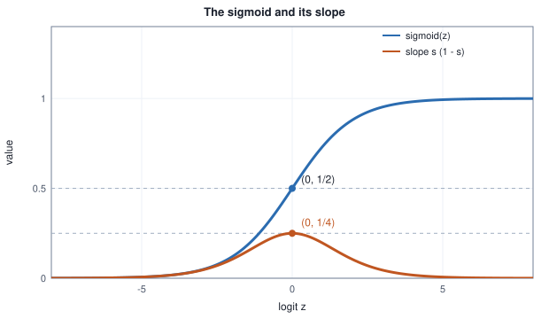

<!-- SPDX-License-Identifier: CC-BY-4.0 -->
<!-- Copyright (c) 2026 Martin Schröder <info@swedishembedded.com> -->

# Classification and Logistic Regression

*How does a model output a probability for a yes-or-no question, and how do we train it?*

## The problem

A workshop turns out machine parts and inspects every one. An inspector measures how far the diameter is from the drawing (in hundredths of a millimetre) and then says one word: pass or reject. The workshop wants a program that does the same from the measurement alone, and, because a wrong call costs money in both directions, it wants more than a word. It wants a number: *how likely is it that this part would be rejected?* A part with a probability of $0.51$ and a part with $0.99$ are both "reject", and the workshop treats them differently.

The previous chapter predicted a number on a scale: a temperature. Here the answer is one of two outcomes. A model that answers with one of a fixed set of categories, rather than a number on a scale, is a **classifier**, and the task of building one from labelled examples is **classification**. The label $y$ of a part is $1$ if it was rejected and $0$ if it passed. When there are exactly two classes, as here, the label takes the values $0$ and $1$ and the task is *binary* classification; the word is used for any number of classes, and the last section points at what changes for many.

Twelve parts were measured and inspected. The values below are produced as the book's randomness chapter specifies (the generator and the order of its draws are printed with the table). The draw order mentions the function `sigmoid`, $\sigma(z) = 1/(1 + e^{-z})$, which turns any number $z$ into a number between $0$ and $1$; here it is the chance that a part with this measurement is rejected. The chapter derives it in "The sigmoid: undoing the logit"; until then it is only a smooth S-shaped curve from $0$ to $1$. The part numbers are positions after sorting by $x$, not positions in the draw.

<!-- worked: logistic_regression.one_feature_table -->
Generator: the book's SplitMix64, seed 0x7b350638aa531ef5 (8878009080876310261).
Draw order, part by part (N = 12): x = round(5 u1, 1) with u1 = uniform(), then u2 = uniform(); y = 1 (rejected) when u2 < sigmoid(-5.5 + 2.2 x). Rows are shown sorted by x and numbered in that order.

| part | x (0.01 mm) | y |
|---|---:|---:|
| 1 | 1.0 | 0 |
| 2 | 1.2 | 1 |
| 3 | 1.3 | 0 |
| 4 | 1.4 | 0 |
| 5 | 1.5 | 0 |
| 6 | 1.7 | 0 |
| 7 | 2.4 | 1 |
| 8 | 2.5 | 1 |
| 9 | 2.7 | 0 |
| 10 | 3.1 | 1 |
| 11 | 3.5 | 1 |
| 12 | 4.0 | 1 |
<!-- /worked -->

(The generating law that appears in the draw order is nature's, written down here only so that the table can be reproduced; the learner never sees it.) The pattern is plain but not clean: large errors are mostly rejected and small ones mostly passed, yet one part at $x = 1.2$ was rejected and one at $x = 2.7$ passed. No single cut-off value of $x$, with every part above it called rejected and every part below it called passed, gets all twelve right. A model has to say that the chance of rejection rises with $x$ and that it is neither $0$ nor $1$ in the middle.

This chapter builds that model in four steps, each answering a question the previous step raises.

1. **Why not the line we already have?** We fit the straight line of chapter 2 to the labels and watch it fail in two specific, measurable ways.
2. **What should the model output?** A probability, which must lie between $0$ and $1$. We find the one function that turns a linear score into a probability and show that it is forced on us by the idea of odds.
3. **What should we minimise?** A score for a probability against an observed yes or no. It is the cross-entropy of Volume I applied to a coin with two sides, and we show why the squared error of chapter 2 is the wrong choice here.
4. **How do we get the weights?** Gradient descent again, with a gradient so simple that it is worth deriving twice, a check that the problem has one valley, and the numerical care that a loss made of logarithms of probabilities demands.

You may use from earlier chapters: gradient descent, the learning rate and the design matrix with a column of ones (chapter 2 of this volume); the dot product (Volume I, chapter 3); the logarithm (chapter 1); the derivative of the sigmoid (chapter 7); the gradient, convexity and the Hessian (chapters 7 and 8); the Bernoulli distribution (chapter 11); cross-entropy (chapter 13); and log-sum-exp and floating-point overflow (chapter 15).

## Before you begin

Six questions to answer from memory. The answers are at the end of the chapter. If one is hard, go back to the chapter named before reading on.

1. (Chapter 2 of this volume, "Linear Regression and the First Descent", gradient descent.) For $\mathcal{L}(w) = (w - 1)^2$, write one step of gradient descent from $w = 2$ with learning rate $\eta = 0.25$. What is the new $w$ and what is the loss before and after?
2. (Volume I, chapter 11, "The Distributions Machine Learning Uses", the Bernoulli distribution.) A Bernoulli variable takes the value $1$ with probability $q = 0.3$. What is the probability of the value $0$, and what is the mean? Write the probability of an observed value $y \in \{0, 1\}$ as one formula in $q$ and $y$.
3. (Volume I, chapter 13, "Information, Entropy and Surprise", cross-entropy.) For a target distribution $p = (1, 0)$ and a model $q = (0.8, 0.2)$, compute $H(p, q) = -\sum_k p_k \log q_k$ in nats. What is its value when $q = (1, 0)$, and what happens when $q = (0, 1)$?
4. (Volume I, chapter 1, "Numbers, Quantities and Notation", the logarithm.) Use $\log(ab) = \log a + \log b$ and $\log(1/a) = -\log a$ to show that $\log 0.25 = -\log 4$. What is $\log$ of a number between $0$ and $1$: positive, zero or negative?
5. (Volume I, chapter 3, "Vectors: Lists of Numbers with Geometry", the dot product.) For $\mathbf{w} = (2, -1, 0.5)$ and $\mathbf{x} = (1, 3, 4)$, what is $\mathbf{w} \cdot \mathbf{x}$, and what is the shape of $\mathbf{X}\mathbf{w}$ when $\mathbf{X}$ has shape $[N, 3]$?
6. (Volume I, chapter 7, "Derivatives: The Mathematics of Change", the sigmoid.) The sigmoid is $s(x) = 1/(1 + e^{-x})$ with slope $s'(x) = s(x)(1 - s(x))$. What are $s(0)$ and $s'(0)$, and what happens to $s'(x)$ as $x$ becomes very large?

## A first attempt: a line through the labels

The tool we already own is linear regression, and the labels are numbers, $0$ and $1$. The least-squares line through the twelve points $(x, y)$ is a legitimate thing to compute: it is the closed form of chapter 2, slope $S_{xy}/S_{xx}$ and a line through the means. To turn its value into a **decision** (a yes-or-no call: reject or pass) we compare it with the value $0.5$, halfway between the labels, and call a part rejected when the line is at or above it. A comparison value of this kind is called a *threshold*. A part is *misclassified* when the decision differs from its label, and the last column of the table counts them. Then we ask what happens when one part, a grossly oversize one at $x = 15$ (a clear reject, $y = 1$), is added to the data.

<!-- worked: logistic_regression.linear_fit_on_labels -->
| fit | intercept | slope | prediction at x = 0 | prediction at x = 5 | x where line = 0.5 | rows misclassified |
|---|---:|---:|---:|---:|---:|---:|
| twelve parts | -0.2238 | 0.3303 | -0.2238 | 1.4275 | 2.192 | 2 of 12 |
| plus one part at x = 15.0 (y = 1) | 0.3531 | 0.0583 | 0.3531 | 0.6448 | 2.518 | 4 of 13 |
<!-- /worked -->


Two things are wrong, and both are visible in the table.

**The outputs are not probabilities.** The first line predicts $-0.2238$ at $x = 0$ and $1.4275$ at $x = 5$. A "probability" of $-0.22$ or $1.43$ means nothing, and any program that multiplies or compares such outputs (a cost that weights each outcome by its probability, say) inherits the nonsense. The line is straight, so it must leave the band between $0$ and $1$ somewhere; the only question is where.

**A point that is clearly on the right side drags the decision to the wrong place.** The part at $x = 15$ is a reject and the model should be more sure of it, not less. But squared error asks the line to be close to $1$ out at $x = 15$ as well, and the only way a line can do that is to flatten. The slope falls from $0.3303$ to $0.0583$, the point where the line crosses $0.5$ moves from $2.192$ to $2.518$, and two rejected parts that were called correctly, those at $2.4$ and $2.5$, are now called passes: four mistakes of thirteen instead of two of twelve. Evidence that the model should be confident about changes its mind about parts nowhere near it.

The green curve in the figure is what we are about to build. Its value never leaves $(0, 1)$, it rises steeply where the labels change and levels off where they do not, so a far point agrees with it and cannot move it. The table that follows shows both facts for the curve's own fit: the weights $w_0, w_1$ of $\sigma(w_0 + w_1 x)$ that minimise the mean binary cross-entropy defined in the sections below. The first line of the table says how they were computed; the decision rule is the same as before, reject when the curve is at or above $0.5$.

<!-- worked: logistic_regression.logistic_fit_one_feature -->
Weights that minimise the mean binary cross-entropy of the next sections, found by Newton's method from w = (0, 0): 30 updates w <- w - solve(H, g, true), with the gradient g and Hessian H of the sections "The gradient" and "Convexity: one valley" (the gradient norm is then below 1e-12). The last row needs a solution that accurate; the others are printed to four decimals.

| fit | w0 | w1 | x where p = 0.5 | rows misclassified |
|---|---:|---:|---:|---:|
| twelve parts | -3.9640 | 1.8682 | 2.122 | 2 of 12 |
| plus one part at x = 15.0 | -3.9640 | 1.8682 | 2.122 | 2 of 13 |
| absolute change of the weights | 9.6 x 10^-10 | 4.8 x 10^-10 |  |  |
<!-- /worked -->

The two fits agree in all four printed decimals and the decision point does not move. The last row prints how far apart they really are: the far part changes each weight by less than $10^{-9}$. (A fit that stopped early would show a larger difference, but that would be an artifact of stopping, not a property of the model.) By the end of the chapter we will be able to say why the change is so small (Check your understanding, question 2).

## From probability to a linear score

We want a model that keeps what a line is good at (a weighted sum of the features, one weight per feature, trained by gradient descent) and produces a number in $(0, 1)$. The weighted sum of the features is the dot product $z = \mathbf{w}\cdot\mathbf{x}$; as in chapter 2, we put the intercept inside by giving every example a first feature equal to $1$, so $\mathbf{x} = (1, x_1, \dots, x_d)$ and $\mathbf{w} = (w_0, w_1, \dots, w_d)$. The score $z$ can be any real number. The job is a map from the whole real line onto the interval $(0, 1)$ that is not an arbitrary squash but follows from something about probabilities.

### Odds

Gamblers do not usually say that an event has probability $0.8$; they say it is "four to one". The **odds** of an event of probability $p$ are

$$
\mathrm{odds}(p) = \frac{p}{1 - p},
$$

the ratio of the chance that it happens to the chance that it does not. Probability $0.8$ gives odds $0.8/0.2 = 4$; probability $0.5$ gives odds $1$ ("evens"); probability $0.2$ gives odds $0.25$. Odds run from $0$ (impossible) to $\infty$ (certain) and the number $1$ sits at the symmetric point. That is better than a probability, which is squeezed against both ends of $(0, 1)$, but odds are still lopsided: "twice as likely" and "half as likely" are far apart ($2$ and $0.5$) though they are the same statement turned around.

The cure is the logarithm of chapter 1, which turns ratios into differences and a reciprocal into a negation. The logarithm of the odds is the **logit** of the probability:

$$
\mathrm{logit}(p) = \log\frac{p}{1 - p}.
$$

It runs over the whole real line, $-\infty$ for an impossible event and $+\infty$ for a certain one, it is $0$ at $p = 1/2$, and it is odd: $\mathrm{logit}(1 - p) = \log\frac{1-p}{p} = -\mathrm{logit}(p)$. Swapping the two outcomes only changes the sign.

<!-- worked: logistic_regression.odds_table -->
| p | odds p/(1-p) | logit z = log(odds) | sigmoid(z) |
|---|---:|---:|---:|
| 0.01 | 0.0101 | -4.5951 | 0.0100 |
| 0.10 | 0.1111 | -2.1972 | 0.1000 |
| 0.25 | 0.3333 | -1.0986 | 0.2500 |
| 0.50 | 1.0000 | 0.0000 | 0.5000 |
| 0.75 | 3.0000 | 1.0986 | 0.7500 |
| 0.90 | 9.0000 | 2.1972 | 0.9000 |
| 0.99 | 99.0000 | 4.5951 | 0.9900 |
<!-- /worked -->

Read the table down the logit column: $-4.5951, -2.1972, -1.0986, 0, 1.0986, 2.1972, 4.5951$. The probabilities $0.25$ and $0.75$ give logits of equal size and opposite sign, because their odds are $1/3$ and $3$. The last column anticipates the next subsection.

### The model: a linear logit

Now the modelling assumption, the whole of the model. *The logit of the probability of the label is a linear function of the features:*

$$
\mathrm{logit}\big(P(y = 1 \mid \mathbf{x})\big) = z = \mathbf{w}\cdot\mathbf{x}.
$$

Everything the line did well survives, because the right-hand side is still a weighted sum: each weight is the amount that one unit of its feature adds to the log-odds, or, since a sum of logarithms is the logarithm of a product, one unit multiplies the odds by $e^{w_j}$. The left-hand side is a quantity with no end points to run into, so a weighted sum can equal it for every input. The probability is recovered by running the logit backwards.

### The sigmoid: undoing the logit

Solve $z = \log\frac{p}{1-p}$ for $p$. Exponentiate both sides: $e^z = \frac{p}{1 - p}$. Multiply out, $e^z (1 - p) = p$, collect the terms in $p$, $e^z = p(1 + e^z)$, and divide:

$$
p = \frac{e^z}{1 + e^z} = \frac{1}{1 + e^{-z}} .
$$

The right-hand side is the **sigmoid** (also called the logistic function), $\sigma(z) = 1/(1 + e^{-z})$, which you met in Volume I as the example whose slope is easy: it is the inverse of the logit. For every $p \in (0, 1)$, $\sigma(\mathrm{logit}(p)) = p$, as the last column of the table of odds shows, and for every $z$, $\mathrm{logit}(\sigma(z)) = z$. The model, in the form the rest of the chapter uses, is therefore

$$
\hat{p} = \sigma(\mathbf{w}\cdot\mathbf{x}) = P(y = 1 \mid \mathbf{x}),
$$

the parameter of a Bernoulli distribution (chapter 11) over the label, computed from the features. The label $y$ is a draw from it. This is **logistic regression**; the name is historical, and the task it solves is classification.

Four properties of $\sigma$ carry the rest of the chapter. The table gives numbers for each.

<!-- worked: logistic_regression.sigmoid_properties -->
| z | sigmoid(z) | sigmoid(-z) | sum | s (1 - s) | central difference |
|---|---:|---:|---:|---:|---:|
| -8 | 0.000335 | 0.999665 | 1.000000 | 0.000335 | 0.000335 |
| -4 | 0.017986 | 0.982014 | 1.000000 | 0.017663 | 0.017663 |
| -2 | 0.119203 | 0.880797 | 1.000000 | 0.104994 | 0.104994 |
| -1 | 0.268941 | 0.731059 | 1.000000 | 0.196612 | 0.196612 |
| 0 | 0.500000 | 0.500000 | 1.000000 | 0.250000 | 0.250000 |
| 1 | 0.731059 | 0.268941 | 1.000000 | 0.196612 | 0.196612 |
| 2 | 0.880797 | 0.119203 | 1.000000 | 0.104994 | 0.104994 |
| 4 | 0.982014 | 0.017986 | 1.000000 | 0.017663 | 0.017663 |
| 8 | 0.999665 | 0.000335 | 1.000000 | 0.000335 | 0.000335 |
<!-- /worked -->

(The last column is the central difference $(\sigma(z + h) - \sigma(z - h))/(2h)$ with $h = 10^{-5}$.)



- **Range.** $0 < \sigma(z) < 1$ for every finite $z$, so the output is always a legitimate probability, and it reaches neither end.
- **Symmetry.** $\sigma(-z) = 1 - \sigma(z)$. Proof: $1 - \sigma(z) = \frac{e^{-z}}{1 + e^{-z}}$, and multiplying top and bottom by $e^{z}$ gives $\frac{1}{e^{z} + 1} = \sigma(-z)$. The columns "sigmoid(z)" and "sigmoid(-z)" add to $1$. It is the odd symmetry of the logit seen from the other side: the probability of the other outcome is the sigmoid of the negated score.
- **Slope.** $\sigma'(z) = \sigma(z)(1 - \sigma(z))$, derived in chapter 7 and confirmed by the last two columns. The slope is at most $1/4$, reached at $z = 0$.
- **Saturation.** For $\lvert z\rvert$ beyond about $4$ the sigmoid is within $0.02$ of its limit and its slope is under $0.018$; at $z = 8$ the slope is $0.000335$. A sigmoid that is deep in one of its tails is said to **saturate**: large changes of $z$ change $\hat{p}$ very little, and therefore a loss that reaches the weights *through* $\hat{p}$ receives almost no signal there. The next section shows that this matters.

## The decision boundary

A probability becomes a decision by a rule: reject the part when $\hat{p} \ge t$ for a threshold $t$, most often $t = 1/2$. Because $\sigma$ increases, $\hat{p} \ge 1/2$ exactly when $z \ge 0$, so the rule at $t = 1/2$ is a statement about the sign of a weighted sum:

$$
\text{reject} \iff w_0 + w_1 x_1 + w_2 x_2 \ge 0 .
$$

The set where the score is exactly zero, $w_0 + w_1 x_1 + w_2 x_2 = 0$, is a straight line in the plane of the two measurements; with three features it is a plane, and with $d$ features a flat sheet of dimension $d - 1$. It separates the region of rejection from the region of acceptance and is the **decision boundary**.

A hand example makes it concrete. Take $\mathbf{w} = (-5, 1, 1)$, so the boundary is $x_1 + x_2 = 5$. The part $(1, 1)$ has $z = -3$ and $\hat{p} = \sigma(-3) = 0.0474$: pass. The part $(2.5, 2.5)$ is on the boundary, $z = 0$, $\hat{p} = 0.5$. The part $(4, 3)$ has $z = 2$ and $\hat{p} = \sigma(2) = 0.8808$: reject. The score also measures how far a part is from the boundary: the vector $(w_1, w_2) = (1, 1)$ is at a right angle to the line (it is the gradient of $z$), and the signed distance of $(4, 3)$ from it is $z/\lVert(w_1, w_2)\rVert = 2/\sqrt{2} = 1.414$. So $z$ is a distance in units of $\lVert(w_1, w_2)\rVert$, and the sigmoid converts that distance into a probability: a part far from the boundary on the reject side is confidently rejected, and a part on the boundary is a coin toss.

The threshold is a separate choice from the model. Rejecting when $\hat{p} \ge t$ is the same as rejecting when $z \ge \mathrm{logit}(t)$, which is the boundary $w_0 + w_1 x_1 + w_2 x_2 = \mathrm{logit}(t)$: a line *parallel* to the one at $t = 1/2$, moved toward the passing side when $t < 1/2$ (reject more) and toward the rejecting side when $t > 1/2$ (reject less). Lines of equal probability are all parallel, as the figure in "Reading the fitted model" shows. Choosing $t$ is a decision about the relative cost of the two kinds of mistake, not about the model, and a later chapter measures them properly; this chapter shows the trade-off in a table once the weights are known.

## The loss: binary cross-entropy

Now to find the weights from labelled examples we need a score for a choice of $\mathbf{w}$, as in chapter 2. We have the model's probability $\hat{p}_n$ for each part $n$ and the true label $y_n \in \{0, 1\}$. What should a good loss be?

Think of the model as making a bet on the outcome. If it said $\hat{p} = 0.9$ and the part was rejected ($y = 1$), the model was right, and its loss should be small. If it said $0.9$ and the part passed, the model had assigned probability $1 - 0.9 = 0.1$ to what actually happened, and the loss should be large. In both cases the natural quantity is the probability the model gave to *what actually happened*. For a Bernoulli outcome that probability is written as one formula,

$$
P(y \mid \hat{p}) = \hat{p}^{\,y}(1 - \hat{p})^{1 - y},
$$

which equals $\hat{p}$ when $y = 1$ and $1 - \hat{p}$ when $y = 0$ (the exponent $0$ switches the other factor off).

Chapter 13 supplies the loss. The cross-entropy of a model $q$ against observed data $p$ is $H(p, q) = -\sum_k p_k \log q_k$; with a single observed label, $p$ puts all its weight on the observed outcome and the sum keeps one term, $-\log q_{\text{observed}}$, the *surprise* of the model at what happened. Here the outcomes are $0$ and $1$, the model $q = (1 - \hat{p}, \hat{p})$ and the observation $p = (1 - y, y)$. Then

$$
\ell(\hat{p}, y) = -\big[\,y \log \hat{p} + (1 - y)\log(1 - \hat{p})\,\big],
$$

the **binary cross-entropy** of one example, and its mean over the data,

$$
\mathcal{L}(\mathbf{w}) = \frac{1}{N}\sum_{n=1}^{N} \ell(\hat{p}_n, y_n), \qquad \hat{p}_n = \sigma(\mathbf{w}\cdot\mathbf{x}_n),
$$

is the loss we minimise. Numbers: for $y = 1$ and $\hat{p} = 0.9$ it is $-\log 0.9 = 0.1054$; for $y = 0$ and the same $\hat{p} = 0.9$ it is $-\log 0.1 = 2.3026$; for $\hat{p} = 0.5$ it is $\log 2 = 0.6931$ whatever the label. The loss is $0$ only for a perfect, certain prediction and it grows without bound as the model becomes certain of the wrong answer: $-\log\hat{p} \to \infty$ as $\hat{p} \to 0$ with $y = 1$. A bold wrong answer is punished far more than a timid one, and that is what we want from a probability.

(The next chapter explains why this is not only a sensible score but the one that follows from the principle of maximum likelihood. For now it is a cross-entropy, and chapter 13 told us what that measures.)

### The same loss, written in the logit

Everything above is in terms of $\hat{p}$, but $\hat{p}$ is computed from $z$, and for both clarity and numerical safety it helps to write the loss as a function of $z$ directly. Use $\log\sigma(z) = -\log(1 + e^{-z})$ and $\log(1 - \sigma(z)) = \log\sigma(-z) = -\log(1 + e^{z})$. Introduce the function **softplus**,

$$
\mathrm{softplus}(z) = \log(1 + e^{z}),
$$

a smooth version of $\max(z, 0)$ (it is close to $0$ for very negative $z$ and close to $z$ for very positive $z$). Then

$$
\ell = y\,\mathrm{softplus}(-z) + (1 - y)\,\mathrm{softplus}(z).
$$

A short identity simplifies this: $\mathrm{softplus}(z) = \log\big(e^{z}(e^{-z} + 1)\big) = z + \mathrm{softplus}(-z)$, so $\mathrm{softplus}(-z) = \mathrm{softplus}(z) - z$ and

$$
\boxed{\;\ell(z, y) = \mathrm{softplus}(z) - y\,z\;}
$$

for both values of $y$ (check: $y = 0$ gives $\mathrm{softplus}(z)$, $y = 1$ gives $\mathrm{softplus}(z) - z$). This is the form we compute and differentiate. It takes the logit, not the probability, so no step of the computation ever forms $\hat{p}$ and takes its logarithm. The numerical section shows what that buys.

### Why not the squared error?

Chapter 2 minimised the squared difference between prediction and label, and $(\hat{p} - y)^2$ is a perfectly good way to score a probability against a $0$ or $1$ (the statisticians call it the Brier score). Why leave it behind? Take one part with label $y = 1$ and compare the two losses and their slopes with respect to the logit $z$. The table abbreviates the binary cross-entropy of the next section as BCE, $-\log\hat{p}$ for $y = 1$, and the squared error as SE, $(\hat{p} - 1)^2$. By the chain rule (derived in "The gradient" below) the slope of BCE is $\hat{p} - 1$ and the slope of SE is $2(\hat{p} - 1)\,\hat{p}(1 - \hat{p})$.

<!-- worked: logistic_regression.single_example_losses -->
| z | p | BCE | squared error | dBCE/dz | dSE/dz |
|---|---:|---:|---:|---:|---:|
| -8 | 0.00034 | 8.00034 | 0.99933 | -0.99966 | -0.00067 |
| -4 | 0.01799 | 4.01815 | 0.96435 | -0.98201 | -0.03469 |
| -2 | 0.11920 | 2.12693 | 0.77580 | -0.88080 | -0.18496 |
| 0 | 0.50000 | 0.69315 | 0.25000 | -0.50000 | -0.25000 |
| 2 | 0.88080 | 0.12693 | 0.01421 | -0.11920 | -0.02503 |
| 4 | 0.98201 | 0.01815 | 0.00032 | -0.01799 | -0.00064 |
<!-- /worked -->


Look at the row $z = -8$. The model says the part has a probability of $0.00034$ of being a reject, and it *is* a reject: the model is confidently, badly wrong. The squared error is $0.99933$, almost its maximum possible value of $1$, and its slope is $-0.00067$: gradient descent is told that the loss is nearly flat there and to hardly move. The cross-entropy is $8.00034$ and its slope is $-0.99966$: move, quickly. The squared error treats a part with $\hat{p} = 0.018$ and one with $\hat{p} = 0.0003$ almost alike (losses $0.964$ and $0.999$), and the cross-entropy knows the second is twice as bad ($4.02$ and $8.00$). This is the saturation of the sigmoid at work: the chain rule for the squared error multiplies in $\sigma'(z)$, which vanishes in the tails, exactly where the model is most wrong.

There is a second, deeper reason. Chapter 2 showed that the squared error of a *linear* model is a convex bowl in the weights, which is what made "go downhill" safe. Put a sigmoid inside the squared error and the bowl is gone. Take the simplest case, one part with $x = 1$ and $y = 1$, no intercept, and one weight $w$, so $z = w$. The table gives both losses as functions of $w$ with a second difference $(\mathcal{L}(w + h) - 2\mathcal{L}(w) + \mathcal{L}(w - h))/h^2$ at $h = 0.01$ for the curvature: a convex function has a non-negative second derivative everywhere.

<!-- worked: logistic_regression.nonconvex_squared_error -->
| w | squared error | its second difference | BCE | its second difference |
|---|---:|---:|---:|---:|
| -6 | 0.99506 | -0.00488 | 6.00248 | +0.00247 |
| -4 | 0.96435 | -0.03282 | 4.01815 | +0.01766 |
| -2 | 0.77580 | -0.11881 | 2.12693 | +0.10499 |
| -1 | 0.53445 | -0.05553 | 1.31326 | +0.19661 |
| 0 | 0.25000 | +0.12500 | 0.69315 | +0.25000 |
| 1 | 0.07233 | +0.12618 | 0.31326 | +0.19661 |
| 2 | 0.01421 | +0.04111 | 0.12693 | +0.10499 |
| 4 | 0.00032 | +0.00124 | 0.01815 | +0.01766 |
<!-- /worked -->

The squared error has negative curvature for $w \le -1$ and positive curvature from $w = 0$ on: it is a ramp that turns over into a bowl, not a bowl. The cross-entropy's curvature is positive in every row, and it equals $\sigma(w)(1 - \sigma(w))$ (compare the column $s(1 - s)$ of the sigmoid table), so it is never negative; we prove that in general below. The practical consequence is shown by running gradient descent on each from the same bad start, $w = -6$, with $\eta = 1$ (the part, the step rule and the recorded steps are printed with the table):

<!-- worked: logistic_regression.descent_squared_vs_bce -->
One part with x = 1 and y = 1, no intercept, so z = w. Start w = -6, eta = 1. Each step is w <- w - eta g with g = 2 (p - 1) p (1 - p) for the squared error (p - y)^2 and g = p - 1 for the BCE; row k shows w after k steps.

| step k | w (squared error) | its loss | w (BCE) | its loss |
|---|---:|---:|---:|---:|
| 0 | -6.0000 | 0.99506 | -6.0000 | 6.00248 |
| 5 | -5.9752 | 0.99494 | -1.1849 | 1.45172 |
| 10 | -5.9497 | 0.99481 | 1.2560 | 0.25059 |
| 50 | -5.7188 | 0.99347 | 3.7420 | 0.02343 |
| 100 | -5.3284 | 0.99037 | 4.5195 | 0.01084 |
| 500 | 3.4300 | 0.00098 | 6.1963 | 0.00203 |
| 2000 | 4.4010 | 0.00015 | 7.5960 | 0.00050 |
<!-- /worked -->

After ten steps the cross-entropy run has crossed zero and is at loss $0.25$; the squared-error run has moved from $-6.0000$ to $-5.9497$ and has a loss of $0.99481$, hardly different from where it began. It does reach the solution eventually (by step $500$ it is at $w = 3.43$), because the bad plateau is crossed slowly, but at step $100$ its loss is still $0.99037$ against $0.01084$ for the cross-entropy run. On a real model with thousands of weights the plateau is not always crossed.

## The gradient

To run gradient descent we need $\nabla\mathcal{L}$. We derive it twice, because the two routes teach different things.

**Route 1, through the logit form.** Take one example. $\ell = \mathrm{softplus}(z) - y z$ with $z = \mathbf{w}\cdot\mathbf{x}$. The derivative of $\mathrm{softplus}(z) = \log(1 + e^z)$ is $\frac{e^z}{1 + e^z} = \sigma(z)$ (chain rule, chapter 7). So

$$
\frac{\partial \ell}{\partial z} = \sigma(z) - y = \hat{p} - y .
$$

Since $z = \sum_j w_j x_j$, $\partial z/\partial w_j = x_j$, and the chain rule gives

$$
\frac{\partial \ell}{\partial w_j} = (\hat{p} - y)\,x_j .
$$

**Route 2, through the probabilities.** Differentiate the original form. With $\hat{p} = \sigma(z)$,
$\frac{\partial \ell}{\partial \hat{p}} = -\frac{y}{\hat{p}} + \frac{1 - y}{1 - \hat{p}}$ and $\frac{\partial \hat{p}}{\partial z} = \hat{p}(1 - \hat{p})$. Multiply:

$$
\frac{\partial \ell}{\partial z} = \left(-\frac{y}{\hat{p}} + \frac{1 - y}{1 - \hat{p}}\right)\hat{p}(1 - \hat{p}) = -y(1 - \hat{p}) + (1 - y)\hat{p} = \hat{p} - y .
$$

The $\hat{p}(1 - \hat{p})$ of the sigmoid slope cancels the $1/\hat{p}$ and $1/(1 - \hat{p})$ of the logarithm exactly. That cancellation is the reason the table above shows a slope of $-0.99966$ at $z = -8$: the sigmoid's flat tail, which kills the squared error's gradient, is precisely compensated by the logarithm's steepness. (For the squared error the same chain is $2(\hat{p} - y)\cdot\hat{p}(1 - \hat{p})$, and nothing cancels it: it is the column "dSE/dz".)

The mean over the data, in matrix form, with $\mathbf{X}$ of shape $[N, d+1]$ (a column of ones first), $\mathbf{y}$ of shape $[N]$ and $\sigma$ applied to each element of $\mathbf{X}\mathbf{w}$:

$$
\nabla_{\mathbf{w}}\mathcal{L} = \frac{1}{N}\,\mathbf{X}^\top\big(\sigma(\mathbf{X}\mathbf{w}) - \mathbf{y}\big), \qquad \text{shape } [d + 1].
$$

Compare it with the gradient of chapter 2, $\frac{2}{N}\mathbf{X}^\top(\mathbf{X}\mathbf{w} - \mathbf{y})$. It is the same sentence: *the gradient is each feature times the residual, averaged over the examples*, where the residual is now the probability minus the label instead of the prediction minus the label. (The factor $2$ is the only other difference: it came from differentiating a square.) Nothing in "error times input" is special to lines; it is what you get whenever the loss and the output nonlinearity are a matched pair, and the next volume meets it again, for a different nonlinearity, as the gradient of softmax and cross-entropy.

Every derivation of a gradient in this book is followed by a check against finite differences (chapter 8), because a wrong gradient still lowers the loss for a while:

<!-- worked: logistic_regression.gradient_check -->
At w = (-1.0, 0.5, 0.25) on the sixty parts; finite differences with h = 1e-06.

| component | (1/N) X^T (p - y) | central difference of the loss |
|---|---:|---:|
| w0 | 0.23641426 | 0.23641426 |
| w1 | 0.44482425 | 0.44482425 |
| w2 | 0.26398166 | 0.26398166 |
<!-- /worked -->

The sixty parts are the data of the next section, where the second measurement joins the first.

## Two measurements: the data

A single measurement can only give a threshold. The workshop in fact measures a second quantity on every part, the surface roughness in micrometres, and the two together decide the inspection. Here are the sixty parts (the draw order is given so you can generate them yourself).

<!-- worked: logistic_regression.parts_table -->
Generator: the book's SplitMix64, seed 0x9b6efb5e5166b958 (11200165705828186456).
Draw order, part by part (N = 60): x1 = round(5 u1, 1), x2 = round(5 u2, 1), u3, each u = uniform(); y = 1 (rejected) when u3 < sigmoid(-6.0 + 1.2 x1 + 1.0 x2). First ten rows, then the totals.

| part | x1 (0.01 mm) | x2 (micrometres) | y |
|---|---:|---:|---:|
| 1 | 1.4 | 0.8 | 0 |
| 2 | 1.7 | 0.1 | 0 |
| 3 | 3.6 | 4.4 | 1 |
| 4 | 4.9 | 4.0 | 1 |
| 5 | 2.4 | 3.4 | 0 |
| 6 | 3.9 | 3.5 | 1 |
| 7 | 3.6 | 4.2 | 1 |
| 8 | 1.9 | 1.8 | 0 |
| 9 | 1.9 | 4.8 | 1 |
| 10 | 1.6 | 3.3 | 0 |

Rejected parts (y = 1): 27 of 60; passed (y = 0): 33.
<!-- /worked -->

The design matrix $\mathbf{X}$ has shape $[60, 3]$, with rows $(1, x_1, x_2)$, and the label vector $\mathbf{y}$ has shape $[60]$.

## Convexity: one valley

Gradient descent on a loss with many valleys can end in a poor one. For logistic regression it cannot, and the proof is the same short argument as for least squares, one level up: the Hessian of chapter 8.

Differentiate $\partial\mathcal{L}/\partial w_j = \frac{1}{N}\sum_n (\hat{p}_n - y_n) x_{nj}$ once more, with respect to $w_k$. The label does not depend on $\mathbf{w}$, and $\partial\hat{p}_n/\partial w_k = \hat{p}_n(1 - \hat{p}_n)x_{nk}$, so

$$
\frac{\partial^2 \mathcal{L}}{\partial w_j\,\partial w_k} = \frac{1}{N}\sum_{n} \hat{p}_n(1 - \hat{p}_n)\,x_{nj}\,x_{nk},
\qquad
\mathbf{H} = \frac{1}{N}\,\mathbf{X}^\top\mathbf{S}\,\mathbf{X}, \quad \mathbf{S} = \mathrm{diag}\big(\hat{p}_n(1 - \hat{p}_n)\big).
$$

For any direction $\mathbf{v}$ of shape $[d + 1]$,

$$
\mathbf{v}^\top\mathbf{H}\,\mathbf{v} = \frac{1}{N}\sum_n \hat{p}_n(1 - \hat{p}_n)\,(\mathbf{x}_n\cdot\mathbf{v})^2 \;\ge\; 0,
$$

a sum of non-negative terms: the Hessian is positive semidefinite everywhere, which is the second-derivative test for convexity in many variables. Every point with zero gradient is a global minimum. If the columns of $\mathbf{X}$ are independent, every $\hat{p}_n(1 - \hat{p}_n)$ is strictly positive and the only $\mathbf{v}$ with $\mathbf{v}^\top\mathbf{H}\mathbf{v} = 0$ is $\mathbf{0}$: the loss is strictly convex and has at most one minimiser. (At most: whether it has one at all is the subject of a later section.)

The matrix $\mathbf{S}$ has entries at most $1/4$, since $\hat{p}(1 - \hat{p})\le 1/4$. Hence $\mathbf{v}^\top\mathbf{H}\mathbf{v} \le \frac{1}{4N}\mathbf{v}^\top\mathbf{X}^\top\mathbf{X}\mathbf{v}$ and the largest eigenvalue of $\mathbf{H}$ never exceeds the **curvature cap**

$$
\lambda_{\mathrm{cap}} = \tfrac{1}{4}\,\lambda_{\max}\!\big(\tfrac{1}{N}\mathbf{X}^\top\mathbf{X}\big)
$$

(the subscript is a label; the letter $L$ is not used for it because the notation page lists $L$ for a loss).

By chapter 2, gradient descent on a quadratic with largest curvature $\lambda_{\max}$ is stable for $\eta < 2/\lambda_{\max}$; the loss here is not quadratic, but its curvature is bounded by $\lambda_{\mathrm{cap}}$ everywhere, and a step of $\eta = 1/\lambda_{\mathrm{cap}}$ is a safe choice. The table evaluates the Hessian's eigenvalues at four values of $\mathbf{w}$ on the sixty parts, computed with `jacobi_eigen(H, 20)`, the symmetric eigenvalue routine of Volume I, chapter 6 (also used for $\lambda_{\max}$ in the cap). The row "fitted w" uses the weights at the stop of the run in the next section, printed in the table's first line to four decimals.

<!-- worked: logistic_regression.hessian_psd -->
Hessian of the mean loss, H = (1/N) X^T S X with S = diag(p (1 - p)), on the sixty parts; eigenvalues by jacobi_eigen(H, 20). Bound lambda_cap = 3.916414; fitted w = (-9.6185, 1.7694, 1.7584), the weights at the stop of the run in "Training by gradient descent".

| where | smallest eigenvalue | middle | largest |
|---|---:|---:|---:|
| w = (0, 0, 0) | 0.0369 | 0.3932 | 3.9164 |
| w = (-3, 0.5, 0.5) | 0.0186 | 0.3341 | 3.3404 |
| fitted w | 0.0021 | 0.1919 | 1.4724 |
| w = (-30, 6, 6) | 7.81 x 10^-5 | 0.0564 | 0.3423 |
<!-- /worked -->

Every eigenvalue is positive. At $\mathbf{w} = \mathbf{0}$ every $\hat{p} = 1/2$, $\mathbf{S} = \frac{1}{4}\mathbf{I}$ and the largest eigenvalue is exactly the cap $\lambda_{\mathrm{cap}}$; elsewhere it is smaller. Notice the last row. As the weights grow, the probabilities approach $0$ and $1$, the products $\hat{p}(1 - \hat{p})$ shrink and *all* the curvature drains away. We return to this.

## Training by gradient descent

The ingredients are in place: the model, the loss, its gradient, a step size and the guarantee of one valley. The algorithm is the loop of chapter 2.

```text
function sigmoid(z: real) -> real:
    if z >= 0:
        return 1 / (1 + exp(-z))
    e = exp(z)
    return e / (1 + e)

function train_logistic(X: array<real>[N, D], y: array<real>[N], eta: real, tau: real,
                        max_steps: int) -> (w: array<real>[D], steps: int):
    require N > 0 and D > 0, "no data"
    require eta > 0 and tau > 0 and max_steps >= 0, "bad hyperparameters"
    for n in 0 .. N:
        require y[n] == 0 or y[n] == 1, "labels must be 0 or 1"
    w = zeros(real, [D])
    for k in 0 .. max_steps:
        r = zeros(real, [N])                         # residuals, shape [N]
        for n in 0 .. N:
            z = sum([X[n, j] * w[j] for j in 0 .. D])     # the logit of part n
            r[n] = sigmoid(z) - y[n]                 # p - y
        g = zeros(real, [D])                         # gradient, shape [D]
        for j in 0 .. D:
            g[j] = sum([X[n, j] * r[n] for n in 0 .. N]) / N
        if sqrt(sum([g[j] * g[j] for j in 0 .. D])) < tau:
            return (w, k)                            # k steps were taken
        for j in 0 .. D:
            w[j] = w[j] - eta * g[j]
    return (w, max_steps)                            # not converged
```

The shapes are $\mathbf{X}: [N, D]$ with $D = d + 1$ (the column of ones included), $\mathbf{y}: [N]$, the residual vector $[N]$, the gradient and the weights $[D]$. The check on the gradient is made *before* the update, so the value returned for $k$ is the number of updates performed: `train_logistic` called with `max_steps` $= 0$ returns $\mathbf{0}$ and $0$. The cost of a step is two passes over the matrix, $O(N D)$, and the memory is $O(N + D)$ beyond the data.

We run it on the sixty parts with the learning rate $\eta = 1/\lambda_{\mathrm{cap}}$ from the previous section (so $\eta = 0.255336$ for $\lambda_{\mathrm{cap}} = 3.916414$) and the stopping rule "gradient norm below $10^{-5}$", starting from $\mathbf{w} = \mathbf{0}$ (so that every $\hat{p}$ starts at $1/2$ and the initial loss is $\log 2$).

<!-- worked: logistic_regression.training_run -->
Start w = (0, 0, 0). lambda_cap = lambda_max(X^T X / N) / 4 = 3.916414, learning rate eta = 1/lambda_cap = 0.255336, stop when the gradient norm is below 1e-05.

| step k | w0 | w1 | w2 | loss | gradient norm |
|---|---:|---:|---:|---:|---:|
| 0 | 0.0000 | 0.0000 | 0.0000 | 0.693147 | 0.405625 |
| 1 | -0.0128 | 0.0606 | 0.0830 | 0.668842 | 0.154861 |
| 2 | -0.0471 | 0.0564 | 0.1021 | 0.662807 | 0.150565 |
| 5 | -0.1490 | 0.0467 | 0.1489 | 0.646434 | 0.140699 |
| 10 | -0.3120 | 0.0458 | 0.2082 | 0.623025 | 0.129772 |
| 20 | -0.6150 | 0.0745 | 0.2866 | 0.584472 | 0.116189 |
| 50 | -1.3776 | 0.2093 | 0.4178 | 0.503792 | 0.090015 |
| 100 | -2.3178 | 0.3929 | 0.5631 | 0.429789 | 0.063885 |
| 200 | -3.5555 | 0.6311 | 0.7601 | 0.364966 | 0.039480 |
| 500 | -5.4835 | 0.9966 | 1.0738 | 0.310667 | 0.017691 |
| 1000 | -6.9899 | 1.2796 | 1.3215 | 0.290943 | 0.008496 |
| 2000 | -8.3233 | 1.5287 | 1.5423 | 0.283023 | 0.003381 |
| 5000 | -9.3970 | 1.7283 | 1.7213 | 0.280953 | 0.000504 |
| 12203 (stop) | -9.6185 | 1.7694 | 1.7584 | 0.280895 | 1.00e-05 |
<!-- /worked -->

The loss falls monotonically from $0.693147$ to $0.280895$. Step 1 is large (the gradient norm is $0.4056$) and the rest are small: at step $100$ the norm is $0.0639$ and the loss is still $0.4298$ against a final $0.2809$. It takes $12203$ steps to bring the gradient below $10^{-5}$. The slowness is the condition number of chapter 8 showing itself. At the solution the Hessian's eigenvalues (table above) are $1.4724$ and $0.0021$, a ratio of about $700$. The error along the flat direction shrinks by a factor $1 - \eta\lambda_{\min} \approx 1 - 0.2553 \times 0.0021 \approx 1 - 5.4\times 10^{-4}$ per step: about $1/(5.4 \times 10^{-4}) \approx 1850$ steps for each factor of $e$. The learning rate cannot be raised (the steep direction would then be unstable). Chapter 2's remedy, rescaling the features, helps; so does a method that uses the Hessian, which Volume III names. Neither changes the answer, only the number of steps.

## Reading the fitted model

The weights are $\mathbf{w} = (-9.6185, 1.7694, 1.7584)$. They are not the law's $(-6.0, 1.2, 1.0)$: sixty labels, each a single yes or no, determine a probability only loosely, and how far to trust a fit like this is a question of the later chapters on generalization. What the fit does let us do is read the model.

<!-- worked: logistic_regression.reading_the_fit -->
| weight | value | odds multiplier exp(w) |
|---|---:|---:|
| w1 (x1, diameter error) | 1.7694 | 5.8673 |
| w2 (x2, roughness) | 1.7584 | 5.8029 |

Part (3.0, 3.0): z = 0.9647, p = 0.7241, odds = 2.6240. One more unit of x1: z = 2.7341, p = 0.9390, odds = 15.3961, the ratio of the odds is 5.8673.
<!-- /worked -->

A weight is a change of log-odds, so $e^{w_j}$ is the factor by which one more unit of feature $j$ multiplies the odds of rejection, other things held fixed. One more hundredth of a millimetre multiplies the odds by $5.8673$ and one more micrometre of roughness by $5.8029$. The effect on the *probability* is not constant: the same unit of $x_1$ moves the part at $(3, 3)$ from $\hat{p} = 0.7241$ to $0.9390$, a rise of $0.2149$, and would move a part at $\hat{p} = 0.99$ by almost nothing, because the odds, not the probability, are what the weights act on.

The decision boundary and the lines of equal probability, for this fit:

<!-- worked: logistic_regression.decision_boundary -->
Fitted w = (-9.6185, 1.7694, 1.7584). The boundary w0 + w1 x1 + w2 x2 = 0 is the line x2 = 5.4702 - 1.0063 x1 (crossing x2 = 0 at x1 = 5.4361 and x1 = 0 at x2 = 5.4702).

| part (x1, x2) | z = w.x | p | decision at 0.5 |
|---|---:|---:|---:|
| (1.0, 1.0) | -6.0908 | 0.0023 | pass |
| (2.0, 2.0) | -2.5630 | 0.0716 | pass |
| (2.5, 2.5) | -0.7992 | 0.3102 | pass |
| (3.0, 3.0) | +0.9647 | 0.7241 | reject |
| (4.0, 2.0) | +0.9758 | 0.7263 | reject |
| (0.5, 4.5) | -0.8212 | 0.3055 | pass |
<!-- /worked -->


The four dashed lines are the sets where the model's probability is $0.1, 0.25, 0.75, 0.9$ (the solid line is the boundary at $0.5$): the set where $\hat{p} = p_0$ is where $z = \mathrm{logit}(p_0)$, which is again a line, with the same direction as the boundary. The probability changes only in one direction, across the lines, and not along them; the model has no other structure. The distance between neighbouring lines is a fixed amount of $z$ divided by $\lVert(w_1, w_2)\rVert$: it is the same for all parts, so confidence changes quickly where the weights are large. The picture also shows the points that a straight boundary cannot satisfy: green dots on the reject side near $(3.4, 3.3)$, $(4.4, 1.1)$ and $(2.4, 3.4)$, and red dots on the pass side near $(2.7, 0.8)$ and $(2.1, 2.6)$. They are the five mistakes at the threshold $1/2$ counted in the next table.

The threshold now has real content. Moving it moves the line parallel to itself, as predicted, and changes which mistakes the workshop makes:

<!-- worked: logistic_regression.threshold_table -->
The sixty training parts (27 rejected, 33 passed). A part is rejected when p >= t.

| threshold t | logit(t) | good parts rejected | bad parts passed | fraction correct |
|---|---:|---:|---:|---:|
| 0.1 | -2.1972 | 12 | 1 | 0.7833 |
| 0.3 | -0.8473 | 8 | 2 | 0.8333 |
| 0.5 | +0.0000 | 3 | 2 | 0.9167 |
| 0.7 | +0.8473 | 1 | 7 | 0.8667 |
| 0.9 | +2.1972 | 1 | 14 | 0.7500 |
<!-- /worked -->

A low threshold rejects parts that would have passed ($12$ at $t = 0.1$) and lets few bad parts through ($1$); a high threshold does the reverse ($14$ bad parts passed at $t = 0.9$). The best fraction correct on these sixty parts is at $t = 0.5$, with $55$ of $60$ correct, but "fraction correct" treats both mistakes as equally costly, and if letting a bad part through costs ten times as much as scrapping a good one, a threshold near $1/11 \approx 0.09$ is the one that minimises expected cost, as Exercise 11 asks you to check. Note also that these are counts on the parts the weights were fitted to. Whether the model will do as well on new parts is the question of chapter 5 and the rest of the volume; chapter 6 develops the numbers (precision, recall) that describe the two kinds of mistake.

## Making it numerically safe

The loss is made of logarithms of probabilities, and a probability near $0$ or $1$ is exactly what a confident model produces. This section is about the three ways a naive implementation fails, and the one habit that avoids them.

**Computing $\log\sigma(z)$ in two steps.** The natural code is `log(sigmoid(z))`. In 32-bit floating point, for $z$ very negative the term $e^{-z}$ in the denominator overflows to infinity once $z$ falls below about $-88.7$, so $\sigma(z) = 1/\infty = 0$ and $\log 0 = -\infty$, although the true value $\log\sigma(z) \approx z$ is an ordinary number. For $z$ very positive, $\sigma(z)$ is so close to $1$ that it *is* $1$ in the format (the spacing of 32-bit numbers just below $1$ is $6 \times 10^{-8}$), and $\log 1 = 0$ loses the true value $-e^{-z}$ entirely. The table computes both, rounding every operation to 32 bits, against the exact value from 60-digit decimal arithmetic:

<!-- worked: logistic_regression.naive_vs_stable -->
| z | naive log(sigmoid(z)) | stable -softplus(-z) | exact |
|---|---:|---:|---:|
| -100 | -inf | -100.00000 | -1.000000e+02 |
| -90 | -inf | -90.00000 | -9.000000e+01 |
| -30 | -30.00000 | -30.00000 | -3.000000e+01 |
| 0 | -0.69315 | -0.69315 | -6.931472e-01 |
| 20 | 0 | -2.061 x 10^-9 | -2.061154e-09 |
| 30 | 0 | -9.358 x 10^-14 | -9.357623e-14 |
| 60 | 0 | -8.757 x 10^-27 | -8.756511e-27 |

Loss of a part with label y = 0 whose logit is z (the true value is softplus(z)):

| z | p = sigmoid(z) | 1 - p | naive -log(1 - p) | stable softplus(z) |
|---|---:|---:|---:|---:|
| 5 | 0.993307173 | 0.00669 | 5.00672 | 5.00672 |
| 15 | 0.999999642 | 3.576 x 10^-7 | 14.84377 | 15.00000 |
| 17 | 1.000000000 | 0 | inf | 17.00000 |
| 20 | 1.000000000 | 0 | inf | 20.00000 |
| 30 | 1.000000000 | 0 | inf | 30.00000 |
| 100 | 1.000000000 | 0 | inf | 100.00000 |
<!-- /worked -->

(Every 32-bit entry is computed one operation at a time: the exact result of the operation on its already-rounded inputs is rounded to the nearest 32-bit number, ties to even, with overflow giving $\infty$ and no flush of tiny values to zero. The operations that round are each `+`, `-`, `/`, `exp`, `log` and `log1p`; negation, `abs`, `min`, `max` and comparisons are exact. The "naive" column of the first table is `log(1 / (1 + exp(-z)))`, three rounded operations (`exp`, `+`, `/`) and then the `log`, with the quotient taken as $0$ when the denominator is $\infty$; the "naive" column of the second is `-log(1 - p)` with `p` as just computed, and $\log 0 = -\infty$. The "stable" columns are `min(z, 0) - log1p(exp(-abs(z)))` (first table, which is $-\mathrm{softplus}(-z)$) and `max(z, 0) + log1p(exp(-abs(z)))` (second table), again one rounding per operation. The "exact" column is $-\log(1 + e^{-z})$ in 60-digit decimal arithmetic.)

The first table's naive column is $-\infty$ where the answer is a perfectly ordinary $-100$, and $0$ where the answer is about $-10^{-9}$. The second table shows the worse mistake. A part whose label is $0$ and whose logit is $17$ (the model is confidently wrong) has a loss of exactly $17$; the naive formula divides to $1 - p = 0$ and returns $+\infty$, and an infinite loss, or the "not a number" that follows $\infty - \infty$, enters the average and ruins it. Even where the result is finite, at $z = 15$, the naive value $14.84377$ is off in the second digit: $1 - \hat{p}$ was computed by subtracting two nearly equal numbers, the cancellation of Volume I, chapter 15.

**The stable form.** The remedy is the logit form of the loss, evaluated with the right formula for each sign. The function $\mathrm{softplus}(z) = \log(1 + e^z)$ is the log-sum-exp of the two numbers $0$ and $z$ (chapter 15: $\mathrm{lse}(0, z) = \log(e^0 + e^z)$), and the log-sum-exp is computed by subtracting the larger number first. With $m = \max(0, z)$,

$$
\mathrm{softplus}(z) = m + \log\!\big(e^{-m} + e^{z - m}\big) = \max(z, 0) + \log\!\big(1 + e^{-\lvert z\rvert}\big).
$$

Both exponentials are of a non-positive number, so nothing overflows; the logarithm is of a number between $1$ and $2$; and `log1p` of chapter 15 gives the logarithm accurately when $e^{-\lvert z\rvert}$ is tiny, so the stable column above for $z = 20$ is $-2.061 \times 10^{-9}$ and not $0$. The loss is then $\ell = \mathrm{softplus}(z) - y z$ and $\log\sigma(z) = -\mathrm{softplus}(-z)$. In the pseudocode of the book:

```text
function softplus(z: real) -> real:
    return max(z, 0) + log1p(exp(-abs(z)))

function bce_from_logit(z: real, y: real) -> real:
    return softplus(z) - y * z            # y in {0, 1} (or a soft target in [0, 1])
```

The sigmoid of the pseudocode above has two branches for the same reason: the exponent is never positive, so the argument of `exp` can never overflow.

**The tempting wrong fix.** The common repair is to clamp the probability into $[\varepsilon, 1 - \varepsilon]$ before taking the log. It removes the infinities and produces silent damage: the clamp is a flat region, so a model that is confidently wrong gets *no gradient* with which to climb out. The last section tells how that was found in brain.

## When the data can be separated

Suppose a threshold exists that gets every training example right: the data are **linearly separable**. Four parts, one measurement, labels $0, 0, 1, 1$ at $x = 0.5, 1.0, 2.0, 3.0$, are such data. Any boundary between $x = 1$ and $x = 2$ classifies all four correctly. What does gradient descent do with them, starting from $\mathbf{w} = (0, 0)$ and $\eta = 0.5$?

<!-- worked: logistic_regression.separable_growth -->
Data (x, y): (0.5, 0), (1.0, 0), (2.0, 1), (3.0, 1). Start w = (0, 0), eta = 0.5, plain gradient steps.

| step k | w0 | w1 | norm of w | boundary -w0/w1 | loss | p at x = 1 | p at x = 2 |
|---|---:|---:|---:|---:|---:|---:|---:|
| 10 | -0.5982 | 0.7516 | 0.9606 | 0.7958 | 0.468809 | 0.5383 | 0.7120 |
| 100 | -3.6558 | 2.5982 | 4.4851 | 1.4071 | 0.149635 | 0.2578 | 0.8236 |
| 1000 | -9.0579 | 6.1919 | 10.9720 | 1.4629 | 0.023330 | 0.0539 | 0.9653 |
| 10000 | -15.6669 | 10.6009 | 18.9164 | 1.4779 | 0.002565 | 0.0063 | 0.9961 |
| 100000 | -22.5370 | 15.1813 | 27.1733 | 1.4845 | 0.000260 | 0.0006 | 0.9996 |
<!-- /worked -->

The weights never settle. Over the last three factors of $10$ in the number of steps the norm of $\mathbf{w}$ grows by $6.5$, $7.9$ and $8.3$: increments that level off at a constant, which is what growth like $\log k$ looks like. The loss falls by about a factor of $10$ per decade, like $1/k$, without ever reaching its infimum of zero. The boundary creeps toward $x = 1.5$, halfway between the two classes.

The reason is the loss itself. If $\mathbf{w}$ classifies every example correctly then every $z_n$ has the sign of its label, and scaling $\mathbf{w}$ to $c\mathbf{w}$ with $c > 1$ pushes every $\hat{p}_n$ nearer to its correct end, strictly lowering the loss. So no finite $\mathbf{w}$ is optimal: the infimum is approached only as $\lVert\mathbf{w}\rVert \to \infty$. This is the case of the strictly convex loss that has no minimiser, and it is the last row of the Hessian table seen from the other side: as the weights grow, the curvature $\hat{p}(1 - \hat{p})$ vanishes, descent slows, and the gradient is small long before the weights are meaningful. It means the stopping rule on the gradient norm of this chapter does not detect convergence on such data; the run ends because the gradient has become small, at an arbitrary size of $\mathbf{w}$.

The consequence for use is practical. Separable data are common when there are few examples or many features (twelve examples can usually be separated by a flat sheet, the many-dimensional version of a line, in a hundred dimensions), and the weights of such a fit are a number decided by how long you ran the loop. The fitted probabilities are then extreme: $\hat{p} = 0.0006$ and $0.9996$ at the two nearest points after $10^5$ steps, for four examples. The cure is to stop the weights from growing by adding to the loss a penalty that increases with $\lVert\mathbf{w}\rVert$, so that a finite minimum exists again. That is regularization, and the next chapter derives it from probability instead of introducing it as a patch. (That the direction of $\mathbf{w}$ in this process converges to the boundary with the widest empty strip (the maximum margin) between the classes is a known result of Soudry and colleagues, listed in the references; the table is consistent with it, since the boundary approaches the midpoint $1.5$.)

## More than two classes

A part is passed or rejected; an image shows one of a thousand objects. For $C$ classes the model produces one logit per class, and the sigmoid is replaced by the softmax, which turns $C$ scores into $C$ probabilities that sum to one. For $C = 2$ it reduces to this chapter: the probability of class $1$ is $\sigma(z_1 - z_0)$, a sigmoid of the difference of the two logits, and the loss is again the cross-entropy of chapter 13. The multiclass case, in which the gradient is again "probability minus the label", belongs to Volume III. Where each class is an independent yes-or-no question (an image may contain a dog *and* a ball), the model uses one sigmoid per class and this chapter's loss is applied per class, as the first story below shows.

## Making it work

**Use the loss on logits.** Give the loss function the score $z$, never the probability. The library functions of every framework named "with logits" exist for this reason.

**Check the gradient.** $\hat{p} - y$ is easy to write and easy to get the sign wrong; the finite-difference table above is the standing test.

**Initialise at zero.** For logistic regression with a column of ones, $\mathbf{w} = \mathbf{0}$ is a valid start: the loss is convex, so no symmetry has to be broken, and $\hat{p} = 1/2$ everywhere. (For networks, Volume III, the answer is different.)

**Scale the features.** The learning rate $1/\lambda_{\mathrm{cap}}$ depends on $\lambda_{\max}(\mathbf{X}^\top\mathbf{X}/N)$, and chapter 2's lesson about conditioning applies unchanged.

**Look at the probabilities, not only the decisions.** A model can classify well while its probabilities are badly wrong (the separable case is an example); chapter 6 develops the tools to measure it.

**Common mistakes.**

- Labels coded as $\{-1, +1\}$ with the formula for $\{0, 1\}$ (or the reverse). The loss in the $\pm 1$ coding is $\mathrm{softplus}(-y z)$; a mix-up gives a model that is exactly wrong.
- Thresholding the logit at $1/2$, or the probability at $0$: the two scales differ, and the threshold on $z$ for probability $t$ is $\mathrm{logit}(t)$.
- Forgetting the column of ones, which forces the boundary through the origin.
- Reading an accuracy of $0.9167$ on the training set as a statement about future parts.

## Where this appears in brain

Logistic regression as a stand-alone model is not what brain is for, but every piece of this chapter is a kernel or a loss in it: the sigmoid, the cross-entropy on logits, the gradient $\hat{p} - y$, and the stable evaluation.

**The sigmoid and its slope.** `crates/kernels/wgsl/sigmoid.wgsl` computes $1/(1 + e^{-x})$ elementwise and `crates/kernels/wgsl/sigmoid_bwd.wgsl` its backward pass, $dx = dy\cdot s(1 - s)$. The backward kernel takes the *input* $x$ of the sigmoid, not its output, and recomputes $s$ from it: the slope formula of this chapter makes that cheap, and it matches how every other activation backward in brain is written (its header says so). The sigmoid existed in brain only fused inside other kernels (the silu activation, `crates/kernels/wgsl/bce_logits_grad.wgsl` and a router gate) until commit `c817c8ffa` (16 July 2026) added the standalone pair, whose message says that brain had the sigmoid only fused inside the silu and cross-entropy kernels; the kernel's own header gives the reason, that a network needed it as a stand-alone gate in three places.

**Binary cross-entropy on logits.** `crates/kernels/wgsl/bce_logits.wgsl` is the boxed formula of this chapter: its header derives the loss as `max(z, 0) - z * t + log(1 + exp(-abs(z)))`, softplus minus $t z$, per element, and `crates/kernels/wgsl/bce_logits_grad.wgsl` computes $\sigma(z) - t$ with the two-branch sigmoid. The target $t$ is allowed to be any number in $[0, 1]$, not only $0$ or $1$: the derivation above never used $y\in\{0, 1\}$ except to simplify, and the formula $\mathrm{softplus}(z) - t z$ is the cross-entropy against a Bernoulli target of weight $t$ whatever $t$ is. The YOLOv8 detector (`crates/yolov8/src/loss.rs`) uses exactly this: for every anchor point and every class it asks one yes-or-no question, "is there an object of this class here?", with a sigmoid per class rather than a softmax across classes; the matched class's target is a soft alignment score between $0$ and $1$ and every other class's is $0$. The kernels were added with commit `18a52f117` (25 June 2026), among the building blocks of the from-scratch detector, and the loss's test file `crates/yolov8/tests/it/p1_loss.rs` pins them in the same two ways this chapter did: `bce_logits_value_golden` checks that at $z = 0$ the loss is $\log 2$ for both labels, and `bce_logits_grad_finite_difference` compares the gradient kernel with central differences on random logits and soft targets.

The same loss, one level removed, trains a language model on preferences. `crates/rl/src/objective/dpo.rs` implements the direct preference objective, and its core function `pair_term` is this chapter's loss on a margin. For two answers to the same prompt, one chosen and one rejected, it forms a margin $m$, a number that is large when the model prefers the chosen answer more strongly than a frozen reference model does: how much training has raised the chosen answer's log-probability relative to the reference, minus the same for the rejected one, times a constant $\beta_{\mathrm{pref}}$. The loss is $-\log\sigma(m)$, that is $\mathrm{softplus}(-m)$, logistic regression with the label always $1$ and the margin as the logit, and the gradient is scaled by $\sigma(-m)$, the "probability that the model is wrong". The functions `sigmoid` (two-branch) and `softplus` (with `ln_1p`) in that file are the stable forms of this chapter. The test `pair_term_matches_the_hand_computed_dpo_loss` pins one number, reproduced here (`lp_chosen` and `lp_rejected` are the summed log-probabilities of the chosen and the rejected answer under the model being trained, `lp_chosen_ref` and `lp_rejected_ref` under the reference, and `count` is the number of supervised positions in the pair):

<!-- worked: logistic_regression.margin_loss -->
beta_pref = 0.5, count = 8, lp_chosen = -2.0, lp_chosen_ref = -3.0, lp_rejected = -4.0, lp_rejected_ref = -3.5.

| quantity | value |
|---|---:|
| margin m = beta_pref ((lp_chosen - lp_chosen_ref) - (lp_rejected - lp_rejected_ref)) | 0.750000 |
| loss softplus(-m) | 0.386871 |
| same as -log(sigmoid(m)) | 0.386871 |
| slope magnitude sigmoid(-m) | 0.320821 |
| weight beta_pref sigmoid(-m) count | 1.283285 |
| loss at m = 0 (ln 2) | 0.693147 |
<!-- /worked -->

The test asserts the loss $0.386871$, the weight $1.283285$ and, at a zero margin, $\log 2$. Commit `24f5be517` (6 September 2026) added the objective. Volume XII teaches the method; what matters here is that the loss and the arithmetic are the ones above.

**The clamp that hid.** The calibration objective in `crates/rlcd/src/scoring.rs` scores a model that picks among a few options, and trains it to be calibrated. Its cross-entropy is a softmax over the option scores, which for two scores is the sigmoid of their gap, so the gradient is the same $p - t$. Until September 2026 it floored every probability at $10^{-12}$ before taking its logarithm and reciprocal, the "tempting wrong fix" of the last section. Commit `1bd342f7b` (24 September 2026) records the consequence: a target of $(0.8, 0.2)$ gave the correct gradient $-0.800$ at a logit gap of $10$, but $-0.075$ at a gap of $30$ and about $-3 \times 10^{-32}$ at $100$, so a model that had become confidently wrong lost the gradient it needed to recover, and its loss plateaued without a sign of why. The finite-difference test could not see it, because the clamp flattened the loss by the same amount it flattened the gradient and the numeric and analytic derivatives agreed on a value that was wrong. The fix removes the division that needed guarding instead of guarding it, and the new test `cross_entropy_keeps_its_gradient_when_a_prediction_saturates` compares the gradient with the closed form $p - t$, at gaps up to $400$. The general lesson, recorded as knowledge #155, is the one this chapter ended its numerical section on: a finite-difference check only tests a loss where the loss is smooth, so anything with a clamp, floor or `max` in it needs a closed form to check against, and the closed form of the logistic gradient is as short as a formula can be.

## Check your understanding

Answers are at the end of the chapter.

1. **Explain.** The first line of the table of linear fits predicts $-0.2238$ at $x = 0$. Is this a bug in the fit, and what does it say about using the line's value as a probability?
2. **Predict.** A thirteenth part with $x = 15$ and $y = 1$ left the logistic weights unchanged in every printed decimal. What is $\hat{p}$ at $x = 15$ for the twelve-part fit, and what does the gradient contribution $(\hat{p} - y)x$ of that part look like?
3. **Find the error.** "Squared error is more robust than cross-entropy for classification: its loss never exceeds $1$ for a part, while cross-entropy goes to infinity on a mislabelled part." Say what the argument gets wrong, using the row $z = -8$ of the loss table.
4. **Find the error.** A student computes the gradient of the cross-entropy as $(\hat{p} - y)\,\hat{p}(1 - \hat{p})\,x_j$, "because we must multiply by the slope of the sigmoid". What does that formula correspond to, and what would training do on a part with $\hat{p} = 0.0003$ and $y = 1$?
5. **Predict.** At threshold $t = 0.9$, where does the decision boundary lie relative to the one at $t = 0.5$, in terms of $z$, and are more or fewer parts rejected?
6. **Explain.** On separable data the training loss keeps decreasing for $10^5$ steps while the norm of $\mathbf{w}$ keeps growing. What should a user conclude about the fitted probabilities, and why does the gradient-norm stopping rule not signal anything wrong?
7. **Find the error.** A 32-bit program for the loss uses `p = 1/(1+exp(-z))` and `-(y*log(p) + (1-y)*log(1-p))`, and the loss is `inf` for one part with label $0$ and $z = 20$. A colleague says "add `p = min(max(p, 1e-7), 1-1e-7)`". The infinity goes away. What has the repair done to the gradient of that part, and what should be done instead?

## Exercises

1. **[Calculate]** Convert probability $0.8$ to odds and logit, and logit $-1.5$ to a probability and odds. Verify by hand that $\mathrm{logit}(1 - p) = -\mathrm{logit}(p)$ for $p = 0.8$.
2. **[Calculate]** Prove $\sigma(-z) = 1 - \sigma(z)$ and $\sigma'(z) = \sigma(z)(1 - \sigma(z))$ starting from $\sigma(z) = (1 + e^{-z})^{-1}$, and show that $\mathrm{softplus}'(z) = \sigma(z)$.
3. **[Calculate]** A model gives $\hat{p} = (0.9, 0.2, 0.5)$ to three parts with labels $(1, 0, 1)$. Compute the three binary cross-entropies and their mean. Then, for the part with $\mathbf{x} = (1, 2, 3)$, $\hat{p} = 0.5$ and $y = 1$, compute $(\hat{p} - y)\mathbf{x}$ and the weights after one gradient step with $\eta = 0.5$ from $\mathbf{w} = \mathbf{0}$ on this part alone.
4. **[Calculate]** For $\mathbf{X} = \begin{pmatrix} 1 & 0 \\ 1 & 2 \end{pmatrix}$, compute the Hessian of the mean loss at $\mathbf{w} = \mathbf{0}$, its eigenvalues and the learning rate $1/\lambda_{\mathrm{cap}}$. Show that both eigenvalues are positive.
5. **[Calculate]** For the weights $\mathbf{w} = (-3, 2, 1)$ write the decision boundary, say on which side the part $(1, 2)$ lies, give its signed distance from the line at $t = 1/2$, and give the boundary for $t = 0.9$.
6. **[Calculate]** Compute $\log\sigma(-3)$ in two ways: as $\log(\sigma(-3))$ with a calculator, and as $-\mathrm{softplus}(3)$ using the stable formula of this chapter. Then say which of $z = -3$, $z = -100$ would give the wrong answer in 32-bit arithmetic by the naive method and why.
7. **[Implement]** Implement `train_logistic` from the pseudocode (with the two-branch `sigmoid` above) and reproduce `logistic_regression.gradient_check` and the rows $k = 0, 1, 2, 5, 10, 20$ of `logistic_regression.training_run` from `logistic_regression.parts_table` (generate the sixty parts yourself with the book's generator and the draw order printed there).
8. **[Implement]** Implement the 32-bit arithmetic of `logistic_regression.naive_vs_stable` (round the exact result of each operation to the nearest 32-bit number) and reproduce both tables, including the $-\infty$ and $+\infty$ entries.
9. **[Implement]** Reproduce `logistic_regression.separable_growth` and the table of `logistic_regression.nonconvex_squared_error`, then extend the first to $10^6$ steps and report the norm of $\mathbf{w}$ against $\log_{10} k$.
10. **[Investigate]** Rescale $x_1$ and $x_2$ of the sixty parts to z-scores (chapter 12) and train with the learning rate $1/\lambda_{\mathrm{cap}}$ of the new design matrix and the same stopping rule. How many steps does it take? Compare the ratio of the largest to smallest eigenvalue of the Hessian at the solution with the value $\approx 700$ found above, and map the weights back to the original units to verify that the boundary is the same line.
11. **[Investigate]** Suppose passing a bad part costs ten times as much as rejecting a good one. For every threshold of `logistic_regression.threshold_table` compute the total cost on the sixty parts, and find the threshold of lowest cost. Derive from the model's probabilities, with the cost ratio $10$, the threshold at which rejecting and passing have equal expected cost, and compare it with your search.
12. **[Investigate]** In the data of `logistic_regression.separable_growth` change the label of the part at $x = 3.0$ from $1$ to $0$, so that the labels in order of $x$ are $0, 0, 1, 0$ and no threshold on $x$ separates them. Run the same descent ($\eta = 0.5$, start $\mathbf{w} = \mathbf{0}$) until the gradient norm is below $10^{-5}$, or for at most $10^5$ steps. Does it stop before the cap, and do the weights settle? What probability does the fitted model give to the part at $x = 3.0$ and to the part at $x = 2.0$, and how do these compare with the last row of the separable table?

## Summary

A **classification** model outputs one of a set of categories, and the useful form of the answer is a probability. A line fitted by least squares to $0$ and $1$ labels is not one: it leaves $[0, 1]$ and one confident point can move its decision by moving the whole slope. Odds turn a probability into a ratio and their logarithm, the **logit**, turns it into an unbounded number that a weighted sum can match. Assuming the logit is linear, $z = \mathbf{w}\cdot\mathbf{x}$, and inverting it gives the **sigmoid**, $\hat{p} = 1/(1 + e^{-z})$, a probability that always lies in $(0, 1)$ and whose slope is $\hat{p}(1 - \hat{p})$. With the threshold $1/2$ the model's decisions change where $z = 0$: the **decision boundary** is a straight line, a plane or a flat sheet, and other thresholds move it parallel to itself.

The loss is the **binary cross-entropy**, $-[y\log\hat{p} + (1 - y)\log(1 - \hat{p})]$, which is the cross-entropy of chapter 13 for a Bernoulli outcome and equals $\mathrm{softplus}(z) - y z$ in the logit. Unlike the squared error it does not saturate with the sigmoid: the sigmoid's slope cancels against the logarithm and the gradient is $(\hat{p} - y)\mathbf{x}$ per part and $\frac{1}{N}\mathbf{X}^\top(\sigma(\mathbf{X}\mathbf{w}) - \mathbf{y})$ over the data, with a Hessian $\frac{1}{N}\mathbf{X}^\top\mathbf{S}\mathbf{X}$ that is positive semidefinite and bounded by $\lambda_{\mathrm{cap}} = \frac{1}{4}\lambda_{\max}(\mathbf{X}^\top\mathbf{X}/N)$, so the loss is convex and gradient descent with $\eta = 1/\lambda_{\mathrm{cap}}$ is safe. On the sixty parts it reaches a gradient below $10^{-5}$ in $12203$ steps, slowly because the Hessian's eigenvalues differ by a factor of about $700$. A computation that forms $\hat{p}$ and then its logarithm fails in finite precision; the softplus evaluated as $\max(z, 0) + \mathrm{log1p}(e^{-\lvert z\rvert})$, from the logit, does not.

The limits of the chapter are in the data and in the model. A separable training set has no minimiser: the weights grow like $\log k$ and the probabilities go to $0$ and $1$ with nothing to hold them, so the fit says more than the data can support; and the model draws only straight boundaries and sees one probability per class. The next chapter, *Maximum Likelihood, Priors and Regularization*, answers the first problem and explains this chapter's loss: it shows that the cross-entropy and the squared error are both the negative logarithm of the probability the model gives to the data, under different assumptions, and that adding a penalty on the weights is a prior belief about them.

## Key terms

- **classification**: predicting which of a fixed set of categories an example belongs to, from its features, learned from labelled examples; with two categories, labelled $0$ and $1$, it is binary classification. <!-- concept: classification -->
- **logit**: the logarithm of the odds of an event, $\log\frac{p}{1-p}$, a number on the whole real line that a weighted sum of features can model; the model's $z = \mathbf{w}\cdot\mathbf{x}$ is the logit of its predicted probability. <!-- concept: logit -->
- **sigmoid**: the function $\sigma(z) = 1/(1 + e^{-z})$ that maps any real number to $(0, 1)$ and is the inverse of the logit; its slope is $\sigma(1 - \sigma)$, at most $1/4$. <!-- concept: sigmoid -->
- **decision boundary**: the set of inputs where the model switches its decision, for a linear logit the line, plane or flat sheet $\mathbf{w}\cdot\mathbf{x} = 0$ (at threshold $1/2$), which separates the two predicted classes. <!-- concept: decision-boundary -->
- **binary cross-entropy**: the loss $-[y\log\hat{p} + (1 - y)\log(1 - \hat{p})]$ for a yes-or-no label $y$ and predicted probability $\hat{p}$, the cross-entropy of a Bernoulli outcome; in terms of the logit $z$ it is $\mathrm{softplus}(z) - y z$. <!-- concept: binary-cross-entropy -->

## Answers

**Before you begin.**

1. The gradient is $2(w - 1) = 2$ at $w = 2$, so $w \leftarrow 2 - 0.25 \cdot 2 = 1.5$. The loss falls from $(2 - 1)^2 = 1$ to $(1.5 - 1)^2 = 0.25$.
2. $P(0) = 1 - 0.3 = 0.7$ and the mean is $q = 0.3$. One formula for both outcomes: $P(y) = q^{y}(1 - q)^{1 - y}$.
3. $H(p, q) = -(1\cdot\log 0.8 + 0\cdot\log 0.2) = 0.2231$ nats. At $q = (1, 0)$ it is $0$. At $q = (0, 1)$ the single surviving term is $-\log 0$, which is $+\infty$: a model that is certain of the wrong answer is infinitely surprised.
4. $\log 0.25 = \log(1/4) = -\log 4$ (about $-1.386$). The logarithm of a number between $0$ and $1$ is negative.
5. $2\cdot 1 + (-1)\cdot 3 + 0.5\cdot 4 = 2 - 3 + 2 = 1$. $\mathbf{X}\mathbf{w}$ has shape $[N]$.
6. $s(0) = 1/2$ and $s'(0) = \frac12\cdot\frac12 = \frac14$. As $x$ grows, $s \to 1$, $1 - s \to 0$ and $s'(x) \to 0$: the sigmoid flattens.

**Check your understanding.**

1. It is not a bug: a straight line must leave any bounded interval, so some inputs always give values outside $[0, 1]$. It says that the value of a regression line is a score that can be compared with a threshold, not a probability, and a program that uses it as one (a cost, a product of chances) is wrong.
2. At $x = 15$ the twelve-part fit has $z = -3.9640 + 1.8682\cdot 15 \approx 24.06$, so $\hat{p} = \sigma(z)$ differs from $1$ by about $e^{-24.06}$, roughly $4 \times 10^{-11}$. The part's gradient contribution $(\hat{p} - 1)\cdot(1, 15)$ is about $-4\times 10^{-11}$ times $(1, 15)$: nothing, and the change of the weights it causes (last row of the table, below $10^{-9}$) is of that size divided by the small curvature of the other twelve parts. A part the model already classifies with certainty, correctly, produces no gradient. That is why the cross-entropy fit is not moved by the far part and the squared-error line is.
3. The argument looks at the size of the loss and forgets its slope. At $z = -8$ the squared error is $0.99933$ (almost its maximum) *and its slope is $-0.00067$*: the model is wrong and receives no instruction to improve. A bounded loss with a vanishing slope makes the confident mistake hard to fix; that is not robustness. (If the label really is wrong, the cross-entropy does pull strongly on the weights, a separate problem of label noise that a later chapter takes up.)
4. It is the gradient of the *squared error*, $2(\hat{p} - y)\hat{p}(1 - \hat{p})x_j$, up to the factor $2$: the sigmoid's slope has been kept instead of cancelled. At $\hat{p} = 0.0003$ and $y = 1$ the factor $\hat{p}(1 - \hat{p}) \approx 0.0003$ makes the gradient about $0.0003$ times the correct one: training barely moves, the saturation of the loss table.
5. The decision boundary moves to $z = \mathrm{logit}(0.9) = 2.1972$ (the table of thresholds), a line parallel to the one at $z = 0$ on the side where $z$ is larger. A part is rejected only when $z \ge 2.1972$, so fewer parts are rejected: in the threshold table the good parts rejected fall from $3$ to $1$ and the bad parts passed rise from $2$ to $14$.
6. The fitted probabilities are not to be trusted as probabilities: they are as extreme as the number of steps allows ($0.0006$ at the class-0 part nearest the boundary after $10^5$ steps), and the weights are a function of how long the loop ran. The stopping rule on the gradient norm does not signal anything because the gradient really does become small: the loss is flat toward infinity, not because a minimum has been reached.
7. The clamp makes $\hat{p}$ constant ($1 - 10^{-7}$) wherever $z$ is large, so the loss and its gradient with respect to $z$ are $0$ there: the part gets no gradient, and the model has no way to learn that it is wrong. The finite-difference check agrees with the analytic gradient (both zero). The fix is to give the loss the logit $z$ and evaluate $\mathrm{softplus}(z) - y z$ with the stable formula, whose gradient $\sigma(z) - y$ is $1$ at $z = 20$, $y = 0$ with no clamp.

## References

- Berkson, J., "Application of the logistic function to bio-assay", *Journal of the American Statistical Association*, 1944 (the term logit and the logistic model).
- Cox, D. R., "The regression analysis of binary sequences", *Journal of the Royal Statistical Society B*, 1958 (logistic regression).
- Hastie, T., Tibshirani, R. and Friedman, J., *The Elements of Statistical Learning*, second edition, 2009 (logistic regression and its convexity).
- Soudry, D., Hoffer, E., Nacson, M. S., Gunasekar, S. and Srebro, N., "The Implicit Bias of Gradient Descent on Separable Data", *Journal of Machine Learning Research*, 2018 (growth of the weights and convergence of their direction to the maximum-margin solution on separable data).
- Maechler, M., "Accurately Computing log(1 - exp(-|a|)) Assessed by the Rmpfr package", 2012 (stable evaluation of the logistic loss and softplus).
