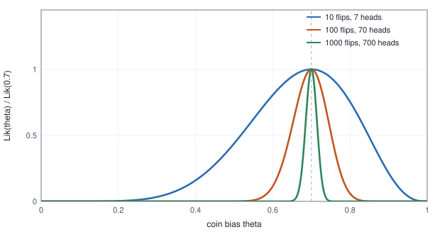
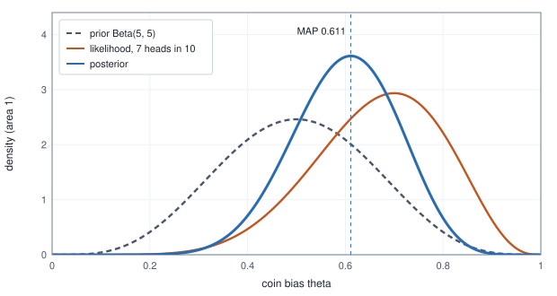
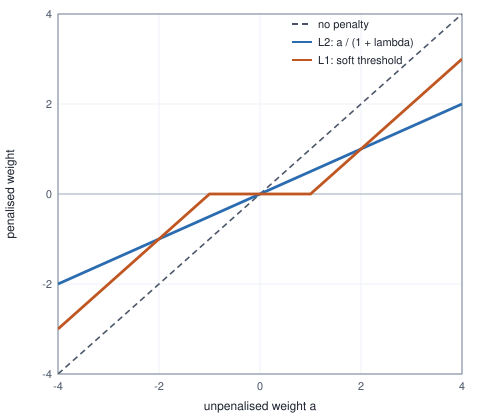
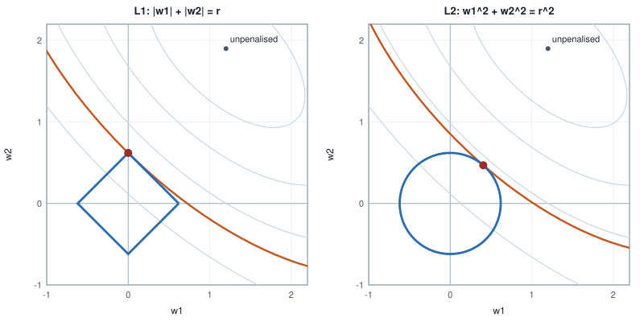

<!-- SPDX-License-Identifier: CC-BY-4.0 -->
<!-- Copyright (c) 2026 Martin Schröder <info@swedishembedded.com> -->

# Maximum Likelihood, Priors and Regularization

*Why are the losses we use the right ones, and what does it mean to prefer simple explanations?*

A coin is flipped ten times and the sequence is H H T H H T H T H H: seven heads and three tails. What is the probability $\theta$ that this coin lands heads? Everyone answers "seven tenths", and almost nobody asks why that answer is better than $0.5$, or $0.6$, or $0.75$. The question has a precise answer, and the answer is the idea behind every loss function in the last two chapters.

Suppose the coin has bias $\theta$ and the flips are independent. The probability of this exact sequence is a product of ten numbers, $\theta$ for each head and $1 - \theta$ for each tail: $\theta^7(1-\theta)^3$. Compute it for two candidate biases by hand. At $\theta = 0.5$ it is $0.5^{10} = 0.000977$. At $\theta = 0.7$ it is $0.7^7 \times 0.3^3 = 0.0022236$. The data we saw are about $2.3$ times as probable if the coin has bias $0.7$ as if it is fair. That ratio is a reason to prefer $0.7$, and the whole chapter grows from taking it seriously.

Two puzzles from the previous chapters get answered along the way. Chapter 2 minimised the mean squared error and chapter 3 the binary cross-entropy, and each time the justification was "it works": the first is smooth and has a closed-form minimiser, the second does not saturate. Both were also promised a deeper reason, and here it is: each is the probability of the data under an assumption about how the data arose, read backwards. The second puzzle is the one chapter 3 ended on. Data that a straight boundary separates have no best weights; gradient descent pushes them to infinity. Something has to say that huge weights are implausible, and saying it with probability turns out to be exactly an added penalty on the size of the weights, the practice called regularization (defined where it arises, below).

Six ideas from earlier chapters do the work below. Try them from memory first; the answers are at the end of the chapter, under "Recall questions".

1. (Chapter 10, Bayes' rule) A defect occurs in 1% of parts. A detector alarms on 90% of defective parts and on 10% of good parts. Given an alarm, is the probability of a defect near $0.9$? Compute it.
2. (Chapter 1, logarithms) What is $\ln(ab)$ in terms of $\ln a$ and $\ln b$, and what is $\ln(0.5^{10})$?
3. (Chapter 11, the Gaussian distribution) Write the density of $\mathcal{N}(\mu, \sigma^2)$ at $x$ and take its natural logarithm.
4. (Chapter 2 and chapter 3 of this volume) Write the mean squared error of predictions $\hat{y}_n$ against labels $y_n$, and the binary cross-entropy of a prediction $\hat{p} = 0.8$ against the labels $y = 1$ and $y = 0$.
5. (Chapter 12, estimators) Why does the sample variance divide by $n - 1$ rather than $n$?
6. (Chapter 3 of this volume) What happened to the weights of the logistic regression on four separable parts as the number of gradient steps grew?

## Likelihood: the probability of the data, read as a function of the parameter

### The coin

The probability of the ten flips depends on the one number $\theta$ that the model leaves open. Written as a function of $\theta$ with the flips fixed, it has a name. The **likelihood** of a parameter $\theta$ for observed data $\mathcal{D}$ is the probability (or probability density) that the model with parameter $\theta$ assigns to those data, viewed as a function of $\theta$:

$$
\mathrm{Lik}(\theta) = p(\mathcal{D} \mid \theta).
$$

The symbol $\mathrm{Lik}$ is used so that $\mathcal{L}$ stays the loss of chapter 2. When the examples are independent the probability of the data is the product of the probabilities of the examples, so $\mathrm{Lik}(\theta) = \prod_{n=1}^N p(y_n \mid \mathbf{x}_n, \theta)$ for labelled data, where the model supplies the probability of each label given its input and says nothing about how the inputs arose. For $h$ heads and $t$ tails, $\mathrm{Lik}(\theta) = \theta^h(1-\theta)^t$. This table evaluates it at nine candidate biases.

<!-- worked: likelihood.coin_likelihood -->
Flips, in order: HHTHHTHTHH (7 heads, 3 tails). Lik(theta) = theta^7 (1 - theta)^3; the last column is 120 Lik(theta), the probability of getting exactly 7 heads in any order.

| theta | Lik(theta) | log Lik(theta) | P(7 heads in 10 flips) |
|---|---:|---:|---:|
| 0.1 | 0.0000001 | -16.4342 | 0.0000 |
| 0.2 | 0.0000066 | -11.9355 | 0.0008 |
| 0.3 | 0.0000750 | -9.4978 | 0.0090 |
| 0.4 | 0.0003539 | -7.9465 | 0.0425 |
| 0.5 | 0.0009766 | -6.9315 | 0.1172 |
| 0.6 | 0.0017916 | -6.3247 | 0.2150 |
| 0.7 | 0.0022236 | -6.1086 | 0.2668 |
| 0.8 | 0.0016777 | -6.3903 | 0.2013 |
| 0.9 | 0.0004783 | -7.6453 | 0.0574 |

At theta = 0.7: Lik = 0.0022236, log Lik = -6.1086.
<!-- /worked -->

The curve rises to a single peak at $\theta = 0.7$ and falls away on both sides; the logarithm column has the same shape and the same peak. The last column multiplies the likelihood by $\binom{10}{7} = 120$, the number of orders in which seven heads can occur, which turns it into the probability of getting seven heads in any order. The factor $120$ does not depend on $\theta$, so it never changes where the peak is. That is why the book works with the probability of the observed sequence and why other texts, which count heads only, reach the same answer.

### A likelihood is not a probability

The same formula plays two roles, and which one it plays depends on which quantity is held fixed.

<!-- worked: likelihood.likelihood_vs_probability -->
| k heads | P(k heads | theta = 0.7) |
|---|---:|
| 0 | 0.000006 |
| 1 | 0.000138 |
| 2 | 0.001447 |
| 3 | 0.009002 |
| 4 | 0.036757 |
| 5 | 0.102919 |
| 6 | 0.200121 |
| 7 | 0.266828 |
| 8 | 0.233474 |
| 9 | 0.121061 |
| 10 | 0.028248 |

Sum over k = 1.000000.

Fixing k = 7 and varying theta instead: the area under 120 theta^7 (1 - theta)^3 on [0, 1] (trapezoid rule, theta = i/1000, i = 0 .. 1000) is 0.090909; 1/11 = 0.090909.
<!-- /worked -->

Fix $\theta = 0.7$ and let the number of heads $k$ vary: the eleven numbers are probabilities of the eleven possible outcomes and sum to $1$. This is a probability distribution over data. Now fix the data, $k = 7$, and let $\theta$ vary: the numbers are likelihoods, and they do not sum to anything in particular. The area under the curve $120\,\theta^7(1-\theta)^3$ is $1/11 = 0.090909$, not $1$. The likelihood answers "how well does each explanation account for what happened", not "how probable is each explanation". To get the second, the probability of $\theta$ given the data, we need Bayes' rule and a starting belief about $\theta$; that is the second half of the chapter.

## Maximum likelihood estimation

The principle that follows from the first comparison is simple: **maximum likelihood estimation** (MLE) chooses the parameter under which the observed data were most probable,

$$
\hat{\theta}_{\mathrm{ML}} = \arg\max_{\theta}\, \mathrm{Lik}(\theta).
$$

For the coin the maximum can be found with calculus, but not on the product directly. Take the logarithm first. Since $\ln$ is increasing, $\mathrm{Lik}$ and $\ln \mathrm{Lik}$ peak at the same $\theta$, and the logarithm of the product is a sum, which is easy to differentiate. The **log-likelihood** is

$$
\ln \mathrm{Lik}(\theta) = h \ln\theta + t \ln(1 - \theta).
$$

Setting the derivative to zero,

$$
\frac{d}{d\theta}\ln \mathrm{Lik}(\theta) = \frac{h}{\theta} - \frac{t}{1 - \theta} = 0
\;\Longrightarrow\; h(1 - \theta) = t\,\theta
\;\Longrightarrow\; \hat{\theta}_{\mathrm{ML}} = \frac{h}{h + t}.
$$

The second derivative, $-h/\theta^2 - t/(1-\theta)^2$, is negative for every $\theta$ in $(0, 1)$, so the stationary point is a maximum. For seven heads in ten flips it is $7/10 = 0.7$, which is the table's peak: $\mathrm{Lik}(0.7) = 0.0022236$ and $\ln\mathrm{Lik}(0.7) = -6.1086$. The folk answer "the fraction of heads" is the maximum likelihood estimate. The principle has earned its place by agreeing with common sense here; its real use is in the cases where common sense gives no answer.

### More data sharpens the peak

The same fraction of heads from more flips has the same maximum and a narrower peak. The next table keeps $70\%$ heads and changes the number of flips; each entry is the likelihood relative to its value at $\theta = 0.7$ (computed through logarithms, for a reason the next section gives), on a grid of step $0.001$.

<!-- worked: likelihood.coin_data_sizes -->
Relative likelihood Lik(theta) / Lik(0.7), computed through logarithms on the grid theta = i/1000, i = 1 .. 999 (the end points 0 and 1 are left out because ln 0 is undefined). The column 'theta with relative >= 1/2' gives the smallest and largest grid value whose relative likelihood is at least 1/2; argmax is the grid value with the largest likelihood.

| n | heads | argmax | at 0.5 | at 0.6 | at 0.8 | theta with relative >= 1/2 | sqrt(0.7*0.3/n) |
|---|---:|---:|---:|---:|---:|---:|---:|
| 10 | 7 | 0.700 | 0.4392 | 0.8057 | 0.7545 | 0.517 to 0.847 | 0.1449 |
| 100 | 70 | 0.700 | 2.67e-04 | 0.1153 | 0.0598 | 0.645 to 0.751 | 0.0458 |
| 1000 | 700 | 0.700 | 1.84e-36 | 4.16e-10 | 5.85e-13 | 0.683 to 0.716 | 0.0145 |
<!-- /worked -->



With ten flips a fair coin is entirely credible: its likelihood is $0.4392$ of the best. With a hundred flips it has fallen to $2.67 \times 10^{-4}$ of the best, and with a thousand to $1.84 \times 10^{-36}$. The width of the region where the relative likelihood is at least a half shrinks by a factor of about three each time the number of flips grows tenfold, the square-root law of chapter 12. The last column of the table is the standard error of the sample proportion from that chapter, and it explains the widths: near its peak the likelihood is close to a bell curve (the second derivative of the log-likelihood at the peak is $-n/(\hat\theta(1 - \hat\theta))$), and a bell with standard deviation $s$ falls to a half at $\sqrt{2\ln 2}\,s \approx 1.177\,s$ from its centre. For $n = 100$ that is $1.177 \times 0.0458 = 0.054$, matching the table's interval $0.645$ to $0.751$ around $0.7$. The likelihood carries its own measure of how much the data say, which the point estimate alone throws away; the starting belief about the parameter that the second half of the chapter introduces is the second place where that width matters.

## Logarithms, and the negative log-likelihood as a loss

The likelihood of $N$ independent examples is a product of $N$ numbers below one, and the logarithm turns it into a sum. There are four reasons to work with the log-likelihood $\ln\mathrm{Lik}(\theta) = \sum_n \ln p(y_n \mid \mathbf{x}_n, \theta)$ and none of them is cosmetic.

- The maximiser is unchanged, because the logarithm is increasing.
- A sum of per-example terms has a gradient that is a sum of per-example gradients, which is what gradient descent over batches needs.
- A sum scales like $N$ where a product shrinks like $\lambda^N$ for some $\lambda < 1$.
- A product of many probabilities cannot be stored. The next table multiplies the flip probabilities one at a time in 64-bit floating point, as chapter 15 warned a computer would.

<!-- worked: likelihood.log_trick -->
theta = 0.7; the product is taken one flip at a time in 64-bit floating point, the heads first and then the tails. The last column is the negative log-likelihood divided by n.

| n flips | heads | product of probabilities | log Lik | -log Lik / n |
|---|---:|---:|---:|---:|
| 10 | 7 | 2.224 x 10^-3 | -6.1086 | 0.610864 |
| 100 | 70 | 2.955 x 10^-27 | -61.0864 | 0.610864 |
| 1000 | 700 | 5.070 x 10^-266 | -610.8643 | 0.610864 |
| 10000 | 7000 | 0.0 (underflow) | -6108.6430 | 0.610864 |

For n = 10000 the true product is 10^(-2652.9); the smallest positive 64-bit floating-point number is about 4.9 x 10^-324.
<!-- /worked -->

At ten thousand flips the product is stored as exactly zero, although the true value, $10^{-2652.9}$, is a perfectly good number; every $\theta$ would have likelihood zero and the maximum could not be found. The log-likelihood is $-6108.6430$, an unremarkable number. The last column, $-\ln\mathrm{Lik}/n = 0.610864$, is the same at every size, which is no accident: it is the average of the per-flip terms $-\ln p$, with seventy per cent of the flips contributing $-\ln 0.7$ and thirty per cent $-\ln 0.3$, and so equals the entropy of a $0.7$ coin from chapter 13 in nats. The log-likelihood measured per example is stable where the likelihood is not.

Optimisers minimise, and the losses of the previous chapters are losses to be made small, so the sign is flipped. The **negative log-likelihood** is

$$
\mathrm{NLL}(\theta) = -\ln \mathrm{Lik}(\theta) = -\sum_{n=1}^{N} \ln p(y_n \mid \mathbf{x}_n, \theta),
$$

and maximising the likelihood is minimising the negative log-likelihood. Each example contributes the non-negative number $-\ln p(y_n \mid \mathbf{x}_n, \theta)$, which is zero if the model gave the observed label probability one and grows without bound as that probability goes to zero: the surprise, in the sense of chapter 13, of what actually happened. Dividing by $N$ gives the mean negative log-likelihood, a loss $\mathcal{L}(\theta)$ in the sense of chapter 2 whose scale does not depend on how much data there is.

This is the central move of the chapter: **a model that assigns a probability to each possible outcome comes with a loss, the negative log of the probability it gave to what happened.** The next two sections show that the two losses we already have are this loss for two particular models. Before that, one more estimation problem is worth doing by hand, because it is the one the first derivation needs.

## Maximum likelihood for a Gaussian

Six thermometer readings, in degrees Celsius: $20.3, 19.8, 20.9, 20.1, 19.5, 20.4$. Assume that each is a draw from $\mathcal{N}(\mu, \sigma^2)$ with both parameters unknown, independently. For continuous data the likelihood uses the density (the probability of one exact value is zero, and the density plays the role of the probability in every step above). The logarithm of the Gaussian density at $x$ is $-\tfrac12\ln(2\pi\sigma^2) - (x - \mu)^2/(2\sigma^2)$, so for $n$ readings

$$
\mathrm{NLL}(\mu, \sigma^2) = \frac{n}{2}\ln(2\pi\sigma^2) + \frac{1}{2\sigma^2}\sum_{i=1}^{n}(x_i - \mu)^2 .
$$

Differentiate in $\mu$ and set the result to zero: $-\frac{1}{\sigma^2}\sum_i (x_i - \mu) = 0$, so $\hat\mu = \frac{1}{n}\sum_i x_i = \bar{x}$, the sample mean, whatever $\sigma^2$ is. Then differentiate in the variance $v = \sigma^2$, with $Q = \sum_i (x_i - \hat\mu)^2$, the sum of squared deviations from the sample mean:

$$
\frac{\partial\,\mathrm{NLL}}{\partial v} = \frac{n}{2v} - \frac{Q}{2v^2} = 0
\;\Longrightarrow\; \hat{\sigma}^2_{\mathrm{ML}} = \frac{Q}{n}.
$$

The maximum likelihood variance divides by $n$, not by $n - 1$. For these readings $\bar{x} = 20.1667$, $Q = 1.1933$, so the maximum likelihood variance is $0.1989$ and the unbiased estimate of chapter 12 is $0.2387$. The table evaluates the NLL at the claimed minimum and at several other points.

<!-- worked: likelihood.gaussian_mle -->
Readings: 20.3, 19.8, 20.9, 20.1, 19.5, 20.4 (n = 6). Sum of squared deviations from the mean: 1.1933.

| parameters | mu | variance | NLL |
|---|---:|---:|---:|
| (mean, 1/n variance) | 20.1667 | 0.1989 | 3.6686 |
| (mean, 1/(n-1) variance) | 20.1667 | 0.2387 | 3.7156 |
| mean + 0.2 | 20.3667 | 0.1989 | 4.2720 |
| mean - 0.2 | 19.9667 | 0.1989 | 4.2720 |
| variance x 0.7 | 20.1667 | 0.1392 | 3.8843 |
| variance x 1.5 | 20.1667 | 0.2983 | 3.8850 |

Brute-force search of the NLL over mu = 19.00, 19.01, ..., 21.00 and variance = 0.05, 0.06, ..., 1.50: smallest at mu = 20.17, variance = 0.20 (NLL 3.6688).
<!-- /worked -->

Both departures from the minimum cost something, as they should. Moving the mean by $0.2$ in either direction adds $n\,\delta^2/(2\hat\sigma^2) = 6 \times 0.04 / (2 \times 0.1989) = 0.603$, which is $4.2720 - 3.6686$ to rounding. A variance $30\%$ too small and one $50\%$ too large cost almost the same, about $0.22$, because the NLL falls steeply on the small side and rises slowly on the large side. A brute-force search of the NLL over a grid agrees with the formulas to the grid's spacing.

Chapter 12 showed that dividing by $n$ underestimates the variance on average: the deviations are measured from a mean fitted to the same data, so they come out too small by the factor $(n - 1)/n$. The next table checks that factor by simulation, and shows that the maximum likelihood estimate is biased and still the minimiser of the NLL.

<!-- worked: likelihood.variance_bias -->
Generator: the book's SplitMix64, seed 0x1ac5475f8760fcf7 (1929026491016871159).
One generator is created once and serves all 20000 repetitions. Draw order: for each repetition in turn, 5 calls of normal() (a sample from N(0, 1)); the true variance is 1. Because 5 is odd, the second value that Box-Muller produces with every other call is held and carries over into the next repetition (the generator is never re-created or re-seeded between repetitions). Each sample of 5 gives the sum of squared deviations from its own mean, divided by 5 and by 4; the table averages each over the 20000 repetitions.

| divisor | average estimate | expected value |
|---|---:|---:|
| 1/n (maximum likelihood) | 0.8029 | 0.8000 |
| 1/(n-1) (unbiased) | 1.0036 | 1.0000 |
<!-- /worked -->

The one generator runs through all $20000$ repetitions without being restarted, so the Box-Muller value held after an odd number of draws carries from one repetition into the next. With $n = 5$ the maximum likelihood variance averages $0.8029$ over the repetitions, close to $(n - 1)/n = 0.8$, and the $1/(n-1)$ version averages $1.0036$. The two statements do not contradict each other because they answer different questions. MLE is "the parameter that makes the data most probable"; unbiasedness is "an estimate that is right on average over many datasets". The bias of the maximum likelihood estimate shrinks like $1/n$ and is irrelevant for the large datasets of machine learning; for a handful of readings the choice of divisor is a choice of goal.

## The losses of chapters 2 and 3 are negative log-likelihoods

### Gaussian noise gives the squared error

Chapter 2 modelled a label as the model's prediction plus noise, $y = f_\theta(\mathbf{x}) + \varepsilon$, and sketched why the noise being Gaussian makes the squared error natural. With $\varepsilon \sim \mathcal{N}(0, \sigma^2)$ the probability density of a label given its input is Gaussian with mean $f_\theta(\mathbf{x})$, so $-\ln p(y \mid \mathbf{x}, \theta) = \frac{(y - f_\theta(\mathbf{x}))^2}{2\sigma^2} + \frac{1}{2}\ln(2\pi\sigma^2)$. Summing over $N$ examples and writing $\mathrm{MSE}(\theta) = \frac{1}{N}\sum_n (y_n - f_\theta(\mathbf{x}_n))^2$,

$$
\mathrm{NLL}(\theta, \sigma^2) = \frac{N}{2\sigma^2}\,\mathrm{MSE}(\theta) + \frac{N}{2}\ln(2\pi\sigma^2).
$$

For a fixed noise level $\sigma$ this is a positive multiple of the mean squared error plus a number that does not depend on $\theta$. Minimising one is minimising the other: **the parameters of maximum likelihood under Gaussian noise are the least-squares parameters.** The table checks the identity on six measurements and six candidate lines, with $\sigma = 1$.

<!-- worked: likelihood.gaussian_nll_is_mse -->
Data (x, y): (0, 1.1), (1, 2.9), (2, 5.2), (3, 6.8), (4, 9.1), (5, 10.9). Line y = w0 + w1 x, sigma = 1, N = 6, N/2 log(2 pi) = 5.5136. MSE is the mean of the squared residuals; NLL is N/2 log(2 pi) + (sum of squared residuals) / 2; the last column recomputes it from the MSE as an arithmetic check of the identity.

| (w0, w1) | MSE | NLL | N/2 log(2 pi) + N/2 MSE |
|---|---:|---:|---:|
| (1.0, 2.0) | 0.0200 | 5.5736 | 5.5736 |
| (0.5, 2.0) | 0.2700 | 6.3236 | 6.3236 |
| (1.0, 1.8) | 0.3600 | 6.5936 | 6.5936 |
| (1.0, 2.2) | 0.4133 | 6.7536 | 6.7536 |
| (0.0, 2.5) | 0.8783 | 8.1486 | 8.1486 |
| (1.5, 1.8) | 0.1100 | 5.8436 | 5.8436 |

Order from best to worst by MSE: 1, 6, 2, 3, 4, 5; by NLL: 1, 6, 2, 3, 4, 5.

Least-squares line: w0 = 1.0571, w1 = 1.9771, MSE = 0.0185, sqrt(MSE) = 0.1359.

NLL = N log sigma + N/2 log(2 pi) + N MSE / (2 sigma^2) for the least-squares line, at six values of sigma listed in this order; the third is sigma = sqrt(MSE) computed from the unrounded MSE.

| sigma | NLL of the least-squares line |
|---|---:|
| 0.1000 | -2.7590 |
| 0.2000 | -2.7573 |
| 0.1359 | -3.4602 |
| 0.4000 | 0.3623 |
| 0.8000 | 4.2614 |
| 1.0000 | 5.5691 |
<!-- /worked -->

The last two columns agree to all digits printed (the last recomputes the NLL from the MSE, so the agreement checks the arithmetic of the identity, and the MSE column carries the information), and the lines come out in the same order under both measures. The second table shows what the noise level does; its rows are in the order listed, with the maximum likelihood value inserted third. For the least-squares line, the NLL as a function of $\sigma$ is smallest at $\sigma = 0.1359$, which is $\sqrt{\mathrm{MSE}}$ of the unrounded $\mathrm{MSE}$ at the best line (the rounded $0.0185$ would give $0.1360$). To see why, apply the maximum likelihood variance of the last section to the residuals: $\hat\sigma^2 = \mathrm{MSE}_{\min}$, and the NLL there is $\frac{N}{2}(\ln(2\pi\,\mathrm{MSE}_{\min}) + 1)$. The model's assumed noise level and its best-fitting line are estimated together, and the estimated noise is the typical size of the residuals, as chapter 2's reading of the loss suggested.

The words "up to constants" hide a condition. The constant can be dropped only while $\sigma$ is fixed. A model that predicts its own noise level, $\sigma(\mathbf{x})$ per example, must keep the $\ln\sigma$ term: without it the loss would be minimised by declaring every example hopelessly noisy, because $(y - f)^2/(2\sigma^2)$ goes to zero as $\sigma$ grows. The term $\ln\sigma$ is the price that keeps the claim of noise honest.

A different noise distribution gives a different loss. If $\varepsilon$ follows a Laplace distribution with density $\frac{1}{2b}e^{-|\varepsilon|/b}$ (a sharp peak and heavier tails than the Gaussian), then $-\ln p(y\mid\mathbf{x},\theta) = |y - f_\theta(\mathbf{x})|/b + \ln(2b)$ and the maximum likelihood fit minimises the mean absolute error, the quantity $E(\theta)$ that chapter 1 used before chapter 2 replaced it. Its optimum is a median where the squared error's is a mean, and the loss's lesser sensitivity to a single wild measurement is the same fact seen as a tail: a Laplace distribution makes outliers less surprising.

### Bernoulli outputs give the binary cross-entropy

A classifier's output is the probability $\hat{p}$ that the label is $1$. The label is a Bernoulli variable (chapter 11) with that probability, so the probability of the observed label $y \in \{0, 1\}$ is

$$
p(y \mid \mathbf{x}, \theta) = \hat{p}^{\,y}\,(1 - \hat{p})^{\,1 - y},
$$

which is $\hat{p}$ when $y = 1$ and $1 - \hat{p}$ when $y = 0$ (the exponent $0$ makes the other factor equal to one). Its negative logarithm is $-[y\ln\hat{p} + (1 - y)\ln(1 - \hat{p})]$, exactly the binary cross-entropy of chapter 3. The negative log-likelihood of $N$ labelled examples is therefore $N$ times the mean binary cross-entropy. Four examples make the identity concrete.

<!-- worked: likelihood.bernoulli_nll_is_bce -->
| example | y | p-hat | probability of the label | -log of it | BCE |
|---|---:|---:|---:|---:|---:|
| 1 | 1 | 0.9 | 0.9 | 0.1054 | 0.1054 |
| 2 | 0 | 0.2 | 0.8 | 0.2231 | 0.2231 |
| 3 | 1 | 0.6 | 0.6 | 0.5108 | 0.5108 |
| 4 | 1 | 0.7 | 0.7 | 0.3567 | 0.3567 |

Probability of the four labels together: 0.3024. NLL = -log 0.3024 = 1.1960. NLL / N = 0.2990, the mean binary cross-entropy.
<!-- /worked -->

The model gave the four labels together the probability $0.9 \times 0.8 \times 0.6 \times 0.7 = 0.3024$, the product of the fourth column. The negative log of that is $1.1960$, the sum of the last column, and a quarter of it, $0.2990$, is the mean binary cross-entropy. The chapter 3 loss is the likelihood of the labels under the model $\hat{p} = \sigma(\mathbf{w}\cdot\mathbf{x})$, and its minimiser is the maximum likelihood weight vector. This also settles the squared-error question of chapter 3: squared error on $0/1$ labels is the likelihood of a Gaussian noise model, which does not describe a label that can only be $0$ or $1$, so it is a poorer description of the data and trains worse, as the chapter showed numerically. The cross-entropy of chapter 13, between the empirical distribution of the labels and the model's, is the same expression, which is why the two names are used interchangeably. For a label that is one of $C$ categories the probability of the observed category is the model's probability for it and the loss is the cross-entropy over a softmax; a language model's loss is the sum of $-\ln p$ of each token of a text given the tokens before it, and its perplexity (chapter 13) is $\exp$ of the mean.

### Reading a loss as an assumption

The two derivations give a method rather than two facts. To train a model: say what distribution of the label the model describes, write $-\ln p$ of the observed labels, and minimise it. The loss is a statement about the world, and a mismatch between the loss and the data's actual behaviour is a modelling error that no optimiser can repair. A loss that looks arbitrary, such as the censored Gaussian of the section on brain below, becomes a calculation.

## A prior: what we believed before the data

Maximum likelihood trusts the data completely. Three flips, all heads, give $\hat\theta_{\mathrm{ML}} = 3/3 = 1$: the coin cannot land tails. Nobody believes that of a coin after three flips, and the reason is knowledge the likelihood does not contain. A **prior** is a probability distribution over the parameters that states what is believed about them before the data are seen. Bayes' rule of chapter 10 says how to combine it with the data,

$$
p(\theta \mid \mathcal{D}) = \frac{p(\mathcal{D} \mid \theta)\,p(\theta)}{p(\mathcal{D})} \;\propto\; \mathrm{Lik}(\theta)\,p(\theta),
$$

where the symbol $\propto$ means "equal up to a factor that does not depend on $\theta$". The denominator $p(\mathcal{D})$ is that kind of factor, so for choosing a $\theta$ it never matters. The left side is the **posterior**, the belief about $\theta$ after the data: the likelihood, tilted toward what the prior found plausible.

### A prior on the coin, as imaginary flips

A convenient prior for a probability is the **Beta distribution** with two positive numbers $a$ and $b$: its density on $(0, 1)$ is proportional to $\theta^{a-1}(1-\theta)^{b-1}$, divided by a constant $B(a, b)$ that makes the area one (for whole numbers $a$ and $b$ it is $(a-1)!\,(b-1)!/(a + b - 1)!$, and nothing below needs more than its existence). Multiply it by the likelihood of $h$ heads and $t$ tails:

$$
p(\theta \mid \mathcal{D}) \;\propto\; \theta^{h}(1-\theta)^{t}\cdot\theta^{a-1}(1-\theta)^{b-1} = \theta^{\,h + a - 1}(1-\theta)^{\,t + b - 1}.
$$

The posterior has the same form as the prior with the counts increased: it is a Beta distribution with $a + h$ and $b + t$ in the place of $a$ and $b$. The prior behaves like $a - 1$ extra heads and $b - 1$ extra tails that were observed before the real data: **pseudo-counts**. $\mathrm{Beta}(1, 1)$ has none and is flat. $\mathrm{Beta}(5, 5)$ is a prior experience of four heads and four tails, centred on a fair coin with some conviction. The figure draws it with the likelihood of seven heads in ten and the posterior; all three are scaled to unit area so that their shapes compare.



The posterior peak lies between the prior's peak and the likelihood's, and nearer the one with more weight behind it. The value at the peak is found by the same calculus as before. The **maximum a posteriori** estimate (MAP) is the parameter at the peak of the posterior, $\hat\theta_{\mathrm{MAP}} = \arg\max_\theta p(\theta\mid\mathcal{D})$. Its logarithm is $(h + a - 1)\ln\theta + (t + b - 1)\ln(1 - \theta)$ plus a constant, which is the coin's log-likelihood with the counts replaced by the posterior counts, so

$$
\hat\theta_{\mathrm{MAP}} = \frac{h + a - 1}{h + t + a + b - 2}.
$$

<!-- worked: likelihood.coin_map -->
7 heads, 3 tails (maximum likelihood 0.7000); the grid argmax maximises the log-posterior (h + a - 1) ln(theta) + (t + b - 1) ln(1 - theta) over theta = i/1000, i = 1 .. 999; the posterior mean is (h + a)/(h + t + a + b):

| prior | pseudo-counts | posterior counts | MAP | grid argmax | posterior mean |
|---|---|---:|---:|---:|---:|
| Beta(1, 1) | 0 heads, 0 tails | 7/10 | 0.7000 | 0.700 | 0.6667 |
| Beta(2, 2) | 1 heads, 1 tails | 8/12 | 0.6667 | 0.667 | 0.6429 |
| Beta(5, 5) | 4 heads, 4 tails | 11/18 | 0.6111 | 0.611 | 0.6000 |
| Beta(20, 20) | 19 heads, 19 tails | 26/48 | 0.5417 | 0.542 | 0.5400 |
| Beta(8, 2) | 7 heads, 1 tails | 14/18 | 0.7778 | 0.778 | 0.7500 |

70 heads, 30 tails (maximum likelihood 0.7000); the grid argmax maximises the log-posterior (h + a - 1) ln(theta) + (t + b - 1) ln(1 - theta) over theta = i/1000, i = 1 .. 999; the posterior mean is (h + a)/(h + t + a + b):

| prior | pseudo-counts | posterior counts | MAP | grid argmax | posterior mean |
|---|---|---:|---:|---:|---:|
| Beta(1, 1) | 0 heads, 0 tails | 70/100 | 0.7000 | 0.700 | 0.6961 |
| Beta(2, 2) | 1 heads, 1 tails | 71/102 | 0.6961 | 0.696 | 0.6923 |
| Beta(5, 5) | 4 heads, 4 tails | 74/108 | 0.6852 | 0.685 | 0.6818 |
| Beta(20, 20) | 19 heads, 19 tails | 89/138 | 0.6449 | 0.645 | 0.6429 |
| Beta(8, 2) | 7 heads, 1 tails | 77/108 | 0.7130 | 0.713 | 0.7091 |
<!-- /worked -->

With the flat prior the MAP estimate is the maximum likelihood estimate, $0.7$. A $\mathrm{Beta}(5, 5)$ prior moves it to $11/18 = 0.6111$ (the figure's peak), a $\mathrm{Beta}(20, 20)$ prior, which stands for thirty-eight imagined flips against ten real ones, to $26/48 = 0.5417$, and a prior that expected heads, $\mathrm{Beta}(8, 2)$, to $14/18 = 0.7778$. In the second table the data are ten times as many with the same fraction of heads, and the same priors move the estimate far less: even $\mathrm{Beta}(20, 20)$ only to $0.6449$. A prior is a vote among a fixed number of imagined examples, and its influence fades as the real examples outnumber them. The grid column, which maximises the log-posterior directly on a grid of step $0.001$, agrees with the formula. The last column is the mean of the posterior, a different summary that this chapter does not use; the average over the whole posterior rather than its peak is the starting point of fully Bayesian prediction, pointed to at the end.

Three heads in three flips under $\mathrm{Beta}(2, 2)$ gives $(3 + 1)/(3 + 2) = 0.8$ instead of $1$: a coin that has landed heads three times is probably biased toward heads, and has not been shown to be unable to land tails.

## Priors on weights become penalties

Now the weights of a model are the unknown parameters, and a prior says what weights are plausible before any data. Take the negative logarithm of the posterior: $-\ln p(\mathbf{w}\mid\mathcal{D}) = \mathrm{NLL}(\mathbf{w}) - \ln p(\mathbf{w}) + \text{const}$. A MAP estimate minimises the negative log-likelihood plus the negative log of the prior, and the second term is a function of the weights alone, added to the loss without reference to any data: a **penalty**. Choosing a prior chooses a penalty, and **regularization** is the practice of adding a penalty to a loss so that weights the prior finds implausible are avoided.

### A Gaussian prior is the L2 penalty

Believe that each weight is probably small and of either sign: independently $w_j \sim \mathcal{N}(0, \sigma_w^2)$, with $D$ weights. Then

$$
-\ln p(\mathbf{w}) = \frac{1}{2\sigma_w^2}\sum_{j=1}^{D} w_j^2 + \frac{D}{2}\ln(2\pi\sigma_w^2) = \frac{1}{2\sigma_w^2}\lVert\mathbf{w}\rVert^2 + \text{const}.
$$

For a regression with Gaussian noise of standard deviation $\sigma$, the negative log-posterior is $\frac{1}{2\sigma^2}\sum_n r_n^2 + \frac{1}{2\sigma_w^2}\lVert\mathbf{w}\rVert^2$ plus constants, with $r_n = y_n - \mathbf{w}\cdot\mathbf{x}_n$. Multiplying by $\sigma^2$, which changes nothing about where the minimum is, gives

$$
J_{\mathrm{L2}}(\mathbf{w}) = \tfrac{1}{2}\sum_{n=1}^{N} (y_n - \mathbf{w}\cdot\mathbf{x}_n)^2 + \tfrac{\lambda}{2}\lVert\mathbf{w}\rVert^2, \qquad \lambda = \frac{\sigma^2}{\sigma_w^2}.
$$

This is **L2 regularization**: the loss plus $\lambda/2$ times the squared Euclidean length ($L^2$ norm, chapter 3 of Volume I) of the weights. When it is used with a squared error the method is called **ridge regression**. The strength $\lambda$ has a meaning: it is the ratio of the noise variance to the prior variance of a weight. A tight prior (small $\sigma_w$) or noisy data (large $\sigma$) gives a strong penalty, because the data deserve less trust than the prior.

The gradient is $-\mathbf{X}^\top(\mathbf{y} - \mathbf{X}\mathbf{w}) + \lambda\mathbf{w}$, and setting it to zero gives the ridge solution

$$
(\mathbf{X}^\top\mathbf{X} + \lambda\mathbf{I})\,\mathbf{w} = \mathbf{X}^\top\mathbf{y}.
$$

It differs from chapter 2's normal equations by $\lambda$ on the diagonal. That addition raises every eigenvalue of $\mathbf{X}^\top\mathbf{X}$ by $\lambda$, so the matrix is invertible even when features are redundant and $\mathbf{X}^\top\mathbf{X}$ is singular: the redundancy that chapter 2 diagnosed with an eigenvalue near zero no longer leaves a direction in which the data say nothing and anything is allowed.

Eight points show the effect. A smooth curve $1 + 2x - 3x^2$ with Gaussian noise of standard deviation $0.3$ is sampled at eight values of $x$, and a polynomial of degree five, with six weights, is fitted to them. Six parameters for eight points is a model with room to follow the noise.

<!-- worked: likelihood.ridge_data_table -->
Generator: the book's SplitMix64, seed 0x73022d5a94d0abfc (8287236131382143996).
Draw order: for i = 0 .. 7 in turn, one call of normal(); y_i = 1 + 2 x_i - 3 x_i^2 + 0.3 * normal(); x_i = -1 + 2 i / 7.

| i | x | true value | y |
|---|---:|---:|---:|
| 0 | -1.0000 | -4.0000 | -4.0943 |
| 1 | -0.7143 | -1.9592 | -1.5569 |
| 2 | -0.4286 | -0.4082 | -1.0119 |
| 3 | -0.1429 | 0.6531 | 0.5213 |
| 4 | 0.1429 | 1.2245 | 0.9513 |
| 5 | 0.4286 | 1.3061 | 1.4867 |
| 6 | 0.7143 | 0.8980 | 1.1767 |
| 7 | 1.0000 | 0.0000 | -0.0545 |
<!-- /worked -->

<!-- worked: likelihood.ridge_path -->
Features 1, x, ..., x^5 (D = 6), the eight points above. Minimise 1/2 sum (y - w.x)^2 + lambda/2 ||w||^2 by (X^T X + lambda I) w = X^T y. 'Error to the true curve' is the RMS difference between the fitted polynomial and 1 + 2x - 3x^2 at the 101 points x = -1, -0.98, ..., 1.

| lambda | w0 | w1 | w2 | w3 | w4 | w5 | norm of w | training RMSE | error to the true curve |
|---|---:|---:|---:|---:|---:|---:|---:|---:|---:|
| 0 | 0.656 | 3.171 | -0.966 | -3.570 | -1.744 | 2.412 | 5.746 | 0.1779 | 0.2664 |
| 0.001 | 0.656 | 3.026 | -0.973 | -3.008 | -1.736 | 1.990 | 5.153 | 0.1789 | 0.2551 |
| 0.01 | 0.658 | 2.532 | -1.023 | -1.155 | -1.678 | 0.618 | 3.525 | 0.1964 | 0.2262 |
| 0.1 | 0.628 | 2.003 | -1.126 | 0.101 | -1.471 | -0.089 | 2.803 | 0.2375 | 0.2178 |
| 1 | 0.326 | 1.185 | -0.857 | 0.477 | -0.995 | 0.282 | 1.882 | 0.5270 | 0.4986 |
| 10 | -0.051 | 0.432 | -0.270 | 0.292 | -0.287 | 0.246 | 0.701 | 1.2171 | 1.0799 |
<!-- /worked -->

Without a penalty ($\lambda = 0$) the weights are large and of opposing sign, $3.171$, $-3.570$, $2.412$, with norm $5.746$: the polynomial uses them to bend through the noise. As $\lambda$ grows the norm falls steadily, to $2.803$ at $\lambda = 0.1$ and $0.701$ at $\lambda = 10$. The training error rises at every step ($0.1779$ to $1.2171$), as it must, because every penalty moves the weights away from the minimum of the training loss. The last column compares the fitted polynomial with the true curve at $101$ points the fit never saw. It falls from $0.2664$ to $0.2178$ at $\lambda = 0.1$ and then rises again to $1.0799$: a little regularization makes the fit better on points it was not fitted to, and too much leaves it unable to follow even the true shape. The best $\lambda$ is neither zero nor large, and the training error alone would never choose it, since it prefers $\lambda = 0$ in every row. Choosing $\lambda$ needs examples that were not used for fitting; here the book played nature and used the true curve, which a practitioner does not have, and the next chapter develops the honest version of the same measurement.

In terms of the prior, $\lambda = 0.1$ with noise $\sigma = 0.3$ corresponds to $\sigma_w^2 = \sigma^2/\lambda = 0.9$, a prior standard deviation of $0.949$ for each weight; $\lambda = 10$ corresponds to $0.095$.

### A Laplace prior is the L1 penalty

Believe instead that most weights are probably exactly or nearly zero and a few are large. The Laplace density $p(w) = \frac{1}{2\beta_w}e^{-|w|/\beta_w}$ has a sharp peak at zero and tails longer than the Gaussian's. (The symbol $\beta_w$ with its subscript is the scale of this prior and has nothing to do with the moment coefficients of Volume III's optimisers.) Its negative logarithm is $|w|/\beta_w + \ln(2\beta_w)$, so for independent weights the MAP objective with Gaussian noise, multiplied by $\sigma^2$ as before, becomes

$$
J_{\mathrm{L1}}(\mathbf{w}) = \tfrac{1}{2}\sum_{n=1}^{N} (y_n - \mathbf{w}\cdot\mathbf{x}_n)^2 + \lambda\lVert\mathbf{w}\rVert_1, \qquad \lambda = \frac{\sigma^2}{\beta_w},
$$

with $\lVert\mathbf{w}\rVert_1 = \sum_j |w_j|$. This is **L1 regularization**, and with a squared error it is called the **lasso**. Chapter 3 of Volume I gave $\lVert\cdot\rVert_1$ its name; what is new is the behaviour. The L1 penalty does something the L2 penalty cannot.

**One weight.** The simplest case is a single weight with unpenalised optimum $a$ (the least-squares value when the features are orthonormal, so that the weights do not interact). Minimise $\frac12(w - a)^2 + \lambda|w|$. Away from zero the objective is smooth. For $w > 0$ its derivative is $w - a + \lambda$, which is zero at $w = a - \lambda$, valid only if that is positive, so $a > \lambda$. For $w < 0$ the derivative is $w - a - \lambda$, zero at $w = a + \lambda$, valid only if $a < -\lambda$. Otherwise there is no stationary point on either side, so consider $w = 0$: the slope just to its right is $\lambda - a \geq 0$ and the slope just to its left is $-\lambda - a \leq 0$ when $|a| \leq \lambda$, so the objective cannot decrease in either direction and $0$ is the minimiser. The result is

$$
w^\star = S(a, \lambda) = \begin{cases} a - \lambda & a > \lambda \\ 0 & |a| \leq \lambda \\ a + \lambda & a < -\lambda \end{cases}
$$

called **soft-thresholding**: move $a$ toward zero by $\lambda$ and stop if you reach it. For the L2 penalty $\frac12(w-a)^2 + \frac{\lambda}{2}w^2$ the derivative $w - a + \lambda w$ is zero at $w^\star = a/(1+\lambda)$: every value is shrunk by the same factor and none reaches zero unless it started there.

<!-- worked: likelihood.soft_threshold_1d -->
lambda = 1. L2 objective 1/2 (w - a)^2 + lambda/2 w^2, L1 objective 1/2 (w - a)^2 + lambda |w|; the check column minimises the objective over w = -4.000, -3.999, ..., 4.000.

| a | L2 minimiser a/(1+lambda) | L2 by search | L1 minimiser | L1 by search |
|---|---:|---:|---:|---:|
| -3 | -1.5000 | -1.500 | -2.0000 | -2.000 |
| -1.5 | -0.7500 | -0.750 | -0.5000 | -0.500 |
| -1 | -0.5000 | -0.500 | 0.0000 | 0.000 |
| -0.5 | -0.2500 | -0.250 | 0.0000 | 0.000 |
| 0 | 0.0000 | 0.000 | 0.0000 | 0.000 |
| 0.5 | 0.2500 | 0.250 | 0.0000 | 0.000 |
| 1 | 0.5000 | 0.500 | 0.0000 | 0.000 |
| 1.5 | 0.7500 | 0.750 | 0.5000 | 0.500 |
| 2 | 1.0000 | 1.000 | 1.0000 | 1.000 |
| 3 | 1.5000 | 1.500 | 2.0000 | 2.000 |
<!-- /worked -->



For $\lambda = 1$ the values $a = -1, -0.5, 0, 0.5, 1$ all give exactly $0$ under the L1 penalty, where L2 gives $-0.5, -0.25, 0, 0.25, 0.5$; a brute-force search of the objective over a grid of step $0.001$ finds the same minimisers. The mechanism is the kink: $|w|$ has slope $-\lambda$ on one side of zero and $+\lambda$ on the other, so the objective's slope jumps by $2\lambda$ at zero, and when the loss's own slope there, $-a$, is smaller than $\lambda$ in size the minimum stays at the kink. The L2 penalty has slope zero at zero, so any nonzero slope of the loss moves the minimum off zero, however slightly. A result with many weights exactly zero is **sparse**.

**Many weights.** With correlated features the weights interact, and a closed form no longer exists, but the one-weight solution is a building block. Fix all weights except $w_j$ and let $\rho_j = \sum_n x_{nj}\,(y_n - \sum_{k\neq j} x_{nk}w_k)$ and $c_j = \sum_n x_{nj}^2$. As a function of $w_j$ alone the loss is $\frac12 c_j w_j^2 - \rho_j w_j$ plus a constant, so $\frac{1}{c_j}J_{\mathrm{L1}} = \frac12(w_j - \rho_j/c_j)^2 + (\lambda/c_j)|w_j|$ plus a constant: the one-weight problem with $a = \rho_j/c_j$ and penalty $\lambda/c_j$, whose answer is $S(\rho_j, \lambda)/c_j$. Cycling through the weights and replacing each by its best value, **coordinate descent**, lowers the objective at every update and converges:

```text
function soft_threshold(a: real, lam: real) -> real:
    if a > lam:
        return a - lam
    if a < -lam:
        return a + lam
    return 0.0

function lasso_cd(X: array<real>[N, D], y: array<real>[N], lam: real, tol: real,
                  max_sweeps: int) -> (w: array<real>[D], sweeps: int):
    require N > 0 and D > 0 and lam >= 0 and tol > 0 and max_sweeps > 0, "bad inputs"
    c = [sum([X[n, j] * X[n, j] for n in 0 .. N]) for j in 0 .. D]     # shape [D]
    for j in 0 .. D:
        require c[j] > 0, "a feature column is all zero"
    w = zeros(real, [D])
    r = copy(y)                                  # the residual y - X w, shape [N]
    for sweep in 1 .. max_sweeps + 1:
        biggest = 0.0
        for j in 0 .. D:
            rho = sum([X[n, j] * (r[n] + X[n, j] * w[j]) for n in 0 .. N])
            new = soft_threshold(rho, lam) / c[j]
            delta = new - w[j]
            for n in 0 .. N:
                r[n] = r[n] - X[n, j] * delta
            w[j] = new
            biggest = max(biggest, abs(delta))
        if biggest < tol:
            return (w, sweep)
    return (w, max_sweeps)
```

A test of an implementation is that the objective never increases between updates, and that at the result every weight satisfies the one-weight condition: $|\rho_j| \leq \lambda$ where $w_j = 0$ and $\rho_j - c_j w_j = \lambda\,\mathrm{sign}(w_j)$ where it is not (here $\mathrm{sign}$ is the book's sign function and is only evaluated where $w_j \neq 0$, so its value $+1$ at $0$ never matters).

Twenty examples with eight features, of which only three matter, show both penalties on the same data. The ridge solution is the formula above; the lasso is the pseudocode above, run from $\mathbf{w} = \mathbf{0}$ afresh at every $\lambda$ with `tol` $= 10^{-12}$ and `max_sweeps` $= 100000$. In both, $\lambda$ increases down the table.

<!-- worked: likelihood.lasso_path -->
Generator: the book's SplitMix64, seed 0x41c428236c6fe664 (4738956840508843620).
Draw order: first the feature matrix X of shape [20, 8] row by row (one normal() per entry), then the 20 noise values, one normal() each; y_n = x_n . w_true + 0.5 * noise_n with w_true = (3.0, -2.0, 0.0, 0.0, 1.5, 0.0, 0.0, 0.0).

Ridge: minimise 1/2 sum (y - X w)^2 + lambda/2 ||w||^2.

| lambda | w1 | w2 | w3 | w4 | w5 | w6 | w7 | w8 | exact zeros |
|---|---:|---:|---:|---:|---:|---:|---:|---:|---:|
| 0 | 3.157 | -2.071 | -0.087 | -0.117 | 1.373 | -0.087 | 0.126 | 0.126 | 0 |
| 2 | 2.430 | -1.602 | 0.113 | -0.066 | 1.230 | -0.223 | 0.126 | 0.025 | 0 |
| 5 | 1.824 | -1.224 | 0.227 | -0.037 | 1.064 | -0.300 | 0.094 | -0.043 | 0 |
| 10 | 1.300 | -0.901 | 0.273 | -0.023 | 0.875 | -0.320 | 0.047 | -0.085 | 0 |
| 20 | 0.831 | -0.607 | 0.256 | -0.016 | 0.652 | -0.283 | 0.000 | -0.099 | 0 |
| 40 | 0.485 | -0.378 | 0.195 | -0.012 | 0.437 | -0.208 | -0.024 | -0.086 | 0 |

Lasso: minimise 1/2 sum (y - X w)^2 + lambda ||w||_1 by cyclic coordinate descent from w = 0, tol = 1e-12, max_sweeps = 100000 (never reached here); a sweep updates w1 .. w8 in order, and the run stops after the first sweep in which the largest absolute change of a weight is below tol (the sweeps column counts that last sweep); 0 is an exact zero.

| lambda | w1 | w2 | w3 | w4 | w5 | w6 | w7 | w8 | exact zeros | sweeps |
|---|---:|---:|---:|---:|---:|---:|---:|---:|---:|---:|
| 0 | 3.157 | -2.071 | -0.087 | -0.117 | 1.373 | -0.087 | 0.126 | 0.126 | 0 | 31 |
| 2 | 2.875 | -1.910 | 0 | 0 | 1.168 | -0.032 | 0 | 0 | 4 | 23 |
| 5 | 2.457 | -1.608 | 0 | 0 | 1.056 | 0 | 0 | 0 | 5 | 24 |
| 10 | 1.749 | -1.098 | 0 | 0 | 0.861 | 0 | 0 | 0 | 5 | 22 |
| 20 | 0.332 | -0.078 | 0 | 0 | 0.472 | 0 | 0 | 0 | 5 | 23 |
| 40 | 0 | 0 | 0 | 0 | 0 | 0 | 0 | 0 | 8 | 1 |
<!-- /worked -->

Ridge shrinks everything together: $w_1$ falls from $3.157$ to $0.485$ and the weights that should be zero stay near it, never exactly there. (The entry for $w_7$ at $\lambda = 20$ prints as $0.000$ but is not exactly zero: the weight changes sign between $0.047$ at $\lambda = 10$ and $-0.024$ at $\lambda = 40$ instead of being held at zero.) The lasso behaves differently. At $\lambda = 2$ four weights are exactly zero; at $\lambda = 5$ five are, and the three weights that remain are the three that generate the data, $w_1$, $w_2$ and $w_5$ (true values $3$, $-2$ and $1.5$, estimated at $2.457$, $-1.608$ and $1.056$). At $\lambda = 40$ all eight are zero and the algorithm stops after a single sweep. Sparsity is a way of selecting features. The estimates of the weights that survive are pulled toward zero too, so each is smaller in magnitude than the unpenalised one; the shrinkage is the price of the selection.

**Why corners.** The figure shows why an L1 penalty finds exact zeros while L2 does not. The penalised minimiser of a loss is the point at which the loss's contour first touches the set of weights whose penalty is at most some radius $r$ (every $\lambda$ corresponds to an $r$; the figure computes the $r$ from the solution). The L2 set is a disc, round everywhere, so the touching point is wherever the contour happens to be tangent. The L1 set is a diamond whose corners lie on the axes, where a weight is exactly zero; a corner pokes out farthest toward a contour approaching from far away, so it is typically the first point touched. In many dimensions the ball has far more corners and edges where some weights vanish than flat faces.



<!-- worked: likelihood.penalty_corners -->
Loss 1/2 (w - m)^T A (w - m) with m = (1.2, 1.9) (its minimiser) and A = [[1.0, 0.6], [0.6, 1.0]]; with b = A m the loss is 1/2 w^T A w - b.w plus a constant. The L1 row minimises loss + lambda ||w||_1 with lambda = 2 by cyclic coordinate descent from w = (0, 0): w_j = S(b_j - A_jk w_k, lambda) / A_jj for j = 1 then 2 (k the other index), until the largest change in a sweep is below 1e-12. The L2 row minimises loss + lambda/2 ||w||^2, whose solution is (A + lambda I) w = b, with lambda found by bisection on [0, 100] (200 halvings; ||w||_2 falls as lambda grows) so that ||w||_2 equals the length of the L1 solution.

| penalty | lambda | w1 | w2 | loss |
|---|---:|---:|---:|---:|
| none | - | 1.2000 | 1.9000 | 0.0000 |
| L1 | 2 | 0.0000 | 0.6200 | 2.4608 |
| L2 | 4.0713 | 0.4060 | 0.4686 | 2.0216 |
<!-- /worked -->

The loss is $\frac12(\mathbf{w}-\mathbf{m})^\top\mathbf{A}(\mathbf{w}-\mathbf{m})$ with its minimum at $\mathbf{m} = (1.2, 1.9)$, and the two weights are correlated through $\mathbf{A}$. Written as $\frac12\mathbf{w}^\top\mathbf{A}\mathbf{w} - \mathbf{b}\cdot\mathbf{w}$ plus a constant with $\mathbf{b} = \mathbf{A}\mathbf{m}$, it is the loss of the many-weight paragraph with $\rho_j = b_j - A_{jk}w_k$ ($k$ the other index) and $c_j = A_{jj}$, so the L1 solution is found by the same coordinate descent, and the L2 solution solves $(\mathbf{A} + \lambda\mathbf{I})\mathbf{w} = \mathbf{b}$. With $\lambda = 2$ the L1 solution is $(0, 0.62)$, a corner, with $w_1$ exactly zero. A ridge solution with the same Euclidean length $0.62$ (found by bisection on $\lambda$, here $4.0713$) is $(0.4060, 0.4686)$, with both weights nonzero and a lower loss, $2.0216$ against $2.4608$, as it must be since it minimises the loss over the circle, of which the L1 solution is one point.

## Regularization fixes the separable fit

Chapter 3 ended with four parts at $x = 0.5, 1.0, 2.0, 3.0$ and labels $0, 0, 1, 1$ that a threshold separates. Gradient descent on the cross-entropy made the weights grow like $\ln k$, to a norm of $27.17$ after $10^5$ steps, and the probabilities approached $0$ and $1$ without limit. In the language of this chapter the likelihood of separable data has no maximum: increasing the weights makes the probability of the labels larger, forever. Maximum likelihood is undefined, and the model is claiming, with a confidence the four examples cannot support, that a part at $x = 1.0$ is almost certainly good.

A Gaussian prior on the weights repairs it. The weights are now penalised by $\frac{1}{2\sigma_w^2}\lVert\mathbf{w}\rVert^2$, which grows as $\lVert\mathbf{w}\rVert^2$, while the cross-entropy can only fall toward zero; beyond some size the penalty's growth outweighs any further fall, and the sum is a convex function with one finite minimiser. The objective of this chapter's worked example divides by $N$ so that it can be compared with chapter 3's mean loss: dividing the negative log-posterior by $N$ gives the mean binary cross-entropy plus $\frac{\lambda}{2}\lVert\mathbf{w}\rVert^2$ with $\lambda = 1/(N\sigma_w^2)$. (Here the strength depends on $N$ and decreases as the data grow; the previous section's regression, with a sum over examples, had no such factor. Each worked table states its own objective.) The gradient is that of chapter 3 plus $\lambda\mathbf{w}$, and a gradient step becomes

$$
\mathbf{w} \leftarrow \mathbf{w} - \eta\left(\nabla\mathcal{L}(\mathbf{w}) + \lambda\mathbf{w}\right) = (1 - \eta\lambda)\,\mathbf{w} - \eta\nabla\mathcal{L}(\mathbf{w}),
$$

so each step first multiplies the weights by the factor $1 - \eta\lambda$, slightly less than one, and then takes the usual step. This is why L2 regularization in training code is called weight decay (a later chapter on regularization in networks takes it up): the weights decay geometrically toward zero unless the data's gradient holds them up. In the pseudocode of chapter 3 the change is one term:

```text
function train_logistic_l2(X: array<real>[N, D], y: array<real>[N], eta: real, lam: real,
                           steps: int) -> array<real>[D]:
    require N > 0 and D > 0 and eta > 0 and lam >= 0 and steps >= 0, "bad inputs"
    for n in 0 .. N:
        require y[n] == 0 or y[n] == 1, "labels must be 0 or 1"
    w = zeros(real, [D])
    for k in 0 .. steps:
        r = [sigmoid(sum([X[n, j] * w[j] for j in 0 .. D])) - y[n] for n in 0 .. N]
        for j in 0 .. D:
            g = sum([X[n, j] * r[n] for n in 0 .. N]) / N + lam * w[j]
            w[j] = w[j] - eta * g          # r was computed from the old w, so all D updates use the same r
    return w
```

(`sigmoid` is the two-branch function of chapter 3, defined on the pseudocode page. The residuals are all computed before any weight changes, so the update is a gradient step and not a cycle through coordinates.)

<!-- worked: likelihood.separable_regularized -->
Data (x, y): (0.5, 0), (1.0, 0), (2.0, 1), (3.0, 1); the features of an example are (1, x), so w0 is the intercept and w1 multiplies x; start w = (0, 0), eta = 0.5. Objective: mean binary cross-entropy + lambda/2 (w0^2 + w1^2). 'k' counts completed gradient steps. The columns w0 .. p at x=2 are taken after k = 100000 steps. The gradient norm is the Euclidean length of the gradient of the penalised objective (the data term plus lambda w) at that w; where it is below 1e-12 it is printed as '< 1e-12', because such values are floating-point round-off that depends on the order of summation.

| lambda | norm at k=1000 | norm at k=10000 | norm at k=100000 | w0 | w1 | boundary -w0/w1 | p at x=1 | p at x=2 | gradient norm |
|---|---:|---:|---:|---:|---:|---:|---:|---:|---:|
| 0 | 10.9720 | 18.9164 | 27.1733 | -22.5370 | 15.1813 | 1.4845 | 0.0006 | 0.9996 | 7.20 x 10^-5 |
| 0.001 | 9.0103 | 9.6009 | 9.6009 | -7.9184 | 5.4294 | 1.4584 | 0.0766 | 0.9498 | < 1e-12 |
| 0.01 | 4.5071 | 4.5071 | 4.5071 | -3.6775 | 2.6058 | 1.4113 | 0.2551 | 0.8226 | < 1e-12 |
| 0.1 | 1.3686 | 1.3686 | 1.3686 | -1.0067 | 0.9272 | 1.0858 | 0.4801 | 0.7001 | < 1e-12 |
<!-- /worked -->

The gradient norm is the length of the gradient of the penalised objective, $\lambda\mathbf{w}$ included, at the final weights; $k$ counts completed steps, and the feature order is the constant $1$ first, so $w_0$ is the intercept and $w_1$ the weight of $x$. The first row reproduces chapter 3: the norm keeps growing ($10.9720$, $18.9164$, $27.1733$) and the gradient norm is still $7.20 \times 10^{-5}$ after $10^5$ steps, so the fit has not converged and never will. With any $\lambda > 0$ the descent reaches a stationary point and stays there: at $\lambda = 0.01$ the norm is $4.5071$ at $10^3$ steps and still $4.5071$ at $10^5$, and the gradient norm of every penalised row is below $10^{-12}$, which is round-off: the table prints the bound and not the digits, because the digits of a residue that small depend on the order of summation. The probabilities stop short of the extremes, and more strongly the larger the penalty: the model's probability that the part at $x = 1$ is rejected is $0.0006$ unpenalised, $0.0766$ at $\lambda = 0.001$, $0.2551$ at $0.01$ and $0.4801$ at $0.1$, which says what four examples can honestly say. The corresponding prior widths, from $\sigma_w^2 = 1/(N\lambda)$ with $N = 4$, are $15.8$, $5.0$ and $1.6$ for the three penalties: the more the model is told to doubt large weights, the less confidently it separates the parts. The boundary moves too, from $1.4845$ to $1.0858$ at $\lambda = 0.1$; this is partly because both weights are penalised, the intercept included, which pulls the boundary away from the midpoint of the classes. Penalising the intercept is a choice, discussed below, and Exercise 11 asks for the comparison.

## Turning the theory into a training run

Work in logarithms and logits. Nothing in a training computation forms the probability of a dataset. A sum of $\ln p$ per example is formed, and each $\ln p$ is evaluated by the stable forms of earlier chapters: the logit form $\mathrm{softplus}(z) - yz$ of chapter 3 for a binary label, log-sum-exp for a category. The product of the table above, which underflowed at ten thousand flips, is a computation no program should ever perform.

A penalty compares weights across features, so their scales must be comparable. A feature measured in millimetres needs a weight a thousand times larger than the same feature in metres, and a penalty on $\lVert\mathbf{w}\rVert^2$ would punish it a million times more for no reason. Standardise features first (z-scores, chapter 12) before penalising.

The intercept is usually left out of the penalty. A prior centred at zero for the intercept says that the average label is probably zero, which is arbitrary. Leaving it unpenalised makes the fit invariant to shifting the labels. The worked tables of this chapter penalise it for simplicity and say so.

Nor can the loss learn the penalty strength. The training loss is lowest at $\lambda = 0$ in every table above, because a penalty can only move the weights away from the training minimum. $\lambda$ is a setting chosen by the person, and it is chosen by trying several values and judging each on examples that were not used for fitting, the subject of the next chapter. In MAP terms, the prior's width is a choice and the data cannot fully check it.

Last, MAP is a point, not the posterior. The MAP estimate keeps only the peak of the posterior and discards its width, which, as the first table of the chapter showed, is how much the data say. Using the whole posterior, predicting by averaging over every plausible parameter value weighted by its posterior probability, is the Bayesian answer and is usually intractable for a large model; the later chapters on variational autoencoders and on forecasting uncertainty return to the question.

## Weight decay, log-probabilities and censored likelihoods in brain

**Weight decay in the optimisers.** The penalty of this chapter is applied in `crates/optim` as a decay term, in two forms. `Rule::SgdMomentum` in `crates/optim/src/rule.rs` adds `wd * w` to the gradient before the momentum step, which is exactly the L2 penalty's gradient $\lambda\mathbf{w}$ (the comment in the source calls it "coupled L2 weight decay, as torch"). `Rule::AdamW` instead subtracts `lr * wd * w` from the weight directly, in `Adam::update` in `crates/optim/src/lib.rs` and in the WGSL kernel `crates/kernels/wgsl/adamw.wgsl` (whose header gives the update as `p = p - lr*wd*p - lr * m_hat / (sqrt(v_hat) + eps)`): the decay is not part of the gradient at all, and that difference (the "W" in AdamW, "decoupled") is the subject of the optimisers chapter, which explains why it matters once the gradient is divided by an adaptive scale. In the regularization of this chapter the two forms are the same method; with a plain gradient step the effect of either on a weight is the multiplication by $1 - \eta\lambda$ derived above.

**A decay that is not a gradient, and a frozen weight that moved.** The one-line decay has a consequence that the story of knowledge #102 turns on. A test in `crates/optim/src/lib.rs`, `a_frozen_tensor_is_bit_for_bit_unchanged_by_a_step`, written in commit `f460c3736` (10 September 2026) while fine-tuning a pretrained detector with a frozen backbone, steps a frozen tensor several times with a nonzero decay and asserts that its bits do not change. With `lr = 0.1` and `wd = 0.5`, four steps of an AdamW update that merely had the frozen weight's gradient removed would multiply it by $(1 - 0.1 \times 0.5)^4 = 0.8145$: the prior's pull toward zero acts whether or not the data's gradient is present, so zeroing a gradient is not freezing a weight. Knowledge #102 states the general lesson: "frozen" is a claim about every path by which a number can change, and the only proof that covers all of them is to train for real and compare bit patterns. What a penalty does is a property of the objective, not of the gradient the optimiser happens to receive.

**Negative log-likelihood as the computation.** `row_logprob` in `crates/model/src/logprobs.rs` returns $\ln\mathrm{softmax}(\text{row})[\text{index}]$ by the stable reduction (subtract the row maximum, then the log of the sum), which is the per-token term of the negative log-likelihood of a language model, with the sign flipped. It was added in commit `78c381b52` (5 September 2026) as the primitive that preference, policy-gradient and distillation objectives are built from, and is used by `crates/qwen3/src/eval.rs` and `crates/qwen35/src/score.rs` among others; its tests assert agreement with the definition and that a log-probability is never positive, that is, that the loss is never negative. The evaluation of a language model is the same quantity averaged: `val_perplexity` in `crates/gpt2/src/eval.rs` returns $\exp$ of the mean next-token cross-entropy over validation windows (commit `8c26af5e0`, 24 June 2026), with the sanity check that a uniform guess over $V$ tokens, whose negative log-likelihood is $\ln V$ per token, has perplexity $V$.

**A loss that is a likelihood and nothing simpler.** Commit `3f8386bd2` (5 October 2026) added `crates/kernels/wgsl/gauss_cens_nll_value.wgsl`, the negative log-likelihood of a Gaussian whose mean and log standard deviation the model predicts per row. For an exactly observed value it computes $\frac12 z^2 + \ln\sigma + \frac12\ln 2\pi$ with $z = (y - \mu)/\sigma$: the expression of this chapter, with $\sigma$ learned and therefore with the $\ln\sigma$ term kept. For a value reported only as lying below or above a detection limit, it computes $-\ln\Phi(z)$ or $-\ln\Phi(-z)$, the log of the probability that the true value is on the reported side. A squared error has no such term, and treating "below the limit" as a missing value, or as the limit itself, would train on a distorted question. The kernel's header says it directly: a censored value "is information about where it lies, not a missing value". A test in `crates/model/src/hostmath.rs`, `gauss_cens_nll_kernels_match_the_host_formula`, holds the kernels to the host formula. The lesson is the chapter's central one: when the data are not exact measurements with Gaussian noise, the loss that is right is whatever $-\ln p(\text{data})$ is for the process that produced them.

**Sparsity in brain is made after training, not by a penalty.** A search of the training code finds no L1 penalty, and the pruning of `crates/modelopt/src/prune.rs` (commit `3206ce221`, 4 November 2026) does not come from one: it removes whole channels of the dimensions a model declares prunable, ranked by a second-order estimate of the loss increase, $\tfrac12\sum_j F_j w_j^2$ over the channel's weights with $F_j$ a measure of the loss's curvature in that weight. Zeros are produced here by a decision made after the weights are trained, rather than by a prior that preferred them during training; what the lasso does by penalty during training, this does by ranking afterwards, and it removes entire channels, so that the pruned model runs smaller dense products instead of masked ones.

## Check your understanding

Answers are at the end of the chapter.

1. **Explain.** The table of the coin gives $\mathrm{Lik}(0.7) = 0.0022236$. A reader says "so the probability that the coin's bias is $0.7$ is about $0.2\%$". What is wrong, and what would be needed to say something about the probability of a bias?
2. **Predict.** A coin lands heads four times in four flips. What is the maximum likelihood estimate of $\theta$, why is the likelihood's maximum at the edge of the allowed range, and what is the MAP estimate under $\mathrm{Beta}(2, 2)$?
3. **Find the error.** "The Gaussian negative log-likelihood is the squared error plus a constant, so a model that predicts its own noise level $\sigma(\mathbf{x})$ can be trained on $\sum (y - f)^2/(2\sigma^2)$ alone." What goes wrong if one does?
4. **Find the error.** "The maximum likelihood variance is biased, so a training loss based on it is wrong and should divide by $n - 1$." Answer with the simulation table.
5. **Predict.** For $\lambda = 1$, what are the L2 and L1 minimisers of the one-weight problem when the unpenalised optimum is $a = 0.9$ and when it is $a = 2.5$?
6. **Explain.** Two experiments use the same prior on the weights, and in the second the measurement noise is half as large. Does $\lambda = \sigma^2/\sigma_w^2$ go up or down, and why is that the right direction?
7. **Find the error.** "L2 regularization drives irrelevant weights to zero, so it performs feature selection." Use the lasso-path table to say what is true.

## Exercises

1. **[Calculate]** For $h = 3$ heads and $t = 1$ tail, evaluate $\mathrm{Lik}(\theta)$ at $\theta = 0.5, 0.75, 0.9$ and find the maximum by calculus. Then find the MAP estimate under $\mathrm{Beta}(3, 3)$ and the posterior counts.
2. **[Calculate]** For the readings $2, 4, 9$, compute the maximum likelihood mean and variance and the unbiased variance, and the NLL at the maximum likelihood point.
3. **[Calculate]** Derive that Laplace noise of scale $b$ gives a negative log-likelihood $\frac{1}{b}\sum_n |y_n - f_\theta(\mathbf{x}_n)| + N\ln(2b)$. For a constant model $f = c$ and the labels $1, 2, 10$, find the $c$ that minimises it and compare with the minimiser of the squared error.
4. **[Calculate]** Show that the posterior of a coin under a $\mathrm{Beta}(a, b)$ prior after $h$ heads and $t$ tails is $\mathrm{Beta}(a + h, b + t)$, and that its maximiser is $(h + a - 1)/(h + t + a + b - 2)$. For which $a$ and $b$ is the MAP estimate undefined or on the boundary for $h = t = 0$?
5. **[Calculate]** Soft-threshold the values $a = -2, -0.5, 0.3, 1.4$ with $\lambda = 0.8$ and compare with the L2 values $a/(1 + \lambda)$. Then verify for $a = 1.4$ by evaluating $\frac12(w - a)^2 + \lambda|w|$ at $w^\star$ and at $w^\star \pm 0.1$.
6. **[Calculate]** With noise standard deviation $\sigma = 0.5$ and a prior $w_j \sim \mathcal{N}(0, 0.25^2)$, what is $\lambda$ for the sum-form objective $J_{\mathrm{L2}}$? For a logistic model with $N = 50$ examples and $\sigma_w = 2$, what is $\lambda$ in the mean-loss form, and what is it if the data are ten times larger?
7. **[Implement]** Reproduce `likelihood.coin_likelihood`, `likelihood.likelihood_vs_probability` and `likelihood.log_trick` in your own language, in 64-bit floating point. Verify the area $1/11$ with the trapezoid rule of $1000$ panels, and the underflow at $10000$ flips.
8. **[Implement]** Reproduce `likelihood.gaussian_mle` (including the grid search) and `likelihood.variance_bias` with the book's generator and the draw order printed there.
9. **[Implement]** Generate the eight points of `likelihood.ridge_data_table` and reproduce `likelihood.ridge_path` by solving $(\mathbf{X}^\top\mathbf{X} + \lambda\mathbf{I})\mathbf{w} = \mathbf{X}^\top\mathbf{y}$ with your own elimination.
10. **[Implement]** Reproduce `likelihood.soft_threshold_1d` and `likelihood.lasso_path` (coordinate descent, cold start at each $\lambda$, `tol` $= 10^{-12}$, `max_sweeps` $= 100000$). Check after each run that the optimality conditions stated after the pseudocode hold to $10^{-9}$.
11. **[Implement]** Reproduce `likelihood.separable_regularized` from the chapter 3 data. Then repeat it with the intercept excluded from the penalty and report the boundary at each $\lambda$.
12. **[Investigate]** Add a copy of the first feature to the lasso data (so that two columns are identical) and rerun ridge and lasso at $\lambda = 5$. How do the two penalties divide the weight between the copies, and what does it say about which one is deterministic about redundant features?

## Summary

The **likelihood** of a parameter is the probability the model gives to the observed data as a function of that parameter; it is not the probability of the parameter. **Maximum likelihood estimation** chooses the parameter that makes the data most probable, and works with the logarithm, which turns a product over examples into a sum, has the same maximiser, and avoids underflow; the **negative log-likelihood** is the loss. For a coin it gives the fraction of heads, for a Gaussian the sample mean and the variance with divisor $n$. Under Gaussian noise of fixed standard deviation the negative log-likelihood is the mean squared error up to a positive factor and a constant, under a Bernoulli model of the label it is the binary cross-entropy, and under Laplace noise the mean absolute error, so the losses of chapters 2 and 3 are maximum likelihood estimates and each states an assumption about how the data arose.

A **prior** is a belief about the parameters before the data; with Bayes' rule it gives the posterior, and the **maximum a posteriori** estimate is its peak, which for a coin with a Beta prior is the maximum likelihood estimate computed with imagined extra flips. The same estimate on weights adds the negative log of the prior to the loss: a Gaussian prior gives **L2 regularization**, a penalty proportional to the squared length of the weights with strength $\lambda = \sigma^2/\sigma_w^2$, which shrinks all weights smoothly, makes redundant features solvable, and, with a gradient step, becomes weight decay; a Laplace prior gives **L1 regularization**, whose kink at zero turns the one-weight problem into soft-thresholding and the many-weight problem into sparse solutions found by coordinate descent. The separable data of chapter 3 have a finite minimiser once a penalty is added, with probabilities that the four examples can support.

The limits are in the choices that remain. The loss is only as right as the distribution it assumes. The prior is a belief the chapter chose rather than checked, $\lambda$ is not fixed by the training loss (which always prefers none), and the MAP estimate is a single point that discards the width of the posterior. The next chapter, *Generalization, Overfitting and Honest Evaluation*, turns the one honest tool the ridge table borrowed, error on examples the fit never saw, into a procedure: it says how to hold such examples back, what they tell, and what goes wrong when they leak.

## Key terms

- **likelihood**: the probability (or density) that a model with a given parameter assigns to the observed data, read as a function of the parameter; it is not the probability of the parameter. <!-- concept: likelihood -->
- **maximum likelihood estimation**: choosing the parameter under which the observed data were most probable, equivalently the one that minimises the negative log-likelihood. <!-- concept: maximum-likelihood-estimation -->
- **negative log-likelihood**: minus the natural logarithm of the likelihood, a sum over independent examples of the surprise at each observed label; the loss that maximum likelihood minimises. <!-- concept: negative-log-likelihood -->
- **prior**: a probability distribution over the parameters stating what is believed about them before the data are seen. <!-- concept: prior -->
- **maximum a posteriori**: choosing the parameter at the peak of the posterior, equivalently minimising the negative log-likelihood plus the negative log of the prior. <!-- concept: maximum-a-posteriori -->
- **L2 regularization**: adding to the loss a penalty proportional to the sum of the squared weights, which is the effect of a Gaussian prior on the weights and shrinks them smoothly toward zero. <!-- concept: l2-regularization -->
- **L1 regularization**: adding to the loss a penalty proportional to the sum of the absolute values of the weights, which is the effect of a Laplace prior and sets some weights exactly to zero. <!-- concept: l1-regularization -->

## Answers

**Recall questions.**

1. No. $P(\text{defect}\mid\text{alarm}) = \frac{0.9 \times 0.01}{0.9 \times 0.01 + 0.1 \times 0.99} = \frac{0.009}{0.108} = 0.0833$, about $8\%$: the rare base rate dominates.
2. $\ln(ab) = \ln a + \ln b$, so $\ln(0.5^{10}) = 10\ln 0.5 = -6.9315$, the value in the coin table at $\theta = 0.5$.
3. $\frac{1}{\sqrt{2\pi\sigma^2}}\exp\!\big(-\frac{(x-\mu)^2}{2\sigma^2}\big)$, whose logarithm is $-\frac12\ln(2\pi\sigma^2) - \frac{(x-\mu)^2}{2\sigma^2}$.
4. $\mathrm{MSE} = \frac1N\sum_n(\hat y_n - y_n)^2$. For $\hat{p} = 0.8$: $-\ln 0.8 = 0.2231$ when $y = 1$ and $-\ln 0.2 = 1.6094$ when $y = 0$.
5. The deviations are measured from the sample mean, which was fitted to the same data and sits closer to them than the true mean does, so $\sum(x_i - \bar{x})^2$ is smaller on average than $n\sigma^2$, by exactly $\sigma^2$; dividing by $n - 1$ repairs it.
6. They kept growing without limit, roughly like $\ln k$ (the norm was $27.17$ after $10^5$ steps), and the fitted probabilities went toward $0$ and $1$.

**Check your understanding**

1. $0.0022236$ is the probability of that exact sequence if the bias is $0.7$; it is a number about the data given the bias. The likelihood curve is not a distribution over $\theta$ (the area under $120\,\mathrm{Lik}$ is $1/11$). A probability of $\theta$ given the data needs a prior and Bayes' rule.
2. $\hat\theta_{\mathrm{ML}} = 4/4 = 1$. The likelihood $\theta^4$ increases all the way to $1$, so the maximum is at the boundary and the calculus condition $h/\theta - t/(1-\theta) = 0$ has no solution inside $(0, 1)$; the estimate says tails are impossible. Under $\mathrm{Beta}(2, 2)$ the posterior counts are $5$ and $1$ and $\hat\theta_{\mathrm{MAP}} = 5/6 = 0.8333$.
3. The constant $\frac12\ln(2\pi\sigma^2)$ depends on $\sigma$ and cannot be dropped when $\sigma$ is learned: with $\sum(y-f)^2/(2\sigma^2)$ alone the loss decreases as $\sigma$ grows, and the minimum is $\sigma \to \infty$ for every example, a model that has learned nothing. The $\ln\sigma$ term penalises large $\sigma$.
4. The simulation shows what each divisor estimates, not what a loss needs. The $1/n$ variance is the exact minimiser of the NLL (average $0.8029$ against the expected $0.8$ at $n = 5$), and the $1/(n-1)$ version is the unbiased one ($1.0036$). The bias of the former is $\sigma^2/n$ and disappears for large $n$; correcting it changes what is being optimised, not the loss's correctness.
5. For $a = 0.9$: L2 gives $0.9/2 = 0.45$, L1 gives $0$ because $0.9 \leq 1$. For $a = 2.5$: L2 gives $1.25$, L1 gives $2.5 - 1 = 1.5$.
6. $\lambda$ goes down, to a quarter of its value. With less noise each example is more trustworthy, so the prior should count for less against the data.
7. L2 shrinks but never produces an exact zero, as the ridge table shows (no entries are exactly $0$ at any $\lambda$, and $w_7$ merely changes sign). Exact zeros, and so selection of features, come from the L1 penalty: at $\lambda = 5$ the lasso keeps exactly the three generating features.
