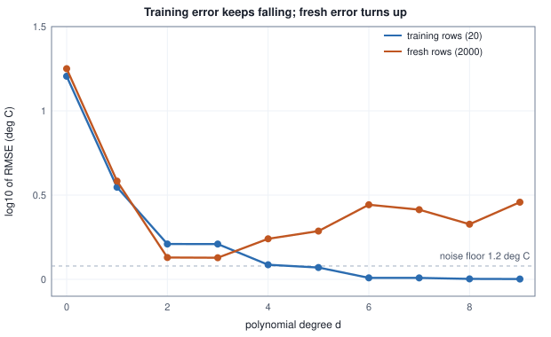
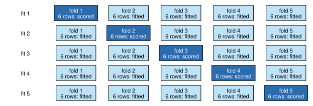

<!-- SPDX-License-Identifier: CC-BY-4.0 -->
<!-- Copyright (c) 2026 Martin Schröder <info@swedishembedded.com> -->

# Generalization, Overfitting and Honest Evaluation

*How do we know a model has learned the pattern rather than memorized the examples?*

## The problem

The workshop of chapter 1 has run more sensors through the reference thermometer and now holds twenty measured rows. The table below lists them. Nobody knows what degree of polynomial relates a sensor's voltage to the temperature, so the workshop does the natural thing and tries them all: a constant, a line, a parabola, a cubic, and so on up to degree nine. Each is fitted to the twenty rows by least squares (chapter 2), and each is scored by how far its predictions are from the labels it was fitted to.

<!-- worked: generalization.sensor_source -->
The source: voltage v uniform on [0.4, 2.8], temperature y = -6 + 50 v - 8 v^2 + 1.2 z with z a standard Gaussian sample. A row is two draws in this order: v = 0.4 + 2.4 * rng.uniform(), then z = rng.normal(); v and y are kept unrounded. Every model of this chapter uses the feature x = (v - 1.6) / 1.2, which maps the voltage range to [-1, 1], and the columns 1, x, x^2, ..., x^d.

| data set | generator seed | rows | use |
|---|---|---:|---|
| training rows | 0xccbf378dd8839571 | 20 | the rows every model below is fitted to |
| fresh rows | 0xd89ce2c4f07468b1 | 2000 | scoring only, never used to choose anything |

| n | voltage v (V) | temperature y (deg C) |
|---|---:|---:|
| 1 | 1.4968 | 52.594 |
| 2 | 1.0610 | 35.239 |
| 3 | 1.7563 | 59.367 |
| 4 | 1.4003 | 49.012 |
| 5 | 2.2971 | 65.540 |
| 6 | 0.7777 | 27.007 |
| 7 | 2.7961 | 73.674 |
| 8 | 0.7426 | 26.279 |
| 9 | 0.9278 | 32.682 |
| 10 | 0.5228 | 19.827 |
| 11 | 1.0165 | 36.064 |
| 12 | 0.5664 | 21.660 |
| 13 | 2.2762 | 65.557 |
| 14 | 2.3762 | 68.149 |
| 15 | 1.3760 | 51.968 |
| 16 | 1.8024 | 57.010 |
| 17 | 1.2713 | 46.371 |
| 18 | 0.8638 | 31.770 |
| 19 | 1.1734 | 41.284 |
| 20 | 1.6530 | 56.056 |
<!-- /worked -->

<!-- worked: generalization.degree_sweep -->
Least squares fits of degree d to the 20 training rows (normal equations, Gaussian elimination with partial pivoting, in the features x of the previous table). RMSE = square root of the mean squared difference between prediction and label, in degrees Celsius, on the 20 training rows and on the 2000 fresh rows (labels included, so even a perfect model scores about 1.2).

| degree d | parameters | training RMSE | fresh RMSE |
|---|---:|---:|---:|
| 0 | 1 | 16.052 | 17.798 |
| 1 | 2 | 3.521 | 3.830 |
| 2 | 3 | 1.621 | 1.348 |
| 3 | 4 | 1.620 | 1.344 |
| 4 | 5 | 1.221 | 1.741 |
| 5 | 6 | 1.176 | 1.934 |
| 6 | 7 | 1.021 | 2.772 |
| 7 | 8 | 1.020 | 2.591 |
| 8 | 9 | 1.006 | 2.124 |
| 9 | 10 | 1.005 | 2.870 |
<!-- /worked -->

The third column is the one a project manager would read. It falls and falls: from $16.052$ degrees for a constant to $1.005$ for the degree-nine polynomial, and it can never go back up, because a polynomial of degree $d + 1$ contains every polynomial of degree $d$ (set its top coefficient to zero), so the best fit in the larger family is at least as good on these rows. By this column the degree-nine curve is the winner by a wide margin.

The fourth column is the same models scored on two thousand fresh rows that none of them was fitted to. It tells another story. It falls until degree $2$ or $3$ ($1.348$ and $1.344$), where the models are about as good as any model could be given that the labels themselves carry noise of standard deviation $1.2$, and then it rises: $1.741$ at degree four, $2.772$ at degree six, $2.870$ at degree nine. The degree-nine curve that looked best by the third column is worse on new rows than a parabola by more than a factor of two.



This is the question of the chapter. The number the model was built to make small, its error on the rows it was fitted to, is the wrong number to believe, and the gap between it and the number that matters (the error on rows the model has not seen) grows with the freedom of the model. Chapter 1 saw the same effect with a lookup table, and chapter 4 chose the strength of a penalty by comparing fits to the true curve, which a practitioner does not have and promised "the honest version". This chapter builds it: how to measure the error on unseen rows without cheating, why every measurement is spoiled by being used twice, where the gap comes from, and how the world can change after the measurement.

You may use from earlier chapters: datasets and the expected error on a new draw from the source (chapter 1 of this volume), the mean squared error and least squares (chapter 2), the penalty of ridge regression (chapter 4), and from Volume I the variance of a random quantity, the bias of an estimator, the standard error, and the problem of making many comparisons (chapters 10 and 12).

## Before you begin

Six questions to answer from memory. The answers are at the end of the chapter. If one is hard, go back to the chapter named before reading on.

1. (Chapter 12, "Statistics: Learning Facts from Samples", estimators.) What does it mean for an estimator $\hat\theta$ to be biased, and why does the sample variance with divisor $n$ underestimate the true variance?
2. (Chapter 10, "Probability: Reasoning Under Uncertainty", variance.) Two independent quantities have variances $4$ and $9$. What is the variance of their sum, and of their average?
3. (Chapter 12, "Statistics", many comparisons.) Twenty independent tests are each run at the $5\%$ level and every null hypothesis is true. What is the probability that at least one test comes out significant?
4. (Chapter 1 of this volume, data come from a distribution.) A model's average error on the rows it was fitted to is $0.0$. Why does that not say that its expected error on a new draw from the source is $0.0$?
5. (Chapter 2 of this volume, the mean squared error.) Predictions $2, 5$ against labels $3, 3$: what is the mean squared error?
6. (Chapter 4 of this volume, regularization.) When the penalty $\lambda$ of ridge regression grows, what happens to the training error and to the size of the weights?

## Underfitting and overfitting

Read the table of the problem by its two ends. At degrees $0$ and $1$ both columns are bad and close together: $16.052$ against $17.798$, and $3.521$ against $3.830$. A constant and a line cannot follow a curve that bends, so they are wrong on the rows they were fitted to and just as wrong on new rows. **Underfitting** is this failure: the model is too restricted to represent the pattern, so its error is high everywhere, the training error included.

At degrees $4$ to $9$ the two columns separate. The training error is $1.221$ at degree four and $1.005$ at degree nine, below the noise of the labels ($1.2$), which is possible only because the polynomial has bent itself to follow noise in these particular twenty rows. The fresh error is $1.741$ to $2.870$. **Overfitting** is this failure: a model flexible enough to fit the accidents of its training rows does so, its training error is flattering, and its error on new rows is worse than that of a simpler model. The mark of overfitting is a training error that keeps improving while the error on new rows gets worse.

Both words describe a model relative to its data, not a model alone. A degree-six polynomial overfits twenty rows. Fitted to $640$ rows, it would have so many rows pinning down each of its seven coefficients that the noise of any one row hardly moves it, and it would hardly overfit (a table at the end of the chapter computes this). Underfitting and overfitting are the two ends of one dial, the flexibility of the model against the amount of information in the data, and the working problem of machine learning is to set that dial without being able to see the quantity it controls. The two thousand fresh rows were a luxury of this book, which can run its source as often as it likes. A workshop has its twenty rows and nothing else. The rest of the chapter is about what it can do with them.

## Training, validation and test sets

The idea that fixes the problem is to hold some of the rows back. Fit the model on part of the data and score it on the part it did not see. A row that was not used for fitting is, for that model, a draw from the source: its error is an unbiased estimate (Volume I, chapter 12) of the expected error on new rows, because nothing about the model depended on it.

A single hold-out is enough for one model, but a project needs more than one decision. It chooses between degrees, between penalties, between architectures and learning rates, and each choice is made by looking at a score. A score that has been used to choose is no longer innocent, as the next section shows with numbers. So the careful practice is to keep three sets apart, each with one job.

The **training set** is the part of the data used to fit the parameters: every weight is chosen by minimising the loss on these rows and no others. The **validation set** is used to choose between models, that is, every decision that is not a weight: the degree, the penalty $\lambda$, the learning rate, when to stop. The **test set** is used once, at the end, to report the score of the one model that was chosen. The three are disjoint, written $\mathcal{D}_{\mathrm{train}}$, $\mathcal{D}_{\mathrm{val}}$ and $\mathcal{D}_{\mathrm{test}}$, and chosen without looking at the labels: a random split when the rows are exchangeable, and one of the structured splits of the leakage section when they are not.

Here is the procedure on the penalty of chapter 4. Forty rows are drawn from the source: the first twenty are the training set, the next ten the validation set and the last ten the test set. A degree-nine polynomial is fitted to the twenty training rows with each penalty in a grid, and every fit is scored on all three sets and, because this book can, on two thousand fresh rows.

<!-- worked: generalization.three_way_split -->
Generator: the book's SplitMix64, seed 0xb67d637de94ae0c3 (13149775879427776707).
40 rows of the source in one generator, two draws per row; rows 1 to 20 are the training set, the next 10 the validation set, the last 10 the test set. Degree 9 (ten columns), minimise 1/2 sum (y - w.x)^2 + lambda/2 ||w||^2 on the training rows (every weight penalised, as in the likelihood chapter). RMSE in degrees Celsius; fresh = the 2000 fresh rows.

| lambda | training RMSE | validation RMSE | test RMSE | fresh RMSE |
|---|---:|---:|---:|---:|
| 0 | 0.825 | 1.440 | 2.776 | 2.042 |
| 0.001 | 1.003 | 1.322 | 2.527 | 1.650 |
| 0.01 | 1.029 | 1.210 | 2.537 | 1.602 |
| 0.1 | 1.277 | 1.164 | 2.674 | 1.912 |
| 1 | 4.075 | 3.920 | 5.453 | 4.437 |
| 10 | 18.679 | 19.195 | 21.696 | 18.009 |
| 100 | 44.617 | 45.758 | 51.825 | 43.157 |
<!-- /worked -->

The training column says what it always says: the smaller the penalty, the better, and the best of all is no penalty at all ($0.825$ at $\lambda = 0$). Choosing $\lambda$ by the training error would choose it, and the fresh column shows the price: $2.042$ at $\lambda = 0$ against $1.602$ at $\lambda = 0.01$. The validation column gets close to the truth. Its minimum is at $\lambda = 0.1$ ($1.164$), the fresh minimum is at $\lambda = 0.01$ ($1.602$), and the two agree on the rest of the story: no penalty is worse than a small one, and a penalty of $1$ or more destroys the fit. The choice is imperfect because ten validation rows are a small sample, and two neighbouring penalties are not separated by ten rows.

Two things in the table call for care. First, the validation score of the chosen model, $1.164$, is lower than that model's fresh error, $1.912$. Second, the test score of the same model, $2.674$, is higher. Neither is a mistake. The first is a consequence of the choice: $\lambda = 0.1$ was picked because it had the lowest validation score of seven candidates, which makes it the candidate that was most flattered by its ten validation rows. The second is plain sampling noise in ten rows. The next section quantifies both.

## Looking at the test set more than once

Suppose a team has a test set and a project in which it tries a hundred model variants. After each one it looks at the test score, and in the end it reports the best. The test set is the unused part of the data, so everything seems proper. It is not, and the reason is the one of Volume I, chapter 12: with twenty independent tests at the $5\%$ level and every null hypothesis true, the chance of at least one significant result is $1 - 0.95^{20} = 0.64$. A score is an estimate with noise, and the best of many noisy estimates is biased upward, because the maximum of a set of numbers is chosen precisely for being on the lucky side of its own noise.

To see this in its purest form, take candidates that cannot be any good. Each of $K$ candidates answers each of $50$ test questions correctly by flipping a fair coin, so each has a true accuracy of exactly $0.5$ and nothing to learn. Choose the candidate with the best test accuracy.

<!-- worked: generalization.look_at_test_set -->
Generator: the book's SplitMix64, seed 0x06ba84f3d3891860 (484846092656646240).
Each candidate answers each of 50 test questions correctly with probability 0.5, independently of every other answer and candidate: one rng.uniform() per answer, correct when it is below 0.5. Draw order: for each of 50 repetitions, for each K in (1, 10, 100, 1000) in turn (all repetitions of one K before the next K): K candidates of 50 answers in turn; the candidate with the most correct answers is chosen (the first on a tie); then 2000 more answers of the chosen candidate on fresh questions. 'Exact' is the expected best accuracy computed from the binomial distribution, and 'P(best >= 33/50)' the exact chance that the best candidate answers at least 33 of 50 correctly (one candidate alone: 0.0164).

| candidates K | best test accuracy (simulated) | best test accuracy (exact) | P(best >= 33/50) | accuracy of the chosen one on fresh questions |
|---|---:|---:|---:|---:|
| 1 | 0.525 | 0.500 | 0.016 | 0.497 |
| 10 | 0.614 | 0.608 | 0.153 | 0.501 |
| 100 | 0.669 | 0.676 | 0.809 | 0.499 |
| 1000 | 0.721 | 0.725 | 1.000 | 0.500 |
<!-- /worked -->

With $K = 1$ there is nothing to select and the average is $0.5$ (the table shows $0.525$ because only $50$ repetitions were simulated; the exact column says $0.500$). With ten candidates the best looks like $0.608$ (exact; simulated $0.614$), with a hundred $0.676$ (simulated $0.669$) and with a thousand $0.725$ (simulated $0.721$), where the exact column is computed from the binomial distribution. The column on the right is the honest one: the chosen candidate, scored on two thousand fresh questions, is at $0.5$ every time, because it never knew anything. The last-but-one column turns this into the language of chapter 12: one coin-flipper reaches $33$ of $50$ with probability $0.016$, which would pass a test at the $5\%$ level, and the best of a hundred does so with probability $0.809$.

Real candidates are not coin-flippers, but the arithmetic is the same: every look at a score and every choice made on it moves information from the held-out rows into the model. The test set protects against this only as long as it is looked at once. The regression problem shows the effect with realistic models. Repeating the split of the previous section a thousand times, with candidates the grid $\lambda \in \{0.01, 0.03, 0.1, 0.3, 1, 10\}$, each repetition gets its own forty rows, and the table compares what each way of reporting claims against the truth.

<!-- worked: generalization.selection_optimism -->
Generator: the book's SplitMix64, seed 0x82ae03119264e8fe (9416467244883699966).
1000 repetitions of the split of the previous example (20 training, 10 validation, 10 test rows; each repetition draws its 40 rows in turn from the one generator, two draws per row). Candidates: degree 9, lambda in (0.01, 0.03, 0.1, 0.3, 1.0, 10.0). Squared errors (MSE) are averaged over the repetitions; 'true' is the MSE of the chosen fit on the first 1000 fresh rows. The last column is the standard error of the mean of (reported - true) over the repetitions.

| lambda chosen by | score reported | mean reported | mean true (fresh) MSE of the chosen fit | reported - true | standard error |
|---|---|---:|---:|---:|---:|
| training MSE | training MSE | 0.978 | 2.789 | -1.811 | 0.076 |
| validation MSE | validation MSE | 2.146 | 2.407 | -0.261 | 0.049 |
| validation MSE | test MSE, read once | 2.469 | 2.407 | +0.062 | 0.056 |
| test MSE | test MSE, read for every lambda | 2.082 | 2.409 | -0.327 | 0.043 |
<!-- /worked -->

Reading the rows from the top. Choosing the penalty by the training error and reporting that error says $0.978$ where the truth is $2.789$ (it always picks the smallest penalty on the grid, and its score is the most flattering available). Choosing by the validation error and reporting the validation error says $2.146$ against a truth of $2.407$, optimistic by $0.261$ with a standard error of $0.049$: the winner's curse of the choice, mild because there are only six candidates and the choice is a selection among their noisy validation scores. The third row is the discipline of the test set: the same choice, reported by the test error read once, gives $2.469$ against $2.407$, a difference of $+0.062$ with a standard error of $0.056$, which is zero within the noise. The test score of a model that did not use the test set to choose is an unbiased estimate. It is not a precise one: a standard error of $0.056$ over a thousand repetitions means that a single repetition's gap has a standard deviation of about $0.056 \times \sqrt{1000} = 1.77$. Ten test rows are enough to be unbiased and not enough to be useful.

The last row is the leak. If the same ten test rows are used to choose the penalty (that is, they have become a second validation set), the reported error is $2.082$ against a truth of $2.409$, and the optimism is $0.327$. The set that was supposed to be a witness has become a participant. Once this has happened, the only remedy is a new test set, which is why test sets in serious projects are put away, sometimes in a place the developers cannot read, and why a result that has been used to make a decision can never be reported as a test result.

The same thing happens through the people as well as the code. A developer who looks at the test score, sees it is lower than hoped, changes the model and tries again is doing the search above by hand, with the same bias and no count of the number of looks. The count matters: the cure for a search is to know its size and then to report a score from rows the search never saw, a fresh test set or one set aside for this purpose.

## Where the gap comes from: bias and variance

The overfit polynomials of the first table are not wrong in a random direction. Their error on fresh rows has a structure that can be written down, and the structure says what to do about it. Take one input $\mathbf{x}$ and write the label there as

$$
y = f(\mathbf{x}) + \varepsilon, \qquad \mathbb{E}[\varepsilon] = 0, \qquad \mathrm{Var}[\varepsilon] = \sigma^2,
$$

with $f$ the true curve and $\varepsilon$ the noise of chapter 2, independent of everything else. The model $\hat f_{\mathcal{D}}$ is chosen using a training set $\mathcal{D}$, and $\mathcal{D}$ is random: another set of twenty rows would have given another model, as the five different lines of chapter 1 showed. So $\hat f_{\mathcal{D}}(\mathbf{x})$ is a random number, an estimator in the sense of Volume I of the true value $f(\mathbf{x})$. Write its average over training sets as $\bar f(\mathbf{x}) = \mathbb{E}_{\mathcal{D}}[\hat f_{\mathcal{D}}(\mathbf{x})]$.

The expected squared error at $\mathbf{x}$, over the training set and over the noise of one new label, is $\mathbb{E}[(y - \hat f)^2]$. Write $y - \hat f = \varepsilon + (f - \hat f)$ and expand. The cross term is $2\,\mathbb{E}[\varepsilon]\,\mathbb{E}[f - \hat f] = 0$, because the new label's noise is independent of the training set, so

$$
\mathbb{E}\bigl[(y - \hat f)^2\bigr] = \sigma^2 + \mathbb{E}\bigl[(f - \hat f)^2\bigr].
$$

For the second term write $f - \hat f = (f - \bar f) + (\bar f - \hat f)$, where the first part does not depend on $\mathcal{D}$ and the second has average zero. The cross term again vanishes, and

$$
\mathbb{E}\bigl[(f - \hat f)^2\bigr] = \underbrace{(f(\mathbf{x}) - \bar f(\mathbf{x}))^2}_{\text{bias}^2} + \underbrace{\mathbb{E}\bigl[(\hat f_{\mathcal{D}}(\mathbf{x}) - \bar f(\mathbf{x}))^2\bigr]}_{\text{variance}} .
$$

Putting the two together,

$$
\boxed{\;\mathbb{E}\bigl[(y - \hat f_{\mathcal{D}}(\mathbf{x}))^2\bigr] = \underbrace{\sigma^2}_{\text{noise}} + \underbrace{(f(\mathbf{x}) - \bar f(\mathbf{x}))^2}_{\text{bias}^2} + \underbrace{\mathrm{Var}_{\mathcal{D}}\bigl[\hat f_{\mathcal{D}}(\mathbf{x})\bigr]}_{\text{variance}}\;}
$$

The three terms mean three different things. The **noise** is the part of the label that no model can predict; it sets the floor of the error (here $1.2^2 = 1.44$) and is the reason the best possible fresh RMSE in the table of the problem is $1.2$ and not $0$. The **bias** is how far the average model is from the truth: what the model family cannot express, however much data there is. A line is biased for a curved relationship, and it stays biased with a million rows. The variance is how much the fitted model moves from one training set to another: what the family can express but the data do not pin down. A model with many parameters and few rows has high variance. Averaging over $\mathbf{x}$ drawn from the source gives the same decomposition for the whole expected error. The bias and the spread of an estimator, as chapter 12 defined them for a number, are here defined at every input for a function. The loss must be the squared error: for other losses the decomposition takes other forms and the neat sum is lost.

The decomposition can be measured, because this book can draw as many training sets as it wants. Draw $1000$ training sets of $20$ rows, fit each degree to each, and at $41$ voltages evaluate the predictions of the $1000$ fits. The average of the $1000$ predictions at a voltage is $\bar f$; its distance from the true curve is the bias; the spread of the $1000$ predictions is the variance. One further check is independent of the algebra: at each voltage a fresh noisy label is drawn for each training set and the squared error of the prediction against it is recorded.

<!-- worked: generalization.bias_variance_degree -->
Generator: the book's SplitMix64, seed 0x03dcee5362d15fc7 (278359318897713095).
1000 training sets of 20 rows. Draw order: for each training set in turn, 20 rows (two draws each, as in the source), then 41 draws of normal() that become the noise of one fresh label at each grid point. The 41 grid points are v = 0.4 + 2.4 i / 40, i = 0 .. 40. Least squares fits of degree d. Bias^2 is the grid average of (mean prediction - true value)^2, variance the grid average of the population variance (divisor 1000) of the predictions, noise = 1.2^2 = 1.44.

| degree d | parameters | bias^2 | variance | noise | bias^2 + variance + noise | measured MSE on fresh labels |
|---|---:|---:|---:|---:|---:|---:|
| 0 | 1 | 313.062 | 15.951 | 1.440 | 330.453 | 330.589 |
| 1 | 2 | 13.105 | 2.155 | 1.440 | 16.700 | 16.724 |
| 2 | 3 | 0.001 | 0.288 | 1.440 | 1.729 | 1.725 |
| 3 | 4 | 0.002 | 0.512 | 1.440 | 1.953 | 1.938 |
| 4 | 5 | 0.005 | 1.523 | 1.440 | 2.968 | 2.988 |
| 5 | 6 | 0.010 | 8.264 | 1.440 | 9.714 | 9.739 |
| 6 | 7 | 0.084 | 150.431 | 1.440 | 151.954 | 151.858 |

The mean over sets and grid of (prediction - true value)^2 equals bias^2 + variance in every row to within 10^-9 (the identity is exact; any gap is rounding): yes.
<!-- /worked -->


At degree $0$ and degree $1$ the bias is huge ($313.062$ and $13.105$) and the variance is modest: the models are stable and wrong, which is underfitting in the language of this section. At degree $2$ the bias is $0.001$, which is zero up to the simulation: the true curve is a parabola, so the family contains it and the average of many fits finds it. From there the bias stays near zero and the variance climbs: $0.288$ at degree two, $0.512$ at three, $1.523$ at four, $8.264$ at five, and $150.431$ at six, which is overfitting. The total, the sum of the three columns, has its minimum at degree $2$, $1.729$, and the last column, the independently measured error on fresh labels, agrees with it to within the noise of the simulation ($1.725$). The printed line under the table checks the algebra on the same numbers: the average of $(\hat f - f)^2$ over sets and voltages equals bias squared plus variance in every row to within $10^{-9}$.

A note about the near-zero bias entries. The bias of every family from degree $2$ up is exactly zero, and the printed values ($0.001$ to $0.084$) are the leftover noise of averaging $1000$ fits: the squared error of a mean of $S$ predictions of variance $v$ is about $v/S$, so degree six, with a variance of $150$, is expected to show about $0.15$ and prints $0.084$. A simulation of this kind has a floor on the bias it can resolve, and the floor rises with the variance.

The degrees of the table are one way to change flexibility. Another is the one of chapter 4: keep a degree-nine polynomial and restrain it with a penalty. The decomposition for that dial is smooth, because a ridge penalty moves the model continuously.

<!-- worked: generalization.bias_variance_ridge -->
Generator: the book's SplitMix64, seed 0x53e4fd03bbc34ccf (6045234792314916047).
1000 training sets of 20 rows. Draw order: for each training set in turn, 20 rows (two draws each, as in the source), then 41 draws of normal() that become the noise of one fresh label at each grid point. The 41 grid points are v = 0.4 + 2.4 i / 40, i = 0 .. 40. Degree 9 fits minimising 1/2 sum (y - w.x)^2 + lambda/2 ||w||^2. Bias^2 is the grid average of (mean prediction - true value)^2, variance the grid average of the population variance (divisor 1000) of the predictions, noise = 1.2^2 = 1.44.

| lambda | bias^2 | variance | bias^2 + variance + noise | measured MSE on fresh labels |
|---|---:|---:|---:|---:|
| 0.001 | 0.032 | 7.191 | 8.663 | 8.681 |
| 0.01 | 0.025 | 1.750 | 3.215 | 3.202 |
| 0.03 | 0.153 | 1.103 | 2.696 | 2.674 |
| 0.1 | 0.833 | 0.950 | 3.223 | 3.189 |
| 0.3 | 3.855 | 1.346 | 6.641 | 6.593 |
| 1 | 20.745 | 2.690 | 24.875 | 24.801 |
| 10 | 365.999 | 7.273 | 374.712 | 374.357 |
| 100 | 1878.645 | 1.794 | 1881.879 | 1881.071 |
<!-- /worked -->


With almost no penalty ($\lambda = 0.001$) the bias is $0.032$ and the variance $7.191$; as the penalty grows the variance falls to its minimum, $0.950$ at $\lambda = 0.1$, while the bias climbs to $0.833$ and then to $1878.645$ at $\lambda = 100$. The variance rises again between $\lambda = 0.3$ and $\lambda = 10$ ($1.346$ to $7.273$) because every weight, the intercept included, is penalised, so a strong penalty leaves a shrunken copy of the overall level of the labels, which itself differs from one training set to the next; at $\lambda = 100$ even that is squeezed out ($1.794$). The total is lowest at $\lambda = 0.03$ ($2.696$). This is the **bias-variance tradeoff**: lowering one of the two terms by changing the flexibility of the model raises the other, and the best model is at the minimum of the sum, not at either extreme. It is the same dial as underfitting and overfitting, and it explains why regularization helps: a penalty buys a small bias for a large reduction in variance. Note that the best total here ($2.696$) is above that of the plain parabola ($1.729$). The parabola is the true family, and no penalised polynomial of degree nine beats a model whose shape is exactly right; regularization is what one does when the right shape is not known.

The decomposition also says how to read the first table of the chapter. Training error is the part of the error that the training set can see, and it contains neither the variance nor the noise of new rows, because the model was fitted to this noise. This is why the training error falls without limit as the model gets more flexible while the fresh error does not.

## Cross-validation

The validation set of the three-way split has a cost: the ten rows used for validation are ten rows the model was not fitted to. With forty rows in all, that is a quarter of the data held out and a score computed from a sample that is too small to separate two neighbouring penalties. **Cross-validation** recovers most of the rows. Split the data into $k$ parts called **folds**; fit $k$ models, each one to all folds but one, and score each on the fold it did not see; average the $k$ scores. Every row is used for fitting $k - 1$ times and for scoring exactly once.

The folds are assigned by shuffling the row numbers and dealing them out in turn, which makes the assignment random but balanced: every fold has $\lfloor N/k \rfloor$ or $\lceil N/k \rceil$ rows.

```text
function fold_assignment(n: int, k: int, rng: Generator) -> array<int>[n]:
    require 2 <= k and k <= n, "need at least two folds and no more folds than rows"
    order = [i for i in 0 .. n]          # the row numbers 0, 1, ..., n-1
    shuffle(order, rng)
    fold = zeros(int, [n])
    for position in 0 .. n:
        fold[order[position]] = position mod k
    return fold
```

Given the folds, the loop that fits and scores is short. The learner is passed in as a function that fits a model to some rows and returns its loss on others, so the same loop serves a polynomial, a classifier or a network.

```text
function cross_validate(X: array<real>[N, d], y: array<real>[N], fold: array<int>[N], k: int,
        fit_and_score: function(array<real>[M, d], array<real>[M],
                                array<real>[V, d], array<real>[V]) -> real) -> array<real>[k]:
    require len(fold) == N, "one fold number per row"
    scores = zeros(real, [k])
    for j in 0 .. k:
        train_rows = [n for n in 0 .. N if fold[n] != j]
        held_rows = [n for n in 0 .. N if fold[n] == j]
        require len(held_rows) > 0, "an empty fold"
        scores[j] = fit_and_score(rows(X, train_rows), [y[n] for n in train_rows],
                                  rows(X, held_rows), [y[n] for n in held_rows])
    return scores
```

The cross-validation estimate of the expected loss is the average of the fold scores, $\mathrm{CV}_k = \frac{1}{k}\sum_{j=0}^{k-1} \mathrm{score}_j$, which for folds of equal size is the mean loss over all rows, each scored by a model that did not see it. The diagram below shows the structure for the thirty development rows and five folds used below.



Take the development rows to be the twenty training and ten validation rows of the three-way example, thirty rows in all, and $k = 5$.

<!-- worked: generalization.cv_folds -->
Generator: the book's SplitMix64, seed 0x69a8ce989e9d927d (7613562324961301117).
The order 0, 1, ..., 29 is shuffled by the book's shuffle (Fisher-Yates, 29 integer draws); the row at shuffled position p goes to fold p mod 5. Rows are numbered from 1 in the table.

| fold | rows (of the 30 development rows) |
|---:|---|
| 1 | 1, 7, 21, 25, 28, 29 |
| 2 | 3, 4, 11, 14, 24, 30 |
| 3 | 2, 12, 13, 16, 19, 26 |
| 4 | 6, 9, 10, 17, 22, 23 |
| 5 | 5, 8, 15, 18, 20, 27 |
<!-- /worked -->

<!-- worked: generalization.cross_validation -->
The development rows are the 20 training and 10 validation rows of the earlier split (30 rows), folds as in the previous table. For each fold: fit degree 9 with the penalty lambda to the other 24 rows, take the MSE on the 6 held-out rows. 'CV' is the mean of the 5 fold MSEs; 'LOO' is leave-one-out (30 fits, one row held out each time, mean squared error over the rows); 'fresh' is the MSE on the 2000 fresh rows of the fit to all 30 rows.

| lambda | fold 1 | fold 2 | fold 3 | fold 4 | fold 5 | CV | LOO | fresh (all 30 rows) |
|---|---:|---:|---:|---:|---:|---:|---:|---:|
| 0 | 5.333 | 0.809 | 3.070 | 1.104 | 12.724 | 4.608 | 1.869 | 2.449 |
| 0.001 | 0.932 | 0.992 | 4.778 | 1.680 | 2.612 | 2.199 | 2.202 | 1.965 |
| 0.01 | 0.801 | 0.857 | 2.138 | 1.485 | 2.509 | 1.558 | 1.615 | 2.049 |
| 0.1 | 1.221 | 1.121 | 2.207 | 0.824 | 4.336 | 1.942 | 1.746 | 2.932 |
| 1 | 12.537 | 19.215 | 15.572 | 10.904 | 19.217 | 15.489 | 11.321 | 12.789 |
| 10 | 167.459 | 402.076 | 280.557 | 297.735 | 324.565 | 294.478 | 232.284 | 197.666 |
| 100 | 1112.742 | 2140.370 | 2078.467 | 1993.491 | 2180.672 | 1901.148 | 1751.538 | 1557.592 |

Smallest CV: lambda = 0.01. Smallest LOO: lambda = 0.01.
<!-- /worked -->

The five fold columns are scores of the same model on five different sets of six rows, and they differ a lot: at $\lambda = 0$ from $0.809$ to $12.724$, at $\lambda = 0.01$ from $0.801$ to $2.509$. This is the sampling noise of small scoring sets, now visible, and the average hides it by averaging it. The $\mathrm{CV}$ column picks $\lambda = 0.01$ ($1.558$), where the fresh error of the model refitted on all thirty rows is $2.049$ against a best of $1.965$ at $\lambda = 0.001$. The estimate is still optimistic, because it is the best of seven noisy scores, a mild version of the selection effect of the previous section, and it is for models trained on $24$ rows while the refitted model has $30$.

The last row-wise variant is **leave-one-out** cross-validation, $k = N$: each row is held out in turn and the model is fitted to the other $N - 1$. It uses the most data in each fit, $29$ of $30$ rows, and costs $N$ fits. Its column agrees with the five-fold one here ($1.615$ at $\lambda = 0.01$, the minimum, against $1.558$), and it is not obviously better: the $N$ models are nearly identical to each other, so their errors are strongly correlated and the average of $N$ strongly correlated numbers is hardly more stable than the average of five.

The costs and the variance can be stated. Choosing among $C$ candidates by $k$-fold cross-validation takes $kC$ fits, plus one more to refit the winner on all the data, against $C$ for a single split: $30$ against $6$ in the next table. The estimate has a variance: the score of one fold is a mean over about $N/k$ rows and the folds are not independent (each pair of training sets shares $(k-2)/k$ of the rows), so there is no formula as simple as the standard error of Volume I, chapter 12, and the spread of the fold scores understates the uncertainty of their average. Whether the extra fits buy something is measurable: draw many development sets of thirty rows, choose $\lambda$ on each by a single split (twenty rows fit, ten scored) and by five-fold cross-validation, refit the choice on all thirty rows and compare what each method claimed with what the refitted model really does on fresh rows.

<!-- worked: generalization.cv_vs_split -->
Generator: the book's SplitMix64, seed 0x1390132f46f59a96 (1409647777141856918).
1000 development sets of 30 rows from the one generator. Draw order: for each set in turn, its 30 rows (two draws each), then the shuffle of the 5-fold assignment (29 integer draws). Both methods choose lambda from (0.01, 0.03, 0.1, 0.3, 1.0, 10.0) (degree 9) as the smallest score; the chosen lambda is then refitted on all 30 rows. 'estimate' is the score the method reports for its choice, 'true' the MSE of the refitted model on the first 1000 fresh rows. The last column is the standard deviation, over the sets, of estimate - true.

| method | fits per set | mean estimate | mean true MSE | median true MSE | sd of (estimate - true) |
|---|---:|---:|---:|---:|---:|
| single split, 20 fit + 10 score | 6 | 2.119 | 2.139 | 1.821 | 1.898 |
| 5-fold cross-validation | 30 | 2.080 | 2.076 | 1.777 | 1.526 |
<!-- /worked -->

Both methods are about unbiased here ($2.119$ claimed against $2.139$ true for the split, $2.080$ against $2.076$ for cross-validation, with the choice made on the same grid) and their choices are about equally good (median true MSE $1.821$ against $1.777$). The difference is in the spread of the claim: the standard deviation of the error of the estimate is $1.898$ for the split and $1.526$ for cross-validation. The extra fits buy a steadier estimate, not a different one. For small data it is worth the cost; for a model that takes days to train it is not, and a single split with a big enough validation set is the practical choice. The pseudocode has one more condition that matters more than $k$: **every step that uses the data to make a decision must be inside the loop**. A standardization, a feature selection or an imputation computed on all the rows before the loop makes the fold scores dishonest in the way the next section shows.

## Data leakage

All of the evaluations so far assume that the held-out rows are independent of the training rows in the way a new row from the source would be. **Data leakage** is any path by which information about the rows used for scoring reaches the fitting, so that the score is no longer a score on unseen data. A leak does not raise an error. It raises the score, and a high score on a clean-looking evaluation is what a project hopes to see, so leaks are found by suspicion rather than by symptom. Four kinds follow, each with a tiny experiment in which the labels are pure noise (so the right answer is known: chance) and in which the leaky protocol finds a high score anyway.

### The same record on both sides

A dataset in which a row appears twice, whether because a log was loaded twice, an image was cropped twice or a record was resubmitted, and which is split at random, puts the copy of many test rows into the training set. A model that memorises does well, and a lookup table is the extreme case of chapter 1. In the experiment, $100$ items each have a random feature and a coin-flip label; each is recorded twice; the model answers with the label of the nearest training record.

<!-- worked: generalization.leak_duplicates -->
Generator: the book's SplitMix64, seed 0x2f477d859d6f3e68 (3406829655954505320).
100 items, each a feature x = rng.uniform() followed by a label 1 if rng.uniform() < 0.5 else 0, so the label is a coin flip unrelated to x. Each item is recorded twice (200 records). 200 repetitions; per repetition the draws are the 100 items in turn, then the shuffle of the 200 records (leaky protocol: the first 100 records train, the other 100 test), then the shuffle of the 100 item numbers (clean protocol: the first 50 items, both copies each, train; the other 50 test). The model answers a test record with the label of the training record whose x is nearest (the first on a tie). Accuracy is averaged over the test records.

| protocol | mean accuracy | sd over repetitions |
|---|---:|---:|
| random split of the records | 0.743 | 0.057 |
| split by item | 0.499 | 0.072 |

Expected accuracy of the leaky protocol: 1/2 + 1/2 * 100/199 = 0.7513; of the clean protocol: 0.5.
<!-- /worked -->

With the records split at random the accuracy is $0.743$ on labels that are a coin flip. The reason is countable: the twin of a test record is in the training half with probability $100/199$, and then the lookup is right, otherwise it is right half the time, so the expected accuracy is $\tfrac12 + \tfrac12 \cdot \tfrac{100}{199} = 0.7513$. Splitting by item, so that both copies go to the same side, gives $0.499$, which is the truth. Near-duplicates leak in the same way, only less visibly: neighbouring frames of one video, paraphrases of one question, the same text with different whitespace.

### A statistic computed with the labels of all the rows

The next leak is the subtlest, because it is committed by a step that looks like preparation. Forty rows, each with two hundred features that are all independent noise, and labels $0, 1, 0, 1, \dots$: nothing in the features can predict the label. The model keeps the ten features whose class means differ most and classifies by the nearer class centroid. The only question is when the ten features are chosen.

<!-- worked: generalization.leak_selection -->
Generator: the book's SplitMix64, seed 0xa4578ff7cfad0a05 (11842092039697926661).
40 rows, 200 features, every feature value an independent normal(): there is nothing to learn. Row i has label i mod 2 (labels 0, 1, 0, 1, ...), so each half has 10 of each class. 100 repetitions; each draws the 40 x 200 matrix row by row. Rows 1 to 20 train, rows 21 to 40 test. The model keeps the 10 features with the largest |mean of class 1 - mean of class 0|, then classifies a test row by the nearer of the two class centroids (squared distance over the kept features, class 0 on a tie). Leaky protocol: the features are chosen from all 40 rows; clean protocol: from the 20 training rows only.

| where the features were chosen | mean test accuracy | sd over repetitions |
|---|---:|---:|
| all 40 rows, labels included | 0.809 | 0.075 |
| the 20 training rows only | 0.510 | 0.118 |
<!-- /worked -->

Choosing the features on all forty rows and then splitting gives a test accuracy of $0.809$, on data that carries no information. Choosing them on the twenty training rows only gives $0.510$. Out of two hundred noise features some ten will look related to the labels by chance in any set of rows, and if the test rows were among those used to pick them, the test rows are the very rows by which they look related. The same happens with any statistic that looks at labels (a feature's correlation with the label, a threshold chosen to separate the classes, a target encoding) and with any choice made on the held-out rows, such as picking the best of several models by the test score, the subject of the previous sections.

Statistics that do not touch the labels leak too, but less, and the direction is not always flattering. Standardizing every feature by the mean and standard deviation of all the rows, test rows included, lets each test row influence the numbers it is scaled by: an unusual test row pulls the mean towards itself and so looks a little less unusual. In production the model will have only the statistics of the data it was trained on, so those are the ones to use at evaluation too. The rule that covers all of this: every quantity computed from data (a mean, a vocabulary, a threshold, a selected feature, a learned embedding) is a parameter, and is fitted on the training set only, and applied to the other sets as a fixed function.

### Future information

When the rows are observations in time, the order is information. A random split of the time steps puts test points between training points, and a model that interpolates between its neighbours looks excellent at a task that cannot be done at all in use, because in use there are no later points. The experiment is a random walk of $300$ steps. The model predicts the value at a test time by the value at the nearest training time, which is a model with no parameters at all.

<!-- worked: generalization.leak_time -->
Generator: the book's SplitMix64, seed 0x157c33810dec64ed (1548169001286001901).
100 random walks of 300 steps: s_0 = normal(), then s_t = s_(t-1) + normal(), t = 1 .. 299. Per walk the draws are the 300 steps, then the shuffle of the times 0 .. 299 (random protocol: the first 210 shuffled times train, the other 90 test). Chronological protocol: times 0 .. 209 train, 210 .. 299 test. The model predicts s_t by the value at the nearest training time (the earlier one on a tie). RMSE over the test times.

| protocol | mean RMSE | sd over walks |
|---|---:|---:|
| random split of the times | 1.032 | 0.080 |
| chronological split | 5.852 | 3.111 |
<!-- /worked -->

When the $90$ test times are a random subset of the times, the nearest training time is usually the next or previous step, and the walk has moved by one unit of noise: the RMSE is $1.032$. When the test times are the last $90$, as they will be when the model is used on tomorrow's data, the nearest training time is the last one and the walk has had up to $90$ steps to wander: the RMSE is $5.852$, with a standard deviation over walks of $3.111$, because a random walk can go anywhere. Same model, same data, a factor of almost six. Only the second number describes a forecast.

A time-series split is therefore chronological: the training set is the past and the validation and test sets are later. There is a second leak across the seam. If the quantity to be predicted at a training time reaches $h$ steps into the future, the labels of the last training rows overlap the first rows of the next set, and a model can be fitted to the very quantity it is later scored on. The cure is an **embargo**: a gap of at least $h$ steps between the training rows and the later rows that are scored, and the rule that no feature may use a value from after the time of the prediction, including statistics such as a mean over the whole series.

### The same subject in both sets

Rows are often not independent: many belong to one patient, one document, one machine, one speaker, one episode of a game. Rows of one group are alike for reasons that have nothing to do with the pattern to be learned, and a model can learn to recognise the group instead. In the experiment there are $30$ subjects with $8$ rows each. Each subject has a fingerprint, a point in the plane, and its rows are that point plus a little noise. The label belongs to the subject and is a coin flip, so it cannot be predicted from a new subject's features. The model answers with the label of the nearest training row.

<!-- worked: generalization.leak_groups -->
Generator: the book's SplitMix64, seed 0x908e3cbeb64e186a (10416329777954560106).
30 subjects with 8 rows each. Per subject, in turn: a fingerprint of two normal() draws, a label (1 if rng.uniform() < 0.5 else 0) shared by all its rows, then 8 rows, each (fingerprint_1 + 0.1 * normal(), fingerprint_2 + 0.1 * normal()). The label is a coin flip per subject, so nothing about it is predictable from a new subject's features. 30 repetitions; after the 30 subjects, the shuffle of the 240 row numbers (row protocol: first half trains) and then the shuffle of the 30 subject numbers (group protocol: the first 15 subjects, all their rows, train). The model answers with the label of the nearest training row in the plane (first on a tie).

| protocol | mean accuracy | sd over repetitions |
|---|---:|---:|
| random split of the rows | 0.905 | 0.044 |
| split by subject | 0.515 | 0.134 |
<!-- /worked -->

Splitting the rows at random puts rows of every subject on both sides, and the nearest training row is a sibling with the same label: $0.905$. A **group split** puts all rows of a subject on one side, and the accuracy becomes $0.515$, chance. The first number measures how well the model recognises people it has already met; only the second says how it treats a new one, which is the situation in use. A group split is a split of the groups, then of the rows they own, and the fold assignment above applies unchanged, one level up.

```text
function group_fold_assignment(group: array<int>[N], G: int, k: int, rng: Generator) -> array<int>[N]:
    require 2 <= k and k <= G, "need at least as many groups as folds"
    group_fold = fold_assignment(G, k, rng)      # one fold number per group
    return [group_fold[group[n]] for n in 0 .. N]
```

Here `group[n]` is the group number of row `n`, in `0 .. G-1`. Using it in `cross_validate` gives a cross-validation in which a group is never on both sides.

A checklist follows from the four cases. Before trusting a score, ask for each held-out row: could the model have seen this row, a copy of it, a neighbour of it, another row of the same subject, a statistic computed from it, or the future relative to it? The answer is usually found by looking at how the data were generated and split, not at the model.

## Distribution shift

Every score so far has the same silent premise: the rows the model will meet are draws from the same source as the rows it learned from and was scored on (chapter 1, "Data comes from a distribution"). **Distribution shift** is the failure of the premise: the source in use differs from the source of the data. A held-out set cut from the same data cannot reveal it, however carefully it was cut, and that is the central difficulty.

### Covariate shift

Take chapter 1's sensor and install it where it runs hotter, at higher voltages. Fit three polynomials to forty rows taken at voltages between $0.4$ and $1.8$ V, score them on a thousand held-out rows from the same range and on a thousand production rows from $1.8$ to $2.8$ V. In production the relation between voltage and temperature has not changed: it is the same law, only the inputs have moved to a region the model never saw. This is **covariate shift**: the distribution of the features changes and the rule that connects the features to the label does not.

<!-- worked: generalization.covariate_shift -->
Generator: the book's SplitMix64, seed 0x77ff0c75c986ec55 (8646643509606411349).
Three sets from the source, drawn in this order from one generator, two draws per row: 40 training rows with v = 0.4 + 1.4 * rng.uniform(); 1000 held-out rows from the same range; then 1000 'production' rows with v = 1.8 + 1.0 * rng.uniform(). Least squares fits of degree d to the training rows; RMSE in degrees Celsius.

| degree d | parameters | training RMSE | held-out RMSE (same range) | production RMSE (higher voltages) |
|---|---:|---:|---:|---:|
| 1 | 2 | 1.767 | 1.744 | 11.051 |
| 2 | 3 | 1.086 | 1.250 | 1.415 |
| 5 | 6 | 0.964 | 1.408 | 261.497 |
<!-- /worked -->

On held-out rows from the training range the three models look alike: $1.744$, $1.250$ and $1.408$ degrees, from the line, the parabola and the degree-five polynomial. A careful person would conclude that the parabola is best, the polynomial of degree five second, and the line last. In production the line is wrong by $11.051$ degrees, the parabola by $1.415$ (close to the noise of $1.2$, because its shape is the true shape and extrapolates correctly) and the degree-five polynomial by $261.497$, because a high-degree polynomial is free to do anything outside the data that pinned it. The held-out error ranked the degree-five polynomial above the line, and in production it is more than twenty times worse. The held-out error is a correct number about the world it was drawn from, which is the world of the training rows, and says nothing about another.

### Label shift

The other simple kind is a change in how common each label is while the rule that generates the features from the label stays fixed. This is **label shift**. Two classes have features $x \sim \mathcal{N}(0, 1)$ and $x \sim \mathcal{N}(2, 1)$, and the rule trained on equal classes is to answer class 1 when $x > 1$. With $\Phi$ the cumulative distribution function of the Gaussian (Volume I, chapter 11) and $p_1$ the share of class 1 in use, the error of any threshold $t$ is $(1 - p_1)(1 - \Phi(t)) + p_1\,\Phi(t - 2)$. The rule is best for equal classes. For another share, a point is class 1 when $p_1\,\mathcal{N}(x; 2, 1) > (1 - p_1)\,\mathcal{N}(x; 0, 1)$; taking logarithms of the Gaussian densities this is $x > 1 + \tfrac12 \ln\frac{1 - p_1}{p_1}$.

<!-- worked: generalization.label_shift -->
Class 0: x ~ N(0, 1). Class 1: x ~ N(2, 1). The rule trained on equal classes is 'predict class 1 when x > 1'. The error is (1 - p1) P(x > t | class 0) + p1 P(x <= t | class 1), computed with the Gaussian cumulative distribution function (erf). The best threshold for a class-1 share p1 is t = 1 + ln((1 - p1)/p1) / 2.

| share of class 1 in use, p1 | error of the rule x > 1 | error of always answering class 0 | best threshold | error at the best threshold |
|---|---:|---:|---:|---:|
| 0.5 | 0.1587 | 0.5000 | 1.0000 | 0.1587 |
| 0.2 | 0.1587 | 0.2000 | 1.6931 | 0.1121 |
| 0.1 | 0.1587 | 0.1000 | 2.0986 | 0.0701 |
| 0.02 | 0.1587 | 0.0200 | 2.9459 | 0.0181 |
<!-- /worked -->

The error of the trained rule is $0.1587$ in every row, because it depends only on the symmetric overlap of two equally wide Gaussians. In use it is the wrong rule. When class 1 is $10\%$ of the cases the best threshold is $2.0986$ with an error of $0.0701$, and the trained rule at $0.1587$ is worse than the rule that always answers class 0, which has an error of $0.1000$. At a share of $2\%$ the trained rule's $0.1587$ is eight times the $0.0200$ of answering class 0 every time. The rule is as good at separating the classes as ever; what has moved is the best place to draw the line, because prior beliefs (chapter 4) are part of the optimal answer, and the prior in use is not the prior in the data. The error of the trained rule did not change, which is the fact that makes label shift easy to miss with a single accuracy number, and is a reason for the richer metrics of the next chapter.

### Detection, and the limits of detection

Shift of the features can be detected without labels, by comparing the statistics of the rows in use with those of the training rows, which are available in production. The tools are those of Volume I, chapter 12.

<!-- worked: generalization.shift_detection -->
The voltage feature v of the three sets of the previous example. 'Outside' is the fraction of the set's rows with v below the smallest or above the largest training voltage.

| set | rows | mean v | sd v | min v | max v | outside training range |
|---|---:|---:|---:|---:|---:|---:|
| training | 40 | 1.073 | 0.433 | 0.416 | 1.800 | 0.000 |
| held-out | 1000 | 1.108 | 0.409 | 0.400 | 1.799 | 0.012 |
| production | 1000 | 2.282 | 0.288 | 1.800 | 2.800 | 1.000 |

Difference of means in standard errors, (mean of second - mean of first) / sqrt(s1^2/n1 + s2^2/n2): training to held-out +0.50; training to production +17.51.
<!-- /worked -->

The held-out rows are consistent with the training rows: the mean differs by $+0.50$ standard errors, and $1.2\%$ of the rows fall outside the range of the training voltages. The production rows differ by $+17.51$ standard errors, and every one of them lies outside the training range. These are the numbers a monitor would report on the first day. The comparison can be made on anything that is available without labels (a feature, a summary of the activations of a model, the length of the inputs, the share of missing values), and a comparison of whole distributions (for example the difference between two histograms) catches changes that a comparison of means misses. What no feature statistic can show is a change in the rule that connects features to labels, with the features unchanged (the same voltage now means another temperature because the thermometer was recalibrated): that requires labels, a small sample of production rows labelled by hand, scored regularly. And the reverse also holds: a shifted feature does not imply a broken model. The parabola was barely hurt by the shift of the table above, because its shape was right. The warning from a detector is a reason to look, not a verdict.

The general remedy is not a trick of evaluation. Make the evaluation set resemble the use: sample it from the deployment conditions, split by the unit that is new at deployment (a new subject, a later month, a new machine), and keep scoring in production. The shifted and unshifted scores of the table together are the honest report: "$1.250$ on the range we trained on, $1.415$ on the range we will meet".

## More data or more model

The bias-variance picture answers a question every project asks: given an error that is too high, is it better to collect more data or to build a bigger model? The answer depends on which of the two terms is large. Fit a line, a parabola and a degree-six polynomial to training sets of growing size and record the excess error, the bias squared plus the variance (the fresh squared error is this plus the noise $1.44$), averaged over $100$ training sets at each size. A plot of an error against the size of the training set is a **learning curve**.

<!-- worked: generalization.learning_curves -->
Generator: the book's SplitMix64, seed 0x18cdbacb2ac1f578 (1787290008894436728).
For each N in (20, 40, 80, 160, 320, 640) in turn, 100 training sets of N rows from the one generator (two draws per row). Least squares fits of degree (1, 2, 6); the entry is the mean over the sets of the grid average of (prediction - true value)^2 on the 41 grid points v = 0.4 + 2.4 i / 40. This is the excess error: the expected squared error on fresh labels is this plus 1.44.

| N | degree 1 | degree 2 | degree 6 |
|---|---:|---:|---:|
| 20 | 14.994 | 0.229 | 29.627 |
| 40 | 13.995 | 0.122 | 0.732 |
| 80 | 13.516 | 0.052 | 0.205 |
| 160 | 13.249 | 0.025 | 0.075 |
| 320 | 13.145 | 0.016 | 0.037 |
| 640 | 13.076 | 0.007 | 0.019 |
<!-- /worked -->

The line's column does not fall: $14.994$ at $20$ rows and $13.076$ at $640$. Its error is bias, which more rows of the same kind do not reduce; only a more flexible model does. The parabola's error is nearly all variance, and it falls steadily, from $0.229$ to $0.007$, roughly in proportion to $1/N$. The degree-six polynomial has a large variance at $20$ rows ($29.627$) and loses to the parabola at every size, but the gap closes: $0.205$ against $0.052$ at $80$ rows, $0.019$ against $0.007$ at $640$. More data makes the flexible model safe to use, and the lesson is symmetrical. If the training error is also high, the model underfits and needs more capacity, not more data. If the training error is low and the validation error is high, the model overfits, and either more data or less capacity will help, with more data the more reliable fix and more capacity the wrong direction. Which of the two a project is in is read from the training and validation errors together, as in the first table of the chapter, and a learning curve is the experiment that tells how much more data would help.

## Making it work

A few habits keep the machinery of the chapter honest in practice.

- **Decide the protocol before looking at results**, and write down the split, its seed, and the metric. A split that is changed after a bad score is a search of the kind of the test-set section, with a count of one that nobody recorded.
- **Size the held-out sets for the claim.** An accuracy measured on $n$ rows has a standard error of $\sqrt{p(1-p)/n}$ (Volume I, chapter 12): $0.07$ for $p = 0.5$ and $n = 50$, and $0.03$ for $p = 0.9$ and $n = 100$. Two models whose scores differ by less than this are not separated, and the sets of ten rows of this chapter's examples were chosen so that this is visible.
- **Put the preprocessing inside the protocol.** Every statistic fitted from data belongs to the training set or to the training part of the fold; the evaluation uses it as fixed.
- **Split by the unit that is new in use**: the group, the later period, the new machine. Fold assignment on rows is correct only when rows are exchangeable.
- **Refit the winner.** After the choice is made on the validation set or by cross-validation, the model for deployment is usually refitted on everything except the test set, and the test score then describes the procedure, not that exact refit.
- **Report the number of looks.** A validation score that has selected among $C$ candidates is optimistic by an amount that grows with $C$ (the tables of the test-set section), and the test score is reported once.

## Where this appears in brain

**Leak-safe windows for forecasting.** Forecasting is the time-series case of the leakage section, and the forecasting crates enforce it by construction. `crates/forecast/src/train_data.rs` turns raw daily bars into (context, horizon) training windows and splits them by the date of the last context bar, along one global calendar, into training, validation and holdout sets. Its `temporal_split` leaves an embargo between the sets, and the line `cfg.embargo.max(horizon)` floors the gap at the forecast horizon even when a caller asks for none, which is exactly the rule of the section above. The comment at the top adds the second rule: scaling is computed per window from past bars only, never globally. The test `temporal_split_has_no_horizon_leak_across_the_embargo` asserts the invariant on a synthetic series: the last future bar of any training window comes strictly before the first context bar of any validation window. The module and its tests were added in commit `5ce448795` (21 July 2026), with the weekly fine-tuning pipeline for the forecasting model, and its header notes that the reference recipe of the model overlaps its split ranges, so that brain's embargoed split is deliberately stricter than the recipe it implements.

**A leak inside the model.** Future information can also leak through an architecture. Commit `29e21264f` (18 August 2026) fixed the trainer of the same forecasting model, whose dependency layer let every training position attend to positions after it, although at inference a position sees only what precedes it. The commit message and the comment in `crates/kronos/src/train.rs` give the reason it survived: a gradient check proves that the backward pass matches the forward pass, not that the forward pass is the right function, so a model that peeks at the future has a perfectly consistent gradient and a training loss that looks excellent. The cure was a one-kernel change to the causal softmax, and the check that can catch such a leak is a comparison against a reference trained the same way, which the commit message says gates it.

**Splitting by group.** `crates/data/src/episode.rs` stores recorded game episodes, and its `split` divides a dataset into training and validation episodes by whole episode, never by frame, because neighbouring frames of one game are nearly identical and a frame split would put near-copies of the training rows in the validation set (the comment says so). That is the group split of the leakage section, with the episode as the group. The test `episode_split_by_episode_disjoint_and_covers_all` checks that the two parts are disjoint and cover every episode. The function takes the first episodes in recorded order for training and the rest for validation, so what it provides is a split by group in time order; a random assignment of episodes would use the `group_fold_assignment` of this chapter. The format and the split came together in commit `558cdaa24` (15 July 2026).

**Held-out probes that cannot be in the training text.** Learning a fact from a document is judged by asking questions the training did not contain. `crates/promote/src/document.rs` builds the training texts and the held-out probe questions from one batch and refuses a batch whose probe question appears inside a fact the model will be trained on (`ProbeInTrainingSpan`): its source calls such a probe "a memorisation test wearing a generalisation test's clothes", the duplicate-record leak of this chapter in other words. A task's identity is derived from its own normalised text, with no split tag, so `train_probe_split` can check disjointness and fail if it is violated (`ProbeTrainOverlap`). It also refuses fewer than `MIN_HELD_OUT_PROBES` (48) probes, a floor derived from the sign test the promotion gate applies: with a handful of discordant pairs a significant result is not reachable at all, so a held-out set smaller than the floor cannot carry the claim. The comment on the study configuration in `crates/rl/src/document.rs` explains why the gate and the regime are not options: a knob for either "would be an invitation to tune after seeing the result", the test-set discipline in a sentence. These checks were first written in commit `802e9b714` (7 September 2026), in `crates/rl`, and the promotion gate and these checks moved into `crates/promote` in commit `71c2a9ef1` (the same day).

**Using the validation set to stop.** Training on a small dataset drives the training loss toward zero while the model gets worse at everything it was not shown, and `EarlyStop` in `crates/model/src/train.rs` watches the held-out loss for exactly that divergence. The story of knowledge #209 is the evaluation hygiene of this chapter in a different place: the run stopped at the right time and printed the best held-out loss, but handed the caller the parameters of the last step, and every test of the feature had checked the checkpoint on disk, not the model that the caller received. The regression test `the_model_handed_back_holds_the_best_evaluation_and_the_report_names_it` reads the returned model. Note also what this use of a validation set costs: it selects the checkpoint with the lowest validation loss, so the validation score of the kept model is optimistic, as in the table of the test-set section, and a score that is going to be reported must come from rows the stopping rule never saw. Knowledge #145 tells the same story as the distribution-shift section: a held-out set drawn the way the training set was drawn priced the training set's skew into its score, and only a score of the policy on the states that its own behaviour reached showed the difference.

## Check your understanding

1. A colleague reports that a model reaches $0.0$ training error and says that it must therefore be perfect on the sensor. Using the first table of the chapter, explain what is missing, and what training error the model would have had if it were the right model, given that the labels carry noise.
2. A model's validation error is $4.1$ for $\lambda = 0.1$, $3.8$ for $\lambda = 1$ and $5.0$ for $\lambda = 10$. The team picks $\lambda = 1$ and reports $3.8$ as the expected error on new data. Is $3.8$ too high, too low or correct on average, and why? What should they report?
3. In the guessing experiment the best of $1000$ candidates scores $0.725$ on a test set of $50$ questions. A reader says that $0.725$ is far above the $5\%$-level threshold of $33/50$ and so the model must have learned something. Find the error in the reasoning.
4. The decomposition $\text{noise} + \text{bias}^2 + \text{variance}$ is derived for one input with a random training set. Why does the cross term $2\,\mathbb{E}[\varepsilon]\,\mathbb{E}[f - \hat f]$ vanish, and what would break if the test label's noise were correlated with the training labels' noise?
5. A degree-six polynomial has a variance of $150.431$ in the degree table and a degree-two polynomial a variance of $0.288$, yet the degree-six model's bias is no larger. Which one would you pick for twenty rows, and which for six hundred and forty? Use the learning-curve table.
6. A dataset has $500$ images of $50$ patients. A team splits the images at random $80/20$ and reports $97\%$ accuracy at recognising a disease label that belongs to the patient. A second team splits by patient and gets $61\%$. Which number is the honest one for a model that will be used on new patients, and what is the first team's model probably doing?
7. A forecasting team standardizes the whole price series by its overall mean and standard deviation, then splits the series into the first $80\%$ for training and the last $20\%$ for testing. The model is scored well. Name the leak, and say how the evaluation should have been arranged.
8. A model trained on sensor data at low voltages has the same held-out error as another model, so a manager picks the cheaper one. In deployment the voltages are higher. What in the held-out evaluation could have warned of the difference, and what could not have?

## Exercises

1. **[Calculate]** For the degree table of the chapter, compute the gap (fresh RMSE minus training RMSE) at degrees $2$, $5$ and $9$, and say which of the three the definitions of underfitting and overfitting call overfitted. Then find the first degree at which the training error is below the noise standard deviation $1.2$.
2. **[Calculate]** A model's expected squared error at a point decomposes into noise $1.44$, bias squared $0.25$ and variance $0.75$. What is the expected squared error, and what would it be if the model's variance were halved by a method that adds $0.1$ to the bias squared? Is the change worth it?
3. **[Calculate]** Show that for a coin-flipping candidate with $50$ answers the probability of at least $33$ correct is the $0.0164$ of the table. (Use the binomial formula with $n = 50$, $p = 1/2$.) Then compute the probability that the best of $K$ candidates reaches $33$ for $K = 10$ and $K = 100$ and compare with the table.
4. **[Calculate]** Thirty rows are split into five folds of six. How many fits does five-fold cross-validation of $8$ candidate penalties need, including a final refit? Repeat for leave-one-out. For ten-fold with a model that takes $4$ minutes to fit, how long does it take?
5. **[Calculate]** For two classes $\mathcal{N}(0, 1)$ and $\mathcal{N}(2, 1)$ and a class-1 share of $p_1 = 0.3$, compute the best threshold $1 + \tfrac12\ln\frac{1 - p_1}{p_1}$ and the error of the rule $x > 1$ and of the best rule. (Use the error function for $\Phi$.)
6. **[Calculate]** A test set of $200$ rows gives an accuracy of $0.9$. What is the standard error, and what $95\%$ interval follows? How many rows would be needed for a standard error of $0.01$?
7. **[Implement]** Reproduce `generalization.sensor_source` and `generalization.degree_sweep`, in your language, from the seeds and draw order printed. Check that the training RMSE does not rise as the degree grows.
8. **[Implement]** Reproduce `generalization.look_at_test_set` with the book's generator and the draw order printed, and the exact column from the binomial distribution.
9. **[Implement]** Reproduce `generalization.three_way_split` and `generalization.cross_validation`, including `generalization.cv_folds` with the book's shuffle, and the leave-one-out column.
10. **[Implement]** Reproduce `generalization.bias_variance_degree` and `generalization.bias_variance_ridge`, including the identity check printed under the first table.
11. **[Implement]** Reproduce `generalization.leak_duplicates`, `generalization.leak_selection`, `generalization.leak_time` and `generalization.leak_groups`, each with its two protocols.
12. **[Investigate]** In `generalization.three_way_split` change the validation set from ten rows to forty (use more rows of the source). How does the penalty chosen by validation move towards the fresh minimum, and how does the noise of the test score change when the test set is enlarged in the same way? Explain both in terms of the standard error of a mean.

## Summary

The error of a model on the rows it was fitted to is chosen to be small, so it is an optimistic estimate of the error on new rows, and the optimism grows with the freedom of the model: training error keeps falling as a polynomial gains degrees, while the error on new rows falls to the noise floor and then rises. A model too restricted for the pattern underfits and a model too free for its data overfits. To measure honestly, rows are held apart: a training set to fit the parameters, a validation set to choose between models, a test set to report the final score once, because every look at a score and every choice made on it moves information into the model; the best of many noisy scores is biased upward, as the search among coin-flippers and the repeated experiment on the penalty both showed. For squared error the expected error at a point splits exactly into noise, squared bias and variance; adding flexibility lowers the bias and raises the variance, and regularization trades some of one for the other. Cross-validation spends $k$ fits to use every row for both fitting and scoring and steadies the estimate. Leaks (duplicates, statistics from all the rows, the future, the same group on both sides) give high scores on noise, and are avoided by splitting along the unit that is new in use and fitting every data-dependent step on the training rows only. Distribution shift defeats every held-out score taken from the training distribution, so use must be compared with the data, and the labels, when available, scored there. Last, more data cures variance but not bias.

The chapter assumed a number that measures how wrong a prediction is, and used the squared error for regression and the accuracy for a few examples. Whether an error measure answers the question that is really being asked is another matter, and accuracy in particular can be very high for a useless model; the next chapter, "Measuring Models: Metrics and Calibration", is about choosing the number that is reported.

## Key terms

- **training set**: the rows used to fit a model's parameters, and no other decisions; the error on it is a flattering estimate of the error on new rows. <!-- concept: training-set -->
- **validation set**: rows kept apart from fitting and used to choose between models (degree, penalty, learning rate, when to stop); the score of the chosen model on it is optimistic, because it was chosen for its score. <!-- concept: validation-set -->
- **test set**: rows used once, after every choice is made, to report the final score of the chosen model; looking at it more than once turns it into a validation set. <!-- concept: test-set -->
- **overfitting**: a model so flexible for its data that it fits the accidents of the training rows, so that its training error is low and its error on new rows is worse than that of a simpler model. <!-- concept: overfitting -->
- **underfitting**: a model too restricted to represent the pattern, so that its error is high on the training rows and on new rows alike. <!-- concept: underfitting -->
- **bias-variance tradeoff**: the exact split of the expected squared error into noise, squared bias (what the model family cannot express) and variance (how much the fit moves between training sets), and the fact that making a model more flexible lowers the first of the last two and raises the second. <!-- concept: bias-variance-tradeoff -->
- **cross-validation**: estimating the error on new rows by dividing the data into $k$ folds, fitting to all but one fold and scoring on the one left out, in turn, and averaging the $k$ scores. <!-- concept: cross-validation -->
- **data leakage**: any route by which information about the rows used for scoring reaches the fitting (duplicates, statistics computed from all the rows, the future, the same subject on both sides), which makes the score too good to be true. <!-- concept: data-leakage -->
- **distribution shift**: a difference between the source of the rows a model will meet and the source of the rows it was fitted to and scored on, which no held-out set from the training source can reveal. <!-- concept: distribution-shift -->

## Answers

**Before you begin**

1. An estimator is biased when its expected value differs from the parameter, $\mathbb{E}[\hat\theta] \ne \theta$. The mean squared deviation about the sample mean uses the sample mean, which sits closer to the points than the true mean does, so the deviations are too small by the factor $(n - 1)/n$; dividing by $n - 1$ corrects it.
2. For independent quantities the variance of the sum is $4 + 9 = 13$ and the variance of the average is $13/4 = 3.25$.
3. $1 - 0.95^{20} = 0.64$.
4. The parameters were chosen to make the error on those rows small, so the error on them is a chosen number, not a sample of the error on new rows. A lookup table has $0$ error on its rows and, as chapter 1 showed, a large error on fresh ones. The expected error on a new draw needs rows that did not take part in the choice.
5. $((2 - 3)^2 + (5 - 3)^2)/2 = (1 + 4)/2 = 2.5$.
6. A larger $\lambda$ raises the training error (the minimiser of the penalised objective is not the minimiser of the loss) and shrinks the norm of the weights.

**Check your understanding**

1. A training error of $0$ says that the model fitted the rows, not that it will fit new ones: the lookup table of chapter 1 has it and failed on fresh rows, and in the first table the training error keeps falling to $1.005$ while the fresh error rises to $2.870$. The labels carry noise of standard deviation $1.2$, so the right model has a training error near $1.2$ (a little less, since it fitted some of the noise) and a training error of $0.0$ means it was fitted to the noise. What is missing is the error on rows not used for fitting.
2. Too low, on average. $\lambda = 1$ was chosen because $3.8$ was the smallest of three noisy validation scores, so it is the candidate favoured by the noise of the validation rows, and the best of several noisy estimates is biased downward in error (upward in apparent quality). They should report the score of the chosen model on a test set that took no part in the choice, or by an outer cross-validation, and state how many candidates were compared.
3. The threshold of $33$ out of $50$ is the threshold for one candidate chosen in advance. The best of $1000$ candidates reaches it with probability $1.000$ even if every candidate is a coin-flipper: the rule has to account for the number of looks. The test of whether the chosen candidate has learned anything is its score on fresh questions, which in the experiment was $0.5$.
4. $\varepsilon$ is the noise of the new label and $\hat f_{\mathcal{D}}$ depends only on the training rows, and the two are independent, so $\mathbb{E}[\varepsilon (f - \hat f)] = \mathbb{E}[\varepsilon]\,\mathbb{E}[f - \hat f] = 0 \cdot \mathbb{E}[f - \hat f]$. If the new label's noise were correlated with the training labels' noise (for example the same subject in both), $\varepsilon$ and $\hat f$ would be dependent, the cross term would no longer vanish, and the expected error would be lower than $\sigma^2 + $ bias$^2 + $ variance: an optimistic score, which is the leak of the same-subject case.
5. For twenty rows the parabola: its total error is far smaller ($1.729$ against $151.954$ in the degree table), because the degree-six model's variance dominates its error. For six hundred and forty rows both are fine: the learning-curve table shows the degree-six excess error falling from $29.627$ to $0.019$ as the data grow, close to the parabola's $0.007$. The choice depends on the amount of data, and the parabola is the better one whenever its shape is right.
6. The split by patient gives $61\%$, the honest figure for new patients. The first team's model probably recognises the patients (their fingerprints in the images: scanner, anatomy, background) and looks up their label, as in the group experiment where a coin-flip label was recognised at $0.905$ by a random split and at chance by a split by subject.
7. The standardization uses the mean and standard deviation of the whole series, including the test period, which is information from the future (and if the series trends, the training data are scaled by a quantity that depends on the test values). The statistics should be computed on the training period only and applied to the test period unchanged; the series is split chronologically with an embargo of at least the forecast horizon between the last training window and the first test window.
8. The held-out rows come from the training range, so their error cannot reveal anything about higher voltages; the covariate-shift table shows two models with held-out errors $1.250$ and $1.408$ whose errors on the shifted rows ($1.415$ and $261.497$) differ by a factor of about $185$. What could have warned is a comparison of the feature statistics of the production inputs with the training inputs (the mean differed by $17.51$ standard errors and every production row lay outside the training range), or an evaluation set deliberately drawn at the higher voltages.

## References

- Trevor Hastie, Robert Tibshirani and Jerome Friedman, *The Elements of Statistical Learning*, second edition, 2009 (the bias-variance decomposition, cross-validation, and the selection of features on all the rows before cross-validation).
- Stuart Geman, Elie Bienenstock and René Doursat, "Neural Networks and the Bias/Variance Dilemma", 1992.
- Joaquin Quiñonero-Candela, Masashi Sugiyama, Anton Schwaighofer and Neil Lawrence (editors), *Dataset Shift in Machine Learning*, 2009.
