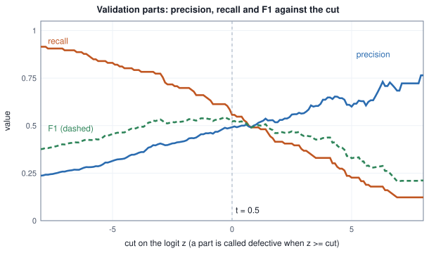

<!-- SPDX-License-Identifier: CC-BY-4.0 -->
<!-- Copyright (c) 2026 Martin Schröder <info@swedishembedded.com> -->

# Measuring Models: Metrics and Calibration

*Which number tells us whether a model is good, and why is accuracy so often the wrong one?*

A factory inspects 100000 parts a month, and one part in a hundred is defective. A vendor offers a defect detector and advertises it as "99% accurate". The line manager asks what it would take to beat that, and an engineer answers with a rule that needs no sensor and no model: *never raise an alarm*. Of the 100000 parts, 99000 are good, so the rule is right on 99000 of them, and its accuracy is $0.99$. It also never finds a single defect.

The detector of Volume I, chapter 10, raises an alarm on $90\%$ of defective parts and on $10\%$ of good ones. Beside the accuracy (the share of parts classified correctly), the table below reports three numbers defined properly further on: the precision (of the parts that raise an alarm, the share that are defective), the recall (of the defective parts, the share that raise an alarm) and the F1 score (one number that is small when either of those two is small). Counted on the same 100000 parts:

<!-- worked: metrics.accuracy_under_imbalance -->
100000 parts, 1% defective (1000); the detector alarms on 90% of defective parts and on 10% of good ones, counts rounded to whole parts.

|  | parts | alarm (predicted defective) | no alarm |
|---|---:|---:|---:|
| defective | 1000 | 900 | 100 |
| good | 99000 | 9900 | 89100 |
| total | 100000 | 10800 | 89200 |

| rule | accuracy | precision | recall | F1 |
|---|---:|---:|---:|---:|
| detector | 0.9000 | 0.0833 | 0.9000 | 0.1525 |
| never alarm | 0.9900 | undefined | 0.0000 | 0.0000 |

Precision by Bayes' rule, recall x prevalence / (recall x prevalence + false alarm rate x (1 - prevalence)) = 0.0833. F1 is computed from the counts, 2 TP / (2 TP + FP + FN), which is defined whenever there is a defective part or an alarm: for 'never alarm' it is 0 / 1000 = 0 although its precision is undefined.
<!-- /worked -->

The detector that finds nine defects in ten has an accuracy of $0.90$, nine points *below* a rule that finds none. Nothing is wrong with the arithmetic: accuracy counts every part equally, and when 99 parts in 100 are good, what happens to the good parts decides the number. Yet the detector is the one the factory wants. The same table also shows two other numbers, precision and recall, that tell the two stories apart: the right number comes from asking what a model is *for* before choosing the number that scores it.

Three questions follow. Which number summarizes a classifier's decisions, and which summarizes how well it ranks parts regardless of where the line is drawn? When a model says "$80\%$ likely defective", does that mean what it says, and if not, how is it measured and repaired? And how do the answers change for numbers on a scale and for the text a language model writes, where there is a measure of right and wrong that a probability does not capture? The rules that tie the answers together are short: choose the number from the decision it serves, and say how uncertain it is.

The answers draw on six earlier ideas: the sigmoid and the threshold, conditional probability, the trapezoid rule, perplexity, the discipline of the validation set and the standard error. The questions below bring each back and name the chapter that taught it; the answers are under "Recall questions" at the end.

1. (Chapter 3 of this volume, "Classification and Logistic Regression", the sigmoid and the threshold.) A model gives a part the logit $z = 2.1972$. What probability does it assign to "defective", and for which thresholds $t$ is the part called defective?
2. (Volume I, chapter 10, "Probability: Reasoning Under Uncertainty", conditional probability.) Of 200 parts, 20 are defective. A test flags 30 parts, and 15 of the flagged parts are defective. Compute $P(\text{defective} \mid \text{flagged})$ and $P(\text{flagged} \mid \text{defective})$. Which one answers "how much should I trust an alarm"?
3. (Volume I, chapter 9, "Integrals and Differential Equations", the trapezoid rule.) The points $(0, 0)$, $(0.5, 0.8)$, $(1, 1)$ are joined by straight segments. What is the area under them, by the trapezoid rule?
4. (Volume I, chapter 13, "Information, Entropy and Surprise", perplexity.) A model gives the correct tokens of a four-token answer the probabilities $0.5, 0.25, 0.5, 0.25$. What is the mean cross-entropy in nats, and the perplexity?
5. (Chapter 5 of this volume, "Generalization, Overfitting and Honest Evaluation", the validation set.) A threshold is to be chosen from held-out data. Why should it be chosen on the validation set and the score reported on the test set?
6. (Volume I, chapter 12, "Statistics: Learning Facts from Samples", standard error.) A model answers $90$ of $100$ questions correctly. What is the standard error of its accuracy, and about how wide is a $95\%$ interval?


## Accuracy and the confusion matrix

A classifier that answers yes or no (chapter 3) can be wrong in two different ways, and the two are not alike. Call the label $1$ (a defective part) the **positive** class. A decision at a fixed threshold $t$ (call the part defective when $\hat{p} \ge t$) falls into one of four boxes, counted over a dataset:

| | decision: positive | decision: negative |
|---|---|---|
| label $1$ | true positive, $\mathrm{TP}$ | false negative, $\mathrm{FN}$ |
| label $0$ | false positive, $\mathrm{FP}$ | true negative, $\mathrm{TN}$ |

The $2 \times 2$ table of these four counts is the **confusion matrix**. The factory table above is one, with the rows "defective" and "good" and the columns "alarm" and "no alarm". The word *positive* names what the decision says, not whether the news is good: a false positive is a false alarm, a false negative is a miss.

**Accuracy** is the share of decisions that are right,

$$
\text{accuracy} = \frac{\mathrm{TP} + \mathrm{TN}}{\mathrm{TP} + \mathrm{FP} + \mathrm{FN} + \mathrm{TN}}.
$$

It is the probability that a randomly chosen example is classified correctly. To see what controls its value, split it by class. Let $\xi = P(y = 1)$ be the share of positives (the base rate of Volume I, chapter 10; the letter $\xi$ is used because $\pi$ is the constant 3.14159... and $\rho$ is the correlation). A random example is a positive with probability $\xi$, and then it is right with probability $\mathrm{TP}/n_+$, the share of positives found; it is a negative with probability $1 - \xi$, and then right with probability $\mathrm{TN}/n_-$. So

$$
\text{accuracy} = \xi \cdot \frac{\mathrm{TP}}{n_+} + (1 - \xi) \cdot \frac{\mathrm{TN}}{n_-},
$$

where $n_+ = \mathrm{TP} + \mathrm{FN}$ and $n_- = \mathrm{FP} + \mathrm{TN}$ count the positive and negative examples. Accuracy is a weighted average of the success rate on each class, with the *class shares* as the weights. In the factory, $\xi = 0.01$: the detector's accuracy is $0.01 \times 0.9 + 0.99 \times 0.9 = 0.90$, and the rule that never alarms has $0.01 \times 0 + 0.99 \times 1 = 0.99$. The class that is rare gets one percent of the vote.

Two consequences follow, and both will recur. First, a classifier is always compared with the **majority-class rule**, which always answers with the more common class and whose accuracy is $\max(\xi, 1 - \xi)$. (Such a reference point is called a baseline; chapter 8 of this volume makes it a habit of every experiment.) An accuracy of $0.95$ on data with $\xi = 0.02$ is worse than this rule's $0.98$; the same accuracy at $\xi = 0.5$ is excellent. Second, accuracy gives a false positive and a false negative the same weight. When a missed defect costs ten times a false alarm, or the reverse, a number that treats them as equal is answering a question nobody asked.

## Precision and recall

Two questions can be asked about a detector. When it raises an alarm, how often is the alarm real? Of the defects that exist, how many does it find? Each is a conditional probability (Volume I, chapter 10).

The first is the **precision**, $P(y = 1 \mid \text{decision positive})$: among the parts called defective, the share that are,

$$
\text{precision} = \frac{\mathrm{TP}}{\mathrm{TP} + \mathrm{FP}}.
$$

The second is the **recall**, $P(\text{decision positive} \mid y = 1)$: among the defective parts, the share that were called defective,

$$
\text{recall} = \frac{\mathrm{TP}}{\mathrm{TP} + \mathrm{FN}} = \frac{\mathrm{TP}}{n_+}.
$$

Recall is also the **true positive rate**, $\mathrm{TPR}$. The matching quantity for the good parts is the **false positive rate**, $\mathrm{FPR} = \mathrm{FP}/n_-$: the share of good parts that raise an alarm. (One minus it is the specificity, the true negative rate.) In the factory table, the detector's precision is $900/10800 = 0.0833$ and its recall $900/1000 = 0.9$; the rule that never alarms has recall $0$ and no precision at all, because it never makes a positive decision and $0/0$ is not a number. A precision with an empty denominator is reported as undefined, never as $0$ or $1$ (see the habits for reporting a metric, near the end).

The table that opened the chapter shows why the vendor's phrase is empty and why precision matters. Of the 10800 alarms, only 900 are real. This is the base-rate arithmetic of Volume I, chapter 10, and precision is its output. Bayes' rule written for a classifier says: take $P(y = 1 \mid \text{positive}) = P(\text{positive} \mid y = 1)\,P(y = 1) / P(\text{positive})$ and expand the denominator over the two classes,

$$
\text{precision} = \frac{\mathrm{TPR}\cdot \xi}{\mathrm{TPR}\cdot \xi + \mathrm{FPR}\cdot (1 - \xi)}.
$$

With $\mathrm{TPR} = 0.9$, $\mathrm{FPR} = 0.1$ and $\xi = 0.01$ this is $0.009/0.108 = 0.0833$, the number the factory table printed twice, once by counting and once by this formula. The two rates $\mathrm{TPR}$ and $\mathrm{FPR}$ describe the detector alone; the base rate $\xi$ describes the population it is pointed at. Precision combines them, so it changes when the population changes even if the detector does not. Recall and the false positive rate do not: each is a probability *given the label*. That asymmetry decides which curve is used for which question in the sections below.

Each number protects against a different failure. Low recall means defects ship to customers. Low precision means inspectors spend their day re-checking good parts, and, as the factory table shows, that cost grows as defects become rarer. Which matters more is a fact about the factory, not about mathematics.

## The screening data

The examples that follow use one model on one data source, so that every table can be compared with the others. The source is again a screening problem. Each part has twenty measurements, and only the first two carry any information about whether the part is defective; the other eighteen are noise. About one part in ten is defective. A logistic model with all twenty measurements (chapter 3) is fitted to a small training set, which is exactly the situation of chapter 5 in which a model with many weights memorizes: there are $21$ weights and $100$ training parts.

<!-- worked: metrics.screen_data -->
Generator: the book's SplitMix64, seed 0x2aa0719b44b5c9e5 (3071579857553312229).
Draw order, part by part: x1, ..., x20 = rng.normal() in that order (so ten Box-Muller pairs, none held over), then u = rng.uniform(); y = 1 (defective) when u < sigmoid(-4.5 + 2.5 x1 + 1.8 x2). 100 training parts, then 1000 validation parts, then 3000 test parts, all from this one generator.

| split | parts | defective | fraction defective |
|---|---:|---:|---:|
| training | 100 | 12 | 0.1200 |
| validation | 1000 | 106 | 0.1060 |
| test | 3000 | 306 | 0.1020 |

Model: logistic regression with an intercept and all 20 measurements (no penalty), weights set to zero, 3000 plain gradient steps of size 0.5 on the mean cross-entropy of the 100 training parts. The norm of the 21 weights is 12.9800; the weight of x1 is 6.9072, of x2 is 2.3599, and the largest weight of the other 18 measurements is 2.3347 in absolute value. Training cross-entropy 0.0733, validation cross-entropy 0.4664.
<!-- /worked -->

The training cross-entropy is $0.0733$ and the validation cross-entropy $0.4664$: the gap of an overfitted model. The weight of the first measurement is $6.9072$ where the law that made the data has $2.5$, and the norm of the weights is $12.98$. The weights have grown the way chapter 3's separable example grew: with $12$ positives and $21$ weights the training set is close to separable (its cross-entropy is already $0.0733$), and plain gradient descent keeps stretching the logits. The model ranks parts well (the area under the ROC curve, below, measures how well) and states its probabilities with more confidence than the data justify (calibration, further on, measures that and repairs it). The training set is used only to fit the weights; the validation set will choose thresholds and fit a correction to the probabilities; the test set will be used to report.

## Moving the threshold

The model outputs $\hat{p} = \sigma(z)$, and a decision needs a threshold $t$: call the part defective when $\hat{p} \ge t$, equivalently when $z \ge \mathrm{logit}(t)$ (chapter 3). Every table so far fixed $t$, which hides the fact that precision and recall describe a model together with a threshold, not the model alone. Moving $t$ changes all four counts. (The F1 column is defined in the next section; until then read it as one number that is large only when precision and recall are both large.)

<!-- worked: metrics.threshold_sweep -->
The 1000 validation parts (106 defective). A part is called defective when sigmoid(z) >= t.

| t | logit(t) | TP | FP | FN | TN | precision | recall | F1 | accuracy |
|---|---:|---:|---:|---:|---:|---:|---:|---:|---:|
| 0.001 | -6.907 | 95 | 268 | 11 | 626 | 0.2617 | 0.8962 | 0.4051 | 0.7210 |
| 0.01 | -4.595 | 86 | 179 | 20 | 715 | 0.3245 | 0.8113 | 0.4636 | 0.8010 |
| 0.1 | -2.197 | 74 | 105 | 32 | 789 | 0.4134 | 0.6981 | 0.5193 | 0.8630 |
| 0.5 | +0.000 | 59 | 61 | 47 | 833 | 0.4917 | 0.5566 | 0.5221 | 0.8920 |
| 0.9 | +2.197 | 43 | 37 | 63 | 857 | 0.5375 | 0.4057 | 0.4624 | 0.9000 |
| 0.99 | +4.595 | 29 | 16 | 77 | 878 | 0.6444 | 0.2736 | 0.3841 | 0.9070 |
| 0.999 | +6.907 | 13 | 6 | 93 | 888 | 0.6842 | 0.1226 | 0.2080 | 0.9010 |
<!-- /worked -->

Read the table from top to bottom. As $t$ rises, fewer parts are called defective, so $\mathrm{TP}$ and $\mathrm{FP}$ both fall and recall falls: $0.8962$ at $t = 0.001$, $0.1226$ at $t = 0.999$. It can only fall, because raising the threshold removes decisions and never adds them. Precision moves the other way in the main, from $0.2617$ to $0.6842$, because the parts that survive a high threshold are the ones the model is surest of; but not monotonically (it would be monotone only if the model's scores were in perfect order), as the figure shows. That is the **precision-recall trade-off**: no threshold gives both a low miss rate and a low false-alarm rate, and moving along the table buys one with the other.

The figure below sweeps the cut on the logit from $-8$ to $8$ in steps of $0.1$ on the same validation parts, a wider and finer grid than the seven rows of the table, so its end values differ from the table's.



The accuracy column rises as the threshold grows: $0.7210$ at $t = 0.001$, $0.9070$ at $t = 0.99$. A reader who trusted accuracy would raise the threshold to $0.99$ and so find only $29$ of the $106$ defects. The reason is the one of the opening example. The never-alarm rule has accuracy $1 - 106/1000 = 0.894$ on these validation parts, and every increase of the threshold moves the model toward that rule. At the default $t = 0.5$ the model's accuracy is $0.8920$, below the rule that never looks at the part. The model finds $59$ of $106$ defects, which the rule does not.

## One number for both: the F1 score

Sometimes a table of precision and recall is not enough: a search over thresholds, or over models, needs one number to compare. The obvious candidate is the average of the two. It has a flaw that one extreme pair shows: a detector that raises one alarm, on a part that is defective, has precision $1.0$ and recall $0.01$ (one of a hundred defects), and the arithmetic mean $0.505$ says it is as good as one with both at $0.505$. A single lucky alarm earns half marks.

The **F1 score** is the **harmonic mean** of precision $P$ and recall $R$:

$$
F_1 = \frac{2}{1/P + 1/R} = \frac{2 P R}{P + R}.
$$

The harmonic mean of two numbers is the reciprocal of the mean of their reciprocals. It is pulled toward the smaller of the two, and it is near $0$ if either is. Six pairs show the difference:

<!-- worked: metrics.f1_means -->
| precision | recall | arithmetic mean | harmonic mean F1 | min |
|---|---:|---:|---:|---:|
| 0.9 | 0.9 | 0.9000 | 0.9000 | 0.9 |
| 0.5 | 0.5 | 0.5000 | 0.5000 | 0.5 |
| 1.0 | 0.5 | 0.7500 | 0.6667 | 0.5 |
| 1.0 | 0.1 | 0.5500 | 0.1818 | 0.1 |
| 1.0 | 0.01 | 0.5050 | 0.0198 | 0.01 |
| 0.2 | 0.8 | 0.5000 | 0.3200 | 0.2 |

Validation parts at t = 0.5: TP = 59, FP = 61, FN = 47, TN = 833. F1 from the two ratios 2 P R / (P + R) = 0.522124; from the counts 2 TP / (2 TP + FP + FN) = 0.522124.
Add 1000000 more good parts, all correctly passed (TN becomes 1000833): precision 0.4917, recall 0.5566, F1 0.5221 are unchanged, accuracy goes from 0.8920 to 0.999892.
<!-- /worked -->

For the lucky detector the harmonic mean is $0.0198$, almost its recall. When the two are equal all three means agree; when they differ the harmonic mean sits between the minimum and the arithmetic mean, and near the minimum.

There is a reason for the harmonic mean beyond its behaviour. Write $P = \mathrm{TP}/(\mathrm{TP} + \mathrm{FP})$ and $R = \mathrm{TP}/(\mathrm{TP} + \mathrm{FN})$. Their reciprocals are $1/P = (\mathrm{TP} + \mathrm{FP})/\mathrm{TP}$, the number of alarms raised per real defect found, and $1/R = (\mathrm{TP} + \mathrm{FN})/\mathrm{TP}$, the number of defects that exist per defect found. Both are *costs per hit*, with the same denominator $\mathrm{TP}$, and the mean of two costs per hit is the right way to average them:

$$
\frac{1}{F_1} = \frac{1}{2}\left(\frac{\mathrm{TP} + \mathrm{FP}}{\mathrm{TP}} + \frac{\mathrm{TP} + \mathrm{FN}}{\mathrm{TP}}\right) = \frac{2\,\mathrm{TP} + \mathrm{FP} + \mathrm{FN}}{2\,\mathrm{TP}}, \qquad F_1 = \frac{2\,\mathrm{TP}}{2\,\mathrm{TP} + \mathrm{FP} + \mathrm{FN}}.
$$

The last form is the one to compute: it needs only the counts and is defined whenever at least one positive exists or has been called. It is also the definition used for the rule that never alarms in the opening example: there $\mathrm{TP} = \mathrm{FP} = 0$ and $\mathrm{FN} = 1000$, so $F_1 = 0/1000 = 0$, although its precision is undefined and the ratio form $2PR/(P + R)$ is not available. (Only when no part is positive and none is called positive is $F_1$ itself undefined, $0/0$.) The paragraph under the table checks it on the validation parts at $t = 0.5$, with the counts of the threshold table: the two ratios and the count form give the same $F_1$ to six places.

The form shows what $F_1$ ignores: $\mathrm{TN}$ does not appear. That is deliberate when good parts are plentiful and uninteresting, and the paragraph under the table makes it concrete: adding a million correctly passed good parts leaves precision, recall and $F_1$ unchanged and sends accuracy from $0.8920$ to $0.999892$. The other thing $F_1$ fixes is that it weights precision and recall equally; a factory where a miss costs ten times a false alarm needs a different weighting, which is the subject of the last section. In the threshold table, $F_1$ is largest at $t = 0.5$ ($0.5221$) and nearly as large at $t = 0.1$ ($0.5193$): a broad plateau, not a sharp peak, which is typical.

## The ROC curve

The threshold table is a few points of a continuous story, and the whole story says how well a model ranks defective parts above good ones without ever choosing a threshold. Move $t$ through every possible value and record, at each, the pair $(\mathrm{FPR}, \mathrm{TPR})$. The curve through those points is the **ROC curve** (the name, receiver operating characteristic, comes from radar engineering, where the receiver's threshold was the knob). Start with a case small enough to do by hand: eight parts, scored by some model, with the label next to each score. The score is a logit, or a probability, or any number where higher means more likely defective.

<!-- worked: metrics.roc_by_hand -->
Scores and labels, highest first: 0.95+, 0.85+, 0.80-, 0.70+, 0.60+, 0.60-, 0.40-, 0.30-. '+' is defective (4 parts), '-' is good (4 parts). A part is called defective when its score is at or above the threshold; tied scores cross it together.

| threshold | TP | FP | FPR | TPR |
|---|---:|---:|---:|---:|
| above all | 0 | 0 | 0.00 | 0.00 |
| 0.95 | 1 | 0 | 0.00 | 0.25 |
| 0.85 | 2 | 0 | 0.00 | 0.50 |
| 0.80 | 2 | 1 | 0.25 | 0.50 |
| 0.70 | 3 | 1 | 0.25 | 0.75 |
| 0.60 | 4 | 2 | 0.50 | 1.00 |
| 0.40 | 4 | 3 | 0.75 | 1.00 |
| 0.30 | 4 | 4 | 1.00 | 1.00 |

Trapezoids, width x average height: (0.00 x 0.125) = 0.00000; (0.00 x 0.375) = 0.00000; (0.25 x 0.500) = 0.12500; (0.00 x 0.625) = 0.00000; (0.25 x 0.875) = 0.21875; (0.25 x 1.000) = 0.25000; (0.25 x 1.000) = 0.25000.
Area = 0.84375.
Pairs: 4 x 4 = 16; positive above negative in 13, tied in 1, below in 2; (greater + equal / 2) / pairs = 0.84375.
Rank sum: 0.84375.
<!-- /worked -->

The sweep starts with the threshold above every score, so no part is called defective: $\mathrm{FPR} = \mathrm{TPR} = 0$, the corner $(0, 0)$. Lower it past the highest score ($0.95$, a defective part): $\mathrm{TP}$ becomes $1$ of $4$ and the curve moves up by $1/4$. Past $0.85$, another defective part: up again. Past $0.80$, a good part: the curve moves right by $1/4$ (one of four good parts is now a false alarm). Each defective part passed moves the curve up by $1/n_+$ and each good part passed moves it right by $1/n_-$; when the threshold is below every score the curve reaches $(1, 1)$, every part called defective. Two parts, one defective and one good, share the score $0.60$: no threshold separates them, so the curve moves along the diagonal, up $1/4$ and right $1/4$, in one step.

The **area under the ROC curve**, $\mathrm{AUC}$, is a one-number summary. Compute it by the trapezoid rule of Volume I, chapter 9: each segment contributes its width times the average of its two heights. The block lists the seven trapezoids; the area is $0.84375$. A curve along the diagonal has area $0.5$ (a model with no information); a curve through the top-left corner, $\mathrm{TPR} = 1$ at $\mathrm{FPR} = 0$, has area $1$; an area below $0.5$ means the model ranks backwards, and negating its scores would give $1 - \mathrm{AUC}$.

### The same number as a count of pairs

The block prints a second computation of the same number. There are $n_+ n_- = 16$ pairs consisting of one defective and one good part. Count a pair when the defective part has the higher score: this happens for $13$ pairs. One pair is tied (the two parts at $0.60$), and a tie gets half credit. The share is $(13 + \tfrac{1}{2})/16 = 0.84375$, the area. This is not a coincidence, and the equivalence gives the AUC its second, more useful meaning.

The equivalence comes from the shape of the path. Let $z_i^{+}$ be the score of the $i$-th positive example and $z_j^{-}$ that of the $j$-th negative. First suppose all scores differ. As the threshold falls past the scores in decreasing order the curve moves up $1/n_+$ at each positive and right $1/n_-$ at each negative. The area under a path of up and right steps is the sum, over its *right* steps, of the width $1/n_-$ times the height at that moment, and the height is $(\text{positives already passed})/n_+$. A positive has been passed when its score is above the negative's. So the right step for negative $j$ contributes

$$
\frac{1}{n_-} \cdot \frac{\#\{i : z_i^{+} > z_j^{-}\}}{n_+},
$$

and summing over $j$,

$$
\mathrm{AUC} = \frac{1}{n_+ n_-}\sum_{i=1}^{n_+}\sum_{j=1}^{n_-} \mathbf{1}\!\left[z_i^{+} > z_j^{-}\right].
$$

Ties change the path only slightly. A group of $p$ positives and $q$ negatives with the same score is passed in one step, from a point $(x, y)$ to $(x + q/n_-, y + p/n_+)$, a straight segment. Its trapezoid has width $q/n_-$ and average height $y + p/(2 n_+)$, so it contributes $\frac{q}{n_-}\,y + \frac{p\,q}{2\,n_+ n_-}$. The first term is the credit for those $q$ negatives against the positives *strictly above* them, as before; the second is exactly one half for each of the $p q$ tied pairs. In general,

$$
\mathrm{AUC} = P(z^{+} > z^{-}) + \tfrac{1}{2} P(z^{+} = z^{-}),
$$

where $z^{+}$ is the score of a positive example drawn at random and $z^{-}$ that of a negative drawn at random. **The area under the ROC curve is the probability that a random defective part is ranked above a random good one, with ties counted as half.** That is what "$\mathrm{AUC} = 0.88$" says: pick a defective part and a good part at random, and the model gives the defective one the higher score $88\%$ of the time.

Two things follow at once. The $\mathrm{AUC}$ depends on the scores only through their order, so any strictly increasing transformation of the scores leaves it unchanged: $z$, $\sigma(z)$ and $z/3$ have the same $\mathrm{AUC}$. And it depends on the two classes separately, never on how many parts of each there are, so it does not move when the base rate does.

### A third computation, by ranks

Counting pairs takes $n_+ n_-$ comparisons, $824364$ on the test set below; a sort needs only $O(N \log N)$. Rank all $N$ scores from the lowest (rank $1$), giving tied scores the average of the ranks they occupy. Let $W_+$ be the sum of the ranks of the positives (the Wilcoxon rank sum). The rank of a positive $i$ is $1$, plus the number of positives below it (counting ties as half), plus the number of negatives below it (counting ties as half). Summed over all the positives, the first term gives $n_+$, the second gives $n_+(n_+ - 1)/2$ (each pair of positives contributes $1$ in total: one is above the other, or they tie and each gets half), and the third is exactly the numerator of the pair count. Therefore

$$
W_+ = \frac{n_+(n_+ + 1)}{2} + n_+ n_- \cdot \mathrm{AUC}, \qquad \mathrm{AUC} = \frac{W_+ - n_+(n_+ + 1)/2}{n_+ n_-}.
$$

(In the eight-part example the positives have the ascending ranks $3.5$ (tied with a good part for ranks $3$ and $4$), $5$, $7$ and $8$, so $W_+ = 23.5$ and $\mathrm{AUC} = (23.5 - 10)/16 = 0.84375$, the block's value.) This is the Mann-Whitney $U$ statistic in disguise, and it is the form brain computes (the last section). In pseudocode, the trapezoid version, which handles ties by moving through every group of equal scores at once:

```text
function roc_auc(score: array<real>[N], y: array<int>[N]) -> real:
    require N > 0, "no examples"
    n_pos = sum(y)
    n_neg = N - n_pos
    require n_pos > 0 and n_neg > 0, "AUC needs both classes"
    order = argsort(score, descending)
    tp = 0
    fp = 0
    prev_fpr = 0.0
    prev_tpr = 0.0
    area = 0.0
    i = 0
    while i < N:
        j = i
        while j < N and score[order[j]] == score[order[i]]:   # one group of tied scores
            if y[order[j]] == 1:
                tp = tp + 1
            else:
                fp = fp + 1
            j = j + 1
        fpr = fp / n_neg
        tpr = tp / n_pos
        area = area + (fpr - prev_fpr) * (prev_tpr + tpr) / 2
        prev_fpr = fpr
        prev_tpr = tpr
        i = j
    return area
```

### Checking the equivalence on real scores

The three computations must agree to rounding error on the 3000 test parts, and they do, to eight places. To test the tie rule as well, the logits are also rounded to one decimal (the `round(z, 1)` of the pseudocode, ties away from zero; no logit of this dataset lies exactly halfway, so the rule does not decide any value), which creates $1645$ tied (defective, good) pairs; the table also shows what the two wrong tie rules would give.

<!-- worked: metrics.auc_three_ways -->
The 3000 test parts (306 defective, 2694 good, 824364 pairs). Ties counted as half in the first three columns; counted as 0 and as 1 in the last two.

| scores | tied pairs | trapezoid | pairs, tie = 1/2 | rank sum | pairs, tie = 0 | pairs, tie = 1 |
|---|---:|---:|---:|---:|---:|---:|
| logits as computed | 0 | 0.87778700 | 0.87778700 | 0.87778700 | 0.87778700 | 0.87778700 |
| logits rounded to 1 decimal (ties) | 1645 | 0.87774636 | 0.87774636 | 0.87774636 | 0.87674862 | 0.87874410 |
<!-- /worked -->

Without ties all five columns are equal: $0.87778700$. With ties the trapezoid, the half-credit pair count and the rank sum still agree ($0.87774636$), and the two wrong rules (a tie counts $0$, or counts $1$) bracket the right answer, $0.87674862$ and $0.87874410$. The difference is small here because few pairs tie; it is much larger for a classifier whose scores take only a few distinct values, where most pairs tie.

## When the positives are rare: the PR curve

The left panel of the figure below is the ROC curve of the model on the test parts, with its area, $0.8778$, shaded. The ROC curve is the same whatever share of the parts are defective, because both of its axes are rates *given the label*. That is a strength when the base rate is unknown or will change. It is a weakness when the question is the one the factory asked: of the parts flagged, how many are real?

The **precision-recall curve** plots precision against recall as the threshold moves (the right panel), the same sweep with different axes. Since precision combines $\mathrm{TPR}$, $\mathrm{FPR}$ and the base rate, it carries the base rate with it. To see it, keep the model fixed and change the share of defective parts by giving each good part a weight, as if the factory had more of them or fewer. (The third column of the table, the average precision, summarizes a whole precision-recall curve in one number; it is defined right after the table.)


<!-- worked: metrics.pr_vs_prevalence -->
The 3000 test parts. Each good part is given the weight (1 - xi)/xi x 306/2694 (each defective part has weight 1) so that the defective parts make up a share xi (the base rate) of the weighted total. The operating point is the first threshold at which recall reaches 0.8: logit -3.9946, recall 0.8007, false positive rate 0.1904.

| base rate xi | ROC AUC | average precision | precision at the operating point |
|---|---:|---:|---:|
| 0.5000 | 0.8778 | 0.8694 | 0.8079 |
| 0.2000 | 0.8778 | 0.6613 | 0.5125 |
| 0.1020 (the test set) | 0.8778 | 0.5024 | 0.3232 |
| 0.0500 | 0.8778 | 0.3518 | 0.1812 |
| 0.0100 | 0.8778 | 0.1388 | 0.0407 |
| 0.0010 | 0.8778 | 0.0569 | 0.0042 |
<!-- /worked -->

The ROC area does not move: $0.8778$ in every row. The precision at one fixed threshold, the first at which recall reaches $0.8$ (with $\mathrm{FPR} = 0.1904$), falls from $0.8079$ when half the parts are defective to $0.3232$ at the test set's own $10.2\%$ to $0.0042$ at $0.1\%$, exactly as the Bayes formula says. The same model, with the same $\mathrm{AUC}$, would be a useful filter in one factory and a nuisance in another. The ROC curve cannot show this; the PR curve and any summary of it can.

The usual summary is the **average precision**, $\mathrm{AP}$: the step-wise area under the PR curve,

$$
\mathrm{AP} = \sum_k (R_k - R_{k-1})\,P_k,
$$

where $R_k$ and $P_k$ are the recall and precision after the $k$-th distinct score (a group of tied scores counts as one score), and $R_0 = 0$. Each step is weighted by the recall gained, and the precision at that point is used as it stands: unlike the ROC curve, precision does not move in a straight line between two thresholds, so the trapezoid of the ROC section would not be a faithful area here. The table shows $\mathrm{AP}$ following the base rate, from $0.8694$ at $50\%$ to $0.5024$ at the test set's own rate to $0.0569$ at $0.1\%$. The baseline of an uninformative model is $\xi$ itself (the dashed lines of the figure), so a PR curve is always read against its own base rate.

The two curves answer different questions. Use the ROC curve to compare models on their ability to rank, independent of the population; use the PR curve when the population is known, positives are rare and what matters is the quality of what is flagged. Reporting both costs nothing.

## Calibration

The metrics so far use only the *order* of the scores, or a fixed threshold. They never ask whether "$\hat{p} = 0.9$" is true. A model has good **calibration** when its probabilities match frequencies: among all the parts to which it gives probability $0.8$, about $80\%$ should be defective. In symbols, $P(y = 1 \mid \hat{p} = p) = p$ for every $p$. This is a strong property and it is the one that lets a downstream user multiply the probability by a cost (the last sections), combine it with another probability, or decide with it.

The check is a sort and a count. Divide the interval $[0, 1]$ into $B$ equal-width bins, put each part in the bin containing its $\hat{p}$ (a $\hat{p}$ of exactly $1$ goes into the last bin), and in each bin compare two numbers: the mean predicted probability, and the observed share of defective parts. A table of them is a **reliability diagram** in numbers. For the screening model on the test parts, ten bins:

<!-- worked: metrics.reliability_raw -->
The 3000 test parts, 10 equal-width bins of the predicted probability of 'defective'.

| bin of p | parts | mean p | observed share | gap |
|---|---:|---:|---:|---:|
| 0.0 to 0.1 | 2432 | 0.0047 | 0.0391 | 0.0344 |
| 0.1 to 0.2 | 81 | 0.1395 | 0.2099 | 0.0704 |
| 0.2 to 0.3 | 46 | 0.2422 | 0.2391 | 0.0030 |
| 0.3 to 0.4 | 40 | 0.3497 | 0.2250 | 0.1247 |
| 0.4 to 0.5 | 30 | 0.4494 | 0.2333 | 0.2161 |
| 0.5 to 0.6 | 43 | 0.5525 | 0.3488 | 0.2036 |
| 0.6 to 0.7 | 27 | 0.6408 | 0.2593 | 0.3816 |
| 0.7 to 0.8 | 35 | 0.7605 | 0.2571 | 0.5033 |
| 0.8 to 0.9 | 47 | 0.8587 | 0.2979 | 0.5608 |
| 0.9 to 1.0 | 219 | 0.9815 | 0.5571 | 0.4244 |

ECE (10 equal-width bins) = 0.0856. Mean predicted probability 0.1281, observed share of defective parts 0.1020. Parts with p < 0.01 or p > 0.99: 2302 of 3000 (share 0.7673). Cross-entropy 0.4733, squared-error probability score 0.0939. For comparison, the predictions on the 100 training parts have cross-entropy 0.0733.
<!-- /worked -->

If the model were calibrated, the "mean $p$" and "observed share" columns would agree. They do not. In the bin from $0.9$ to $1.0$, $219$ parts have a mean predicted probability of $0.9815$, and $55.7\%$ are defective; $122$ of the $219$. In the bin from $0.8$ to $0.9$ the model says $0.86$ and the truth is $0.30$. The model is **overconfident** in every bin above $0.3$. At the low end it is the other way round: the $2432$ parts it gives less than $0.1$ (mean $0.0047$) are defective $3.9\%$ of the time, which is $95$ of the $306$ defective parts, so the model is too sure that these parts are good. And $2302$ of the $3000$ parts (a share of $0.7673$) get a probability below $0.01$ or above $0.99$. That is the signature of the nearly separable fit of chapter 3: the weights have grown until the logits are large, and a large logit is a probability near $0$ or $1$ whether or not the evidence supports it.

One number summarizes the table, the **expected calibration error**, $\mathrm{ECE}$: the average, over all examples, of the gap between a bin's observed share and its mean prediction,

$$
\mathrm{ECE} = \sum_{b=1}^{B} \frac{n_b}{N}\,\bigl|\mathrm{freq}_b - \mathrm{conf}_b\bigr|,
$$

where $n_b$ is the number of parts in bin $b$, $\mathrm{freq}_b$ is the share of them that are defective, and $\mathrm{conf}_b$ is their mean predicted probability. Bins with no parts are skipped. Here $\mathrm{ECE} = 0.0856$: on average the model's probability is off by about $0.09$. The block also gives the mean predicted probability, $0.1281$, against the observed share of defective parts, $0.1020$, and two scores that react to calibration, the cross-entropy ($0.4733$, the training loss of chapter 3 measured on new parts) and the squared-error probability score, the mean of $(\hat{p} - y)^2$ ($0.0939$, also called the Brier score).

```text
function ece(p: array<real>[N], y: array<int>[N], B: int) -> real:
    require N > 0 and B >= 1, "nothing to bin"
    count = zeros(int, [B])
    sum_p = zeros(real, [B])
    sum_y = zeros(real, [B])
    for n in 0 .. N:
        k = min(floor(p[n] * B), B - 1)         # p = 1 goes into the last bin
        count[k] = count[k] + 1
        sum_p[k] = sum_p[k] + p[n]
        sum_y[k] = sum_y[k] + y[n]
    total = 0.0
    for k in 0 .. B:
        if count[k] > 0:
            total = total + (count[k] / N) * abs(sum_y[k] / count[k] - sum_p[k] / count[k])
    return total
```

Calibration and discrimination are separate properties. The model of this chapter has a good ranking ($\mathrm{AUC} = 0.88$) and poor calibration. The reverse also happens: a model that always says the base rate, $\hat{p} = \xi$, is perfectly calibrated and ranks nothing. A product that only needs to rank parts for inspection needs the first; a product that multiplies the probability by a price needs the second. Both are reported.

The calibration metrics in brain use a variant. For a classifier choosing among several options, `ece` there bins by the model's *confidence in the option it chose* and compares each bin with the share of those choices that were right (a related but not identical statistic for two options). The one defined here, on the probability of the positive class, keeps the direction of the error visible (above or below the diagonal), which the repair below needs.

## Temperature scaling

A model that is overconfident can be repaired from held-out data without touching its ranking. If the logits are too large, shrink them. Replace $\sigma(z)$ by $\sigma(a z)$ with a single number $a > 0$, chosen so that the probabilities fit the data. Its reciprocal $T = 1/a$ is called the temperature, and fitting $a$ is **temperature scaling**: a larger temperature flattens the probabilities toward one half. (Where the word comes from, and what it does to a sampling distribution, is a topic for the volume on language models; here it only scales a logit.)

How should $a$ be chosen? Not on the training set: there the model is already overconfident by construction, and a fit on those parts would see nothing wrong. This is the situation of chapter 5, and the same rule applies: the parameters of the model are fitted on the training set, the single extra parameter is fitted on the validation set, and the result is reported on the test set. The fit is the cross-entropy of chapter 3 as a function of $a$ alone, on the validation parts $(z_n, y_n)$:

$$
f(a) = \frac{1}{N}\sum_{n} \bigl[\mathrm{softplus}(a z_n) - y_n\, a z_n\bigr].
$$

By the same algebra as chapter 3 (the derivative of $\mathrm{softplus}(u)$ is $\sigma(u)$, here with $u = a z_n$), the slope and the curvature are

$$
f'(a) = \frac{1}{N}\sum_n \bigl(\sigma(a z_n) - y_n\bigr) z_n, \qquad f''(a) = \frac{1}{N}\sum_n \sigma(a z_n)\bigl(1 - \sigma(a z_n)\bigr) z_n^2 \;\ge\; 0.
$$

The curvature is never negative, so $f$ is convex (as chapter 3 showed for the full model) and its slope increases with $a$. A convex function of one variable has at most one valley, and the way to find where an increasing slope crosses zero is to bracket the crossing and halve the bracket. That is all the algorithm needs:

```text
function ce_slope(a: real, z: array<real>[N], y: array<int>[N]) -> real:
    return mean([(sigmoid(a * z[n]) - y[n]) * z[n] for n in 0 .. N])

function fit_scale(z: array<real>[N], y: array<int>[N]) -> real:
    require N > 0, "no validation parts"
    require ce_slope(0.0, z, y) < 0.0, "the logits do not rank positives above negatives"
    lo = 0.0
    hi = 1.0
    found = false
    for k in 0 .. 60:                           # double hi until the slope is positive
        if ce_slope(hi, z, y) > 0.0:
            found = true
            break
        lo = hi
        hi = 2.0 * hi
    require found, "no finite scale: the logits separate the labels"
    for k in 0 .. 80:                           # halve the bracket (lo, hi)
        mid = (lo + hi) / 2.0
        if ce_slope(mid, z, y) < 0.0:
            lo = mid
        else:
            hi = mid
    return (lo + hi) / 2.0
```

The two `require` lines are real cases. At $a = 0$ the slope is $\frac{1}{N}\sum_n (\tfrac{1}{2} - y_n) z_n$, which is negative when the positives have larger logits than the negatives on average; if it is not, no positive scale helps because the model is anti-informative. And if the validation set is separable by the logits, $f$ decreases forever as $a$ grows: the same missing minimiser as chapter 3's separable data, now in one variable.

<!-- worked: metrics.temperature_fit -->
The 1000 validation parts. The model is sigmoid(a z) with z the logit of the fitted model of `metrics.screen_data`; a is found by bisection on the slope of the cross-entropy.

| scale a | temperature 1/a | validation cross-entropy |
|---|---:|---:|
| 0.1 | 10.000 | 0.3756 |
| 0.15 | 6.667 | 0.3116 |
| 0.2 | 5.000 | 0.2784 |
| 0.3 | 3.333 | 0.2589 |
| 0.5 | 2.000 | 0.2914 |
| 0.75 | 1.333 | 0.3721 |
| 1.0 | 1.000 | 0.4664 |
| 1.5 | 0.667 | 0.6681 |
| 0.3027 (fitted) | 3.303 | 0.2589 |

Slope at the fitted a: absolute value below 1e-12 (yes; the exact residue is rounding noise and depends on the summation order). Temperature = 1/a = 3.3032.

On the test parts:

| quantity | before (a = 1) | after (a fitted) |
|---|---:|---:|
| cross-entropy | 0.4733 | 0.2664 |
| squared-error probability score | 0.0939 | 0.0813 |
| ECE, 10 equal-width bins | 0.0856 | 0.0687 |
| accuracy at t = 0.5 | 0.8857 | 0.8857 |
| ROC AUC | 0.877787 | 0.877787 |
<!-- /worked -->

The first table is the valley of $f$: the cross-entropy of the validation parts falls from $0.4664$ at $a = 1$ to $0.2589$ at the fitted $a = 0.3027$, a temperature of $3.3032$, and rises again on both sides. At the minimum the slope is zero to rounding (the block checks that its absolute value is below $10^{-12}$; the residue itself depends on the order of summation). The model's logits were about three times too large.

The second table is what the repair does on the test parts. The cross-entropy falls from $0.4733$ to $0.2664$. The $\mathrm{ECE}$ falls less, from $0.0856$ to $0.0687$. Two numbers do not move at all: the accuracy at $t = 0.5$ ($0.8857$) and the $\mathrm{AUC}$ ($0.877787$). That is not luck. A positive $a$ keeps the sign of every logit and the order of every pair of logits, so it changes no decision at $t = 0.5$ and no ranking. Temperature scaling repairs the *confidence* and leaves the *discrimination* alone, which is why it is safe to do after the model is trained.

(One more thing to notice in that table: the accuracy of $0.8857$ is below the never-alarm accuracy of $1 - 306/3000 = 0.8980$, as on the validation parts.)

### What a single scale cannot repair

The $\mathrm{ECE}$ after scaling is still $0.0687$. The reliability diagram shows what is left:


<!-- worked: metrics.reliability_scaled -->
The 3000 test parts, a and b fitted on the validation parts.

| bin of p | parts (scale) | mean p | observed | parts (scale+shift) | mean p | observed |
|---|---:|---:|---:|---:|---:|---:|
| 0.0 to 0.1 | 1838 | 0.0243 | 0.0169 | 2109 | 0.0266 | 0.0209 |
| 0.1 to 0.2 | 335 | 0.1424 | 0.0687 | 381 | 0.1444 | 0.1654 |
| 0.2 to 0.3 | 194 | 0.2451 | 0.1340 | 200 | 0.2487 | 0.2500 |
| 0.3 to 0.4 | 151 | 0.3470 | 0.2252 | 105 | 0.3502 | 0.3143 |
| 0.4 to 0.5 | 111 | 0.4479 | 0.2252 | 59 | 0.4425 | 0.4237 |
| 0.5 to 0.6 | 98 | 0.5429 | 0.3061 | 53 | 0.5463 | 0.5094 |
| 0.6 to 0.7 | 80 | 0.6464 | 0.3625 | 31 | 0.6529 | 0.6129 |
| 0.7 to 0.8 | 63 | 0.7506 | 0.3810 | 24 | 0.7442 | 0.6667 |
| 0.8 to 0.9 | 60 | 0.8510 | 0.5500 | 22 | 0.8492 | 0.6364 |
| 0.9 to 1.0 | 70 | 0.9557 | 0.7286 | 16 | 0.9342 | 0.9375 |

Scale only: a = 0.3027, ECE = 0.0687, cross-entropy 0.2664. Scale and shift, sigmoid(a z + b) fitted on the validation parts by Newton's method with step halving (`fit_scale_shift` of the chapter: start (1, 0), at most 100 iterations, stop when |da| + |db| < 1e-12): a = 0.2347, b = -0.9928, ECE = 0.0116, cross-entropy 0.2283. Mean predicted probability: scale only 0.1707, scale and shift 0.1081, observed 0.1020.
<!-- /worked -->

After the scale alone the points are closer to the diagonal but still below it in every bin, because the probabilities are too high everywhere: the mean predicted probability is $0.1707$ against an observed share of $0.1020$. Shrinking the logits moves every probability toward one half, including those of the thousands of clearly good parts, whose probability rises from nearly $0$ to a few percent. One number cannot at once shrink the confidence and keep the overall rate. A second parameter, a shift $b$, can: fit $\sigma(a z + b)$ on the validation parts. The loss is the same cross-entropy, now in two variables, $f(a, b) = \frac{1}{N}\sum_n \bigl[\mathrm{softplus}(a z_n + b) - y_n (a z_n + b)\bigr]$. Write $s_n = \sigma(a z_n + b)$. By the same algebra as before its gradient has the components $g_a = \frac{1}{N}\sum_n (s_n - y_n) z_n$ and $g_b = \frac{1}{N}\sum_n (s_n - y_n)$, and its Hessian has the entries $h_{aa} = \frac{1}{N}\sum_n s_n (1 - s_n) z_n^2$, $h_{ab} = \frac{1}{N}\sum_n s_n (1 - s_n) z_n$ and $h_{bb} = \frac{1}{N}\sum_n s_n (1 - s_n)$. Newton's method (Volume I, chapter 7, extended here to two variables) moves from $(a, b)$ by the step $(\Delta a, \Delta b)$ that solves the two equations $h_{aa}\Delta a + h_{ab}\Delta b = g_a$ and $h_{ab}\Delta a + h_{bb}\Delta b = g_b$, by Cramer's rule; it is safe to halve the step whenever the full step fails to lower the loss, and the loop below stops when the step is negligible:

```text
function cross_entropy(z: array<real>[N], y: array<int>[N], a: real, b: real) -> real:
    return mean([softplus(a * z[n] + b) - y[n] * (a * z[n] + b) for n in 0 .. N])

function fit_scale_shift(z: array<real>[N], y: array<int>[N]) -> (real, real):
    require N > 0, "no validation parts"
    a = 1.0
    b = 0.0
    for iteration in 0 .. 100:
        s = [sigmoid(a * z[n] + b) for n in 0 .. N]
        g_a = mean([(s[n] - y[n]) * z[n] for n in 0 .. N])
        g_b = mean([s[n] - y[n] for n in 0 .. N])
        h_aa = mean([s[n] * (1 - s[n]) * z[n] * z[n] for n in 0 .. N])
        h_ab = mean([s[n] * (1 - s[n]) * z[n] for n in 0 .. N])
        h_bb = mean([s[n] * (1 - s[n]) for n in 0 .. N])
        det = h_aa * h_bb - h_ab * h_ab
        require det > 0.0, "the Hessian is singular: the logits are all equal"
        d_a = (h_bb * g_a - h_ab * g_b) / det
        d_b = (h_aa * g_b - h_ab * g_a) / det
        base = cross_entropy(z, y, a, b)
        step = 1.0
        while step > 0.000001 and cross_entropy(z, y, a - step * d_a, b - step * d_b) > base:
            step = step / 2.0
        a = a - step * d_a
        b = b - step * d_b
        if abs(step * d_a) + abs(step * d_b) < 0.000000000001:
            break
    return (a, b)
```

The Hessian is positive definite whenever the logits take at least two different values (its determinant is a variance-like quantity), so `det` is positive; the halving loop ends after at most 20 halvings, and a step that was halved down to $10^{-6}$ is taken anyway, as the loop is written. The fit gives $a = 0.2347$ and $b = -0.9928$; the mean predicted probability becomes $0.1081$, the $\mathrm{ECE}$ falls to $0.0116$, and the cross-entropy to $0.2283$. The curve of the figure lies near the diagonal in most bins.

Fitting a shift as well as a scale costs one more parameter and still changes no ranking (a strictly increasing map of the logit again), but the shift can move the decisions at a fixed threshold, and it needs more data to estimate. Which to use is a question about how much held-out data there is: the single scale is the safest when data are scarce, and the pair when the base rate of the held-out set is trustworthy. The survival crate of brain makes exactly this choice, an intercept alone, both, or both only when the data show the slope differs from one (the last section).

### How much of the ECE is noise

An $\mathrm{ECE}$ computed from a finite sample is never zero, even for perfect probabilities, because each bin's observed share is a sample mean (Volume I, chapter 12). The data of this chapter allow a test of that, since the hidden law gives each test part its true probability. Using those true probabilities as the predictions gives a perfectly calibrated "model":

<!-- worked: metrics.ece_binning -->
The 3000 test parts. 'Recalibrated' is sigmoid(a z + b) with a, b fitted on the validation parts (`metrics.reliability_scaled`). 'True law' uses the hidden probability sigmoid(-4.5 + 2.5 x1 + 1.8 x2) of each part, which is perfectly calibrated by construction; the last column uses only the first 300 test parts (in the order drawn). Equal-width bins follow the `ece` pseudocode of the chapter. Equal-mass bins: sort the N parts by predicted probability ascending (parts with equal probability keep their original order), and let bin b = 0 .. B - 1 hold the sorted positions floor(b N / B) to floor((b + 1) N / B) - 1, so bin sizes differ by at most one; each bin is weighted by its own count, n_b / N. Four decimals printed.

| binning rule | model, raw | model, recalibrated | true law, 3000 parts | true law, 300 parts |
|---|---:|---:|---:|---:|
| 5 equal-width bins | 0.0856 | 0.0061 | 0.0051 | 0.0212 |
| 10 equal-width bins | 0.0856 | 0.0116 | 0.0070 | 0.0324 |
| 20 equal-width bins | 0.0858 | 0.0141 | 0.0084 | 0.0477 |
| 10 equal-mass bins | 0.0817 | 0.0137 | 0.0082 | 0.0289 |
| 30 equal-mass bins | 0.0839 | 0.0209 | 0.0132 | 0.0518 |
| 7 equal-mass bins (7 does not divide 3000 or 300) | 0.0837 | 0.0125 | 0.0043 | 0.0140 |
<!-- /worked -->

The true law has $\mathrm{ECE} = 0.0070$ on $3000$ parts and $0.0324$ on $300$ parts with ten bins: the noise floor of the measurement, and it rises with the number of equal-width bins because each bin is estimated from fewer parts ($0.0212$ with $5$ bins and $0.0477$ with $20$). The recalibrated model's $0.0116$ is therefore close to what a perfect model would score at this size, and the raw model's $0.0856$ is twelve times the floor. Two consequences: an $\mathrm{ECE}$ difference of a point or two on a few hundred examples is not evidence of anything, and the number of bins is part of the metric and has to be stated. Equal-mass bins, which put (almost) the same number of parts in each, are an alternative that never leaves a bin nearly empty, and the table gives them too. The rule in full: sort the $N$ parts by predicted probability ascending, parts with equal probability keeping their original order (the stable `argsort` of the pseudocode). Bin $b$, for $b = 0, \dots, B - 1$, holds the sorted positions $\lfloor bN/B \rfloor$ to $\lfloor (b + 1)N/B \rfloor - 1$. When $B$ divides $N$ every bin has $N/B$ parts; otherwise the sizes differ by at most one, and each bin is weighted in the sum by its own count, $n_b/N$. The last row of the table uses $B = 7$, which divides neither $3000$ nor $300$.

```text
function ece_equal_mass(p: array<real>[N], y: array<int>[N], B: int) -> real:
    require B >= 1 and B <= N, "need at least one part per bin"
    order = argsort(p)                          # ascending, ties keep the original order
    total = 0.0
    for b in 0 .. B:
        first = (b * N) // B
        last = ((b + 1) * N) // B               # one past the last position of bin b
        count = last - first
        sum_p = 0.0
        sum_y = 0.0
        for m in first .. last:
            sum_p = sum_p + p[order[m]]
            sum_y = sum_y + y[order[m]]
        total = total + (count / N) * abs(sum_y / count - sum_p / count)
    return total
```

## Metrics for numbers

For a quantity the labels are numbers $y$ and the predictions $\hat{y}$. The mean squared error of chapter 2 is the average of $(\hat{y} - y)^2$. Its unit is the unit of the quantity squared, and a single large error dominates it. The **mean absolute error**, $\mathrm{MAE} = \frac{1}{N}\sum_n |\hat{y}_n - y_n|$, is in the quantity's own unit and weighs every error in proportion to its size. The choice follows the loss one cares about: the constant that minimises the squared error is the mean (set $\frac{d}{dc}\sum_n (y_n - c)^2 = 0$), the constant that minimises the absolute error is the median (the derivative of $\sum_n |y_n - c|$ is the number of labels below $c$ minus the number above it, which vanishes at the middle value).

A third number gives the error a scale. The **coefficient of determination**, $R^2 = 1 - \mathrm{SSE}/\mathrm{SST}$, compares the squared errors, $\mathrm{SSE} = \sum_n (\hat{y}_n - y_n)^2$, with those of the baseline that always predicts the mean of the labels $\bar{y} = \frac{1}{N}\sum_n y_n$, $\mathrm{SST} = \sum_n (y_n - \bar{y})^2$ (so $\mathrm{MSE} = \mathrm{SSE}/N$). It is the regression counterpart of the majority-class baseline: it is $0$ for the baseline itself, $1$ for perfect predictions, and negative for a model worse than the baseline.

<!-- worked: metrics.regression_metrics -->
Labels y = [2.0, 4.0, 6.0, 8.0, 10.0], mean 6.0, SST = sum of (y - mean)^2 = 40.0. MSE = SSE / 5, MAE = mean of |prediction - y|, R^2 = 1 - SSE/SST, with SSE = sum of (prediction - y)^2; no rounding before the last step, four decimals printed.

| predictions | predicted values | MSE | MAE | R^2 |
|---|---|---:|---:|---:|
| small errors | [2.5, 3.5, 6.5, 7.5, 10.5] | 0.2500 | 0.5000 | 0.9688 |
| one large error | [2.0, 4.0, 6.0, 8.0, 20.0] | 20.0000 | 2.0000 | -1.5000 |
| always the mean | [6.0, 6.0, 6.0, 6.0, 6.0] | 8.0000 | 2.4000 | 0.0000 |
<!-- /worked -->

One error of size $10$ among five predictions multiplies the MSE by eighty ($0.25$ to $20$) and the MAE by four ($0.5$ to $2$), and sends $R^2$ to $-1.5$, below the baseline's $0$.

## Metrics for language models and tasks with one right answer

A language model assigns a probability to every possible next token (Volume I, chapter 13). The natural score of the probabilities is the perplexity of that chapter, $\exp$ of the mean cross-entropy of the correct tokens; it is the validation score of every language model, and it is computed from the probabilities alone. It is comparable only between models that use the same tokenizer and the same text, because a model that splits text into characters and one that splits it into words average over different units.

A user of a model that answers questions sees something else: the answer. For a task with exactly one right answer (an arithmetic result, a name, a fact), the natural score is **exact match**: the share of test questions where the generated answer equals the reference answer as a string, after a stated normalization (for example trimming whitespace and ignoring case). It is accuracy with the whole answer as the unit, and it inherits all the cautions above: it needs a baseline, a count and an interval. It gives no partial credit, deliberately, because a half-right fact is a wrong fact.

The two scores can disagree, and the way they disagree shows what each measures. Take five test answers of four tokens each and two models.

<!-- worked: metrics.perplexity_vs_exact_match -->
5 test answers of 4 tokens. Model A gives the correct token probability 0.45 at all 20 positions and it is its top choice every time. Model B gives it 0.95 at 19 positions and 0.02 at the second token of the third answer, where another token is the top choice. An answer is an exact match when all its tokens are the top choice.

| model | mean cross-entropy (nats) | perplexity | token accuracy | exact match |
|---|---:|---:|---:|---:|
| A: hedges, always right | 0.7985 | 2.2222 | 1.0000 | 1.0000 |
| B: sharp, one slip | 0.2443 | 1.2768 | 0.9500 | 0.8000 |

If each token is right independently with probability a, an answer of L tokens is right with probability a^L:

| token accuracy a | L = 1 | L = 4 | L = 10 | L = 20 | L = 50 |
|---|---:|---:|---:|---:|---:|
| 0.99 | 0.9900 | 0.9606 | 0.9044 | 0.8179 | 0.6050 |
| 0.95 | 0.9500 | 0.8145 | 0.5987 | 0.3585 | 0.0769 |
| 0.9 | 0.9000 | 0.6561 | 0.3487 | 0.1216 | 0.0052 |
<!-- /worked -->

Model A is unsure everywhere (probability $0.45$ for the correct token) but its top choice is always correct, so every answer is an exact match. Model B is sharp (probability $0.95$ on $19$ of $20$ positions) and slips once, giving the correct token $0.02$ where another token is its top choice. B has the much better perplexity ($1.2768$ against $2.2222$), and A has the better exact match ($1.0$ against $0.8$). The perplexity is an average over positions of a *logarithm*: the one slip costs $-\ln 0.02 = 3.9120$ nats in a sum of $4.8866$ nats over twenty positions, which is a lot but is shared with nineteen good positions. Exact match looks at the answer as a whole, so one wrong token loses the whole answer, however confident the rest. And in the other direction, hedging costs perplexity (every position costs $-\ln 0.45 = 0.7985$ nats) but costs exact match nothing, because the top choice is what is written.

The second table shows why token-level success understates sequence-level failure. If each token is right independently with probability $a$, an answer of $L$ tokens is right with probability $a^L$. A model that is $99\%$ right per token is right on $60.5\%$ of $50$-token answers; at $95\%$ per token it falls to $7.7\%$. Metrics at the token level (perplexity, token accuracy) answer *how well does the model predict text*; metrics at the answer level (exact match) answer *does the system do the task*. Which is reported depends on which question is being asked, and a serious evaluation reports both.

## Choosing a metric

**Metric selection** is the step that comes before any of the formulas above: write down the decision the model's output feeds, what each wrong outcome costs, and pick the number whose best value is the best decision. A procedure that works:

1. *Name the decision and its costs.* "Reject a part", "send a part to inspection", "show a result to a user". A false alarm and a miss rarely cost the same.
2. *Choose the metric the decision determines.* Ranking only: $\mathrm{AUC}$. A flagged list that people review: precision at the list's size, or the PR curve. Probability used as a number: cross-entropy and calibration. A quantity with outliers that matter: MSE; outliers that do not: MAE. A single right answer: exact match.
3. *Test the metric on two predictors whose scores are known.* The rule that always answers with the majority class, and a predictor that is perfect. A metric on which the trivial rule beats a good model (accuracy under imbalance) or on which the perfect predictor does not score best has the wrong definition for the task.
4. *Fix the protocol before looking at results*: the split, the threshold-selection rule, the number of bins (chapter 5).
5. *Report with an uncertainty* (next section).

Step 3 has a brain story below: a calibration metric that gave a perfect model a bad score.

### The cost of the two mistakes

When the costs are known, the best threshold is derived, not searched. Let a false positive cost $c_{\mathrm{FP}}$ and a false negative cost $c_{\mathrm{FN}}$ (a correct decision costs nothing). If the model's probability that a part is defective is $p$, then calling it defective costs $(1 - p)\,c_{\mathrm{FP}}$ in expectation (it is good with probability $1 - p$), and calling it good costs $p\,c_{\mathrm{FN}}$. Call it defective when the first is smaller:

$$
(1 - p)\,c_{\mathrm{FP}} < p\,c_{\mathrm{FN}} \iff p > \frac{c_{\mathrm{FP}}}{c_{\mathrm{FP}} + c_{\mathrm{FN}}} = t^\star.
$$

The default $t = 0.5$ is the right threshold only when the two costs are equal. With $c_{\mathrm{FP}} = 1$ and $c_{\mathrm{FN}} = 10$ it is $t^\star = 1/11 = 0.0909$. The derivation assumes the probability $p$ is *true*; a miscalibrated probability gives the wrong threshold, which is a practical reason to calibrate. The table puts it to the test on the screening data: the cost per part on the validation and test parts for several rules for choosing the cut on the logit.

<!-- worked: metrics.cost_threshold -->
Cost of a good part rejected (false positive) 1, of a defective part passed (false negative) 10. A part is flagged when its cut is met on the logit z. For a calibrated probability p, flagging pays when p x 10 > (1 - p) x 1, that is p > 1/(1 + 10) = 0.0909, logit -2.3026. The scaled probability is sigmoid(a z) with a = 0.3027, so its cut on z is -2.3026/0.3027; the scaled and shifted one is sigmoid(a z + b) with a = 0.2347, b = -0.9928 (`metrics.reliability_scaled`), so its cut is (-2.3026 - (-0.9928))/0.2347. A searched cut is the lowest of the cuts c_k = -15 + 0.05 k, k = 0 .. 600 (computed by that multiplication; a part is flagged when z >= c_k) with the smallest cost on the parts named. Costs are per part, four decimals printed.

| rule | cut on z | cost per part, validation | cost per part, test | FP on test | FN on test |
|---|---:|---:|---:|---:|---:|
| flag nothing | - | 1.0600 | 1.0200 | 0 | 306 |
| flag everything | - | 0.8940 | 0.8980 | 2694 | 0 |
| raw probability, t = 0.5 | +0.000 | 0.5310 | 0.5313 | 204 | 139 |
| raw probability, t = 0.0909 | -2.303 | 0.4170 | 0.4400 | 370 | 95 |
| scaled probability, t = 0.0909 | -7.606 | 0.3980 | 0.4120 | 926 | 31 |
| scaled and shifted probability, t = 0.0909 | -5.580 | 0.3910 | 0.3643 | 673 | 42 |
| cut searched on the validation parts | -3.300 | 0.3560 | 0.3933 | 450 | 73 |
| for reference: best cut on the test parts | -5.050 | 0.3750 | 0.3537 | 621 | 44 |
<!-- /worked -->

The rule that flags everything costs $0.8980$ per part on the test parts and the rule that flags nothing $1.0200$ (every defect missed); the model at its default $t = 0.5$ costs $0.5313$. Applying $t^\star$ to the raw probabilities costs $0.4400$. Applying it to the probabilities after the scale alone costs $0.4120$, and after the scale and the shift $0.3643$, within $0.011$ of the best cut on the test parts ($0.3537$, which cannot be known in practice and is shown only as a reference). A cut searched directly on the $1000$ validation parts costs $0.3933$ on the test parts: it won on the validation parts ($0.3560$) by chasing their noise. The calibrated probability with the derived threshold used the validation parts only to fit two numbers, and was the more reliable route here. That is one dataset and one split, and the conclusion is not a theorem; it is the reason to compare the routes on held-out data for a given problem rather than to trust either.

## Reporting uncertainty

Every number above was computed from a finite test set, so it carries a sampling error (Volume I, chapter 12). For the accuracy there is a formula, the standard error $\sqrt{p(1-p)/n}$; for the $\mathrm{AUC}$, the $F_1$ score or the $\mathrm{ECE}$ the easiest honest tool is the bootstrap of that chapter: resample the test parts with replacement, recompute the metric, and read the interval from the spread of the replicates. The cut for $F_1$ is chosen on the validation parts first and then held fixed, so that the interval describes the test sample and not the choice of the cut.

<!-- worked: metrics.bootstrap_intervals -->
Generator: the book's SplitMix64, seed 0x6a94e644937c3834 (7680016446780094516).
The 3000 test parts (306 defective). The cut on z is chosen on the validation parts (the lowest of the cuts c_k = -15 + 0.05 k, k = 0 .. 600, computed by that multiplication, with the largest F1 on the validation parts, a part being flagged when z >= c_k; on equal F1 the lowest cut): z >= -1.15, which is held fixed. The estimate column is the metric on the original 3000 test parts in their given order. 1000 resamples drawn one after the other from this one generator; a resample is 3000 calls of rng.integer(3000), each the index of a test part (rows in the order drawn). Interval ends are the 2.5th and 97.5th percentiles of the sorted replicates by linear interpolation at position q x (1000 - 1), q = 0.025 and 0.975, in the ascending list of the 1000 replicates; the standard error is the standard deviation of the replicates (divisor 1000).

| metric | estimate | standard error | 95% lower | 95% upper |
|---|---:|---:|---:|---:|
| ROC AUC | 0.8778 | 0.0096 | 0.8582 | 0.8968 |
| accuracy | 0.8693 | 0.0063 | 0.8567 | 0.8813 |
| F1 | 0.4909 | 0.0223 | 0.4488 | 0.5354 |

Formula for the accuracy, with p the estimate above and n = 3000: sqrt(p (1 - p) / n) = 0.0062, interval p -/+ 1.959964 x that = 0.8573 to 0.8814.
<!-- /worked -->

The $\mathrm{AUC}$ is $0.8778$ with a $95\%$ interval from $0.8582$ to $0.8968$; the accuracy $0.8693$ from $0.8567$ to $0.8813$, close to the formula's $0.8573$ to $0.8814$. The $F_1$ score, which depends on a few hundred positives, is the least certain: $0.4909$ with an interval of $0.4488$ to $0.5354$, a width of nearly nine points. Two models whose $F_1$ differ by two points on this test set are not distinguished; and for two models scored on the *same* test parts the paired comparison of Volume I, chapter 12, is far sharper than two separate intervals. These intervals describe the variation of the test sample for a fixed model; they do not include the variation from retraining (a different seed, a different training sample), which is the subject of chapter 8.

## Habits for reporting a metric

The formulas above are the easy half of measuring a model. What decides whether the number can be believed is a short list of habits.

**Choose on the validation set, report on the test set.** The threshold, the temperature, the number of bins and the metric itself are decisions (chapter 5). Look at the test set once.

**State the base rate and the baseline** beside every accuracy, precision or $F_1$, and the number of positives beside every rate: $\pm 0.02$ is a very different statement at $306$ positives and at $12$.

**Do not report an undefined number as zero.** Precision with no positive decisions, recall with no positives, an $\mathrm{AUC}$ with one class absent: report them as undefined and say why. A zero is the most plausible number there is, and it reads as a measurement (knowledge #170).

**More than two classes.** Compute the counts per class (each class against the rest) and average the per-class scores, which treats every class equally (the macro average), or pool the counts first, which lets the frequent classes dominate (the micro average). The choice is the same one as the choice between accuracy and recall: whose mistakes matter.

**Sort ties explicitly.** A ranking metric whose value depends on how tied scores happen to be ordered by a sort is a defect; the tie rule of this chapter (half credit) is what keeps the $\mathrm{AUC}$ independent of the sort.

**Calibration needs counts.** A bin estimated from ten examples is noise; use fewer bins or equal-mass bins, state them, and compare against a noise floor like the one above.

**Compute the loss on logits.** The cross-entropy and the slope used in the temperature fit are stable when written in the logit (chapter 3); form $\sigma(a z)$ with the two-branch sigmoid, never from a probability that has already saturated to $1$.

## Perplexity, calibration error and rank statistics in brain's crates

**The evaluation harness.** The language-model metrics of this chapter live with the GPT they score, in `crates/gpt2/src/eval.rs`. `val_perplexity` loads a checkpoint, draws `batches` random batches of $16$ windows (each as long as the checkpoint's block size) from the validation split with a seeded generator, averages the per-batch cross-entropy and returns its exponential: perplexity as defined in Volume I, chapter 13, as the exponential of a mean cross-entropy. `exact_match` is exact match as defined above, for datasets of lines `LHS=RHS` (a calculator, a string reverser): it takes the last tenth of the lines of the source text, keeps the lines with exactly one `=`, samples `n_samples` of them with replacement, decodes the right-hand side greedily from the prompt `LHS=` (always taking the highest-probability character) until a newline or until the length of the true answer plus two characters, and counts a hit when the decoded string equals the right-hand side exactly. It returns the accuracy and the number actually scored (prompts too long for the model's block are skipped and not counted). The served `brain gpt2 eval` (`crates/gpt2/src/caps.rs`) reports both numbers, with $20$ batches and $200$ samples by default. The module's doc comment says what the section above argued: it is "the honest 'did it actually learn the rule' number, not perplexity". The function compares the strings as they are, with no normalization. The one place in brain that scores an answer by exact match and normalizes does so with a stated rule: `normalize` in `crates/promote/src/document.rs` collapses whitespace and lower-cases, and its comment calls this "the ONLY latitude an exact match gets", because anything looser (substring containment, edit distance, another model's opinion) "would stop being exact match". When no candidate line exists it returns `(0.0, 0)` and the action reports no exact match for a count of zero, so an unmeasured score is not shown as a measured $0$. The tests in `crates/gpt2/src/eval.rs` build a tiny model in process whose output ignores its input, so the answers are known in closed form. With every weight zero the logits are all equal and the perplexity over a vocabulary of $8$ characters is exactly $8$; with a margin of $10$ on one token, a validation split of that token scores $1/p$ for $p = e^{10}/(e^{10} + 7)$, and a split that never contains it scores $e^{10} + 7$. The same constant models fix the exact-match path: a model that always emits the end of line is right on exactly the lines whose right-hand side is empty, a tail with no `LHS=RHS` line returns $(0.0, 0)$, and a prompt as long as the block is skipped and not counted. The same ideas apply to other tasks: `evaluate` in `crates/lfm2/src/train.rs` reports a pseudo-perplexity and a masked-token accuracy for the encoder model, `crates/eval/src/asr.rs` the word error rate (word-level edit distance over the reference length) for speech recognition, and `crates/yolov8/src/detection.rs` the precision, recall and average precision of an object detector. The detector is scored against a box overlap threshold as well as a confidence threshold, which is the subject of the vision volume; what carries over from this chapter is the definition of precision and recall at an operating point and of $\mathrm{AP}$ as the area under the precision-recall curve, with its stated convention that precision with no predictions is $0$ (this chapter reports such a precision as undefined; the module says which it chose, and that a class with no ground truth is left out of the mean). The detection module's own header says that "the evaluator is golden-tested BEFORE any mAP is trusted", which is step 3 of the procedure above.

The crate came with the first language model: commit `8c26af5e0` (24 June 2026) added `gpt_val_perplexity` and `gpt_exact_match` together, with the stated purpose of "same-input model-comparison metrics". Commit `8b2773e73` (22 September 2026) made `eval::calibration` a re-export of the calibration metrics that live one crate lower.

**Calibration metrics.** `crates/rlcd/src/metrics.rs` holds the calibration arithmetic of this chapter: `reliability_bins` (equal-width bins, with the same rule that a probability of exactly $1$ goes into the last bin), `ece` (the weighted gap between bin accuracy and bin confidence), `ada_ece` (equal-mass bins), `nll`, `brier_score` and `failure_auroc`. Its `ece` is the top-label variant described above, and its tests state the properties of the metric as exact facts: `ece_is_zero_on_a_perfectly_calibrated_input` builds $10$ examples at each confidence $0.1$ to $0.9$ with exactly the right number correct and requires an $\mathrm{ECE}$ of zero, and `ece_is_one_minus_accuracy_when_maximally_overconfident` requires that confidence $1$ everywhere gives $1 - \text{accuracy}$. The story of this module is step 3 of the procedure above. The calibration pipeline of the learning sample scored its model's $\mathrm{ECE}$ with a confidence that was not the probability of the chosen option but $1 - H(p)/\ln K$, how peaked the distribution is, and scored the model against the argmax of the true distribution. Commit `07191ec88` (24 September 2026) records the consequence: an exact Bayesian oracle on the sample's world, a model that cannot be improved on, scored an $\mathrm{ECE}$ of $0.646$, *worse* than the $0.554$ of the trained model, so no run could have improved the number without getting worse. The metric was measuring confidence and not calibration. The commit added metrics that score against the example's own exact distribution (`soft_ece` and others), and a test, `entropy_confidence_ece_punishes_the_exact_oracle`, that keeps the bad number as evidence: it asserts that the old computation gives $0.6459$ on an oracle. The lesson is the one the procedure states: a metric must be run on a predictor whose right answer is known before it is trusted on one that is not.

**The AUC as a rank statistic.** `crates/survival/src/auc.rs` computes a time-dependent AUC for survival models, and its header describes it exactly as this chapter defines the area: "the weighted share of case-control pairs the model ranked in the right order", with a tie in the prediction (within a small tolerance) counting one half. The cases are subjects with an event by the horizon, the controls those still event-free, and the weights correct for subjects lost to follow-up, which is a topic for the forecasting volume; with no censoring every weight is $1$ and the statistic is the pair count above. It does not form the pairs: it sorts the controls once and reads, for each case, the weight of the controls below it from a prefix sum, an $O(n \log n)$ computation of the same sum, in the spirit of the rank formula above. The tests establish the equivalence this chapter derived. `a_hand_computed_example` is a four-subject case with scores $0.9, 0.4$ for the two cases and $0.6, 0.1$ for the two controls: three of the four pairs are ordered correctly, and the function returns $0.75$; with all four scores equal it returns $0.5$, the half credit for ties. A second test, `the_fast_path_equals_the_definition_with_censoring_ties_weights_and_competing_events`, compares the fast path with a pair-by-pair definition on random data with ties, weights, censoring and competing events. The four-subject case is reproduced here from the pair table and, independently, from the trapezoid rule:

<!-- worked: metrics.survival_auc_example -->
| pair (case vs control) | credit |
|---|---:|
| subject 0 (0.9) vs subject 2 (0.6) | 1 |
| subject 0 (0.9) vs subject 3 (0.1) | 1 |
| subject 1 (0.4) vs subject 2 (0.6) | 0 |
| subject 1 (0.4) vs subject 3 (0.1) | 1 |

Share of pairs: 3 of 4 = 0.7500. Trapezoid area of the ROC curve: 0.7500. With all four scores equal to 0.5 the curve is the diagonal and both counts give 0.5000 (0.5000 by pairs).
<!-- /worked -->

The same crate's `crates/survival/src/binary.rs` has the version for a plain yes-or-no outcome: `auroc`, computed from tie groups with half credit, which refuses (a test expects the panic "both outcome classes") when a class has no examples, where `failure_auroc` in the calibration module returns `NaN`: the undefined-not-zero rule of the habits section above; `average_precision`, the step-wise area under the PR curve defined above; `brier`; and `predictive_values`, the Bayes formula for precision from a sensitivity, a specificity and a prevalence, with its test using the numbers of the opening example. They were added in commits `f70285a06` (6 October 2026, the AUC, which it checks against a reference implementation) and `8d01f12f9` (8 October 2026, the binary evaluation). `crates/survival/src/recalibration.rs` is the scale-and-shift calibration of this chapter in the log-odds: `logit P = a + b logit F`, fitted on held-out subjects, with an option to estimate only the intercept, and an evidence-gated option that fits the slope only when it differs from one by more than a stated number of standard errors, because "estimating a slope from a few hundred events is itself noisy". Its fit returns nothing when the data are separable or the slope is not positive, the two cases that the `require` lines of `fit_scale` above refuse. It arrived in commit `6d2ad5d50` (6 October 2026).

**What the harness could not see.** Knowledge #23 is a story about a metric that could not fail. A feature (training a low-rank adapter and saving it) did nothing: the checkpoint's configuration did not record the adapter, so every reload silently produced the untrained base model. The only test of the feature asserted that the exact-match score after training was at least the score before. That statistic could not distinguish success from failure: the base model passes it exactly. The test that replaced it (`crates/qwen3/tests/it/lora_roundtrip.rs`) reloads the checkpoint, requires that it reproduce the trained model's outputs, and also requires that those outputs differ from the base model's by a real margin; its failure message says that the first check alone "would pass even if LoRA adapters are silently dropped at load". A metric is useful to the extent that a broken system can score badly on it.

## Check your understanding

Answers are at the end of the chapter.

1. **Predict.** Of $1000$ parts, $5$ are defective. What are the accuracy, precision and recall of the rule that never alarms? A detector flags $20$ parts, $4$ of them defective: what are its accuracy, precision and recall, and is its accuracy higher or lower than the rule's?
2. **Find the error.** "The model has an $\mathrm{AUC}$ of $0.95$, so when it flags a part, the part is defective with probability $0.95$." Use the table of the PR section to say what is wrong.
3. **Explain.** A detector has precision $1.0$ and recall $0.01$. Why is its $F_1$ score $0.0198$ and not $0.505$, and what in the counts is the reason?
4. **Predict.** Every logit of the screening model is multiplied by $2$ (so $a = 2$). What happens to the $\mathrm{AUC}$, to the accuracy at $t = 0.5$ and to the cross-entropy on the validation parts? Use the first table of the temperature section.
5. **Find the error.** A team fits the temperature on the test set "so the reliability diagram looks right" and reports the test $\mathrm{ECE}$. What is wrong with the reported number, and which set should have been used for the fit?
6. **Explain.** Model A has the lower perplexity and model B the higher exact match on the same questions. Using the table of the language section, say what each metric is averaging, and which model you would deploy to answer arithmetic questions.
7. **Find the error.** "The model is $99.5\%$ right per token, so a $100$-token answer is right $99.5\%$ of the time." Compute what is expected under independence, and say what the assumption is.
8. **Predict.** A missed defect costs $19$ times a false alarm. What threshold should a calibrated model use? The cost table of the chapter is for a ratio of $10$ (threshold $0.0909$), not $19$; use it only for the direction of the comparison: does the raw model's cut at the derived threshold err on the stricter or the looser side relative to the calibrated one, and what is the evidence?

## Summary

Accuracy, the share of decisions that are right, is a weighted average of the success rate on each class with the *class shares* as weights, so when one class is rare it reports almost only the other: a rule that never raises an alarm is $99\%$ accurate on a population with $1\%$ defects and finds no defects. The confusion matrix names the four outcomes of a decision at a threshold; **precision**, $\mathrm{TP}/(\mathrm{TP} + \mathrm{FP})$, and **recall**, $\mathrm{TP}/(\mathrm{TP} + \mathrm{FN})$, are two conditional probabilities of it, and Bayes' rule ties precision to the base rate. Moving the threshold trades one for the other. The **F1 score** is their harmonic mean, which is $2\mathrm{TP}/(2\mathrm{TP} + \mathrm{FP} + \mathrm{FN})$, near the smaller of the two and blind to the true negatives. The **ROC curve** plots the true positive rate against the false positive rate over every threshold; its area, computed by the trapezoid rule, equals the probability that a random positive is scored above a random negative, ties counting half, so it depends on the scores only through their order and does not change with the base rate. Where the positives are rare the precision-recall curve is the more informative, because precision carries the base rate: on the same scores the $\mathrm{AUC}$ stays at $0.8778$ while the precision at a fixed operating point goes from $0.8079$ to $0.0042$.

A model is **calibrated** when its probabilities match frequencies. The reliability diagram bins the predictions and compares each bin's mean prediction with the observed share, and the expected calibration error is their gap averaged over the examples. A nearly separable fit is overconfident; a scale $a$ on the logit fitted on the validation set (temperature scaling) is a one-dimensional convex problem, leaves every ranking and every decision at a threshold of one half unchanged, and here lowers the cross-entropy from $0.4733$ to $0.2664$ but the $\mathrm{ECE}$ only from $0.0856$ to $0.0687$; adding a shift brings it to $0.0116$, near the noise floor of the measurement. For quantities the metrics are the MSE, the MAE and $R^2$; for language models perplexity scores the probabilities and **exact match** scores the answers, and they can disagree because one averages a logarithm over tokens and the other counts whole answers. **Metric selection** starts from the decision and its costs (the best threshold on a calibrated probability is $c_{\mathrm{FP}}/(c_{\mathrm{FP}} + c_{\mathrm{FN}})$), tests the metric on a trivial and on a perfect predictor, and reports an interval from the bootstrap.

The limits are in what a held-out test set can say. Every number here describes the model on a sample drawn the way the training data were drawn (chapter 5): a shift in the population changes the base rate and the calibration alike, and none of these numbers reveals it in advance. The next chapter, *Machine Learning Before Deep Learning*, turns from how to score a model to which models existed before the neural network: nearest neighbours, trees, ensembles and kernels, whose merits are exactly what these metrics, applied honestly, measure.

## References

- Davis, J. and Goadrich, M., "The Relationship Between Precision-Recall and ROC Curves", *Proceedings of the International Conference on Machine Learning*, 2006 (the two curves, and why linear interpolation is not valid on a precision-recall curve).
- Fawcett, T., "An introduction to ROC analysis", *Pattern Recognition Letters*, 2006 (the ROC curve, the area and its probabilistic reading).
- Hanley, J. A. and McNeil, B. J., "The meaning and use of the area under a receiver operating characteristic (ROC) curve", *Radiology*, 1982 (the area as the probability of ranking a positive above a negative).
- Mann, H. B. and Whitney, D. R., "On a test of whether one of two random variables is stochastically larger than the other", *Annals of Mathematical Statistics*, 1947 (the rank-sum statistic).
- Guo, C., Pleiss, G., Sun, Y. and Weinberger, K. Q., "On Calibration of Modern Neural Networks", *Proceedings of the International Conference on Machine Learning*, 2017 (temperature scaling and the expected calibration error).
- Platt, J., "Probabilistic outputs for support vector machines and comparisons to regularized likelihood methods", in *Advances in Large Margin Classifiers*, 1999 (fitting a scale and a shift to a classifier's scores).
- Brier, G. W., "Verification of forecasts expressed in terms of probability", *Monthly Weather Review*, 1950 (the squared-error probability score).
- van Rijsbergen, C. J., *Information Retrieval*, second edition, 1979 (the F measure).

## Exercises

1. **[Calculate]** A detector's counts on $1000$ parts are $\mathrm{TP} = 30$, $\mathrm{FP} = 20$, $\mathrm{FN} = 10$, $\mathrm{TN} = 940$. Compute accuracy, precision, recall, false positive rate and $F_1$, and the accuracy of the majority-class rule. Verify the identity accuracy $= \xi\,\mathrm{TPR} + (1 - \xi)(1 - \mathrm{FPR})$.
2. **[Calculate]** Show that $\min(P, R) \le F_1 \le (P + R)/2$ for $P, R > 0$, with equality in the second only when $P = R$, and that $F_1 \le 2\min(P, R)$. Compute $F_1$ for $(P, R) = (0.2, 0.8)$ and compare with the table.
3. **[Calculate]** Six parts have scores and labels $0.9\,(+)$, $0.8\,(-)$, $0.7\,(+)$, $0.7\,(-)$, $0.4\,(+)$, $0.2\,(-)$. Build the ROC points, compute the trapezoid area, count the pairs with half credit for the tie, and compute $W_+$ and the rank-sum formula. Confirm that the three agree.
4. **[Calculate]** A model's logits on four validation parts are $-2, -1, 1, 2$ with labels $0, 0, 1, 1$. Show that the slope $f'(a)$ of the cross-entropy is negative for every $a > 0$ and that no finite scale minimises the loss. Change the labels to $0, 1, 0, 1$: compute $f'(0)$, and decide whether a positive scale can help.
5. **[Calculate]** For the cost ratio $c_{\mathrm{FN}} = 19\,c_{\mathrm{FP}}$, derive the threshold $t^\star$ on a calibrated probability and on the logit. A model is calibrated for a population with $2\%$ defective parts and is moved to a population with $10\%$: using the Bayes formula for the odds, say how the calibrated probability of a part must be adjusted, and how $t^\star$ moves.
6. **[Implement]** Implement the confusion counts, precision, recall, $F_1$, the ROC points with the trapezoid area, the pair count with half credit for ties, and the rank sum, and reproduce `metrics.roc_by_hand` and `metrics.auc_three_ways` (the generator of `metrics.screen_data` is needed for the second).
7. **[Implement]** Generate the screening data with the generator and draw order printed in `metrics.screen_data`, fit the logistic model by $3000$ gradient steps of $0.5$ from zero, and reproduce `metrics.screen_data` and `metrics.threshold_sweep`.
8. **[Implement]** Implement `ece`, `fit_scale` (bisection) and the two-parameter fit by Newton's method with step halving, and reproduce `metrics.reliability_raw`, `metrics.temperature_fit` and `metrics.reliability_scaled`.
9. **[Implement]** Implement the percentile bootstrap of the $\mathrm{AUC}$, the accuracy and the $F_1$ with the generator and index draws printed in `metrics.bootstrap_intervals`, and reproduce its table, then reproduce `metrics.cost_threshold`.
10. **[Investigate]** Train the screening model on $400$ training parts instead of $100$ (same law, the same fit rule) and measure the temperature, the $\mathrm{ECE}$ before and after scaling and the $\mathrm{AUC}$ on a fresh test set. How does the overconfidence change with the amount of training data, and why?
11. **[Investigate]** Redo `metrics.cost_threshold` for cost ratios $3$, $10$ and $30$. For each, compare the derived threshold of the scale-and-shift probabilities with the best cut on the test parts. When does the derived cut fail, and what does that say about the probabilities?
12. **[Investigate]** Using the true probabilities of the hidden law as predictions (as `metrics.ece_binning` does), measure the $\mathrm{ECE}$ with ten equal-width bins on test sets of $100$, $300$, $1000$ and $3000$ parts drawn from the same generator. How does the noise floor scale with $n$, and what test-set size would you need for an $\mathrm{ECE}$ difference of $0.01$ to be visible?

## Key terms

- **accuracy**: the share of a classifier's decisions that are right, $(\mathrm{TP} + \mathrm{TN})/N$; equivalently the average of the per-class success rates weighted by the class shares, so a rare class barely affects it. <!-- concept: accuracy -->
- **precision and recall**: precision is the share of the examples called positive that are positive, $P(y = 1 \mid \text{decision positive})$; recall is the share of the positive examples that are called positive, $P(\text{decision positive} \mid y = 1)$, also the true positive rate. <!-- concept: precision-and-recall -->
- **F1 score**: the harmonic mean of precision and recall, $2PR/(P + R) = 2\mathrm{TP}/(2\mathrm{TP} + \mathrm{FP} + \mathrm{FN})$, a single number that is near $0$ when either is. <!-- concept: f1-score -->
- **ROC curve**: the curve of the true positive rate against the false positive rate as the decision threshold moves over every value; its area equals the probability that a random positive is scored above a random negative, counting ties as one half. <!-- concept: roc-curve -->
- **calibration**: the property that a model's probabilities match frequencies, so that among the examples given probability $p$ about a share $p$ are positive; measured with a reliability diagram and the expected calibration error. <!-- concept: calibration -->
- **exact match**: the share of test questions whose generated answer equals the single reference answer as a string, after a stated normalization; all or nothing, with no partial credit. <!-- concept: exact-match -->
- **metric selection**: choosing the number that scores a model from the decision its output feeds and the costs of its mistakes, checking it on a trivial and a perfect predictor, and reporting it with an uncertainty. <!-- concept: metric-selection -->

## Answers

**Recall questions.**

1. $\sigma(2.1972) = 0.9$, because $\mathrm{logit}(0.9) = \ln 9 = 2.1972$. The part is called defective at every threshold $t \le 0.9$, and not at $t > 0.9$.
2. $P(\text{defective} \mid \text{flagged}) = 15/30 = 0.5$ and $P(\text{flagged} \mid \text{defective}) = 15/20 = 0.75$. The first, how often a flag is real, says how much to trust an alarm.
3. The first segment has width $0.5$ and average height $0.4$, area $0.2$; the second has width $0.5$ and average height $0.9$, area $0.45$; the total is $0.65$.
4. The mean of $0.6931, 1.3863, 0.6931, 1.3863$ is $1.0397$ nats, and the perplexity is $e^{1.0397} = 2.8284$, which is also $(2 \cdot 4 \cdot 2 \cdot 4)^{1/4} = 64^{1/4}$: the model is as uncertain as a choice among about $2.8$ equally likely tokens.
5. A threshold chosen to make a score good is a parameter fitted to the data it is chosen on, so the score on those data is optimistic (chapter 5, "looking at the test set more than once"). The test set must be untouched by the choice to give an unbiased report.
6. The standard error is $\sqrt{0.9 \cdot 0.1/100} = 0.03$, so a $95\%$ interval is about $0.9 \pm 1.96 \cdot 0.03 = 0.9 \pm 0.059$, from $0.84$ to $0.96$.

**Check your understanding.**

1. The never-alarm rule: $\mathrm{TP} = \mathrm{FP} = 0$, $\mathrm{FN} = 5$, $\mathrm{TN} = 995$, so accuracy $0.995$, precision undefined ($0/0$) and recall $0$. The detector has $\mathrm{TP} = 4$, $\mathrm{FP} = 16$, $\mathrm{FN} = 1$, $\mathrm{TN} = 979$: accuracy $983/1000 = 0.983$, precision $4/20 = 0.2$ and recall $4/5 = 0.8$. Its accuracy is lower than the rule's, although it finds four of the five defects.
2. The $\mathrm{AUC}$ is the probability that a random defective part is scored above a random good one; it says nothing about the flagged set. Precision depends on the base rate: in the table the model's $\mathrm{AUC}$ is $0.8778$ in every row, while the precision at one operating point runs from $0.8079$ to $0.0042$ as the share of defective parts falls from one half to $0.1\%$.
3. The mean of the reciprocals is $\tfrac{1}{2}(1/1.0 + 1/0.01) = 50.5$, so $F_1 = 1/50.5 = 0.0198$. In counts: one alarm, which was real ($\mathrm{TP} = 1$, $\mathrm{FP} = 0$), against $99$ missed defects ($\mathrm{FN} = 99$), gives $2/(2 + 0 + 99) = 0.0198$. The harmonic mean is dominated by the large per-hit cost of the misses.
4. The $\mathrm{AUC}$ and the accuracy at $t = 0.5$ do not change: a positive scale keeps every sign and every order. The cross-entropy rises: the validation cross-entropy is convex in $a$ with its minimum at $a = 0.3027$, where it is $0.2589$; it is $0.4664$ at $a = 1$ and $0.6681$ at $a = 1.5$, so at $a = 2$ it is larger still. The model becomes more overconfident.
5. The test set has been used to choose a parameter, so the $\mathrm{ECE}$ on it is optimistic: it measures the fit to that sample, noise included. The temperature should be fitted on the validation set and the $\mathrm{ECE}$ reported on the test set, which was never used to choose anything.
6. Perplexity averages the logarithm of the probability of the correct token over all positions, so it rewards sharpness on most tokens and tolerates a single slip (B: $1.2768$ against A's $2.2222$). Exact match counts whole answers, so it loses an answer to any single wrong top choice (B: $0.8$ against A's $1.0$). To answer arithmetic questions, where an answer is right or wrong as a whole, model A, which gets every answer right; B's better perplexity is a better fit to the text on average, not a better answer rate.
7. Under independence the answer is right with probability $0.995^{100} = 0.6058$, about $61\%$, not $99.5\%$. The assumption is that the tokens of an answer are right or wrong independently with the same probability. In practice errors are correlated (one wrong digit often follows from an earlier wrong one) and positions differ in difficulty, so the real value differs from $0.6058$, but the order of magnitude is the point: per-token accuracy overstates the accuracy of whole answers.
8. The threshold is $t^\star = 1/(1 + 19) = 0.05$. In the table (which is for the ratio $10$, $t^\star = 0.0909$, so it shows the direction and not the numbers for $19$) the raw model's cut at its derived threshold ($-2.303$) is stricter than the calibrated one ($-5.580$): it flags $581$ parts ($211$ defective, $370$ good) where the calibrated cut flags $937$, and it misses $95$ defective parts where the calibrated cut misses $42$. The raw model's tails are overconfident (parts it gives about $0.005$ are defective $3.9\%$ of the time), so a threshold on the raw probability cuts too high. The test cost is $0.4400$ against $0.3643$.
