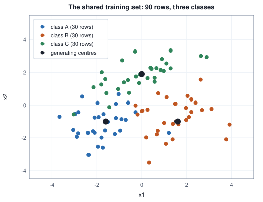
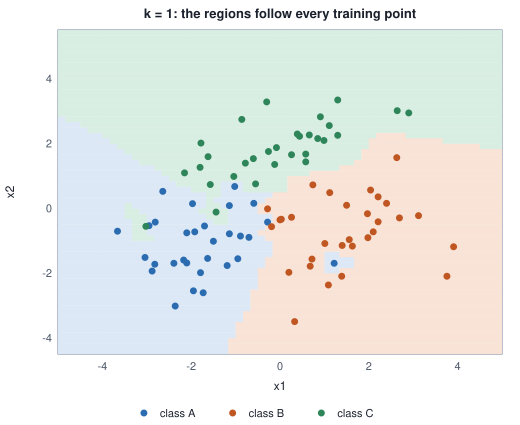
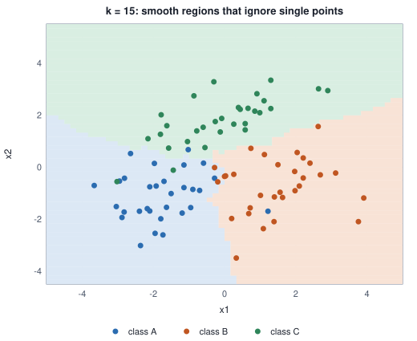
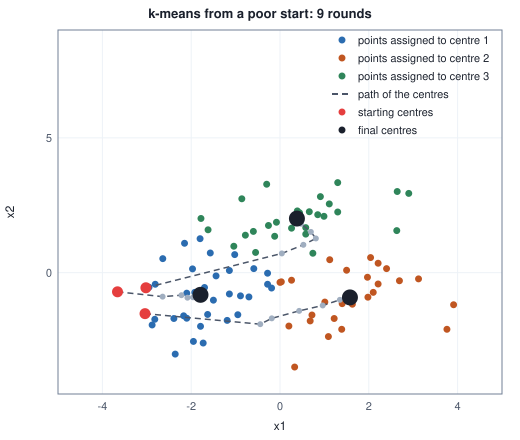
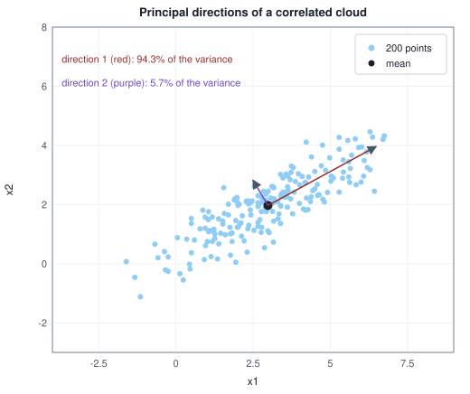
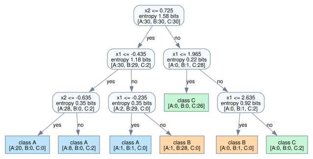
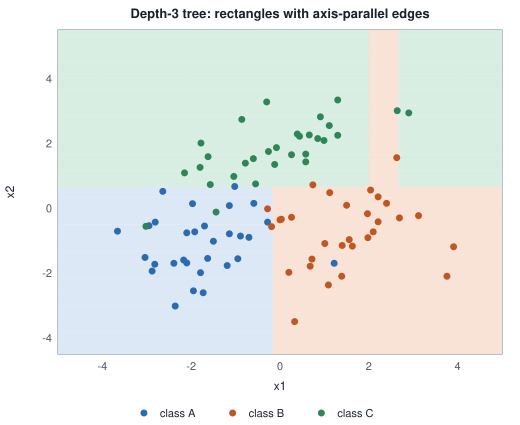

<!-- SPDX-License-Identifier: CC-BY-4.0 -->
<!-- Copyright (c) 2026 Martin Schröder <info@swedishembedded.com> -->

# Machine Learning Before Deep Learning

*What did the field know before neural networks took over, and when are those methods still the right tool?*

## The problem

A workshop has ninety machines, and each has been inspected by a technician who wrote down its state: A (healthy), B (worn bearing) or C (loose mounting). A sensor also gives two readings for every machine. Nobody has time to train a neural network, and nobody wants to explain one to the maintenance crew. The question is how well the two readings predict the state, which method gets there with the least effort, and what each method needs to believe about the data in order to work.

The ninety machines are the shared example of this chapter. Every method below is run on exactly these rows, so that the pictures and the accuracies can be compared. The rows are generated by the book's own generator, and the recipe is printed so that you can regenerate them. The book plays the part of nature here: the three groups come from three Gaussian-like blobs with different centres and shapes, one of them (class C) stretched along a diagonal, and they overlap.

<!-- worked: classical.dataset_head -->
Generator: the book's SplitMix64, seed 0x5ff3181ac5f6e1d8 (6913896356213350872). Three classes A, B, C. Each point is two draws, z1 = rng.normal() then z2 = rng.normal(); with the class's standard deviations (s1, s2) and angle t, a = s1 z1 and b = s2 z2, x1 = c1 + a cos t - b sin t and x2 = c2 + a sin t + b cos t, rounded to 2 decimals. Rows are drawn in order, the class cycling A, B, C, A, ...: first 90 training rows, then 300 validation rows, then 600 test rows, from one generator without reseeding.

| class | training rows | centre (c1, c2) | s1, s2, t | average of training rows |
|---|---:|---|---|---|
| A | 30 | (-1.6, -1.0) | 1.1, 1.1, 0 deg | (-1.76, -1.10) |
| B | 30 | (1.6, -1.0) | 1.1, 1.1, 0 deg | (1.47, -0.71) |
| C | 30 | (0.0, 1.9) | 1.6, 0.6, 35 deg | (-0.10, 1.81) |

The first six training rows:

| n | x1 | x2 | class |
|---|---:|---:|---|
| 1 | -1.97 | 0.14 | A |
| 2 | 0.00 | -0.36 | B |
| 3 | -0.08 | 1.87 | C |
| 4 | -2.82 | -1.73 | A |
| 5 | 1.12 | 0.48 | B |
| 6 | -1.44 | -0.12 | C |
<!-- /worked -->



Because the groups overlap, no method can be right every time: even a model that knew the generating distributions exactly would mislabel the rows that fall in the overlaps. The accuracy that such a model reaches is the ceiling for everything below, and the chapter will show that several quite different methods reach about the same height. The 90 rows are used to fit each method; the 300 validation rows choose its settings (the discipline of chapter 5); the 600 test rows score the final choice once, with accuracy as the metric (chapter 6) because the three classes are equally frequent and equally important here.

The methods in this chapter are what the field used for thirty years before deep networks. They are not obsolete. They are fast, many have a closed form or a short proof, several still win on small tables of numbers, and, more to the point for this book, nearly every one of them reappears inside a modern model under a new name: the grouping loop of chapter 1 as the codebook of a speech codec, principal directions as the low-rank structure of Volume I, nearest neighbours as retrieval over embeddings, the kernel as the similarity at the heart of attention. Seven ideas, each as a picture, an algorithm, a worked trace on a handful of numbers, the kind of boundary it can draw, how it fails and where it returns later.

## Before you begin

Six questions to answer from memory. The answers are at the end of the chapter. If one is hard, go back to the chapter named before reading on.

1. (Volume I, chapter 3, "Vectors", norms.) Compute the $L^1$, $L^2$ and $L^\infty$ norms of $(3, -4)$.
2. (Volume I, chapter 6, "Matrix Decompositions", eigenvectors.) The symmetric matrix $\begin{pmatrix}2&1\\1&2\end{pmatrix}$ has eigenvectors $(1, 1)/\sqrt{2}$ and $(1, -1)/\sqrt{2}$. What are its eigenvalues, and what is the relation of its eigenvectors to each other?
3. (Volume I, chapter 6, singular value decomposition.) If $\mathbf{X} = \mathbf{U}\boldsymbol{\Sigma}\mathbf{V}^\top$, what are the eigenvalues and eigenvectors of $\mathbf{X}^\top\mathbf{X}$ in terms of $\mathbf{U}$, $\boldsymbol{\Sigma}$, $\mathbf{V}$?
4. (Volume I, chapter 13, "Information, Entropy and Surprise", entropy.) A node of a decision process holds four examples of class A and four of class B. What is the entropy of its class distribution in bits? And for six of A and two of B, to three decimals?
5. (Volume I, chapter 10, "Probability", conditional probability.) Of 10 messages, 4 are spam. Of the spam messages, 3 contain the word "free", and of the 6 others, 1 does. What is $P(\text{spam} \mid \text{free})$?
6. (Chapter 1 of this volume, the grouping loop, and chapter 5, overfitting.) The grouping loop of chapter 1 repeated two steps. Say what they were. A model scores $100\%$ on the rows it was fitted to and $80\%$ on validation rows: what is that pattern called, and what is its usual cause?

## Nearest neighbours

**What it is for.** The first method needs no training at all. To classify a new machine, find the training machines whose readings are most like it and let them vote. The idea is as old as the habit of judging by resemblance, and it makes one assumption: *rows that are close in feature space tend to have the same label*.

The **k-nearest neighbours** method (k-NN) stores the training rows. For a new row $\mathbf{x}$, let $\mathcal{N}_k(\mathbf{x})$ be the $k$ training rows nearest to $\mathbf{x}$ in some distance, and predict the class most common among their labels. "Nearest" needs a distance, and the norms of Volume I, chapter 3, supply the candidates: the distance between $\mathbf{a}$ and $\mathbf{b}$ is $\lVert\mathbf{a} - \mathbf{b}\rVert$ for the $L^1$, $L^2$ or $L^\infty$ norm.

### A trace on five points

Five labelled points and a query at the origin. The table gives every distance, so that the vote can be done by hand under each norm.

<!-- worked: classical.knn_trace -->
Five labelled points and the query q = (0, 0):

| point | (x1, x2) | class | L1 distance | L2 distance | L-infinity distance |
|---|---|---:|---:|---:|---:|
| a | (3.0, 0.0) | A | 3.00 | 3.00 | 3.00 |
| b | (2.2, 2.2) | B | 4.40 | 3.11 | 2.20 |
| c | (-1.0, 3.5) | B | 4.50 | 3.64 | 3.50 |
| d | (-2.5, -1.0) | A | 3.50 | 2.69 | 2.50 |
| e | (1.0, -2.0) | B | 3.00 | 2.24 | 2.00 |

The neighbours in order of increasing distance (first three, nearest first) and the vote for k = 1 and k = 3:

| norm | three nearest | class for k = 1 | class for k = 3 |
|---|---|---:|---:|
| L1 | a, e, d | A | A |
| L2 | e, d, a | B | A |
| L-infinity | e, b, d | B | B |
<!-- /worked -->

With the $L^2$ distance the single nearest point is $e$, class B, so $k = 1$ says B; the three nearest are $e, d, a$ with classes B, A, A, so $k = 3$ says A. The prediction changed with $k$, and it also depends on the norm: the $L^1$ distance finds $a$ nearest (a tie of $3.00$ with $e$ goes to the lower row number, since the sort is stable) and predicts A even for $k = 1$. Which norm is right is not a mathematical question. It is the question of what "similar" should mean for these readings, and it can be tried on the validation rows, as below.

```text
function knn_predict(X: array<real>[N, d], y: array<int>[N], x: array<real>[d], k: int, C: int) -> int:
    require 1 <= k and k <= N, "knn_predict: k out of range"
    dist = zeros(real, [N])
    for n in 0 .. N:
        s = 0.0
        for j in 0 .. d:
            s = s + (X[n, j] - x[j]) ^ 2
        dist[n] = sqrt(s)                      # the L2 distance; any norm of the difference could stand here
    order = argsort(dist)                      # nearest first; equal distances keep their row order
    votes = zeros(int, [C])
    for r in 0 .. k:
        votes[y[order[r]]] = votes[y[order[r]]] + 1
    return argmax(votes)                       # on a tie the smaller class label wins
```

The cost is the whole point of the method's character. Training is free (store $\mathbf{X}$ and $\mathbf{y}$); each prediction costs $O(Nd)$ to compute the distances plus a sort, $O(N\log N)$, or $O(N)$ with a selection that finds the $k$ smallest. Memory is $O(Nd)$, all the data. The cost of learning has been moved to the moment of asking.

### The shape of the boundary

For $k = 1$ the regions of the plane that belong to each training row are the cells closer to that row than to any other, and the class boundary is made of straight pieces along the perpendicular bisectors between rows of different classes. The picture shows the ninety training rows and the regions the 1-nearest-neighbour rule paints. The boundary follows every single row, including the ones that sit inside the wrong group.



For $k = 15$ the rule needs fifteen rows to agree, and one stray row no longer redraws the map:



The number $k$ is the dial of chapter 5's bias-variance tradeoff, in its purest form. A small $k$ is flexible (low bias, high variance): with $k = 1$ every training row is classified correctly, because it is its own nearest neighbour, and the model memorises the noise. A large $k$ averages over a wide neighbourhood (high bias, low variance), and for $k = N$ the prediction is the most common class overall, the same for every query. The right value is found as chapter 5 taught, on validation rows:

<!-- worked: classical.knn_k_sweep -->
L2 distance, majority vote, a vote tie going to the smaller class label. Training accuracy counts each training row as its own nearest neighbour (distance 0). Validation: the 300 validation rows; the best k has the highest validation accuracy, the smaller k on a tie.

| k | training accuracy | validation accuracy | chosen |
|---:|---:|---:|---|
| 1 | 100.0% | 86.7% |  |
| 3 | 92.2% | 88.0% |  |
| 5 | 94.4% | 88.0% |  |
| 9 | 92.2% | 89.3% | best |
| 15 | 93.3% | 89.3% |  |
| 21 | 93.3% | 88.3% |  |
| 31 | 87.8% | 86.3% |  |
<!-- /worked -->

Training accuracy is $100.0\%$ at $k = 1$ and then wanders between $87.8\%$ and $94.4\%$; it is not the guide. Validation accuracy rises from $86.7\%$ at $k = 1$ to $89.3\%$ at $k = 9$ and $k = 15$, and falls to $86.3\%$ at $k = 31$, a third of the training set: the characteristic hump. The smaller of the two best values, $k = 9$, is taken. The differences are small, a few rows out of 300 (one row is $0.33$ percentage points), and the hump is a trend to read, not a precise optimum.

### Which distance, and on which scale

Changing the norm at the chosen $k$:

<!-- worked: classical.knn_norms_and_test -->
Validation accuracy at k = 9 for three distances:

| distance | validation accuracy |
|---|---:|
| L1 | 87.7% |
| L2 | 89.3% |
| L-infinity | 88.0% |

Test accuracy of k = 9 with L2 (600 test rows, looked at once): 89.0%.
<!-- /worked -->

The norms differ by a point or two, which on 300 rows is about five rows and no more than noise. The scale of the features matters far more, because a distance adds the coordinates up and so lets the feature with the biggest numbers decide. To see it, add a useless third feature, a uniform random number multiplied by a scale $s$, to every row:

<!-- worked: classical.knn_irrelevant_feature -->
Generator: the book's SplitMix64, seed 0x53bf905884356fa6 (6034700735549370278). A third feature x3 = s u is added to every row, with u = rng.uniform(): first one draw for each of the 90 training rows in order, then one for each of the 300 validation rows in order. k = 5, L2 distance. Standardised: each of the three features minus its training average and divided by its training standard deviation (divisor N).

| scale s of the useless feature | validation accuracy, raw | validation accuracy, standardised |
|---:|---:|---:|
| 0 | 88.0% | - |
| 1 | 86.7% | 86.7% |
| 10 | 85.3% | 86.7% |
| 100 | 49.3% | 86.7% |
<!-- /worked -->

A useless feature of scale $1$ costs a little ($88.0\%$ to $86.7\%$) and one of scale $10$ costs a little more. At scale $100$, the extra coordinate dominates every distance, and the validation accuracy falls to $49.3\%$, far below the $88.0\%$ it started from, because the useless coordinate now decides which rows are nearest. Standardising every feature first (subtract the training mean, divide by the training standard deviation, as in chapter 2's feature scaling, using only training statistics) brings it back to $86.7\%$ at every scale, because after standardising the useless feature has the same weight as a real one, and k-NN has no mechanism for learning that it should have less. That is the method's central weakness: all features count equally, and nothing is learned about which ones matter.

### The curse of dimensionality

The assumption that near rows share labels needs rows that are near. In many dimensions there are none. Take 200 points drawn uniformly in the unit cube of $d$ dimensions, pick one as the query and look at its distances to the other 199:

<!-- worked: classical.distance_concentration -->
Generator: the book's SplitMix64, seed 0xf09d6076a9b38554 (17338120203215799636). For each dimension d in turn (2, 10, 100, 1000), 200 points with d coordinates drawn by rng.uniform(), point after point, coordinate after coordinate, from one generator. The first point is the query; the L2 distances to the other 199 are summarised (standard deviation with divisor 199).

| d | mean distance | std / mean | (max - min) / min | nearest / mean |
|---|---:|---:|---:|---:|
| 2 | 0.464 | 0.482 | 17.407 | 0.116 |
| 10 | 1.257 | 0.186 | 2.480 | 0.412 |
| 100 | 4.076 | 0.052 | 0.328 | 0.847 |
| 1000 | 13.021 | 0.017 | 0.103 | 0.955 |
<!-- /worked -->

In two dimensions the nearest point is only $0.116$ of the mean distance away, and the farthest is $17.4$ times further than the nearest (the ratio $(\max - \min)/\min$). At $d = 1000$ the nearest is $0.955$ of the mean and the farthest only $0.103$ further than the nearest: every point is at almost the same distance from the query. The distances **concentrate**, and with it the notion of "nearest" loses its meaning. The mechanism is the law of large numbers of Volume I, chapter 11: a squared distance is a sum of $d$ independent terms, each with the same mean and spread; the sum grows like $d$ and its standard deviation like $\sqrt{d}$ (variances of independent terms add), so the relative spread falls like $1/\sqrt{d}$, and the distance, the square root of the sum, inherits that rate. The table agrees: the standard deviation over the mean falls from $0.482$ to $0.186$ to $0.052$ to $0.017$ as $d$ grows by factors of $5$, $10$ and $10$, roughly $1/\sqrt{d}$ at the larger steps. This is the **curse of dimensionality**: a method whose only tool is a distance between raw coordinates needs more and more data as the number of features grows, and it works in high dimension only when the data lie near a low-dimensional set, which is the situation principal component analysis, below, detects.

**Where it returns.** Retrieval over embeddings is nearest-neighbour search. A model maps each passage to a vector of a few hundred or thousand numbers, and a query is answered by the $k$ stored vectors with the highest cosine similarity (Volume I, chapter 3). The curse is why the vectors come from a trained network and not from raw features: the network moves the data into a space where near really does mean similar. A large stored set cannot be scanned for every query, so approximate nearest-neighbour indexes trade a little accuracy for a large saving, and the codebook lookup of vector quantization, a nearest-neighbour search against a few thousand centres, is below in the next section.

**Summary of k-NN.** Inductive bias: nearby rows share labels; the boundary is piecewise linear and can bend around any shape, given enough rows. Cost: no training, $O(Nd)$ per query, memory $O(Nd)$. Fails when features are on different scales, when many features are useless, when the dimension is high and the data fill it, and when the store is too large to scan. Strength: no assumptions about the shape of the classes, and a baseline that takes ten lines to write.

## k-means: naming the grouping loop

**What it is for.** The other half of chapter 1's three settings: rows with no labels, and the wish to find groups. Chapter 1 ran a procedure on twelve machines and said that it was a well-known method with a name of its own. The name is **k-means**, and the procedure is **Lloyd's algorithm**.

Given $N$ rows and a number of groups $k$, k-means chooses $k$ **centres** $\boldsymbol{\mu}_1, \dots, \boldsymbol{\mu}_k$ and a group $g_n \in \{0, \dots, k-1\}$ for every row, to make the **objective**

$$
\mathcal{J} = \sum_{n=1}^{N} \lVert \mathbf{x}_n - \boldsymbol{\mu}_{g_n} \rVert^2
$$

as small as possible: the total squared distance from each row to the centre of its group. The assign-then-average loop of chapter 1 is a way of lowering this number, and the two steps are exactly the two steps of the loop there:

1. **Assign.** With the centres fixed, give each row to its nearest centre.
2. **Update.** With the groups fixed, move each centre to the mean of the rows in its group.

### A trace on six points

Six points, two centres, a deliberately poor start in which both centres lie in the lower left. Each round prints the centres used by the assignment, the assignment, and the value of $\mathcal{J}$ after each of the two steps.

<!-- worked: classical.kmeans_trace -->
Six points (1.0, 1.0), (1.5, 2.0), (3.0, 4.0), (5.0, 7.0), (3.5, 5.0), (4.5, 5.0); starting centres (1.0, 1.0) and (1.5, 2.0). A tie goes to the lower centre; the loop stops when an assignment equals the previous one.

| round | centres used by the assignment | assignment of the six points | J after assigning | J after moving the centres |
|---:|---|---:|---:|---:|
| 1 | (1.00, 1.00) (1.50, 2.00) | 122222 | 74.500 | 20.700 |
| 2 | (1.00, 1.00) (3.50, 4.60) | 112222 | 11.190 | 7.875 |
| 3 | (1.25, 1.50) (4.00, 5.25) | 112222 | 7.875 | 7.875 |

Final centres (1.25, 1.50) and (4.00, 5.25), final J 7.875. The sequence J(assign 1), J(move 1), J(assign 2), ... never increases: yes.
<!-- /worked -->

Round 1 gives the first point to centre 1 and the other five to centre 2 ($\mathcal{J} = 74.5$), then moves centre 2 to the mean of five points, $(3.5, 4.6)$ ($\mathcal{J} = 20.7$). Round 2 reassigns the second point (its distance to centre 1 is now smaller), giving $\mathcal{J} = 11.19$, and the update brings it to $7.875$. In round 3 the assignment is the same as in round 2, so the centres cannot move and the loop stops. The sequence $74.5, 20.7, 11.19, 7.875, 7.875$ never increases, which is the property that makes the algorithm sound.

```text
function lloyd(X: array<real>[N, d], mu0: array<real>[k, d]) -> (array<real>[k, d], array<int>[N]):
    require k <= N, "lloyd: more centres than rows"
    mu = copy(mu0)
    g_old = zeros(int, [N])
    for n in 0 .. N:
        g_old[n] = -1                          # no assignment yet
    loop:
        g = zeros(int, [N])
        for n in 0 .. N:                       # step 1: assign each row to its nearest centre
            best = 0
            best_d = infinity
            for j in 0 .. k:
                dj = 0.0
                for t in 0 .. d:
                    dj = dj + (X[n, t] - mu[j, t]) ^ 2
                if dj < best_d:                # strict, so a tie keeps the lower centre
                    best = j
                    best_d = dj
            g[n] = best
        same = true
        for n in 0 .. N:
            if g[n] != g_old[n]:
                same = false
        if same:
            return (mu, g)
        for j in 0 .. k:                       # step 2: move each centre to the mean of its rows
            cnt = 0
            s = zeros(real, [d])
            for n in 0 .. N:
                if g[n] == j:
                    cnt = cnt + 1
                    for t in 0 .. d:
                        s[t] = s[t] + X[n, t]
            if cnt > 0:                        # a group with no rows keeps its centre
                for t in 0 .. d:
                    mu[j, t] = s[t] / cnt
        g_old = copy(g)
```

Each round costs $O(Nkd)$ for the assignment and $O(Nd)$ for the update, and the number of rounds is not bounded by a small constant: between seven and nine rounds per run on average in the experiments below, the last one being the confirming round.

### Why the objective never increases

The claim is that $\mathcal{J}$ does not increase at either step, and it can be proved in two lines. **The assign step.** $\mathcal{J}$ is a sum of one term per row, and the term of row $n$ depends only on its own group $g_n$. Choosing for each row the centre with the smallest squared distance minimises each term separately, so the sum cannot go up. **The update step.** Fix a group of $m$ rows $\mathbf{x}_i$ with mean $\bar{\mathbf{x}}$ and ask for the point $\mathbf{p}$ that minimises $\sum_i \lVert\mathbf{x}_i - \mathbf{p}\rVert^2$. Write $\mathbf{x}_i - \mathbf{p} = (\mathbf{x}_i - \bar{\mathbf{x}}) + (\bar{\mathbf{x}} - \mathbf{p})$ and expand: the cross term is $2(\bar{\mathbf{x}} - \mathbf{p})\cdot\sum_i(\mathbf{x}_i - \bar{\mathbf{x}}) = 0$ because deviations from the mean sum to zero, so

$$
\sum_i \lVert\mathbf{x}_i - \mathbf{p}\rVert^2 = \sum_i \lVert\mathbf{x}_i - \bar{\mathbf{x}}\rVert^2 + m\,\lVert\bar{\mathbf{x}} - \mathbf{p}\rVert^2 .
$$

The second term is zero exactly when $\mathbf{p} = \bar{\mathbf{x}}$, so the mean is the best centre, and moving a centre to the mean cannot raise the sum. (A group with no rows adds nothing to $\mathcal{J}$, so leaving its centre where it is changes nothing.) The identity also shows what goes wrong if one mixes distances: using the $L^1$ distance in the assignment and the mean in the update would break the argument, because the mean is the minimiser of squared $L^2$ distances, not of $L^1$ ones.

Termination follows. $\mathcal{J}$ is bounded below by $0$, there are only $k^N$ assignments, and $\mathcal{J}$ strictly falls whenever an assignment changes (the new assignment is strictly better for the old centres, up to ties that the lowest-index rule fixes), so no assignment is ever visited twice and the loop must stop. What it reaches is a **local minimum**: no single step improves it. It need not be the lowest value of $\mathcal{J}$ over all choices of centres, and finding that is a hard combinatorial problem.

### Local minima, and seeding

The final value depends on the starting centres. On the ninety training rows with their labels hidden, take $k = 3$ and start from the three rows with the smallest $x_1$, all in the left-hand cluster. Alongside, a start drawn by the rule that the next section defines:

<!-- worked: classical.kmeans_objective_by_round -->
Poor start: the three training rows with the smallest x1, (-3.66, -0.71), (-3.04, -1.52), (-3.02, -0.56). k-means++ start: generator seed 0x4e56adacbd1489c9 (5644890140373715401); one draw `rng.integer(90)`, then two draws of `rng.uniform()`; the centres chosen are (0.20, -1.98), (2.90, 2.94), (3.12, -0.23). The rounds are Lloyd's, the last one being the round whose assignment equals the previous round's.

| round | poor start: J after assigning | J after moving | k-means++ start: J after assigning | J after moving |
|---|---:|---:|---:|---:|
| 1 | 1251.23 | 371.30 | 510.70 | 232.40 |
| 2 | 301.30 | 267.07 | 196.81 | 182.10 |
| 3 | 245.31 | 224.56 | 175.97 | 173.68 |
| 4 | 210.69 | 199.55 | 171.70 | 169.22 |
| 5 | 185.86 | 175.75 | 169.21 | 169.01 |
| 6 | 171.91 | 170.38 | 168.78 | 168.58 |
| 7 | 169.28 | 169.00 | 168.58 | 168.58 |
| 8 | 168.77 | 168.58 | (stopped) |  |
| 9 | 168.58 | 168.58 | (stopped) |  |

Final J: poor start 168.58, k-means++ start 168.58.
<!-- /worked -->

Both reach $168.58$ in the end, but the poor start begins at $\mathcal{J} = 1251.23$ and needs nine rounds, where the other begins at $510.70$ and needs seven, and the values fall monotonically in both columns, in line with the proof. The picture follows the three centres of the poor start from their starting points (red) through the rounds to their final places:



A start can also end somewhere worse. Run Lloyd's algorithm from $100$ random starts (three random rows as centres) and $100$ **k-means++** starts for $k = 3$, and then for $k = 6$. The k-means++ rule chooses the first centre uniformly among the rows and each further centre with probability proportional to $D(\mathbf{x})^2$, the squared distance from the row to the nearest centre chosen so far, so that new centres are likely to be far from the old ones and a start that crowds two centres into one group becomes unlikely:

```text
function kmeanspp_seed(X: array<real>[N, d], k: int, rng: inout Generator) -> array<real>[k, d]:
    require 1 <= k and k <= N, "kmeanspp_seed: k out of range"
    mu = zeros(real, [k, d])
    first = rng.integer(N)
    for t in 0 .. d:
        mu[0, t] = X[first, t]
    for j in 1 .. k:
        D = zeros(real, [N])                   # squared distance to the nearest centre chosen so far
        total = 0.0
        for n in 0 .. N:
            D[n] = infinity
            for i in 0 .. j:
                s = 0.0
                for t in 0 .. d:
                    s = s + (X[n, t] - mu[i, t]) ^ 2
                D[n] = min(D[n], s)
            total = total + D[n]
        u = rng.uniform() * total              # a point of [0, total), walked off the running sum of D
        chosen = N - 1
        for n in 0 .. N:
            u = u - D[n]
            if u <= 0.0:
                chosen = n
                break
        for t in 0 .. d:
            mu[j, t] = X[chosen, t]
    return mu
```

<!-- worked: classical.kmeans_restarts -->
Generator: the book's SplitMix64, seed 0x272400305f1b8863 (2820379474394843235). Points: the 90 training rows without their labels. In order, from one generator: 100 random starts and 100 k-means++ starts for k = 3, then the same for k = 6. A random start shuffles the numbers 0 .. 89 with `shuffle` and takes the first k rows as centres. A k-means++ start draws the first centre as row `rng.integer(90)`, then each further centre with one `rng.uniform()`: u = uniform x (sum of D), walk the rows in order subtracting each D(row) from u, and take the first row at which u <= 0 (D = squared distance to the nearest centre so far). Lloyd's rounds follow until the assignment repeats; the rounds counted include the last, confirming one. J is the sum of squared distances to the assigned centre. 'Lowest' is the lowest J found by any of the 200 runs at that k.

| k | start | lowest J | median J | highest J | mean J | runs reaching the lowest | mean rounds |
|---:|---|---:|---:|---:|---:|---:|---:|
| 3 | random rows | 168.58 | 168.58 | 234.89 | 173.47 | 81 of 100 | 9.1 |
| 3 | k-means++ | 168.58 | 168.58 | 234.32 | 171.53 | 84 of 100 | 8.4 |
| 6 | random rows | 82.90 | 91.81 | 103.55 | 91.37 | 1 of 100 | 7.9 |
| 6 | k-means++ | 82.90 | 89.97 | 104.89 | 90.13 | 1 of 100 | 6.8 |
<!-- /worked -->

With $k = 3$ most runs from either start reach the lowest value $168.58$ ($81$ of $100$ and $84$ of $100$), and the worst ends near $234$: a real local minimum, in which two centres share one group and one centre serves two. With $k = 6$ almost no run reaches the lowest value found ($1$ in $100$ in both cases) and the median is higher: more centres, more ways to be stuck. k-means++ is better on average (a mean of $90.13$ against $91.37$ at $k = 6$, and fewer rounds), but here the gain is small. It is a guarantee in theory (the expected $\mathcal{J}$ is within a factor $O(\log k)$ of the best possible, a result of Arthur and Vassilvitskii listed in the references) and an inexpensive improvement in practice. The standard remedy, in addition to a good seeding, is to **restart** the algorithm several times and keep the run with the lowest $\mathcal{J}$.

### Choosing $k$

$\mathcal{J}$ always falls when $k$ grows (more centres cannot be worse; at $k = N$ it is zero), so it cannot choose $k$ by itself. What can be read from it is where adding a group stops paying.

<!-- worked: classical.kmeans_choose_k -->
Generator: the book's SplitMix64, seed 0xcb016a648831aefc (14628090044690312956). For each k = 1 .. 8 in turn, 10 k-means++ starts (each: `rng.integer(90)`, then k - 1 draws of `rng.uniform()`), the lowest final J is kept. Points: the 90 training rows.

| k | lowest J of 10 starts | J / N | relative drop from k - 1 |
|---|---:|---:|---:|
| 1 | 509.23 | 5.658 |  |
| 2 | 289.27 | 3.214 | 43.2% |
| 3 | 168.58 | 1.873 | 41.7% |
| 4 | 124.52 | 1.384 | 26.1% |
| 5 | 100.82 | 1.120 | 19.0% |
| 6 | 82.99 | 0.922 | 17.7% |
| 7 | 71.24 | 0.792 | 14.2% |
| 8 | 60.68 | 0.674 | 14.8% |
<!-- /worked -->

The drop in $\mathcal{J}$ is large up to $k = 3$ ($43.2\%$ and $41.7\%$) and falls to $26.1\%$ at $k = 4$ and to between $14\%$ and $19\%$ after that. That bend at $k = 3$ is the "elbow", and it agrees with the three groups that generated the data, though only because the groups are well enough separated; on data without a clear bend the elbow is a matter of opinion, and the honest answer is that $k$ is a modelling choice to be judged by what the groups are used for.

**Inductive bias and failure modes.** k-means assumes round groups of similar size (the squared distance to a centre favours a boundary halfway between centres, a straight line), so it splits an elongated group into pieces and cannot find a ring inside a ring. It is sensitive to scale in the same way as k-NN, it needs $k$ in advance, and an outlier pulls a mean far from where most of its group lies. **Cost:** $O(Nkd)$ per round.

**Where it returns.** Replace every row by its nearest centre and the $k$ centres become a codebook: a row is stored as one small integer, the index of its centre, and the error made is the distance to the centre. $\mathcal{J}/N$ is the average squared error of that compression. This is vector quantization, which a later volume develops, and the codebooks of the image tokenizers and speech codecs of the later volumes are centres of exactly this kind, learned with a running-average form of the update step.

## Principal component analysis

**What it is for.** Rows often have many features that move together: six sensors that all respond to the same two causes, a hundred pixels that change with the lighting. Describing such rows by all their coordinates is wasteful, and a distance computed over redundant features (the curse above) is dominated by whatever is redundant. **Principal component analysis** (PCA) finds a few new directions in feature space along which the rows vary most, and describes each row by its position along them. It uses no labels: it is a second unsupervised method, about the shape of the cloud rather than its groups.

### Variance along a direction

Let the rows be $\mathbf{x}_1, \dots, \mathbf{x}_N$ with mean $\bar{\mathbf{x}}$, and let $\mathbf{X}_c$ be the matrix whose rows are $\mathbf{x}_n - \bar{\mathbf{x}}$ (the **centred** rows). The **covariance matrix** is

$$
\mathbf{C} = \frac{1}{N}\mathbf{X}_c^\top\mathbf{X}_c ,
$$

with entry $C_{ij}$ the average product of the deviations of features $i$ and $j$ (this chapter divides by $N$, not $N-1$, so that the total variance below is exactly the mean squared distance to the mean; the ratios of the results do not depend on the choice). Project every centred row onto a unit vector $\mathbf{u}$: the number $\mathbf{u}\cdot(\mathbf{x}_n - \bar{\mathbf{x}})$ is the position of the row along $\mathbf{u}$, and the variance of these positions is

$$
\frac{1}{N}\sum_n \bigl(\mathbf{u}\cdot(\mathbf{x}_n - \bar{\mathbf{x}})\bigr)^2 = \mathbf{u}^\top\mathbf{C}\,\mathbf{u}.
$$

The first principal direction is the unit $\mathbf{u}$ that makes this largest. The matrix $\mathbf{C}$ is symmetric, so by the spectral theorem of Volume I, chapter 6, it has orthonormal eigenvectors $\mathbf{u}_1, \dots, \mathbf{u}_d$ with eigenvalues $\lambda_1 \ge \dots \ge \lambda_d \ge 0$ (in this section $\lambda_j$ with an index is an eigenvalue; the penalty $\lambda$ of chapter 4 returns in the section on kernels) and $\mathbf{C} = \sum_j \lambda_j\mathbf{u}_j\mathbf{u}_j^\top$. Write any unit vector as $\mathbf{u} = \sum_j a_j\mathbf{u}_j$ with $\sum_j a_j^2 = 1$. Then

$$
\mathbf{u}^\top\mathbf{C}\,\mathbf{u} = \sum_j \lambda_j a_j^2 \le \lambda_1\sum_j a_j^2 = \lambda_1 ,
$$

with equality for $\mathbf{u} = \mathbf{u}_1$. So the direction of largest variance is the eigenvector of the largest eigenvalue, and that variance is the eigenvalue. Among the directions orthogonal to $\mathbf{u}_1$ the same argument gives $\mathbf{u}_2$ with variance $\lambda_2$, and so on. The $\mathbf{u}_j$ are the **principal components** (directions), $\lambda_j$ is the variance along the $j$-th, and the total variance $\sum_j\lambda_j = \operatorname{tr}\mathbf{C}$ is the mean squared distance of the rows to their mean. The **explained variance** of component $j$ is $\lambda_j/\sum_i\lambda_i$.

### A trace on four points

Four points lie nearly on a line. The table lists them, their deviations from the mean, the position of each along the first direction (its **score**) and the **reconstruction** that keeps only that direction, $\hat{\mathbf{x}} = \bar{\mathbf{x}} + (\mathbf{u}_1\cdot(\mathbf{x} - \bar{\mathbf{x}}))\,\mathbf{u}_1$, and the lines below it check each step in two ways.

<!-- worked: classical.pca_trace -->
| n | x1 | x2 | x1 centred | x2 centred | score on direction 1 | reconstruction (rank 1) |
|---:|---:|---:|---:|---:|---:|---|
| 1 | 2 | 1 | -3.00 | -2.50 | -3.9046 | (1.9583, 1.0518) |
| 2 | 4 | 3 | -1.00 | -0.50 | -1.0925 | (4.1489, 2.8150) |
| 3 | 6 | 4 | 1.00 | 0.50 | 1.0925 | (5.8511, 4.1850) |
| 4 | 8 | 6 | 3.00 | 2.50 | 3.9046 | (8.0417, 5.9482) |

Average point (5.00, 3.50). Covariance (divisor N = 4): [[5.0000, 4.0000], [4.0000, 3.2500]], trace 8.2500, determinant 0.2500.
Eigenvalues from the quadratic formula: 8.2196 and 0.0304. First direction (0.7790, 0.6270) (angle 38.83 degrees), second (-0.6270, 0.7790).
Jacobi eigenvalues of the same matrix: 8.2196 and 0.0304. Explained variance of direction 1: 99.63%.
Sum of squared reconstruction errors of the four points: 0.1217; N times the discarded eigenvalue: 0.1217.
Eigenvalues of the 4 x 4 matrix Xc Xc^T: 32.8783, 0.1217, 0.0000, 0.0000; N times the eigenvalues of the covariance: 32.8783, 0.1217. Singular values of Xc: 5.7340, 0.3488.
<!-- /worked -->

The covariance is $\begin{pmatrix}5&4\\4&3.25\end{pmatrix}$, with trace $8.25$ and determinant $5 \times 3.25 - 16 = 0.25$, so the eigenvalues solve $\lambda^2 - 8.25\lambda + 0.25 = 0$ and are $8.2196$ and $0.0304$. The first direction explains $99.63\%$ of the variance, and keeping only it makes the four points move a total squared distance of $0.1217$ (the reconstruction column is the point's projection onto the line). That equals $N\lambda_2 = 4 \times 0.0304$, the discarded variance times the number of rows: the cost of dropping components is exactly the variance in them. (Eigenvectors are defined up to sign: $\mathbf{u}$ and $-\mathbf{u}$ are both unit eigenvectors, and this chapter prints the one whose entry of largest magnitude is positive. Another implementation may print the negative, with every score negated; the variances and reconstructions are unchanged.)

### The same thing from the singular value decomposition

Volume I, chapter 6, ended by noting that when the rows of $\mathbf{X}_c$ are examples, the eigenvectors of $\mathbf{X}_c^\top\mathbf{X}_c$ are the right singular vectors of $\mathbf{X}_c$. Write $\mathbf{X}_c = \mathbf{U}\boldsymbol{\Sigma}\mathbf{V}^\top$. Then $\mathbf{C} = \frac{1}{N}\mathbf{V}\boldsymbol{\Sigma}^2\mathbf{V}^\top$, so the columns of $\mathbf{V}$ are the principal directions and

$$
\lambda_j = \frac{\sigma_j^2}{N}.
$$

The last two lines of the trace check this against a second route that does not form $\mathbf{C}$ at all: the nonzero eigenvalues of the $4\times 4$ matrix $\mathbf{X}_c\mathbf{X}_c^\top$ are $32.8783$ and $0.1217$, which are $N\lambda_1$ and $N\lambda_2$, and the singular values of $\mathbf{X}_c$ are their square roots, $5.7340$ and $0.3488$. The Eckart-Young theorem of that chapter now says something about data: of all rank-$r$ summaries of the centred rows, the one that keeps the $r$ largest singular values is the best in squared error, and its error is the sum of the discarded squared singular values, which is $N\sum_{j>r}\lambda_j$. PCA is the low-rank approximation of the data matrix.

```text
function pca(X: array<real>[N, d], r: int) -> (array<real>[d], array<real>[d, r], array<real>[d]):
    require 1 <= r and r <= d and N >= 2, "pca: bad sizes"
    m = zeros(real, [d])                       # the mean of each feature
    for n in 0 .. N:
        for t in 0 .. d:
            m[t] = m[t] + X[n, t] / N
    Xc = zeros(real, [N, d])
    for n in 0 .. N:
        for t in 0 .. d:
            Xc[n, t] = X[n, t] - m[t]
    C = matmul(transpose(Xc), Xc)              # [d, d]
    for i in 0 .. d:
        for j in 0 .. d:
            C[i, j] = C[i, j] / N              # divisor N
    (vals, V) = jacobi_eigen(C, 60)            # Volume I, chapter 6; the eigenvectors are the columns of V
    order = argsort(vals, descending)
    lam = zeros(real, [d])
    U = zeros(real, [d, r])
    for j in 0 .. d:
        lam[j] = vals[order[j]]
    for j in 0 .. r:
        for t in 0 .. d:
            U[t, j] = V[t, order[j]]           # the j-th principal direction is the column j of U
    return (m, U, lam)
```

The scores of a row are `matmul(transpose(U), x - m)` (a vector of $r$ numbers), and its reconstruction is `m + matmul(U, scores)`. Forming $\mathbf{C}$ costs $O(Nd^2)$ and the eigendecomposition $O(d^3)$; when $d$ is larger than $N$, or when only a few components are wanted, one computes the SVD of $\mathbf{X}_c$ directly instead, at $O(Nd\min(N, d))$.

### Directions on a cloud, and how many to keep

Two hundred points from a stretched, tilted cloud (the recipe is in the table), and the principal directions drawn from the sample mean with a length of two standard deviations each:

<!-- worked: classical.pca_cloud -->
Generator: the book's SplitMix64, seed 0x1403b86a7f392896 (1442199073229187222). 200 points; each is two draws a = 2.0 rng.normal(), b = 0.5 rng.normal(), then x1 = 3.0 + a cos t - b sin t, x2 = 2.0 + a sin t + b cos t with t = 30 degrees, rounded to 2 decimals. Covariance with divisor N. Average point (2.98, 1.97).

| quantity | value |
|---|---|
| covariance entries C11, C12, C22 | 3.1331, 1.6426, 1.1787 |
| eigenvalues lambda1, lambda2 | 4.0671, 0.2446 |
| lambda1 + lambda2 versus C11 + C22 | 4.3118 versus 4.3118 |
| first direction (unit vector); angle | (0.8693, 0.4943); 29.63 degrees |
| explained variance ratio of direction 1 | 94.33% |
| covariance of the whitened data | [[1.0000, 0.0000], [0.0000, 1.0000]] |

Whitening: z = (u1 / sqrt(lambda1), u2 / sqrt(lambda2)), with u_j the dot product of the centred point with direction j.
<!-- /worked -->



The cloud was built with standard deviations $2$ and $0.5$ (variances $4$ and $0.25$) along axes tilted by $30$ degrees. The sample recovers variances $4.0671$ and $0.2446$ and a direction at $29.63$ degrees; the sum of the eigenvalues equals the sum of the diagonal of the covariance ($4.3118$), the trace identity, and the first direction explains $94.33\%$ of the variance. The last row is the **whitened** data. Divide each score by the standard deviation of its direction, $z_j = \mathbf{u}_j\cdot(\mathbf{x} - \bar{\mathbf{x}})/\sqrt{\lambda_j}$, and the scores have covariance exactly the identity: the scores are uncorrelated (the covariance of the scores is $\mathbf{U}^\top\mathbf{C}\,\mathbf{U} = \boldsymbol{\Lambda}$, diagonal) with variances $\lambda_j$, and dividing by $\sqrt{\lambda_j}$ makes each one. Whitening puts every direction on the same scale and removes the correlations; it also amplifies directions whose variance is tiny, which are mostly noise, so in practice one divides by $\sqrt{\lambda_j + \epsilon}$ with a small $\epsilon$, the same device as the $\lambda\mathbf{I}$ added to $\mathbf{X}^\top\mathbf{X}$ in the ridge regression of chapter 4.

With more features the question is how many components to keep. Here six features are generated from two hidden factors plus a little noise of standard deviation $0.3$:

<!-- worked: classical.pca_two_factors -->
Generator: the book's SplitMix64, seed 0x73212898cbe9201f (8295956625314357279). 300 rows of 6 features. Draw order: first the 6 x 2 matrix W of loadings, row by row, 12 calls of rng.normal(); then, for each row, 2 calls (the hidden factors z) and 6 calls (noise); feature j is the dot product of row j of W with z, plus 0.3 times its noise draw. Covariance with divisor N.

| component | eigenvalue | explained variance | cumulative |
|---|---:|---:|---:|
| 1 | 7.0801 | 73.75% | 73.75% |
| 2 | 2.1420 | 22.31% | 96.07% |
| 3 | 0.1066 | 1.11% | 97.18% |
| 4 | 0.0979 | 1.02% | 98.20% |
| 5 | 0.0890 | 0.93% | 99.12% |
| 6 | 0.0843 | 0.88% | 100.00% |

Squared reconstruction error averaged over the rows (summed over the 6 features) when only the first r components are kept, against the sum of the discarded eigenvalues:

| r | average squared reconstruction error | sum of eigenvalues r+1 .. 6 |
|---|---:|---:|
| 0 | 9.5998 | 9.5998 |
| 1 | 2.5197 | 2.5197 |
| 2 | 0.3777 | 0.3777 |
| 3 | 0.2711 | 0.2711 |
| 4 | 0.1732 | 0.1732 |
| 5 | 0.0843 | 0.0843 |
| 6 | 0.0000 | 0.0000 |
<!-- /worked -->

Two eigenvalues, $7.0801$ and $2.1420$, stand out; the other four are all near $0.09$, which is the noise variance $0.3^2$. Two components explain $96.07\%$ of the variance, and the table of errors says what the rest costs: keeping $r = 2$ leaves a mean squared reconstruction error of $0.3777$ per row, equal to the sum of the four discarded eigenvalues (the check that holds in every row of the table), against $9.5998$ for $r = 0$ (replace every row by the mean). Rows of six numbers are summarised by two with little loss: the data lie near a flat two-dimensional subspace of $\mathbb{R}^6$. A plot of the eigenvalues, or the cumulative explained variance, shows such a bend (as the elbow of k-means), and a common rule is to keep as many components as it takes to explain a chosen share, such as $95\%$ (here, two).

### What PCA assumes, and how it fails

**Inductive bias.** The data lie near a flat subspace (a line, a plane, a hyperplane), and the directions of large variance are the ones that matter. Flat means linear: a ring of points has no good low-dimensional linear summary. **Failure modes.** Variance depends on units, so features on larger scales dominate the first components; standardise unless the units are comparable. A few outliers contribute their squared deviations and can capture a whole component. And large variance is not relevance. Take 400 rows with a feature $x_1$ of standard deviation $3$ that carries no information about the class and a feature $x_2$ of standard deviation $0.3$ around two class means $\pm 1$:

<!-- worked: classical.pca_wrong_direction -->
Generator: the book's SplitMix64, seed 0x058c42da3fa4fdf4 (399767972067212788). 400 rows; row i has class y = i mod 2; the two draws per row are x1 = 3 rng.normal() (no information about y) and x2 = (+1 if y = 1 else -1) + 0.3 rng.normal(). Each component is scored as a one-dimensional classifier: the threshold is the midpoint of the two class averages of the score, the side of the larger class average is called class 1.

| component | eigenvalue | explained variance | accuracy of the 1-D classifier |
|---|---:|---:|---:|
| 1 | 8.087 | 88.4% | 49.5% |
| 2 | 1.065 | 11.6% | 100.0% |
<!-- /worked -->

The first component, $88.4\%$ of the variance, is almost exactly the useless feature, and used as a one-dimensional classifier it scores $49.5\%$, chance for two equal classes. The second, with $11.6\%$ of the variance, separates the classes perfectly. A model that discards the small components in order to compress the rows would discard the answer. PCA does not know what the rows are for.

**Cost:** $O(Nd^2 + d^3)$. **Where it returns.** Truncating an SVD to its largest singular values is the low-rank structure of the adapters in Volume I, and PCA of the hidden states of a network is a standard way to look at what a layer represents. A neural network trained as an autoencoder with no nonlinearity and squared error learns the same subspace as PCA (Baldi and Hornik, listed in the references); nonlinear autoencoders (Volume III) lift the restriction to flat subspaces. Layer normalisation, also in Volume III, rescales each row by its own standard deviation: like whitening, it puts activations on a common scale, but by a far cheaper rule.

## Decision trees

**What it is for.** The methods so far measure distances. A **decision tree** instead asks questions, the way a technician would: is the vibration above 3.5? if not, is the temperature above 2.5? Each question concerns one feature and a threshold; the answers lead down a tree to a leaf, which holds a class. The model is a set of rules a person can read, and it needs no distance, no scaling and no assumption about the shape of the classes. The problem is to choose the questions.

### Measuring a mixed node: entropy and Gini

A node holds the training rows that reached it, with counts $n_c$ of each class and shares $p_c = n_c/n$. A good question makes the two sides purer than the node. The measure of purity is the entropy of Volume I, chapter 13, of the class shares,

$$
H = -\sum_c p_c\log_2 p_c ,
$$

in bits: $0$ for a pure node and $1$ for two equal classes. The **information gain** of a split is the entropy of the node minus the size-weighted entropy of the two sides,

$$
\mathrm{IG} = H(\text{node}) - \frac{n_L}{n}H(\text{left}) - \frac{n_R}{n}H(\text{right}) .
$$

It is the mutual information (Volume I, chapter 13) between the answer to the question and the class, estimated from the counts: how many bits the answer tells about the class. The **Gini impurity**, $G = 1 - \sum_c p_c^2$, is a cheaper measure with the same shape ($0$ for a pure node, $0.5$ for two equal classes), and its gain is computed the same way. The two usually pick the same questions.

### A tree built by hand

Eight machines, two readings each (vibration $x_1$, temperature $x_2$) and a class, 0 for fine and 1 for worn. The root holds four of each class: $H = 1$ bit and $G = 0.5$. A threshold on a feature only matters between two neighbouring values of that feature in the data, so the candidates are the midpoints, thirteen in all (seven for $x_1$, six for $x_2$), and for each the table gives the class counts on each side, the entropies, and both gains.

<!-- worked: classical.tree_hand_root -->
Eight rows (x1, x2, class): (1, 5, 0), (2, 7, 0), (3, 4, 0), (4, 8, 1), (5, 3, 1), (6, 6, 1), (7, 2, 0), (8, 7, 1). Class counts [class 0, class 1] at the root: [4, 4]; entropy 1.0000 bits; Gini 0.5000. Every candidate threshold (midpoints between consecutive distinct values of one feature), with the class counts on each side, the entropy of each side in bits, and the information gain (entropy of the parent minus the size-weighted entropy of the two sides) and the Gini decrease.

| split (left side: <=) | left counts | right counts | H(left) | H(right) | information gain | Gini decrease |
|---|---|---|---:|---:|---:|---:|
| x1 <= 1.5 | [1, 0] | [3, 4] | 0.000 | 0.985 | 0.1379 | 0.0714 |
| x1 <= 2.5 | [2, 0] | [2, 4] | 0.000 | 0.918 | 0.3113 | 0.1667 |
| x1 <= 3.5 | [3, 0] | [1, 4] | 0.000 | 0.722 | 0.5488 | 0.3000 |
| x1 <= 4.5 | [3, 1] | [1, 3] | 0.811 | 0.811 | 0.1887 | 0.1250 |
| x1 <= 5.5 | [3, 2] | [1, 2] | 0.971 | 0.918 | 0.0488 | 0.0333 |
| x1 <= 6.5 | [3, 3] | [1, 1] | 1.000 | 1.000 | 0.0000 | 0.0000 |
| x1 <= 7.5 | [4, 3] | [0, 1] | 0.985 | 0.000 | 0.1379 | 0.0714 |
| x2 <= 2.5 | [1, 0] | [3, 4] | 0.000 | 0.985 | 0.1379 | 0.0714 |
| x2 <= 3.5 | [1, 1] | [3, 3] | 1.000 | 1.000 | 0.0000 | 0.0000 |
| x2 <= 4.5 | [2, 1] | [2, 3] | 0.918 | 0.971 | 0.0488 | 0.0333 |
| x2 <= 5.5 | [3, 1] | [1, 3] | 0.811 | 0.811 | 0.1887 | 0.1250 |
| x2 <= 6.5 | [3, 2] | [1, 2] | 0.971 | 0.918 | 0.0488 | 0.0333 |
| x2 <= 7.5 | [4, 3] | [0, 1] | 0.985 | 0.000 | 0.1379 | 0.0714 |

Largest information gain: x1 <= 3.5, 0.5488 bits (the first of equal gains in the order of the table).
<!-- /worked -->

The split $x_1 \le 3.5$ wins. Check one row by hand: the left side holds three rows, all class 0, $H = 0$; the right side holds five, one of class 0 and four of class 1, $H = -0.2\log_2 0.2 - 0.8\log_2 0.8 = 0.7219$; the gain is $1 - \tfrac{5}{8}\times 0.7219 = 0.5488$ bits. The Gini decrease picks the same split. Now repeat on each side. The left side is pure and becomes a leaf. The right side holds $[1, 4]$ and the best question on its five rows is $x_2 \le 2.5$, with a gain of $0.7219$, all of the entropy of the node, because it separates the one row of class 0 from the rest:

<!-- worked: classical.tree_hand_full -->
```text
node: counts [4, 4], entropy 1.0000 bits, split x1 <= 3.5 with gain 0.5488
    yes: leaf: counts [3, 0], class 0
    no: node: counts [1, 4], entropy 0.7219 bits, split x2 <= 2.5 with gain 0.7219
        yes: leaf: counts [1, 0], class 0
        no: leaf: counts [0, 4], class 1
```

Leaves: 3, depth 2. Training accuracy 100.0%. Prediction for (x1, x2) = (4.5, 5.0): class 1.
<!-- /worked -->

Both leaves of the second split are pure, so the tree stops: three leaves, depth $2$, no training errors. A new machine with readings $(4.5, 5.0)$ takes the "no" branch twice and is called class 1. The second split also shows the weakness of the method in miniature: it exists to isolate a single row, $(7, 2)$, so it is a fact about one machine and not about machines. A tree that is allowed to grow until every leaf is pure will do this everywhere.

```text
record Node:
    counts: array<int>[C]          # training rows of each class that reached the node
    feature: int                   # the feature tested, or -1 at a leaf
    threshold: real                # a row goes to `left` when its value of the feature is <= threshold
    left: optional Node
    right: optional Node

function entropy_bits(counts: array<int>[C]) -> real:
    n = sum(counts)
    h = 0.0
    for c in 0 .. C:
        if counts[c] > 0:
            h = h - (counts[c] / n) * log2(counts[c] / n)
    return h

function best_split(X: array<real>[N, d], y: array<int>[N], C: int) -> (int, real, real):
    total = zeros(int, [C])
    for n in 0 .. N:
        total[y[n]] = total[y[n]] + 1
    parent = entropy_bits(total)
    best_f = -1
    best_t = 0.0
    best_gain = 0.0
    for f in 0 .. d:
        order = argsort(X[:, f])               # the rows from the smallest value of feature f up
        left = zeros(int, [C])
        right = copy(total)
        for r in 0 .. N - 1:
            i = order[r]
            left[y[i]] = left[y[i]] + 1        # row i joins the left side
            right[y[i]] = right[y[i]] - 1
            nxt = order[r + 1]
            if X[nxt, f] > X[i, f]:            # a threshold only between two different values
                t = (X[i, f] + X[nxt, f]) / 2
                gain = parent - ((r + 1) * entropy_bits(left) + (N - r - 1) * entropy_bits(right)) / N
                if gain > best_gain + 1e-12:   # a later split must beat the best by more than rounding noise
                    best_f = f
                    best_t = t
                    best_gain = gain
    return (best_f, best_t, best_gain)

function build_tree(X: array<real>[N, d], y: array<int>[N], C: int, max_depth: int, depth: int) -> Node:
    counts = zeros(int, [C])
    for n in 0 .. N:
        counts[y[n]] = counts[y[n]] + 1
    node = Node(counts, -1, 0.0, none, none)
    if max(counts) == N or depth >= max_depth: # pure, or as deep as allowed (pass a huge max_depth for no limit)
        return node
    (f, t, gain) = best_split(X, y, C)
    if f == -1:                                # no question gains anything
        return node
    li = [n for n in 0 .. N if X[n, f] <= t]
    ri = [n for n in 0 .. N if X[n, f] > t]
    node.feature = f
    node.threshold = t
    node.left = build_tree(rows(X, li), [y[n] for n in li], C, max_depth, depth + 1)
    node.right = build_tree(rows(X, ri), [y[n] for n in ri], C, max_depth, depth + 1)
    return node

function tree_predict(node: Node, x: array<real>[d]) -> int:
    if node.feature == -1:
        return argmax(node.counts)             # the most common class at the leaf, the smaller label on a tie
    if x[node.feature] <= node.threshold:
        return tree_predict(node.left, x)
    return tree_predict(node.right, x)
```

`build_tree` is recursive: it calls itself on the two sides, each a strictly smaller set of rows (a split puts at least one row on each side), and it returns without a call when the node is pure, when the depth limit is reached or when no question gains anything. Cost: sorting dominates, $O(dN\log N)$ for the rows at one level of the tree, so $O(D\,dN\log N)$ for depth $D$; a prediction follows one path, $O(D)$. The method is **greedy**: each question is the best for its node, with no look-ahead, so the whole tree need not be the best possible one.

### The ninety machines

On the shared data, with the entropy criterion (and, in the last two columns, the Gini impurity), for a growing depth limit:

<!-- worked: classical.tree_depth_sweep -->
Trees grown on the 90 training rows by the algorithm of the chapter, splitting until a node is pure, has no split with a positive gain, or reaches the depth limit. Entropy criterion in bits; the last two columns repeat the experiment with the Gini impurity.

| max depth | leaves (entropy) | training accuracy | validation accuracy | leaves (Gini) | validation accuracy (Gini) |
|---|---:|---:|---:|---:|---:|
| 1 | 2 | 64.4% | 58.7% | 2 | 58.7% |
| 2 | 4 | 94.4% | 85.0% | 4 | 85.0% |
| 3 | 7 | 95.6% | 82.3% | 7 | 82.3% |
| 4 | 10 | 97.8% | 81.0% | 10 | 81.0% |
| 6 | 13 | 100.0% | 80.7% | 13 | 80.7% |
| 8 | 13 | 100.0% | 80.7% | 13 | 80.7% |
| no limit | 13 | 100.0% | 80.7% | 13 | 80.7% |
<!-- /worked -->

Depth is the capacity dial. At depth $1$ the tree makes one question and cannot separate three classes ($58.7\%$ on validation). At depth $2$ it has four leaves and reaches $85.0\%$ on validation, the best of the table. Deeper trees fit the training rows better ($95.6\%$, $97.8\%$, and $100.0\%$ at depth $6$ with $13$ leaves) and the validation accuracy goes down, to $80.7\%$: overfitting in the sense of chapter 5, with its signature gap between the two columns. Entropy and Gini grow the same trees at every depth here. The depth-3 tree, drawn from the structure the algorithm returned, reads as a set of rules:



and its regions show what kind of boundary a tree can draw:



The narrow orange strip inside the green region is the single row of class B at $(2.63, 1.56)$, isolated by two questions: the same memorisation as the hand-built tree's second split, already present at depth 3.

### Inductive bias, and a staircase

A tree draws boundaries made of axis-parallel pieces: every region is a rectangle (a box in more dimensions) with one constant answer, and the output is a step function. Two things follow. The tree is unaffected by any monotone change of a feature (taking logarithms, rescaling, changing units), because only the order of the values enters the questions; no standardising is needed, and one feature in dollars and one in millimetres sit together without trouble. And a boundary that is not axis-parallel must be approximated by steps. For points uniform in the unit square labelled $1$ when $x_1 > x_2$ (a single straight line), 200 training rows and 200 test rows:

<!-- worked: classical.tree_diagonal -->
Generator: the book's SplitMix64, seed 0xb6143d1cc535c862 (13120178808214112354). 400 points (x1, x2), each two draws of rng.uniform(), label 1 if x1 > x2 else 0. The first 200 are the training rows, the last 200 the test rows. Entropy criterion.

| max depth | leaves | test accuracy |
|---|---:|---:|
| 1 | 2 | 77.5% |
| 2 | 4 | 81.0% |
| 3 | 7 | 89.5% |
| 4 | 10 | 95.5% |
| 6 | 14 | 95.5% |
| 8 | 15 | 96.0% |
<!-- /worked -->

A model of three numbers, the logistic regression of chapter 3, draws this boundary exactly; the tree needs about ten leaves for $95.5\%$ and still makes mistakes along the diagonal at fifteen. **Failure modes** are the greedy choice, the staircase, a prediction that is constant outside the range of the data, and **instability**: a small change in the rows can change the question at the root and with it the whole tree, which is variance in the sense of chapter 5, and the reason the next section exists.

**Where it returns.** A tree sends each input down one path and applies the rule found at its leaf: a learned, hard, input-dependent choice of which part of a model computes the answer. The mixture-of-experts layers met in later volumes make the same kind of choice, with a learned, soft gate in place of a threshold on one feature.

## Ensembles

**What it is for.** The tree of the last section is a low-bias, high-variance model: grown deep, it can fit anything, and a small change of the rows gives a different tree. Chapter 5 showed that variance is what a different training set does to a model, and a classical remedy for variance is to average many models. An **ensemble** is a set of models whose predictions are combined, by vote or by average, into one. There are two strategies, and they attack different terms of the bias-variance decomposition: averaging independently trained models to cut variance (bagging, random forests), and training models one after another, each correcting the last, to cut bias (boosting).

### Why averaging cuts variance, and how far

Take $M$ predictors $f_1, \dots, f_M$ at one input, each with variance $\sigma^2$ over the draw of the training set, and each pair with correlation $\rho$. The variance of their average is

$$
\mathrm{Var}\Bigl[\tfrac{1}{M}\textstyle\sum_m f_m\Bigr] = \frac{1}{M^2}\Bigl(M\sigma^2 + M(M-1)\rho\sigma^2\Bigr) = \rho\sigma^2 + \frac{1-\rho}{M}\sigma^2 .
$$

(The $M$ variances and the $M(M-1)$ ordered pairs of covariances $\rho\sigma^2$ add up.) Two things follow. If the models were independent, $\rho = 0$, the variance would fall as $\sigma^2/M$. And however many models are averaged, the variance cannot fall below $\rho\sigma^2$: the part the models share survives. The mean of the average is the average of the means, so the **bias** of the ensemble is no better than the bias of its members. Averaging helps exactly when the members are individually low in bias, high in variance and not too correlated, which is a description of deep trees.

### Bagging and random forests

Training sets are not free; the training set is all there is. **Bagging** (bootstrap aggregating) makes new training sets from the old by resampling: a **bootstrap sample** of the $N$ rows is $N$ rows drawn *with replacement*, so some rows appear twice and about a third (the share $(1 - 1/N)^N$, near $e^{-1}$) are absent. Grow one tree on each of $M$ bootstrap samples and let the trees vote. The trees differ because their samples differ, which makes $\rho$ smaller than $1$, though not by much when one dominant feature gives every tree the same top split. A **random forest** adds a second source of difference: at every split, only a random subset of the features is considered (here one of the two), so that different trees are forced to use different questions and the correlation falls further.

```text
function forest_fit(X: array<real>[N, d], y: array<int>[N], C: int, M: int, rng: inout Generator) -> array<Node>[M]:
    trees = []
    for m in 0 .. M:
        idx = [rng.integer(N) for i in 0 .. N]          # a bootstrap sample: N draws with replacement
        append build_tree(rows(X, idx), [y[i] for i in idx], C, big, 0) to trees
    return trees          # in a random forest, best_split looks at one random feature per node (one rng.integer(d))

function forest_predict(trees: array<Node>[M], x: array<real>[d], C: int) -> int:
    votes = zeros(int, [C])
    for m in 0 .. M:
        c = tree_predict(trees[m], x)
        votes[c] = votes[c] + 1
    return argmax(votes)                                # the smaller class label wins a tie
```

Here `big` stands for a depth limit that is never reached. Cost: $M$ times the cost of one tree, and the trees are independent, so they can be grown in parallel. On the shared data, validation accuracy for ensembles of $M$ trees (the table says exactly how the draws are ordered):

<!-- worked: classical.forest_accuracy -->
Generator: the book's SplitMix64, seed 0x95d509e6da88768d (10796546568804136589). Draw order: 100 bagged trees, then 100 random-forest trees, from one generator. For each tree: a bootstrap sample of the 90 training rows (90 calls of `rng.integer(90)`, the rows taken in the order drawn); then the tree is grown to purity (entropy). In a random-forest tree, each node that is about to be split first draws one `rng.integer(2)`, the only feature considered there; nodes are visited depth-first, the yes branch before the no branch. An ensemble of B trees uses the first B trees of its 100; the vote is the plurality of the trees, a tie going to the smaller class label.

| B trees | bagging: validation accuracy | random forest: validation accuracy |
|---|---:|---:|
| 1 | 79.3% | 82.3% |
| 5 | 82.0% | 84.7% |
| 25 | 80.7% | 85.3% |
| 100 | 84.0% | 86.0% |

One tree grown on the full training set (no bootstrap): validation accuracy 80.7%.
<!-- /worked -->

A single bootstrap tree is a little worse than the tree grown on all rows ($79.3\%$ against $80.7\%$): it has seen only about two thirds of the distinct rows. With $100$ trees the bagged vote reaches $84.0\%$ and the random forest $86.0\%$. The curve is noisy: the bag of $25$ trees ($80.7\%$) is below the bag of $5$ ($82.0\%$), because a validation set of $300$ rows cannot resolve differences of one or two points. What it does show is the direction.

The cleaner measurement is of the variance itself. Draw $60$ independent training sets of $90$ rows from the source (the book can do what a practitioner cannot), grow a single tree and a bag of $25$ trees on each, and record, at $300$ fixed probe rows, the fraction of votes for class A, which is $0$ or $1$ for the single tree:

<!-- worked: classical.ensemble_variance -->
Generator: the book's SplitMix64, seed 0x97e87fd30c3ba1a3 (10946139438744052131). 60 independent training sets of 90 rows (the dataset's recipe, class cycling A, B, C), from one generator: for each set, its 90 rows (two normals each), then 25 bootstrap samples of 90 `rng.integer(90)` draws, one per tree. The probes are the first 300 test rows. At each probe the quantity followed is the fraction of the model's votes for class A (0 or 1 for one tree). The table gives the variance of that fraction across the training sets (divisor 60), averaged over the probes, and the average test accuracy on the probes.

| model | average variance of the class-A vote | average accuracy on the probes |
|---|---:|---:|
| one tree | 0.0610 | 85.0% |
| bag of 25 trees | 0.0217 | 86.6% |
<!-- /worked -->

The variance of the prediction falls from $0.0610$ to $0.0217$, a factor of $2.8$, and the average accuracy on the probes rises from $85.0\%$ to $86.6\%$. If the $25$ trees were independent the variance would have fallen by a factor of $25$ ($0.0024$); the factor seen says the trees are strongly correlated. Solving $0.0217 = \rho\times 0.0610 + (1 - \rho)\times 0.0610/25$ gives $\rho \approx 0.33$ (only approximately, because the single tree in the table is grown on all rows and not on a bootstrap sample). A forest cannot get past the floor $\rho\sigma^2$, and making $\rho$ smaller is the reason for choosing the features of each split at random.

### Boosting: the models take turns

Averaging independent models reduces variance but not bias: a forest of stumps is still biased. **Boosting** builds the ensemble in sequence, so that each new model concentrates on what the models so far get wrong, and combines them into a weighted sum. Its strength is that the members can be very weak: a **stump**, a tree with one question, is only slightly better than guessing, and a few dozen of them can still draw a rich boundary.

**AdaBoost** keeps a weight $q_n$ on every training row (at first $1/N$ each) and, in round $m$, fits a stump $h_m$ to the *weighted* rows: the best stump is the one with the smallest weighted error $\mathrm{err}_m = \sum_n q_n[h_m(\mathbf{x}_n) \ne y_n]$, with labels $y_n \in \{-1, +1\}$. The stump gets the vote weight $v_m = \tfrac{1}{2}\ln\frac{1 - \mathrm{err}_m}{\mathrm{err}_m}$ (positive when the stump beats chance, larger the better it is), the weights are updated so that the rows it got wrong count more, and the final classifier is the sign of the weighted vote:

$$
q_n \leftarrow \frac{q_n\,e^{-v_m y_n h_m(\mathbf{x}_n)}}{Z_m},\qquad H(\mathbf{x}) = \mathrm{sign}\Bigl(\sum_m v_m h_m(\mathbf{x})\Bigr),
$$

with $Z_m$ the sum of the new weights, so that they again sum to one. A trace on ten points on a line. The weights before and after each of the first three rounds are in the first table, and the second table lists the stump chosen, its error and vote weight, and the training errors of the sum so far:

<!-- worked: classical.adaboost_rounds -->
Ten points with x = 0 .. 9 and labels y = +, +, +, -, -, -, +, +, +, -. Initial weights 1/10. A stump predicts s when x <= t and -s otherwise, for t at the half-integers 0.5 .. 8.5 and s = +1 or -1; the best stump has the smallest weighted error (the lowest t, then s = +1, on a tie). alpha = 0.5 ln((1 - error)/error); the new weight is the old one times exp(-alpha y h(x)), divided by their sum Z. The strong classifier is the sign of the sum of alpha h (sign(0) = +1).

| x | y | w before round 1 | h1(x) | w after round 1 | w before round 2 | h2(x) | w after round 2 | w before round 3 | h3(x) | w after round 3 |
|---:|---:|---:|---:|---:|---:|---:|---:|---:|---:|---:|
| 0 | +1 | 0.1000 | +1 | 0.0714 | 0.0714 | +1 | 0.0455 | 0.0455 | -1 | 0.1250 |
| 1 | +1 | 0.1000 | +1 | 0.0714 | 0.0714 | +1 | 0.0455 | 0.0455 | -1 | 0.1250 |
| 2 | +1 | 0.1000 | +1 | 0.0714 | 0.0714 | +1 | 0.0455 | 0.0455 | -1 | 0.1250 |
| 3 | -1 | 0.1000 | -1 | 0.0714 | 0.0714 | +1 | 0.1667 | 0.1667 | -1 | 0.1019 |
| 4 | -1 | 0.1000 | -1 | 0.0714 | 0.0714 | +1 | 0.1667 | 0.1667 | -1 | 0.1019 |
| 5 | -1 | 0.1000 | -1 | 0.0714 | 0.0714 | +1 | 0.1667 | 0.1667 | -1 | 0.1019 |
| 6 | +1 | 0.1000 | -1 | 0.1667 | 0.1667 | +1 | 0.1061 | 0.1061 | +1 | 0.0648 |
| 7 | +1 | 0.1000 | -1 | 0.1667 | 0.1667 | +1 | 0.1061 | 0.1061 | +1 | 0.0648 |
| 8 | +1 | 0.1000 | -1 | 0.1667 | 0.1667 | +1 | 0.1061 | 0.1061 | +1 | 0.0648 |
| 9 | -1 | 0.1000 | -1 | 0.0714 | 0.0714 | -1 | 0.0455 | 0.0455 | +1 | 0.1250 |

The rounds, and the number of training points the combined classifier gets wrong after each:

| round | stump | weighted error | alpha | Z | errors of the sum so far |
|---:|---|---:|---:|---:|---:|
| 1 | x <= 2.5 gives +1, else -1 | 0.3000 | 0.4236 | 0.9165 | 3 |
| 2 | x <= 8.5 gives +1, else -1 | 0.2143 | 0.6496 | 0.8207 | 3 |
| 3 | x <= 5.5 gives -1, else +1 | 0.1818 | 0.7520 | 0.7714 | 0 |
| 4 | x <= 2.5 gives +1, else -1 | 0.1944 | 0.7107 | 0.7915 | 0 |
| 5 | x <= 8.5 gives +1, else -1 | 0.1897 | 0.7261 | 0.7841 | 0 |
| 6 | x <= 5.5 gives -1, else +1 | 0.1915 | 0.7202 | 0.7869 | 0 |
<!-- /worked -->

Round 1 finds the stump "$+1$ up to $x = 2.5$, then $-1$", which is wrong on the three points $x = 6, 7, 8$: error $0.3$, vote weight $\tfrac12\ln(0.7/0.3) = 0.4236$. Those three points' weights rise from $0.1$ to $0.1667$ and the others fall to $0.0714$. A property of the update shows in the table: after it, the weighted error of the stump just chosen is *exactly one half*. The wrong rows now carry $3\times 0.1667 = 0.5$. In general the wrong rows' weight is multiplied by $e^{v} = \sqrt{(1-\mathrm{err})/\mathrm{err}}$ and the right rows' by its inverse, so before normalising the two groups weigh $\mathrm{err}\sqrt{(1-\mathrm{err})/\mathrm{err}} = \sqrt{\mathrm{err}(1-\mathrm{err})}$ and $(1-\mathrm{err})\sqrt{\mathrm{err}/(1-\mathrm{err})} = \sqrt{\mathrm{err}(1-\mathrm{err})}$: equal, hence one half each. The next stump is therefore forced to find something that the last one could not, because the last one is no better than a coin on the new weights. Round 2's stump (positive everywhere except at $x = 9$) is wrong on the three points $x = 3, 4, 5$, and the sum of two stumps still gets three points wrong; round 3's stump is wrong on four points, but they are four points on which both earlier stumps were right, so the vote of the three still gets them right, and after round 3 the combined classifier makes no mistake. Three stumps, each wrong on three or four of the ten points, together fit a pattern that no single stump can, because the labels change sign three times along the line and a threshold can follow only one change.

**Gradient boosting** generalises the same idea to any loss, by reading it as gradient descent (chapter 2) where the quantity being moved is the prediction itself. Let $F$ be the current prediction and $L$ the loss. For each row the negative gradient $-\partial L/\partial F(\mathbf{x}_n)$ says which way and how far the prediction at that row should move; fit a small tree to those numbers, and add a fraction $\eta$ of it (the **shrinkage**, the learning rate of this procedure) to $F$. For the squared loss $\tfrac12(y - F)^2$ the negative gradient is the residual $y - F$, so each round fits a stump to what is left over:

<!-- worked: classical.gradient_boosting_rounds -->
Eight points: x = 1 .. 8, y = 1.2, 1.9, 3.1, 3.8, 6.2, 7.1, 7.9, 9.1. Squared loss, so the negative gradient is the residual y - F(x). F0 = mean of y. Each round fits a stump to the current residuals by least squares (leaf values are the mean residual of each side; the lowest threshold on a tie) and sets F = F + 0.5 (stump), the shrinkage.

| round | stump on residuals | left leaf | right leaf | SSE of the stump | MSE of F after the round |
|---:|---|---:|---:|---:|---:|
| 0 | constant | 5.0375 |  |  | 7.5198 |
| 1 | x <= 4.5 | -2.5375 | +2.5375 | 8.6475 | 2.6907 |
| 2 | x <= 5.5 | -1.0362 | +1.7271 | 7.2078 | 1.3484 |
| 3 | x <= 2.5 | -1.7006 | +0.5669 | 3.0748 | 0.6254 |
| 4 | x <= 7.5 | -0.2353 | +1.6468 | 1.9037 | 0.3348 |
| 5 | x <= 3.5 | -0.5939 | +0.3564 | 0.9852 | 0.1761 |
| 6 | x <= 6.5 | -0.1719 | +0.5157 | 0.6993 | 0.1096 |
<!-- /worked -->

The squared error, averaged over the eight points, falls from $7.5198$ (the constant) to $2.6907$, $1.3484$, $0.6254$, and to $0.1096$ after six rounds, while each stump is itself a two-valued step function with an error of its own. With the logistic loss of chapter 3 in place of the squared error, the same recipe gives a classifier, and with many hundreds of shallow trees, small $\eta$ and a validation set that decides when to stop, it is the method that usually wins on tables of numbers.

**Inductive bias and cost.** An ensemble of trees is a sum of piecewise-constant functions: it can bend, but it is still made of rectangles, and it cannot extrapolate beyond the range of its data. A forest costs $M$ trees, parallel across trees; boosting costs $M$ trees too but they are sequential, each needing the output of the last. **Failure modes.** A forest does not reduce bias and loses the readability of a single tree (hundreds of trees are not a set of rules). Boosting concentrates weight on the rows that are hard, which includes the rows with wrong labels, so it can overfit noisy labels, and it has several settings (rounds, depth, shrinkage) that need a validation set. **Where it returns.** Averaging many differently-trained models returns as model averaging and, in the reading of Volume III, as dropout. Boosting's "add a correction to the running prediction" returns as the residual stream of Volume V, where each block adds its correction to a running state that every later block reads.

## Kernel methods

**What it is for.** Linear models draw straight boundaries. Chapter 2 got curves out of a linear method by a change of features: the parabola $w_0 + w_1v + w_2v^2$ is linear in the three features $1, v, v^2$. Replace the inputs by a richer list of features, fit a linear model on the list, and the boundary in the original space is curved. A **kernel method** is that idea carried to its end, with a trick that lets the list of features be enormous, even infinite, at the cost of a table of similarities between rows.

### The feature map

A **feature map** $\boldsymbol{\psi}$ sends a row $\mathbf{x}$ to a longer vector $\boldsymbol{\psi}(\mathbf{x})$, and the model is linear in it: $f(\mathbf{x}) = \mathbf{w}\cdot\boldsymbol{\psi}(\mathbf{x})$. For two inputs and all terms of degree up to $2$,

$$
\boldsymbol{\psi}(\mathbf{x}) = \bigl(1,\ \sqrt{2}\,x_1,\ \sqrt{2}\,x_2,\ x_1^2,\ \sqrt{2}\,x_1x_2,\ x_2^2\bigr),
$$

six features (the $\sqrt{2}$ factors are explained next). The number of features of the degree-$p$ polynomial map of $d$ inputs is $\binom{d + p}{p}$: for $d = 100$ and $p = 3$ it is $176851$, and the work of fitting grows with it. The trick avoids writing the features at all.

### The kernel trick

Many methods, ridge regression among them (see below), touch the rows only through dot products $\boldsymbol{\psi}(\mathbf{x})\cdot\boldsymbol{\psi}(\mathbf{x}')$. Define the **kernel** $\mathcal{K}(\mathbf{x}, \mathbf{x}') = \boldsymbol{\psi}(\mathbf{x})\cdot\boldsymbol{\psi}(\mathbf{x}')$. If the kernel can be computed directly from $\mathbf{x}$ and $\mathbf{x}'$, without forming $\boldsymbol{\psi}$, the long feature vectors are never built: this is the **kernel trick**. For the map above, expand $(\mathbf{x}\cdot\mathbf{x}' + 1)^2 = (x_1x_1')^2 + 2\,(x_1x_1')(x_2x_2') + (x_2x_2')^2 + 2\,x_1x_1' + 2\,x_2x_2' + 1$, and compare with the six products of corresponding features of $\boldsymbol{\psi}(\mathbf{x})$ and $\boldsymbol{\psi}(\mathbf{x}')$, in order: $1$, $2\,x_1x_1'$, $2\,x_2x_2'$, $(x_1x_1')^2$, $2\,(x_1x_1')(x_2x_2')$, $(x_2x_2')^2$. The same six terms, so $\mathcal{K}(\mathbf{x}, \mathbf{x}') = (\mathbf{x}\cdot\mathbf{x}' + 1)^2$, computed with one dot product in $d$ dimensions, where the feature route takes $O(d^2)$. A numerical check, with a second kernel for later:

<!-- worked: classical.kernel_trick_check -->
x = (1, 2), y = (2, 1), x.y = 4.

| map | value |
|---|---|
| psi((1, 2)) | (1.0000, 1.4142, 2.8284, 1.0000, 2.8284, 4.0000) |
| psi((2, 1)) | (1.0000, 2.8284, 1.4142, 4.0000, 2.8284, 1.0000) |

Products term by term: 1.0000, 4.0000, 4.0000, 4.0000, 8.0000, 4.0000; their sum 25.000000. The kernel (x.y + 1)^2 = 25.000000.

The Gaussian kernel exp(-gamma |x - y|^2) with gamma = 0.5 (|x - y|^2 = 2) at the same points: 0.367879. Its expansion exp(-g|x|^2) exp(-g|y|^2) times the sum over n of (2 g x.y)^n / n!, cut after n terms:

| sum up to n = | partial sum | absolute difference from the kernel |
|---|---:|---:|
| 0 | 0.006738 | 3.61e-01 |
| 1 | 0.033690 | 3.34e-01 |
| 2 | 0.087593 | 2.80e-01 |
| 4 | 0.231336 | 1.37e-01 |
| 6 | 0.327165 | 4.07e-02 |
| 8 | 0.360020 | 7.86e-03 |
| 10 | 0.366835 | 1.04e-03 |
| 12 | 0.367779 | 1.01e-04 |
| 16 | 0.367879 | 4.17e-07 |
<!-- /worked -->

The two feature vectors have dot product $25$, equal to $(4 + 1)^2$. The **Gaussian kernel** (the radial basis function kernel) $\mathcal{K}(\mathbf{x}, \mathbf{x}') = \exp(-\gamma\lVert\mathbf{x} - \mathbf{x}'\rVert^2)$ is $1$ for equal rows and falls to $0$ with distance, at a rate set by $\gamma$: a similarity. It too is a dot product of a feature map, an infinite one. Expand $\lVert\mathbf{x} - \mathbf{x}'\rVert^2 = \lVert\mathbf{x}\rVert^2 + \lVert\mathbf{x}'\rVert^2 - 2\mathbf{x}\cdot\mathbf{x}'$ to get

$$
e^{-\gamma\lVert\mathbf{x} - \mathbf{x}'\rVert^2} = e^{-\gamma\lVert\mathbf{x}\rVert^2}\,e^{-\gamma\lVert\mathbf{x}'\rVert^2}\sum_{n=0}^{\infty}\frac{(2\gamma)^n(\mathbf{x}\cdot\mathbf{x}')^n}{n!} .
$$

Each $(\mathbf{x}\cdot\mathbf{x}')^n$ is a polynomial kernel of degree $n$ with a positive coefficient, so the Gaussian kernel is a sum of polynomial feature maps of every degree, one after the other: infinitely many features. The partial sums in the table converge to the exact value, $0.367879$, with an error of $4.2\times 10^{-7}$ after sixteen terms. That a computation with $\exp$ of one distance equals an infinite sum of polynomial features is the whole content of the trick.

### Kernel ridge regression

Chapter 4's ridge regression minimises $\sum_n (y_n - \mathbf{w}\cdot\boldsymbol{\psi}(\mathbf{x}_n))^2 + \lambda\lVert\mathbf{w}\rVert^2$ (here $\lambda$ without a subscript is again the penalty of that chapter, not an eigenvalue). Let $\boldsymbol{\Psi}$ be the matrix whose rows are the feature vectors. The solution of chapter 4 is $\mathbf{w} = (\boldsymbol{\Psi}^\top\boldsymbol{\Psi} + \lambda\mathbf{I})^{-1}\boldsymbol{\Psi}^\top\mathbf{y}$, a system of the size of the number of features. There is an equal formula whose size is the number of rows. Start from $\boldsymbol{\Psi}^\top(\boldsymbol{\Psi}\boldsymbol{\Psi}^\top + \lambda\mathbf{I}) = (\boldsymbol{\Psi}^\top\boldsymbol{\Psi} + \lambda\mathbf{I})\boldsymbol{\Psi}^\top$ (both sides are $\boldsymbol{\Psi}^\top\boldsymbol{\Psi}\boldsymbol{\Psi}^\top + \lambda\boldsymbol{\Psi}^\top$), multiply from the left by $(\boldsymbol{\Psi}^\top\boldsymbol{\Psi} + \lambda\mathbf{I})^{-1}$ and from the right by $(\boldsymbol{\Psi}\boldsymbol{\Psi}^\top + \lambda\mathbf{I})^{-1}$ (both exist, for $\lambda > 0$): $(\boldsymbol{\Psi}^\top\boldsymbol{\Psi} + \lambda\mathbf{I})^{-1}\boldsymbol{\Psi}^\top = \boldsymbol{\Psi}^\top(\boldsymbol{\Psi}\boldsymbol{\Psi}^\top + \lambda\mathbf{I})^{-1}$. So $\mathbf{w} = \boldsymbol{\Psi}^\top\mathbf{c}$ with

$$
\mathbf{c} = (\mathbf{K} + \lambda\mathbf{I})^{-1}\mathbf{y}, \qquad K_{nm} = \mathcal{K}(\mathbf{x}_n, \mathbf{x}_m),
$$

the **Gram matrix** $\mathbf{K} = \boldsymbol{\Psi}\boldsymbol{\Psi}^\top$ of the kernel on the training rows, of size $N \times N$. A prediction is $f(\mathbf{x}) = \mathbf{w}\cdot\boldsymbol{\psi}(\mathbf{x}) = \sum_n c_n\,\mathcal{K}(\mathbf{x}_n, \mathbf{x})$: a weighted sum of similarities to the training rows, with weights $c_n$ found by one linear solve. No feature is ever built. The two routes should give the same numbers, and here is a test on four points, with the degree-2 kernel in one dimension, so that both are small enough to see:

<!-- worked: classical.kernel_ridge_equivalence -->
Four points x = 0, 1, 2, 3 with y = 1, 0, 2, 5; lambda = 0.5. Feature map psi(x) = (1, sqrt(2) x, x^2), so the kernel is (x x' + 1)^2.

Primal weights (3 numbers) w = (0.426770, -0.483750, 0.727449). Dual coefficients (4 numbers) c = (1.146460, -0.940188, 0.063369, 0.157129).

| x | primal: w.psi(x) | dual: sum of c_n k(x_n, x) | difference |
|---:|---:|---:|---:|
| 0.5 | 0.2665696735 | 0.2665696735 | 0.0e+00 |
| 1.5 | 1.0373423860 | 1.0373423860 | 2.2e-16 |
| 4 | 9.3294536049 | 9.3294536049 | 5.3e-15 |
<!-- /worked -->

The primal route solves a $3\times 3$ system for three weights, the dual route a $4\times 4$ system for four coefficients, and the predictions agree to $10^{-14}$, rounding error. The costs are the reason for the existence of both: the dual takes $O(N^3)$ to solve and $O(N^2)$ memory for $\mathbf{K}$, independent of the number of features, which is what lets the Gaussian kernel work; the primal takes $O(Np^2 + p^3)$ for $p$ features, which is cheaper when $p \ll N$ and impossible for the infinite $p$ of the Gaussian. A prediction costs $O(Nd)$ kernel evaluations.

```text
function kernel_ridge_fit(X: array<real>[N, d], Y: array<real>[N, C], gamma: real, lam: real) -> array<real>[N, C]:
    require lam > 0.0, "kernel_ridge_fit: lambda must be positive"
    K = zeros(real, [N, N])
    for n in 0 .. N:
        for m in 0 .. N:
            s = 0.0
            for t in 0 .. d:
                s = s + (X[n, t] - X[m, t]) ^ 2
            K[n, m] = exp(-gamma * s) + (lam if n == m else 0.0)    # K + lambda I
    coef = zeros(real, [N, C])
    for c in 0 .. C:
        coef[:, c] = solve(K, Y[:, c], true)    # Volume I, chapter 4, with partial pivoting
    return coef                                  # f(x)_c = sum over n of coef[n, c] * exp(-gamma |x_n - x|^2)
```

For a classifier of three classes the targets $\mathbf{Y}$ are one-hot (a $1$ in the column of the true class) and the predicted class is the column with the largest output. Chapter 4's penalty acts here as it did there: a large $\lambda$ shrinks the coefficients and smooths the function. The kernel's own width $\gamma$ is the second dial: a wide kernel (small $\gamma$) makes every row similar to many others and the fit smooth; a narrow kernel (large $\gamma$) makes each row similar only to itself, and the predictor becomes a lookup of nearby rows, a smooth cousin of nearest neighbours. On the shared data, validation accuracy for a grid of both, and for the linear reference:

<!-- worked: classical.kernel_ridge_grid -->
One-hot targets (three columns, 1 for the true class), least squares, the class of the largest of the three outputs. Validation accuracy of kernel ridge with the Gaussian kernel exp(-gamma |x - x'|^2), on the 300 validation rows; * marks the best (the first in the order of the table on a tie).

| gamma (rows), lambda (columns) | 0.01 | 0.1 | 1 |
|---|---:|---:|---:|
| 0.05 | 89.3% | 89.0% | 88.3% |
| 0.2 | 89.0% | 89.3% | 88.3% |
| 0.5 | 89.7% * | 89.3% | 89.0% |
| 2 | 86.0% | 87.0% | 89.0% |

The linear reference, the ridge fit of chapter 4 on the same one-hot targets with an unpenalised intercept (features and targets centred on the training means):

| lambda | validation accuracy |
|---|---:|
| 0.01 | 88.7% |
| 0.1 | 88.7% |
| 1 | 88.7% |
| 10 | 89.0% * |
| 100 | 88.7% |
<!-- /worked -->

The grid is flat between $\gamma = 0.05$ and $\gamma = 0.5$ ($88.3\%$ to $89.7\%$) and falls to $86.0\%$ at $\gamma = 2$ with the weakest penalty, the narrow-kernel lookup memorising its rows. The linear ridge reference reaches $89.0\%$, within a point of the best kernel. That is an honest finding and not a flaw: in this dataset the best boundaries between the three blobs are nearly straight lines, so a richer feature space has little to add. A kernel earns its cost when the boundary is curved, and the linear model of chapter 3, or a polynomial of chapter 2, would already have been enough here.

### Support vector machines: the widest margin

The third classical use of kernels asks a geometric question. When two classes can be separated by a line (chapter 3, the separable case), infinitely many lines do it. Gradient descent on the cross-entropy in chapter 3 kept growing the weights and crept toward the boundary halfway between the classes. A **support vector machine** (SVM) picks that boundary on purpose: the line with the widest empty strip, the **margin**, between the classes. Scale $\mathbf{w}$ and $b$ so that the closest points satisfy $y_n(\mathbf{w}\cdot\mathbf{x}_n + b) = 1$ (labels $y_n = \pm 1$). Their distance to the boundary is then $1/\lVert\mathbf{w}\rVert$ (the score $\mathbf{w}\cdot\mathbf{x} + b$ changes by $\lVert\mathbf{w}\rVert$ per unit of distance across the line), and the widest margin is the smallest $\lVert\mathbf{w}\rVert$ that still has every point on the correct side with room to spare:

$$
\min_{\mathbf{w},\,b}\ \tfrac{1}{2}\lVert\mathbf{w}\rVert^2\quad\text{subject to}\quad y_n(\mathbf{w}\cdot\mathbf{x}_n + b) \ge 1\ \text{ for every } n .
$$

For chapter 3's four points, a search for the smallest $w$ confirms what the picture suggests:

<!-- worked: classical.svm_margin_check -->
Points x = 0.5, 1, 2, 3 with labels -, -, +, + (the separable data of chapter 3). Brute-force search over w in [0, 4] and b in [-6, 0] on a grid of step 0.005, for the smallest w with y (w x + b) >= 1 for all four points:

w = 2.000, b = -3.000; boundary at x = 1.500; margin (distance from the boundary to the nearest point) 1/w = 0.500.

| x | y | w x + b | y (w x + b) |
|---|---:|---:|---:|
| 0.5 | -1 | -2.000 | 2.000 |
| 1 | -1 | -1.000 | 1.000 |
| 2 | +1 | +1.000 | 1.000 |
| 3 | +1 | +3.000 | 3.000 |

The points with y (w x + b) = 1 (support vectors): x = 1, 2. With dual weights alpha = 2.000 on each support vector, w = sum of alpha y x = 2.000 and the dual objective sum alpha - (1/2) sum alpha alpha' y y' x x' = 2.000, equal to the primal (1/2) w^2 = 2.000.
<!-- /worked -->

The boundary is $x = 1.5$, exactly the midpoint that gradient descent was approaching; the margin on each side is $0.5$; and only the two points closest to the boundary, $x = 1$ and $x = 2$, touch it. These are the **support vectors**. Moving or deleting $x = 0.5$ or $x = 3$ would not change the boundary. The statement that the general solution has this shape is a theorem of constrained optimisation, quoted here without its derivation: the solution can be written $\mathbf{w} = \sum_n \nu_n y_n\mathbf{x}_n$ with a multiplier $\nu_n \ge 0$ per row, and $\nu_n$ is positive only for support vectors; the multipliers solve a problem that touches the rows only through the dot products $\mathbf{x}_n\cdot\mathbf{x}_m$,

$$
\max_{\nu \ge 0}\ \sum_n\nu_n - \tfrac{1}{2}\sum_{n,m}\nu_n\nu_m\,y_ny_m\,\mathbf{x}_n\cdot\mathbf{x}_m\quad\text{with}\quad\sum_n\nu_ny_n = 0,
$$

so that a kernel can stand in for the dot product, and a prediction is $\sum_n\nu_ny_n\mathcal{K}(\mathbf{x}_n, \mathbf{x}) + b$. The table checks it on the four points: with $\nu = 2$ on each support vector, $\mathbf{w}$ is $2$ again and the value of the dual problem is $2.000$, equal to the $\tfrac12 w^2$ of the original. When the classes overlap and no line has every point on the right side, the constraints are relaxed into a loss, the **hinge loss** $\max(0, 1 - y_n(\mathbf{w}\cdot\mathbf{x}_n + b))$, which is zero for a point beyond the margin and grows linearly for a point inside it or wrong. The objective $\tfrac{1}{N}\sum_n\max(0, 1 - y_n(\mathbf{w}\cdot\mathbf{x}_n + b)) + \lambda\lVert\mathbf{w}\rVert^2$ has the form of chapter 4: a loss plus an L2 penalty, with the penalty trading margin against violations. Compared with the logistic loss of chapter 3, which is positive at every finite margin, the hinge loss is exactly zero once a point is safely classified, which is why only support vectors matter.

**Inductive bias, cost, failure modes.** A kernel method assumes that the function is smooth with respect to the kernel's notion of similarity, and the Gaussian kernel makes that precise: nearby rows get similar outputs, over a distance scale of about $1/\sqrt{\gamma}$. The $N\times N$ Gram matrix is the practical limit (memory $O(N^2)$, solve $O(N^3)$), so these methods are comfortable at some thousands of rows and strained at some hundreds of thousands. The kernel, $\gamma$ and $\lambda$ must be chosen on validation rows, distances are as scale-sensitive as in k-NN, and an SVM score is not a probability: it needs the calibration of chapter 6. **Where it returns.** A prediction of the form $\sum_n c_n\mathcal{K}(\mathbf{x}_n, \mathbf{x})$ is a similarity-weighted combination of stored items. Attention (Volume V) computes a similarity of a query to stored keys and returns a weighted combination of stored values, the same shape, with learned representations in place of a fixed kernel.

## Naive Bayes

**What it is for.** The last method turns classification into counting. Bayes' rule (Volume I, chapter 10) writes the probability of a class given the features as proportional to the probability of the class times the probability of the features given the class, $P(c \mid \mathbf{x}) \propto P(c)\,P(\mathbf{x} \mid c)$. The first factor is a share of the training rows. The second is the hard one: for $d$ binary features a table of $P(\mathbf{x} \mid c)$ has $2^d$ entries per class, and no training set fills it. **Naive Bayes** assumes the features are *conditionally independent given the class*, so that

$$
P(\mathbf{x} \mid c) = \prod_{j=1}^d P(x_j \mid c),
$$

and only $d$ small one-dimensional tables per class are needed. The assumption is called naive because it is rarely true; the method works because a classifier needs only the *ranking* of the classes to be right, not the probabilities.

### A tiny text example

A message is a list of words; the features are the words in it. Seven training messages (three spam, four ham) over a vocabulary of seven words. The table has the count of each word in each class, its probability given the class by counting, and the same with **Laplace smoothing**, which adds $\alpha = 1$ to every count (and $V = 7$ to the total, so the probabilities still sum to one). The second table classifies three messages, with and without smoothing.

<!-- worked: classical.naive_bayes_text -->
Training messages. Spam: "win free prize now"; "free now"; "win win free". Ham: "meeting report now"; "lunch meeting"; "report lunch"; "meeting now". Vocabulary (V = 7): win, free, prize, now, meeting, report, lunch.

Word counts per class (over all messages of the class) and the estimated probability of a word given the class, without smoothing and with Laplace smoothing (add 1 to every count, V to the total):

| word | count in spam | count in ham | P(w given spam) | P(w given ham) | smoothed P(w given spam) | smoothed P(w given ham) |
|---|---:|---:|---:|---:|---:|---:|
| win | 3 | 0 | 0.3333 | 0.0000 | 0.2500 | 0.0625 |
| free | 3 | 0 | 0.3333 | 0.0000 | 0.2500 | 0.0625 |
| prize | 1 | 0 | 0.1111 | 0.0000 | 0.1250 | 0.0625 |
| now | 2 | 2 | 0.2222 | 0.2222 | 0.1875 | 0.1875 |
| meeting | 0 | 3 | 0.0000 | 0.3333 | 0.0625 | 0.2500 |
| report | 0 | 2 | 0.0000 | 0.2222 | 0.0625 | 0.1875 |
| lunch | 0 | 2 | 0.0000 | 0.2222 | 0.0625 | 0.1875 |
| total | 9 | 9 | 1.0000 | 1.0000 | 1.0000 | 1.0000 |

Classifying three messages. The class prior is the share of training messages (3/7 spam, 4/7 ham). The score of a class is the prior times the product of the word probabilities; P(spam given message) is the spam score divided by the sum of the two scores. Laplace column 0 means no smoothing, 1 means add one.

| message | smoothing added to each count | spam score | ham score | P(spam given message) |
|---|---:|---:|---:|---:|
| free meeting now | 0 | zero | zero | undefined (0 / 0) |
| free meeting now | 1 | 1.256e-03 | 1.674e-03 | 0.4286 |
| win win now | 0 | 1.058e-02 | zero | 1.0000 |
| win win now | 1 | 5.022e-03 | 4.185e-04 | 0.9231 |
| prize meeting | 0 | zero | zero | undefined (0 / 0) |
| prize meeting | 1 | 3.348e-03 | 8.929e-03 | 0.2727 |
<!-- /worked -->

Without smoothing, "win" has probability $0$ given ham, because no ham message contains it, and the same for "free" and "prize"; "meeting", "report" and "lunch" have probability $0$ given spam. A message containing a word unseen in a class gets the product $0$ for that class, whatever else it says. "win win now" is certain to be spam ($P = 1.0000$) on the strength of the single word "win" and nothing else, and "free meeting now" has a word unseen in each class, so both scores are $0$ and the posterior is $0/0$: the method cannot answer. Smoothing repairs both. With $\alpha = 1$, $P(\text{win} \mid \text{spam}) = (3 + 1)/(9 + 7) = 0.25$ and $P(\text{win} \mid \text{ham}) = (0 + 1)/(9 + 7) = 0.0625$, no probability is zero, and "win win now" becomes $0.9231$ spam: confident, not certain.

The smoothing is not arbitrary. Chapter 4 showed that the maximum a posteriori estimate of a coin's probability under a Beta prior with parameters $a$ and $b$ is the observed count plus $a - 1$ and $b - 1$ pseudo-counts: $\mathrm{Beta}(2, 2)$ gives $(h + 1)/(n + 2)$. Laplace smoothing is the same estimate for a word distribution over $V$ words, with a prior of one imagined occurrence of each word in each class (a Dirichlet prior, the generalisation of the Beta to more than two outcomes): $P(w \mid c) = (n_{wc} + \alpha)/(n_c + \alpha V)$. And as there, its influence fades as the data grow: a count of $3$ is moved a lot by a pseudo-count of $1$, a count of $3000$ is not.

The posterior can be read directly from the logarithms. For "win win now" the log-odds of spam against ham is $\ln(3/4) + 2\ln(0.25/0.0625) + \ln(0.1875/0.1875) = -0.2877 + 2.7726 + 0 = 2.4849$, and $\sigma(2.4849) = 0.9231$, the table's value (the sigmoid of chapter 3). For "free meeting now" one spam word and one ham word cancel exactly ($\ln 4 + \ln\tfrac14 = 0$) and the posterior is the prior, $3/7 = 0.4286$. This is worth noticing: naive Bayes is a *linear* model in the word counts, whose weight for a word is $\ln\bigl(P(w \mid \text{spam})/P(w \mid \text{ham})\bigr)$, so it has the form of the logistic regression of chapter 3, with its weights found by counting instead of by gradient descent on the cross-entropy. Naive Bayes models the data, $P(\mathbf{x}\mid c)$, and logistic regression models the answer, $P(c\mid\mathbf{x})$. With enough data the second usually wins; with very little, the first often does, because counting needs no optimisation.

```text
function nb_fit(counts: array<int>[C, V], docs: array<int>[C], alpha: real) -> (array<real>[C], array<real>[C, V]):
    require alpha > 0.0, "nb_fit: with alpha = 0 an unseen word has probability zero"
    log_prior = zeros(real, [C])
    log_word = zeros(real, [C, V])
    for c in 0 .. C:
        log_prior[c] = log(docs[c] / sum(docs))
        denom = sum(counts[c, :]) + alpha * V
        for w in 0 .. V:
            log_word[c, w] = log((counts[c, w] + alpha) / denom)
    return (log_prior, log_word)               # counts[c, w]: occurrences of word w in all messages of class c

function nb_predict(log_prior: array<real>[C], log_word: array<real>[C, V], message: array<int>[T]) -> int:
    best = 0
    best_score = -infinity
    for c in 0 .. C:
        s = log_prior[c]                       # sums of logarithms, never a product of small probabilities
        for t in 0 .. T:
            s = s + log_word[c, message[t]]    # message[t] is the index of the t-th word
        if s > best_score:
            best = c
            best_score = s
    return best
```

Fitting is one pass over the data, $O(\text{total words})$; a prediction costs $O(CT)$; memory is $O(CV)$. Working with sums of logarithms avoids multiplying hundreds of small probabilities into an underflow (Volume I, chapter 15), and to turn the scores into posterior probabilities one subtracts the largest score before exponentiating, the log-sum-exp device of that chapter.

### Numeric features, and the price of the assumption

For numbers, $P(x_j \mid c)$ is modelled by a Gaussian per class and feature, with the mean and variance of that feature among the rows of the class (the maximum likelihood estimates of chapter 4). This is **Gaussian naive Bayes**; it is the multivariate Gaussian of Volume I with a diagonal covariance matrix per class. On the ninety training rows it reaches $87.0\%$ on validation. The naive assumption is false for class C, which is tilted: within it, $x_1$ and $x_2$ are correlated. A more instructive way to see what the assumption costs is to break it deliberately, by adding to the model a copy of $x_1$, which carries no new information but is, to the model, a second independent witness:

<!-- worked: classical.naive_bayes_duplicate -->
Gaussian naive Bayes on the 90 training rows: for each class, the average and variance (divisor N_c) of each feature column, equal to the class's share of the rows as prior; the score of a class is the log prior plus, for each feature column used, the log of the Gaussian density. Average confidence is the average over the 300 validation rows of the largest posterior probability.

| features used | validation accuracy | average confidence |
|---|---:|---:|
| x1, x2 | 87.0% | 0.891 |
| x1, x2, and a copy of x1 | 87.3% | 0.921 |
| x1, x2, and three copies of x1 | 84.3% | 0.930 |
<!-- /worked -->

Accuracy hardly moves with one copy ($87.0\%$ to $87.3\%$) and is lower with three ($84.3\%$), but the average confidence climbs steadily, from $0.891$ to $0.921$ to $0.930$: the same evidence is counted again each time. Already without copies the average confidence ($0.891$) is above the accuracy ($87.0\%$). Naive Bayes is often a good classifier and a poor estimator of probability, which is the calibration problem of chapter 6 in its natural habitat.

**Inductive bias, cost, failure modes.** The features are independent given the class, which for discrete features gives a boundary linear in the counts (and for Gaussians a boundary that is a conic section: a line when the variances of the classes agree). It fails when features are strongly dependent, duplicated or redundant, when a probability is needed, and, as seen, when a count is zero. It is cheap, needs few rows, handles very many features (every word of a vocabulary is one) and has nothing to tune but $\alpha$. **Where it returns.** Counting the next word given the previous words is the n-gram language model of Volume V, and counting words given a class is a unigram language model per class, which is exactly what the text example fitted. Neural language models keep the probabilistic framing and drop the independence.

## Comparing the methods

The six supervised methods, each trained on the same 90 rows, with the settings the earlier tables chose on the 300 validation rows, and scored once on the 600 test rows:

<!-- worked: classical.comparison_table -->
Every method trained on the same 90 training rows, its settings chosen on the 300 validation rows (the choices of the earlier tables), then scored once on the 600 test rows. The last row is a reference no learner can see: the class whose generating density (the Gaussian of the dataset recipe, equal priors) is largest at the row, ignoring the rounding of the data.

| method | settings | validation accuracy | test accuracy |
|---|---|---:|---:|
| k-nearest neighbours | k = 9 | 89.3% | 89.0% |
| decision tree | max depth 2 | 85.0% | 87.7% |
| random forest | 100 trees, 1 feature per split | 86.0% | 88.0% |
| Gaussian kernel ridge | gamma = 0.5, lambda = 0.01 | 89.7% | 88.7% |
| linear ridge on one-hot labels | lambda = 10 | 89.0% | 88.2% |
| Gaussian naive Bayes | none | 87.0% | 88.0% |
| the rule that knows the generating Gaussians | no training (reference) | 91.0% | 88.3% |

Standard error of an accuracy of 0.89 on 600 rows: sqrt(0.89 x 0.11 / 600) = 0.0128, about 1.3 percentage points.
<!-- /worked -->

The test accuracies lie between $87.7\%$ and $89.0\%$, within about one standard error of each other (the line under the table: $1.3$ percentage points). The reference row shows how little there is to win. The rule that knows the generating Gaussians, which no learner can see, scores $88.3\%$ on the test rows, and nearest neighbours, which know nothing of them, score $4$ rows in $600$ higher: luck of this one test sample and nothing else (on the validation rows the same rule scores $91.0\%$). The methods cannot be ranked from this experiment, and that is the result. The three groups overlap, so the ceiling is near $89\%$ for every method that can draw smooth boundaries, and each method gets there by a different route: nearest neighbours by memory, the tree by rectangles, the forest by averaging rectangles, the kernel by similarity, the linear model by a straight line per class, naive Bayes by a model of the blobs. The comparison is a lesson in how a number should be read (chapter 6): a difference of one point on 600 rows says nothing, and chapter 8 turns that into a procedure. The methods do differ in what they ask and cost, and that is what decides among them:

| method | what it assumes | rows it suits | features it suits | readable? | training cost | prediction cost |
|---|---|---|---|---|---|---|
| k-nearest neighbours | near rows share labels | up to the point where a scan or index is affordable | few, on one scale | each answer is its neighbours | none (store the rows) | $O(Nd)$ per query |
| k-means | round groups, $k$ known | any number | moderate, on one scale | centres can be read | $O(Nkd)$ per round | $O(kd)$ |
| PCA | data near a flat subspace | any number | many, correlated | directions can be inspected | $O(Nd^2 + d^3)$ | $O(rd)$ |
| decision tree | axis-parallel rules | few to many | mixed units, any scale | rules a person can read | $O(D\,dN\log N)$ | $O(D)$ |
| forest, boosted trees | sums of rectangles | hundreds to millions | tables of mixed features | feature importances only | $O(M D\,dN\log N)$ | $O(MD)$ |
| kernel ridge, SVM | smooth in the kernel's similarity | up to some thousands (the $N\times N$ matrix) | moderate, on one scale | support vectors | $O(N^3)$ for ridge | $O(Nd)$ |
| naive Bayes | features independent given the class | very few to very many | very many, sparse (words) | counts and weights | one pass | $O(Cd)$ |

### When classical methods still win

Four situations favour them. **Tables of numbers**: rows with a handful to a few hundred columns of mixed kinds (age, price, a category, a reading), from hundreds to millions of rows; boosted trees are usually the method to beat, because a tree needs no scaling, handles mixed units and finds the interactions between columns without being told. **Little data**: a neural network learns its features and so needs rows to learn them from; with a few hundred rows a nearest-neighbour rule, a naive Bayes model or a kernel ridge with a sensible kernel often wins, because their assumptions do the work that data would otherwise have to do. **Explanations**: a shallow tree gives rules to the maintenance crew, a nearest-neighbour answer comes with its neighbours, a naive Bayes score decomposes into one term per word. **A baseline**: before building a network, run these (chapter 8 makes this a rule); if a forest reaches the same accuracy in a minute, the network has to justify its cost.

Neural networks win where the rows are raw perception: pixels, audio samples, text. Every method in this chapter is a fixed notion of similarity or a fixed list of features together with a simple learner, and for pixels no fixed distance or list of features is good enough: the nearest neighbours of an image in raw pixel space are pictures with the same colours, not the same objects, and the curse of dimensionality says why. A network learns the representation in which a nearest-neighbour search, a linear boundary or a similarity does work. That is why the same ideas return inside the models of the later volumes (the codebook, the low-rank projection, the retrieval, the similarity-weighted sum), applied to learned features.

## Making it work

**Scale first, where distances count.** k-NN, k-means, PCA, Gaussian kernels and the SVM all depend on the scale of each feature; standardise with the mean and standard deviation of the *training* rows only, and apply the same numbers to validation and test rows (the leak of chapter 5 otherwise). Trees and naive Bayes with per-feature models do not need it. **Fit every preprocessing step on the training rows**, including PCA directions and whitening. **Seed and restart.** A method with random starts (k-means, forests) needs a stated seed and, for k-means, several restarts: report the best of the restarts and the spread. **Break ties by rule.** Equal distances, equal gains and equal votes happen with rounded data; each algorithm above names its rule (the lower index, the smaller class), because a result that depends on the iteration order of a library cannot be reproduced. **Choose settings on validation rows**: $k$, the depth, the number of trees, $\gamma$, $\lambda$, $\alpha$, the number of components. **Guard the arithmetic**: add a small floor to a variance, add the $\epsilon$ in whitening, work with logarithms of probabilities, and subtract the maximum before exponentiating.

## Where this appears in brain

**k-means with k-means++ seeding, in retrieval for reconstruction.** `crates/sfm/src/retrieval.rs` chooses which pairs of photographs are worth matching in a structure-from-motion run. Each image gets a global descriptor (VLAD) built against a vocabulary of "visual words", and the vocabulary is learned by k-means on the capture's own local descriptors: `Vocabulary::learn` seeds the centres with the k-means++ rule of this chapter (each next centre drawn with probability proportional to its squared distance from the nearest centre so far, the cumulative walk of the pseudocode above), then runs a fixed twelve rounds of Lloyd's algorithm. Three choices answer questions the chapter left open. The loop runs a fixed number of rounds and not until the assignment repeats, since a few dozen words learned on the spot only need to be good enough. A word that loses all its descriptors keeps its centre (a comment says so), which is the empty-group rule of chapter 1. And the learning set is a deterministic subsample of about $40000$ descriptors (`TRAIN_SAMPLE`), because the cost is linear in the rows (the comment says that a few hundred per word pin a centre down). The images are then ranked against each other by the dot product of unit-length descriptors, nearest-neighbour search over images. The test `retrieval_finds_the_overlapping_images_among_all_pairs` in `crates/sfm/tests/it/sfm_global.rs` builds images that each see three consecutive "places" of a street, in shuffled order, and requires that every pair of street neighbours is among the proposed pairs while fewer than half of all pairs are proposed. It arrived in commit `12fae0db5` (25 September 2026).

**Nearest-codebook search, the same loop in a codec.** `crates/kernels/wgsl/vq_argmin.wgsl` is the assignment step of k-means as a GPU kernel: one thread per query row finds the codebook entry at the smallest squared distance, and a tie goes to the lowest index, the rule of the pseudocode above; `vq_argmax_dot.wgsl` is the version for normalised vectors. The host side in `crates/wm-core/src/vq.rs` holds the update step. `ema_update` keeps a running count and sum for every codebook entry and sets the entry to their ratio, an exponentially averaged form of "move each centre to the mean of its rows", and, in its own words, leaves entries that were never assigned unchanged (again chapter 1's empty-group rule). The same file has `usage_stats`, which reports the share of entries used and the perplexity $\exp(-\sum p\log p)$ of the assignment distribution, the entropy of Volume I, chapter 13, applied as the standard check for a codebook in which most centres have died. Its tests include a comparison of the kernel with a brute-force argmin and a hand-computed perplexity. These arrived together in commit `387350c1f` (16 July 2026). `crates/mimi/src/model.rs` uses nearest-codebook search to turn audio features into discrete codes: the host loop in `rvq_encode` finds the nearest entry in a codebook, subtracts it, and runs the next codebook on the residual, sixteen times, a stack of k-means codebooks each fitted to what the previous ones left over.

**A distance is a modelling choice: knowledge #188.** The image tokenizer in `crates/vqgan` can be configured to search an L2-normalised codebook (`codebook_l2_norm` in `crates/vqgan/src/config.rs`, applied on upload in `crates/vqgan/src/model.rs`), which makes the nearest entry by Euclidean distance the one with the largest cosine, the two distances of this chapter's first section. Knowledge #188 records what went wrong in the port: the stored table was close to unit length, so using it raw looked almost right, and the stages of the decoder agreed with the reference to a cosine of $0.999$ although they were off by a few percent in relative error; only a gate that compared magnitudes saw it. The lesson for this chapter is that "nearest" depends on a normalisation the data may only approximately satisfy, and a check that is blind to scale cannot see a missing normalisation.

**Principal directions, without the centring.** The latent sparse attention index in `crates/model/src/lsa/indexer.rs` projects keys onto a few directions chosen by PCA: `pca_layer` computes the leading eigenvectors of the second moment of the key rows with the symmetric eigensolver. It does not subtract the mean, and the doc comment explains: "Uncentred, because the index scores raw dot products, not deviations from a mean". That is a real difference from this chapter's PCA, which centres first. Without centring the directions are the right singular vectors of the data matrix itself (the matrix of the chapter's SVD section with the mean left in), and they include the direction of the mean whenever the mean is large. The test `pca_projections_are_orthonormal_leading_directions` in `crates/model/src/lsa/engine_tests.rs` (commit `6e4a59caa`, 4 November 2026, the commit chapter 6 of Volume I also cites) builds keys concentrated on four of sixteen channels and checks that the four returned columns are orthonormal and leak almost nothing into the other twelve channels.

**Grouping without a seed.** In the same module, `crates/model/src/lsa/ward.rs` groups the key pools of a block into buckets with a different method, Ward merging, in which every bucket starts as one pool and the two buckets whose union loses the least alignment are merged repeatedly. Its header states the contrast with k-means: "There is no seed and no assignment pass: the merges are the partition". Ties go to the lower index and each round merges only pairs that are each other's cheapest, so the partition is a function of its input, with none of the starting-point sensitivity measured above; the module is the host reference that device kernels are gated against, so it needs that. Its tests (`ward_merges_parallel_pools_first`, `ward_partitions_a_block_into_exactly_its_buckets_under_the_cap` in `crates/model/src/lsa/tests.rs`) arrived in commit `8fe442f59` (4 November 2026).

**Nearest neighbours, as a service and as a scale.** `samples/text/retrieve` embeds every passage of a corpus with an embedding model, embeds the query, scores every passage by cosine similarity and sorts: exact top-$k$ retrieval, nearest neighbours with $k$ results. Its README says plainly that this is a flat scan and not an approximate index, linear in the corpus per query, the right scope for a sample and the thing to replace past a few thousand passages (commit `3dcca1817`, 21 September 2026). A different use is in `crates/splat/src/init.rs`, where `knn_spacing` sizes each Gaussian of a starting scene by the mean distance to its three nearest points, found through a hash grid so that the cost stays linear in the number of points; the grid is useful only because the points live in three dimensions (a grid of cells does nothing in a thousand, which is the curse of dimensionality seen above). The test `spacing_of_a_grid_is_its_pitch` checks it on a regular lattice, where every distance is known (commit `eea648489`, 25 September 2026).

No tree, forest, boosting, kernel or naive Bayes implementation exists in brain: these methods have no place in an engine that serves neural networks, and are in this book as the history and the baselines of the field.

## Check your understanding

Answers are at the end of the chapter.

1. **Find the error.** A colleague's k-means prints the objective after each step: $74.5,\ 20.7,\ 11.19,\ 12.3,\ 7.9$. Which number cannot be right, what does the proof of the chapter say about it, and name two bugs that would produce it.
2. **Predict.** In the table of the useless third feature, scale $100$ gives $49.3\%$ raw and $86.7\%$ standardised. What would you expect raw at scale $0.01$, and why? What does standardising do to a *useful* feature that happens to have a small scale?
3. **Explain.** On the two-feature data of the last PCA example, the first component carries $88.4\%$ of the variance and classifies at $49.5\%$, and the second carries $11.6\%$ and classifies at $100\%$. Why does PCA choose the first? What would you do before using PCA as the front end of a classifier?
4. **Find the error.** "The tree of depth $6$ has $100\%$ training accuracy and the tree of depth $2$ only $94.4\%$, so the deeper tree is the better model." What is wrong, and which two numbers of the depth table decide the question?
5. **Predict.** Twenty-five trees each have prediction variance $0.0610$ and pairwise correlation $0.5$. What is the variance of their average, and how low can it go with unlimited trees? What would you change in the way the trees are grown to push it lower?
6. **Find the error.** "After round 1 of AdaBoost the stump has weighted error $0.3$, the lowest of all stumps, so round 2 will choose the same stump again with a larger vote." What does the update do to the weighted error of that stump, and what follows?
7. **Explain.** The Gaussian kernel corresponds to infinitely many features, yet kernel ridge regression with it needs only a finite computation. Which two quantities decide its cost, and at what size of data does it stop being practical on the grounds of memory alone?
8. **Explain.** In the text example, "win win now" scores $P(\text{spam}) = 1.0000$ without smoothing and $0.9231$ with it. Why is the first number a mistake to believe, and where in the formula does it come from?

## Exercises

1. **[Calculate]** For the five points of `classical.knn_trace` and the $L^2$ distance, list the classes of the points in order of distance and give the vote for each $k = 1, \dots, 5$ (a tie goes to the smaller label). For which $k$ is the answer B?

2. **[Calculate]** Run Lloyd's algorithm by hand on the one-dimensional rows $1, 2, 4, 11, 12$ with starting centres $1$ and $4$. Give the assignment, the new centres and $\mathcal{J}$ after each step, until the assignment repeats, and check that the sequence of values never increases.

3. **[Calculate]** A node holds five rows of class A and five of class B. A split sends $[4, 1]$ to the left and $[1, 4]$ to the right. Compute the information gain in bits and the Gini decrease.

4. **[Calculate]** Four points have equal weights $1/4$ and a stump is wrong on exactly one of them. Compute its weighted error, its vote weight $v = \tfrac12\ln\frac{1 - \mathrm{err}}{\mathrm{err}}$, the new weights after the update and their normalisation, and check that the weighted error of the same stump under the new weights is $1/2$.

5. **[Calculate]** For $\boldsymbol{\psi}(x) = (1, \sqrt{2}\,x, x^2)$ compute $\boldsymbol{\psi}(2)\cdot\boldsymbol{\psi}(3)$ and compare it with $(2\cdot 3 + 1)^2$. Then find a feature map for the kernel $(x x')^2$ on one-dimensional inputs, and one for $x x' + 1$.

6. **[Calculate]** Three classes each have $5$ word occurrences in total over a vocabulary of $V = 3$ words. One particular word occurs $0$, $2$ and $3$ times in the three classes. Give its probability in each class without smoothing, and with Laplace smoothing $\alpha = 1$ (the denominator becomes the class total plus $\alpha V$). Which classes could a message consisting of this word alone be assigned to in each case?

7. **[Implement]** Implement the generator recipe of `classical.dataset_head` (the book's SplitMix64, seed printed there) and $k$-nearest neighbours. Reproduce `classical.dataset_head` (the six rows and the class means), `classical.knn_k_sweep` (training and validation accuracy for each $k$) and the three distances and the test accuracy of `classical.knn_norms_and_test`, to the digits printed.

8. **[Implement]** Implement Lloyd's algorithm with the stated tie and empty-group rules, the random start and the k-means++ start. Reproduce `classical.kmeans_trace`, then `classical.kmeans_restarts` (the generator, the draw order and the counting rules are in its header; all $400$ runs).

9. **[Implement]** Implement PCA with a Jacobi eigensolver (Volume I, chapter 6) and reproduce `classical.pca_trace` (including the quadratic-formula eigenvalues and the check against the eigenvalues of $\mathbf{X}_c\mathbf{X}_c^\top$), `classical.pca_cloud` and `classical.pca_two_factors`, taking care of the sign convention of eigenvectors printed in the text.

10. **[Implement]** Implement the decision tree with the split rule and tie rule of the pseudocode. Reproduce `classical.tree_hand_root` and `classical.tree_hand_full`, then `classical.tree_depth_sweep` on the shared data, and then bagging and the random forest with the draw order of `classical.forest_accuracy`.

11. **[Implement]** Reproduce `classical.adaboost_rounds` and `classical.gradient_boosting_rounds`; then implement kernel ridge regression in the primal and the dual form and reproduce `classical.kernel_ridge_equivalence` (the two predictions agree to rounding error); then reproduce `classical.svm_margin_check` by a grid search and `classical.naive_bayes_text` (all six message rows).

12. **[Investigate]** (a) Generate a training set of $900$ rows by the recipe of the shared dataset (a fresh seed is fine) and repeat the comparison of `classical.comparison_table`, choosing the settings on validation rows as before. Which methods gain most from ten times the data, which hardly gain, and what happens to the gap between the tree and the forest? (b) Add $20$ features of pure noise (standard normal) to every row and repeat with the original $90$ rows. Rank the methods by how much they lose, and explain the ranking with the curse of dimensionality, the equal weight k-NN gives to every feature, and the tree's choice of the best question at each node.

## Summary

The field's methods before deep learning are seven ideas about what makes two rows alike or a model simple. Nearest neighbours judge by resemblance: the $k$ nearest training rows vote, $k$ is the bias-variance dial (validation accuracy rose from $86.7\%$ at $k = 1$ to $89.3\%$ at $k = 9$ and fell again), all features count equally, and in high dimension distances concentrate (the spread of distances falls from $0.482$ to $0.017$ of the mean between $2$ and $1000$ dimensions), so that nothing is near. k-means is the grouping loop of chapter 1 given its name: assign each row to the nearest centre, move each centre to the mean of its rows. The objective, the total squared distance to the assigned centre, never increases (the mean minimises squared distance, and the nearest centre minimises each term), the loop ends at a local minimum, k-means++ seeding and restarts mitigate that, and the elbow of the objective suggests $k$. Principal component analysis finds the directions of largest variance as the eigenvectors of the covariance, equivalently the right singular vectors of the centred data; the variance a direction carries is its eigenvalue, the error of keeping $r$ directions is the sum of the discarded ones, and large variance is not the same as relevance. A decision tree asks one-feature questions chosen by information gain or Gini decrease, draws axis-parallel boxes, needs no scaling, and overfits when grown deep ($100\%$ training and $80.7\%$ validation accuracy against $85.0\%$ at depth $2$). Ensembles combine trees: averaging bootstrap trees lowers variance ($0.0610$ to $0.0217$) but only down to the correlation floor, and boosting adds weak models one at a time, each aimed at what is left, by reweighting rows (AdaBoost) or fitting residuals (gradient boosting). Kernel methods make a linear model curved by a feature map, and the kernel trick evaluates the dot product of the features without building them, so that kernel ridge regression solves an $N\times N$ system and the support vector machine takes the widest margin, with support vectors that alone fix the boundary. Naive Bayes multiplies per-feature class probabilities under an independence assumption that is false but cheap, needs Laplace smoothing (a Dirichlet prior, chapter 4's pseudo-counts) to survive an unseen word, and is overconfident when features are duplicated.

On the shared ninety rows all of them land within one standard error of each other, near the ceiling that the overlapping groups impose, so what separates them is the assumption, the cost and the explanation they offer. They still win on small tables, on small data, where an explanation is needed and as baselines. They lose on perception, because every one of them rests on a fixed distance or a fixed list of features. The chapter that follows takes up the other thing the experiments of this chapter had to do: a comparison of methods, where the first lesson was that one point on 600 rows says nothing, becomes a controlled experiment with a baseline, an ablation, an effect size and a reported uncertainty.

## Key terms

- **k-nearest neighbours**: a classifier that stores the training rows and predicts the most common label among the $k$ rows nearest to a new one; $k$ trades bias against variance. <!-- concept: nearest-neighbors -->
- **k-means**: the method that finds $k$ group centres by alternately assigning each row to its nearest centre and moving each centre to the mean of its rows (Lloyd's algorithm), lowering the total squared distance to the centres at every step. <!-- concept: k-means -->
- **principal component analysis**: finding the directions along which centred rows vary most, the eigenvectors of their covariance matrix, so that rows can be summarised by their positions along the first few. <!-- concept: principal-component-analysis -->
- **decision tree**: a model that asks a sequence of yes-or-no questions, each a threshold on one feature chosen to make the answers as informative about the class as possible, and predicts the class held at the leaf reached. <!-- concept: decision-tree -->
- **ensemble**: a set of models whose predictions are combined by a vote or an average; trained independently on resampled data (bagging, random forests) it lowers variance, trained in sequence on what is left (boosting) it lowers bias. <!-- concept: ensemble -->
- **kernel method**: a method that fits a linear model on a (possibly enormous) feature map of the inputs while computing only the kernel, the dot product of the features of two rows, as in kernel ridge regression and the support vector machine. <!-- concept: kernel-method -->
- **naive Bayes**: a classifier that applies Bayes' rule with the assumption that the features are independent given the class, so that the class probabilities come from simple counts or per-feature distributions. <!-- concept: naive-bayes -->

## Answers

**Before you begin.**

1. $L^1$: $3 + 4 = 7$; $L^2$: $\sqrt{9 + 16} = 5$; $L^\infty$: $\max(3, 4) = 4$.
2. $(1,1)/\sqrt{2}$ gives $\mathbf{A}\mathbf{v} = (3, 3)/\sqrt{2}$, eigenvalue $3$; $(1,-1)/\sqrt{2}$ gives $(1, -1)/\sqrt{2}$, eigenvalue $1$. The eigenvectors are orthogonal (their dot product is zero), as always for different eigenvalues of a symmetric matrix.
3. $\mathbf{X}^\top\mathbf{X} = \mathbf{V}\boldsymbol{\Sigma}^\top\boldsymbol{\Sigma}\mathbf{V}^\top$: the eigenvalues are the squares $\sigma_j^2$ of the singular values and the eigenvectors are the columns of $\mathbf{V}$.
4. Four and four: $H = 1$ bit. Six and two: $-0.75\log_2 0.75 - 0.25\log_2 0.25 = 0.75\times 0.415 + 0.25\times 2 = 0.811$ bits.
5. Of the $10$ messages, $3 + 1 = 4$ contain "free", and $3$ of those are spam: $P(\text{spam} \mid \text{free}) = 3/4 = 0.75$.
6. Assign every point to the nearest centre; move each centre to the mean of its points; stop when the assignment no longer changes. $100\%$ on the fitting rows and $80\%$ on validation is overfitting, usually because the model is too flexible for the number of rows and has stored the noise of the training set.

**Check your understanding.**

1. The fourth number, $12.3$, which follows $11.19$ (the value after the second assignment) and so is the value after the second update step. Neither step can raise $\mathcal{J}$: the assignment minimises each term for the current centres and the mean minimises each group's sum. The true value in the trace is $7.875$. Two bugs that give an increase: the update uses a different assignment from the one just made (a stale or mismatched array), and the assignment uses a different distance from the objective (for example the $L^1$ distance in the assignment and the mean in the update, which minimises squared distance and not absolute distance); an empty group whose centre is reset to the origin is a third.
2. About the $88.0\%$ of the two-feature model: at scale $0.01$ the extra coordinate changes a squared distance by at most $10^{-4}$, against several units for the real coordinates, so it cannot reorder the neighbours. Standardising gives a useful feature a weight it did not have, namely equal to the others', which is neutral when all features matter equally and harmful when a small-scale feature is genuinely the important one and its scale was what kept it from being drowned: standardising is a choice about importance, not a free improvement.
3. PCA looks only at the variance, which is large in the useless feature ($x_1$, standard deviation $3$) and small in the useful one ($0.3$ around two class means), and it never sees the labels. Before using PCA as a front end, check what it keeps against the task: score components with the labels (as the table does), or choose a supervised method, or keep enough components that the useful low-variance ones survive.
4. Training accuracy measures fit to rows the tree was built from, which a deep tree can reach by memorisation. The decision is made on validation rows: $85.0\%$ at depth $2$ and $80.7\%$ at depth $6$, so the shallower tree is the better model.
5. $\rho\sigma^2 + (1 - \rho)\sigma^2/M = 0.5\times 0.0610 + 0.5\times 0.0610/25 = 0.0305 + 0.00122 = 0.0317$. With unlimited trees the floor is $\rho\sigma^2 = 0.0305$. To go lower, lower the correlation: consider only a random subset of the features at each split (a random forest), or make the bootstrap samples differ more.
6. The update makes the weighted error of the stump just chosen exactly $1/2$ (the wrong rows' weight, $0.3\to 0.5$, and the right rows' weight, $0.7\to 0.5$), so under the new weights it is no better than a coin. Another stump, with a lower weighted error on the new weights, wins round 2 (the table: error $0.2143$), and the vote weight of the old stump is not increased, since it already has its vote $0.4236$.
7. Only the $N\times N$ matrix of kernel values (the Gram matrix) and the solution of one linear system are needed: memory $O(N^2)$ and time $O(N^3)$ for the solve, plus $O(N^2 d)$ to form the matrix. Memory alone stops it at a few hundred thousand rows (a matrix of $10^5\times 10^5$ numbers is $10^{10}$ numbers, tens of gigabytes), and long before that the solve is slow.
8. No ham message in the training set contains "win", so $P(\text{win}\mid\text{ham}) = 0$ and the ham score, a product that includes it, is $0$, whatever the other words say; the spam score is positive, so the posterior is $1$. Seven messages are too few to conclude that a word can never occur in ham. The zero comes from the maximum likelihood estimate of a count of $0$, which Laplace smoothing replaces by a pseudo-count.

## References

- Cover, T. M. and Hart, P. E., "Nearest neighbor pattern classification", 1967 (the error of the one-nearest-neighbour rule in the limit of much data).
- Beyer, K., Goldstein, J., Ramakrishnan, R. and Shaft, U., "When is 'nearest neighbor' meaningful?", 1999 (concentration of distances in high dimension).
- Lloyd, S. P., "Least squares quantization in PCM", 1982 (Lloyd's algorithm, written in 1957).
- Arthur, D. and Vassilvitskii, S., "k-means++: the advantages of careful seeding", 2007.
- Pearson, K., "On lines and planes of closest fit to systems of points in space", 1901 (the origin of principal components).
- Baldi, P. and Hornik, K., "Neural networks and principal component analysis: learning from examples without local minima", 1989.
- Breiman, L., Friedman, J., Olshen, R. and Stone, C., *Classification and Regression Trees*, 1984; Quinlan, J. R., "Induction of decision trees", 1986.
- Breiman, L., "Bagging predictors", 1996, and "Random forests", 2001.
- Freund, Y. and Schapire, R. E., "A decision-theoretic generalization of on-line learning and an application to boosting", 1997; Friedman, J. H., "Greedy function approximation: a gradient boosting machine", 2001.
- Boser, B. E., Guyon, I. M. and Vapnik, V. N., "A training algorithm for optimal margin classifiers", 1992; Cortes, C. and Vapnik, V., "Support-vector networks", 1995; Schoelkopf, B. and Smola, A. J., *Learning with Kernels*, 2002.
- Domingos, P. and Pazzani, M., "On the optimality of the simple Bayesian classifier under zero-one loss", 1997; McCallum, A. and Nigam, K., "A comparison of event models for naive Bayes text classification", 1998.
- Jegou, H., Douze, M., Schmid, C. and Perez, P., "Aggregating local descriptors into a compact image representation", 2010 (the VLAD descriptor used in retrieval for reconstruction).
- van den Oord, A., Vinyals, O. and Kavukcuoglu, K., "Neural discrete representation learning", 2017 (a learned codebook updated by a running mean of assigned vectors).
- Hastie, T., Tibshirani, R. and Friedman, J., *The Elements of Statistical Learning*, second edition, 2009 (every method of this chapter).
