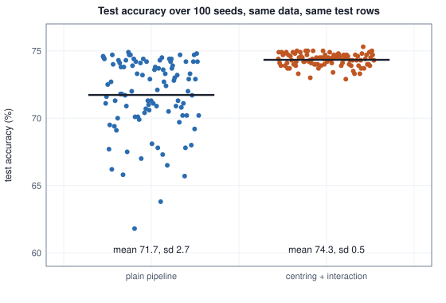
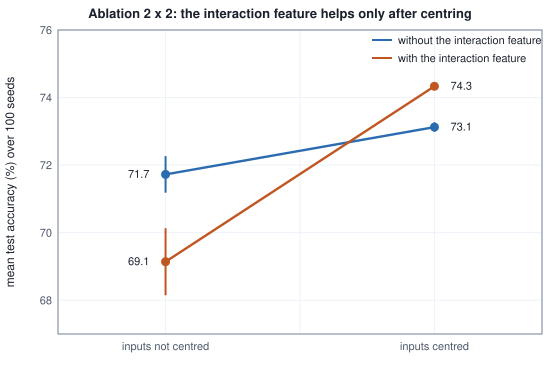

<!-- SPDX-License-Identifier: CC-BY-4.0 -->
<!-- Copyright (c) 2026 Martin Schröder <info@swedishembedded.com> -->

# Experiments, Baselines and Claims

*How do we run an experiment whose result we can believe and someone else can repeat?*

## The problem

A colleague reports: "my new feature transform improves accuracy by 1.2 points." The sentence is short and every word of it can be false. The accuracy may have been measured on a test set so small that 1.2 points is inside its noise. The two numbers may come from one training run each, and one run of a learning algorithm is one draw from a spread of possible outcomes. The "baseline" may have been run with a stale learning rate while the new method was tuned for a week. The transform may have been compared with a method nobody uses. The best of several runs, or the best of several metrics, may have been reported. The test set may have been used to choose among variants. And nobody else may be able to run it again and get the same numbers.

None of these needs bad faith. Each is what happens by default when the person who wants the result to be true is the person who runs the experiment. This chapter is about the habits that turn a number into a claim that can be checked: what to hold fixed, what to compare against, how much a result moves when nothing has changed, how large a difference has to be to matter, how to take a result apart, and what to write next to it.

To have something to measure, the chapter uses one small world for every experiment, so that every table can be compared with every other. The book plays the part of nature, which means the truth is known: the rule that generates the labels is written down, and the accuracy of that rule is the ceiling for every classifier.

A machine has four sensors. A reading is four numbers, each sitting at a resting level (the first two at $2$, the other two at $0$) plus a standard Gaussian wobble. The label, 0 or 1, is a noisy function of the wobbles of the first three sensors and of the product of the wobbles of the first two. A classifier sees only the four readings with the resting level included, learns from $200$ labelled rows, is tuned on $300$ others and is scored on $1000$ more.

<!-- worked: experiments.dataset_recipe -->
Generator: the book's SplitMix64, seed 0xdfe451e2438d6cc3 (16133109797385759939). One generator, rows drawn in order: 200 training rows, then 300 validation rows, then 1000 test rows. A row is four calls of `rng.normal()` (x1, x2, x3, x4, in that order), then one `rng.uniform()` u. The logit is z = 1.2 x1 - 0.8 x2 + 0.5 x3 + 0.6 x1 x2 (x4 has weight 0), the label is 1 when u < sigmoid(z) and 0 otherwise, and the reading a classifier sees is x plus the resting level (2, 2, 0, 0).

The first five training rows (readings rounded to 2 decimals):

| n | reading 1 | reading 2 | reading 3 | reading 4 | label |
|---|---:|---:|---:|---:|---:|
| 1 | 2.18 | 3.94 | -0.34 | 0.31 | 0 |
| 2 | 3.57 | 2.24 | -1.16 | 1.05 | 0 |
| 3 | 3.20 | 2.22 | 0.63 | -0.48 | 0 |
| 4 | 1.95 | 1.07 | 0.91 | 1.97 | 1 |
| 5 | 1.91 | 1.22 | -0.64 | -0.81 | 1 |

Share of label 1 in each part:

| part | rows | share of label 1 |
|---|---:|---:|
| training | 200 | 0.470 |
| validation | 300 | 0.520 |
| test | 1000 | 0.533 |

Average of each reading over the training rows (used for centring): 1.934, 2.098, -0.029, -0.069.
<!-- /worked -->

The learner is logistic regression (chapter 3) trained by stochastic gradient descent (chapter 2), one example per step, a fixed number of epochs. Its randomness comes from two places, the initial weights and the order in which the examples are visited, and the recipe fixes both streams from one run seed, one stream per purpose as Volume I, chapter 17, taught.

```text
function sgd_logistic(F: array<real>[N, p], y: array<int>[N], lr: real, epochs: int,
        run_seed: int) -> (array<real>[p], real):
    require N > 0 and p > 0 and epochs >= 1, "sgd_logistic: nothing to train on"
    init_rng = Generator(derive_seed(run_seed, "init"))      # one stream per purpose (Volume I, chapter 17)
    order_rng = Generator(derive_seed(run_seed, "order"))
    b = 0.5 * init_rng.normal()                              # the bias first, then the weights in feature order
    w = zeros(real, [p])
    for j in 0 .. p:
        w[j] = 0.5 * init_rng.normal()
    order = [i for i in 0 .. N]
    for epoch in 0 .. epochs:
        shuffle(order, order_rng)                            # continues from the order of the previous epoch
        for position in 0 .. N:
            i = order[position]
            s = 0.0
            for j in 0 .. p:
                s = s + w[j] * F[i, j]
            g = sigmoid(b + s) - y[i]                        # derivative of the loss with respect to the logit
            for j in 0 .. p:
                w[j] = w[j] - lr * (g * F[i, j])
            b = b - lr * g
    return (w, b)
```

Two feature pipelines feed it. The **plain** pipeline passes the four readings as they are. The **candidate** pipeline, the colleague's new transform, does two things: it subtracts each reading's average over the training rows (centring), and it appends the product of the first two centred readings (an interaction feature). Both are trained with learning rate $0.03$ for $3$ epochs. The claim is that the candidate is better by $1.2$ points of test accuracy. Here is what five runs say, each pipeline run from the same run seed:

<!-- worked: experiments.one_seed_claims -->
Generator: the book's SplitMix64, seed 0x62005bedda8f6496 (7061745292849144982). The run seed of run k is the raw draw number k (`next()`, counting from 0) of this generator. Each run trains on the 200 training rows with learning rate 0.03, 3 epochs, one example per step, and scores the same 1000 test rows. Both pipelines use the same run seed, so they start from the same initial weights and visit the examples in the same order.

| run | run seed | plain: test accuracy % | centring + interaction: test accuracy % | difference (points) |
|---:|---:|---:|---:|---:|
| 0 | 0x08b798ae9b79976f | 74.6 | 74.4 | -0.2 |
| 1 | 0xb90711d1585bd32f | 67.3 | 74.5 | +7.2 |
| 2 | 0x3867886c151bf1b1 | 74.3 | 74.6 | +0.3 |
| 3 | 0x3a6541ecc602b420 | 67.8 | 74.3 | +6.5 |
| 4 | 0xccfac44ab4c52316 | 71.0 | 74.4 | +3.4 |
<!-- /worked -->

Run 0 says the transform changes nothing ($-0.2$ points). Run 1 says it gains $7.2$ points. Runs 2, 3 and 4 say $+0.3$, $+6.5$ and $+3.4$. The data, the code and the test rows are identical in all five. Any one of these differences could have been written down as "the" result, and none of them is $1.2$. The chapter's job is to say what we can and cannot conclude from numbers like these.

## Before you begin

Six questions to answer from memory. The answers are at the end of the chapter. If one is hard, go back to the chapter named before reading on.

1. (Volume I, chapter 12, "Statistics", hypothesis tests.) Two models score $70.4\%$ and $71.2\%$ on the same $500$ questions and a test returns $p = 0.55$. What does that number say, and what does it not say about whether the models differ?
2. (Volume I, chapter 12, paired tests.) Why is the standard error of the gap between two models scored on the same questions smaller than for two models scored on different questions, and which questions carry the information in a paired comparison?
3. (Volume I, chapter 17, "Randomness on a Deterministic Machine", seeds and reproducibility.) Name the three things that must be the same for a run to be repeated exactly, and say what "one stream per purpose" buys you.
4. (Chapter 5, "Generalization", the test set.) A team tries a hundred variants, looks at the test score of each and reports the best. Why is that score too high, and what would an honest report need?
5. (Chapter 6, "Measuring Models", accuracy.) A screening model reaches $97\%$ accuracy on a task where $3\%$ of cases are positive. What simple predictor reaches the same accuracy?
6. (Chapters 2 and 3, gradient descent and logistic regression.) One example $\mathbf{x} = (1, 2)$ with label $y = 1$, weights $\mathbf{w} = (0.2, -0.1)$, bias $b = 0$, learning rate $0.1$. Compute one step of the update in the `sgd_logistic` function above.

## A controlled experiment

*What it is for: making sure that the only difference between the two things compared is the thing the claim is about.*

A claim of the form "B is better than A because of X" is a causal claim, and the only way to support a causal claim by an experiment is to change X and nothing else. An experiment built that way is a **controlled experiment**: everything that could influence the result is either held identical for both arms or varied in a way the analysis accounts for. The difficulty is in the word *everything*. Before running anything, it helps to write down a short card with one line for each place where the two arms could differ unnoticed:

| line of the card | what must be the same for A and B |
|---|---|
| data and split | the same training, validation and test rows, drawn once, never reshuffled to suit one arm |
| preprocessing | what is fitted on the training rows only (the centring means), applied to all three parts |
| model and recipe | the same learner, learning rate, epochs and batch size, unless the recipe itself is the thing under test |
| seeds | a stated number of seeds, the same ones for both arms, drawn before looking at any result |
| compute | the same training budget (steps, epochs, model size, wall time), reported with the result |
| tuning effort | the same number of tuning trials over the same ranges, on the validation set |
| metric and test use | the metric named in advance, the test set read once at the end |

The line most often broken is the sixth, so it comes first.

### Unequal tuning effort

Suppose the "new method" is not a method at all: it is the plain pipeline under a new name. The only thing the claimant adds is care. Method A is run with the learning rate $0.1$ of the recipe its original authors published. Method B is tuned: sixteen learning rates are drawn at random between $0.003$ and $0.3$ on a logarithmic scale, each is trained, the one with the best validation accuracy is kept, and its test accuracy is reported. Both methods are the same procedure, so the true difference is zero by construction. The table repeats the whole experiment on $100$ fresh datasets and records the gain that B would claim.

<!-- worked: experiments.tuning_effort -->
Generator: the book's SplitMix64, seed 0xc2465e08ab719904 (13998979883056863492). 100 repetitions from one generator. A repetition draws 200 training, 300 validation and 1000 test rows (recipe of the dataset), then one `next()` for A's fixed run (learning rate 0.1, 3 epochs), then B's 16 tries, then A's 16 tries; a try is u = `uniform()` (learning rate 0.003 x 100^u), then a run seed = `next()`. All runs use the plain pipeline, so A and B are the same method. A search keeps the try with the best validation accuracy (the earlier try on a tie) and reports its test accuracy; 'k tries' means the first k tries of that search. The difference is B minus A in points of test accuracy; standard error = sd (divisor n - 1) / sqrt(100); the interval is the 95% t interval over the repetitions, mean +- t SE with the multiplier 1.98422 (Student t, 99 degrees of freedom); the last column is the share of repetitions in which B's reported accuracy is at least 1.2 points above A's (at least 12 more correct answers on the 1000 test rows).

Mean test accuracy of A's fixed recipe over the repetitions: 69.9%.

| A gets | B gets | mean B - A (points) | standard error | 95% interval (points) | share with B ahead by 1.2 or more |
|---|---|---:|---:|---:|---:|
| A: its fixed recipe (learning rate 0.1) | B: 1 try | -1.33 | 0.64 | -2.59 to -0.06 | 0.27 |
| A: its fixed recipe (learning rate 0.1) | B: 4 tries | +1.80 | 0.37 | +1.08 to +2.53 | 0.48 |
| A: its fixed recipe (learning rate 0.1) | B: 16 tries | +2.16 | 0.36 | +1.45 to +2.88 | 0.52 |
| A: 4 tries | B: 4 tries | +0.18 | 0.17 | -0.15 to +0.52 | 0.23 |
| A: 16 tries | B: 16 tries | +0.00 | 0.15 | -0.30 to +0.30 | 0.22 |
<!-- /worked -->

When B is allowed four or sixteen tries and A keeps its published recipe, B reports a mean gain of $+1.80$ and $+2.16$ points. The interval for sixteen tries, $+1.45$ to $+2.88$, is far from zero, and in about half of the repetitions B claims at least the $1.2$ points of the colleague. Nothing in B is better; what differs is the effort spent finding a good setting for it. When both arms get the same number of tries, the mean gain is $+0.18$ for four tries each and $+0.00$ for sixteen each, with intervals that contain zero.

The first row of the table is also instructive. B with a single random try does worse than the published recipe ($-1.33$ points): tuning is not magic, it is a search, and a search with one trial is a lottery ticket. The gain comes from the maximum over the tries, and two arms with the same number of tries have maxima of the same kind.

There is a short argument for why equal effort repairs the comparison. Let each try of an arm produce a validation score and a test score. An arm with $k$ tries reports the test score of the try with the best validation score. If A and B draw their tries from the same distribution, then A's report and B's report have the same distribution too, whatever $k$ is, so their difference has mean zero. If B has more tries, its report comes from a better part of the same distribution and the difference does not have mean zero. The measurement was honest (the test set was read once per arm); the comparison was not.

```text
function tuned_test_score(data: Dataset, tries: int, rng: Generator) -> real:
    require tries >= 1, "at least one try"
    best_validation = -1.0
    reported = 0.0
    for t in 0 .. tries:
        lr = 0.003 * 100 ^ rng.uniform()               # log-uniform between 0.003 and 0.3
        run_seed = rng.next()
        model = train(data.train, lr, run_seed)
        v = accuracy(model, data.validation)
        if v > best_validation:                        # strictly: the earlier try wins a tie
            best_validation = v
            reported = accuracy(model, data.test)
    return reported
```

Tuning effort is one instance of a general rule: every degree of freedom the claimant controls and the baseline does not is a place for a difference to come from. Compute is another (a longer training run, a larger model), and the card above lists them so that they are chosen, not discovered.

## Baselines

*What it is for: giving the number a meaning, because an accuracy by itself says nothing about whether the model is good.*

"$74.3\%$" cannot be judged until we know what a model with no skill, a simple model and the best earlier model get on the same rows. A **baseline** is a method, run under the same protocol as the new one (same split, same metric, comparable tuning and care), whose result the new one has to beat to count as progress. A convincing experiment has several, in three kinds.

A **trivial** baseline uses no features: for classification, the majority class; for regression, the mean of the training targets; for a probability, the training share of the label. It sets the floor and catches the experiment that measures nothing (chapter 6: $97\%$ accuracy at a $3\%$ base rate). A **simple** baseline is a method from the earlier chapters, fitted properly: logistic regression to convergence (chapter 3), nearest neighbours or naive Bayes (chapter 7). It is the number a colleague could have produced in an afternoon, and the new method must beat it by enough to justify its complexity. The **previous best** is the strongest earlier method on the same task, tuned as carefully as the new method will be.

The ladder for the chapter's world follows. The two SGD rows average the $100$ runs of the seed section; the other methods are deterministic given the training rows.

<!-- worked: experiments.baseline_ladder -->
Every row is scored on the same 1000 test rows except the last. A classifier with a logit z predicts label 1 when z >= 0 and label 0 otherwise. The interval is the Wald interval of the accuracy a (Volume I, chapter 12): a +- 1.96 sqrt(a (1 - a) / n), with n the number of rows scored (1000, or 20,000 in the last row), shown in points. For the two SGD rows a is the average accuracy over the 100 paired seeds of the seed table and n is 1000; accuracy and log loss are each averaged over the seeds. Log loss is the mean negative log-likelihood in nats of the predicted probability (Volume II, chapter 4), shown where the model outputs one; for the majority class it is the loss of the constant probability equal to the training share of label 1.

Majority class: predict the more frequent label of the training rows (label 0 if the shares are equal). Naive Bayes (Volume II, chapter 7) on the four raw readings: per class the average and the variance with divisor N_c of each reading, the prior equal to the class's share of the training rows, no smoothing; predict 1 when the log score of class 1 is strictly greater than that of class 0. k nearest neighbours: readings standardised by the training average and standard deviation (divisor N), Euclidean distance, ties in distance broken by the lower training row index, a vote of the k nearest rows (predict 1 when more than k/2 of them have label 1), k chosen from (1, 5, 15, 31, 61, 101) by the best validation accuracy, the smaller k on a tie. Convergence: Newton's method (Volume I, chapter 7) on the logistic loss: from all-zero parameters (weights and bias), each step solves H step = g by Gaussian elimination with partial pivoting, where g and H are the gradient and the Hessian of the loss summed over the training rows (the Hessian is X^T S X of Volume II, chapter 3, with lambda added on the diagonal for each weight when the row has a penalty; the parameters are the weights followed by the bias), and subtracts the step from the parameters; at most 30 steps, stopping after a step whose largest absolute parameter change is below 1e-10. The previous best uses the four centred readings and their ten products x_i x_j with i <= j (14 features), and minimises the summed training log loss plus (lambda / 2) times the sum of the squared weights (the objective J_L2 of Volume II, chapter 4; the bias is not penalised), with lambda from {0, 0.1, 1, 10} chosen by the best validation accuracy, the smaller lambda on a tie. Validation accuracy % by lambda: 0: 75.0, 0.1: 75.0, 1: 75.0, 10: 74.0.

| method | test accuracy % | 95% interval (accuracy %) | log loss |
|---|---:|---:|---:|
| majority class (the training share of label 1 is 0.470) | 46.7 | 43.6 to 49.8 | 0.699 |
| naive Bayes (Gaussian) | 72.6 | 69.8 to 75.4 | - |
| k nearest neighbours, k = 31 chosen on validation | 70.9 | 68.1 to 73.7 | - |
| logistic regression to convergence, raw readings | 73.3 | 70.6 to 76.0 | 0.528 |
| lab baseline: logistic regression by SGD, plain (mean of 100 seeds) | 71.7 | 68.9 to 74.5 | 0.547 |
| candidate: SGD with centring + interaction (mean of 100 seeds) | 74.3 | 71.6 to 77.0 | 0.522 |
| previous best: logistic regression on all products, L2 0 chosen on validation | 73.8 | 71.1 to 76.5 | 0.542 |
| the rule that generated the labels, on these 1000 rows | 73.7 | 71.0 to 76.4 | - |
| the same rule on 20,000 fresh rows (the ceiling) | 74.5 | 73.9 to 75.1 | - |

The last row is the true logit rule, 'predict 1 when the true logit z of the row is at least 0', on 20,000 fresh rows. Generator: the book's SplitMix64, seed 0x66512cc854f215b9 (7372723303912445369). The rows come from this one generator in the recipe of the dataset: for each row four calls of `rng.normal()`, then one `rng.uniform()`, with the same logit and label rule. The accuracy of this row is itself an estimate: its Wald interval has half-width 0.6 points, so it is a measurement of the ceiling and not the ceiling itself.
<!-- /worked -->


Read it from the bottom. The majority class scores $46.7\%$, below a coin flip. That is not a mistake in the code: the training rows contain $47.0\%$ of label 1, so the majority class is label 0, and the test rows contain $53.3\%$ of label 1. A trivial baseline is itself an estimate from a sample, and the one that shortcuts it (take the majority from the rows being scored) would flatter it. Its log loss is $0.699$ nats, a little above $\ln 2 = 0.693$, which is the log loss of knowing nothing, for the same reason.

Everything with features lies between $70.9\%$ and $74.3\%$, and every interval is about $5.5$ points wide, so the test set alone cannot rank them. Within that band the rungs matter for the claim. The lab's baseline, SGD on the plain readings, reaches $71.7\%$ on average over seeds. Logistic regression fitted to convergence on the same readings reaches $73.3\%$, $1.6$ points higher, with no tuning at all, only a loop that runs until the gradient is zero instead of for three epochs. The previous best, all products of the centred readings with a penalty chosen on validation, reaches $73.8\%$. The candidate averages $74.3\%$. Against the ceiling, $74.5\%$ in the last row of the table (the accuracy of the true rule on twenty thousand fresh rows from the generator printed under the table), there is almost nothing left to gain.

So the size of the improvement depends entirely on which baseline is named. The candidate's mean gain is $+2.6$ points over the lab's baseline, $+1.0$ over the converged model and $+0.5$ over the previous best. The colleague's $1.2$ points could be a true statement about the converged model and a false one about the lab's baseline and the previous best, and a paper that reports only the lab's baseline is making the largest claim the data allow. A strong baseline is the most important number in a report because every improvement is a difference with it. Beating a weak baseline is easy and says little; the result is only as strong as the strongest thing it was compared with.

Two cautions come with the ladder. First, a baseline must be treated as carefully as the method. The lab baseline is a logistic regression stopped early at an ill-conditioned starting point; the converged one is the same model finished. Reporting the first as "the baseline" compares the candidate with a handicapped version of the best-known method. Second, the ceiling is measured too. The true rule scores $73.7\%$ on the $1000$ test rows and $74.5\%$ on twenty thousand others, and that second number has an interval of its own, $\pm 0.6$ points: it is a measurement of the ceiling and no more precise than that. On this test set a model can score above the true rule by luck, and a gap of a point on $1000$ rows is not evidence of anything. Knowing the ceiling is what tells us whether a claimed improvement has room to be real.

## Seeds: how much a run moves when nothing changes

*What it is for: measuring the noise of the training procedure itself, which a single run cannot show.*

The five runs of the problem section differed in nothing but the run seed, and the plain pipeline's accuracy ranged from $67.3\%$ to $74.6\%$. To measure that spread properly, run it many times. Here are $100$ seeds, the same data and the same test rows each time, so every difference in the table is the seed's alone (the initial weights and the order of the examples):

<!-- worked: experiments.seed_spread -->
Generator: the book's SplitMix64, seed 0x62005bedda8f6496 (7061745292849144982). Run seed k is the raw draw k of this generator (`next()`, counting from 0); the 100 paired runs use draws 0 .. 99 for both pipelines, the partner runs of the different-seeds comparison use draws 100 .. 199 for the candidate. Same data, same recipe (learning rate 0.03, 3 epochs); the test set is the same 1000 rows every time, so every difference below comes from the seed (initial weights and data order) alone. Standard deviations use the divisor n - 1. 'Ahead by 1.2 or more' means at least 12 more correct answers out of 1000. The correlation is the Pearson correlation of the 100 paired accuracies.

| pipeline | mean test accuracy % over 100 seeds | standard deviation (points) | lowest % | highest % | range (points) |
|---|---:|---:|---:|---:|---:|
| plain | 71.72 | 2.73 | 61.8 | 74.9 | 13.1 |
| centring + interaction | 74.33 | 0.48 | 72.9 | 75.3 | 2.4 |

Correlation over the seeds between the two pipelines' accuracies at the same seed: 0.198.

| comparison (100 pairs) | mean of B - A (points) | standard deviation of B - A (points) | share of pairs with B ahead | share with A ahead | share with B ahead by 1.2 or more |
|---|---:|---:|---:|---:|---:|
| one run each, different seeds | +2.68 | 2.78 | 0.86 | 0.12 | 0.62 |
| one run each, the same seed | +2.61 | 2.68 | 0.85 | 0.13 | 0.61 |
<!-- /worked -->



The plain pipeline moves over $13.1$ points depending on the seed, with a standard deviation of $2.73$ points. Its worst seed is $61.8\%$ and its best $74.9\%$. The candidate moves over $2.4$ points, standard deviation $0.48$. Part of what the candidate buys is stability: three epochs of SGD land in nearly the same place whatever the start (the ablation below suggests why).

This is the number a claim lives or dies by. A single comparison of one run of each is a draw from the distribution of the difference, whose standard deviation is $2.78$ points when the two runs have independent seeds. Look at the right-hand table. With a true mean gain of $+2.7$ points, a single pair of runs shows the candidate ahead in $86$ of $100$ pairs and behind in $12$. It shows a gain of at least the claimed $1.2$ in $62$ pairs, and it would sometimes have shown several points of loss. A researcher who runs once and reports what came out is reporting an outcome that depends mainly on the seed. This is the hidden luck of Volume I, chapter 17, measured on a task with real data and a real metric: hard-coding a seed makes the luck repeatable, and does not make it go away.

**Paired seeds.** Volume I, chapter 17, introduced common random numbers: give both arms the same seed, so that what they share (here the bias draw, the first four initial weights and the order in which examples are visited) cancels from the difference. The variance of a difference is

$$
\mathrm{Var}[B - A] = \mathrm{Var}[A] + \mathrm{Var}[B] - 2\,\rho\,\mathrm{sd}[A]\,\mathrm{sd}[B],
$$

where $\rho$ is the correlation between the two arms' scores over seeds. Here $\rho = 0.198$, so the standard deviation of the difference falls only from $2.78$ to $2.68$ points: $2.73^2 + 0.48^2 - 2 \times 0.198 \times 2.73 \times 0.48 = 7.16$, whose square root is $2.68$. Pairing helps when the arms' noise is shared; here almost all of the noise is the plain arm's own instability, which the shared seed does not remove. Pairing costs nothing and never hurts, and the paired mean difference is the better estimate, but it is not a substitute for many seeds.

**How many seeds.** The mean of the per-seed difference has standard error $s_D/\sqrt{n}$ (Volume I, chapter 12), and with $s_D = 2.68$ and $n = 100$ the $95\%$ interval for the gain is $+2.08$ to $+3.14$ points, a half-width of $0.53$ (the Student $t$ multiplier for $99$ degrees of freedom, $1.98422$, times the standard error $0.268$; the Gaussian $1.96$ would give $+3.13$ for the upper end). To halve it, quadruple the seeds. To resolve a gain of half a point against this noise takes about $(1.96 \times 2.68 / 0.5)^2 \approx 110$ seeds. The cost of a seed is the cost of a training run, so the number is decided against the size of the effect that matters (the next section), not by what is convenient, and it is reported.

The seeds are also part of the experiment card. The run seeds come from one printed generator and are fixed before any result is seen; the experiment reports all of them, not the best; and each run's initial weights and data order come from derived streams, so adding a feature to one arm does not shuffle the data order of the other (Volume I, chapter 17).

## Effect size and significance

*What it is for: separating "is there a difference" from "is the difference worth anything".*

A hypothesis test (Volume I, chapter 12) answers one question: could chance alone produce a difference this large? It does not say how large the difference is. The **effect size** is the difference itself, in the units of the metric: $+2.6$ points of accuracy. It is what decides whether a result matters, and an experiment reports it with its interval. For paired data there is also a **standardised effect**, the mean difference divided by the standard deviation of the differences, $\bar{D}/s_D$, which has no units and so can be compared across metrics and tasks.

The relation between the effect and the test statistic is exact. The paired $z$ statistic is $\bar{D}/(s_D/\sqrt{n})$, which is

$$
z = \frac{\bar{D}}{s_D}\,\sqrt{n}.
$$

At a fixed standardised effect, $z$ grows with the square root of the number of examples $n$, without bound. A difference that is real but tiny becomes significant once $n$ is large enough, and a difference that is large can stay insignificant while $n$ is small. The first value of $n$ at which the expected $z$ reaches $1.96$ is $(1.96/(\bar{D}/s_D))^2$. When every difference $D_i$ is $0$ the standard deviation $s_D$ is $0$ and $z$ has no value; the book defines $z = 0$ then, so that an experiment in which the two models never disagree counts as not significant.

To see it with numbers, take two models and give each question four outcomes: both right, only A right, only B right, both wrong. In the tiny-effect scenario B gains $0.3$ points over A; in the large-effect scenario it gains $6$. For each size $n$ the table draws one sample of $n$ questions and reports the paired statistic of Volume I, chapter 12.

<!-- worked: experiments.effect_vs_n -->
Generator: the book's SplitMix64, seed 0x6bd1da19bce40a98 (7769230636268915352). One generator, the tiny-effect scenario first and then the large-effect one; within a scenario the sizes in the order of the table, each size a fresh sample. A question is one `rng.uniform()` u: both right if u is below p11, only A right if below p11 + p10, only B right if below p11 + p10 + p01, else both wrong. D = +1 when only B is right, -1 when only A is. D-bar is the mean of D, SE is s_D / sqrt(n) (s_D with divisor n - 1), z = D-bar / SE, p is the two-sided Gaussian area outside |z|, the interval is D-bar +- 1.96 SE, and the last column is D-bar / s_D (the standardised effect). When s_D = 0 (every D is 0) the statistic has no value: the book sets z = 0, p = 1 and D-bar / s_D = 0, so the experiment counts as not significant.

Scenario 'tiny effect': p11 = 0.7, p10 = 0.03, p01 = 0.033, p00 = 0.237. True gain of B over A: +0.30 points; true standardised effect 0.0120; the n at which the expected z reaches 1.96 is (1.96 / 0.0120)^2 = 26,887.

| n | only A right | only B right | gain D-bar (points) | SE (points) | 95% interval (points) | z | p | D-bar / s_D |
|---:|---:|---:|---:|---:|---:|---:|---:|---:|
| 50 | 3 | 0 | -6.00 | 3.39 | -12.65 to +0.65 | -1.77 | 0.0770 | -0.2501 |
| 200 | 2 | 10 | +4.00 | 1.71 | +0.64 to +7.36 | 2.33 | 0.0195 | 0.1651 |
| 1,000 | 34 | 25 | -0.90 | 0.77 | -2.41 to +0.61 | -1.17 | 0.2412 | -0.0371 |
| 5,000 | 162 | 167 | +0.10 | 0.36 | -0.61 to +0.81 | 0.28 | 0.7828 | 0.0039 |
| 20,000 | 606 | 668 | +0.31 | 0.18 | -0.04 to +0.66 | 1.74 | 0.0824 | 0.0123 |
| 100,000 | 2998 | 3414 | +0.42 | 0.08 | +0.26 to +0.57 | 5.20 | 0.0000 | 0.0164 |

Scenario 'large effect': p11 = 0.7, p10 = 0.04, p01 = 0.1, p00 = 0.16. True gain of B over A: +6.00 points; true standardised effect 0.1625; the n at which the expected z reaches 1.96 is (1.96 / 0.1625)^2 = 146.

| n | only A right | only B right | gain D-bar (points) | SE (points) | 95% interval (points) | z | p | D-bar / s_D |
|---:|---:|---:|---:|---:|---:|---:|---:|---:|
| 50 | 0 | 6 | +12.00 | 4.64 | +2.90 to +21.10 | 2.58 | 0.0097 | 0.3656 |
| 200 | 6 | 21 | +7.50 | 2.55 | +2.50 to +12.50 | 2.94 | 0.0033 | 0.2080 |
| 1,000 | 36 | 104 | +6.80 | 1.16 | +4.52 to +9.08 | 5.84 | 0.0000 | 0.1847 |
| 5,000 | 204 | 502 | +5.96 | 0.52 | +4.93 to +6.99 | 11.36 | 0.0000 | 0.1606 |
| 20,000 | 786 | 1998 | +6.06 | 0.26 | +5.55 to +6.57 | 23.28 | 0.0000 | 0.1646 |
| 100,000 | 4000 | 9967 | +5.97 | 0.12 | +5.74 to +6.20 | 51.15 | 0.0000 | 0.1617 |
<!-- /worked -->


For the tiny effect the standardised effect is $0.0120$, and the expected $z$ reaches $1.96$ at $n = 26{,}887$ questions. The table agrees: at $20{,}000$ questions the draw has $p = 0.0824$ and the interval $-0.04$ to $+0.66$ still contains zero, and at $100{,}000$ the gain is $+0.42$ points with $z = 5.20$. A result significant at five standard errors, for a difference of less than half a point of accuracy.

Each row is one draw, and one draw is exactly what the seed section warned about. In the tiny-effect table at $n = 200$ the sample happens to show a gain of $+4.00$ points with $p = 0.0195$, although the truth is $+0.30$. To see what a given $n$ typically does, repeat the experiment $300$ times at each size:

<!-- worked: experiments.significance_repeated -->
Generator: the book's SplitMix64, seed 0xc4259df40cdf440f (14133876677085709327). The two scenarios of the previous table, the tiny effect first; within a scenario the sizes n = 50, 200, 1000 in turn, each 300 repeated experiments in a row, an experiment being n questions drawn as before (one `rng.uniform()` each). 'Expected z' is (true standardised effect) x sqrt(n). 'Significant' means z > 1.96 (a two-sided p below 0.05 with B ahead); an experiment with s_D = 0 (every D is 0) is given z = 0 and is not significant. s_D uses the divisor n - 1. The mean gain over the significant ones is shown as - when none is significant.

| scenario | n | expected z | share of 300 experiments significant | mean gain over all (points) | mean gain over the significant ones (points) | true gain (points) |
|---|---|---:|---:|---:|---:|---:|
| tiny effect | 50 | 0.08 | 0.01 | +0.04 | +8.00 | +0.30 |
| tiny effect | 200 | 0.17 | 0.05 | +0.39 | +4.32 | +0.30 |
| tiny effect | 1,000 | 0.38 | 0.09 | +0.30 | +1.85 | +0.30 |
| large effect | 50 | 1.15 | 0.15 | +5.45 | +12.55 | +6.00 |
| large effect | 200 | 2.30 | 0.60 | +5.76 | +7.33 | +6.00 |
| large effect | 1,000 | 5.14 | 1.00 | +6.01 | +6.01 | +6.00 |
<!-- /worked -->

With the large effect and $50$ questions the expected $z$ is $1.15$, and only $0.15$ of the experiments reach significance, so $85\%$ of the time an honest experiment of that size misses a gain of six points. The experiments that do reach it report a mean gain of $+12.55$ points, twice the truth: the winner's curse of chapter 5, because to cross the line at $n = 50$ the sample has to overshoot. At $1000$ questions all $300$ are significant and the mean is the truth. For the tiny effect, at $1000$ questions $0.09$ of the experiments are "significant", and those report $+1.85$ points, six times the truth. So a significant result from a small sample is a biased estimate of the effect as well as a noisy one, and "not significant" from a small sample is not evidence of no effect.

Two habits follow. State in advance the smallest gain that would matter (the promotion gate described in the last section of this chapter, "Where this appears in brain", has such a floor) and judge the interval against it: a gain whose whole interval lies above zero but below the floor is a finding about the method and not a reason to adopt it. And say what the number of examples was, because $p$ without $n$ cannot be interpreted.

## Ablations

*What it is for: finding out which part of a new method is responsible for its gain.*

A new method is usually several changes at once. The candidate has two: centring and the interaction feature. The colleague's claim, as written, attaches the whole gain to "the transform". An **ablation** takes the full system apart: remove one component, or add one component, retrain under the same protocol and the same seeds, and compare. With two components the complete set of experiments is a $2 \times 2$ table of four pipelines, and the paired seeds of the previous sections turn it into four columns of $100$ runs.

<!-- worked: experiments.ablation_table -->
The 100 paired runs of the seed table: the four pipelines are trained with the same 100 run seeds and scored on the same 1000 test rows. Standard error = sd (divisor n - 1) / sqrt(100); intervals are mean +- t SE, 95% t intervals with the multiplier 1.98422 (Student t, 99 degrees of freedom) of the per-seed values.

| pipeline | centring | interaction | mean test accuracy % | standard error (points) | 95% interval (accuracy %) |
|---|---|---|---:|---:|---:|
| plain | no | no | 71.72 | 0.27 | 71.18 to 72.27 |
| interaction only | no | yes | 69.14 | 0.50 | 68.15 to 70.13 |
| centring only | yes | no | 73.12 | 0.07 | 72.98 to 73.27 |
| centring + interaction | yes | yes | 74.33 | 0.05 | 74.24 to 74.43 |

Paired differences over the seeds (points of accuracy):

| change | mean difference (points) | standard error | 95% interval |
|---|---:|---:|---:|
| add the interaction to the plain pipeline | -2.58 | 0.36 | -3.30 to -1.87 |
| add the interaction to the centred pipeline | +1.21 | 0.05 | +1.10 to +1.32 |
| add centring to the plain pipeline | +1.40 | 0.26 | +0.89 to +1.91 |
| add centring to the pipeline with the interaction | +5.19 | 0.51 | +4.19 to +6.20 |
| remove the interaction from the full pipeline | -1.21 | 0.05 | -1.32 to -1.10 |
| remove centring from the full pipeline | -5.19 | 0.51 | -6.20 to -4.19 |
| remove both from the full pipeline | -2.61 | 0.27 | -3.14 to -2.08 |

Interaction contrast per seed, (full - centring only) - (interaction only - plain): mean +3.79 points, standard error 0.36, 95% interval +3.07 to +4.52. Sum of the two removal losses 6.40 points against the loss of removing both 2.61 points.
<!-- /worked -->



The table contradicts the colleague's story. The interaction feature added to the plain pipeline makes things worse, by $2.58$ points (interval $-3.30$ to $-1.87$). Centring alone helps by $1.40$ points. Together they reach $74.33\%$, which is $2.61$ points above the plain pipeline. The parts **interact**: the effect of one depends on the level of the other. Adding the interaction feature to a centred pipeline gains $+1.21$ points, adding it to an uncentred one loses $2.58$; adding centring to the plain pipeline gains $1.40$ points, adding it to the pipeline with the interaction gains $5.19$. The interaction contrast, the difference between the two effects of the feature, is $+3.79$ points with an interval of $+3.07$ to $+4.52$ over the seeds.

A mechanism, flagged as a likely explanation and not a proof. The product of two uncentred readings is nearly a linear combination of the readings themselves, as the correlations show:

<!-- worked: experiments.product_correlations -->
Pearson correlation coefficient over the 200 training rows (the training means are those of the dataset table).

| pair of features | correlation |
|---|---:|
| raw product against raw reading 1 | +0.692 |
| raw product against raw reading 2 | +0.615 |
| centred product against centred reading 1 | +0.100 |
| centred product against centred reading 2 | -0.207 |
<!-- /worked -->

Three epochs of SGD on features that are this strongly correlated, with a bias that must absorb the resting level, move slowly along the poorly conditioned direction and noisily along the others (chapter 2's condition number). Centring removes most of the correlation and the new feature becomes a separate direction that the optimiser can use. The ablation says what is true (the two parts help only together); the correlations suggest why.

The wrong way to read the table is the one-at-a-time removal that most ablation tables use. Removing the interaction from the full pipeline costs $1.21$ points; removing centring costs $5.19$; the two losses add up to $6.40$ points, yet removing both costs only $2.61$. An attribution table that says "centring is worth $5.19$ points and the interaction $1.21$" describes losses that cannot be added, because each depends on the other being present. When components interact, report the grid, say which cells were run, and do not hand out shares of the gain.

Ablations multiply the number of runs: $r$ components give $2^r$ cells for a complete factorial, each of them over all the seeds. Often the budget allows only the full system and each single removal. That is a legitimate design provided the claim is limited to what it measures ("removing centring costs $X$ from the full system") and the possibility of an interaction is stated.

## Reporting uncertainty

*What it is for: letting the reader judge the claim, by giving them the noise, the budget and the choices behind the number.*

**Reporting uncertainty** means writing next to every result the quantities that say how far to trust it. There are two sources of noise to account for, and they are different. The first is the training randomness: how much the number would move if the model were trained again from another seed, on the same data. The second is the sample of test examples: how much it would move if another set of examples had been drawn. Volume I, chapter 12, separated them, and chapter 6 ended by saying that intervals over the test sample do not include the variation from retraining. Both can be computed, and neither contains the other.

<!-- worked: experiments.report_card -->
Candidate: centring + interaction, SGD, learning rate 0.03, 3 epochs, 100 seeds (the paired runs of the seed table), test set of 1000 rows, tuned on nothing. For each baseline the per-example difference D = (candidate's share of the 100 seeds that classify the example correctly) - (the baseline's correct, 0 or 1; for the plain SGD baseline also its share of seeds). Gain = mean of D in points. 'Test-sample interval' is gain +- 1.96 SE with SE = s_D / sqrt(1000) (divisor n - 1): the uncertainty from having only 1000 test rows, for the seed-averaged models. 'Seed interval' is the 95% t interval of the per-seed gain over the 100 paired seeds (mean +- 1.98422 SE, 99 degrees of freedom): the uncertainty from the training randomness, on these 1000 rows.

| baseline | gain of the candidate (points) | seed interval (points) | test-sample interval (points) |
|---|---:|---:|---:|
| plain pipeline (same SGD recipe) | +2.61 | +2.08 to +3.14 | +1.54 to +3.68 |
| logistic regression to convergence, raw readings | +1.03 | - | -0.22 to +2.29 |
| previous best (all products, L2 by validation) | +0.53 | - | -0.89 to +1.96 |
<!-- /worked -->

The candidate against the lab's baseline gains $+2.61$ points. The seed interval, $+2.08$ to $+3.14$, says how much the gain moves with the seed on these test rows, and the test-sample interval, $+1.54$ to $+3.68$, says how much it moves with the choice of $1000$ test rows. The second is twice as wide as the first, a general lesson: the standard error from the test sample does not shrink by running more seeds, and the interval from the seeds does not shrink by buying a larger test set. Each needs its own remedy.

Against logistic regression fitted to convergence the gain is $+1.03$ points and the test-sample interval is $-0.22$ to $+2.29$. It contains zero and it contains the colleague's $1.2$. Against the previous best it is $+0.53$ with an interval of $-0.89$ to $+1.96$. With these data the honest summary of the claim is: the candidate is clearly better than a lab baseline that is not run to convergence, and not distinguishable from properly fitted logistic regression on a test set of this size. The two seed intervals are shown only for the SGD comparison because the converged models have no seed.

Here is the checklist, as prose, of what a result is reported with.

*What was compared.* Name every arm, with its recipe, and say which baselines were run by the authors and which were copied from elsewhere. A copied number is a number from another protocol.

*How many seeds, which ones.* State the number of seeds and how they were produced, and report the mean with the standard error or an interval over seeds, not the best seed. If one seed was used because the run is too expensive, say that the seed noise is unmeasured.

*How many test examples.* Give $n$, and an interval for the metric that accounts for the test sample (Wald, Volume I, chapter 12, or a bootstrap for metrics such as F1 or AUC, chapter 6). For a comparison, give the interval of the paired difference, not two separate intervals.

*What was tuned, on which split, with what budget.* Say which hyperparameters were searched, over what ranges, with how many trials, for each arm, and that the choice was made on the validation set. The test set was read once, at the end.

*How many things were tried.* Every variant, metric and seed that was run, not only those that appear in the table. A result that is the best of twenty is judged against twenty (Volume I, chapter 12, multiple comparisons).

*What was decided in advance.* The metric, the margin that matters and the number of seeds, written before the run.

*What would let someone repeat it.* The data split, the seeds, the code version and the command, recorded with the result. A number whose recipe is lost can neither be defended nor discarded.

An honest results sentence for this chapter's claim reads: "Against logistic regression fitted to convergence on the same $200$ training rows, the candidate gains $1.0$ point of test accuracy (95% interval from the $1000$ test rows: $-0.2$ to $+2.3$; averaged over $100$ seeds, whose accuracies have a standard deviation of $0.48$ points); nothing was tuned; the claimed gain of $1.2$ points is not established."

## Four ways to manufacture a win

*What it is for: recognising, in other people's work and in one's own, how a method with no advantage ends up with a table that says it has one.*

The experiments so far each showed one thing going right or wrong. Here they are together. Take A and B to be the same method, so the true gain is zero, and measure what each protocol reports over $60$ repetitions on fresh data (each repetition draws its own rows, as in the tuning table):

<!-- worked: experiments.failure_modes -->
Generator: the book's SplitMix64, seed 0xf5c304c2877ed38c (17709003393294324620). 60 repetitions from one generator. A repetition draws 200 training, 300 validation and 1000 test rows, then 10 run seeds for A and 10 for B (one `next()` each), then one more `next()` for the long run of the last row. A and B are the same method: the plain pipeline, learning rate 0.03, 3 epochs, except in the last row, where B uses 12 epochs. 'Best' means the highest test value. In the metric row the claimed gain is the largest of the three differences (accuracy; F1 = 2 TP / (2 TP + FP + FN) of label 1 with a positive decision when the logit is at least 0, and 0 when TP = 0; area under the ROC curve = the share of (label 1, label 0) pairs in which the label 1 row has the larger logit, a tie counting one half), each in points, for the first seed of each method (chapter 6 defines the metrics). Standard error = sd (divisor n - 1) / sqrt(60). The last column is the share of repetitions in which the reported gain is at least 1.2 points (a tolerance of 1e-9 on the comparison; for accuracy that means 12 more correct answers).

| protocol | mean reported gain of B over A (points) | standard error | share of repetitions with gain >= 1.2 |
|---|---:|---:|---:|
| one run each, accuracy fixed in advance | -0.52 | 0.35 | 0.20 |
| B reports its best of 10 seeds, A its first | +1.61 | 0.25 | 0.42 |
| both report their best of 10 seeds | +0.02 | 0.06 | 0.03 |
| B reports the best of accuracy, F1 and AUC | +1.93 | 0.34 | 0.52 |
| B trains 4 times as long (12 epochs against 3) | +0.04 | 0.34 | 0.22 |
<!-- /worked -->

The first row is the honest single comparison with a metric named in advance. Its mean reported gain is $-0.52$ points with a standard error of $0.35$, so the interval of two standard errors on either side contains zero and zero is the answer; yet in $20\%$ of the repetitions the table shows $1.2$ points or more by seed luck alone. The rest are protocols that look reasonable and are not.

*Cherry-picked seeds.* B reports its best of ten seeds on the test set, A its first: $+1.61$ points reported for no gain, with $42\%$ of the repetitions at $1.2$ or more. The selection is test-set reuse (chapter 5) with the seed as the variant. When both report their best of ten the gain is $+0.02$ with a standard error of $0.06$: the cure is symmetric effort, or better, the mean over all seeds.

*Metric shopping.* B reports whichever of accuracy, F1 and area under the ROC curve (chapter 6) favours it most: $+1.93$ points, with $52\%$ of the repetitions at $1.2$ or more, from the same single pair of runs. Each metric is a different noisy measurement of the same pair of models, and the maximum of three noisy gains is not a gain. The metric belongs on the experiment card before the run.

*Unequal compute.* B trains four times as long. In this world that buys nothing on average ($+0.04$ points, standard error $0.34$, and $22\%$ of the repetitions at $1.2$ or more against $20\%$ in the first row), so this row manufactures no win. It stays on the list because it does elsewhere: where the shorter run is still under-trained, the longer one wins for real, and the win would be credited to the method if the budget were not stated. Under a fixed training budget the comparison is between methods; without it, between budgets. The same holds for model size and for the number of tuning trials, as in the first table.

*Unequal tuning* was the first table. Together these protocols are the large part of what separates results that replicate from results that do not.

## Making it work

**Write the protocol before the run.** The card of the controlled-experiment section, the metric, the margin that matters, the number of seeds and the baselines, are written down first. Choices made after seeing the numbers are tuned on the test set whether or not the test set was touched.

**Include a baseline that could embarrass you.** Run the strongest simple method you can think of and the trivial one, with the same care. If the new method does not beat the simple one by more than the noise, that is the result.

**Control the unit of repetition.** Seeds vary the training; they do not vary the data. If the claim is about a distribution of datasets, the dataset has to be resampled too (the tuning table did that: each repetition drew its own rows). A single fixed test set gives the same answer to every seed about its own idiosyncrasies.

**Record the run in the result.** Seed, commit, configuration and command belong in the artifact next to the numbers, so a later reader can tell whether a difference is a change in the method or only in the run.

**Report what failed.** A negative or inconclusive ablation is a finding. The cost of omitting it is that the next person repeats it.

**Common mistakes.**

- *Reading a single seed as the result.* The seed table shows differences of $-0.2$ to $+7.2$ points between the same two pipelines.
- *Comparing with a baseline that nobody would choose.* The gain shrinks from $2.6$ to $0.5$ points along the ladder.
- *Calling a significant result important.* With enough examples a gain of $0.42$ points has $z = 5.2$ (the tiny-effect table at $100{,}000$ questions).
- *Calling an insignificant result unimportant.* At $50$ questions an honest test misses a six-point gain in $85\%$ of experiments.
- *Reporting a one-at-a-time ablation as an attribution of shares.* Interacting parts do not add.
- *Reporting the better of two runs.* The best of ten seeds against one is worth $+1.61$ points for nothing (the failure table).

## Where this appears in brain

**The architecture battery.** `crates/bench` is brain's harness for asking "does this architecture learn this task". A `Benchmark` (`crates/bench/src/lib.rs`) owns its dataset and its scoring and carries a pass threshold; `crates/bench/src/eval.rs` runs the whole battery against one architecture of the registry in `crates/bench/src/arch.rs` and writes a JSON artifact that records the seed, the commit and whether it was the reduced "smoke" run, so that the `compare` view can show them beside the scores. `crates/bench/src/axes.rs` averages benchmark scores into capability axes. Read by the standards of this chapter it is a controlled design at the level of the protocol: every architecture goes through the same benchmark code, the same generated data and the same decoder interface. It is a single-seed design at the level of the numbers, since one artifact is one seed, so a gap of a few points between two architectures on the leaderboard is a gap between two draws until the artifacts are repeated over seeds. The compare view prints the seed row for that reason.

**Seed noise discovered by a failing benchmark.** Commit `d46730061` (June 2026) records the moment the suite hit this. The message says that the modular-addition probe scored $0.0189$, below chance, on one seed and about $0.7$ on two others, and that the grokking behaviour it probes is too variable for a hard pass/fail bar. The commit added the `informational` flag to the `Benchmark` trait: a benchmark with that flag is reported against its threshold as a reference line and never fails the suite. The doc comment of `informational` in `crates/bench/src/lib.rs` states the rule in the chapter's terms, for tasks "whose single-run result is inherently high-variance". Two things are worth noticing. The commit also switched the default configuration to a smaller one and reports its score on $0.79$ for the one seed that had failed; with the seed table in mind, that is evidence about one draw. And the lesson the commit drew, to stop gating on a quantity whose spread was not known, is the right one.

The fixed seed is the other side of the same coin. Commit `399d768af` (October 2026) made the benchmark configurations draw a random seed when none is given, with `crates/bench/tests/it/default_seed.rs` asserting that two default configurations get different seeds, so unseeded runs are independent samples. Tests that need a fixed seed keep one with a reason, and the reasons read like the chapter: `crates/bench/tests/it/scaling.rs` says the loss-versus-size ordering "has a fixed noise tolerance tuned on this seed", and `crates/bench/tests/it/capscale.rs` says its grid "was only validated" at its seed and was not re-measured for others. A tolerance tuned on one seed is hidden luck written into a test; the comment makes it visible. Commit `c20e9be68` (October 2026) turned the habit into a gate: `scripts/gates/check-seed-literals.sh`, run by `make check/seed-literals`, fails on any literal seed in production code that is not listed with a reason (a salt mixed into a caller's seed, a constant of the problem, a frozen artifact, a generator that is never consulted, a test double, a benchmark input), and a literal seed in a test needs a `// seed:` comment. `crates/seed/src/lib.rs` is the one source of default seeds (`random_seed`), printed at the boundary and recorded so that passing the number back reproduces the run.

**An ablation made fair by construction.** Commit `310824ded` (October 2026) added `MixerAblation` in `crates/bench/src/survival_bench/mixers.rs`: the all-attention stack, an all-recurrent stack and the three-to-one hybrid of one survival model (a model of the time until an event), trained on identical data, split, seed and number of optimisation steps, with parameter counts held within a stated tolerance and early stopping off so that every variant takes every step. Its test, `crates/bench/tests/survival_mixers.rs`, checks that the comparison was fair (the counts, the steps, finite scores) and deliberately does not assert which mixer wins. It runs one seed unless the `MIXER_ABLATION_SEEDS` variable lists several, and the doc comment says why: more than one seed shows how much of a difference between variants is the seed's. That is the card of this chapter turned into code: equal budget, equal data, and a switch for the seed spread.

**A baseline for a procedure.** `crates/promote/src/gate.rs` holds the promotion gate (the check that decides whether a newly trained model replaces the current one), whose exact sign test Volume I, chapter 12 described. It is a controlled comparison by construction: its documentation requires both arms to be decoded greedily on the same held-out tasks in the same order from checkpoints reloaded from disk, and it demands a minimum effect size next to the significance, which is the "state the margin in advance" habit. Its `GatePolicy::CoinFlip` is a baseline in the sense of this chapter, one for the procedure instead of the model: the null arm that runs the same gate and then lets a coin decide what carries forward. Commit `596d2df16` (September 2026) added the document study that runs the real gated loop and the coin-flip arm on the same frozen probes, and the policy's doc comment says what the pair is for: a gated run that is not separated from the coin "beyond seed noise" has a decorative gate. The same commit makes the gate and the training regime fixed inside the study instead of options, because "a knob for either is an invitation to tune after seeing the result", the protocol-before-the-run rule.

**The ladder before the criterion.** Knowledge #134 tells a baseline story in one place. A learning sample froze its success bar at beating $71\%$, then measured a ladder of scripted policies on the same game; the entry reports that the policy ignoring the observation scored $63.7\%$, so the bar had been set against a ceiling nothing could reach and the failures that followed had been diagnosed against a bar that was wrong. The lesson is encoded as a test, `the_policy_ladder_shows_the_headroom` in `samples/decision/arena/src/arena.rs`, added with that sample in commit `6664f316d` (September 2026): it fails if no policy that reads the observation beats the naive one by a margin, so that a testbed that cannot show learning fails loudly. A neighbouring test in the same file records, in its doc comment, that the first draft of the game had random play winning $53\%$ against the heuristic's $62\%$, so that "a training run that beat random by 5 points looked like a result when it was mostly noise". The same entry notes that an untrained-policy baseline read $74\%$ on the default seed and between $0$ and $5\%$ on seven others, and recommends quoting a median: the baseline of a stochastic learner is a distribution too. The commit message's final table reports two seeds of the trained policy at $79.0\%$ and $78.0\%$ over $200$ held-out episodes; the standard error of one such rate is $\sqrt{0.78 \times 0.22/200} = 2.9$ points, so the two are not distinguishable, and the honest statement, which the commit makes, is that the method matches the best hand-written policy and beats the teacher it cloned by a margin far outside the noise.

Commit `b3da5ef07` (October 2026) put baselines into the evaluation command: `crates/decisions/src/evaluation.rs` reports a decision model's accuracy against the majority baseline and the chance baseline, takes the majority label from the training split, and says in its documentation that taking it from the evaluated rows flatters the baseline, the effect of the ladder table above. It reports the lift, the accuracy minus the larger of the two baselines. The test `a_model_trained_on_the_task_beats_the_majority_baseline_and_a_shuffled_one_does_not` in `crates/sdk/tests/it/decision_eval.rs` adds a negative control: a model trained on shuffled labels must not beat the baseline (its bounds, the test's comment says, were tuned on the training draw of its pinned seed).

**An ablation that said no.** Commit `2dac31fee` (September 2026) is a short story about reading an ablation honestly. A sample's reinforcement learner had a shaping term in its reward; the arms were "same code, same maps, same seed, one weight zeroed", and the README the commit changes reports a difference of $+0.023 \pm 0.040$ between the arms. The commit concludes that the term does nothing measurable, withdraws the explanation that had motivated it ("the section now says that rather than leaving a claim standing that the measurement does not support"), and uses what the arms showed, that the policy leaves the cloned optimum after the first update and random-walks, to find the real defect, a missing limit on update size. What to add from the chapter: the counts behind the intervals are iterations of one training run per arm, not independent seeds, and consecutive iterations of a random walk are correlated, so those intervals understate the run-to-run spread; the conclusion "no measurable difference" survives, as a statement about one run each, and a claim of equivalence would need the seeds.

**The scaling sweep.** `crates/bench/src/scaling.rs` trains three model sizes for a few hundred steps on one seed and fits $L(N) = E + A N^{-\alpha}$ to the final training losses, choosing the floor $E$ from a grid of $64$ candidates by the best $R^2$ of the log-log fit. With three points and a free choice that maximises the fit, a high reported $R^2$ is weak evidence of a power law, and the exponent has no interval. The module presents itself as the machinery for a later predictive study, and that is the right reading: the numbers it prints are a first look, which the chapter's reporting checklist would send back for more sizes and seeds.

## Check your understanding

1. A paper's table says: "ours $81.3\%$, baseline $80.1\%$, $p = 0.03$". The baseline number was copied from an earlier paper, each result is one run, and the improvement is attributed to a new loss function. List three things you would check before believing that the loss function is the reason.
2. In the tuning table B with $16$ tries beats A's published recipe by $+2.16$ points and a reviewer answers: "the measurement is honest, the test set was read once, so the gain is real". What is correct and what is wrong in that answer?
3. The seed table's interval for the gain is $+2.08$ to $+3.14$ with $100$ seeds. What happens to its half-width, and to the standard deviation of the difference of a single pair of runs, if the number of seeds is raised to $400$?
4. A model change improves accuracy by $0.1$ point and the test set has ten million rows. The paired test gives $p < 10^{-6}$. Is the change worth adopting? What further information do you need, and what does the number of rows tell you about the interval?
5. A $2 \times 2$ ablation gives accuracies $60$ (neither part), $62$ (part 1 only), $61$ (part 2 only) and $70$ (both). Compute the effect of part 1 with and without part 2, the interaction contrast, and the sum of the two one-at-a-time removal losses from the full system. A report says "part 1 contributes $2$ points, part 2 contributes $1$ point and the rest is noise". Find the error.
6. A researcher runs ten seeds of the new method and one of the baseline, "because the baseline is expensive", and reports the new method's mean over its ten seeds against the baseline's single run. The mean is $0.6$ points above. Is this comparison controlled? What should be done, and what is the smallest honest change?
7. The report card gives a seed interval of $\pm 0.53$ points and a test-sample interval of about $\pm 1.07$ points for the gain over the plain baseline. A reviewer asks for $400$ seeds to shrink the uncertainty. Explain why that is the wrong request for the wider interval.
8. The majority-class baseline scored $46.7\%$ on a test set whose labels are $53.3\%$ ones. A reader suspects a bug in the baseline. Is there one, and how do you know?

## Exercises

1. **[Calculate]** Two models have only-A-right probability $0.02$ and only-B-right probability $0.05$ on a question. Compute the true gain, the standardised effect $\bar{D}/s_D$ (the variance of $D$ is $(p_{10} + p_{01}) - (p_{01} - p_{10})^2$) and the $n$ at which the expected $z$ reaches $1.96$.
2. **[Calculate]** With the seed table's standard deviation of the paired difference ($2.68$ points), how many seeds are needed for a $95\%$ half-width of $0.3$ points, using the Gaussian multiplier $1.96$? Say why the true answer is slightly larger.
3. **[Calculate]** If A and B have the same distribution of validation scores for each try and the tries are independent and continuous, show that the probability that the best of $16$ tries of B has a higher validation score than a single try of A is $16/17$, and generalise to $k$ tries against $m$.
4. **[Calculate]** From the seed table's two standard deviations ($2.73$ and $0.48$) and $\rho = 0.198$, check the $2.68$ for the paired difference. What is the smallest standard deviation of the difference that any correlation could give, and what does it say about how much pairing can help here?
5. **[Implement]** Reproduce `experiments.dataset_recipe` and `experiments.one_seed_claims`: the generator, the draw order, the logit and the SGD recipe, and the five rows of the table.
6. **[Implement]** Reproduce `experiments.seed_spread` and the four cells of `experiments.ablation_table`, including the derived streams `init` and `order`. Check the identity of the paired standard deviation with the formula in the chapter.
7. **[Implement]** Reproduce the first four rows and the last three rows of `experiments.baseline_ladder` (the majority class, naive Bayes, $k$ nearest neighbours, converged logistic regression by Newton's method, the previous best and the two ceiling rows).
8. **[Implement]** Reproduce `experiments.effect_vs_n` and `experiments.significance_repeated` and check that the expected $z$ column equals $\sqrt{n}$ times the true standardised effect.
9. **[Implement]** Reproduce `experiments.tuning_effort` and `experiments.failure_modes` from their printed draw orders. Check that the equal-effort row has a mean gain within two standard errors of zero.
10. **[Investigate]** Set the resting level of the sensors to $(0, 0, 0, 0)$ and regenerate the ablation. Predict first whether the interaction feature still lowers accuracy on the uncentred readings and whether the interaction contrast stays large; then explain the result with the correlations of `experiments.product_correlations`.
11. **[Investigate]** Repeat the ablation with $10$ seeds instead of $100$ for $200$ different draws of the seeds and count how often the $95\%$ interval of the interaction contrast excludes zero. What does the answer say about how many seeds an ablation needs?
12. **[Investigate]** Add a fifth protocol to the failure-mode table: B chooses its learning rate on the test set instead of the validation set, with sixteen tries and A with one. How large is the reported gain, and how does it compare with the validation-based $+2.16$ points of the tuning table?

## Summary

A claim of improvement is a difference between two measurements, and each measurement is noisy, so the claim has to be supported by an experiment in which the only thing that differs is the thing the claim names. The controlled experiment holds the data, the recipe, the compute, the tuning effort, the seeds and the metric the same for both arms; unequal tuning effort alone turned a method that was the same as its baseline into one that gained over two points. Baselines give the number meaning: a trivial one, a simple one and the previous best, all run as carefully as the new method, and the ladder showed the same candidate's gain shrinking from $2.61$ to $0.53$ points as the baseline got stronger. A single run proves nothing, because the same procedure moved by $13$ points over $100$ seeds; the remedy is many seeds, the same ones for both arms, reported with an interval. A hypothesis test and an effect size answer different questions, and with $z = (\bar{D}/s_D)\sqrt{n}$ a tiny gain becomes significant at $100{,}000$ questions while a large one is missed $85\%$ of the time at $50$. An ablation attributes a gain to its parts, but when parts interact, as centring and the interaction feature do, the one-at-a-time losses do not add, and the grid is the honest report. A result is reported with both sources of noise (seeds and test sample), the number of seeds and examples, what was tuned on which split and how many things were tried; cherry-picked seeds, metric shopping and unequal tuning each manufactured a gain from nothing in the failure and tuning tables, and unequal compute does so wherever the longer run is genuinely better.

The world of this chapter was simulated, with the truth known, and its conclusions are about how experiments behave, not about any particular method. A real project has real data, a real test set that can be used up, and a model whose failures are not known in advance. The next chapter, "Project: A Predictor You Can Trust", puts all of Volume II to work on real measurements: fit a model, choose a metric before looking, compare against baselines, and explain exactly where the model fails.

## Key terms

- **controlled experiment**: a comparison in which the two arms differ only in the thing the claim is about, with the data, recipe, seeds, compute, tuning effort and metric held the same, so that a difference can be attributed to that thing. <!-- concept: controlled-experiment -->
- **baseline**: a method run under the same protocol as the new one, trivial (no features), simple (an earlier chapter's method fitted properly) or the previous best, whose result the new one must beat to count as progress. <!-- concept: baseline -->
- **effect size**: the size of a difference in the metric's own units (points of accuracy), or standardised as the mean difference over the standard deviation of the differences; it says how much a result matters, where a test says only whether chance could explain it. <!-- concept: effect-size -->
- **ablation**: removing or adding the components of a method one at a time (or in a grid) under the same protocol to see which of them produce the result; when components interact, the grid is the report and shares of the gain are not defined. <!-- concept: ablation -->
- **reporting uncertainty**: stating with a result its intervals over seeds and over the test sample, the numbers of seeds and examples, what was tuned on which split, and how many variants were tried, so that a reader can judge how far to trust it. <!-- concept: reporting-uncertainty -->

## Answers

**Before you begin**

1. A p-value of $0.55$ says that if the two models were equally good, a gap at least this large in either direction would occur about $55\%$ of the time from the choice of questions alone. It does not say the models are equal: with $500$ questions the test cannot tell a gap of this size from none, and it does not say the probability that they differ.
2. Both models find the same questions easy or hard, so their answers are positively correlated and the variance of the per-question difference, $\mathrm{Var}[A] + \mathrm{Var}[B] - 2\mathrm{Cov}[A, B]$, is smaller than the sum of the variances. Only the discordant questions, where exactly one model is right, carry information about which is better.
3. The same seed, the same order and number of draws, and the same arithmetic (floating-point operations in the same grouping). One stream per purpose, derived from the run seed and a name, means that changing one component (adding a weight) does not change the draws another component receives (the data order).
4. The best of many noisy scores is chosen for being on the lucky side of its noise, so it is biased upward, and the test set has become a validation set. An honest report chooses on the validation set, reads the test set once, and states the number of variants tried.
5. The predictor that always says "negative" gets $97\%$. Accuracy alone does not distinguish the screening model from this trivial baseline.
6. $z = 0.2 \cdot 1 + (-0.1) \cdot 2 + 0 = 0$, so $\sigma(0) = 0.5$ and $g = 0.5 - 1 = -0.5$. Then $w_1 = 0.2 - 0.1 \cdot (-0.5 \cdot 1) = 0.25$, $w_2 = -0.1 - 0.1 \cdot (-0.5 \cdot 2) = 0.0$ and $b = 0 - 0.1 \cdot (-0.5) = 0.05$.

**Check your understanding**

1. Three of several: whether the baseline was rerun in the authors' protocol (same data split, preprocessing, tuning budget) instead of copied; how many seeds were run and what the seed spread is, since one run each cannot separate a $1.2$-point gap from noise; whether the test set was used to choose among variants; and an ablation that changes only the loss function with everything else fixed. The $p$ value of $0.03$ does not address any of these.
2. Correct: the test set was read once per arm, so each reported number is a fair estimate of that arm's tuned model. Wrong: the conclusion that the comparison shows an advantage of the method. B had sixteen tries and A one fixed recipe, and with equal effort the difference is $+0.00$. What the gain measures is the value of tuning the baseline.
3. The half-width of the interval over seeds is proportional to $1/\sqrt{n}$, so it falls from $0.53$ to about $0.27$ points. The standard deviation of the difference of one pair of runs does not change: it is a property of the procedure ($2.68$), and more seeds only estimate it and the mean better.
4. A $0.1$-point change on ten million rows has a very large $z$, but the effect size is $0.1$ points. Whether to adopt it depends on the margin that matters for the application and on its cost (complexity, compute, risk); the interval will be narrow (a few hundredths of a point) and the number of rows says only that the estimate is precise, not that it is important.
5. Part 1 without part 2: $62 - 60 = +2$; with part 2: $70 - 61 = +9$. Interaction contrast: $(70 - 61) - (62 - 60) = 7$, equivalently $70 - 62 - 61 + 60 = 7$. Removing part 1 from the full system costs $70 - 61 = 9$, removing part 2 costs $70 - 62 = 8$, the sum is $17$ but removing both costs $10$. The report's error: the parts do not contribute $2$ and $1$; the remaining $7$ points are the interaction, which is part of the signal, not noise, and exists only when both parts are present.
6. It is not controlled: the new method gets ten draws, the baseline one, so the baseline's single run carries seed noise (of the order of the seed spread) that the new method's mean has averaged out. The smallest honest change is to run the baseline on the same seeds as the new method (paired) or on as many seeds as the budget allows, and report the mean difference with its interval; if the baseline cannot be repeated, say that its seed noise is unmeasured.
7. The wider interval comes from the test sample, $1000$ rows, which more seeds do not change. The remedy is more test examples, or a paired comparison that uses them better, and the seed interval can be left at $100$ seeds since it is already the narrower part.
8. There is no bug. The majority class is chosen from the training rows, which contain $47.0\%$ ones, so it is label 0; the test rows contain $53.3\%$ ones, so predicting 0 is right $46.7\%$ of the time. A trivial baseline is itself an estimate from a sample, and it falls below $50\%$ when the sample's majority differs from the test distribution's.
