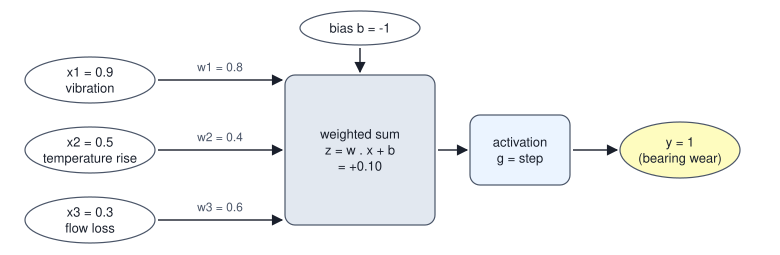
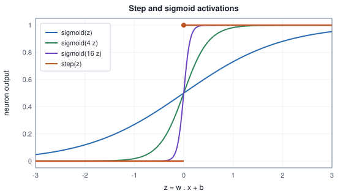
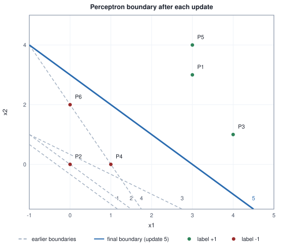
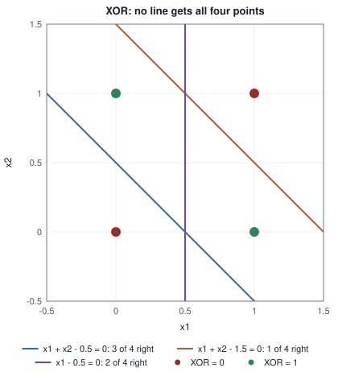
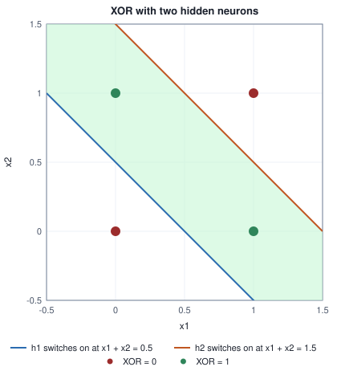

<!-- SPDX-License-Identifier: CC-BY-4.0 -->
<!-- Copyright (c) 2026 Martin Schröder <info@swedishembedded.com> -->

# The Neuron and the Perceptron

*What is an artificial neuron, and what can a single one never learn?*

## The problem

A pump in a plant is watched by three sensors: how hard it vibrates, how much its housing has warmed above normal, and how much its flow has fallen short. Each reading is scaled to the range $0$ to $1$. A maintenance engineer looks at the three numbers and decides: raise the alarm, or leave it. No single reading decides. A pump that vibrates a lot but is cool and flowing well is probably fine; a pump that is a little worse on all three is not. The engineer is, in effect, taking a vote in which the sensors have different numbers of votes, and calling the alarm when the total is large enough.

That sentence is already a program. Give each sensor a **weight** that says how many votes it casts per unit of reading, add the weighted readings, and compare the total with a threshold. The previous volume used this program twice without naming it: the logit of [logistic regression](../v02-learning/03-logistic-regression.md) is a weighted sum of features, and the sign of that sum is the decision. This chapter gives the program a name, the **artificial neuron**, shows how its weights can be found from labelled examples by a rule of two lines (the perceptron rule, 1958), proves that the rule stops whenever it can, and then asks the question that drove the field for a generation: what can one such unit *not* do? The answer fits in four points on a square, and it is the reason the rest of this volume exists.

The chapter has five steps.

1. **One neuron, by hand.** We compute the pump decision for four readings and see what each part of the formula contributes.
2. **The general neuron and its activation function.** The same weighted sum, with the hard threshold replaced by other choices, is linear regression, logistic regression, or the perceptron.
3. **Learning the weights.** The perceptron rule, traced update by update on six points, with the geometry of one update.
4. **Does it stop?** The convergence theorem, its proof in six lines, and a numerical check of the bound.
5. **What one neuron cannot do.** Linear separability, the XOR problem with a proof, and the two ways out: a better set of features, or more neurons.

You may use from earlier chapters: the dot product and the length of a vector (Volume I, chapter 3); the sigmoid and the decision boundary of a linear logit (Volume II, chapter 3). Where the text borrows from the margin of a support vector machine or the feature maps of kernel methods (Volume II, chapter 7), it restates what it needs.

## Before you begin

Five questions on ideas from earlier chapters, to answer from memory. The answers are at the end of the chapter. If one is hard, go back to the chapter named before reading on.

1. (Volume I, chapter 3, "Vectors: Lists of Numbers with Geometry", the dot product.) For $\mathbf{w} = (0.5, -1, 2)$ and $\mathbf{x} = (4, 1, 0.5)$, what is $\mathbf{w}\cdot\mathbf{x}$?
2. (Volume II, chapter 3, "Classification and Logistic Regression", the decision boundary.) A model scores a point by $z = -3 + x_1 + 2x_2$ and predicts the positive class when $z \ge 0$. Which side of the boundary is the point $(2, 1)$ on, and what is the equation of the boundary?
3. (Volume II, chapter 3, the sigmoid.) What are $\sigma(0)$ and $\sigma(4)$, and what does $\sigma(z)$ approach as $z \to -\infty$?
4. (Volume II, chapter 7, "Machine Learning Before Deep Learning", the support vector machine.) Among the many lines that separate two classes, which one does a support vector machine choose?
5. (Volume II, chapter 3, "When the data can be separated".) The classes of a dataset can be separated by a line. What does gradient descent on the cross-entropy do to the weights as the steps continue, and why?

## A neuron as a weighted vote

Start with the pump and put numbers on it. The three readings are $x_1$ (vibration), $x_2$ (temperature rise) and $x_3$ (flow loss). The engineer's rule of thumb becomes weights $\mathbf{w} = (0.8, 0.4, 0.6)$, so that vibration counts most, and a threshold of $1$: raise the alarm when the weighted total reaches $1$. Moving the threshold to the other side of the inequality turns it into a number added to the total, the **bias** $b = -1$. The alarm is then

$$
y = \begin{cases} 1 & \text{if } \mathbf{w}\cdot\mathbf{x} + b \ge 0,\\ 0 & \text{otherwise.}\end{cases}
$$

Here are four situations, each computed term by term. The column "sigmoid" is $\sigma(z)$ of the total, which the next section uses.

<!-- worked: perceptron.pump_vote -->
Inputs: vibration, temperature rise, flow loss (each scaled to [0, 1]). Weights w = (0.8, 0.4, 0.6), bias b = -1.0.
Alarm = step(w . x + b) with step(z) = 1 for z >= 0 and 0 otherwise.

| case | x | w1 x1 | w2 x2 | w3 x3 | sum of votes | z = sum + b | alarm | sigmoid(z) |
|---|---:|---:|---:|---:|---:|---:|---:|---:|
| calm | (0.1, 0.2, 0.1) | 0.08 | 0.08 | 0.06 | 0.22 | -0.78 | 0 | 0.314 |
| vibration alone | (0.9, 0.1, 0.1) | 0.72 | 0.04 | 0.06 | 0.82 | -0.18 | 0 | 0.455 |
| bearing wear | (0.9, 0.5, 0.3) | 0.72 | 0.20 | 0.18 | 1.10 | +0.10 | 1 | 0.525 |
| hot and blocked | (0.6, 0.9, 0.9) | 0.48 | 0.36 | 0.54 | 1.38 | +0.38 | 1 | 0.594 |
<!-- /worked -->

Read the table from the left. In the "calm" row every sensor casts a few small votes and the total of $0.22$ is far below the threshold of $1$, so $z = -0.78$ and there is no alarm. "Vibration alone" has the largest single vote, $0.72$, and still does not fire ($z = -0.18$): the weights say that one loud sensor is not enough, which is the engineer's rule of thumb. "Bearing wear" has a little of everything, the total $1.10$ passes the threshold, and the alarm fires by a small margin ($z = +0.10$). "Hot and blocked" fires with room to spare ($z = +0.38$).

Three things are worth seeing before any generalisation. First, a weight is a *price* in votes per unit of reading, so its sign says whether the reading pushes towards the alarm (positive) or away (negative) and its size says how hard. Second, the bias is the only number that does not multiply a reading: with all readings zero the total is exactly $b$, so $b$ sets how much evidence is needed before anything happens. Third, the decision depends on the readings only through the single number $z = \mathbf{w}\cdot\mathbf{x} + b$. Every pump whose readings give the same $z$ is treated alike, however different the three readings are.

### The biological analogy, briefly

The name comes from biology, and the analogy is loose. A nerve cell receives signals from other cells through many input fibres; each connection has a strength; the cell adds up the incoming signals and, when the total crosses a threshold, sends a pulse of its own down its output fibre. In 1943 Warren McCulloch and Walter Pitts described exactly this idealisation, a unit that fires when enough of its inputs are active, and showed that networks of such units can compute logical statements. Rosenblatt's perceptron (1958) added a way to set the strengths from examples.

That is as far as the resemblance goes. A real nerve cell communicates in timed pulses rather than numbers, has thousands of inputs of many kinds, changes its connections by chemistry that nobody writes as a two-line rule, and is only one of many cell types. Nothing in this volume depends on neuroscience; the *neuron* of machine learning is a small function of a weighted sum, and it earns its place by what it computes, not by what it resembles.

## The artificial neuron

Take the pump decision and keep what is general. A neuron has $d$ inputs, collected in a vector $\mathbf{x}$ of shape $[d]$, one weight per input, collected in $\mathbf{w}$ of shape $[d]$, and one bias $b$. It forms the weighted sum

$$
z = \mathbf{w}\cdot\mathbf{x} + b = \sum_{j=0}^{d-1} w_j x_j + b ,
$$

called the **pre-activation** (the book writes it $z$, as the logit of Volume II was written), and then passes it through a fixed one-input function $g$:

$$
\boxed{y = g(\mathbf{w}\cdot\mathbf{x} + b).}
$$

That formula is the **artificial neuron**, and $g$ is its **activation function**: the function applied to the weighted sum to produce the neuron's output. The weights and the bias are the neuron's parameters, the numbers that learning will set; $g$ is chosen by the designer and has no parameters of its own. (The names *weight* and *bias* are older than their meaning here. A bias is not a prejudice, it is the offset that lets the decision boundary avoid the origin.)



The figure is the "bearing wear" row of the table: the arrows carry the readings, each arrow multiplies by its weight, the box sums and adds the bias, and the activation produces the output.

### Three choices of activation

The pump neuron used the **step function**, $\mathrm{step}(z) = 1$ for $z \ge 0$ and $0$ otherwise (the convention of the threshold rule in Volume II: a score of exactly zero counts as positive). Two other choices already appeared in the previous volume, and the same weighted sum under each of the three is a model you know.

| activation $g$ | formula | the neuron is |
|---|---|---|
| identity | $g(z) = z$ | linear regression (Volume II, chapter 2): the output is a number on a scale |
| sigmoid | $g(z) = \sigma(z) = 1/(1 + e^{-z})$ | logistic regression (Volume II, chapter 3): the output is a probability |
| step | $g(z) = \mathrm{step}(z)$ | the perceptron of this chapter: the output is a hard yes or no |

What changes between the rows is the kind of answer, and, as the rest of the chapter shows, what can be learned and how. The sigmoid and the step are close relatives. Multiply the score by a number $k$ before applying the sigmoid and the curve gets steeper; for large $k$ it is indistinguishable from the step except in a sliver around $z = 0$:

<!-- worked: perceptron.activation_values -->
The sigmoid of k z for growing k against the step, at nine values of z.

| z | step(z) | sigmoid(z) | sigmoid(4 z) | sigmoid(16 z) |
|---|---:|---:|---:|---:|
| -3.0 | 0 | 0.0474 | 0.0000 | 0.0000 |
| -2.0 | 0 | 0.1192 | 0.0003 | 0.0000 |
| -1.0 | 0 | 0.2689 | 0.0180 | 0.0000 |
| -0.5 | 0 | 0.3775 | 0.1192 | 0.0003 |
| +0.0 | 1 | 0.5000 | 0.5000 | 0.5000 |
| +0.5 | 1 | 0.6225 | 0.8808 | 0.9997 |
| +1.0 | 1 | 0.7311 | 0.9820 | 1.0000 |
| +2.0 | 1 | 0.8808 | 0.9997 | 1.0000 |
| +3.0 | 1 | 0.9526 | 1.0000 | 1.0000 |
<!-- /worked -->



The difference that matters for later chapters is the slope. The step function has slope $0$ everywhere except at $z = 0$, where it jumps and has no slope at all; the sigmoid has slope $\sigma(z)(1 - \sigma(z))$ (Volume II, chapter 3), positive everywhere. A function with a slope can be improved by gradient descent. A function whose slope is zero offers a gradient nothing to follow. Keep that in mind: it returns at the end of the chapter and is the reason the multilayer networks of the next chapter use smooth activations. Other smooth choices (the rectified linear unit, the hyperbolic tangent and their relatives) are the subject of that chapter; this one needs only the three above.

### The bias as a weight on a constant input

The bias is the one parameter that does not multiply an input, which makes every formula carry a special case. Remove it by giving the neuron one more input that is always $1$. Write $\tilde{\mathbf{x}} = (\mathbf{x}, 1)$, of shape $[d + 1]$, and $\tilde{\mathbf{w}} = (\mathbf{w}, b)$. Then

$$
\tilde{\mathbf{w}}\cdot\tilde{\mathbf{x}} = \mathbf{w}\cdot\mathbf{x} + b \cdot 1 = z .
$$

This is the column of ones of the design matrix of Volume II, chapter 2, and the reason Volume II wrote $z = \mathbf{w}\cdot\mathbf{x}$ with "the intercept inside $\mathbf{w}$". The convergence proof below uses it: a neuron with a bias in $d$ dimensions is a neuron without one in $d + 1$ dimensions whose last input is constant.

### Many neurons at once: a layer

One neuron gives one number. $H$ neurons that read the same input give $H$ numbers, each with its own weight vector and bias. Stack the weight vectors as the rows of a matrix $\mathbf{W}$ of shape $[H, d]$ and the biases into $\mathbf{b}$ of shape $[H]$. Then all $H$ pre-activations are one matrix-vector product,

$$
\mathbf{z} = \mathbf{W}\mathbf{x} + \mathbf{b}, \qquad \mathbf{y} = g(\mathbf{z}) \text{ applied to every entry},
$$

and for a batch of $B$ examples, collected as the rows of $\mathbf{X}$ of shape $[B, d]$,

$$
\mathbf{Z} = \mathbf{X}\mathbf{W}^\top + \mathbf{b}, \qquad \text{shape } [B, H],
$$

with $\mathbf{b}$ added to every row. Row $i$ of $\mathbf{W}$ is neuron $i$; the entry $Z_{n,i}$ is the weighted vote of neuron $i$ on example $n$. This is the *linear layer*, and it is the form in which the backpropagation chapter of this volume differentiates it. One question remains for each neuron: where do its weights come from?

## Learning the weights: the perceptron

The pump engineer chose the weights by judgment. Suppose instead there is a log of past readings, each labelled by an inspector as a real fault or not. The task of a learner is to find weights and a bias that classify the log correctly.

Frank Rosenblatt's answer in 1958 was a rule so small that it can be run by hand. A **perceptron** is a neuron with a step activation together with this rule for setting its weights from labelled examples. Write the label as $y_n \in \{-1, +1\}$ (the sign convention makes the rule shorter; the label $t_n \in \{0, 1\}$ of Volume II is $t_n = (y_n + 1)/2$). Start with all weights and the bias at zero. Visit the examples one after another. For each example compute its score $z = \mathbf{w}\cdot\mathbf{x}_n + b$. If the score has the right sign, $y_n z > 0$, do nothing. Otherwise the example is a **mistake**, and move the weights toward it:

$$
\mathbf{w} \leftarrow \mathbf{w} + y_n\,\mathbf{x}_n, \qquad b \leftarrow b + y_n .
$$

A score of exactly $0$ counts as a mistake. That is a convention with a reason: the weights start at zero, where every score is $0$, and the rule must be able to start. Repeat passes over the examples until a whole **pass** (one visit to each example, in the order given) produces no mistake.

```text
function perceptron_train(X: array<real>[N, d], y: array<real>[N], order: array<int>[N],
                          max_passes: int) -> (w: array<real>[d], b: real, updates: int, passes: int):
    require N > 0 and d > 0, "no data"
    require max_passes > 0, "need at least one pass"
    for n in 0 .. N:
        require y[n] == 1.0 or y[n] == -1.0, "labels must be -1 or +1"
    w = zeros(real, [d])
    b = 0.0
    updates = 0
    for p in 1 ..= max_passes:
        errors = 0
        for k in 0 .. N:
            n = order[k]                                  # the example visited k-th in this pass
            z = sum([w[j] * X[n, j] for j in 0 .. d]) + b
            if y[n] * z <= 0.0:                           # a mistake (a score of exactly 0 is one)
                for j in 0 .. d:
                    w[j] = w[j] + y[n] * X[n, j]
                b = b + y[n]
                errors = errors + 1
        updates = updates + errors
        if errors == 0:
            return (w, b, updates, p)                     # pass p was clean: p passes were made
    return (w, b, updates, max_passes)                    # did not settle within max_passes
```

The function does not shuffle: the caller supplies `order`, a list of the $N$ row indices (`order[k]` is the row visited $k$-th), so that the same call with the same order gives the same result. The cost of a pass is $O(Nd)$ and the memory beyond the data is $O(d)$.

### A trace by hand

Six points in the plane, three labelled $+1$ and three $-1$, visited in the order $P1, \dots, P6$ in every pass. Every visit is shown, not only the updates, so that you can follow the run with a pencil.

<!-- worked: perceptron.perceptron_trace -->
Points, visited in this order every pass: P1 = (3, 3) label +1, P2 = (0, 0) label -1, P3 = (4, 1) label +1, P4 = (1, 0) label -1, P5 = (3, 4) label +1, P6 = (0, 2) label -1.
Start w = (0, 0), b = 0. A visit is a mistake when y (w . x + b) <= 0, and then w += y x, b += y.

| pass | point | z before | outcome | w after | b after |
|---|---:|---:|---:|---:|---:|
| 1 | P1 | +0.0 | mistake | (3.0, 3.0) | +1.0 |
| 1 | P2 | +1.0 | mistake | (3.0, 3.0) | +0.0 |
| 1 | P3 | +15.0 | ok | (3.0, 3.0) | +0.0 |
| 1 | P4 | +3.0 | mistake | (2.0, 3.0) | -1.0 |
| 1 | P5 | +17.0 | ok | (2.0, 3.0) | -1.0 |
| 1 | P6 | +5.0 | mistake | (2.0, 1.0) | -2.0 |
| 2 | P1 | +7.0 | ok | (2.0, 1.0) | -2.0 |
| 2 | P2 | -2.0 | ok | (2.0, 1.0) | -2.0 |
| 2 | P3 | +7.0 | ok | (2.0, 1.0) | -2.0 |
| 2 | P4 | +0.0 | mistake | (1.0, 1.0) | -3.0 |
| 2 | P5 | +4.0 | ok | (1.0, 1.0) | -3.0 |
| 2 | P6 | -1.0 | ok | (1.0, 1.0) | -3.0 |
| 3 | P1 | +3.0 | ok | (1.0, 1.0) | -3.0 |
| 3 | P2 | -3.0 | ok | (1.0, 1.0) | -3.0 |
| 3 | P3 | +2.0 | ok | (1.0, 1.0) | -3.0 |
| 3 | P4 | -2.0 | ok | (1.0, 1.0) | -3.0 |
| 3 | P5 | +4.0 | ok | (1.0, 1.0) | -3.0 |
| 3 | P6 | -1.0 | ok | (1.0, 1.0) | -3.0 |
The rule made 5 updates and the pass 3 had none: final w = (1.0, 1.0), b = -3.0, boundary 1 x1 + 1 x2 -3 = 0.
<!-- /worked -->

Follow the first pass. At $P1 = (3, 3)$ the weights are zero, the score is $0$, which counts as a mistake, and the update gives $\mathbf{w} = (3, 3)$, $b = 1$. At $P2 = (0, 0)$ (label $-1$) the score is now $+1$, wrong, and subtracting $\mathbf{x} = (0, 0)$ changes nothing in $\mathbf{w}$: a point at the origin can only move the bias, here from $1$ to $0$. $P3$ and $P5$ are classified correctly and ignored. $P4 = (1, 0)$ (label $-1$) scores $+3$, wrong, and $\mathbf{w}$ becomes $(2, 3)$, $b = -1$. $P6 = (0, 2)$ scores $+5$, wrong, and $\mathbf{w}$ becomes $(2, 1)$, $b = -2$. The second pass has one mistake, at $P4$ (score exactly $0$), giving the final $\mathbf{w} = (1, 1)$, $b = -3$, and the third pass is clean. The learned boundary is $x_1 + x_2 = 3$: in the third pass the three positives score $+3$, $+2$ and $+4$ and the three negatives $-3$, $-2$ and $-1$.

Five updates in two passes. The figure draws the boundary after each update, in the order of the table: the first boundary has $\mathbf{w}$ pointing at $P1$, and the later ones swing around until all six points are on their correct side.



### What one update does

Why should "add the example to the weights" help? Look at what an update does to the score of the very example that caused it. After a mistake on $(\mathbf{x}, y)$ the new score is

$$
\mathbf{w}'\cdot\mathbf{x} + b' = (\mathbf{w} + y\mathbf{x})\cdot\mathbf{x} + (b + y) = (\mathbf{w}\cdot\mathbf{x} + b) + y\,(\lVert\mathbf{x}\rVert^2 + 1) .
$$

The score moves by $y\,(\lVert\mathbf{x}\rVert^2 + 1)$: up for a positive example, down for a negative one, by a fixed amount that depends only on the example's length (the $+1$ is the bias's share, the length of the appended $1$). So an update always pushes the example's score toward its correct sign. It does not promise to *reach* the correct sign in one step, and it does not look at other examples at all. The table checks both claims on the five updates of the trace:

<!-- worked: perceptron.update_geometry -->
The score of the visited point rises (for a positive point; falls for a negative one) by exactly |x|^2 + 1, the squared length of x with a 1 appended. The angle is between w and x in degrees (a dash where w or x is the zero vector).

| update | point | y | z before | z after | change | |x|^2 + 1 | angle(w, x) before | angle(w, x) after |
|---|---:|---:|---:|---:|---:|---:|---:|---:|
| 1 | P1 | +1 | +0.00 | +19.00 | 19.00 | 19.00 | - | 0.0 |
| 2 | P2 | -1 | +1.00 | +0.00 | -1.00 | 1.00 | - | - |
| 3 | P4 | -1 | +3.00 | +1.00 | -2.00 | 2.00 | 45.0 | 56.3 |
| 4 | P6 | -1 | +5.00 | +0.00 | -5.00 | 5.00 | 33.7 | 63.4 |
| 5 | P4 | -1 | +0.00 | -2.00 | -2.00 | 2.00 | 26.6 | 45.0 |
<!-- /worked -->

Update 1 moves the score of $P1$ from $0$ to $19$, exactly $\lVert\mathbf{x}\rVert^2 + 1 = 19$. Update 3 acts on $P4 = (1, 0)$, whose length squared plus one is only $2$: its score falls from $+3$ to $+1$, still on the wrong side. The point is fixed only by update 5 in the second pass, after the weights have moved under the influence of other points. A mistake costs a fixed step and is not repaired by one step.

The picture in the weight space is a rotation. The weight vector $\mathbf{w}$ is perpendicular to the boundary, and the score is $\lVert\mathbf{w}\rVert\lVert\mathbf{x}\rVert\cos\theta + b$ where $\theta$ is the angle between $\mathbf{w}$ and $\mathbf{x}$. Adding $\mathbf{x}$ to $\mathbf{w}$ (for a positive example) bends $\mathbf{w}$ toward $\mathbf{x}$: the angle shrinks and the dot product grows. Subtracting $\mathbf{x}$ (for a negative example) bends $\mathbf{w}$ away from it. The last two columns show it: update 3 (negative $P4$) increases the angle between $\mathbf{w}$ and $\mathbf{x}$ from $45.0$ to $56.3$ degrees, update 4 (negative $P6$) from $33.7$ to $63.4$ degrees, and update 1 (positive $P1$) turns $\mathbf{w}$ onto $\mathbf{x}$, the angle becoming $0$. The bias moves the boundary parallel to itself in the same spirit: a positive mistake raises $b$, shifting the boundary toward the negative side.

## Does it stop?

The trace stopped after three passes. Will the rule always stop? It cannot always: on data that no line can separate, there is always a mistake in every pass, so the rule never finishes (the last section watches that happen). The useful question is whether it always stops *when it can*, that is, when a separating boundary exists. Rosenblatt's 1958 paper gave the rule, and proofs that it stops on separable data followed within a few years (Novikoff, 1962). The proof is short enough to give in full, and it also tells us what makes the problem hard.

### The statement

Use the augmented vectors of the last section, so that the bias is part of the weights, and write $\tilde{\mathbf{x}}_n = (\mathbf{x}_n, 1)$ and $\tilde{\mathbf{w}} = (\mathbf{w}, b)$; the update becomes $\tilde{\mathbf{w}} \leftarrow \tilde{\mathbf{w}} + y_n\tilde{\mathbf{x}}_n$ and a mistake is $y_n\,\tilde{\mathbf{w}}\cdot\tilde{\mathbf{x}}_n \le 0$. Two numbers describe the data:

- $R$, the largest length of an augmented example, $R = \max_n \lVert\tilde{\mathbf{x}}_n\rVert$;
- $\gamma$, the **margin** of a separator: for a unit vector $\mathbf{s}$ (length $1$) that classifies every example correctly, $\gamma = \min_n y_n\,\mathbf{s}\cdot\tilde{\mathbf{x}}_n > 0$. This is the distance from the nearest example to the separating plane, measured in the augmented space.

**Theorem (perceptron convergence).** If a unit vector $\mathbf{s}$ and a number $\gamma > 0$ exist with $y_n\,\mathbf{s}\cdot\tilde{\mathbf{x}}_n \ge \gamma$ for every example, then the perceptron rule, started from $\tilde{\mathbf{w}} = \mathbf{0}$ and visiting the examples in any order and for as many passes as it likes, makes at most $(R/\gamma)^2$ updates in total.

Since a pass without a mistake ends the run, and every other pass has at least one update, the rule stops after at most $(R/\gamma)^2 + 1$ passes.

### The proof

Let $\tilde{\mathbf{w}}_k$ be the weights after $k$ updates, with $\tilde{\mathbf{w}}_0 = \mathbf{0}$. Each update adds $y\tilde{\mathbf{x}}$ for a mistaken example $(\tilde{\mathbf{x}}, y)$. Two inequalities, one about the direction of $\tilde{\mathbf{w}}_k$ and one about its length.

*The weights line up with the separator, at least $\gamma$ per update.* Take the dot product of the update with $\mathbf{s}$:

$$
\mathbf{s}\cdot\tilde{\mathbf{w}}_{k+1} = \mathbf{s}\cdot\tilde{\mathbf{w}}_k + y\,\mathbf{s}\cdot\tilde{\mathbf{x}} \ge \mathbf{s}\cdot\tilde{\mathbf{w}}_k + \gamma ,
$$

since every example has $y\,\mathbf{s}\cdot\tilde{\mathbf{x}} \ge \gamma$. By induction from $\mathbf{s}\cdot\tilde{\mathbf{w}}_0 = 0$,

$$
\mathbf{s}\cdot\tilde{\mathbf{w}}_k \ge k\gamma .
\tag{1}
$$

*The weights grow slowly, at most $R^2$ in squared length per update.* Square the length of the update:

$$
\lVert\tilde{\mathbf{w}}_{k+1}\rVert^2 = \lVert\tilde{\mathbf{w}}_k\rVert^2 + 2y\,\tilde{\mathbf{w}}_k\cdot\tilde{\mathbf{x}} + \lVert\tilde{\mathbf{x}}\rVert^2 \le \lVert\tilde{\mathbf{w}}_k\rVert^2 + R^2 .
$$

The middle term is at most $0$ because the update happened: it was a mistake, $y\,\tilde{\mathbf{w}}_k\cdot\tilde{\mathbf{x}} \le 0$. This is the one place where "only update on mistakes" is used, and it is what keeps the weights from growing faster. By induction,

$$
\lVert\tilde{\mathbf{w}}_k\rVert^2 \le kR^2 .
\tag{2}
$$

*Squeeze.* A dot product with a unit vector is at most the length of the other vector (the cosine is at most $1$), so with (1) and (2),

$$
k\gamma \le \mathbf{s}\cdot\tilde{\mathbf{w}}_k \le \lVert\tilde{\mathbf{w}}_k\rVert \le \sqrt{k}\,R .
$$

Divide by $\sqrt{k}\gamma$: $\sqrt{k} \le R/\gamma$, that is $k \le (R/\gamma)^2$. The number of updates cannot exceed that, however the examples are ordered. $\square$

The left side grows like $k$ and the right like $\sqrt{k}$; a straight line cannot stay below a square-root curve forever, so the updates must stop. The proof says nothing about *which* separator the rule finds, only that it finds one.

### Checking the bound

A bound is a claim about every order of the data, so test it on many. For the six points of the trace we need $R$ and a margin $\gamma$. Any separating unit vector gives a valid bound; take the hand-chosen separator $(2, 1, -5.5)$ (the boundary $2x_1 + x_2 = 5.5$, with the bias last) normalised to length $1$. We then run the rule from zero over $200$ random orders of the six points and count updates. The generator is the book's SplitMix64 and its seed is printed, so you can reproduce the orders.

<!-- worked: perceptron.convergence_bound -->
Generator: the book's SplitMix64, seed 0x16ae51a8033bec53 (1634333496832683091).
Draw order: for each of the 200 runs, shuffle(list [0, 1, 2, 3, 4, 5]) with the book's Fisher-Yates shuffle, then run the rule from w = 0, b = 0 over that order each pass until a pass has no mistake.

Separator w* = (2.0, 1.0, -5.5) (last entry is the bias), |w*| = 5.9372.

| quantity | value |
|---|---:|
| R = largest |(x1, x2, 1)| | 5.0990 |
| gamma = smallest y (w* . (x, 1)) / |w*| | 0.5895 |
| bound (R / gamma)^2 | 74.82 |
| mistakes in the order of the trace | 5 |
| fewest mistakes over 200 orders | 5 |
| mean mistakes over 200 orders | 7.76 |
| most mistakes over 200 orders | 9 |
<!-- /worked -->

The bound is $(R/\gamma)^2 = 74.82$, so no run may make more than $74$ updates. The runs make between $5$ and $9$, the trace's order being the luckiest at $5$. The bound is true but far from tight, which is typical of a bound that must hold for the worst order and the worst data. What it does capture is the right *scaling*: the number of updates depends on the ratio of the size of the data to the width of the gap between the classes, and not on the number of examples or on the number of inputs.

To see that scaling, vary the gap. Take $20$ points in the square $[-1, 1]^2$, labelled by the sign of $x_1$, and discard every point with $|x_1| < g/2$, so that the classes are separated by an empty strip of width at least $g$. The separator $\mathbf{s} = (1, 0, 0)$ has margin $\gamma$ equal to the smallest $|x_1|$ present.

<!-- worked: perceptron.gap_scaling -->
Data: 20 points per row. Generator: the book's SplitMix64, seed 0x862eeb8ac633e870 (9668924431274338416). Draw order: candidate after candidate, x1 = 2 u1 - 1 then x2 = 2 u2 - 1 (u1, u2 = uniform()); a candidate is kept when |x1| >= g / 2, with label +1 if x1 > 0 and -1 otherwise, until 20 are kept. The separator is w* = (1, 0), b = 0.
Orders: Generator: the book's SplitMix64, seed 0x3c66e9384cac8056 (4352422517913976918). 200 orders per row, each one shuffle of [0, ..., 19], the generator restarted for each row.

| gap g | gamma | R | bound (R/gamma)^2 | fewest | mean | most |
|---|---:|---:|---:|---:|---:|---:|
| 1 | 0.5292 | 1.6290 | 9.5 | 2 | 2.1 | 4 |
| 0.5 | 0.2710 | 1.6290 | 36.1 | 2 | 3.6 | 6 |
| 0.25 | 0.1465 | 1.6290 | 123.7 | 2 | 4.3 | 12 |
| 0.1 | 0.0544 | 1.6290 | 896.0 | 2 | 4.2 | 12 |
<!-- /worked -->

In every row the largest count is below the bound, as the theorem demands. The bound grows by a factor of about $94$ from the widest gap to the narrowest, because $\gamma$ falls by about a factor of ten; the observed worst case grows much less in this small sample. A narrower gap is a harder problem, and the bound is the right measure of how much harder in the worst case, not in a typical case.

Two more facts about the bound. First, it is unchanged if every input is multiplied by the same constant $c$ and the bias is dropped (so the boundary passes through the origin): $R$ and $\gamma$ both scale by $c$ and their ratio is the same. Second, it ignores how many examples there are. The number of mistakes is a property of the *margin* of the data, and a larger separable dataset with the same margin is no harder. Both are exercises below.

## How the perceptron relates to logistic regression and to the widest margin

The perceptron rule looks like a new idea, and it is a close relative of one you know. Write the label as $t \in \{0, 1\}$ and the neuron's output as $\hat{y} = \mathrm{step}(z)$. The perceptron rule, with a step size $\eta$ in front, says

$$
\mathbf{w} \leftarrow \mathbf{w} + \eta\,(t - \hat{y})\,\mathbf{x} .
$$

For a correct example $t = \hat{y}$ and nothing moves. For a mistake $t - \hat{y}$ is $+1$ (a positive example scored too low) or $-1$ (a negative one scored too high), so the update adds or subtracts $\eta\mathbf{x}$, which for $\eta = 1$ is the rule above. (The two forms agree except at a score of exactly zero, where the first counts a positive example as correct and the second does not; the difference does not matter away from ties.) Compare this with the per-example gradient step of logistic regression (Volume II, chapter 3), where the gradient of the cross-entropy is $(\hat{p} - t)\mathbf{x}$ and descent subtracts it:

$$
\mathbf{w} \leftarrow \mathbf{w} + \eta\,(t - \sigma(z))\,\mathbf{x} .
$$

It is the same sentence, *add the input times the residual*, with the hard output $\mathrm{step}(z)$ replaced by the soft one $\sigma(z)$. Tabulate the multiplier of $\mathbf{x}$ for both.

<!-- worked: perceptron.update_coefficients -->
The factor that multiplies the input vector x in one update of w, for a neuron with score z and label t in {0, 1}. The perceptron uses t - step(z), logistic regression t - sigmoid(z).

| z | step(z) | t = 1: perceptron | t = 1: logistic | t = 0: perceptron | t = 0: logistic |
|---|---:|---:|---:|---:|---:|
| -4.0 | 0 | 1 | 0.9820 | 0 | -0.0180 |
| -2.0 | 0 | 1 | 0.8808 | 0 | -0.1192 |
| -0.5 | 0 | 1 | 0.6225 | 0 | -0.3775 |
| +0.5 | 1 | 0 | 0.3775 | -1 | -0.6225 |
| +2.0 | 1 | 0 | 0.1192 | -1 | -0.8808 |
| +4.0 | 1 | 0 | 0.0180 | -1 | -0.9820 |
<!-- /worked -->

Read the rows for a positive example ($t = 1$). At $z = -4$ (very wrong) both rules push hard: the perceptron by $1$, logistic by $0.982$. At $z = +0.5$ (right, but barely) the perceptron does nothing and logistic still pushes by $0.3775$; at $z = +4$ (right, confidently) logistic pushes by $0.018$ and the perceptron by $0$. Three consequences follow.

- **Every example vs only the mistakes.** Logistic regression lets every example speak, in proportion to how unsure the model is about it. The perceptron listens only to the examples it gets wrong, and listens to each of them equally.
- **A stopping point.** The perceptron stops as soon as nothing is wrong, with finite weights. On separable data logistic regression never stops: the loss can always be lowered by growing the weights, which Volume II watched happen (the weight norm grew roughly like the logarithm of the number of steps).
- **No probability.** The step output is a decision with no measure of confidence; the sigmoid output is a probability that can be calibrated and used with a threshold chosen for costs.

There is also a way to read the perceptron rule as gradient descent. Define the loss of one example as $\max(0, -y\,z)$: zero when the example is on the correct side, and growing linearly with how far it is on the wrong side. Its slope with respect to the weights is $-y\,\tilde{\mathbf{x}}$ where $y z < 0$ and $0$ where $y z > 0$. Descent with step size $1$, one example at a time, subtracts that slope: it adds $y\tilde{\mathbf{x}}$ on a mistake and does nothing otherwise. That *is* the perceptron rule. The support vector machine of Volume II, chapter 7 minimises the closely related hinge loss $\max(0, 1 - y z)$, which is zero only when the example is on the correct side *by at least a margin of 1*, plus a penalty on $\lVert\mathbf{w}\rVert^2$; the perceptron's loss is the same hinge moved to $0$ and without the penalty. The missing demand for a margin is what the following comparison shows.

<!-- worked: perceptron.separators_compared -->
Same six points as the trace. Logistic regression: labels mapped to t in {0, 1}, w and b from 0, plain gradient descent, learning rate 0.5, 20000 steps on the mean cross-entropy. Margin = the smallest distance from a point to the boundary, y (w . x + b) / |w|. The widest margin is found by trying every direction u of 0.00, 0.01, ..., 359.99 degrees, placing the boundary halfway between the classes' projections on u and keeping the best half-gap. The 200 orders are those of the bound table.

| method | direction of w (degrees) | margin |
|---|---:|---:|
| perceptron, order of the trace | 45.0 | 0.7071 |
| perceptron, worst of 200 orders | - | 0.2425 |
| perceptron, best of 200 orders | - | 1.0000 |
| logistic regression, 20000 steps | 22.5 | 1.3676 |
| widest margin (scan of directions) | 26.6 | 1.5652 |
<!-- /worked -->

The perceptron accepts *any* separator, and which one it ends on depends on the order of the examples: across the $200$ orders its final boundary has a margin as small as $0.2425$ and as large as $1.0000$, against $0.7071$ for the order of the trace. Logistic regression, run long enough, drifts toward the widest margin (it has reached $1.3676$ of the best $1.5652$ after $20000$ steps and is still moving, matching the slow drift seen in Volume II). The widest margin is what the support vector machine returns directly, and it is the unique answer: it does not depend on the order. A boundary with a wide margin is the one least sensitive to a little noise in the inputs, which is the sense in which it generalises well; the perceptron's convergence theorem, with its dependence on $\gamma$, is the first place where that quantity appears.

## Linear separability

The convergence theorem has a hypothesis: a separator exists. The hypothesis is worth a name. A set of labelled points is **linearly separable** if there is some $\mathbf{w}$ and $b$ with $y_n(\mathbf{w}\cdot\mathbf{x}_n + b) > 0$ for every point: a line (a plane, a flat sheet in more inputs) with every point of one class on one side and every point of the other class on the other. **Linear separability** is this property of the data, and, read the other way, of a *labelling*: a function of the inputs is computable by a single threshold neuron exactly when its table of labels is linearly separable.

Two functions of two binary inputs show the first cases, and the pump neuron's weights were chosen the same way.

### AND and OR

The AND of two bits is $1$ only when both are $1$; the OR is $1$ unless both are $0$. Each is one threshold neuron. For AND take weights $(1, 1)$ and bias $-1.5$: the sum $x_1 + x_2$ is $0$, $1$ or $2$, and only $2$ beats $1.5$. For OR take bias $-0.5$: any sum of $1$ or more beats $0.5$. NAND (not AND) is the AND neuron with every sign flipped. The tables are computed by the reference program, which also asserts that each neuron equals its target:

<!-- worked: perceptron.logic_gates -->
Each gate is step(w1 x1 + w2 x2 + b) with the weights shown; step(z) = 1 for z >= 0.

AND: w = (1.0, 1.0), b = -1.5

| x1 | x2 | z | neuron | target |
|---|---:|---:|---:|---:|
| 0 | 0 | -1.5 | 0 | 0 |
| 0 | 1 | -0.5 | 0 | 0 |
| 1 | 0 | -0.5 | 0 | 0 |
| 1 | 1 | +0.5 | 1 | 1 |

OR: w = (1.0, 1.0), b = -0.5

| x1 | x2 | z | neuron | target |
|---|---:|---:|---:|---:|
| 0 | 0 | -0.5 | 0 | 0 |
| 0 | 1 | +0.5 | 1 | 1 |
| 1 | 0 | +0.5 | 1 | 1 |
| 1 | 1 | +1.5 | 1 | 1 |

NAND: w = (-1.0, -1.0), b = +1.5

| x1 | x2 | z | neuron | target |
|---|---:|---:|---:|---:|
| 0 | 0 | +1.5 | 1 | 1 |
| 0 | 1 | +0.5 | 1 | 1 |
| 1 | 0 | +0.5 | 1 | 1 |
| 1 | 1 | -0.5 | 0 | 0 |
<!-- /worked -->

Geometrically, each gate is a line in the square of the four inputs with one corner on one side and three on the other. AND cuts off the corner $(1, 1)$ and OR cuts off the corner $(0, 0)$. A line that cuts off one corner of a square is easy to draw; the question is what happens when the two classes are diagonal opposites.

### XOR

The **exclusive or** of two bits is $1$ when exactly one of them is $1$: the labels are $0$ at $(0, 0)$, $1$ at $(0, 1)$, $1$ at $(1, 0)$, $0$ at $(1, 1)$. The two points of class $1$ sit on one diagonal of the square and the two of class $0$ on the other. The **XOR problem** is the fact that no single threshold neuron computes this function.

Here is the proof. Suppose weights $w_1, w_2$ and a bias $b$ did. The neuron's output is $1$ exactly when the score is nonnegative, so the four rows of the table say:

$$
\begin{aligned}
(0, 0) \mapsto 0:&\quad b < 0, \\
(0, 1) \mapsto 1:&\quad w_2 + b \ge 0, \\
(1, 0) \mapsto 1:&\quad w_1 + b \ge 0, \\
(1, 1) \mapsto 0:&\quad w_1 + w_2 + b < 0 .
\end{aligned}
$$

Add the second and third: $w_1 + w_2 + 2b \ge 0$. But the fourth says $w_1 + w_2 + b < 0$ and the first says $b < 0$, so $w_1 + w_2 + 2b = (w_1 + w_2 + b) + b < 0$. A number cannot be both nonnegative and negative; no such $w_1, w_2, b$ exist. $\square$

The proof has a picture. The midpoint of the two points of class $1$, $(0, 1)$ and $(1, 0)$, is $(0.5, 0.5)$, and so is the midpoint of the two points of class $0$. The score is a linear function, so its value at a midpoint is the average of its values at the endpoints. If the neuron scored both class-$1$ points at $0$ or above, the midpoint would score at $0$ or above; if it scored both class-$0$ points below $0$, the same midpoint would score below $0$. The same argument shows more generally that if the segment joining two points of one class crosses the segment joining two points of the other, no line separates the classes.

The picture shows three candidate boundaries, and what each gets right. The OR neuron gets three of four; so does any line that cuts off one corner. No line gets four.



A search confirms the proof on a finite grid. Of the sixteen functions that map two bits to one bit, how many does some neuron with weights and bias on a grid compute?

<!-- worked: perceptron.boolean_functions -->
Every (w1, w2, b) with each entry in {-4.0, -3.5, ..., 4.0} (17^3 = 4913 neurons), outputs step(w1 x1 + w2 x2 + b) on the inputs (0,0), (0,1), (1,0), (1,1) in that order. A function is named by its four outputs in that order.

| outputs | name | neurons computing it |
|---|---|---:|
| 0000 | constant 0 | 1208 |
| 0001 | AND | 84 |
| 0010 |  | 204 |
| 0011 |  | 204 |
| 0100 |  | 204 |
| 0101 |  | 204 |
| 0110 | XOR | 0 |
| 0111 | OR | 204 |
| 1000 | NOR | 204 |
| 1001 | XNOR | 0 |
| 1010 |  | 204 |
| 1011 |  | 204 |
| 1100 |  | 204 |
| 1101 |  | 204 |
| 1110 | NAND | 120 |
| 1111 | constant 1 | 1461 |

Functions reached: 14 of 16.
<!-- /worked -->

Fourteen of sixteen. The two that no neuron on the grid reaches are the XOR and its opposite, XNOR (which is $1$ when the bits are equal), and by the proof no neuron on *any* grid, or off it, reaches them: XNOR has the same two diagonals with the labels exchanged and the same argument works. A grid search can only fail to find a thing; it was the proof that said the thing does not exist.

### The learning rule on XOR

What does the perceptron rule do on a problem it cannot solve? Run it on the four XOR points, with the labels $-1$ at $(0,0)$ and $(1,1)$ and $+1$ at $(0,1)$ and $(1,0)$.

<!-- worked: perceptron.xor_cycle -->
XOR with labels -1 for (0,0) and (1,1) and +1 for (0,1) and (1,0), visited in the order (0,0), (0,1), (1,0), (1,1) every pass; the same rule as before from w = (0, 0), b = 0. The sum of y (x1, x2, 1) over the four points is (0, 0, 0).

| pass | point | y | z before | outcome | w after | b after |
|---:|---|---:|---:|---|---|---|
| 1 | (0, 0) | -1 | +0.0 | mistake | (0.0, 0.0) | -1.0 |
| 1 | (0, 1) | +1 | -1.0 | mistake | (0.0, 1.0) | +0.0 |
| 1 | (1, 0) | +1 | +0.0 | mistake | (1.0, 1.0) | +1.0 |
| 1 | (1, 1) | -1 | +3.0 | mistake | (0.0, 0.0) | +0.0 |
| 2 | (0, 0) | -1 | +0.0 | mistake | (0.0, 0.0) | -1.0 |
| 2 | (0, 1) | +1 | -1.0 | mistake | (0.0, 1.0) | +0.0 |
| 2 | (1, 0) | +1 | +0.0 | mistake | (1.0, 1.0) | +1.0 |
| 2 | (1, 1) | -1 | +3.0 | mistake | (0.0, 0.0) | +0.0 |
<!-- /worked -->

Every visit is a mistake, and at the end of each pass the weights are exactly $\mathbf{w} = (0, 0)$, $b = 0$, where they started. The run repeats forever. The reason is visible in the last line of the preamble: the sum of the four updates $\sum_n y_n\tilde{\mathbf{x}}_n$ is the zero vector, so a pass in which every example is a mistake adds nothing in total. The rule would stop if a separator existed (the theorem); when none does, it has no stopping point, and it may cycle (as here) or wander, but it never settles. A practical implementation that cannot know whether the data are separable must therefore put a limit on the number of passes, as the pseudocode does with `max_passes`.

### A short history

The XOR argument is old and simple. It was given much prominence in Marvin Minsky and Seymour Papert's book *Perceptrons* (1969), which analysed carefully what single-layer perceptrons can and cannot compute, with XOR as the smallest case and other functions (the parity of many bits, whether a drawn shape is connected) as harder ones. The book was a mathematical analysis of what single-layer perceptrons can and cannot compute; it did not prove that deeper networks share the limit, and it offered no way to train them. Interest and funding for neural networks fell in the decade after 1969, and historians disagree on how much of that is owed to this book and how much to the limited computers, data and results of the time. What is not in dispute is the technical situation the book left: a single neuron was well understood and too weak, and nobody had a procedure that trained a composition of neurons. The procedure, backpropagation, became widely known in 1986 (Rumelhart, Hinton and Williams), and Volume III's fourth chapter derives it.

## Two ways out

XOR is not computed by one neuron on the raw inputs. There are two kinds of repair, and they are the two directions in which this book goes next.

### Change the features

The kernel methods of Volume II fit a linear model on a richer list of features of the input (the feature map). Add to $(x_1, x_2)$ the product $x_1x_2$ as a third input. In the three-dimensional space of $(x_1, x_2, x_1x_2)$ the four points are no longer the corners of a flat square, and a plane separates them. With weights $(1, 1, -2)$ and bias $-0.5$:

<!-- worked: perceptron.xor_feature_map -->
Features (x1, x2, x1 x2) with weights w = (1.0, 1.0, -2.0) and bias b = -0.5.

| x1 | x2 | x1 x2 | z | neuron | XOR |
|---|---:|---:|---:|---:|---:|
| 0 | 0 | 0 | -0.5 | 0 | 0 |
| 0 | 1 | 0 | +0.5 | 1 | 1 |
| 1 | 0 | 0 | +0.5 | 1 | 1 |
| 1 | 1 | 1 | -0.5 | 0 | 0 |
<!-- /worked -->

The two points of class $1$ have $x_1x_2 = 0$ and score $+0.5$; the point $(1, 1)$ has the product $1$ and is dragged down by its weight $-2$ to $-0.5$. XOR is linear in a better description of the input. The cost is that someone had to *think of* the product: the feature map is chosen by hand, and for the inputs of real problems (images, sounds, text) nobody can write down the right features.

### Compose neurons

The second repair lets the neurons choose the features. Feed the inputs to two neurons instead of one, and feed *their* outputs to a third. The first two are the OR neuron and the AND neuron of the previous section, with outputs $h_1$ and $h_2$, so that $h_1 = \mathrm{step}(x_1 + x_2 - 0.5)$ and $h_2 = \mathrm{step}(x_1 + x_2 - 1.5)$. The third neuron says "$h_1$ but not $h_2$": $y = \mathrm{step}(h_1 - h_2 - 0.5)$. In words, XOR is "at least one, but not both".

<!-- worked: perceptron.xor_two_layer -->
Hidden neuron h1 = step(x1 + x2 - 0.5), hidden neuron h2 = step(x1 + x2 - 1.5), output y = step(h1 - h2 - 0.5).

| x1 | x2 | z of h1 | h1 | z of h2 | h2 | z of y | y | XOR |
|---|---:|---:|---:|---:|---:|---:|---:|---:|
| 0 | 0 | -0.5 | 0 | -1.5 | 0 | -0.5 | 0 | 0 |
| 0 | 1 | +0.5 | 1 | -0.5 | 0 | +0.5 | 1 | 1 |
| 1 | 0 | +0.5 | 1 | -0.5 | 0 | +0.5 | 1 | 1 |
| 1 | 1 | +1.5 | 1 | +0.5 | 1 | -0.5 | 0 | 0 |
<!-- /worked -->

The four rows reproduce the XOR table exactly. In the picture each hidden neuron is a line, and the lines are parallel: $h_1$ switches on above $x_1 + x_2 = 0.5$ and $h_2$ above $x_1 + x_2 = 1.5$. The output neuron keeps the strip between them, which contains $(0, 1)$ and $(1, 0)$ but neither $(0, 0)$ nor $(1, 1)$. Two straight lines have done what one could not, by cutting the square into three regions and letting a third neuron accept the middle one.



Notice three things, because each is the subject of a chapter that follows.

First, the weights above were found by thinking, not by learning. Nothing here is a procedure that would find them from the four labelled points. Second, the learning rule of this chapter cannot be used for the hidden neurons: the perceptron rule updates a neuron when *its own output* is wrong, and nobody tells the hidden neuron $h_1$ what its output should have been; only the final answer has a label. Third, and more fundamentally, the step activation has slope zero almost everywhere, so a gradient method has no information about how a small change in the hidden weights would change the final error: the answer changes only when a weighted sum crosses zero, and a small change almost never makes it. The way out is to give the hidden neurons activations that vary smoothly and to compute how the final error depends on every weight through all the layers. The next chapter builds the layered network with such activations and shows why the composition can represent far more than one neuron (stacking layers with an identity activation would add nothing, since a product of matrices is one matrix); the third introduces the output of a network that chooses among many classes; and the fourth derives the backward pass that delivers the gradient for every weight. The perceptron stands at the start of that line: a weighted vote, a threshold, and a rule that works exactly as long as one vote is enough.

## Where this appears in brain

The neuron $y = g(\mathbf{W}\mathbf{x} + \mathbf{b})$ is not a model in brain; it is the *shape* of nearly every kernel launch in it. The three stages of the formula, the weighted sums, the bias and the activation, are kept visible as three kinds of kernel.

**The weighted sums are one matrix multiply.** `crates/kernels/wgsl/matmul.wgsl` computes `out = x @ W^T` for `x` of shape $[M, K]$ and `W` of shape $[N, K]$, and its header says in one line what this chapter spent a section on: `W[n, k]` is weight row $n$, which is output feature $n$. Row $n$ of `W` is neuron $n$; one invocation computes one output element, the dot product of one input row with one neuron's weights, so one launch evaluates every neuron on every example, the $\mathbf{Z} = \mathbf{X}\mathbf{W}^\top$ of the layer section. The header calls it the generic matrix multiply for every linear stage: the attention projections, the router, the expert feed-forward weights and the output head.

**The bias and the activation are separate steps.** `crates/kernels/wgsl/bias_add.wgsl` adds `bias[n]` to every row in place (`out[m,n] += bias[n]`, the "added to every row" of the layer section), and the activation is an elementwise kernel of its own, for example `crates/kernels/wgsl/sigmoid.wgsl`, `crates/kernels/wgsl/silu.wgsl` and `crates/kernels/wgsl/tanh_act.wgsl`, each the formula $y = g(z)$ with one thread per element. Where the extra trips through memory matter, the stages are fused: `crates/kernels/wgsl/conv_act.wgsl`, cited in Volume I for its fusion, computes a convolution, a per-channel scale and shift, and a selectable activation (identity, rectified linear, silu, sigmoid) in one pass, with a convolution playing the role of the dot product.

**A decision head is one neuron.** The head of the decision model in `crates/decide/src/head.rs` ends in exactly the unit of this chapter with the identity as activation. Its module comment writes the last stage as `score_i = out_i . w + b`, and the code builds it from the two kernels above: a matrix multiply against `head.score.weight` of shape $[1, H]$ and a `bias_add` of `head.score.bias` of shape $[1]$, giving one raw score per option. No squashing is applied on the device: the scores of one question's options are normalised together by a softmax on the host, because the number of options is chosen per request. The commit that added the head, `commit fcabe836a` (17 September 2026), says the same in prose: the scorer is a dot product against a learned vector, and the softmax is deliberately not on the device. It is the lesson of the table of activations in a real design: the activation is whatever the output must be, and a score that will be compared across a variable set of options needs no activation of its own.

## Check your understanding

Answers are at the end of the chapter.

1. In the trace, update 3 acts on $P4$ and leaves its score at $+1$, still on the wrong side of the boundary for a negative example. A reader concludes that the rule is broken. Explain what the update did to $P4$'s score, and what happened to $P4$ later.
2. Find the error: "The perceptron converged on the six points after five updates, so on any separable dataset of six points it makes at most five updates."
3. A perceptron without a bias is run on a dataset, and then on the same dataset with every input multiplied by $10$. Does the sequence of mistakes change? Explain by following the weights.
4. Find the error: "XOR is separable. The points $(0, 1)$ and $(1, 0)$ lie on the line $x_1 + x_2 = 1$, and the other two points lie on either side of it, so the line separates them from the rest."
5. Predict what the perceptron rule does on XOR after the first pass, and say which property of the four labelled points makes it so.
6. A student proposes to learn the two hidden neurons of the hand-built XOR network by gradient descent on the squared error of the output, keeping the step activation. What will the gradient with respect to the hidden weights be, and why does that stop the plan?
7. On separable data, the perceptron stops with finite weights and logistic regression does not. Explain the difference from the form of their update rules.

## Exercises

1. **[Calculate]** For the pump neuron with $\mathbf{w} = (0.8, 0.4, 0.6)$ and $b = -1$, compute $z$ for the readings $(0.5, 0.5, 0.5)$. With temperature and flow fixed at $0.5$, what is the smallest vibration reading at which the alarm fires?
2. **[Calculate]** Find weights and a bias for a threshold neuron that computes NOR (output $1$ only when both inputs are $0$), and for a neuron that computes the AND of three binary inputs. Verify every row of each truth table.
3. **[Calculate]** Run the perceptron rule by hand, in the order given, on the two points $(1, 1)$ with label $+1$ and $(-1, 0)$ with label $-1$, starting from $\mathbf{w} = (0, 0)$, $b = 0$. Give each update and the final weights.
4. **[Calculate]** For the two points of exercise 3, take $\mathbf{s} = (1, 0, 0)$ (the weight on $x_1$ only) and compute $R$, $\gamma$ and the bound $(R/\gamma)^2$. Compare it with the number of updates of exercise 3.
5. **[Calculate]** Prove that XNOR (labels $1$ at $(0, 0)$ and $(1, 1)$, $0$ at $(0, 1)$ and $(1, 0)$) is not computed by any single threshold neuron: write the four inequalities and derive the contradiction.
6. **[Calculate]** Find weights on $(x_1, x_2, x_1x_2)$ and a bias for which a single step neuron computes XNOR. Then, in the hand-built XOR network, find the range of the threshold $\theta_2$ of $h_2 = \mathrm{step}(x_1 + x_2 - \theta_2)$ (with the rest unchanged) for which the network still computes XOR.
7. **[Implement]** Implement `perceptron_train` from the pseudocode in a language of your choice and reproduce the table of `perceptron.perceptron_trace`: every visit, the score before it, the outcome, and $\mathbf{w}$ and $b$ after it, with the six points and their order as printed.
8. **[Implement]** Reproduce `perceptron.convergence_bound`: seed the book's SplitMix64 with the printed seed, shuffle the list $[0, \dots, 5]$ with the book's shuffle before each of $200$ runs, run the rule from zero over that order until a clean pass, and report $R$, $\gamma$, $(R/\gamma)^2$ and the fewest, mean and most updates. Check that none exceeds the bound.
9. **[Implement]** Reproduce `perceptron.boolean_functions`: enumerate every $(w_1, w_2, b)$ on the stated grid, compute the four outputs of each neuron, and count the neurons that compute each of the sixteen functions. Report how many functions are reached.
10. **[Investigate]** Take the $20$ points of `perceptron.gap_scaling` with $g = 0.5$ and flip the label of one of them so that the data are no longer separable. Run the perceptron rule for $200$ passes and record the number of mistakes per pass and the classification accuracy after each pass. Does the rule settle? Modify it to remember the weights with the highest accuracy seen so far, and say what that buys and what it does not.

## Summary

A neuron computes a weighted vote of its inputs, adds a bias and passes the total through an activation function: $y = g(\mathbf{w}\cdot\mathbf{x} + b)$. With the identity it is linear regression, with the sigmoid logistic regression, with the step the perceptron. The perceptron rule sets the weights from labelled examples by adding each misclassified example, signed by its label, to the weights; an update raises the score of the example by $\lVert\mathbf{x}\rVert^2 + 1$ and does not look at the others. When the data are linearly separable with margin $\gamma$ and the largest augmented input has length $R$, the rule makes at most $(R/\gamma)^2$ updates whatever the order, a bound that the six-point example and the gap sweep both respected and that was far from tight. The rule is the stochastic gradient descent of a hinge loss at zero and the hard-output cousin of logistic regression; it finds some separator, not the widest. A single neuron can compute only linearly separable functions: AND and OR are, XOR is not, by four inequalities that cannot all hold, and on XOR the perceptron cycles forever. Two repairs exist, a better set of features chosen by hand, or a second layer of neurons whose hidden units choose the features, and the second is hand-built in this chapter without any way to train it.

That is the problem the next chapters solve. The step activation gives a gradient nothing to follow, and a hidden neuron has no label of its own. The next chapter therefore builds the multilayer network with smooth activations and shows what stacking can represent, and the fourth chapter derives the backward pass that tells every weight in every layer how to change.

## Key terms

- **artificial neuron**: a function of an input vector that forms a weighted sum of its entries plus a bias and passes the total through an activation function, $y = g(\mathbf{w}\cdot\mathbf{x} + b)$; the weights and the bias are what is learned. <!-- concept: artificial-neuron -->
- **perceptron**: a neuron with a step activation together with Rosenblatt's rule for learning its weights, which adds each misclassified example, signed by its label, to the weights and the bias and repeats over the data until a pass has no mistake. <!-- concept: perceptron -->
- **activation function**: the fixed one-input function $g$ a neuron applies to its weighted sum to produce its output, for example the identity, the sigmoid or the step. <!-- concept: activation-function -->
- **linear separability**: the property of labelled points that some line (plane, flat sheet) puts all points of one class on one side and all points of the other on the other; equivalently, the labelling is computed by a single threshold neuron. <!-- concept: linear-separability -->
- **XOR problem**: the fact that the exclusive-or of two bits, whose two classes sit on opposite diagonals of a square, is not linearly separable and so no single threshold neuron computes it. <!-- concept: xor-problem -->

## Answers

**Before you begin**

1. $0.5\cdot 4 + (-1)\cdot 1 + 2\cdot 0.5 = 2 - 1 + 1 = 2$.
2. At $(2, 1)$, $z = -3 + 2 + 2 = 1 \ge 0$, so it is on the positive side. The boundary is $z = 0$, the line $x_1 + 2x_2 = 3$.
3. $\sigma(0) = 0.5$ and $\sigma(4) = 0.9820$. As $z \to -\infty$ it approaches $0$ without reaching it.
4. The one with the widest empty strip (the margin) between the classes. In the four-point example of that chapter it was the boundary $x = 1.5$ with a margin of $0.5$.
5. The weights keep growing (their norm roughly like the logarithm of the number of steps) and the loss approaches zero without reaching it. Any correct classifier can be made more confident by scaling its weights up, which lowers the loss, so there is no finite minimiser.

**Check your understanding**

1. The update lowers the score of the negative example $P4$ by exactly $\lVert\mathbf{x}\rVert^2 + 1 = 2$, from $+3$ to $+1$. That is the right direction, but the size of the step is fixed and was not enough to cross zero. The rule is not broken: other updates (4, at $P6$) changed the weights further, and $P4$ was still a mistake in the second pass, where update 5 finally took its score to $-2$. A mistake is not repaired in one step, only pushed in the right direction.
2. The bound depends on the margin $\gamma$ and the size $R$ of the data, not on the number of points, and the number of updates depends on the order of the examples. For the six points the bound was $74.82$ and over $200$ orders the count went up to $9$. Five was the count for one order, as low as any of the $200$ orders gave; on other data with a smaller margin it can be far larger.
3. No. Let the weights after $k$ updates be $\mathbf{w}$ on the original data. On the scaled data they are $10\mathbf{w}$, by induction: an update adds $y\cdot 10\mathbf{x}$ instead of $y\mathbf{x}$. The score of any example is then $(10\mathbf{w})\cdot(10\mathbf{x}) = 100\,\mathbf{w}\cdot\mathbf{x}$, which has the same sign, so the same examples are mistakes at every step. (With a bias the invariance holds only approximately, since the appended $1$ does not scale.)
4. The line $x_1 + x_2 = 1$ passes through $(0, 1)$ and $(1, 0)$, so as a threshold rule with bias $-1$ those two score exactly $0$ and are classified as $1$, correctly. But $(0, 0)$ scores $-1$ (class $0$, correct) and $(1, 1)$ scores $+1$ (class $1$, wrong). The line does not put the two class-$0$ points on the same side: they lie on opposite sides of it. Three of four are right, as the figure shows for the other lines of its kind.
5. Every visit in the first pass is a mistake, and the weights at the end of the pass are back at $\mathbf{w} = (0, 0)$, $b = 0$, so the same pass repeats forever. The reason is that the four updates $y_n\tilde{\mathbf{x}}_n$ sum to the zero vector: $(0,0,-1) + (0,1,1) + (1,0,1) + (-1,-1,-1) = (0,0,0)$.
6. The gradient is zero: the step activation has slope zero everywhere except at the jump, and a small change in a hidden weight moves the weighted sum across zero for almost no input, so the output and the error do not change. Gradient descent then sees a flat loss and does not move any hidden weight.
7. The perceptron adds an example only when it is a mistake, so once every example is correct, every update is zero and the weights stay put. The logistic update multiplies the input by $t - \sigma(z)$, which is never exactly zero for a finite score; a correctly classified example still pulls the weights toward larger magnitudes, so on separable data they grow without limit.

## References

- Warren S. McCulloch and Walter Pitts, "A logical calculus of the ideas immanent in nervous activity", 1943.
- Frank Rosenblatt, "The perceptron: a probabilistic model for information storage and organization in the brain", 1958.
- Albert B. J. Novikoff, "On convergence proofs on perceptrons", 1962.
- Marvin Minsky and Seymour Papert, "Perceptrons: An Introduction to Computational Geometry", 1969.
- David E. Rumelhart, Geoffrey E. Hinton and Ronald J. Williams, "Learning representations by back-propagating errors", 1986.
