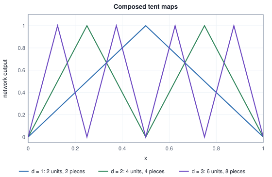

<!-- SPDX-License-Identifier: CC-BY-4.0 -->
<!-- Copyright (c) 2026 Martin Schröder <info@swedishembedded.com> -->

# Multilayer Networks

*Why does stacking layers with a nonlinearity between them let a network represent almost anything?*

The previous chapter ended with a network that works and cannot be trained. Two threshold neurons read the inputs $x_1, x_2$, a third reads their outputs, and together they compute the exclusive or that no single neuron can. Every weight in it was found by thinking. A step activation gives a gradient method nothing to follow: nudge a weight and the output does not move at all, until the nudge is large enough to make it jump. And a hidden neuron has no label of its own, so the perceptron rule could not touch it.

Two changes remove those obstacles and leave the shape of the network alone. The units get activation functions that vary smoothly, so that a small change of a weight makes a small change of the output. And the layers are written as matrices acting on a whole batch of examples at once, which is how every network in this book and in brain is computed. What is left is the doubt whether anything was lost on the way. A network that cannot represent the function we want is a dead end however well it is trained, so what such a network can represent has to be settled before anyone asks how to train it.

The answer has three parts, and each is measured rather than asserted. A nonlinearity between the layers is essential, because without it any number of layers is one layer. With it, a single hidden layer can follow any continuous curve as closely as we like, at a price that we count: in one dimension the error falls like $1/k^2$ in the number of units $k$, and in $D$ dimensions the same construction needs a number of units that grows like a power of $D$. And depth buys something that width does not: a function with $2^d$ linear pieces that a network $d$ layers deep builds from $2d$ units needs at least $2^d - 1$ units if it has one layer.

The route starts with chapter 1's XOR network rebuilt from tanh and ReLU units, which shows what a hidden layer does. The shapes $[B, D] \to [B, H] \to [B, O]$ follow, with the cost of a forward computation in parameters, FLOPs and bytes, and then a computed demonstration that stacked linear layers collapse into one. That is why the activation functions come next, with their derivatives and the reasons ReLU, GELU and SiLU displaced the sigmoid and tanh in deep networks. The representation question is answered after them, with a curve built from ReLU ramps and the universal approximation theorem, and the comparison of depth with width closes the argument with a sawtooth whose pieces double at every layer. Training stays out of it: how weights are found is the subject of the chapters from the fourth on, and this chapter only makes sure that something worth finding exists.

The argument leans on the neuron and the activation function (chapter 1), the matrix-vector product and the composition of linear maps (Volume I, chapter 4), and composition of functions (Volume I, chapter 2). Five questions bring these back; answer them from memory, because the answers are at the end of the chapter, and a hard one sends you to the chapter it names.

1. (Chapter 1, "The Neuron and the Perceptron", the artificial neuron.) A neuron has weights $\mathbf{w} = (2, -1)$, bias $b = 0.5$ and the identity as its activation. What does it output for $\mathbf{x} = (1, 3)$?
2. (Chapter 1, the activation function.) Which activation turns the neuron $g(\mathbf{w}\cdot\mathbf{x} + b)$ into linear regression, which into logistic regression and which into the perceptron? Why could the perceptron's activation not be used to train a hidden neuron?
3. (Volume I, chapter 4, "Matrices as Linear Maps", the matrix-vector product.) A matrix $\mathbf{W}$ has shape $[3, 2]$ and $\mathbf{x}$ has two entries. What is the shape of $\mathbf{W}\mathbf{x}$, and what is its first entry in terms of the first row of $\mathbf{W}$?
4. (Volume I, chapter 2, "Functions and Their Shapes", composition.) For $f(x) = 2x + 1$ and $g(x) = x - 3$, compute $g(f(x))$ and $f(g(x))$. Are they equal?
5. (Volume I, chapter 4, composing linear maps, three chapters back.) The linear map $\mathbf{A}$ has shape $[3, 2]$ and $\mathbf{B}$ has shape $[4, 3]$. Which single matrix does $\mathbf{x} \mapsto \mathbf{B}(\mathbf{A}\mathbf{x})$ equal, and what is its shape?

## The XOR network again, smooth

Take the hand-built network of chapter 1 and give its neurons smooth activations. The chapter-1 hidden neurons computed $\mathrm{step}(x_1 + x_2 - 0.5)$ and $\mathrm{step}(x_1 + x_2 - 1.5)$. Scale both weighted sums by 4, so that they read $4(x_1 + x_2) - 2$ and $4(x_1 + x_2) - 6$, and replace the step with $\tanh$, the hyperbolic tangent. The tanh is a smooth step that goes from $-1$ to $+1$ instead of from $0$ to $1$; the factor 4 makes the transition steep enough that the two hidden values sit close to their extremes. The output neuron takes $5h_1 - 5h_2 - 5$ and passes it through the sigmoid of chapter 1. Writing the hidden weights as a matrix $\mathbf{W}_1$ with one row per hidden unit, and its biases as $\mathbf{b}_1$:

<!-- worked: mlp.xor_smooth -->
Hidden unit i: h_i = tanh(z_i) with z = W1 x + b1, W1 = [[4, 4], [4, 4]], b1 = (-2, -6). Output: y = sigmoid(z_out) with z_out = 5 h1 - 5 h2 - 5.

| x1 | x2 | z1 | h1 | z2 | h2 | z_out | y | XOR |
|---|---:|---:|---:|---:|---:|---:|---:|---:|
| 0 | 0 | -2.0 | -0.9640 | -6.0 | -1.0000 | -4.8202 | 0.0080 | 0 |
| 0 | 1 | +2.0 | 0.9640 | -2.0 | -0.9640 | +4.6403 | 0.9904 | 1 |
| 1 | 0 | +2.0 | 0.9640 | -2.0 | -0.9640 | +4.6403 | 0.9904 | 1 |
| 1 | 1 | +6.0 | 1.0000 | +2.0 | 0.9640 | -4.8202 | 0.0080 | 0 |
<!-- /worked -->

Read the table from the left. The hidden units see only the sum $x_1 + x_2$ (both rows of $\mathbf{W}_1$ are $(4, 4)$), which is $0$, $1$ or $2$. For the sum $0$ both hidden values are close to $-1$; for the sum $1$ the first is close to $+1$ and the second still close to $-1$; for the sum $2$ both are close to $+1$. The output unit computes $5(h_1 - h_2) - 5$, which is positive exactly when $h_1 - h_2$ exceeds $1$, and that happens only in the middle case. So the output $y$ is $0.0080$, $0.9904$, $0.9904$, $0.0080$: not exactly $0$ and $1$, but on the right side of $0.5$ for every row, and now every unit has a slope.

The same function can be built with the simplest unit of all. The ReLU, $\mathrm{relu}(z) = \max(0, z)$, is zero for negative inputs and the identity for positive ones (Volume I, chapter 2). Two ReLU hidden units and a linear output suffice:

<!-- worked: mlp.xor_relu -->
Two ReLU hidden units, z1 = x1 + x2 and z2 = x1 + x2 - 1, h = relu(z), and the output y = h1 - 2 h2 with no activation on the output.

| x1 | x2 | z1 | h1 | z2 | h2 | y = h1 - 2 h2 | XOR |
|---|---:|---:|---:|---:|---:|---:|---:|
| 0 | 0 | 0 | 0 | -1 | 0 | 0 | 0 |
| 0 | 1 | 1 | 1 | 0 | 0 | 1 | 1 |
| 1 | 0 | 1 | 1 | 0 | 0 | 1 | 1 |
| 1 | 1 | 2 | 2 | 1 | 1 | 0 | 0 |
<!-- /worked -->

Here $y = h_1 - 2h_2$ with $h_1 = \mathrm{relu}(x_1 + x_2)$ and $h_2 = \mathrm{relu}(x_1 + x_2 - 1)$. As a function of the sum $s = x_1 + x_2$ it is $\mathrm{relu}(s) - 2\,\mathrm{relu}(s - 1)$: zero at $s = 0$, one at $s = 1$, back to zero at $s = 2$. It is a tent, the shape Volume I built from three ramps. XOR is "the sum is exactly one", and a tent peaked at one says that.

### The hidden pair as new coordinates

Look at the columns $h_1, h_2$ of the ReLU table as a pair of coordinates. The four inputs, which sat on the corners of a square where no line separates the classes, become four points $(h_1, h_2)$:

| input $(x_1, x_2)$ | hidden pair $(h_1, h_2)$ | XOR |
|---|---|---:|
| $(0, 0)$ | $(0, 0)$ | 0 |
| $(0, 1)$ | $(1, 0)$ | 1 |
| $(1, 0)$ | $(1, 0)$ | 1 |
| $(1, 1)$ | $(2, 1)$ | 0 |

The two inputs of class 1 are now the same point $(1, 0)$, and the points of class 0 are $(0, 0)$ and $(2, 1)$. Those three points are separable by a line: the output neuron's own line $h_1 - 2h_2 = 0.5$ does it. This is what a **hidden layer** is: a layer of units whose outputs are not the answer but a new description of the input, from which the next layer can compute the answer with a simple rule. The units are called hidden because their values are never given in the data. A dataset says "this input has label 1"; it does not say what $h_1$ should be.

Chapter 1 named two ways out of the XOR problem: a feature map written by hand, or neurons that choose the features. The hidden layer is the second made precise. Its weights $\mathbf{W}_1$ and $\mathbf{b}_1$ are parameters like any other, so the features it computes are learned, not designed. Whether they can be learned is the matter of the chapters that follow. That features chosen by the network are all it takes to get past XOR is the reason layers are worth stacking.

A network of fully connected layers, each followed by an activation (the last often an identity or a task-specific function), is a **multilayer perceptron** (MLP). The name is historical: the units are rarely perceptrons now, since the step is replaced by a smooth activation. Fully connected means that every unit of a layer reads every output of the layer before.

## One layer, then a batch

A layer of $H$ units reading $D$ inputs is $H$ neurons sharing one input. Chapter 1 wrote one neuron as $y = g(\mathbf{w}\cdot\mathbf{x} + b)$. Stack the $H$ weight vectors as the rows of a matrix $\mathbf{W}$ of shape $[H, D]$, and the biases into a vector $\mathbf{b}$ of $H$ entries. The weighted sums of all $H$ units are one matrix-vector product,

$$
\mathbf{z} = \mathbf{W}\mathbf{x} + \mathbf{b} \quad [H], \qquad \mathbf{h} = g(\mathbf{z}) \quad [H],
$$

where $g$ is applied to every entry separately. The shape of $\mathbf{W}$ is written *outputs by inputs*: row $j$ is neuron $j$, so $\mathbf{W}\mathbf{x}$ has $H$ entries.

A training set is many examples, and the useful unit of computation is a batch of $B$ of them. Put the examples in the rows of $\mathbf{X}$, of shape $[B, D]$, the layout used throughout Volume II. Row $n$ of the result must be $(\mathbf{W}\mathbf{x}_n + \mathbf{b})^\top$, and that is the row $n$ of $\mathbf{X}\mathbf{W}^\top$ plus $\mathbf{b}^\top$:

$$
\mathbf{Z} = \mathbf{X}\mathbf{W}^\top + \mathbf{1}\mathbf{b}^\top \quad [B, H], \qquad \mathbf{A} = g(\mathbf{Z}) \quad [B, H].
$$

Here $\mathbf{1}$ is a column of $B$ ones, so $\mathbf{1}\mathbf{b}^\top$ is the bias vector repeated in every row (the broadcast of Volume I, chapter 5). The transpose is there because $\mathbf{W}$ keeps the *outputs by inputs* shape, and $\mathbf{X}\mathbf{W}^\top$ has the inner dimension $D$ matching on both sides. A network is a chain of such layers. For layer $\ell = 1, 2, \dots$ with weights $\mathbf{W}_\ell$ and biases $\mathbf{b}_\ell$, and with $\mathbf{A}_0 = \mathbf{X}$,

$$
\mathbf{Z}_\ell = \mathbf{A}_{\ell-1}\mathbf{W}_\ell^\top + \mathbf{1}\mathbf{b}_\ell^\top, \qquad \mathbf{A}_\ell = g(\mathbf{Z}_\ell),
$$

except that the last layer usually applies no activation (or one chosen for the task, like the softmax of the next chapter), so its output is $\mathbf{Z}$. A network with one hidden layer has the shapes $\mathbf{X}: [B, D] \to \mathbf{Z}_1, \mathbf{A}_1: [B, H] \to \mathbf{Y}: [B, O]$, with $\mathbf{W}_1: [H, D]$ and $\mathbf{W}_2: [O, H]$.


A numerical case, small enough to check by hand. Three examples, two inputs, three hidden units with tanh, two outputs:

<!-- worked: mlp.batch_forward -->
B = 3, D = 2, H = 3, O = 2. X = [[0.5, -1], [1, 2], [-1.5, 0.5]], W1 = [[1, -1], [0.5, 2], [-2, 1]], b1 = (0, 0.5, -0.5), W2 = [[1, -1, 0.5], [0.5, 1, -1]], b2 = (0.1, -0.1), hidden activation tanh.

| row n | x (D = 2) | Z1 = X W1^T + b1 (H = 3) | A = tanh(Z1) (H = 3) | Y = A W2^T + b2 (O = 2) |
|---|---:|---:|---:|---:|
| 0 | (0.5, -1) | (1.5000, -1.2500, -2.5000) | (0.9051, -0.8483, -0.9866) | (1.3601, 0.4909) |
| 1 | (1, 2) | (-1.0000, 5.0000, -0.5000) | (-0.7616, 0.9999, -0.4621) | (-1.8926, 0.9812) |
| 2 | (-1.5, 0.5) | (-2.0000, 0.7500, 3.0000) | (-0.9640, 0.6351, 0.9951) | (-1.0016, -0.9419) |
<!-- /worked -->

Check row 0 by hand. $\mathbf{x}_0 = (0.5, -1)$ gives the first hidden sum $1\cdot 0.5 + (-1)(-1) + 0 = 1.5$, the second $0.5\cdot 0.5 + 2\cdot(-1) + 0.5 = -1.25$ and the third $-2\cdot 0.5 + 1\cdot(-1) - 0.5 = -2.5$, the first row of $\mathbf{Z}_1$. Their tanh values are $0.9051$, $-0.8483$ and $-0.9866$, and the first output is $1\cdot 0.9051 + (-1)(-0.8483) + 0.5(-0.9866) + 0.1 = 1.3601$. Every row is computed independently of the others: the batch is a way of doing many identical computations with one matrix product, never a way for examples to interact.

The algorithm, in the book's pseudocode. A layer takes the previous activations, a weight matrix, a bias vector and an activation function; a network chains layers, with the identity on the last.

```text
function identity(z: real) -> real:
    return z

function layer_forward(A_in: array<real>[B, K], W: array<real>[N, K], b: array<real>[N],
                       g: function(real) -> real)
        -> (array<real>[B, N], array<real>[B, N]):
    require W.shape[1] == A_in.shape[1], "layer inputs do not match the previous width"
    require b.shape[0] == W.shape[0], "one bias per unit"
    Z = matmul(A_in, transpose(W))                 # [B, N]
    A = zeros(real, [B, N])
    for i in 0 .. B:
        for j in 0 .. N:
            Z[i, j] = Z[i, j] + b[j]               # b added to every row
            A[i, j] = g(Z[i, j])
    return (Z, A)

function network_forward(X: array<real>[B, D], Ws: list<array<real>>, bs: list<array<real>>,
                         g: function(real) -> real) -> array<real>[B, O]:
    require len(Ws) >= 1 and len(Ws) == len(bs), "one weight matrix and one bias per layer"
    A = X
    for layer in 0 .. len(Ws):
        if layer < len(Ws) - 1:
            (Z, A) = layer_forward(A, Ws[layer], bs[layer], g)
        else:
            (Z, A) = layer_forward(A, Ws[layer], bs[layer], identity)
    return A                                       # O = Ws[len(Ws) - 1].shape[0]
```

The loop index `layer` counts from $0$; it is $\ell - 1$ in the equations. Chapter 4 writes the forward computation of a two-layer network with a loss attached (`mlp_forward`); this one is the loss-free skeleton for any number of layers.

### Counting parameters and work

A network is a table of numbers, and its size is the first thing to count. Layer $\ell$ has $d_\ell d_{\ell-1}$ weights and $d_\ell$ biases, where $d_\ell$ is its width. For one example, the matrix products cost two operations (a multiply and an add) per weight: $2 d_\ell d_{\ell-1}$ floating-point operations (FLOPs) per layer. The bias adds and the activations add $d_\ell$ operations each, a small fraction that the table leaves out. Four networks:

<!-- worked: mlp.parameter_counts -->
Parameters = sum over layers of (d_out d_in + d_out); weight bytes at 4 bytes per parameter; FLOPs = 2 d_out d_in per layer for the matrix products of one example (a multiply and an add each), not counting the bias adds and the activations.

| network | widths D-...-O | parameters | weight bytes (f32) | matmul FLOPs per example |
|---|---|---:|---:|---:|
| XOR network of this chapter | 2-2-1 | 9 | 36 | 12 |
| small image classifier | 784-128-10 | 101,770 | 407,080 | 203,264 |
| two hidden layers | 784-512-512-10 | 669,706 | 2,678,824 | 1,337,344 |
| one transformer feed-forward block | 768-3072-768 | 4,722,432 | 18,889,728 | 9,437,184 |
<!-- /worked -->

The XOR network is $2 \cdot 2 + 2$ plus $1 \cdot 2 + 1$ is nine numbers. The one-hidden-layer classifier with $128$ units has $101{,}770$, almost all in the first matrix ($784 \times 128 = 100{,}352$), and the same count says how many bytes the weights occupy, $4$ per number in 32-bit floating point. The FLOPs are exactly twice the weights without the biases: each weight is used once per example, and the work is as large as the model. Those counts say nothing about time, which depends on the machine; they say how much arithmetic and how many bytes any machine must handle.

A batch changes the balance between the two. One linear layer $\mathbf{Z} = \mathbf{X}\mathbf{W}^\top$ with $D = 768$ and $H = 3072$ (the first matrix of the feed-forward block in the table above) does $2BDH$ FLOPs for a batch of $B$. It must read $\mathbf{X}$ ($BD$ numbers), read $\mathbf{W}$ ($HD$ numbers, once, however large $B$ is) and write $\mathbf{Z}$ ($BH$ numbers):

<!-- worked: mlp.layer_work -->
One linear layer Z = X W^T with D = 768 inputs and H = 3072 outputs (the first matrix of a transformer feed-forward block), float32. FLOPs = 2 B D H. Bytes = 4 (B D + H D + B H): the batch is read, the weights are read once, the result is written.

| batch B | FLOPs | bytes moved | FLOPs per byte |
|---|---:|---:|---:|
| 1 | 4,718,592 | 9,452,544 | 0.5 |
| 16 | 75,497,472 | 9,682,944 | 7.8 |
| 256 | 1,207,959,552 | 13,369,344 | 90.4 |
| 4096 | 19,327,352,832 | 72,351,744 | 267.1 |
<!-- /worked -->

At $B = 1$ the weights dominate the traffic and every number read from memory is used for one multiply and one add, $0.5$ FLOPs per byte moved. At $B = 4096$ the same weights serve $4096$ examples and the ratio is $267.1$. A larger batch does not change the arithmetic per example (it is $2DH$ whatever $B$ is); it changes how many times each weight, once fetched, is used. That is why batches matter for the engine, and a later volume returns to it as the roofline.

## Why the nonlinearity is essential

Why not use the identity as every activation and let the layers do the work? Because the layers then do no work that one layer could not do. Take the XOR network of this section with the identity as its hidden activation, so that $\mathbf{A}_1 = \mathbf{Z}_1$. For a single example the output is

$$
\mathbf{y} = \mathbf{W}_2(\mathbf{W}_1\mathbf{x} + \mathbf{b}_1) + \mathbf{b}_2 = (\mathbf{W}_2\mathbf{W}_1)\,\mathbf{x} + (\mathbf{W}_2\mathbf{b}_1 + \mathbf{b}_2).
$$

This is the composition of two linear maps, which is the product matrix $\mathbf{W}_2\mathbf{W}_1$ (Volume I, chapter 4), plus a constant: one layer, with weights $\mathbf{W}_2\mathbf{W}_1$ of shape $[O, D]$ and bias $\mathbf{W}_2\mathbf{b}_1 + \mathbf{b}_2$. Repeat the step and any number of linear layers is one:

$$
\mathbf{W}_n(\cdots(\mathbf{W}_2(\mathbf{W}_1\mathbf{x} + \mathbf{b}_1) + \mathbf{b}_2)\cdots) + \mathbf{b}_n = \mathbf{M}\mathbf{x} + \mathbf{c}
$$

for a single matrix $\mathbf{M} = \mathbf{W}_n\cdots\mathbf{W}_1$ and a single vector $\mathbf{c}$. Run it on the weights of the smooth XOR network:

<!-- worked: mlp.linear_collapse -->
The XOR network of the previous example with the identity as hidden activation. W2 W1 = [[0.0, 0.0]], W2 b1 + b2 = 15.0.

| x1 | x2 | z1 | z2 | two layers | one layer (W2 W1) x + (W2 b1 + b2) |
|---|---:|---:|---:|---:|---:|
| 0 | 0 | -2.0 | -6.0 | +15.0 | +15.0 |
| 0 | 1 | +2.0 | -2.0 | +15.0 | +15.0 |
| 1 | 0 | +2.0 | -2.0 | +15.0 | +15.0 |
| 1 | 1 | +6.0 | +2.0 | +15.0 | +15.0 |

A second network, W1 = [[1, 2], [0, -1], [3, 1]], b1 = (1, 0, -1), W2 = [[2, -1, 1]], b2 = 0.5, at x = (1, 2).

| quantity | value |
|---|---:|
| z1 = W1 x + b1 | (6, -2, 4) |
| two layers: W2 z1 + b2 | 18.5 |
| W2 W1 (1 x 2) | [[5, 6]] |
| W2 b1 + b2 | 1.5 |
| one layer: (W2 W1) x + (W2 b1 + b2) | 18.5 |
<!-- /worked -->

In the first table the two layers produce $+15.0$ for every one of the four inputs. The product $\mathbf{W}_2\mathbf{W}_1 = 5\cdot(4, 4) + (-5)\cdot(4, 4) = (0, 0)$, because the two hidden units were built to cancel each other on the part of the input that matters; with the cancelling nonlinearity removed nothing is left of the XOR network but its constant. The second table is a less special case. The network of three hidden units, $\mathbf{x} = (1, 2)$: the two layers give $18.5$ and the single collapsed layer $[5, 6]\,\mathbf{x} + 1.5$ gives $18.5$ too, to the last digit, as the algebra says.

The same argument bounds what linear stacks can do. The rank of a product never exceeds the rank of either factor (Volume I, chapter 4), so a stack whose narrowest layer has $H$ units is a linear map of rank at most $H$. Depth without nonlinearity adds parameters and arithmetic but no expressive power: for classification, the boundary is still one hyperplane, which is the line of chapter 1. Everything that stacking can add comes from the activation function between the layers, and Volume I's ReLU example already showed the mechanism: a ReLU between two lines gives a composite that agrees with the collapsed line where the ReLU passes its input, and differs where it clips.

## The activation functions

The choice of $g$ matters for two reasons: which functions the network can represent, and whether the gradient that reaches the first layers is usable. Four activations cover almost all of this book. We take them in the order of their history.

### Four curves

The **tanh** activation is the hyperbolic tangent $\tanh(z) = (e^z - e^{-z})/(e^z + e^{-z})$. It is the sigmoid of chapter 1 rescaled to be centred on zero, $\tanh(z) = 2\sigma(2z) - 1$, and it ranges over $(-1, 1)$. It was a common hidden activation for a long time because its output is centred (a layer's outputs have no systematic sign for the next layer to compensate) and because its slope at zero is $1$ rather than the sigmoid's $\tfrac14$.

The **ReLU** (rectified linear unit) is $\mathrm{relu}(z) = \max(0, z)$, the piecewise function of Volume I. Its slope is $1$ for $z > 0$ and $0$ for $z < 0$. At exactly $z = 0$ it has a kink and no derivative; any slope between $0$ and $1$ is a valid choice, and this book takes $0$, so that $\mathrm{relu}'(0) = 0$.

The **GELU** (Gaussian error linear unit) is $\mathrm{gelu}(z) = z\,\Phi(z)$, where $\Phi$ is the standard Gaussian cumulative distribution function of Volume I. It multiplies the input by the probability that a standard Gaussian variable falls below it: a large positive $z$ is passed almost unchanged ($\Phi \approx 1$), a large negative one is almost removed ($\Phi \approx 0$), and in between the input is scaled softly. Through the error function, $\Phi(z) = \tfrac12\bigl(1 + \mathrm{erf}(z/\sqrt2)\bigr)$.

The **SiLU** (sigmoid linear unit, also called swish) is the same idea with the logistic cumulative distribution of chapter 1 in place of the Gaussian: $\mathrm{silu}(z) = z\,\sigma(z)$.

All four at nine points, each followed by its derivative. The derivatives are worked out below the table.

<!-- worked: mlp.activation_table -->
tanh(x), relu(x) = max(0, x), gelu(x) = x Phi(x) with the exact erf form, silu(x) = x sigmoid(x); each followed by its derivative (the derivative of relu at 0 is taken as 0).

| x | tanh | tanh' | relu | relu' | gelu | gelu' | silu | silu' |
|---|---:|---:|---:|---:|---:|---:|---:|---:|
| -3.0 | -0.9951 | 0.0099 | 0.0000 | 0.0000 | -0.0040 | -0.0119 | -0.1423 | -0.0881 |
| -2.0 | -0.9640 | 0.0707 | 0.0000 | 0.0000 | -0.0455 | -0.0852 | -0.2384 | -0.0908 |
| -1.0 | -0.7616 | 0.4200 | 0.0000 | 0.0000 | -0.1587 | -0.0833 | -0.2689 | 0.0723 |
| -0.5 | -0.4621 | 0.7864 | 0.0000 | 0.0000 | -0.1543 | 0.1325 | -0.1888 | 0.2600 |
| +0.0 | 0.0000 | 1.0000 | 0.0000 | 0.0000 | 0.0000 | 0.5000 | 0.0000 | 0.5000 |
| +0.5 | 0.4621 | 0.7864 | 0.5000 | 1.0000 | 0.3457 | 0.8675 | 0.3112 | 0.7400 |
| +1.0 | 0.7616 | 0.4200 | 1.0000 | 1.0000 | 0.8413 | 1.0833 | 0.7311 | 0.9277 |
| +2.0 | 0.9640 | 0.0707 | 2.0000 | 1.0000 | 1.9545 | 1.0852 | 1.7616 | 1.0908 |
| +3.0 | 0.9951 | 0.0099 | 3.0000 | 1.0000 | 2.9960 | 1.0119 | 2.8577 | 1.0881 |
<!-- /worked -->


The derivatives follow from rules of Volume I. For tanh, $\tanh' = 4\sigma'(2z) = 4\sigma(2z)(1 - \sigma(2z))$ by the chain rule and the sigmoid's slope $\sigma' = \sigma(1 - \sigma)$ (Volume II, chapter 3). Writing $t = \tanh(z) = 2\sigma(2z) - 1$, so that $\sigma(2z) = (1 + t)/2$, this is $(1 + t)(1 - t)$:

$$
\tanh'(z) = 1 - \tanh^2(z).
$$

For the ReLU, the slope is $1$ or $0$ as above. For the SiLU, the product rule gives $\mathrm{silu}'(z) = \sigma(z) + z\,\sigma'(z)$, that is

$$
\mathrm{silu}'(z) = \sigma(z) + z\,\sigma(z)\bigl(1 - \sigma(z)\bigr).
$$

For the GELU, the product rule with $\Phi' = \phi$ (the Gaussian density) gives

$$
\mathrm{gelu}'(z) = \Phi(z) + z\,\phi(z), \qquad \phi(z) = \frac{e^{-z^2/2}}{\sqrt{2\pi}}.
$$

Check one number from the table by hand. At $z = 1$, $\sigma(1) = 0.7311$, so $\mathrm{silu}'(1) = 0.7311 + 1\cdot 0.7311\cdot 0.2689 = 0.7311 + 0.1966 = 0.9277$, as printed. And $\Phi(1) = 0.8413$, $\phi(1) = 0.2420$, so $\mathrm{gelu}'(1) = 0.8413 + 0.2420 = 1.0833$.


The picture of the derivatives is the more informative one. Tanh's slope is a bell: largest at $z = 0$, nearly gone beyond $|z| = 3$. The ReLU's slope is a switch. GELU and SiLU are smooth versions of the switch, and both have a feature the ReLU lacks: for negative $z$ the function dips below zero, and so the slope is *negative* over part of that range, and for positive $z$ the slope rises above $1$ before settling. The next table measures this on a grid of $12{,}001$ points:

<!-- worked: mlp.activation_facts -->
Grid x = -6 + 0.001 i for i = 0, ..., 12000 (12001 points). A tie for the lowest value or the largest slope goes to the first (lowest) grid point attaining it.

| function | lowest value | at x | largest slope | at x | slope at x = 4 | share with |slope| < 0.01 | share with slope >= 0.5 |
|---|---:|---:|---:|---:|---:|---:|---:|
| tanh | -1.0000 | -6.000 | 1.0000 | +0.000 | 0.0013 | 0.501 | 0.147 |
| relu | 0.0000 | -6.000 | 1.0000 | +0.001 | 1.0000 | 0.500 | 0.500 |
| gelu | -0.1700 | -0.752 | 1.1289 | +1.414 | 1.0005 | 0.248 | 0.500 |
| silu | -0.2785 | -1.278 | 1.0998 | +2.399 | 1.0527 | 0.008 | 0.500 |
<!-- /worked -->

GELU's lowest value is $-0.1700$, at $z = -0.752$; SiLU's is $-0.2785$ at $z = -1.278$. Both slopes overshoot $1$, GELU's to $1.1289$ at $z = 1.414$ and SiLU's to $1.0998$ at $z = 2.399$, and settle towards $1$ from above, which the column "slope at $z = 4$" shows ($1.0005$ and $1.0527$). The two share columns say the same thing in another way. Almost half of the grid ($0.501$) has a tanh slope below $0.01$ and exactly half ($0.500$, the negative half) has a ReLU slope of zero, against $0.248$ for GELU and $0.008$ for SiLU; and a slope of at least $0.5$ is found on $0.147$ of the grid for tanh and on $0.500$ for the other three. Neither GELU nor SiLU has a convention to make at zero: both are smooth there, and $\mathrm{gelu}'(0) = \mathrm{silu}'(0) = 0.5$.

### Three forms of GELU

The exact GELU needs $\Phi$, so needs the error function $\mathrm{erf}$, which is not an elementary arithmetic operation. Two cheaper curves are in common use as replacements, and they are not the same function:

- the **tanh form**, $\tfrac12 z\bigl(1 + \tanh\bigl(\sqrt{2/\pi}\,(z + 0.044715\,z^3)\bigr)\bigr)$, which replaces $\Phi$ by a tanh of a cubic polynomial;
- the **sigmoid form** (often called quick GELU), $z\,\sigma(1.702\,z)$, which replaces $\Phi$ by a logistic curve steepened by the factor $1.702$.

The SiLU, $z\,\sigma(z)$, is the sigmoid form without the factor. How far is each from the exact form?

<!-- worked: mlp.gelu_forms -->
exact gelu(x) = 0.5 x (1 + erf(x / sqrt 2)); tanh form 0.5 x (1 + tanh(sqrt(2/pi) (x + 0.044715 x^3))); quick form x sigmoid(1.702 x); silu x sigmoid(x).

| x | exact | tanh form | abs diff | quick form | abs diff | silu |
|---|---:|---:|---:|---:|---:|---:|
| -3.0 | -0.004050 | -0.003637 | 4.12e-04 | -0.018071 | 1.40e-02 | -0.142278 |
| -1.0 | -0.158655 | -0.158808 | 1.53e-04 | -0.154204 | 4.45e-03 | -0.268941 |
| -0.5 | -0.154269 | -0.154286 | 1.72e-05 | -0.149612 | 4.66e-03 | -0.188770 |
| +0.5 | 0.345731 | 0.345714 | 1.72e-05 | 0.350388 | 4.66e-03 | 0.311230 |
| +1.0 | 0.841345 | 0.841192 | 1.53e-04 | 0.845796 | 4.45e-03 | 0.731059 |
| +3.0 | 2.995950 | 2.996363 | 4.12e-04 | 2.981929 | 1.40e-02 | 2.857722 |

Largest absolute difference from the exact form over x = -6 + 0.01 i, i = 0, ..., 1200 (differences are compared after rounding to 12 decimals; among ties, which occur because the difference is an even function of x, the grid point with the lowest x, the negative one, is reported).

| approximation | largest abs difference | at x |
|---|---:|---:|
| tanh form | 4.732e-04 | -2.70 |
| quick form x sigmoid(1.702 x) | 2.033e-02 | -2.27 |
| silu x sigmoid(x) | 1.930e-01 | -1.97 |
<!-- /worked -->

The tanh form is within $4.7\times 10^{-4}$ of the exact function at every point of that grid; the sigmoid form is within $2.0\times 10^{-2}$; the SiLU, whose only difference from the sigmoid form is the missing factor $1.702$, is off by as much as $0.193$. Three curves that look the same in a plot are three different functions, and a model trained with one and evaluated with another has been given a different function. The same holds for their derivatives, which a training step uses. The tanh form's slope is $0.5(1 + t) + 0.5z(1 - t^2)\sqrt{2/\pi}\,(1 + 3\cdot 0.044715\,z^2)$ with $t = \tanh(\sqrt{2/\pi}(z + 0.044715 z^3))$ (the product rule and the chain rule). Against the exact slope:

<!-- worked: mlp.gelu_derivative_gap -->
Derivative of the exact gelu, 0.5 (1 + erf(x / sqrt 2)) + x exp(-x^2 / 2) / sqrt(2 pi), against the derivative of the tanh form, 0.5 (1 + t) + 0.5 x (1 - t^2) sqrt(2/pi) (1 + 3 * 0.044715 x^2) with t = tanh(sqrt(2/pi) (x + 0.044715 x^3)).

| x | exact gelu' | tanh-form gelu' | abs diff |
|---|---:|---:|---:|
| -3.0 | -0.011946 | -0.011584 | 3.61e-04 |
| -2.0 | -0.085232 | -0.086099 | 8.67e-04 |
| -1.0 | -0.083315 | -0.082964 | 3.51e-04 |
| +0.0 | 0.500000 | 0.500000 | 0.00e+00 |
| +1.0 | 1.083315 | 1.082964 | 3.51e-04 |
| +2.0 | 1.085232 | 1.086099 | 8.67e-04 |
| +3.0 | 1.011946 | 1.011584 | 3.61e-04 |

Over x = -4 + 0.01 i, i = 0, ..., 800 the largest absolute difference (differences compared after rounding to 12 decimals; the difference is an even function of x, so the lowest x of a tied pair is reported) is 8.684e-04 at x = -2.02; the largest relative difference (where |exact gelu'| > 0.001) is 0.253.
<!-- /worked -->

The two slopes differ by at most $8.684\times 10^{-4}$, at $z = -2.02$. That is small enough to hide: a program that evaluates the exact GELU going forward and the tanh form's slope going backward would produce gradients that are wrong in the fourth digit and a loss curve that looks normal. Volume I, chapter 7, tells the story of how brain met this trap; the rule it taught is that a forward function and its backward must be the same function, and this chapter's table shows how small the temptation to mix them is.

### Slopes multiply: why the old units gave way

A network with several hidden layers is a composition, so its derivative with respect to an early weight is a product of factors, one from each layer; chapter 4 derives this properly and chapter 12 studies what goes wrong. The factors that depend on the activation function are its slopes $g'(z)$ at the pre-activations the layer actually had. A preview, with the weights' own factors left out: the product of the same slope $g'(z)$ taken over a number of layers.

<!-- worked: mlp.slope_chain -->
The activation's own slope g'(z) at a fixed pre-activation z, raised to the number of layers: the product of equal slope factors, as a chain of layers that all sit at the same z would give. The weights contribute factors of their own.

| activation | z | slope g'(z) | depth 1 | depth 5 | depth 10 | depth 20 |
|---|---:|---:|---:|---:|---:|---:|
| sigmoid | +0.0 | 0.2500 | 2.50e-01 | 9.77e-04 | 9.54e-07 | 9.09e-13 |
| tanh | +0.0 | 1.0000 | 1.00e+00 | 1.00e+00 | 1.00e+00 | 1.00e+00 |
| tanh | +1.0 | 0.4200 | 4.20e-01 | 1.31e-02 | 1.71e-04 | 2.91e-08 |
| tanh | +2.0 | 0.0707 | 7.07e-02 | 1.76e-06 | 3.10e-12 | 9.60e-24 |
| relu | +1.0 | 1.0000 | 1.00e+00 | 1.00e+00 | 1.00e+00 | 1.00e+00 |
| gelu | +1.0 | 1.0833 | 1.08e+00 | 1.49e+00 | 2.23e+00 | 4.96e+00 |
| silu | +1.0 | 0.9277 | 9.28e-01 | 6.87e-01 | 4.72e-01 | 2.23e-01 |
<!-- /worked -->

The sigmoid's slope never exceeds $0.25$, so even at its best point twenty layers shrink the product to $9.09\times 10^{-13}$. Tanh's slope reaches $1$ only at $z = 0$ and falls off on both sides, so a unit pushed to $z = 2$ contributes $0.0707$ per layer, and twenty such layers $9.60\times 10^{-24}$. A unit whose input is large in either direction is **saturated**: its output barely responds to its input, and neither does the gradient. The ReLU's slope is exactly $1$ wherever the unit is active, so the product over its active units is $1$ however deep the chain is. GELU and SiLU lie near $1$ where the input is positive; here GELU's slope at $z = 1$, $1.0833$, grows over twenty layers to $4.96$ and SiLU's, $0.9277$, shrinks to $0.223$. The table is a preview, not a verdict: real pre-activations are not all equal and the weights contribute their own factors, which is the subject of the initialization chapter. It does show the direction. Sigmoid and tanh cannot pass a signal back through many saturated layers, and a unit with slope close to $1$ over a wide range of inputs can.

The honest summary of why ReLU, GELU and SiLU won is therefore partly this arithmetic and partly experience. Networks with many layers trained with them reached lower losses and trained more reliably. The theory that fully explains the preference does not exist, and a text that claimed one would be overstating.

### What the ReLU costs: units that switch off

The ReLU passes nothing for negative inputs, and it passes back nothing. Take a layer of eight ReLU units on four inputs with random weights, $1000$ random inputs and zero biases; then change the bias of the last unit to $-12$:

<!-- worked: mlp.relu_sparsity -->
Generator: the book's SplitMix64, seed 0xa1bef3f58a690e71 (11655021121596100209). Draw order: 8 x 4 weights W[u, j] with normal(), row by row, then 1000 x 4 inputs X[n, j] with normal(), row by row. Unit u computes relu(W[u] . x + b[u]) with b = 0 except b[7] = -12.

| unit u | length of W[u] | b[u] | examples with output > 0 (of 1000) | share |
|---|---:|---:|---:|---:|
| 0 | 2.136 | +0.0 | 511 | 0.511 |
| 1 | 1.505 | +0.0 | 508 | 0.508 |
| 2 | 1.558 | +0.0 | 506 | 0.506 |
| 3 | 1.921 | +0.0 | 486 | 0.486 |
| 4 | 2.080 | +0.0 | 464 | 0.464 |
| 5 | 1.387 | +0.0 | 503 | 0.503 |
| 6 | 2.630 | +0.0 | 480 | 0.480 |
| 7 | 1.653 | -12.0 | 0 | 0.000 |

Overall 3458 of 8000 unit outputs are positive (0.432).
<!-- /worked -->

For a unit whose weights and bias are zero-mean random numbers, about half of the inputs make it positive: the table's seven ordinary units are active on $464$ to $511$ of the $1000$ inputs, and the overall share of positive outputs is $0.432$. This is the **sparsity** of a ReLU layer: for each input, a different subset of its units is on, and only those contribute to the output. The last unit has a pre-activation that is normal with mean $-12$ and a standard deviation equal to the length of its weights, $1.653$, so about seven standard deviations below zero; its output is zero on every input and so is its slope. A unit like that contributes nothing to any output and, as chapter 12 shows, receives no gradient either, so training cannot revive it: a dead unit. The smooth activations lack this failure in its sharpest form, because GELU and SiLU keep a small nonzero slope for moderately negative inputs.

### The cost of an activation

The activation is applied to every element of $\mathbf{Z}$, one input and one output each. In 32-bit floats that is $8$ bytes moved per element, and the arithmetic per element is the count of operations in its formula. Counting each of $+$, $-$, $\times$, $/$ and $\max$ as one operation and each call of $\exp$, $\tanh$ or $\mathrm{erf}$ as one special-function call:

<!-- worked: mlp.activation_cost -->
Per element, float32: the activation reads 4 bytes and writes 4 bytes (8 bytes moved). The matrix product that feeds it, with D = 768 inputs, costs 2 D = 1536 FLOPs per output element. The last column divides that by the activation's arithmetic plus special-function calls.

| activation | formula | arithmetic ops | special calls | bytes moved | operations per byte | matmul FLOPs per output / activation ops |
|---|---|---:|---:|---:|---:|---:|
| relu | max(0, x) | 1 | 0 | 8 | 0.125 | 1536 |
| tanh | tanh(x) | 0 | 1 | 8 | 0.125 | 1536 |
| silu | x / (1 + exp(-x)) | 3 | 1 | 8 | 0.500 | 384 |
| gelu (erf form) | 0.5 x (1 + erf(0.7071 x)) | 4 | 1 | 8 | 0.625 | 307 |
| gelu (tanh form) | 0.5 x (1 + tanh(k (x + 0.044715 x x x))) | 8 | 1 | 8 | 1.125 | 171 |
<!-- /worked -->

Every activation does between $0.125$ and $1.125$ operations per byte it moves, against a matrix product that does tens to hundreds of FLOPs per byte at a reasonable batch size ($90.4$ at $B = 256$ and $267.1$ at $B = 4096$ in the table above). An elementwise activation is limited by memory traffic, not arithmetic: the extra work of the tanh form of GELU over the ReLU is a handful of operations on numbers that are already being moved. The last column compares the work of the matrix product that feeds an activation ($2D = 1536$ FLOPs per output element at $D = 768$) with the activation's own: from $1536$ times larger for the ReLU to $171$ times for the tanh form. The activation is a small fraction of the arithmetic of a layer and the reason to fuse it into the product that produces its input is the memory traffic, not the arithmetic.

## What a network can represent

The XOR network is one function. The question that decides whether networks are worth training is how many functions a network can be. We answer it constructively in one dimension, measure the cost, and then state the general theorem.

### Building a curve from ramps

Let $f(x) = \sin(2\pi x)$ on $[0, 1]$. A unit $\mathrm{relu}(x - x_j)$ is a ramp: zero up to the knot $x_j$, then rising with slope $1$. A sum of scaled ramps,

$$
\hat f(x) = f(0) + \sum_{j=0}^{k-1} c_j\,\mathrm{relu}(x - x_j),
$$

is a one-hidden-layer network with $k$ hidden units (input weight $1$, bias $-x_j$), output weights $c_j$ and output bias $f(0)$. It is a continuous piecewise linear function whose slope changes only at the knots. Choose the knots equally spaced, $x_j = j/k$, so that the interval $j$ runs from $x_j$ to $x_{j+1}$. The slope of $\hat f$ on interval $j$ is $c_0 + c_1 + \dots + c_j$, because every ramp that has started contributes its $c$. To make $\hat f$ agree with $f$ at every knot, the slope on interval $j$ must be the slope of the chord of $f$ over it:

$$
s_j = k\bigl(f(x_{j+1}) - f(x_j)\bigr), \qquad c_0 = s_0, \quad c_j = s_j - s_{j-1} \ (j \ge 1).
$$

Each output weight is the change of slope at its knot: a unit exists to bend the curve at one place. For $k = 4$:

<!-- worked: mlp.relu_approx_k4 -->
f(x) = sin(2 pi x) on [0, 1], k = 4 hidden units relu(x + b_j) with knots x_j = j/4 and b_j = -x_j. Slope s_j = 4 (f(x_(j+1)) - f(x_j)); output weights c_0 = s_0 and c_j = s_j - s_(j-1); output bias f(0) = 0.

| unit j | knot x_j | hidden bias b_j | slope s_j of piece j | output weight c_j |
|---|---:|---:|---:|---:|
| 0 | 0/4 | +0.00 | 4.0000 | 4.0000 |
| 1 | 1/4 | -0.25 | -4.0000 | -8.0000 |
| 2 | 2/4 | -0.50 | -4.0000 | 0.0000 |
| 3 | 3/4 | -0.75 | 4.0000 | 8.0000 |
<!-- /worked -->

The sine is steepest on the first and last quarters (slope $+4$ for the chord) and runs down across the middle two, whose chords have the same slope $-4$. So the unit at $x_2 = \tfrac12$ has output weight $0$ (it is not needed: the slope does not change there). The $k = 4$ network therefore has three distinct linear pieces. The construction as an algorithm, with the unit weights $1$ implicit:

```text
function relu_interpolant(f: function(real) -> real, k: int)
        -> (array<real>[k], array<real>[k], real):
    require k >= 1, "need at least one unit"
    b = zeros(real, [k])                    # hidden biases, -x_j
    c = zeros(real, [k])                    # output weights, slope changes
    previous = 0.0
    for j in 0 .. k:
        x0 = j / k
        x1 = (j + 1) / k
        slope = k * (f(x1) - f(x0))         # chord slope on interval j
        b[j] = 0.0 - x0
        c[j] = slope - previous
        previous = slope
    return (b, c, f(0.0))                   # network(x) = f(0) + sum_j c[j] * relu(x + b[j])
```


### Error against the number of units

The figure shows three networks; the error of the larger ones is the number to watch. Define it as the largest $|f(x) - \hat f(x)|$ over the points $x = i/4000$, $i = 0, \dots, 4000$. There is a bound to compare against. On one interval of width $w = 1/k$ the chord $\ell$ matches $f$ at both ends, so $e = f - \ell$ is zero at both ends and $e'' = f''$. Let $m$ bound $|f''|$ and set $q(x) = \tfrac m2 (x - x_j)(x_{j+1} - x)$, which has $q'' = -m$, is zero at both ends and peaks at $\tfrac m2 (w/2)^2 = mw^2/8$. Then $q - e$ has second derivative $-m - f'' \le 0$, so it is concave and zero at both ends, hence nonnegative; the same argument gives $q + e \ge 0$. Therefore $|e| \le q \le m w^2/8$. For the sine $m = (2\pi)^2$:

$$
\max_x |f(x) - \hat f(x)| \;\le\; \frac{(2\pi)^2}{8k^2}.
$$

<!-- worked: mlp.relu_approx_error -->
f(x) = sin(2 pi x), knots x_j = j/k, error = largest |f(x) - network(x)| over x = i/4000, i = 0, ..., 4000. Bound = max|f''| / (8 k^2) with max|f''| = (2 pi)^2.

| k hidden units | largest error | bound max|f''| / (8 k^2) | error / bound | previous error / error |
|---|---:|---:|---:|---:|
| 2 | 1.0000 | 1.2337 | 0.811 |  |
| 4 | 0.2105 | 0.3084 | 0.683 | 4.75 |
| 8 | 0.0704 | 0.0771 | 0.913 | 2.99 |
| 16 | 0.0188 | 0.0193 | 0.978 | 3.73 |
| 32 | 0.0048 | 0.0048 | 0.994 | 3.93 |
| 64 | 0.0012 | 0.0012 | 0.999 | 3.98 |
<!-- /worked -->

The measured error is always below the bound and approaches it as $k$ grows (the ratio goes from $0.811$ at $k = 2$ to $0.999$ at $k = 64$). Each doubling of $k$ divides the error by about $4$ once $k$ is large, $3.98$ at the last step: error is proportional to $1/k^2$. To halve the error costs about $\sqrt 2$ times as many units, and to gain one decimal digit of accuracy about $3.2$ times as many. The error falls steadily with the unit count: there is no accuracy the construction cannot reach, and no free accuracy either.

### The universal approximation theorem

The example generalises into the central result of this chapter. Several authors proved variants in 1989; the version below is from the later general treatments.

> **Universal approximation theorem.** Let $f$ be a continuous function on a closed bounded set $K \subset \mathbb{R}^D$, let $g$ be a continuous activation function that is not a polynomial, and let $\varepsilon > 0$. Then there is a number of hidden units $k$, weights, biases and output weights such that the one-hidden-layer network $\hat f(\mathbf{x}) = \sum_{j} c_j\, g(\mathbf{w}_j\cdot\mathbf{x} + b_j) + c_0$ satisfies $|f(\mathbf{x}) - \hat f(\mathbf{x})| < \varepsilon$ for every $\mathbf{x} \in K$.

For the ReLU in one dimension the construction above is a proof: a continuous $f$ on $[0, 1]$ is uniformly continuous, so the chords of $f$ over narrow enough intervals stay within $\varepsilon$ of it, and a network with one unit per interval reproduces the chords. For many dimensions and a general $g$ the proofs are harder and not needed here; their ingredients are the same, a supply of bends placed where they are wanted. We call this property **universal approximation**: a class of networks can come as close as desired to any continuous function on a bounded set.

The theorem is a statement of existence, and each way in which it is sometimes read as more is worth checking against the construction we have.

*Size.* It says that a $k$ exists, not how large it is. In one dimension the count is the square root of the accuracy: to get below $0.01$ for the sine, the smallest $k$ is $23$. In $D$ dimensions the natural generalisation of the construction uses a grid of cells, one bump per cell, so its size grows as the number of cells:

<!-- worked: mlp.grid_cells -->
Smallest k for which the k-unit network above has error at most 0.01: k = 23. A grid with 23 cells along each of D axes has 23^D cells.

| D | cells | count |
|---|---:|---:|
| 1 | 23^1 | 23 |
| 2 | 23^2 | 529 |
| 3 | 23^3 | 12,167 |
| 4 | 23^4 | 279,841 |
| 6 | 23^6 | 148,035,889 |
| 10 | 23^10 | 41,426,511,213,649 |
<!-- /worked -->

A grid with $23$ cells along each axis has $23^D$ cells: $279{,}841$ at $D = 4$ and $41{,}426{,}511{,}213{,}649$ at $D = 10$. This is not a lower bound on what any network needs, since a cleverer construction can do better for particular functions; it is the cost of the argument that needs no knowledge of the function but its continuity. The size is what the theorem hides.

*Learnability.* It says a good set of weights exists. It does not say that gradient descent finds them, nor from how many examples; the construction above used the known $f$ to set every weight, and a training set holds only samples.

*Generalisation.* A network that matches $f$ at the training points need not match it between them. The existence of a good fit says nothing about what an arbitrary fit to noisy data does elsewhere, which is the overfitting of Volume II and the regularization chapter of this one.

The theorem justifies the architecture, then: no continuous function is out of reach in principle. All of the engineering, which is most of this book, is in choosing the weights, in making the networks small enough to run, and in knowing when the fit generalises.

## Depth against width

The theorem is about one hidden layer. Why do networks have many? The answer has a proof in one case, which is worth seeing because it is exact.

Consider the tent map on $[0, 1]$, $\mathrm{tent}(x) = 2\min(x, 1 - x)$: it rises from $0$ at $x = 0$ to $1$ at $x = \tfrac12$ and falls back to $0$ at $x = 1$. Two ReLU units compute it on $[0, 1]$,

$$
\mathrm{tent}(x) = 2\,\mathrm{relu}(x) - 4\,\mathrm{relu}(x - \tfrac12).
$$

For $x \le \tfrac12$ the second term is zero and the result is $2x$; for $x > \tfrac12$ it is $2x - 4x + 2 = 2 - 2x$. Its two pieces each map their half of $[0, 1]$ onto the whole of $[0, 1]$.

Now compose it with itself. The function $\mathrm{tent}(\mathrm{tent}(x))$ is a network of two hidden layers of width $2$: the second layer's two units read the output of the first. Its first-layer output $\mathrm{tent}(x)$ goes up and down once over $[0, 1]$, and the outer tent turns each of its two pieces into a full up-and-down, so there are now four pieces. Each further layer doubles them. Writing $\mathrm{tent}^{\circ d}$ for the $d$-fold composition, a network of $d$ hidden layers of width $2$ computes it, and the number of linear pieces is $2^d$:

<!-- worked: mlp.tent_values -->
Tent network of depth d: hidden layers of width 2. First layer: weights (1, 1)^T, biases (0, -1/2); later layers: weights [[2, -4], [2, -4]], biases (0, -1/2); output weights (2, -4), output bias 0. Each hidden layer computes relu(W h + b), the output layer is linear; T(x) = 2 relu(x) - 4 relu(x - 1/2) on [0, 1]; the depth-d network computes the d-fold composition.

| x | d = 1: T(x) | d = 2: T(T(x)) | d = 3: T(T(T(x))) |
|---|---:|---:|---:|
| 0/8 | 0.000 | 0.000 | 0.000 |
| 1/8 | 0.250 | 0.500 | 1.000 |
| 2/8 | 0.500 | 1.000 | 0.000 |
| 3/8 | 0.750 | 0.500 | 1.000 |
| 4/8 | 1.000 | 0.000 | 0.000 |
| 5/8 | 0.750 | 0.500 | 1.000 |
| 6/8 | 0.500 | 1.000 | 0.000 |
| 7/8 | 0.250 | 0.500 | 1.000 |
| 8/8 | 0.000 | 0.000 | 0.000 |
<!-- /worked -->



The table is exact: the weights are integers and the inputs are multiples of $\tfrac18$, so every value is a dyadic rational (a fraction with a power of two below) that binary floating point holds without error. In a layer of the deep network, the first unit passes $\mathrm{tent}$'s input through and the second subtracts $\tfrac12$ first, so that the next layer's pair $2h_1 - 4h_2$ is the tent again; every hidden layer after the first has weights $\begin{pmatrix}2 & -4\\ 2 & -4\end{pmatrix}$ and biases $(0, -\tfrac12)$, and the output unit has weights $(2, -4)$.

What would a *shallow* network need to compute the same function? A single hidden layer of $u$ ReLU units $\mathrm{relu}(w_jx + b_j)$ has one kink per unit, at $x = -b_j/w_j$, and a sum of such functions has kinks only at those places, so at most $u$ of them: at most $u + 1$ linear pieces. To make $2^d$ pieces it needs at least $2^d - 1$ units. Counting parameters ($3$ per unit, an input weight, an input bias and an output weight, plus one output bias; the deep network has $6d + 1$):

<!-- worked: mlp.tent_pieces -->
Pieces counted exactly (rational arithmetic) on the grid x = i / 2^(d+1): one plus the number of grid points at which the slope between neighbouring grid points changes. Deep network: d hidden layers of width 2, 6 d + 1 parameters. A one-hidden-layer ReLU network with u units has at most u + 1 pieces, so it needs at least pieces - 1 units, and 3 u + 1 parameters.

| depth d | hidden units (deep) | parameters (deep) | linear pieces | units needed (one hidden layer) | parameters (one hidden layer) | ratio of parameters (one hidden layer / deep) |
|---|---:|---:|---:|---:|---:|---:|
| 1 | 2 | 7 | 2 | 1 | 4 | 0.6 |
| 2 | 4 | 13 | 4 | 3 | 10 | 0.8 |
| 3 | 6 | 19 | 8 | 7 | 22 | 1.2 |
| 4 | 8 | 25 | 16 | 15 | 46 | 1.8 |
| 5 | 10 | 31 | 32 | 31 | 94 | 3.0 |
| 6 | 12 | 37 | 64 | 63 | 190 | 5.1 |
| 7 | 14 | 43 | 128 | 127 | 382 | 8.9 |
| 8 | 16 | 49 | 256 | 255 | 766 | 15.6 |
| 9 | 18 | 55 | 512 | 511 | 1,534 | 27.9 |
| 10 | 20 | 61 | 1024 | 1,023 | 3,070 | 50.3 |
<!-- /worked -->

Pieces were counted exactly: one plus the number of grid points at which the slope between neighbouring grid points changes. The count equals $2^d$ at every depth. The deep network's size is *linear* in $d$ ($6d + 1$ parameters) while its pieces double each layer; the shallow network's size is linear in the pieces and so exponential in $d$. At $d = 10$ the deep network has $61$ parameters and $1024$ pieces, and a one-hidden-layer network with that many pieces needs at least $1{,}023$ units and $3{,}070$ parameters, $50$ times as many. Depth multiplies the number of linear pieces; width adds to it.

This is a statement about one function chosen to favour depth. It shows that a gap in efficiency exists and what it looks like, and nothing more. It does not say that deep networks find such sawtooth structure in real problems, nor that gradient descent finds weights like these: the slope of $\mathrm{tent}^{\circ 10}$ is $\pm 1024$, a landscape no one expects a training method to navigate from random weights. The case for depth in practice combines this representational argument with a second one, that the layers can reuse features built in earlier layers, and with experience: networks of many layers train to lower losses than shallow ones of the same size. The weights' count is a coarse measure either way, and the two measures do not move together: depth multiplies the pieces and also lengthens the product of slopes of the previous section.

## Feed-forward blocks, activation kernels and a lesson in matching pairs

The multilayer perceptron of this chapter is the *feed-forward block* of every transformer in brain, and the toy models are small enough to read whole.

**A plain feed-forward block is two layers and an activation.** The GPT-style model in `crates/gpt2/src/model.rs` documents its block as `x += proj·GELU(fc·h)`: a linear layer `fc` widens the width, the activation is applied to $\mathbf{Z}$, and a second linear layer `proj` narrows it back, which is the $[B, D] \to [B, H] \to [B, D]$ network of this chapter whose feed-forward width defaults to four times the model width (`with_ff_default`, the `4 * d_model` of the model it reproduces). At width $768$ that is the last row of the counting table, $768$-$3072$-$768$, with $4{,}722{,}432$ parameters and $9{,}437{,}184$ FLOPs per example. The module comment says that its GELU is the tanh form, with a pointer to the kernel. A **gated** variant, used by the later model families that share `crates/model/src/block.rs`, replaces the one widening layer by two parallel ones, `gate` and `up`, and combines them elementwise, $\mathrm{silu}(\text{gate}) \cdot \text{up}$, before the narrowing layer (three matrices instead of two); the functions `swiglu_fwd` and `swiglu_bwd` in that file are exactly that activation core and its gradient, and several model crates call them, for example `crates/ouro/src/model.rs`. The kernel for the elementwise step is `crates/kernels/wgsl/silu_mul.wgsl`.

**One kernel per activation, and one per derivative.** The activations of this chapter are elementwise kernels in `crates/kernels/wgsl`, one thread per element, each with its backward next to it: `tanh_act.wgsl` and `tanh_act_bwd.wgsl` ($1 - \tanh^2$), `silu.wgsl` and `silu_bwd.wgsl` ($\sigma + z\sigma(1 - \sigma)$), `gelu.wgsl` and `gelu_bwd.wgsl` for the tanh form, and `gelu_erf.wgsl` and `gelu_erf_bwd.wgsl` for the exact form (the header of `gelu.wgsl` states the tanh formula with the constants of this chapter, $k = \sqrt{2/\pi}$ and $0.044715$). `crates/kernels/wgsl/quick_gelu.wgsl` is the sigmoid form, $z\,\sigma(1.702 z)$, forward only. The plain ReLU is `relu_inplace.wgsl`, the single instruction `max(out[idx], 0.0)` over a buffer; the family with a backward is the leaky ReLU, `leaky_relu_bwd.wgsl`, whose test is $z \ge 0$ and so uses slope $1$ at exactly $z = 0$ where this chapter takes $0$. Both are valid subgradients (at a kink, any slope between the slope on the left and the slope on the right), and they differ only on inputs that are exactly zero, so a reproduction of this chapter's ReLU numbers must keep to the book's choice. Note what the backward kernels read: `gelu_bwd.wgsl` and `tanh_act_bwd.wgsl` take the pre-activation $\mathbf{Z}$ (`x`), not the output, so the forward pass must keep $\mathbf{Z}$, and `tanh_act_bwd` recomputes $\tanh$ from it; the tradeoff of what to keep and what to recompute is the subject of chapter 4's saved activations.

**The toy autoencoder is this chapter's network.** `crates/toyautoencoder/src/model.rs` documents its architecture as four matrix products with a GELU after two of them: `h = GELU(x @ We^T + be)`, `z = h @ Wb^T + bb`, `g = GELU(z @ Wd^T + bd)`, `out = g @ Wo^T + bo`, with shapes `[B, in_dim]`, `[B, hidden]`, `[B, z_dim]`, `[B, hidden]`, `[B, in_dim]` and `x @ W^T` in the kernel's row layout of the previous section. Its gradient check, `check_autoencoder` in `crates/gradcheck/src/lib.rs`, uses the configuration `in_dim = 12`, `hidden = 16`, `z_dim = 4`: weights $12\cdot 16 + 16\cdot 4 + 4\cdot 16 + 16\cdot 12 = 512$ plus biases $16 + 4 + 16 + 12 = 48$, $560$ parameters in all, whose every derivative is compared with finite differences. The bottleneck layer `z`, of width $4$ between two of width $16$, has no activation after it: two linear layers in a row, which by the collapse of this chapter is one linear map of rank at most $4$, and which is there to force that rank.

**Two GELUs and the lesson of matching pairs.** Commit `c76a78130` (16 July 2026) added `gelu_erf.wgsl` because a reference model used the exact GELU and the tanh form differs from it by about $10^{-3}$. Commit `afb291e1a` (July 2026) then added the missing derivative, `gelu_erf_bwd.wgsl`: until then, training through `gelu_erf` would have borrowed `gelu_bwd`, the slope of the other function. The gap between the two slopes, which the table of this chapter measures as at most $8.684\times 10^{-4}$, is below the finite-difference gate's absolute tolerance, so the gate cannot see the mispairing; the commit's test pins the trap (`crates/gradcheck/tests/it/gelu_erf_fd.rs`), and the header of `gelu_erf_bwd.wgsl` says that forward and backward must share the same approximation of $\mathrm{erf}$ for the same reason. Volume I, chapter 7, tells that story in full; the extra lesson here is the activation table, where three functions that the eye cannot tell apart are separated by their errors: $4.7\times10^{-4}$, $2.0\times10^{-2}$ and $0.193$.

**Quick GELU is not SiLU, and a forward kernel is not yet a trainable one.** Commit `f1b4fdc72` (31 July 2026) added `quick_gelu.wgsl` because the text tower of one image-text encoder selects the sigmoid form of GELU in its configuration. The commit message stresses that it is not the SiLU: the factor $1.702$ is the whole difference. The numbers of this chapter agree: the sigmoid form's largest error against the exact GELU on $[-6, 6]$ is $0.0203$ and the SiLU's is $0.193$, nearly ten times larger. The commit added a forward kernel only, because nothing trained through it. The derivative came with the first trainer, commit `3b15554a1` (4 August 2026), which added `quick_gelu_bwd.wgsl` and, according to its message, had to change something else too: the feed-forward block of that encoder overwrote its own activations, which is harmless for inference and makes a backward impossible, since the backward needs the values the forward produced. Training mode writes fresh buffers for every stage, and `crates/clip/src/model.rs` builds a trainable tower with `new_train_on` while the inference path stays untouched. The lesson is the one that chapter 4 develops: what a forward pass keeps is a design decision, and the header of `quick_gelu_bwd.wgsl` repeats the pairing rule of the previous story for a third GELU.

## Check your understanding

Answers are at the end of the chapter.

1. Find the error: "A network with five hidden layers and the identity as every activation has five times the capacity of a network with one hidden layer, since it has five weight matrices instead of one."
2. Predict: in the ReLU XOR network, the hidden biases are changed from $(0, -1)$ to $(0, 0)$ so that $h_2 = \mathrm{relu}(x_1 + x_2)$ as well. What does $y = h_1 - 2h_2$ become, and does the network still compute XOR?
3. For $\mathbf{X}$ of shape $[32, 10]$, a hidden width of $64$ and $3$ outputs, give the shapes of $\mathbf{W}_1$, $\mathbf{b}_1$, $\mathbf{Z}_1$, $\mathbf{A}_1$, $\mathbf{W}_2$ and $\mathbf{Y}$ and the number of parameters.
4. The error of the $k = 64$ network for the sine is $0.0012$. Without running anything, estimate the error at $k = 128$, and say how many more units are needed to go from $0.0012$ to below $0.0001$.
5. Find the error: "By the universal approximation theorem, one hidden layer is enough for any task, so deeper networks are unnecessary."
6. GELU and SiLU are both close to the ReLU for large $|z|$, yet the table says SiLU's slope at $z = 4$ is $1.0527$ while the ReLU's is exactly $1$. Explain what this says about whether SiLU's slope is bounded by $1$.
7. A unit has $\mathrm{relu}(\mathbf{w}\cdot\mathbf{x} + b)$ with $b = -12$ and its weights have length about $1.65$ on inputs that are unit Gaussians in each coordinate. Explain what fraction of examples activate it, and why this unit is useless to the network.
8. The sawtooth network of depth $12$ has how many hidden units, how many parameters, how many linear pieces, and at least how many units would a one-hidden-layer network need?

## Summary

A multilayer perceptron is a chain of fully connected layers: $\mathbf{Z}_\ell = \mathbf{A}_{\ell-1}\mathbf{W}_\ell^\top + \mathbf{1}\mathbf{b}_\ell^\top$ and $\mathbf{A}_\ell = g(\mathbf{Z}_\ell)$ on a batch, shapes $[B, D] \to [B, H] \to [B, O]$, with weights stored outputs by inputs. A hidden layer is a learned change of coordinates: in the XOR network it moves the four corners of a square to points that one line separates. Parameters number $\sum_\ell (d_\ell d_{\ell-1} + d_\ell)$ and the matrix products cost $2 d_\ell d_{\ell-1}$ FLOPs per example per layer; a larger batch leaves the work per example unchanged and raises the number of FLOPs per byte moved, because the weights are read once. Without a nonlinearity any number of layers collapses into one linear map, $\mathbf{M}\mathbf{x} + \mathbf{c}$, so everything a network adds comes from the activation. Tanh, ReLU, GELU and SiLU differ in their shapes and slopes: saturating units have slopes that multiply to nothing over many layers, a ReLU has slope exactly $1$ where active and $0$ elsewhere (so a unit that is never active receives no gradient), and the exact GELU, its tanh form and its sigmoid form are three distinct functions (the tanh form within $4.7\times 10^{-4}$ of the exact one and the sigmoid form within $2.0\times 10^{-2}$ on the grid used), while the SiLU, which is no approximation of it, is up to $0.193$ away. A one-hidden-layer ReLU network with $k$ units follows $\sin(2\pi x)$ with an error that falls like $1/k^2$, and the universal approximation theorem says that for any continuous function on a bounded set some such network gets as close as asked: it asserts existence, not size ($23^D$ cells for the grid construction), nor learnability, nor generalisation. Depth changes the arithmetic of size: $d$ layers of width $2$ make $2^d$ pieces where one layer needs at least $2^d - 1$ units.

What remains is the way to choose the weights. A network that can represent a function is of no use until something finds its weights, and the next three chapters build that something: how the network chooses among classes with the softmax and the cross-entropy, which gives it a loss, then backpropagation, which turns that loss into a gradient for every weight at the cost of about one extra pass through the layers of this chapter, and then the backward pass of each layer written out exactly. The activation derivatives computed above are the elementwise factors that those chapters multiply along the way.

## References

- George Cybenko, "Approximation by superpositions of a sigmoidal function", 1989.
- Kurt Hornik, Maxwell Stinchcombe and Halbert White, "Multilayer feedforward networks are universal approximators", 1989.
- Kurt Hornik, "Approximation capabilities of multilayer feedforward networks", 1991.
- Moshe Leshno, Vladimir Ya. Lin, Allan Pinkus and Shimon Schocken, "Multilayer feedforward networks with a nonpolynomial activation function can approximate any function", 1993.
- Vinod Nair and Geoffrey E. Hinton, "Rectified linear units improve restricted Boltzmann machines", 2010.
- Xavier Glorot, Antoine Bordes and Yoshua Bengio, "Deep sparse rectifier neural networks", 2011.
- Dan Hendrycks and Kevin Gimpel, "Gaussian error linear units (GELUs)", 2016.
- Stefan Elfwing, Eiji Uchibe and Kenji Doya, "Sigmoid-weighted linear units for neural network function approximation in reinforcement learning", 2017.
- Prajit Ramachandran, Barret Zoph and Quoc V. Le, "Searching for activation functions", 2017.
- Matus Telgarsky, "Benefits of depth in neural networks", 2016.
- Guido Montúfar, Razvan Pascanu, Kyunghyun Cho and Yoshua Bengio, "On the number of linear regions of deep neural networks", 2014.

## Exercises

1. **[Calculate]** For the ReLU XOR network, compute $y$ by hand at $(x_1, x_2) = (0.5, 0.5)$ and at $(0.5, 1)$. Sketch $y$ as a function of $s = x_1 + x_2$.
2. **[Calculate]** Three linear layers with no activations have weights of shapes $[3, 2]$, $[5, 3]$ and $[4, 5]$, applied in that order to an input of width $2$. Give the shape of the single collapsed matrix, and the parameter counts of the three-layer network (with biases) and of the collapsed one.
3. **[Calculate]** Verify $\mathrm{silu}'(0) = 0.5$ and $\mathrm{silu}'(-1) = 0.0723$ from the formula, using $\sigma(-1) = 0.2689$. Where is $\mathrm{silu}'$ zero? (Set the formula to zero and solve numerically.)
4. **[Calculate]** Count the parameters and the matrix-product FLOPs per example of a network with widths $10, 64, 64, 3$. Then compute the bytes needed for its weights in 32-bit floats and the FLOPs per byte of weights when $B = 1$.
5. **[Calculate]** Show that $\mathrm{relu}(x) - 2\,\mathrm{relu}(x - 1) + \mathrm{relu}(x - 2)$ is a tent of height $1$ on $[0, 2]$, and find the three-unit network for the same tent on $[3, 5]$. How many units does it take to build the sum of $n$ separate tents that do not overlap, and how does that compare with the $k$-unit interpolant of the section?
6. **[Calculate]** Prove that a one-hidden-layer ReLU network on a scalar input with $u$ units has at most $u + 1$ linear pieces. How many units does the construction of the sawtooth section save, at $d = 6$, by using depth?
7. **[Implement]** Implement `layer_forward` and `network_forward` from the pseudocode and reproduce `mlp.batch_forward`: the arrays $\mathbf{Z}_1$, $\mathbf{A}_1$ and $\mathbf{Y}$ for the three examples, to four decimals.
8. **[Implement]** Implement `relu_interpolant` and reproduce `mlp.relu_approx_k4` and `mlp.relu_approx_error`: the output weights for $k = 4$ and the largest error against the bound for each $k$ in $\{2, 4, 8, 16, 32, 64\}$, evaluated on $x = i/4000$.
9. **[Implement]** Build the tent network of the sawtooth section with hidden layers of width $2$ (first-layer weights $(1, 1)^\top$, biases $(0, -\tfrac12)$; later layers weights $\begin{pmatrix}2 & -4\\ 2 & -4\end{pmatrix}$, biases $(0, -\tfrac12)$; output weights $(2, -4)$) and reproduce `mlp.tent_values` and the piece counts of `mlp.tent_pieces` for $d \le 10$ by counting slope changes between neighbouring points $x = i/2^{d+1}$. Use binary floating point; every value is a dyadic rational and exact.
10. **[Implement]** Reproduce `mlp.relu_sparsity` with the book's SplitMix64 generator (Volume I, chapter 17) at the printed seed, with the printed draw order, and the per-unit counts of positive outputs.
11. **[Investigate]** In `mlp.relu_sparsity`, vary the bias of the last unit through $-9, -6, -3, 0$ and record how many of the $1000$ inputs activate it. Find the smallest magnitude of bias at which the count is zero, and relate it to the length of that unit's weights and the spread of its pre-activation.
12. **[Investigate]** For $k = 8$, replace the equally spaced knots of `relu_interpolant` with knots spaced so that the chord's error is about the same on every interval (for the sine, closer together where the curvature is large). Compare the largest error with the $0.0704$ of the equally spaced network and say how much of the gain remains at $k = 64$.

## Key terms

- **hidden layer**: a layer of units between the input and the output whose values are not given by the data; it computes a new description of the input from which the next layer can compute the answer with a simpler rule. <!-- concept: hidden-layer -->
- **multilayer perceptron**: a network of fully connected layers, each followed by an activation function (usually except the last), so that each layer reads all of the outputs of the one before it; the name is historical, since its units rarely use the step. <!-- concept: multilayer-perceptron -->
- **relu**: the rectified linear unit $\max(0, z)$, zero for negative inputs and the identity for positive ones, with slope $1$ where it is positive and $0$ elsewhere. <!-- concept: relu -->
- **gelu**: the Gaussian error linear unit $z\,\Phi(z)$, the input times the probability that a standard Gaussian variable lies below it, a smooth cousin of the ReLU that dips slightly below zero for negative inputs; it is computed exactly with the error function or approximately by a tanh form or a sigmoid form that are different functions. <!-- concept: gelu -->
- **silu**: the sigmoid linear unit $z\,\sigma(z)$ (also called swish), the input times the logistic sigmoid of the input, smooth, with a slope that overshoots $1$ before settling to it. <!-- concept: silu -->
- **tanh-activation**: the hyperbolic tangent used as a neuron's activation, a smooth step from $-1$ to $1$ equal to $2\sigma(2z) - 1$ with slope $1 - \tanh^2(z)$, centred on zero and saturating for large $|z|$. <!-- concept: tanh-activation -->
- **universal-approximation**: the theorem that, for any continuous function on a closed bounded set and any tolerance, some one-hidden-layer network with a non-polynomial activation stays within that tolerance everywhere on the set; it guarantees that the weights exist, not how many units they need or how to find them. <!-- concept: universal-approximation -->
- **depth-vs-width**: the tradeoff between a network of many layers and one of few wide layers; for the sawtooth, $d$ layers of width $2$ make $2^d$ linear pieces, while one layer with $u$ units makes at most $u + 1$. <!-- concept: depth-vs-width -->

## Answers

**Recall questions.**

1. $z = 2\cdot 1 + (-1)\cdot 3 + 0.5 = -0.5$, and the identity returns $-0.5$.
2. The identity gives linear regression, the sigmoid logistic regression and the step the perceptron. The step has slope zero everywhere except at its jump, so a small change of a hidden weight does not change the output and a gradient method sees a flat landscape.
3. $\mathbf{W}\mathbf{x}$ has shape $[3]$ (three entries). Its first entry is the dot product of the first row of $\mathbf{W}$ with $\mathbf{x}$.
4. $g(f(x)) = (2x + 1) - 3 = 2x - 2$ and $f(g(x)) = 2(x - 3) + 1 = 2x - 5$. They are not equal: the order of composition matters.
5. The single matrix $\mathbf{B}\mathbf{A}$, of shape $[4, 2]$ (the product of a $[4, 3]$ and a $[3, 2]$ matrix).

**Check your understanding**

1. The five matrices multiply into one: $\mathbf{W}_5\cdots\mathbf{W}_1$ is a single matrix, and the network is the linear map $\mathbf{M}\mathbf{x} + \mathbf{c}$ however many layers there are. It has more parameters than one layer but exactly the capacity of one linear layer; parameters are not capacity.
2. With $h_2 = \mathrm{relu}(s)$ and $h_1 = \mathrm{relu}(s)$ the same, $y = h_1 - 2h_2 = -\mathrm{relu}(s)$ with $s = x_1 + x_2$: it is $0$ at $s = 0$ and $-1$ and $-2$ at $s = 1$ and $2$. This does not compute XOR (the outputs are not $0$, $1$, $1$, $0$). The offset $-1$ of the second unit is what makes the function turn around at $s = 1$; without it the two units are identical and the pair is a single ramp.
3. $\mathbf{W}_1$ is $[64, 10]$, $\mathbf{b}_1$ is $[64]$, $\mathbf{Z}_1$ and $\mathbf{A}_1$ are $[32, 64]$, $\mathbf{W}_2$ is $[3, 64]$ and $\mathbf{Y}$ is $[32, 3]$. Parameters: $64\cdot 10 + 64 + 3\cdot 64 + 3 = 640 + 64 + 192 + 3 = 899$.
4. Doubling $k$ divides the error by about $4$ at this size (the ratio at the last doubling was $3.98$), and the bound $(2\pi)^2/(8k^2)$ is $3.01\times 10^{-4}$ at $k = 128$, about $0.0003$. Below $0.0001$ needs $k^2 > 39.478/(8\cdot 10^{-4}) = 49{,}348$, that is $k \ge 222.1$, so $k = 223$ units at the bound (the measured error is slightly below the bound, so a few units fewer might do); from $64$ that is about $3.5$ times as many.
5. The theorem says some one-hidden-layer network gets within $\varepsilon$ of a continuous function, with no limit on its size, and says nothing about training. The sawtooth shows that the size can be exponentially larger than that of a deeper network ($2^d - 1$ units against $2d$), and the cell count $23^D$ shows size growing with the dimension. "Enough in principle" and "enough in practice" are different claims.
6. SiLU's slope is not bounded by $1$: it rises to $1.0998$ at $z = 2.399$ and is still $1.0527$ at $z = 4$, approaching $1$ from above. The activation is close to the identity for large $z$ but not equal to it; the slope of $z\,\sigma(z)$ is $\sigma(z) + z\,\sigma(z)(1 - \sigma(z))$, and the second term stays positive though shrinking.
7. The pre-activation is $b$ plus a Gaussian of standard deviation about $1.65$, so activating needs a value more than about $7.3$ standard deviations above its mean: essentially never, none in $1000$ in the table. Its output is $0$ and its slope is $0$ for every input, so it contributes nothing to the output, and it cannot receive a gradient that would move it.
8. $2d = 24$ hidden units, $6d + 1 = 73$ parameters, $2^{12} = 4096$ linear pieces, and at least $4096 - 1 = 4095$ units in one hidden layer ($3\cdot 4095 + 1 = 12{,}286$ parameters).
