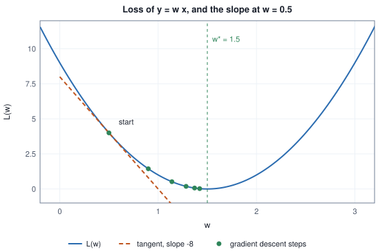
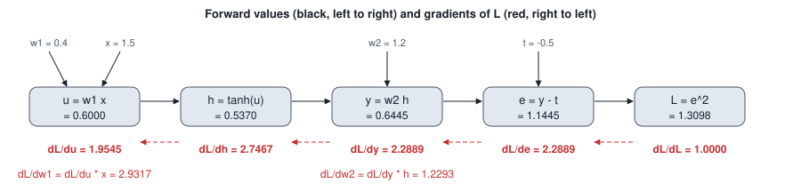

<!-- SPDX-License-Identifier: CC-BY-4.0 -->
<!-- Copyright (c) 2026 Martin Schröder <info@swedishembedded.com> -->

# Backpropagation Derived from Scratch

*How do we compute the gradient of one loss with respect to millions of
parameters in about the cost of one forward pass?*

## The problem

You have a network with a million parameters and a loss $L$ that measures how
wrong it is on a batch of examples. Gradient descent needs one thing from you
at every step: the gradient $\nabla_\theta L$, a vector with one entry per
parameter saying how much the loss changes if that parameter is nudged.

The most direct way to get an entry is the definition of the derivative. Nudge
the parameter by a small amount, run the network again, and see how the loss
moved. One nudge costs one forward pass. A million parameters cost a million
forward passes, for a single gradient, for a single step of training. Training
takes hundreds of thousands of steps. This is not slow; it is impossible.

The way out is not a cleverer nudge. It is to notice that the million
derivatives are not independent facts. They all come from the same network,
whose layers share almost all of their arithmetic, and the chain rule lets
that shared work be done once. **Backpropagation** is the name for doing it:
one forward pass, then one backward pass, and every parameter's gradient
falls out. This chapter derives it from a single weight, builds it up to a
full two-layer network with batches, explains why it is cheap (the cost
argument is the heart of the chapter), what it forces the forward pass to
remember, and why no one ever builds the matrices of derivatives that the
chain rule seems to ask for.

You may use from earlier chapters: the chain rule for several variables and
the Jacobian (Volume I), the squared-error loss and gradient descent
(Volume II), and the multilayer network with its activation functions and
softmax with cross-entropy (the earlier chapters of this volume).

## Before you begin

Five questions on ideas from earlier chapters, to answer from memory. The answers are at the end of the chapter. If one is hard, go back to the chapter named before reading on.

1. ("Gradients, Jacobians and Many Variables", chain rule.) A quantity $z$ depends on $x$ through two intermediate quantities $y_1(x)$ and $y_2(x)$. Write $\frac{dz}{dx}$ in terms of partial derivatives.
2. ("Gradients, Jacobians and Many Variables", Jacobian.) What is the shape of the Jacobian of a function from three inputs to two outputs, and what is its entry in row $i$, column $j$?
3. ("Multilayer Networks".) A hidden layer computes $\mathbf{h} = \tanh(\mathbf{W}_1\mathbf{x} + \mathbf{b}_1)$ from an input of width 4 to a hidden width of 3. What is the shape of $\mathbf{W}_1$?
4. ("Linear Regression and the First Descent", loss and descent.) Write the squared error of a prediction $y$ for a target $t$, and the gradient-descent update of a weight $w$ with learning rate $\eta$.
5. (Chapter 4, "Matrices as Linear Maps", and Chapter 5, "Arrays, Shapes, Strides and Broadcasting".) If $\mathbf{A}$ has shape $[m, k]$ and $\mathbf{B}$ has shape $[k, n]$, what are the shapes of $\mathbf{A}\mathbf{B}$ and of $\mathbf{B}^\top\mathbf{A}^\top$?

## One weight

Start with the smallest possible model: one input $x$, one weight $w$, and an
output $y = w x$. We have a target $t$ and measure the error of one example by
the squared difference,

$$
L = (y - t)^2 .
$$

We want $\frac{dL}{dw}$. Write $L$ as a chain of two steps. First $y = w x$,
then $L = (y - t)^2$. The chain rule says that the derivative of the whole is
the derivative of the last step times the derivative of the step before it:

$$
\frac{dL}{dw} = \frac{dL}{dy} \cdot \frac{dy}{dw} .
$$

Each factor is a derivative of something simple that we can write down looking
only at that one step:

$$
\frac{dL}{dy} = 2 (y - t), \qquad \frac{dy}{dw} = x .
$$

So

$$
\boxed{\frac{dL}{dw} = 2 (y - t)\, x .}
$$

It reads sensibly. If the prediction is too high ($y > t$) and $x$ is positive,
the gradient is positive: raising $w$ raises $y$ and makes things worse, so
the loss slopes upward in $w$. The bigger $x$ is, the more a change in $w$
moves $y$, so the steeper the slope.

**Gradient descent** moves $w$ against the slope. With a **learning rate**
$\eta$ (a small positive number), one update is

$$
w \leftarrow w - \eta \frac{dL}{dw} = w - 2\eta\,(wx - t)\,x .
$$

Here is a run with $x = 2$, $t = 3$, starting at $w = 0.5$, with $\eta = 0.05$.
Every number in the table was computed by the chapter's reference program,
not typed.

<!-- worked: backprop.single_weight -->
Setup: x = 2.0, target t = 3.0, start w = 0.5, learning rate 0.05.

| step | w | y = w x | y - t | L | dL/dw | w after update |
|---:|---:|---:|---:|---:|---:|---:|
| 0 | 0.5000 | 1.0000 | -2.0000 | 4.0000 | -8.0000 | 0.9000 |
| 1 | 0.9000 | 1.8000 | -1.2000 | 1.4400 | -4.8000 | 1.1400 |
| 2 | 1.1400 | 2.2800 | -0.7200 | 0.5184 | -2.8800 | 1.2840 |
| 3 | 1.2840 | 2.5680 | -0.4320 | 0.1866 | -1.7280 | 1.3704 |
| 4 | 1.3704 | 2.7408 | -0.2592 | 0.0672 | -1.0368 | 1.4222 |
| 5 | 1.4222 | 2.8445 | -0.1555 | 0.0242 | -0.6221 | 1.4533 |
<!-- /worked -->

The loss falls every step, and the gradient shrinks as the weight approaches
the answer $w^\ast = t/x = 1.5$, because the slope flattens near the bottom of
the parabola. The figure shows the loss as a function of $w$, the tangent line
at the starting point (its slope is the $-8$ in the first row), and the six
points the descent visits.



For this model we can say exactly how fast it converges. Substitute $w = w^\ast + \delta$
into the update. Since $wx - t = x(w - w^\ast) = x\delta$, the new error is
$\delta' = \delta - 2\eta x^2 \delta = (1 - 2\eta x^2)\,\delta$. The error is
multiplied by the same factor every step:

<!-- worked: backprop.single_weight_contraction -->
The minimiser is w* = t / x = 1.5. The predicted contraction factor is 1 - 2 * 0.05 * 2.0^2 = 0.6000.

| step | w - w* | ratio to previous |
|---:|---:|---:|
| 0 | -1.0000 |  |
| 1 | -0.6000 | 0.6000 |
| 2 | -0.3600 | 0.6000 |
| 3 | -0.2160 | 0.6000 |
| 4 | -0.1296 | 0.6000 |
<!-- /worked -->

That factor is $1 - 2\eta x^2 = 0.6$ here. If $\eta$ were $0.3$ the factor would
be $1 - 2.4 = -1.4$, whose size exceeds one, and the descent would diverge. A
gradient is only a local fact (the slope right here), and a step that is too
long walks out of the region where it is true. Choosing $\eta$ well is the
subject of later chapters; for now we only need the gradient.

## Two weights force the chain rule

With one weight, the chain rule was almost optional: we could have expanded
$L = (wx - t)^2$ and differentiated in one go. Add a second weight and a
nonlinearity, and a chain of local derivatives becomes the only manageable
way to think.

Take the smallest network with a hidden unit:

$$
u = w_1 x, \qquad h = \tanh(u), \qquad y = w_2 h, \qquad e = y - t, \qquad L = e^2 .
$$

The input $x$ goes through a weight, a nonlinearity, a second weight, and is
compared with the target. There are two parameters, $w_1$ and $w_2$, and five
steps between them and the loss. To find $\frac{dL}{dw_2}$ we need only
the last three steps, exactly as before:

$$
\frac{dL}{dw_2} = \frac{dL}{de}\frac{de}{dy}\frac{dy}{dw_2} = 2e \cdot 1 \cdot h .
$$

To find $\frac{dL}{dw_1}$ the chain is longer: $w_1$ affects $u$, which affects
$h$, which affects $y$, which affects $e$, which affects $L$.

$$
\frac{dL}{dw_1} = \frac{dL}{de}\,\frac{de}{dy}\,\frac{dy}{dh}\,\frac{dh}{du}\,\frac{du}{dw_1}
= 2e \cdot 1 \cdot w_2 \cdot (1 - h^2) \cdot x ,
$$

using $\frac{d}{du}\tanh u = 1 - \tanh^2 u$. Look at the two expressions
together. The leading factors $2e \cdot 1$ appear in both, and so does
everything between the loss and $y$. If we compute the gradient with respect to $w_2$ and then the gradient
with respect to $w_1$ as separate formulas, we do the shared work twice. If
we organise the computation as a sweep from the loss back towards the input,
keeping a running product, every shared factor is computed once and each
parameter just picks up the running product at the place where it enters.

Name the running product at each step. Let $\bar{v}$ stand for
$\frac{dL}{dv}$, the derivative of the final loss with respect to any
intermediate quantity $v$. The bar is a bookkeeping notation: it always means
"derivative of the loss with respect to this". Then the sweep is

$$
\bar{e} = 2e, \quad \bar{y} = \bar{e}\cdot 1, \quad \bar{w}_2 = \bar{y}\, h, \quad
\bar{h} = \bar{y}\, w_2, \quad \bar{u} = \bar{h}\,(1 - h^2), \quad \bar{w}_1 = \bar{u}\, x .
$$

Every line has the same shape: *the gradient at this quantity equals the
gradient arriving from the quantity after it, times the local derivative of
the step that connects them*. This is backpropagation. The rest of the
chapter generalises the "quantity" from a number to an array, and the "step"
from a scalar function to a layer.

Numbers, for $x = 1.5$, $w_1 = 0.4$, $w_2 = 1.2$, $t = -0.5$:

<!-- worked: backprop.scalar_chain -->
Setup: x = 1.5, w1 = 0.4, w2 = 1.2, t = -0.5.

| node (forward) | value | gradient rule (backward) | value |
|---|---:|---|---:|
| u = w1 x | 0.6000 | dL/du = dL/dh * (1 - h^2) | 1.9545 |
| h = tanh(u) | 0.5370 | dL/dh = dL/dy * w2 | 2.7467 |
| y = w2 h | 0.6445 | dL/dy = dL/de * 1 | 2.2889 |
| e = y - t | 1.1445 | dL/de = 2 e | 2.2889 |
| L = e^2 | 1.3098 | dL/dL = 1 | 1.0000 |

The two parameter gradients are dL/dw2 = dL/dy * h = 1.2293 and dL/dw1 = dL/du * x = 2.9317.
<!-- /worked -->

Notice what the forward values are used for. The backward rule for $h$ needs
$h$ itself (through $1 - h^2$), and the rule for $w_2$ needs $h$ too. The
backward sweep reads numbers the forward pass produced. We come back to this
dependency in the section on saved activations.

A sweep like this is easy to get subtly wrong, so check it against the
definition of the derivative: nudge each weight up and down by a tiny
amount and compare (a **central difference**, which later chapters study in
detail).

<!-- worked: backprop.scalar_chain_check -->
| parameter | backward | central difference | absolute difference |
|---|---:|---:|---:|
| w1 | 2.931739 | 2.931739 | 6.7e-11 |
| w2 | 1.229263 | 1.229263 | 9.7e-11 |
<!-- /worked -->

The two agree to about ten digits, which is as close as the nudging can get.

## Computational graphs

So far a "network" was a list of equations. Any such computation can be drawn as a
**computational graph**: a directed acyclic graph whose nodes are
values (numbers or arrays) and whose edges say which values were used to
compute which. A node that is not computed from others is an input or a
parameter. Every other node is produced by one **operation** (add, multiply,
$\tanh$, matrix product) from the nodes that point to it. The chain above is
the simplest graph, a path; a network is a graph with branches, since a weight
matrix and an input both feed the same product.



Evaluating the graph from inputs to the loss, in an order where every node
comes after the nodes it depends on (a **topological order**), is the
**forward pass**. Its result is the loss; as a side effect it has computed
every intermediate value.

The **backward pass** visits the same nodes in the reverse order. It starts by
setting the gradient of the loss with respect to itself to $1$, and for every
node it processes, it passes a share of the gradient to each of the nodes the
operation read. The share is the node's gradient times the local derivative of
the operation with respect to that input.

There is one rule beyond the chain we met above, and it comes from the
multivariable chain rule. If a node $v$ is used by several later nodes
$c_1, \dots, c_k$, then $L$ depends on $v$ along several paths, and the
derivatives of the paths add:

$$
\bar{v} = \sum_{j=1}^{k} \bar{c}_j \,\frac{\partial c_j}{\partial v} .
$$

The smallest example is $y = w \cdot w$, where the multiplication reads the same
node twice. It contributes $\bar{y}\, w$ through each of its two inputs, and
the total is $2 w \bar{y}$, as it should be for $w^2$. A weight that is shared
by two layers, or a value that goes through both a residual connection and a
transformation, gets the sum of its contributions. A backward pass that
*assigns* where it should *add* silently loses every contribution but one;
we see a real instance of this under "In brain".

The whole algorithm in pseudocode, for a graph given as arrays. Node $i$ has
an operation $\mathrm{op}[i]$ and a list of input node indices; nodes are
numbered in topological order so inputs have smaller indices. `vjp` is the
function that, for an operation, takes the values it needs and the gradient
of the output, and returns one gradient per input (the next sections say
what it is).

```text
function reverse_mode(op: list<operation>, inputs: list<list<int>>,
                      value: list<tensor>, loss: int) -> list<tensor>:
    # value[i] holds the forward result of node i (the forward pass is done)
    require value[loss] has one element, "the loss must be a scalar"
    n = len(op)
    grad = list of n tensors, grad[i] = zeros(real, value[i].shape)
    grad[loss][0] = 1.0                                      # dL/dL = 1
    for i in loss down to 0:
        if op[i] is input or parameter:
            continue
        ins = [value[j] for j in inputs[i]]
        contributions = vjp(op[i], ins, value[i], grad[i])   # one per input
        for k in 0 .. len(inputs[i]):
            j = inputs[i][k]
            grad[j] = grad[j] + contributions[k]             # add, never assign
    return grad
```

After the loop, `grad[j]` for each parameter node $j$ is $\nabla L$ with
respect to that parameter. Each node is visited once and each edge is used
once, so the backward pass costs about as much as visiting the graph once,
times the cost of a `vjp` relative to the forward operation. That ratio is
bounded, as the cost section shows.

## Forward mode and reverse mode

The backward sweep is one of two ways to apply the chain rule to a graph. The
other starts at the inputs.

Suppose a computation is a composition of maps
$f = f_n \circ \dots \circ f_1$ from $\mathbb{R}^{n_0}$ to $\mathbb{R}^{n_n}$.
By the chain rule its Jacobian is a product of the Jacobians of the steps,
each evaluated at its own input:

$$
\mathbf{J}_f = \mathbf{J}_{f_n}\, \mathbf{J}_{f_{n-1}} \cdots \mathbf{J}_{f_1},
$$

where $\mathbf{J}_{f_k}$ has shape $[n_k, n_{k-1}]$. Matrix multiplication is
associative, so we may bracket this product however we like; the result is the
same and the cost is not.

**Forward-mode differentiation** brackets from the input side. Pick a direction
$\mathbf{v} \in \mathbb{R}^{n_0}$ in input space and compute
$\mathbf{J}_f \mathbf{v}$ by pushing the vector through the chain:
$\mathbf{J}_{f_1}\mathbf{v}$, then $\mathbf{J}_{f_2}$ times that, and so on.
Each step keeps a vector of length $n_k$ alongside the value of the forward
pass. The result is a **Jacobian-vector product**: how the outputs change when
the inputs move along $\mathbf{v}$. In a program, this is done by carrying
a pair (value, derivative along $\mathbf{v}$) through every operation, a
*dual number*; it needs no graph and no stored intermediates, and it costs
a small constant multiple of the forward pass for one direction. To get the
derivative with respect to input $i$, choose $\mathbf{v}$ to be the unit vector
$\mathbf{e}_i$. To get the whole gradient of a function of $P$ inputs you need
$P$ such passes.

**Reverse-mode differentiation** brackets from the output side. Pick a row
vector $\mathbf{u}^\top$ in output space and compute
$\mathbf{u}^\top \mathbf{J}_f$: multiply $\mathbf{u}^\top$ by
$\mathbf{J}_{f_n}$, then the result by $\mathbf{J}_{f_{n-1}}$, and so on back
to the input. Each step keeps a row vector of length $n_k$. The result is a
**vector-Jacobian product**: for a scalar loss we choose $\mathbf{u} = 1$ and
the single row we get is the entire gradient, with respect to all $n_0$ inputs,
in one sweep. This is the backward pass. Unlike forward mode it needs the
forward values of every step, since step $k$'s Jacobian depends on step $k$'s
input; that is the price, and the subject of a later section.

Which is cheaper depends only on the shape of the product, and for training
the shape is extreme: a loss is one number ($n_n = 1$) and the input we
differentiate against is *every parameter* ($n_0 = P$, millions). Here is a
chain of four maps with width $1000$ throughout and a scalar at the end,
multiplied each way:

<!-- worked: backprop.jacobian_chain_cost -->
A chain of four maps with widths [1000, 1000, 1000, 1000, 1]. Its Jacobian is the product J = J4 J3 J2 J1, where J1 is [1000 x 1000], J2 is [1000 x 1000], J3 is [1000 x 1000] and J4 is [1 x 1000]. Three matrix products are needed whichever way the brackets go.

| bracketing | what each product carries | multiply-adds |
|---|---|---:|
| ((J4 J3) J2) J1, output side first (reverse mode) | one row throughout | 3,000,000 |
| J4 (J3 (J2 J1)), input side first (forward mode) | a matrix with 1000 columns throughout | 2,001,000,000 |

The ratio is 667, close to the number of inputs (1000): forward mode drags 1000 columns through every step where reverse mode drags one row.
<!-- /worked -->

Bracketing from the output keeps every intermediate product one row tall;
bracketing from the input keeps every intermediate product $n_0$ columns
wide. The cost ratio is about the number of inputs. Parameters are inputs of
the function whose derivative we want ($L$ as a function of $\theta$), so for
a network with $P$ parameters forward mode costs on the order of $P$ forward
passes. Reverse mode costs about one forward pass plus one backward pass, and
the backward pass for a network built from matrix products turns out to cost
about twice the forward pass (the table below). So the whole gradient
costs a small constant number of forward passes, independent of $P$.

This is the central fact of the chapter, and it is a fact about shapes:
**the cost of reverse mode scales with the number of outputs (one loss), and
the cost of forward mode scales with the number of inputs (all parameters).**
Where a function has few inputs and many outputs the argument runs the other
way, and forward mode wins; machine learning losses have the opposite shape.

To see both modes agree on the network this chapter uses for its worked
example (defined below, 21 parameters), here is forward mode with dual
numbers, one pass per parameter, against the backward pass:

<!-- worked: backprop.forward_mode_check -->
| tensor | entries | forward mode passes | largest |forward mode - reverse mode| |
|---|---:|---:|---:|
| W1 | 12 | 12 | 4.4e-16 |
| b1 | 4 | 4 | 3.3e-16 |
| W2 | 4 | 4 | 2.2e-16 |
| b2 | 1 | 1 | 2.2e-16 |

Forward mode needed 21 passes, one per parameter. Reverse mode needed one forward pass and one backward pass.
<!-- /worked -->

They agree to rounding error, as they must: both evaluate the same product of
Jacobians, just bracketed differently. What differs is cost. For 21 parameters
the difference is invisible. For the sizes below it is not:

<!-- worked: backprop.cost_table -->
| network | B | D | H | O | parameters P | forward work | backward work | backward / forward | forward mode, in forward passes |
|---|---:|---:|---:|---:|---:|---:|---:|---:|---:|
| tiny network of this chapter | 2 | 3 | 4 | 1 | 21 | 64 | 80 | 1.25 | at least 21 |
| digit classifier | 64 | 784 | 256 | 10 | 203,530 | 26,017,792 | 26,345,472 | 1.01 | at least 203,530 |
| one wide layer pair | 8 | 4096 | 16384 | 4096 | 134,238,208 | 2,147,483,648 | 3,221,225,472 | 1.50 | at least 134,238,208 |

Work counts multiplications and additions of the matrix products only (a multiply-add is two operations), skipping the gradient with respect to the data `X`, which no parameter needs.
<!-- /worked -->

The backward-to-forward ratio is small because of how a linear layer
differentiates (derived in the next section): the forward does one matrix
product, and the backward does two, one for the gradient of the weights and one
for the gradient of the input. A layer that needs both costs exactly twice its
forward; the first layer of a network needs no gradient of its input, which
is why the table's ratios are below two. The "forward mode" column is a lower bound that charges one forward pass per
parameter and nothing for the extra work of carrying derivatives. The 134
million parameters of the last row are modest by present standards.

## Vector-Jacobian products: never build the Jacobian

The reverse-mode description above multiplies by Jacobians. If we built them,
it would be hopeless. A network layer with a batch of $B = 64$ examples and
width $4096$ maps $64 \cdot 4096 = 262\,144$ numbers to $262\,144$ numbers. Its
Jacobian has $262\,144^2$ entries.

<!-- worked: backprop.jacobian_sizes -->
| layer (B = 64, D = H = 4096) | entries of the full Jacobian | as float32 | entries of the gradient it multiplies |
|---|---:|---:|---:|
| tanh on a [B, H] activation | 68,719,476,736 | 256 GiB | 262,144 |
| linear layer, w.r.t. its input | 68,719,476,736 | 256 GiB | 262,144 |

Both are the same size because the Jacobian of the whole batch is [B H, B D]; most of it is zero (diagonal for tanh, block diagonal for the linear layer), and the vector-Jacobian product never stores the zeros.
<!-- /worked -->

Fortunately we never need the Jacobian, only its product with one vector. A
**vector-Jacobian product** (VJP) of a function $f$ at a point $\mathbf{x}$ and
a vector $\mathbf{u}$ of the shape of $f$'s output is

$$
\mathrm{vjp}_f(\mathbf{x}, \mathbf{u}) = \mathbf{u}^\top \mathbf{J}_f(\mathbf{x}),
$$

a vector with the shape of $\mathbf{x}$. In the language of the backward pass:
$\mathbf{u}$ is the gradient arriving from above and the result is the
gradient passed down. Each operation in a network supplies a function that
computes this product directly from the structure of the operation, without
ever forming $\mathbf{J}$. Two examples show how much structure there is to
exploit.

*Elementwise functions.* If $a_i = \tanh(z_i)$ for each $i$, then $a_i$
depends only on $z_i$, so the Jacobian is diagonal with entries
$1 - a_i^2$ and

$$
(\mathbf{u}^\top \mathbf{J})_i = u_i\,(1 - a_i^2),
$$

an elementwise product: $n$ multiplications instead of $n^2$.

<!-- worked: backprop.vjp_vs_jacobian -->
Example b=0 of the tiny network. The explicit Jacobian of tanh is a 4 x 4 matrix that is zero off the diagonal:

| J | in 0 | in 1 | in 2 | in 3 |
|---|---:|---:|---:|---:|
| out 0 | 0.9610 | 0.0000 | 0.0000 | 0.0000 |
| out 1 | 0.0000 | 0.6347 | 0.0000 | 0.0000 |
| out 2 | 0.0000 | 0.0000 | 1.0000 | 0.0000 |
| out 3 | 0.0000 | 0.0000 | 0.0000 | 0.6347 |

Gradient arriving from above, u = dA[0] = [-0.5004, 0.3003, -0.8007, -0.2002]. Both ways of computing u^T J:

| input index | via full Jacobian (u^T J) | via the rule u * (1 - a^2) |
|---:|---:|---:|
| 0 | -0.480940 | -0.480940 |
| 1 | 0.190588 | 0.190588 |
| 2 | -0.800697 | -0.800697 |
| 3 | -0.127059 | -0.127059 |

The Jacobian stores 16 numbers to say 4 things; the rule stores 4.
<!-- /worked -->

*Linear maps.* If $\mathbf{z} = \mathbf{W}\mathbf{x}$ then $\mathbf{J} = \mathbf{W}$,
and $\mathbf{u}^\top \mathbf{W}$ is the matrix product that the backward pass of
a layer is made of, derived in the next section. Over a batch the full
Jacobian is block diagonal with one copy of $\mathbf{W}$ per example, and again
only the product with $\mathbf{W}$ is ever computed.

This gives every operation in the engine the same two-function contract: a
forward that computes outputs from inputs, and a backward that takes the
gradient of the loss with respect to the outputs (and whatever the forward
saved) and returns the gradient with respect to the inputs and to any parameters
inside. The graph algorithm above only needs that contract. It does not know
or care what the operations are.

## The backward pass of a two-layer network

Now the network the book uses for the rest of the volume: a linear layer, a
nonlinearity, a second linear layer and the mean squared error. For a batch we
use the convention that **each example is a row**. The data are a matrix
$\mathbf{X}$ of shape $[B, D]$ (batch size $B$, $D$ features), the targets
$\mathbf{T}$ have shape $[B, O]$, and a layer that maps $D$ numbers to $H$
numbers stores a weight matrix $\mathbf{W}$ of shape $[H, D]$ and a bias of
shape $[H]$. The forward pass is

$$
\begin{aligned}
\mathbf{Z}_1 &= \mathbf{X}\mathbf{W}_1^\top + \mathbf{1}\mathbf{b}_1^\top && [B, H] \\
\mathbf{A} &= \tanh(\mathbf{Z}_1) && [B, H] \\
\mathbf{Y} &= \mathbf{A}\mathbf{W}_2^\top + \mathbf{1}\mathbf{b}_2^\top && [B, O] \\
\mathbf{E} &= \mathbf{Y} - \mathbf{T} && [B, O] \\
L &= \frac{1}{B\,O}\sum_{b,o} E_{bo}^2 && \text{scalar}
\end{aligned}
$$

where $\mathbf{1}\mathbf{b}^\top$ is the bias vector repeated on every row (the
broadcast of the pseudocode conventions) and $\tanh$ acts on every element.
Its computational graph, with the gradient each step sends back, is:


We apply the sweep from the loss back to the parameters. At each step we
write what a single entry of the gradient is (a sum over the paths from that
entry to the loss), and then recognise the result as a matrix operation.

**The loss and the error.** $L$ depends on $E_{bo}$ only through $E_{bo}^2$, so
$\bar{E}_{bo} = \frac{2}{B\,O} E_{bo}$. Since $\mathbf{E} = \mathbf{Y} - \mathbf{T}$
and $\mathbf{T}$ is data, $\bar{\mathbf{Y}} = \bar{\mathbf{E}}$:

$$
d\mathbf{Y} := \frac{\partial L}{\partial \mathbf{Y}} = \frac{2}{B\,O}\,\mathbf{E} \qquad [B, O].
$$

(I write $d\mathbf{Y}$ for the matrix of all $\frac{\partial L}{\partial Y_{bo}}$,
the same bar notation as before. The factor $\frac{1}{B O}$ from the *mean*
in the loss is easy to drop by accident; the section on checking shows how
a finite difference catches it.)

**The second linear layer.** One entry is $Y_{bo} = \sum_h A_{bh} (\mathbf{W}_2)_{oh} + (\mathbf{b}_2)_o$.
The weight $(\mathbf{W}_2)_{oh}$ is used in every row of the batch, in
$Y_{bo}$ for each $b$, so by the multivariable chain rule

$$
\frac{\partial L}{\partial (\mathbf{W}_2)_{oh}}
= \sum_{b} \frac{\partial L}{\partial Y_{bo}} \frac{\partial Y_{bo}}{\partial (\mathbf{W}_2)_{oh}}
= \sum_b dY_{bo}\, A_{bh}
\quad\Longrightarrow\quad d\mathbf{W}_2 = d\mathbf{Y}^\top \mathbf{A} \qquad [O, H].
$$

That is a sum over the batch of an outer product of gradient and input, which
is exactly what a matrix product $[O, B] \times [B, H]$ computes. The bias is used
in every row with derivative $1$, so $d\mathbf{b}_2 = \sum_b d\mathbf{Y}_{b,\cdot}$, a sum over
the batch axis, shape $[O]$. The gradient to the layer's input is
$\frac{\partial L}{\partial A_{bh}} = \sum_o dY_{bo} (\mathbf{W}_2)_{oh}$, so

$$
d\mathbf{A} = d\mathbf{Y}\,\mathbf{W}_2 \qquad [B, O] \times [O, H] = [B, H].
$$

**The nonlinearity.** $A_{bh}$ depends only on $(Z_1)_{bh}$ with derivative
$1 - A_{bh}^2$, so

$$
d\mathbf{Z}_1 = d\mathbf{A} \odot (1 - \mathbf{A} \odot \mathbf{A}) \qquad [B, H].
$$

Note that the derivative is expressed through the *output* $\mathbf{A}$ of the
tanh; we do not need $\mathbf{Z}_1$ any more.

**The first linear layer.** Identical in form to the second, with $\mathbf{X}$ in the role of $\mathbf{A}$:

$$
d\mathbf{W}_1 = d\mathbf{Z}_1^\top \mathbf{X} \quad [H, D], \qquad
d\mathbf{b}_1 = \sum_b d\mathbf{Z}_{1,b,\cdot} \quad [H],
$$

and, if a network sits below this one, $d\mathbf{X} = d\mathbf{Z}_1 \mathbf{W}_1$
with shape $[B, D]$. Since $\mathbf{X}$ is data here, nobody needs $d\mathbf{X}$ and
the pseudocode skips it, which also means $\mathbf{W}_1$ itself is not needed
by the backward pass.

The shapes are not decoration. Look at each product: $[O,B] \times [B,H]$,
$[B,O] \times [O,H]$, $[H,B] \times [B,D]$. The inner dimensions must agree
for the product to exist, and in each one the output has the shape of the
parameter or activation whose gradient it is. A gradient always has the
shape of the thing it is the gradient of; if you ever hold a gradient whose
shape differs, the derivation has gone wrong. The reference network in this chapter uses
$B = 2$, $D = 3$, $H = 4$, $O = 1$: all different, so that a transposed matrix
is a shape error and not a quietly wrong answer (knowledge #4 describes
what happens in real systems when toy dimensions coincide).

The next chapter derives the backward pass of every layer type
systematically, including the cases we skipped here. We needed just enough
for this one.

### The algorithm

```text
function mlp_forward(X: array<real>[B, D], T: array<real>[B, O],
                     W1: array<real>[H, D], b1: array<real>[H],
                     W2: array<real>[O, H], b2: array<real>[O])
        -> (real, array<real>[B, H], array<real>[B, O]):
    require X.shape[0] == T.shape[0], "batch sizes differ"
    require W1.shape[1] == X.shape[1] and W2.shape[1] == W1.shape[0], "layer widths do not chain"
    Z1 = matmul(X, transpose(W1))                      # [B, H]
    A  = zeros(real, [B, H])
    for i in 0 .. B:
        for j in 0 .. H:
            A[i, j] = tanh(Z1[i, j] + b1[j])           # b1 added to every row
    Y = matmul(A, transpose(W2))                       # [B, O]
    E = zeros(real, [B, O])
    loss = 0.0
    for i in 0 .. B:
        for o in 0 .. O:
            E[i, o] = Y[i, o] + b2[o] - T[i, o]        # b2 added to every row
            loss = loss + E[i, o] * E[i, o]
    return (loss / (B * O), A, E)                      # A and E are saved for the backward
```

```text
function mlp_backward(X: array<real>[B, D], A: array<real>[B, H], E: array<real>[B, O],
                      W2: array<real>[O, H])
        -> (array<real>[H, D], array<real>[H], array<real>[O, H], array<real>[O]):
    dY = zeros(real, [B, O])
    for i in 0 .. B:
        for o in 0 .. O:
            dY[i, o] = 2.0 * E[i, o] / (B * O)         # includes the 1/(B*O) of the mean
    dW2 = matmul(transpose(dY), A)                     # [O, H]
    db2 = sum(dY, axis=0)                              # [O]
    dA  = matmul(dY, W2)                               # [B, H]
    dZ1 = zeros(real, [B, H])
    for i in 0 .. B:
        for j in 0 .. H:
            dZ1[i, j] = dA[i, j] * (1.0 - A[i, j] * A[i, j])
    dW1 = matmul(transpose(dZ1), X)                    # [H, D]
    db1 = sum(dZ1, axis=0)                             # [H]
    return (dW1, db1, dW2, db2)
```

Look at what `mlp_forward` returns beyond the loss: `A` and `E`. Those are the
numbers the backward pass reads. `X` and `W2` it already has, as the data and
a parameter. The data flow between forward and backward is exactly the set of
shaded nodes in the graph figure. Nothing else from the forward pass
is needed.

### Numbers

The reference network, with small inputs and weights you can follow by hand:

<!-- worked: backprop.network_inputs -->
Batch `X` (2 examples, 3 features) and targets `T` (2 examples, 1 output):

| X | d=0 | d=1 | d=2 |
|---|---:|---:|---:|
| b=0 | 1.00 | 2.00 | -1.00 |
| b=1 | 0.50 | -1.00 | 1.50 |

| T | o=0 |
|---|---:|
| b=0 | 0.70 |
| b=1 | -0.20 |

First layer `W1` (4 x 3) and `b1` (4):

| W1 | d=0 | d=1 | d=2 |
|---|---:|---:|---:|
| h=0 | 0.20 | -0.10 | 0.30 |
| h=1 | 0.40 | 0.10 | -0.20 |
| h=2 | -0.30 | 0.20 | 0.10 |
| h=3 | 0.10 | -0.40 | 0.20 |

| b1 | h=0 | h=1 | h=2 | h=3 |
|---|---:|---:|---:|---:|
| value | 0.10 | -0.10 | 0.00 | 0.20 |

Second layer `W2` (1 x 4) and `b2` (1):

| W2 | h=0 | h=1 | h=2 | h=3 |
|---|---:|---:|---:|---:|
| o=0 | 0.50 | -0.30 | 0.80 | 0.20 |

| b2 | o=0 |
|---|---:|
| value | 0.10 |
<!-- /worked -->

Forward pass:

<!-- worked: backprop.network_forward -->
Pre-activation `Z1 = X W1^T + b1` ([B, H]):

| Z1 | h=0 | h=1 | h=2 | h=3 |
|---|---:|---:|---:|---:|
| b=0 | -0.2000 | 0.7000 | 0.0000 | -0.7000 |
| b=1 | 0.7500 | -0.3000 | -0.2000 | 0.9500 |

Hidden activation `A = tanh(Z1)` ([B, H]):

| A | h=0 | h=1 | h=2 | h=3 |
|---|---:|---:|---:|---:|
| b=0 | -0.1974 | 0.6044 | 0.0000 | -0.6044 |
| b=1 | 0.6351 | -0.2913 | -0.1974 | 0.7398 |

Output `Y = A W2^T + b2` and error `E = Y - T` ([B, O]):

| b | Y | T | E = Y - T | E^2 |
|---|---:|---:|---:|---:|
| b=0 | -0.3009 | 0.7000 | -1.0009 | 1.0017 |
| b=1 | 0.4950 | -0.2000 | 0.6950 | 0.4831 |

Loss `L = (1 / (B O)) * sum E^2` = 0.742402.
<!-- /worked -->

Backward pass, from the loss to the second layer:

<!-- worked: backprop.network_backward_output -->
Output gradient `dY = 2 E / (B O)` ([B, O]):

| dY | o=0 |
|---|---:|
| b=0 | -1.0009 |
| b=1 | 0.6950 |

Second-layer parameter gradients, `dW2 = dY^T A` ([O, H]) and `db2 = sum over b of dY` ([O]):

| dW2 | h=0 | h=1 | h=2 | h=3 |
|---|---:|---:|---:|---:|
| o=0 | 0.6390 | -0.8074 | -0.1372 | 1.1191 |

| db2 | o=0 |
|---|---:|
| value | -0.3058 |
<!-- /worked -->

through the nonlinearity:

<!-- worked: backprop.network_backward_hidden -->
Gradient into the activation, `dA = dY W2` ([B, H]):

| dA | h=0 | h=1 | h=2 | h=3 |
|---|---:|---:|---:|---:|
| b=0 | -0.5004 | 0.3003 | -0.8007 | -0.2002 |
| b=1 | 0.3475 | -0.2085 | 0.5560 | 0.1390 |

Local derivative of tanh from the saved activation, `1 - A^2` ([B, H]):

| 1 - A^2 | h=0 | h=1 | h=2 | h=3 |
|---|---:|---:|---:|---:|
| b=0 | 0.9610 | 0.6347 | 1.0000 | 0.6347 |
| b=1 | 0.5966 | 0.9151 | 0.9610 | 0.4527 |

Gradient into the pre-activation, `dZ1 = dA * (1 - A^2)` elementwise ([B, H]):

| dZ1 | h=0 | h=1 | h=2 | h=3 |
|---|---:|---:|---:|---:|
| b=0 | -0.4809 | 0.1906 | -0.8007 | -0.1271 |
| b=1 | 0.2073 | -0.1908 | 0.5344 | 0.0629 |
<!-- /worked -->

and into the first layer:

<!-- worked: backprop.network_backward_first -->
First-layer parameter gradients, `dW1 = dZ1^T X` ([H, D]) and `db1 = sum over b of dZ1` ([H]):

| dW1 | d=0 | d=1 | d=2 |
|---|---:|---:|---:|
| h=0 | -0.3773 | -1.1692 | 0.7919 |
| h=1 | 0.0952 | 0.5720 | -0.4768 |
| h=2 | -0.5335 | -2.1358 | 1.6022 |
| h=3 | -0.0956 | -0.3170 | 0.2215 |

| db1 | h=0 | h=1 | h=2 | h=3 |
|---|---:|---:|---:|---:|
| value | -0.2736 | -0.0002 | -0.2663 | -0.0641 |

For completeness, the gradient with respect to the input, `dX = dZ1 W1` ([B, D]):

| dX | d=0 | d=1 | d=2 |
|---|---:|---:|---:|
| b=0 | 0.2076 | -0.0422 | -0.2879 |
| b=1 | -0.1889 | 0.0419 | 0.1664 |
<!-- /worked -->

Verify one entry by hand. $dW_2[0,0] = \sum_b dY_{b0} A_{b0} = (-1.0009)(-0.1974) + (0.6950)(0.6351) = 0.1976 + 0.4414 = 0.6390$, the first entry of the table.
Verify another: $d\mathbf{b}_2 = -1.0009 + 0.6950 = -0.3059$ (rounding aside, the table's $-0.3058$).

A gradient is a direction in which the loss increases fastest, so a small step
against it should reduce the loss by about the learning rate times the squared
length of the gradient. For a step of $\eta = 0.01$:

<!-- worked: backprop.network_step -->
Learning rate 0.01. The squared length of the whole gradient is 12.846752, so a small step should lower the loss by about 0.01 * 12.846752 = 0.128468.

| | loss |
|---|---:|
| before the step | 0.742402 |
| after the step | 0.619935 |
| actual decrease | 0.122467 |
<!-- /worked -->

The prediction $0.128$ and the actual decrease $0.122$ differ by a few
percent, which is what a first-order statement about a curved function
should do.

## What must be saved

Look back at how the backward pass used the forward pass. The rule for $d\mathbf{W}_2$
read $\mathbf{A}$. The rule for $d\mathbf{Z}_1$ read $\mathbf{A}$ again. The rule
for $d\mathbf{W}_1$ read $\mathbf{X}$. The rule for $d\mathbf{Y}$ read
$\mathbf{E}$. The backward pass does not recompute the forward pass; it reads
its results. The values the forward pass must keep alive until the backward
pass has used them are called **saved activations** (or saved tensors). What is
saved depends on the operation, and there is often a choice:

<!-- worked: backprop.saved_per_op -->
| operation | the backward pass reads | it does not need |
|---|---|---|
| linear  Y = X W^T + b | X (for dW); W (already a parameter) | nothing |
| tanh  A = tanh(Z) | A (the local derivative is 1 - A^2) | Z |
| ReLU  A = max(0, Z) | which entries of Z were positive (one bit each) | the values of Z |
| mean squared error | E = Y - T (or Y and T) | nothing else |
<!-- /worked -->

The tanh row shows the kind of choice engines make. Saving the output $A$ and
computing $1 - A^2$ needs no further storage. Saving the input $Z$ and
recomputing $\tanh(Z)$ in the backward pass spends arithmetic to keep the
input, which might already be needed for some other reason. For ReLU,
$\max(0, z)$, the backward pass needs only to know whether each $z$ was
positive: a mask of one bit per entry, a thirty-second of the memory of
keeping the values.

Saving has a cost that dominates the memory of training. Inference with a
network can discard each layer's activations as soon as the next layer has
consumed them; the live memory is about two layers' worth. Training must keep
every layer's saved activations from its forward until its backward, which
happens in the reverse order, so the first layer's activations live longest.
The saved memory therefore grows with the *depth* of the network and with the
*batch size*, while the parameters depend on neither of those:

<!-- worked: backprop.saved_memory -->
A stack of 32 linear layers of width 4096 with a tanh after each, float32. Parameters: 2.00 GiB, whatever the batch size. Saved for the backward pass: the layer input and the tanh output, two tensors of [B, width] per layer.

| batch B | saved activations | parameters | saved / parameters |
|---:|---:|---:|---:|
| 1 | 1.0 MiB | 2,048 MiB | 0.000 |
| 16 | 16.0 MiB | 2,048 MiB | 0.008 |
| 256 | 256.0 MiB | 2,048 MiB | 0.125 |
| 4096 | 4,096.0 MiB | 2,048 MiB | 2.000 |
<!-- /worked -->

(The activations are counted as the layer input and the tanh output; the
parameters are the $4096 \times 4096$ weight matrices only.) At small batches
the parameters dominate. As the batch grows, the saved activations overtake
them, and the engineer's problem changes from "does the model fit" to "does
the model fit at this batch size".

The standard answer is to save less and recompute. Keep only the input of each
block of layers, and when the backward pass reaches the block, run its forward
again to regenerate the intermediate values before using them. This costs one
extra forward pass of arithmetic (so a training step costs about four forward
passes' worth instead of three) in exchange for activation memory that no longer
grows with the number of layers inside the block. Whether to keep or recompute,
and in what number format, is a decision with its own chapter in
Volume XIII; here you only need to know that the *set of things a backward pass
reads* is a property of its operations, and that the memory it implies is real.

## Making it work

**Zero before you accumulate.** The backward pass of the network above can be
called once per step and produces fresh gradients. Many engines instead
*add* into persistent gradient buffers, so that several batches (or several
uses of a shared weight) can be summed. That is the right design, and it
means the buffers must be zeroed once per optimiser step. A missing
zeroing produces gradients that grow every step. Gradient accumulation is
treated properly in the next chapter.

**Know which direction each product goes.** A transposed matrix in a backward
product produces the right shape only when dimensions coincide, which is why
the reference network has distinct sizes and why a test dimension should
never be chosen to be square.

**Errors in a backward pass stay local to what is upstream of them.** Suppose
the tanh derivative is forgotten: the code uses $d\mathbf{Z}_1 = d\mathbf{A}$ and skips the factor
$1 - A^2$. The loss still falls for a while, because the direction is
roughly right. Compare the wrong gradients with finite differences:

<!-- worked: backprop.wrong_backward -->
| parameter | wrong backward | central difference | relative error |
|---|---:|---:|---:|
| W1[0,0] | -0.326680 | -0.377280 | 1.3e-01 |
| W1[1,0] | 0.196008 | 0.095181 | 5.1e-01 |
| b1[0] | -0.152923 | -0.273619 | 4.4e-01 |
| b1[2] | -0.244678 | -0.266338 | 8.1e-02 |
| W2[0,0] | 0.638991 | 0.638991 | 1.9e-11 |
| b2[0] | -0.305847 | -0.305847 | 3.5e-11 |
<!-- /worked -->

The second layer's gradients are exactly right (they sit downstream of the
mistake) and the first layer's are wrong by tens of percent. A model with
this bug trains badly and never throws an error. The next section is the
instrument that finds it.

**Non-differentiable points.** ReLU has no derivative at zero. Engines pick a
convention (usually zero). A parameter initialised exactly at such a point
receives no gradient, and nothing ever moves it; knowledge #166 records a model
whose environment parameters started at the kink of a clamp and never learned,
while a nearby quantity compensated and hid the fact.

## Checking against finite differences

How do we know the table above is right? The way that needs no trust in the
person who wrote the backward pass is to go back to the definition. For one
parameter $\theta_i$, the **central difference** estimate of the derivative is

$$
\frac{\partial L}{\partial \theta_i} \approx \frac{L(\theta + h\,\mathbf{e}_i) - L(\theta - h\,\mathbf{e}_i)}{2h},
$$

where $\mathbf{e}_i$ is the unit vector for parameter $i$ and $h$ is a small
step. Expanding $L$ in a Taylor series on both sides shows that the first error
term cancels and the estimate is off by a term proportional to $h^2$, which is
why it is preferred over the one-sided difference, whose error is proportional
to $h$. Choosing $h$ and judging how close is close enough is the subject
of the chapter after next. Here, $h = 10^{-5}$ in double precision, on every
one of the 21 parameters:

<!-- worked: backprop.finite_difference -->
Step size h = 1e-5, double precision. One row per parameter.

| parameter | backprop gradient | central difference | absolute difference |
|---|---:|---:|---:|
| W1[0,0] | -0.37727983 | -0.37727983 | 2.4e-11 |
| W1[0,1] | -1.16920149 | -1.16920149 | 1.6e-10 |
| W1[0,2] | 0.79192166 | 0.79192166 | 4.4e-11 |
| W1[1,0] | 0.09518143 | 0.09518143 | 1.7e-13 |
| W1[1,1] | 0.57198849 | 0.57198849 | 1.6e-11 |
| W1[1,2] | -0.47680706 | -0.47680706 | 2.7e-11 |
| W1[2,0] | -0.53351783 | -0.53351783 | 3.1e-11 |
| W1[2,1] | -2.13575330 | -2.13575330 | 2.1e-10 |
| W1[2,2] | 1.60223547 | 1.60223547 | 4.4e-11 |
| W1[3,0] | -0.09559333 | -0.09559333 | 3.7e-13 |
| W1[3,1] | -0.31704757 | -0.31704757 | 2.2e-12 |
| W1[3,2] | 0.22145424 | 0.22145424 | 1.9e-12 |
| b1[0] | -0.27361938 | -0.27361938 | 2.4e-11 |
| b1[1] | -0.00022498 | -0.00022498 | 7.0e-12 |
| b1[2] | -0.26633842 | -0.26633842 | 2.7e-11 |
| b1[3] | -0.06412811 | -0.06412811 | 3.6e-15 |
| W2[0,0] | 0.63899150 | 0.63899150 | 1.2e-11 |
| W2[0,1] | -0.80736395 | -0.80736395 | 5.3e-12 |
| W2[0,2] | -0.13718071 | -0.13718071 | 2.8e-12 |
| W2[0,3] | 1.11906194 | 1.11906194 | 8.5e-12 |
| b2[0] | -0.30584693 | -0.30584693 | 1.1e-11 |

Largest absolute difference over all 21 parameters: 2.1e-10.
<!-- /worked -->

The two columns agree to at least ten digits. The finite difference costs two
forward passes per parameter, which is why it is a *test* and never a training
method, and why this chapter's cost argument matters.

A finite difference tests a backward pass against *the forward pass it was
given*, nothing more. If the forward is the wrong function (the wrong loss, a
weight on the wrong term), the backward can be exactly its derivative and the
check passes. It proves the derivative, not the objective (knowledge #3).

## In brain

brain is a collection of models whose backward passes are written by hand.
There is no general-purpose differentiation engine in it. This is a design
decision with a history, and it is worth looking at because the alternative
(an automatic differentiation library that records an arbitrary program and
replays it backwards) is what most readers meet first.

**Where the backward kernels live.** The layers of the chapter exist as
WGSL kernels in `crates/kernels/wgsl`. The linear layer's two products are
`matmul_dx.wgsl`, computing $d\mathbf{X}$ with an `accumulate` flag so several
consumers can add into one gradient, and `matmul_dw.wgsl`, computing
$d\mathbf{W}$ by adding into the parameter's gradient buffer
(`dw[idx] = dw[idx] + acc`, the accumulate-never-assign rule). The loss
gradient is `mse_grad.wgsl`, whose header states
$d_{\mathrm{pred}} = 2(\mathrm{pred} - \mathrm{target})/n$, the $d\mathbf{Y}$ of this
chapter. The nonlinearity is `tanh_act_bwd.wgsl`: $dx = dy\,(1 - \tanh^2 x)$, which
reads the *input* of the tanh where the chapter's pseudocode read the output,
the other choice from the saved-activation table. Counting by file name, about
a quarter of the several hundred kernels in that directory are backward or
gradient kernels (names ending in `_bwd`, `_dx`, `_dw`, `_grad`), a count made
for this book in November 2026.

**A model is a forward list and a backward list.** The smallest complete
example is the autoencoder in `crates/toyautoencoder/src/model.rs`: linear,
GELU, linear, linear, GELU, linear, mean squared error. Its `forward_steps`
builds the list of dispatches once; its `build_backward_steps` builds the
reverse list once, in reverse order, with a comment above each group naming the
chain-rule step ("out = g @ Wo^T + bo -> d_g, dWo, dbo", "g = GELU(dec_pre) ->
d_dec_pre"). `backward` just submits the cached list. Each layer's pre-activation
and activation are kept in buffers of their own, one per stage, because the
backward reads them. Its first layer even computes $d\mathbf{X}$ and labels it
"unused", a matrix product the chapter's pseudocode skips. The
decoder-only language model `crates/gpt2/src/model.rs` has the same shape, with
attention and normalisation kernels in between.

**The word "tape".** `crates/model/src/tape.rs` defines `LayerTape`, and the
name is misleading for a reader coming from automatic differentiation. It is not
a recording of operations to be differentiated. It is a list of already-built
dispatches cut into per-layer segments so that a trainer streaming layers
through a small device window can act between them (load the next layer's
weights before it runs, finish a layer's update after its backward). The
differentiation was done by the person who wrote the backward list.

**The correctness gate.** Without an automatic engine, the guarantee that the
hand-written backward is the derivative of the hand-written forward is a
test: `crates/gradcheck/src/lib.rs`, the central-difference checker
previewed above, applied to every model. It was born in commit `afbbae41d`
(24 June 2026), whose message says it "replaces" an external reference
framework as the oracle and validates the first language model's backward
across all 29 of its tensors. That model arrived the same day in commit
`c73a25aeb`: "forward+backprop in WGSL", with the verification claim that its
loss fell when overfitting 50 steps. The architecture-agnostic `Model` trait
(`backward`, `loss`, `zero_grads`, `read_grad`) was introduced in commit
`77123396a`, and because a model exposes exactly that surface, one checker
covers all of them. The gate's own limits are in the entries mentioned
earlier: it checks a backward only against the forward it is given (knowledge #3), and
a check that projects the gradient on a few random directions can miss a
shared weight whose second use was dropped, which needs a per-entry check
(knowledge #187).

**Story: the autodiff crate that was never written.** The first workspace split
(commit `b486191c8`, 24 June 2026) created an `autodiff` crate as a placeholder, with a doc
comment promising "shared SSA forward-cache / reverse-mode autodiff scaffolding
reused by every model". Over the following weeks every model grew its own
backward. On 1 September 2026, commit `6eee2197d` deleted the crate: it was an
eight-line module comment with no code and no consumers, and the commit message
records the verdict that the "reused by every model" claim was never true,
that "every model ships a hand-written backward validated by `crates/gradcheck`,
which is the current design, not a stopgap". The plan to build a general engine
had been replaced by the evidence of what worked.

**Story: the tape that arrived anyway, and the silent zero gradient.** Hand-writing
is not free. When a family of models shared one builder of convolution blocks, a
recorded list of operations did appear: commit `3ead5995f` (4 August 2026) gave
the shared block builder (`crates/vae/src/blocks/grad.rs`) a reverse walk over
a tape of a closed set of operations, each with its hand-written adjoint
kernel. It is reverse mode exactly as in this chapter, specialised: the walk
runs once at graph-construction time and emits a list of kernel dispatches.
The commit message also holds the saved-activation lesson of this chapter. The
builder had reused (aliased) activation buffers between stages, "fine for
inference and fatal for backprop": the backward reads every stage's input, so
every stage must leave its output intact. Training mode allocates per stage.

The design has a failure mode that a pure autodiff engine cannot have.
Operations the builder did not record were skipped by the reverse walk. In
commit `7537e04ca` (24 August 2026) the transformer half of a large image model turned out to be
built with an escape hatch that appended a dispatch to the forward list and
recorded nothing on the tape, so every parameter upstream of it received a
silent zero gradient. Forward parity tests (165 of 165) all passed; the graph
was simply not differentiable. Knowledge #55 records the lesson and #89 the
second model (a small convolutional network) that had the identical bug.
The mirror image of this failure is the "add, never assign" rule: a shared
weight whose second use is dropped trains on part of its gradient, which is
knowledge #187.

**Saved activations as a policy.** What the forward keeps for the backward is
decided in one place: `crates/model/src/saved.rs`. Its header names three
policies: keep every layer's intermediates (fastest, most memory), recompute
them from layer-boundary inputs (one extra forward), or recompute and hold the
boundary tensors in a narrower number format (bf16 or FP8). The planner chooses
the rung and the trainers obey; no model decides it. Commit `a4a1242bc`
(21 October 2026) introduced the policy, and the day-by-day adoptions that
followed show the idea scaling down to the smallest model: commit `355f6c28f`
makes the autoencoder of this section share one pre-activation buffer between
encoder and decoder under recompute and rebuild the encoder's before its
backward, with loss and gradients bit-equal to the keep policy at a lower peak.
Exactly one line of the backward list changes: before the GELU backward, the
matrix product and bias add that produced the pre-activation are dispatched
again. This is the whole idea of recomputation, small enough to read.
Memory for the gradients themselves is managed in the same spirit: commit
`9a3b157d2` (26 October 2026) makes the block-tape reverse hold the gradient of
an activation only while the walk still needs it, with the input gradient
bit-identical. The volume on training at scale returns to all of this.

## Check your understanding

Answers are at the end of the chapter.

1. **Explain.** For a loss and $P = 10^6$ parameters, how many forward-pass-sized computations does a central-difference gradient need, how many does forward mode need, and how many does reverse mode need? Why?
2. **Find the error.** "When a value feeds two later quantities, its gradient is the one from the quantity computed last." What is the correct rule, and why?
3. **Predict.** With $y = wx$, $L = (y - t)^2$, $x = 2$, $t = 3$, $w = 0.5$ and $\eta = 0.05$, compute $y$, $\frac{dL}{dw}$ and the weight after one step.
4. **Predict.** For $v_1 = w_1 x$, $v_2 = \tanh v_1$, $v_3 = w_2 v_2$, $v_4 = v_3 - t$, $L = v_4^2$: in what order does the backward pass visit these quantities, and what value does it start from?
5. **Find the error.** "For a linear layer $\mathbf{Z} = \mathbf{X}\mathbf{W}^\top$ with $\mathbf{W}$ of shape $[O, D]$, the input gradient is $d\mathbf{X} = d\mathbf{Z}\,\mathbf{W}^\top$." Check the shapes and give the correct formula.
6. **Explain.** The Jacobian of a layer from 4096 inputs to 4096 outputs has how many entries per example? Why does backpropagation never build it?
7. **Explain.** Why must the forward pass keep some of its intermediate values until the backward pass, and what grows as the network gets deeper?

## Exercises

1. **[Calculate]** Take the single-weight model with $x = -1.5$, $t = 2$,
   $w_0 = 1$, $\eta = 0.1$. Compute $y$, $L$, $\frac{dL}{dw}$ and the first
   three values of $w$ by hand. Predict the contraction factor and the
   limit, and check them against your numbers.

2. **[Calculate]** For the scalar chain with $x = 1$, $w_1 = 0.5$, $w_2 = -1$,
   $t = 0$, compute every forward value and every $\bar{v}$ in the sweep,
   to four decimals. Then replace $\tanh$ with ReLU and recompute. For which
   values of $w_1 x$ does $w_1$ receive no gradient, and why does that matter
   for how a network is initialised?

3. **[Calculate]** Draw the computational graph of $L = (w x + w - t)^2$,
   where $w$ appears twice. Run the backward sweep with $x = 2$, $w = 3$,
   $t = 1$, showing where the two contributions to $\bar{w}$ are added.
   Confirm with a central difference.

4. **[Calculate]** A network has $B = 5$ examples, $D = 7$ inputs, $H = 3$
   hidden units and $O = 2$ outputs. Write the shape of every array in
   `mlp_forward` and `mlp_backward`. Which two of the matrix products
   in `mlp_backward` would still have valid shapes if $\mathbf{W}_2$ were
   passed untransposed by mistake, and which would be rejected? Redo the
   question for $B = H = 3$.

5. **[Calculate]** Count multiply-adds. For $B = 32$, $D = 100$, $H = 200$,
   $O = 10$ compute the forward work and the backward work of
   `mlp_backward` (without $d\mathbf{X}$). Add the work of $d\mathbf{X}$
   for the first layer: what is the backward-to-forward ratio now, and why
   does it approach two when every layer needs $d\mathbf{X}$?

6. **[Implement]** In your language, implement one step of the single-weight
   model and reproduce the table of `backprop.single_weight` (six steps,
   $x = 2$, $t = 3$, $w_0 = 0.5$, $\eta = 0.05$). Then reproduce the
   contraction ratios of `backprop.single_weight_contraction`.

7. **[Implement]** Implement `mlp_forward` and `mlp_backward` from the
   pseudocode, with `matmul` and `transpose` written as loops. Reproduce the
   forward tables of `backprop.network_forward` and the gradient tables of
   `backprop.network_backward_output`, `backprop.network_backward_hidden` and
   `backprop.network_backward_first` to four decimals.

8. **[Implement]** Add a central-difference checker over a flat list of all 21
   parameters and reproduce `backprop.finite_difference`. Then introduce the
   bug of the "Making it work" section (drop the $1 - A^2$ factor) and
   reproduce the pattern of `backprop.wrong_backward`. Which tensors' gradients
   are still correct, and why?

9. **[Implement]** Implement a dual-number type (value and derivative with
   operations $+$, $-$, $\times$ and $\tanh$), rewrite the loss with
   scalar loops, and get the gradient by one pass per parameter. Reproduce
   `backprop.forward_mode_check`. Then count the multiplications your forward-mode
   gradient used against your backward pass.

10. **[Investigate]** Replace tanh by ReLU in your implementation of the network
    and choose the weights so that some hidden units are negative for every
    example. What happens to their incoming weights' gradients, and what
    does this say about initialisation? Then implement the mask-only saving of
    the ReLU row in the saved-activations table and show that the gradients are
    bit-identical to keeping the values.

11. **[Investigate]** Reproduce `backprop.saved_memory` for your own layer
    widths, then derive a formula for the activation memory of a stack of $n$
    layers when only every $k$-th layer's input is kept and the rest are
    recomputed. For $n = 32$ choose the $k$ that minimises memory, counting
    the temporary storage needed to recompute one block, and state what extra
    arithmetic it costs.

12. **[Investigate]** Run your central-difference checker on the 21 parameters
    in single precision (32-bit floats) with $h = 10^{-1}, 10^{-2}, \dots, 10^{-7}$.
    Plot the largest absolute difference against $h$. Explain the shape of the
    curve, in particular why it rises again as $h$ gets small. (The next chapters
    explain what you will see.)

## Summary

We began with one weight and derived $\frac{dL}{dw} = 2(y-t)x$ and the update
$w \leftarrow w - \eta\,\frac{dL}{dw}$. A second weight and a nonlinearity forced
the chain rule, and the observation that parameters share most of the
product of derivatives led to the backward sweep: start from $\bar{L} = 1$,
and at each step multiply the gradient arriving from the next quantity by the
local derivative, adding contributions where a value is used more than once.
A **computational graph** records which value came from which; the **forward
pass** computes it in topological order, and the **backward pass** visits
the same nodes in reverse. Reverse mode costs about the same as one forward
pass for a scalar output however many inputs there are, because it carries a
row vector through the chain of Jacobians, while **forward mode** carries a
matrix as wide as the number of inputs; for a loss and $P$ parameters that is
the difference between a few passes and $P$ of them. The backward pass is a
sequence of **vector-Jacobian products**, never formed as matrices, one rule
per operation: for a linear layer
$d\mathbf{W} = d\mathbf{Z}^\top\mathbf{X}$, $d\mathbf{b} = \sum_b d\mathbf{Z}$
and $d\mathbf{X} = d\mathbf{Z}\,\mathbf{W}$, for an elementwise function a
product with its local derivative. The backward pass reads values from the
forward pass, **saved activations**, whose memory grows with depth and batch
size and is the first thing training engines trade for recomputation. A
central-difference check against the forward gives an independent confirmation
of every gradient, at two forward passes per parameter.

In brain this is realised as hand-written backward kernels per layer, built
into one cached list per model, validated by a gradient checker, with a small
reverse-mode tape only for a family of shared convolutional blocks; the
history shows why a general autodiff crate was planned, never written, and
deleted.

Limits: we have derived the backward pass for one linear layer, one elementwise
function and one loss. A real network has convolutions, attention,
normalisation, softmax, embeddings and shared weights, and each needs its own
derivation. The next chapter, The Backward Pass of Every Layer,
writes them out systematically, and the one after it makes the finite-difference
checker previewed here into a proper tool, with a theory of how to choose its step
and how to read its output.

## Key terms

- **computational graph**: a record of a calculation as nodes (values) and edges showing which values were used to compute which. <!-- concept: computational-graph -->
- **forward pass**: computing every value of the computational graph in order, from the inputs to the loss. <!-- concept: forward-pass -->
- **backward pass**: visiting the nodes of the graph in reverse order, multiplying the gradient that arrives from the next quantity by the local derivative and adding contributions where a value is used more than once. <!-- concept: backward-pass -->
- **reverse-mode differentiation**: computing derivatives by carrying a row vector from the single output back through the chain of Jacobians, so one sweep gives the gradient with respect to every input. <!-- concept: reverse-mode-differentiation -->
- **forward-mode differentiation**: computing derivatives by carrying the derivative with respect to one input forward through the graph, which costs one pass per input. <!-- concept: forward-mode-differentiation -->
- **vector-Jacobian product**: the product of a row vector with a Jacobian, computed by a per-operation rule without ever building the Jacobian as a matrix. <!-- concept: vector-jacobian-product -->
- **saved activations**: the values of the forward pass that are kept in memory because the backward pass reads them. <!-- concept: saved-activations -->

## Answers

**Before you begin.**

1. $\frac{dz}{dx} = \frac{\partial z}{\partial y_1}\frac{dy_1}{dx} + \frac{\partial z}{\partial y_2}\frac{dy_2}{dx}$: one product per path from $x$ to $z$, added.
2. Shape $[2, 3]$ (outputs by inputs); the entry is $\partial f_i / \partial x_j$, how output $i$ changes with input $j$.
3. $[3, 4]$: hidden width by input width, so that $\mathbf{W}_1\mathbf{x}$ has 3 entries.
4. $L = (y - t)^2$ and $w \leftarrow w - \eta\,\frac{dL}{dw}$.
5. $\mathbf{A}\mathbf{B}$ is $[m, n]$ and $\mathbf{B}^\top\mathbf{A}^\top$ is $[n, m]$, the transpose of the product.

**Check your understanding.**

1. Central differences need two forward passes per parameter, $2\times 10^6$. Forward mode carries the derivative with respect to one input at a time, so $10^6$ passes. Reverse mode carries a row vector from the single output back through the chain, so one backward pass of about the cost of one forward pass gives every gradient entry.
2. The gradients from every use are added. The loss changes through each path independently, and the changes sum, as in the chain rule with several intermediate quantities. Overwriting loses all but one path.
3. $y = 1$; $\frac{dL}{dw} = 2(y - t)x = 2(-2)(2) = -8$; $w \leftarrow 0.5 - 0.05(-8) = 0.9$.
4. In reverse: $L$, $v_4$, $v_3$, $v_2$, $v_1$, ending with the gradients of $w_2$ and $w_1$. It starts from $\bar{L} = 1$, the derivative of $L$ with respect to itself.
5. $d\mathbf{Z}$ is $[B, O]$ and $\mathbf{W}^\top$ is $[D, O]$, so the product is undefined unless $D = O$, and then it has the right shape but the wrong values. The correct formula is $d\mathbf{X} = d\mathbf{Z}\,\mathbf{W}$, shape $[B, D]$.
6. $4096^2 = 16{,}777{,}216$ entries. The backward pass needs only the product of a row vector with it, which is one matrix-vector product with the weights ($4096^2$ multiply-adds) and needs no table of derivatives.
7. The backward rules use values of the forward pass (an input to a product, the output of a $\tanh$). Those saved activations must stay in memory until used, so memory grows with depth and batch size, which is why training engines trade it for recomputation.

## References

- Rumelhart, D. E., Hinton, G. E. and Williams, R. J., *Learning
  representations by back-propagating errors*, 1986.
- Linnainmaa, S., *The representation of the cumulative rounding error of an
  algorithm as a Taylor expansion of the local rounding errors*, master's
  thesis, University of Helsinki, 1970.
- Griewank, A. and Walther, A., *Evaluating Derivatives: Principles and
  Techniques of Algorithmic Differentiation*, second edition, 2008.
- Baydin, A. G., Pearlmutter, B. A., Radul, A. A. and Siskind, J. M.,
  *Automatic differentiation in machine learning: a survey*, 2018.
