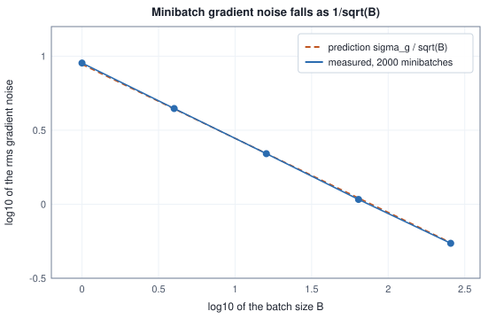
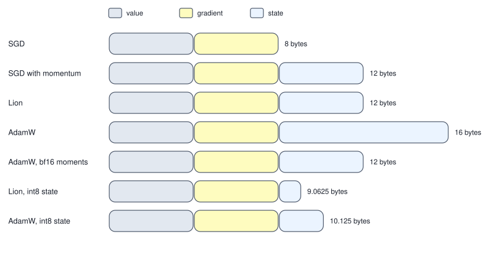

<!-- SPDX-License-Identifier: CC-BY-4.0 -->
<!-- Copyright (c) 2026 Martin Schröder <info@swedishembedded.com> -->

# Optimizers: From SGD to AdamW

*Once we have a gradient, what is the smartest way to use it?*

Chapter 4 made the gradient of a loss with respect to every parameter cost about one extra pass, and Chapter 6 gave a way to prove it correct. Volume II showed what to do with it: step against it, $\theta \leftarrow \theta - \eta\,\nabla\mathcal{L}(\theta)$. That rule has three weaknesses, and each one gets worse as the model grows. The first is the bill.

**The gradient is expensive.** The loss $\mathcal{L}$ is a mean over all $N$ training examples, so its exact gradient is a sum over all of them. Take a linear model with $d = 1000$ weights and a training set of $N = 1\,000\,000$ examples. One example costs about $4d$ floating-point operations (FLOPs) to push through the model and back (2d for the prediction, 2d for the gradient entries), so one exact gradient costs $4dN$ FLOPs, and then we move the weights once. How many moves can we afford, and how much does each cost?

<!-- worked: optimizers.epoch_cost -->
Squared error of a linear model with d = 1,000 weights on N = 1,000,000 examples. One example's loss and gradient cost 4d FLOPs (2d for the prediction, 2d for the gradient entries); one update of the weights reads w and g and writes w, 12 d bytes in 32-bit floats. The number of updates in an epoch is floor(N / B): a last batch smaller than B (for B = 1,024, the last 576 of the 1,000,000 examples) is dropped, and the later columns use that count.

| batch size B | FLOPs of one step (4 d B) | updates in one epoch (floor(N / B)) | FLOPs in one epoch | weight-update bytes in one epoch (12 d floor(N / B)) |
|---|---:|---:|---:|---:|
| 1 | 4,000 | 1,000,000 | 4,000,000,000 | 12,000,000,000 |
| 32 | 128,000 | 31,250 | 4,000,000,000 | 375,000,000 |
| 1,024 | 4,096,000 | 976 | 3,997,696,000 | 11,712,000 |
| 1,000,000 | 4,000,000,000 | 1 | 4,000,000,000 | 12,000 |
<!-- /worked -->

The middle of the table is the observation to hold on to. Whatever the batch size $B$, one pass over the data (an **epoch**: every example used once) costs the same $4dN$ FLOPs. What $B$ chooses is how many times the weights move during that pass: once if we insist on the exact gradient, a million times if we use one example at a time. A step that uses only $B$ examples is cheap, and if its gradient is a good enough estimate of the full one, the many small moves beat the single exact one. How good is good enough can be measured.

**The gradient is only a local fact.** Volume I showed an elongated bowl on which the best fixed step still needed 124 steps to bring the distance to the minimum below 0.001, because a step small enough to be stable along the steep direction crawls along the flat one. Real losses are such bowls in millions of dimensions. Two cures use the history of the gradients: average them, so that the back-and-forth across the valley cancels while the steady drift along it adds up (momentum, defined below), or divide each coordinate by the size of its own recent gradients, so that a coordinate with a huge gradient and one with a tiny gradient make comparable progress (RMSProp and Adam, defined below).

**Penalties interact with the cure.** Volume II turned an L2 penalty into a decay of the weights. We will see that once a step is divided by a running gradient size, the penalty is divided too, and its meaning changes from parameter to parameter. The repair (AdamW, defined below) is a one-line move of the decay out of the gradient.

Every cure also costs memory: momentum remembers one number per parameter, Adam two. For a model with billions of parameters that is the difference between fitting on a device and not, so the bytes of each rule are counted below, and one rule (Lion) keeps a single number and still works.

The chapter leans on gradient descent, the learning rate, the stability bound and the condition number (Volumes I and II), expectation and variance (Volume I), the L2 penalty (Volume II), and the backward pass and its accumulation over micro-batches (Chapters 4 and 5 of this volume). Six questions bring back the descent, the statistics and the sums that every rule below is analysed with.

1. (Volume II, chapter 2, "Linear Regression and the First Descent", the stability limit.) Gradient descent on a quadratic loss whose Hessian has largest eigenvalue $\lambda_{\max}$ uses a fixed learning rate $\eta$. What is the largest $\eta$ for which the error shrinks along every eigendirection?
2. (Volume I, chapter 8, "Gradients, Jacobians and Many Variables", conditioning.) A bowl has curvatures $9$ and $1$. What is its condition number, and by what factor does the error shrink per step at the best fixed learning rate?
3. (Volume I, chapters 10 and 12, "Probability: Reasoning Under Uncertainty" and "Statistics: Learning Facts from Samples", expectation and variance.) The mean of $n$ independent draws of one quantity with mean $\mu$ and variance $\sigma^2$: what are its expectation and variance?
4. (Volume II, chapter 4, "Maximum Likelihood, Priors and Regularization", the L2 penalty.) Write one gradient step on $\mathcal{L}(\mathbf{w}) + \frac{\lambda}{2}\lVert\mathbf{w}\rVert^2$ as "shrink, then step".
5. (Volume I, chapter 14, "Complex Numbers, Frequencies and the Fourier Transform", the geometric sum.) What is $1 + r + r^2 + \dots + r^{n-1}$, and what does it tend to for $0 < r < 1$ as $n$ grows?
6. (Chapter 5, "The Backward Pass of Every Layer", micro-batches.) A batch of 10 is split into micro-batches of 4, 3 and 3, each computing the gradient of its own mean. With what weights are the three gradients added to give the gradient of the mean over 10?

## Stochastic gradient descent

The first weakness has the simplest cure: move the weights many times per pass over the data, using gradients that are cheap and right on average, rather than once on an exact one.

### The minibatch

Write $\ell_n(\theta)$ for the loss of example $n$, so that $\mathcal{L}(\theta) = \frac{1}{N}\sum_{n=0}^{N-1}\ell_n(\theta)$ and, by linearity of the derivative, the exact gradient is the mean of the per-example gradients, $\nabla\mathcal{L} = \frac{1}{N}\sum_n\nabla\ell_n$. A **minibatch** is a small set $\mathcal{B}_t$ of $B$ example indices chosen for step $t$, and its gradient is the mean over just those examples,

$$
\mathbf{g}_t = \frac{1}{B}\sum_{n \in \mathcal{B}_t}\nabla\ell_n(\theta_{t-1}).
$$

**Stochastic gradient descent** (SGD) is gradient descent that steps along $\mathbf{g}_t$ instead of $\nabla\mathcal{L}$:

$$
\theta_t = \theta_{t-1} - \eta\,\mathbf{g}_t .
$$

"Stochastic" means that $\mathbf{g}_t$ depends on a random choice, the choice of $\mathcal{B}_t$. Everything that follows depends on how far the random $\mathbf{g}_t$ strays from the exact $\nabla\mathcal{L}$.

### The minibatch gradient is right on average

Let the indices be drawn independently and uniformly from $\{0, \dots, N-1\}$ (the simplest case; the next sections come back to drawing without repeats). One drawn example has gradient $\nabla\ell_I$ with $I$ uniform, and by the definition of expectation

$$
\mathbb{E}\left[\nabla\ell_I\right] = \sum_{n}\frac{1}{N}\nabla\ell_n = \nabla\mathcal{L}.
$$

The minibatch gradient is the mean of $B$ independent copies, so by linearity of expectation $\mathbb{E}[\mathbf{g}_t] = \nabla\mathcal{L}(\theta_{t-1})$: it is unbiased, an estimate with the right centre (Volume I, "Statistics"). Its spread is the other half. Let $\sigma_g^2 = \mathbb{E}\lVert\nabla\ell_I - \nabla\mathcal{L}\rVert^2$ be the total variance of one example's gradient (the sum of the variances of its $P$ components, one number for the whole vector). The variance of a mean of $B$ independent draws is the variance of one draw divided by $B$ (Volume I, "Statistics"), applied to each component and summed:

$$
\mathbb{E}\lVert\mathbf{g}_t - \nabla\mathcal{L}\rVert^2 = \frac{\sigma_g^2}{B}.
$$

Both claims can be checked with a counted experiment. A linear model with three weights and 2000 examples (the data are described in the block), evaluated at the all-zero weights; at each batch size we draw 2000 minibatches with replacement and measure how far their gradients are from the full gradient.

<!-- worked: optimizers.minibatch_gradient -->
Generator: the book's SplitMix64, seed 0xe7b4619d7c21f6bd (16696077047589631677). Data (draw order, i = 0 .. 1999): three calls of normal() for x_i, then one for the label noise; y_i = x_i . (1, -2, 0.5) + 0.5 * noise. Loss of an example: (x . w - y)^2, evaluated at w = (0, 0, 0). Then, for each batch size in the order of the table, R = 2000 minibatches, each B calls of integer(2000) (sampling with replacement) and the average of the B example gradients.

Full gradient: (-1.8399, 3.8182, -0.9208), norm 4.3373. One example's total variance sigma_g^2 = mean of |grad_i - full|^2 = 77.633. 'Bias' is the distance from the full gradient to the average of the R minibatch gradients, to be compared with the next column, the size that sampling noise alone gives it; 'variance' is the mean over the R minibatches of |g - full|^2; 'noise / signal' is its square root over the norm of the full gradient; 'work' is 4 d B FLOPs with d = 3.

| B | bias of the average | its sampling scale sqrt(sigma_g^2 / (B R)) | measured variance | predicted sigma_g^2 / B | measured x B / sigma_g^2 | noise / signal | work (FLOPs) |
|---|---:|---:|---:|---:|---:|---:|---:|
| 1 | 0.0952 | 0.1970 | 80.849 | 77.633 | 1.041 | 2.073 | 12 |
| 4 | 0.0307 | 0.0985 | 19.630 | 19.408 | 1.011 | 1.022 | 48 |
| 16 | 0.0367 | 0.0493 | 4.818 | 4.852 | 0.993 | 0.506 | 192 |
| 64 | 0.0250 | 0.0246 | 1.160 | 1.213 | 0.956 | 0.248 | 768 |
| 256 | 0.0040 | 0.0123 | 0.297 | 0.303 | 0.978 | 0.126 | 3072 |
<!-- /worked -->

The "bias" column is the distance between the full gradient and the average of the 2000 minibatch gradients; it is within the size that sampling noise alone gives it (the next column) in every row but one, and in that row, $B = 64$, it exceeds it by only 2% ($0.0250$ against $0.0246$), so there is no sign of bias. The measured variance times $B$ over $\sigma_g^2$ stays within 5% of 1 at every batch size, as the formula says. The noise-to-signal column is the root of the variance over the size of the full gradient. A single example gives a gradient whose error is twice as big as the gradient itself (2.073); 256 examples give an error of 12.6% of it.



The cost side is plain arithmetic: the work of a step is $4dB$ FLOPs, proportional to $B$, and the noise falls as $1/\sqrt{B}$. To halve the noise costs four times the work. From $B = 16$ to $B = 64$ the work rises from 192 to 768 FLOPs and the noise-to-signal ratio falls from 0.506 to 0.248. That square-root price is the whole economics of batch size. Early in training, when the gradient is large compared with its noise, a small batch already points the right way and many cheap steps win. Later, when the true gradient has shrunk toward the noise level, no number of cheap steps helps unless the noise is cut by a bigger batch, a smaller learning rate, or both.

### What noise does to the step

How much does the noise matter for where the weights end up? Take one weight with curvature $\lambda$, so that the exact gradient of the error $e$ (the distance from the minimum) is $\lambda e$, and let each step see the gradient plus noise of variance $s^2$ (with a minibatch, $s^2 = \sigma^2/B$ for a one-example variance $\sigma^2$). One step is

$$
e' = e - \eta(\lambda e + \xi) = (1 - \eta\lambda)\,e - \eta\,\xi , \qquad \mathrm{Var}[\xi] = s^2 .
$$

The noise $\xi$ is fresh at every step, so it is independent of $e$, and the variances add. After many steps $e$ settles into a stationary spread $V = \mathbb{E}[e^2]$ that no longer changes from step to step, so $V = (1-\eta\lambda)^2 V + \eta^2\,s^2$, which gives

$$
V = \frac{\eta^2\,s^2}{1 - (1 - \eta\lambda)^2} = \frac{\eta\, s^2}{\lambda\,(2 - \eta\lambda)} .
$$

With a constant learning rate, SGD does not converge to the minimum; it hovers around it with a mean square distance proportional to $\eta s^2$, so proportional to $\eta/B$ for a minibatch. A table of simulations (one weight, $\lambda = 1$, $s = 2$ per example) checks the formula:

<!-- worked: optimizers.noise_floor -->
Generator: the book's SplitMix64, seed 0x904aab07fdd676f5 (10397310740550022901). One weight error e with curvature lam = 1, so the exact gradient is lam e, and a minibatch gradient g = lam e + (s / sqrt(B)) * normal() with s = 2. Start e = 1; each step draws one normal() and sets e <- e - eta g; 200,000 steps per row, the rows in the order of the table, one generator. 'Measured' is the mean of e^2 over steps 1,001 .. 200,000; 'predicted' is eta (s^2 / B) / (lam (2 - eta lam)).

| B | eta | measured mean of e^2 | predicted | ratio |
|---|---:|---:|---:|---:|
| 1 | 0.4 | 0.9853 | 1.0000 | 0.985 |
| 1 | 0.2 | 0.4388 | 0.4444 | 0.987 |
| 1 | 0.1 | 0.2077 | 0.2105 | 0.986 |
| 1 | 0.05 | 0.1007 | 0.1026 | 0.982 |
| 4 | 0.4 | 0.2501 | 0.2500 | 1.000 |
| 4 | 0.2 | 0.1114 | 0.1111 | 1.003 |
| 4 | 0.1 | 0.0522 | 0.0526 | 0.992 |
| 4 | 0.05 | 0.0258 | 0.0256 | 1.007 |
<!-- /worked -->

The measured values agree with the formula to about 2% (the stationary spread of 200,000 correlated steps is itself only known to that precision). At $\eta = 0.1$, the floor with $B = 1$ is $0.2077$ and with $B = 4$ it is $0.0522$: four times the batch, a quarter of the floor. Halving $\eta$ cuts the floor by a little more than half in every row (the factor $2 - \eta\lambda$ in the denominator grows as $\eta$ falls). This is the reason that learning rates are made to fall during a run (Chapter 8), and the reason that "run the same recipe at a larger batch" quietly changes what the learning rate means.

### Epochs and shuffling

Drawing indices independently, with replacement, is what the analysis above assumed; training loops do something slightly different and better. They put the indices $0, \dots, N-1$ in a random order, cut the list into consecutive batches of $B$, use them one after another, and when the list is exhausted, shuffle again. One such pass is an epoch, and every example is used exactly once in it (with replacement, some examples would be used twice and some not at all). At any fixed $\theta$, the gradients of the epoch's minibatches, weighted by their sizes, combine to exactly the full gradient. The shuffle must be a correct one (Volume I, Chapter 17, whose `shuffle` we use). With $N$ not divisible by $B$ the last batch is short, and Chapter 5's rule applies when their gradients are combined into one: weight a batch's mean gradient by $B_j/N$.

<!-- worked: optimizers.epoch_batches -->
Generator: the book's SplitMix64, seed 0x6c7ad29ba79ea6b7 (7816791669228873399). N = 10 examples, batch size B = 4. The index list `order` starts as (0, 1, ..., 9); at the start of every epoch `shuffle(order, rng)` permutes the list as the previous epoch left it; batch j takes the positions 4j .. min(4j + 4, 10) - 1. The last batch is short.

| epoch | batch j | example indices | size B_j | weight B_j / N in the epoch mean |
|---|---:|---:|---:|---:|
| 0 | 0 | (3, 7, 1, 6) | 4 | 4/10 |
| 0 | 1 | (4, 2, 8, 9) | 4 | 4/10 |
| 0 | 2 | (5, 0) | 2 | 2/10 |
| 1 | 0 | (2, 5, 7, 3) | 4 | 4/10 |
| 1 | 1 | (8, 9, 1, 6) | 4 | 4/10 |
| 1 | 2 | (0, 4) | 2 | 2/10 |
<!-- /worked -->

The pseudocode of the whole loop for plain SGD is short. `batch_gradient` is the backward pass of Chapters 4 and 5 over the examples listed in `idx`, returning the mean gradient of those examples.

```text
function sgd(batch_gradient: function(array<real>[P], array<int>[B]) -> array<real>[P],
             theta: inout array<real>[P], N: int, B: int, epochs: int,
             eta: real, rng: Generator) -> none:
    require 0 < B and B <= N, "the batch size must be between 1 and N"
    order = [i for i in 0 .. N]                    # the example indices; reshuffled each epoch
    for epoch in 0 .. epochs:
        shuffle(order, rng)
        for j in 0 .. (N + B - 1) // B:            # ceil(N / B) batches; the last may be short
            idx = order[j * B : min(j * B + B, N)]
            g = batch_gradient(theta, idx)         # shape [P]: mean over the examples of idx
            for i in 0 .. P:
                theta[i] = theta[i] - eta * g[i]   # the whole rule: theta <- theta - eta g
```

Nothing in the loop depends on the update rule except the last two lines, and every optimizer below replaces them.

## Momentum

A step that goes mostly along the valley of the elongated bowl, and little across it, comes from averaging the gradients.

### Averaging cancels the zigzag

On the elongated bowl the gradient of the steep direction changes sign from step to step while the gradient of the flat direction keeps its sign. If we kept a running total of the gradients and stepped along the total, the alternating parts would cancel and the steady parts would add. The **momentum** buffer is such a total, with a forgetting factor $\beta \in [0, 1)$ so that old gradients fade:

$$
\mathbf{m}_t = \beta\,\mathbf{m}_{t-1} + \mathbf{g}_t, \qquad \theta_t = \theta_{t-1} - \eta\,\mathbf{m}_t, \qquad \mathbf{m}_0 = \mathbf{0}.
$$

(The name is the physics: a heavy ball rolling down the bowl keeps some of its velocity, $\beta$ is how much, and the gradient is the force. This form is called the heavy-ball method.) Unrolled, the buffer is a weighted sum of all past gradients, $\mathbf{m}_t = \sum_{k=0}^{t-1}\beta^k\,\mathbf{g}_{t-k}$: the newest gradient has weight 1, one step older $\beta$, and so on. The two situations of the paragraph above are two sums that can be done in closed form. A gradient that never changes, $g$, gives $m_t = g\,(1 + \beta + \dots + \beta^{t-1}) = g\,\frac{1 - \beta^t}{1 - \beta}$, which tends to $g/(1-\beta)$. A gradient that alternates $+g, -g, +g, \dots$ gives a buffer that alternates and settles at size $g/(1+\beta)$ (at an odd step $m = g + \beta m_{\text{prev}}$ with $m_{\text{prev}} = -m$ at the limit, so $m(1 + \beta) = g$). The table computes both for three values of $\beta$.

<!-- worked: optimizers.momentum_buffers -->
Buffer m_k = beta m_(k-1) + g_k, m_0 = 0. First a constant gradient g_k = 1 (limit 1 / (1 - beta)):

| beta | k = 1 | k = 2 | k = 5 | k = 10 | k = 20 | k = 50 | k = 100 | limit |
|---|---:|---:|---:|---:|---:|---:|---:|---:|
| 0.5 | 1.000 | 1.500 | 1.938 | 1.998 | 2.000 | 2.000 | 2.000 | 2.000 |
| 0.9 | 1.000 | 1.900 | 4.095 | 6.513 | 8.784 | 9.948 | 10.000 | 10.000 |
| 0.99 | 1.000 | 1.990 | 4.901 | 9.562 | 18.209 | 39.499 | 63.397 | 100.000 |

Then a gradient that alternates, g_k = +1 for odd k and -1 for even k. The buffer then alternates in sign too (positive at odd k) and its size tends to 1 / (1 + beta):

| beta | k = 1 | k = 2 | k = 5 | k = 10 | k = 20 | k = 50 | k = 100 | limit |
|---|---:|---:|---:|---:|---:|---:|---:|---:|
| 0.5 | 1.000 | -0.500 | 0.688 | -0.666 | -0.667 | -0.667 | -0.667 | +-0.667 |
| 0.9 | 1.000 | -0.100 | 0.837 | -0.343 | -0.462 | -0.524 | -0.526 | +-0.526 |
| 0.99 | 1.000 | -0.010 | 0.980 | -0.048 | -0.092 | -0.198 | -0.319 | +-0.503 |
<!-- /worked -->

For $\beta = 0.9$ a steady gradient is amplified ten times and an alternating one is reduced to $0.526$ of its size: nineteen times less, $\frac{1/(1-\beta)}{1/(1+\beta)} = \frac{1+\beta}{1-\beta}$. That ratio is momentum's entire effect. A steady direction gets an **effective step** of $\eta/(1-\beta)$ per unit gradient, which is why changing $\beta$ from 0.9 to 0.99 without lowering $\eta$ is a tenfold increase of the step in the flat direction. Note also how slowly the buffer fills: with $\beta = 0.99$ it takes about 100 steps to approach its limit (63.4 of 100 after 100 steps), a fact we will meet again.

### Two ways to write the same average

Many descriptions of momentum, and Adam below, write the buffer as a true **exponential moving average**, a weighted average whose weights fall by a factor $\beta$ per step of age and sum to 1:

$$
\mathbf{m}'_t = \beta\,\mathbf{m}'_{t-1} + (1-\beta)\,\mathbf{g}_t .
$$

The two buffers differ only in a factor: $\mathbf{m}'_t = (1-\beta)\,\mathbf{m}_t$ (both satisfy the same recursion up to the factor on the new gradient, and both start at 0). So stepping with $\eta\,\mathbf{m}_t$ is stepping with $\frac{\eta}{1-\beta}\mathbf{m}'_t$. In the sum form a steady gradient $g$ moves the weight by $\eta g/(1-\beta)$ per step; in the average form by $\eta g$. This chapter uses the sum form for SGD with momentum and the average form for Adam and Lion, because that is what each is conventionally defined with (and what `crates/optim` implements); it matters when moving a learning rate from one to the other.

### What momentum does to a quadratic

On a quadratic bowl the effect can be computed exactly, with the tools of Volume II. Along one eigendirection of the Hessian, with curvature $\lambda$ and error $\xi_t$, the gradient is $\lambda\xi_t$. The update is $m_t = \beta m_{t-1} + \lambda\xi_{t-1}$ and $\xi_t = \xi_{t-1} - \eta m_t$. Subtracting two consecutive error updates removes $m$: since $-\eta m_{t-1} = \xi_{t-1} - \xi_{t-2}$,

$$
\xi_t - \xi_{t-1} = -\eta\left(\beta m_{t-1} + \lambda\xi_{t-1}\right) = \beta\,(\xi_{t-1} - \xi_{t-2}) - \eta\lambda\,\xi_{t-1},
$$

$$
\xi_t = (1 + \beta - \eta\lambda)\,\xi_{t-1} - \beta\,\xi_{t-2}.
$$

A solution of the form $\xi_t = z^t$ needs $z^2 - (1 + \beta - \eta\lambda)\,z + \beta = 0$, whose two roots multiply to $\beta$ (the constant term). Gradient descent without momentum ($\beta = 0$) has the single root $1 - \eta\lambda$ of Volume II. With momentum there are two cases. If the roots are complex (conjugates of each other), each has modulus $\sqrt{\beta}$, because the modulus squared is their product, and then the error along this direction shrinks by $\sqrt{\beta}$ per step, with a rotation, whatever $\lambda$ is. The roots are complex when the discriminant is negative, $(1 + \beta - \eta\lambda)^2 < 4\beta$, that is,

$$
\left(1 - \sqrt{\beta}\right)^2 < \eta\lambda < \left(1 + \sqrt{\beta}\right)^2 .
$$

So all directions whose curvature lies in a range of ratio $\left(\frac{1+\sqrt\beta}{1-\sqrt\beta}\right)^2$ shrink at exactly the same speed. To cover curvatures from $\lambda_{\min}$ to $\lambda_{\max}$, with condition number $\kappa = \lambda_{\max}/\lambda_{\min}$, choose $\beta$ and $\eta$ so that the two ends of the interval meet the two ends of the curvatures, $(1 - \sqrt\beta)^2 = \eta\lambda_{\min}$ and $(1 + \sqrt\beta)^2 = \eta\lambda_{\max}$. Taking square roots, $1 - \sqrt\beta = \sqrt{\eta\lambda_{\min}}$ and $1 + \sqrt\beta = \sqrt{\eta\lambda_{\max}}$; their ratio is $\sqrt\kappa = (1 + \sqrt\beta)/(1 - \sqrt\beta)$, which solves to the first formula below, and their sum is $2 = \sqrt\eta\,(\sqrt{\lambda_{\max}} + \sqrt{\lambda_{\min}})$, which gives the second:

$$
\sqrt{\beta} = \frac{\sqrt{\kappa} - 1}{\sqrt{\kappa} + 1}, \qquad \eta = \frac{4}{\left(\sqrt{\lambda_{\max}} + \sqrt{\lambda_{\min}}\right)^2}.
$$

Compare with gradient descent, whose best factor is $\frac{\kappa - 1}{\kappa + 1} \approx 1 - \frac{2}{\kappa}$ (Volume II): the momentum factor is $\approx 1 - \frac{2}{\sqrt{\kappa}}$. The number of steps to reduce the error by a fixed factor falls from proportional to $\kappa$ to proportional to $\sqrt{\kappa}$.

For the bowl of Volume I, with curvatures $6 \pm 4\sqrt{2}$ (11.657 and 0.343), the formulas give exactly $\eta = 0.25$ and $\beta = 0.5$. The table runs through the curvatures that occur:

<!-- worked: optimizers.momentum_modes -->
The bowl of Volume I, Chapter 8 has curvatures 11.6569 and 0.3431 (ratio 33.97). Gradient descent at its best step 0.1667 = 1/6 shrinks every mode by (kappa - 1)/(kappa + 1) = 0.9428. Momentum with eta = 4 / (sqrt(lam_max) + sqrt(lam_min))^2 = 0.2500 and beta = ((sqrt(kappa) - 1) / (sqrt(kappa) + 1))^2 = 0.5000: the per-step factor of a mode of curvature lam is the larger modulus of the two roots of z^2 - (1 + beta - eta lam) z + beta.

| curvature lam | gradient descent |1 - eta lam| | eta lam (momentum) | roots | momentum factor |
|---|---:|---:|---:|---:|
| 0.3431 | 0.9428 | 0.0858 | double root | 0.7071 |
| 0.5000 | 0.9167 | 0.1250 | complex pair | 0.7071 |
| 1.0000 | 0.8333 | 0.2500 | complex pair | 0.7071 |
| 3.0000 | 0.5000 | 0.7500 | complex pair | 0.7071 |
| 6.0000 | 0.0000 | 1.5000 | complex pair | 0.7071 |
| 11.6569 | 0.9428 | 2.9142 | double root | 0.7071 |
<!-- /worked -->

Gradient descent at its best step shrinks the two extreme directions by $0.9428$ and the middle ones by less (a direction with curvature 6 is solved in one step by $\eta = 1/6$, factor $0.0000$, but the extremes decide the speed). With momentum every direction shrinks by $0.7071 = \sqrt{0.5}$. For larger condition numbers the gap grows:

<!-- worked: optimizers.momentum_vs_condition -->
The per-step shrink factor of the error at the best settings: gradient descent (kappa - 1)/(kappa + 1), heavy-ball momentum (sqrt(kappa) - 1)/(sqrt(kappa) + 1). 'Steps' is ln(0.001) / ln(factor), the (fractional) number of steps for a factor-1000 reduction.

| condition number kappa | gradient descent factor | momentum factor | steps, gradient descent | steps, momentum |
|---|---:|---:|---:|---:|
| 9.00 | 0.8000 | 0.5000 | 31.0 | 10.0 |
| 33.97 | 0.9428 | 0.7071 | 117.3 | 19.9 |
| 100.00 | 0.9802 | 0.8182 | 345.4 | 34.4 |
| 1000.00 | 0.9980 | 0.9387 | 3453.9 | 109.2 |
<!-- /worked -->

At $\kappa = 1000$ gradient descent needs about 3454 steps for a thousandfold reduction and momentum about 109. The price is two numbers to choose together instead of one. Momentum with $\beta = 0.9$ is the common default, but the table of the bowl below shows that it is not magic: at $\eta = 0.05$ with $\beta = 0.9$ the bowl takes 68 steps to first get within $0.01$ of the minimum and 90 to stay there, slower than the tuned pair's 25, because with $\beta = 0.9$ every mode oscillates at factor $\sqrt{0.9} = 0.949$, hardly better than the 0.9428 of plain descent. On a loss whose curvatures nobody knows, $\eta$ and $\beta$ are found by trying.

### Nesterov, briefly

The heavy ball takes the gradient at the point where it is. A small change, due to Nesterov, takes the gradient at the point the old momentum is about to carry us to, since we already know we are going there. Write the heavy-ball update as $\mathbf{m}_t = \beta\,\mathbf{m}_{t-1} + \mathbf{g}_t$, $\boldsymbol\psi_t = \boldsymbol\psi_{t-1} - \eta\,\mathbf{m}_t$ for a position $\boldsymbol\psi$, and evaluate the gradient not at $\boldsymbol\psi_{t-1}$ but at the look-ahead point $\theta_{t-1} = \boldsymbol\psi_{t-1} - \eta\beta\,\mathbf{m}_{t-1}$. Store the look-ahead point instead of $\boldsymbol\psi$, so the gradient is taken at the stored parameters as in every other rule. Then $\theta_t = \boldsymbol\psi_t - \eta\beta\,\mathbf{m}_t = \boldsymbol\psi_{t-1} - \eta(1 + \beta)\mathbf{m}_t = \theta_{t-1} + \eta\beta\,\mathbf{m}_{t-1} - \eta(1 + \beta)\mathbf{m}_t$, and since $\beta\,\mathbf{m}_{t-1} = \mathbf{m}_t - \mathbf{g}_t$ this is $\theta_{t-1} - \eta(\mathbf{g}_t + \beta\,\mathbf{m}_t)$. In the form used in code, where the buffer is updated first, the step is therefore along $\mathbf{g}_t + \beta\,\mathbf{m}_t$ instead of $\mathbf{m}_t$, with $\mathbf{g}_t$ the gradient at the stored parameters:

$$
\mathbf{m}_t = \beta\,\mathbf{m}_{t-1} + \mathbf{g}_t, \qquad \theta_t = \theta_{t-1} - \eta\left(\mathbf{g}_t + \beta\,\mathbf{m}_t\right).
$$

It has its own stable region: the pair $(\eta, \beta) = (0.25, 0.5)$, optimal for the heavy ball, diverges for it, as the bowl table below shows; a smaller step such as $\eta = 0.1$ with $\beta = 0.7$ works and takes 31 steps. We will not use it further.

```text
function sgd_momentum_step(theta: inout array<real>[P], g: array<real>[P],
                           m: inout array<real>[P], eta: real, beta: real,
                           nesterov: bool) -> none:
    # m is zeros(real, [P]) before the first step
    for i in 0 .. P:
        m[i] = beta * m[i] + g[i]
        d = g[i] + beta * m[i] if nesterov else m[i]
        theta[i] = theta[i] - eta * d
```

## RMSProp

Momentum treats all coordinates alike: one $\eta$ for all. But the coordinates of a network can differ enormously in the size of their gradients: a weight feeding a unit that is almost always active, a bias, an embedding row that is rarely used. With a single $\eta$, the one with a large gradient limits the step for everybody (the stability bound of Volume II), and the ones with small gradients crawl. A cure is to normalise each coordinate by its own typical gradient size. **RMSProp** keeps, for every coordinate, an exponential moving average of the squared gradient, $\mathbf{v}_t$, whose square root is the root mean square (RMS) of the recent gradients, and divides the step by it:

$$
\mathbf{v}_t = \beta_2\,\mathbf{v}_{t-1} + (1 - \beta_2)\,\mathbf{g}_t \odot \mathbf{g}_t, \qquad
\theta_t = \theta_{t-1} - \eta\,\frac{\mathbf{g}_t}{\sqrt{\mathbf{v}_t} + \epsilon_{\mathrm{den}}} ,
$$

with $\odot$ the elementwise product and the square root, division and sum with $\epsilon_{\mathrm{den}}$ elementwise too. The small constant $\epsilon_{\mathrm{den}}$ (a floor on the denominator, say $10^{-8}$) keeps the division finite when $\mathbf{v}$ is zero; its other role comes below. Think about what this does. If a coordinate's gradient is always about $\pm r$, then $\sqrt{v} \approx r$ and the step is about $\eta\,g/r \approx \pm\eta$: the size of the step no longer depends on $r$. A coordinate with gradients of size $1000$ and one with gradients of size $0.001$ both move by about $\eta$ per step. The units are also right: a parameter and its step now have the same units, whatever the loss is measured in.

### What it can fix and what it cannot

On the elongated bowl in the coordinates where its steep and flat directions are the axes (the "aligned" bowl, the same curvatures 11.657 and 0.343), the gradient components are $\lambda_1 e_1$ and $\lambda_2 e_2$, so the two coordinates have very different gradient sizes, exactly the situation RMSProp is made for: after normalisation both coordinates move at about $\eta$ regardless of curvature. In the bowl of Volume I, where the steep direction is tilted, each coordinate's gradient is a mix of both curvatures; dividing a mix by its own size does not separate them. Per-coordinate scaling cures coordinates of different size; it cannot undo a rotation. The table below shows both bowls, and the two figures draw the paths.


### Two things RMSProp does not do for free

The first is on its first step. $\mathbf{v}_0 = \mathbf{0}$, so after one step $v_1 = (1-\beta_2)g_1^2$ and the first move is $\eta\,g_1/(\sqrt{1-\beta_2}\,|g_1|) = \eta/\sqrt{1-\beta_2}$ in size: $3.16\,\eta$ for $\beta_2 = 0.9$, a step more than three times the learning rate, caused by nothing but the average starting from zero. The table of rules on one weight in the section on Lion shows it as $0.3162$ for $\eta = 0.1$. Adam below repairs this. The second is that normalised steps do not shrink near the minimum: close to it the gradient is small, but so is $\sqrt{v}$, and the step is still about $\eta$. RMSProp therefore hovers around the minimum in a ball of radius of the order of $\eta$ instead of settling into it; at a fixed $\eta$ it behaves like a rule with a noise floor even with exact gradients. The tables show this too.

## Adam

Momentum cures the zigzag, RMSProp cures the unequal scales, and RMSProp carries a start-up flaw. Adam combines the two averages and removes that flaw.

**Adam** keeps both averages. In the average form of the section "Two ways to write the same average", the first moment of the gradient (the mean) and the second moment (the mean square) are

$$
\mathbf{m}_t = \beta_1\,\mathbf{m}_{t-1} + (1 - \beta_1)\,\mathbf{g}_t, \qquad \mathbf{v}_t = \beta_2\,\mathbf{v}_{t-1} + (1 - \beta_2)\,\mathbf{g}_t \odot \mathbf{g}_t,
$$

both starting at zero, with the usual values $\beta_1 = 0.9$ (a memory of about 10 steps) and $\beta_2 = 0.999$ (about 1000 steps; "a memory of $1/(1-\beta)$ steps" is the rule of thumb from the geometric sum). The update divides the first by the root of the second:

$$
\theta_t = \theta_{t-1} - \eta\,\frac{\hat{\mathbf{m}}_t}{\sqrt{\hat{\mathbf{v}}_t} + \epsilon_{\mathrm{den}}}, \qquad
\hat{\mathbf{m}}_t = \frac{\mathbf{m}_t}{1 - \beta_1^t}, \quad \hat{\mathbf{v}}_t = \frac{\mathbf{v}_t}{1 - \beta_2^t}.
$$

The two divisions are the bias correction, which we now derive.

### Bias correction

The averages start at zero, an arbitrary choice, and for a while they remember it. Unroll $m_t = \beta_1 m_{t-1} + (1-\beta_1)g_t$ with $m_0 = 0$:

$$
m_t = (1 - \beta_1)\sum_{k=1}^{t}\beta_1^{\,t-k}\,g_k .
$$

If the gradients all have the same mean $\mu$ (a stationary gradient), the expectation is $\mathbb{E}[m_t] = (1-\beta_1)\,\mu\sum_{k=1}^{t}\beta_1^{t-k}$, and the geometric sum is $\sum_{j=0}^{t-1}\beta_1^j = \frac{1 - \beta_1^t}{1-\beta_1}$, so

$$
\mathbb{E}[m_t] = \left(1 - \beta_1^{\,t}\right)\mu .
$$

The average is too small by the factor $1 - \beta_1^t$: at step 1 it is $1 - \beta_1 = 0.1$ of the right size, a tenfold bias toward zero. The second moment has the same structure with $g_k^2$ in place of $g_k$: if $\mathbb{E}[g_k^2] = s^2$ for every $k$, then $\mathbb{E}[v_t] = (1 - \beta_2^t)\,s^2$. Dividing by $1 - \beta^t$ removes the bias exactly. That division is **bias correction**, and it is a property of the start only: as $t$ grows, $\beta^t \to 0$ and the correction tends to 1. How fast depends on $\beta$:

<!-- worked: optimizers.bias_correction_factors -->
The factor 1 / (1 - beta^t) that divides a moment at step t:

| beta | t = 1 | t = 2 | t = 5 | t = 10 | t = 20 | t = 50 | t = 100 | t = 1000 | t = 5000 |
|---|---:|---:|---:|---:|---:|---:|---:|---:|---:|
| 0.9 | 10.000 | 5.263 | 2.442 | 1.535 | 1.138 | 1.005 | 1.000 | 1.000 | 1.000 |
| 0.99 | 100.000 | 50.251 | 20.404 | 10.458 | 5.492 | 2.532 | 1.577 | 1.000 | 1.000 |
| 0.999 | 1000.000 | 500.250 | 200.400 | 100.451 | 50.477 | 20.494 | 10.503 | 1.582 | 1.007 |

Size of the first step (t = 1, gradient g, any size) of the Adam update measured in units of eta, |m / (sqrt(v) + eps)| with eps negligible against |g|:

| beta1, beta2 | first step / eta without correction | first step / eta with correction |
|---|---:|---:|
| 0.9, 0.999 | 3.1623 | 1.0000 |
| 0.9, 0.99 | 1.0000 | 1.0000 |
| 0.9, 0.95 | 0.4472 | 1.0000 |
| 0.9, 0.9 | 0.3162 | 1.0000 |
<!-- /worked -->

For $\beta_1 = 0.9$ the factor is down to $1.138$ at step 20 and $1.005$ at step 50. For $\beta_2 = 0.999$ the factor is still $10.5$ at step 100 and $1.58$ at step 1000: the second moment is badly biased for the first thousand steps, which is exactly when a training run is at its most delicate. The figure shows what an uncorrected average of a constant gradient does:


A simulation checks the derivation for the second moment. The gradients are Gaussian noise with $\mathbb{E}[g^2] = 4$; $\beta_2 = 0.99$ is used so that the bias is visible within 300 steps.

<!-- worked: optimizers.second_moment_bias -->
Generator: the book's SplitMix64, seed 0x8b4232c766075ae9 (10034638751726525161). The gradient at every step is g_t = 2.0 * normal(), so E[g^2] = 4.0; v_0 = 0, v_t = beta2 v_(t-1) + (1 - beta2) g_t^2 with beta2 = 0.99. 4000 runs, one after another from one generator, each drawing t = 1 .. 300 in order; the table averages v_t over the runs.

| t | mean of v_t | (1 - beta2^t) E[g^2] | mean of v_t / E[g^2] | 1 - beta2^t | mean of v_t / (1 - beta2^t) |
|---|---:|---:|---:|---:|---:|
| 1 | 0.0417 | 0.0400 | 0.0104 | 0.0100 | 4.1699 |
| 2 | 0.0812 | 0.0796 | 0.0203 | 0.0199 | 4.0817 |
| 5 | 0.1996 | 0.1960 | 0.0499 | 0.0490 | 4.0727 |
| 10 | 0.3886 | 0.3825 | 0.0971 | 0.0956 | 4.0640 |
| 50 | 1.5873 | 1.5800 | 0.3968 | 0.3950 | 4.0185 |
| 100 | 2.5479 | 2.5359 | 0.6370 | 0.6340 | 4.0190 |
| 300 | 3.8081 | 3.8038 | 0.9520 | 0.9510 | 4.0045 |
<!-- /worked -->

The average of $v_t$ over 4000 runs is $(1 - \beta_2^t)\cdot 4$ to within sampling noise, and dividing by $1 - \beta_2^t$ recovers $\approx 4$ at every $t$ (4.17 at $t = 1$, where there is only one squared Gaussian per run, to 4.00 at $t = 300$). The corrected first step has a clean form: with both corrections, $\hat m_1 = g_1$ and $\hat v_1 = g_1^2$, so the first step is $\eta\,g_1/(|g_1| + \epsilon_{\mathrm{den}}) \approx \eta\,\mathrm{sign}(g_1)$, of size $\eta$ whatever the gradient. Here are two steps of one weight with every intermediate quantity:

<!-- worked: optimizers.adam_two_steps -->
One weight, start w = 1.0, m = v = 0; eta = 0.1, beta1 = 0.9, beta2 = 0.999, eps = 1e-8, decay lam = 0.01; gradients g_1 = 0.5 and g_2 = 0.3. Per step: m, v; bc1 = 1 - beta1^t, bc2 = 1 - beta2^t; mhat = m / bc1, vhat = v / bc2; decay = eta lam w (computed from the w before the step); step = eta mhat / (sqrt(vhat) + eps); w after = w - decay - step.

| t | g | m | v | bc1 | bc2 | mhat | vhat | decay | step | w after |
|---|---:|---:|---:|---:|---:|---:|---:|---:|---:|---:|
| 1 | 0.5 | 0.050000 | 0.00025000 | 0.1000 | 0.001000 | 0.500000 | 0.250000 | 0.001000 | 0.100000 | 0.899000 |
| 2 | 0.3 | 0.075000 | 0.00033975 | 0.1900 | 0.001999 | 0.394737 | 0.169960 | 0.000899 | 0.095749 | 0.802352 |
<!-- /worked -->

The first row's step is $0.100000 = \eta$ as predicted, and the second is a little smaller ($0.095749$): the memory now holds two gradients. The columns follow the order in which the pseudocode computes them.

Without the corrections the first step is $\eta\,(1-\beta_1)/\sqrt{1-\beta_2}$ in size, the second table above: $3.16\,\eta$ for $\beta_2 = 0.999$, exactly $\eta$ by coincidence for $\beta_2 = 0.99$, and too small ($0.447\,\eta$, $0.316\,\eta$) for smaller $\beta_2$. If we corrected only $\mathbf{m}$ the first step would be $\eta/\sqrt{1-\beta_2}$, which is $31.6\,\eta$ for $\beta_2 = 0.999$. Whichever way the error goes, the correction's job is that the first steps have the size the learning rate says. (The next chapter's warm-up exists for a related reason.)

### What the ratio means

Take a coordinate whose gradient has mean $\mu$ and standard deviation $s$ from step to step (the noise of a minibatch). Then $\sqrt{\hat v} \approx \sqrt{\mu^2 + s^2}$, and $\hat m$ is the mean $\mu$ plus noise: an exponential average of independent noise has variance $(1-\beta_1)^2\sum\beta_1^{2k}s^2 = \frac{1-\beta_1}{1+\beta_1}s^2$, which for $\beta_1 = 0.9$ is a standard deviation of $0.229\,s$. So the ratio $\hat m/\sqrt{\hat v}$ is about $\mu/\sqrt{\mu^2+s^2}$, a number in $(-1, 1)$ that is close to $\pm 1$ where the gradient is consistent and close to 0 where it is mostly noise. Adam's step in each coordinate is therefore at most about $\eta$ and shrinks by itself when a coordinate's gradient is noisy. The learning rate of Adam is a distance in parameter space: "move each weight by at most $\eta$ per step". Knowledge #66 records what that means in practice: with Adam on a small image model at $\eta = 0.03$ every weight moved by half the width of its own initial distribution per step and the training loss entered a limit cycle; at $\eta = 0.005$ the same model went to a floor (see the story in the last section).

### Scale invariance, and the role of epsilon

Multiply every gradient by a constant $a > 0$. Then $\mathbf{m}\to a\,\mathbf{m}$ and $\mathbf{v} \to a^2\mathbf{v}$, and the update becomes $\frac{a\,\hat m}{a\sqrt{\hat v} + \epsilon_{\mathrm{den}}}$: unchanged as long as $a\sqrt{\hat v} \gg \epsilon_{\mathrm{den}}$. SGD's step scales with $a$, and Adam's does not. One weight, twenty fixed gradients, five scales:

<!-- worked: optimizers.gradient_scale -->
Generator: the book's SplitMix64, seed 0xc20b389bcd431398 (13982331709916648344). Twenty gradients g_1 .. g_20 = normal() in order, the same list for every row; the gradient fed to the rule is a * g_t. One weight from w = 0, eta = 0.01, beta1 = 0.9, beta2 = 0.999 for Adam. The table gives w_20 for a = 1 and the ratio w_20(a) / w_20(1) for the other scales; base gradients: g_1 = -0.2006, g_2 = -0.6378, g_3 = 0.8426.

| rule | w_20 at a = 1 | a = 0.25 | a = 4 | a = 0.001 | a = 1e-06 |
|---|---:|---:|---:|---:|---:|
| SGD | 0.047933 | 0.25 | 4 | 0.001 | 1e-06 |
| Adam, eps = 1e-8 | 0.029194 | 1 | 1 | 1 | 0.9747 |
| Adam, eps = 0.1 | 0.023555 | 0.6743 | 1.165 | 0.007408 | 7.468e-06 |
<!-- /worked -->

SGD moves $a$ times as far. Adam with $\epsilon_{\mathrm{den}} = 10^{-8}$ is unchanged for scales from $0.001$ to $4$ and starts to lose its invariance only at $a = 10^{-6}$, where the gradients (of size about $10^{-6}$) are within a factor of 100 of $\epsilon_{\mathrm{den}}$: 2.5% off. With $\epsilon_{\mathrm{den}} = 0.1$ the rule is no longer invariant at all and a scale of $0.001$ takes the weight only $0.74\%$ as far. That is what $\epsilon_{\mathrm{den}}$ is for beyond avoiding a division by zero: it is a floor, below which gradients are treated as noise and the step goes to zero. A coordinate whose gradient has been exactly zero and then is not shows it:

<!-- worked: optimizers.epsilon_floor -->
A weight whose gradient was exactly 0 at steps 1 .. 99 and is 0.0001 at step t = 100; beta1 = 0.9, beta2 = 0.999. Then m = 1.00e-05, v = 1.00e-11, mhat = 1.00e-05, vhat = 1.05e-10, sqrt(vhat) = 1.02e-05. The table gives the step in units of eta: with the true vhat, mhat / (sqrt(vhat) + eps), and in the last column the same step if a lossy store had decoded vhat as exactly 0, mhat / eps.

| eps | step / eta with true vhat | step / eta with vhat decoded as 0 |
|---|---:|---:|
| 1e-08 | 0.9748 | 1000.0 |
| 1e-06 | 0.8890 | 10.0 |
| 1e-05 | 0.4939 | 1.0 |
| 0.0001 | 0.0907 | 0.1 |
| 0.001 | 0.0099 | 0.0 |
<!-- /worked -->

With $\epsilon_{\mathrm{den}} = 10^{-8}$ a sudden gradient of $10^{-4}$ after 99 silent steps makes a step of $0.97\,\eta$, nearly full. With $\epsilon_{\mathrm{den}} = 10^{-5}$ it makes half of that, and with $10^{-3}$ one hundredth. The last column is the failure that makes the floor matter in practice: if a lossy store of the second moment (Volume XIII) decodes a small positive $\hat v$ as exactly zero, the step becomes $\hat m/\epsilon_{\mathrm{den}}$, a thousand times $\eta$ at $\epsilon_{\mathrm{den}} = 10^{-8}$. The scale invariance is also a hazard for testing, as the history of brain shows below.

### Implementation notes

The correction costs two divisions per element and is computed once per step as the scalars $1/(1-\beta_1^t)$ and $1/(1-\beta_2^t)$; an implementation does not divide each element. The $t$ in $\beta^t$ is the number of updates the state has absorbed, which must be restored with the state when training is resumed.

## The rules on one bowl

The two bowls have the same curvatures, 11.657 and 0.343 (condition number 33.97), the same minimum $(1,2)$ and start $(0, 3.5)$. The "rotated" bowl is the one of Volume I; the "aligned" bowl is that bowl turned so that its axes are the coordinates. Each rule is given the exact gradient.

<!-- worked: optimizers.bowl_comparison -->
Both bowls have minimum (1, 2), start (0, 3.5) and curvatures 11.6569 and 0.3431 (condition number 33.97). 'Rotated' is the bowl of Volume I, Chapter 8, with Hessian [[2, 4], [4, 10]] whose steep direction is not a coordinate axis; 'aligned' has the Hessian diag(11.6569, 0.3431), the same bowl turned so that its axes are the coordinates, the first coordinate the steep one. In both, the loss is 0.5 e^T H e for the error e = w - (1, 2), the gradient is H e, and the start error is e = (-1, 1.5). Each rule starts with empty state and takes the exact gradient; RMSProp and Adam use eps = 1e-8 (added to the square root of the second-moment average, as in the pseudocode), the average is updated as beta2 v + (1.0 - beta2) * g * g, and momentum is the sum form of the pseudocode. Columns: the distance to the minimum after 20, 50 and 200 steps; the first step at which the distance is below 0.01; the first step after which it stays below 0.01 up to step 200.

| bowl | rule | hyperparameters | dist. at 20 | dist. at 50 | dist. at 200 | first below | stays below |
|---|---|---|---:|---:|---:|---:|---:|
| rotated | SGD | eta = 1/6 | 0.5552 | 0.0949 | 0.0000 | 89 | 89 |
| rotated | momentum | eta = 0.25, beta = 0.5 | 0.0359 | 0.0000 | 0.0000 | 25 | 25 |
| rotated | momentum | eta = 0.05, beta = 0.9 | 0.4104 | 0.1263 | 0.0000 | 68 | 90 |
| rotated | Nesterov | eta = 0.1, beta = 0.7 | 0.0821 | 0.0000 | 0.0000 | 31 | 31 |
| rotated | Nesterov | eta = 0.25, beta = 0.5 | 1.1e+10 | 1.3e+25 | 2.1e+100 | never | never |
| rotated | RMSProp | eta = 0.05, beta2 = 0.9 | 1.6524 | 0.6720 | 0.0351 | 84 | never |
| rotated | Adam | eta = 0.1, 0.9 / 0.999 | 1.7165 | 0.8513 | 0.0003 | 130 | 130 |
| aligned | SGD | eta = 1/6 | 0.5552 | 0.0949 | 0.0000 | 89 | 89 |
| aligned | momentum | eta = 0.25, beta = 0.5 | 0.0358 | 0.0000 | 0.0000 | 25 | 25 |
| aligned | momentum | eta = 0.05, beta = 0.9 | 0.4101 | 0.1263 | 0.0000 | 68 | 90 |
| aligned | Nesterov | eta = 0.1, beta = 0.7 | 0.0822 | 0.0000 | 0.0000 | 31 | 31 |
| aligned | Nesterov | eta = 0.25, beta = 0.5 | 1.1e+10 | 1.3e+25 | 2.1e+100 | never | never |
| aligned | RMSProp | eta = 0.05, beta2 = 0.9 | 0.3731 | 0.0013 | 0.0000 | 44 | 44 |
| aligned | Adam | eta = 0.1, 0.9 / 0.999 | 0.3036 | 0.0765 | 0.0000 | 66 | 95 |
<!-- /worked -->

Read it by columns. Gradient descent and momentum, whose steps are multiples of the gradient, are indifferent to the rotation: their rows are the same in both bowls (89 and 25 steps to get within $0.01$, 68 for the untuned $\beta = 0.9$, 31 for Nesterov at its own pair). RMSProp and Adam are not: on the aligned bowl, RMSProp reaches the tolerance after 44 steps, half of gradient descent's 89, and stays; on the rotated bowl it reaches it at step 84 but does not stay, still $0.0351$ away after 200 steps, because it is hovering (its floor is of order $\eta = 0.05$). Adam on the aligned bowl takes 66 steps to first arrive, passes the minimum and circles, and has stayed below only from step 95 onward; on the rotated one it first arrives at step 130. The lesson is the section's own: normalisation by coordinate is worth a lot when the coordinates are what differ, and nothing when the difficulty is a direction that is not a coordinate. Real networks are in between, and that is why one optimizer rarely beats all the others on all problems. With the exact gradient, momentum tuned to the bowl is the fastest of all in both. None of these rules has been tuned for the noise of minibatches; the small network below is run with a tuned learning rate for each.

## Decay: coupled and decoupled

Weight decay should shrink every weight by a fixed fraction each step. The shrinkage must therefore not pass through whatever rescaling the optimizer applies to the gradient, and the question is how to write the decay so that it does not.

### The L2 penalty under SGD

Volume II turned the penalty $\frac{\lambda}{2}\lVert\mathbf{w}\rVert^2$ into the update $\theta \leftarrow \theta - \eta(\mathbf{g} + \lambda\theta) = (1 - \eta\lambda)\,\theta - \eta\,\mathbf{g}$: shrink the weights by the factor $1 - \eta\lambda$, then take the usual step. This "decay of the weights" (weight decay) is the same update whether we say we added a penalty to the loss or we shrink the weights directly, as long as the rule applies the gradient as $-\eta\,\mathbf{g}$. A weight that the data never touches ($\mathbf{g} = 0$) decays geometrically with ratio $1 - \eta\lambda$.

### The penalty under Adam is divided by the gradient scale

Now put the penalty into the gradient of Adam, $\mathbf{g} + \lambda\theta$, as code that adds an L2 term to the loss does. Everything the optimizer does to a gradient it does to the penalty's part too. The part of the update that comes from $\lambda\theta_i$ is, with the second moment dominated by the coordinate's own gradient size $r_i$ (the root mean square of its gradient),

$$
\Delta\theta_i^{\text{penalty}} \approx -\eta\,\frac{\lambda\,\theta_i}{r_i + \epsilon_{\mathrm{den}}} .
$$

The decay is divided by the same number that normalises the gradient: a parameter whose gradients are large ($r_i = 100$) is shrunk 100 times less than SGD would, and one whose gradients are small ($r_i = 0.01$) is shrunk 100 times more. The strength $\lambda$ no longer means "shrink by $\eta\lambda$ per step"; it means something different for every parameter, and what it means changes during training as gradients grow and shrink. A one-weight probe measures this: hold $w = 1$, let the data gradient be zero-mean noise of standard deviation $s$, run two Adam instances on the same noise, one with $\lambda w$ added to its gradient and one without, and take the difference of their steps, in units of $\eta\lambda w$, the amount SGD would apply:

<!-- worked: optimizers.decay_strength -->
Generator: the book's SplitMix64, seed 0x15547167106ea66b (1536978060311438955). The data gradient of a weight is noise with standard deviation s and mean 0: g_t = s * normal(), 4000 draws per row, rows in the order of the table, one generator. The weight is held at w = 1 so that the probe measures the pull of the penalty lam w = 0.01 on the step, not the path: two Adam instances (eta = 0.01, beta1 = 0.9, beta2 = 0.999, eps = 1e-8) see the same noise, one with lam w added to its gradient and one without; the 'applied decay' is the mean over the last 2000 steps of the difference of their steps, in units of eta lam w. 'Predicted' is 1 divided by the root mean square, over the same last steps, of the gradient the penalised Adam sees, g_t + lam w (data gradient plus penalty gradient). Decoupled decay applies exactly 1 in these units.

| noise s | applied decay, penalty inside Adam (measured) | 1 / rms of g + lam w (predicted) | decoupled decay |
|---|---:|---:|---:|
| 0.01 | 70.837 | 70.248 | 1.000 |
| 1.00 | 1.009 | 1.006 | 1.000 |
| 100.00 | 0.010 | 0.010 | 1.000 |
<!-- /worked -->

The measured decay is $70.8$, $1.009$ and $0.010$ times what the plain rule applies for noise of $0.01$, $1$ and $100$, matching $1/\mathrm{rms}$ of the gradient Adam sees, data plus penalty (the third column) to within 1%. Two weights of the same network, with gradient scales a factor $10^4$ apart, would be decayed $7000$ times differently. Worse, when the data gradient is zero the penalty's own gradient $\lambda w$ is the only thing Adam sees, and normalising a signal by its own size yields a step of about $\eta$ whatever its size: the decay does not depend on $\lambda$ at all. The next table follows a weight that the data never touches, so that only the decay acts, for $\eta = 0.01$.

<!-- worked: optimizers.decay_trajectories -->
A weight that the data never touches: the loss gradient is 0 at every step, so only the decay acts. w = 1 at step 0, eta = 0.01, Adam with beta1 = 0.9, beta2 = 0.999, eps = 1e-8. SGD is fed the gradient lam w (the penalty's gradient); the Adam rows with the penalty in the gradient are the `decoupled = false` variant of the chapter's pseudocode (the rule adds lam w to the gradient 0 it is given); AdamW is given a gradient of 0 and shrinks the weight itself. For SGD and AdamW the value after k steps is (1 - eta lam)^k.

| rule | lam | k = 0 | k = 10 | k = 50 | k = 100 | k = 200 | k = 500 | k = 1000 | k = 2000 |
|---|---:|---:|---:|---:|---:|---:|---:|---:|---:|
| SGD, penalty in the gradient | 0.1 | 1.0000 | 0.9900 | 0.9512 | 0.9048 | 0.8186 | 0.6064 | 0.3677 | 0.1352 |
| AdamW, decoupled decay | 0.1 | 1.0000 | 0.9900 | 0.9512 | 0.9048 | 0.8186 | 0.6064 | 0.3677 | 0.1352 |
| AdamW, decoupled decay | 1 | 1.0000 | 0.9044 | 0.6050 | 0.3660 | 0.1340 | 0.0066 | 0.0000 | 0.0000 |
| Adam, penalty in the gradient | 0.01 | 1.0000 | 0.9003 | 0.5368 | 0.2244 | 0.0156 | 0.0000 | 0.0000 | 0.0000 |
| Adam, penalty in the gradient | 0.1 | 1.0000 | 0.9003 | 0.5368 | 0.2244 | 0.0156 | 0.0000 | 0.0000 | 0.0000 |
| Adam, penalty in the gradient | 1 | 1.0000 | 0.9003 | 0.5368 | 0.2244 | 0.0156 | 0.0000 | 0.0000 | 0.0000 |
<!-- /worked -->

SGD and AdamW follow $(1 - \eta\lambda)^k$ ($0.3677$ after 1000 steps and $0.1352$ after 2000 for $\lambda = 0.1$), and AdamW at $\lambda = 1$ decays ten times faster ($0.3660$ after 100 steps), as the strength should. Adam with the penalty in the gradient takes the weight from 1 to $0.2244$ in 100 steps and to $0.0156$ in 200, about $\eta$ per step, and its three rows, for $\lambda = 0.01$, $0.1$ and $1$, are identical to four decimals: the strength of the penalty has stopped doing anything. (Dividing the gradient by its own running size cancels $\lambda$ exactly, up to $\epsilon_{\mathrm{den}}$.)

### Decoupled weight decay and AdamW

The repair is to take the decay out of the gradient and apply it directly to the weights. **Decoupled weight decay** shrinks every weight by the same factor $1 - \eta\lambda$ per step, outside the adaptive rule, and **AdamW** is Adam with it:

$$
\theta_t = \theta_{t-1} - \eta\,\lambda\,\theta_{t-1} - \eta\,\frac{\hat{\mathbf{m}}_t}{\sqrt{\hat{\mathbf{v}}_t} + \epsilon_{\mathrm{den}}} .
$$

The moments $\mathbf{m}$ and $\mathbf{v}$ see only the data gradient. The decay term uses the weight from before the step, so the order of the two subtractions does not matter. The strength $\lambda$ now has the same meaning for every parameter and every step, and it appears in the same product $\eta\lambda$ as in SGD: that product is the fraction of the weight removed per step. In the two-step table of the section on Adam, the "decay" column is $\eta\lambda w = 0.1 \times 0.01 \times 1.0 = 0.001$ at step 1.

Adam and AdamW fit one skeleton, written once with a flag that selects where the penalty goes (the flag is false for the coupled form):

```text
function adam_step(theta: inout array<real>[P], g: array<real>[P],
                   m: inout array<real>[P], v: inout array<real>[P], t: int,
                   eta: real, beta1: real, beta2: real, eps: real,
                   lam: real, decoupled: bool) -> none:
    require t >= 1, "t is the 1-based index of this step"
    require 0.0 <= beta1 and beta1 < 1.0 and 0.0 <= beta2 and beta2 < 1.0, "betas must lie in [0, 1)"
    bc1 = 1.0 - beta1 ^ t                          # bias corrections: once per step
    bc2 = 1.0 - beta2 ^ t
    for i in 0 .. P:
        gi = g[i]
        if not decoupled:
            gi = gi + lam * theta[i]               # coupled: L2 penalty inside the gradient
        m[i] = beta1 * m[i] + (1.0 - beta1) * gi
        v[i] = beta2 * v[i] + (1.0 - beta2) * gi * gi
        mhat = m[i] / bc1
        vhat = v[i] / bc2
        if decoupled:
            theta[i] = theta[i] - eta * lam * theta[i]   # decoupled: shrink the weight itself
        theta[i] = theta[i] - eta * mhat / (sqrt(vhat) + eps)
```

with $\mathbf{m}$ and $\mathbf{v}$ both `zeros(real, [P])` before step 1 and `t` counting from 1. Plain Adam is `lam = 0.0`. The shapes are all $[P]$: AdamW's state is two more arrays the size of the parameters, a fact that comes back as bytes below.

RMSProp is the same loop without `m`, `mhat` and `bc` (and with $\hat v$ replaced by $v$, and the gradient itself in the numerator); Adam's family differs from it by exactly the two ideas of momentum and bias correction.

## Lion

Adam pays for its two averages with two extra arrays. Lion shows that one is enough, and that every step can be bounded as well.

**Lion** (the name abbreviates "evolved sign momentum": the rule was found by a search over programs) throws away the magnitude of the update. It forms an interpolation of the momentum and the new gradient, takes only its sign, and steps by $\eta$ in that direction:

$$
\theta_t = \theta_{t-1} - \eta\left(\mathrm{sign}\left(\beta_1\,\mathbf{m}_{t-1} + (1-\beta_1)\,\mathbf{g}_t\right) + \lambda\,\theta_{t-1}\right), \qquad
\mathbf{m}_t = \beta_2\,\mathbf{m}_{t-1} + (1-\beta_2)\,\mathbf{g}_t .
$$

The sign is elementwise, and the decay is decoupled, in the same product $\eta\lambda$ as AdamW's. Two different averages of the gradient appear: a short one ($\beta_1 = 0.9$), formed on the fly from the stored momentum and the new gradient, decides the direction of this step, and a longer one ($\beta_2 = 0.99$) is what is stored. The step uses the momentum from before this gradient arrived: the new gradient enters the step with weight $1 - \beta_1$ and the stored momentum with weight $\beta_1$, but it enters the stored momentum with only $1 - \beta_2$.

Every coordinate moves by exactly $\eta$ (or by 0 if the interpolation is exactly 0): the step is scale-free like Adam's, and bounded by construction. There is no $\mathbf{v}$, no square root, no division and no $\epsilon_{\mathrm{den}}$. The consequence for the memory bill is the point of the rule: one state array, the same as momentum SGD. The consequence for the learning rate is that Lion's step always has the size of Adam's largest steps, so its best $\eta$ is typically several times smaller than Adam's.

In the book's pseudocode `sign(0)` is $+1$ (Pseudocode Conventions). Lion in brain returns 0 at 0, which matters only when the interpolation is exactly zero (for instance at step 1 on a coordinate with zero gradient), so we write the three cases out:

```text
function lion_step(theta: inout array<real>[P], g: array<real>[P], m: inout array<real>[P],
                   eta: real, beta1: real, beta2: real, lam: real) -> none:
    # m is zeros(real, [P]) before the first step
    for i in 0 .. P:
        c = beta1 * m[i] + (1.0 - beta1) * g[i]
        u = 1.0 if c > 0.0 else (-1.0 if c < 0.0 else 0.0)
        theta[i] = theta[i] - eta * (u + lam * theta[i])
        m[i] = beta2 * m[i] + (1.0 - beta2) * g[i]
```

### The rules on one weight

The rules differ most in the size of the step they take. One weight, the same six gradients for every rule, and the same learning rate $\eta = 0.1$ for all; the table is run twice, with the gradients as they are ($a = 1$) and multiplied by $a = 100$:

<!-- worked: optimizers.update_sizes -->
One weight from w = 0 with eta = 0.1 for every rule; the gradients are a * (0.5, 0.3, -0.2, 0.4, 0.4, 0.4) with a = 1 and a = 100; Adam uses beta1 = 0.9, beta2 = 0.999, eps = 1e-8; Lion beta1 = 0.9, beta2 = 0.99. The entries are the amounts subtracted from w (positive: w decreases).

| rule | scale a | step 1 | step 2 | step 3 | step 4 | step 5 | step 6 |
|---|---:|---:|---:|---:|---:|---:|---:|
| SGD | 1 | 0.0500 | 0.0300 | -0.0200 | 0.0400 | 0.0400 | 0.0400 |
| SGD | 100 | 5.0000 | 3.0000 | -2.0000 | 4.0000 | 4.0000 | 4.0000 |
| momentum, beta = 0.9 | 1 | 0.0500 | 0.0750 | 0.0475 | 0.0828 | 0.1145 | 0.1430 |
| momentum, beta = 0.9 | 100 | 5.0000 | 7.5000 | 4.7500 | 8.2750 | 11.4475 | 14.3028 |
| RMSProp, beta2 = 0.9 | 1 | 0.3162 | 0.1690 | -0.1112 | 0.1883 | 0.1681 | 0.1546 |
| RMSProp, beta2 = 0.9 | 100 | 0.3162 | 0.1690 | -0.1112 | 0.1883 | 0.1681 | 0.1546 |
| Adam | 1 | 0.1000 | 0.0957 | 0.0493 | 0.0655 | 0.0747 | 0.0806 |
| Adam | 100 | 0.1000 | 0.0957 | 0.0493 | 0.0655 | 0.0747 | 0.0806 |
| Lion | 1 | 0.1000 | 0.1000 | -0.1000 | 0.1000 | 0.1000 | 0.1000 |
| Lion | 100 | 0.1000 | 0.1000 | -0.1000 | 0.1000 | 0.1000 | 0.1000 |
<!-- /worked -->

SGD's and momentum's steps scale with the gradient (the rows for $a = 100$ are exactly 100 times the rows for $a = 1$); RMSProp's, Adam's and Lion's are identical in the two rows. RMSProp's first step is $0.3162 = \eta/\sqrt{1-\beta_2}$, the start-up bias of the previous sections; Adam's is $0.1000$; Lion's steps are $\pm 0.1$ exactly. Momentum builds up on a steady gradient: its fourth to sixth steps grow from $0.0828$ to $0.1430$ at $a = 1$. Adam's step at step 3 is the smallest ($0.0493$), where the gradient changes sign, because its first moment holds both signs.

## Optimizer state: bytes and FLOPs

A rule must also fit what a device can hold and move, so its cost matters as much as its speed of convergence.

Every rule above keeps arrays beside the parameters: SGD none, momentum and Lion one ($\mathbf{m}$), RMSProp one ($\mathbf{v}$), Adam and AdamW two ($\mathbf{m}$ and $\mathbf{v}$), each as large as the parameter array itself. Training also keeps the parameters and their gradients. In 32-bit floats that is 4 bytes for each array element. The table gives the memory per parameter, the FLOPs of one update (counted by the rule in the block's header) and the bytes that one update moves (read the weight, the gradient and the state, write the weight and the state).

<!-- worked: optimizers.update_cost -->
Per parameter, all arrays in 32-bit floats. Training memory = value (4) + gradient (4) + 4 per state slot. FLOPs of one update (rule written with 1 - beta and lr * lam precomputed once per step): SGD w - eta g, 2; momentum m = beta m + g, w - eta m, 4; RMSProp v: 4 (g g, times 1 - beta2, beta2 v, add), sqrt 1, + eps 1, divide 1, eta times that 1, subtract 1 = 9; Adam / AdamW: m 3, v 4, divisions by bc1 and bc2 2, sqrt 1, + eps 1, divide 1, eta mhat 1, subtract 1, decay 2 = 16; Lion: interpolation 3, step eta (u + lam w) 4, momentum update 3 = 10. Bytes moved by one update: read w, g and the state, write w and the state. The last column is FLOPs per byte moved.

| rule | state slots | bytes of training memory | FLOPs per update | bytes moved per update | FLOPs per byte |
|---|---:|---:|---:|---:|---:|
| SGD | 0 | 8 | 2 | 12 | 0.17 |
| SGD with momentum | 1 | 12 | 4 | 20 | 0.20 |
| RMSProp | 1 | 12 | 9 | 20 | 0.45 |
| Adam / AdamW | 2 | 16 | 16 | 28 | 0.57 |
| Lion | 1 | 12 | 10 | 20 | 0.50 |
<!-- /worked -->

Two things follow. First, the update is limited by bytes, not by arithmetic. An AdamW update does 16 FLOPs for 28 bytes of traffic, $0.57$ FLOP per byte; a device is limited by its arithmetic units only when a computation does a number of FLOPs per byte of the order of its peak FLOP/s divided by its memory bandwidth (two numbers on its datasheet, a ratio of tens). So the cost of an optimizer step, whatever the hardware, is the bytes it moves, and the way to make it cheaper is to move fewer, not to compute less. Second, the state is the largest item that depends on the choice of rule.

For a model of 7 billion parameters in 32-bit floats:

<!-- worked: optimizers.state_memory -->
Per parameter: value 4 bytes and gradient 4 bytes in 32-bit floats, plus the state. Blockwise int8 state stores one byte a code and one 4-byte scale per block of 64 elements, so 1.0625 bytes per slot. The last two columns are for a model of 7,000,000,000 parameters, in decimal gigabytes.

| rule | state bytes per parameter | total bytes per parameter | total for 7e9 parameters (GB) | of which state (GB) |
|---|---:|---:|---:|---:|
| SGD | 0.0000 | 8.0000 | 56.0 | 0.0 |
| SGD with momentum | 4.0000 | 12.0000 | 84.0 | 28.0 |
| Lion | 4.0000 | 12.0000 | 84.0 | 28.0 |
| AdamW | 8.0000 | 16.0000 | 112.0 | 56.0 |
| AdamW, bf16 moments | 4.0000 | 12.0000 | 84.0 | 28.0 |
| Lion, int8 state | 1.0625 | 9.0625 | 63.4 | 7.4 |
| AdamW, int8 state | 2.1250 | 10.1250 | 70.9 | 14.9 |
<!-- /worked -->

The weights and gradients alone are 56 GB; AdamW adds another 56 GB of state, and 112 GB must exist somewhere before a single activation is stored. Lion or momentum would cut 28 GB of that. State does not have to be kept in 32 bits: a moment is an average, tolerant of a coarse representation, and the table's last rows hold it in 16 bits (bf16) or in 8 bits per element with one 32-bit scale per block of 64 (blockwise int8: $1 + 4/64 = 1.0625$ bytes per element), which takes AdamW's 16 bytes per parameter to $10.125$. Narrower state also moves fewer bytes per update, which is the cost that matters:

<!-- worked: optimizers.state_traffic -->
Bytes moved by one AdamW update per parameter when the weight and gradient stay in 32 bits and only the two moments are stored narrower: read w, g and both moments, write w and both moments (the 16 FLOPs per update do not change).

| state format | bytes read | bytes written | bytes moved | fraction of the 32-bit state's 28 bytes |
|---|---:|---:|---:|---:|
| AdamW, 32-bit state | 16.0000 | 12.0000 | 28.0000 | 1.000 |
| AdamW, bf16 state | 12.0000 | 8.0000 | 20.0000 | 0.714 |
| AdamW, int8 state | 10.1250 | 6.1250 | 16.2500 | 0.580 |
<!-- /worked -->

An int8 AdamW update moves $16.25$ bytes against 28, $58\%$ of the traffic, for the same 16 FLOPs. (How to quantise a moment without breaking training, and where the weights themselves can be narrowed, is the subject of Volume XIII, "Mixed-Precision Training" and "Where Training Memory Goes".)



## All the rules on one small network

The comparisons so far used exact gradients. Minibatch noise changes the race, and each rule deserves a learning rate tuned for it, so the rules now compete on one small network.

The task is 200 points $(x_1, x_2)$ uniform in $[-1, 1]^2$ labelled 1 when $x_1x_2 > 0$ and 0 otherwise (a continuous version of the XOR of Chapter 1), and the network of Chapter 2, $2 \to 8 \to 1$ with a tanh hidden layer and a sigmoid output, trained on the mean binary cross-entropy of Volume II, Chapter 3 with the backward pass of Chapter 4. Every rule takes 300 steps of batch size 20 (30 epochs), from the same starting weights, with the same batches. A rule is only as good as its learning rate, so each gets a grid, $\eta \in \{0.0003, 0.001, 0.003, \dots, 10\}$ (a factor of about 3.16 apart), and its score is the mean loss over the last checkpoints.

<!-- worked: optimizers.mlp_sweep -->
Data and starting weights from one generator (seed 0xc234bb64614333c5): for i = 0 .. 199, two calls of uniform() give x1 = 2 u - 1 and x2 = 2 u - 1, and the label is 1 when x1 x2 > 0 and 0 otherwise; then 16 calls of normal() times 0.5 for W1 (row-major, 8 x 2), then 8 calls times 0.5 for W2; biases start at 0. Network: 2 -> 8 tanh -> 1 sigmoid, mean binary cross-entropy. The loss at the starting weights is 0.7471. Every rule runs 300 steps of batch size 20, with batches from a second generator (seed 0xd4925ce94a6807e9): shuffle the list 0 .. 199, cut it into consecutive batches of 20, reshuffle when the epoch ends; the same batches for every rule and learning rate. Entries: the mean loss over all 200 examples, averaged over the six checkpoints at steps 250, 260, ..., 300 (the loss after k updates is the loss at step k); the best entry of each row is in bold. Rule details: momentum is the sum form m = 0.9 m + g, theta = theta - eta m; RMSProp uses beta2 = 0.9 and eps = 1e-8; Adam uses 0.9, 0.999, 1e-8; AdamW adds decoupled decay 0.05; Lion uses beta1 = 0.9, beta2 = 0.99, the three-way sign (0 at 0) and decay 0. Rounding noise grows into any difference in a run whose learning rate is too large. A number that comes from a chaotic run is printed with only the digits that are the same in the run and in four copies of it whose first weight is changed by +1e-12, -1e-12, +3e-12 and -3e-12: in full if all agree on it, as 'about x' with the leading digits on which all agree, or as 'unstable' when not even one digit survives; the other digits cannot be reproduced in another implementation. 'diverged' means the gradient stopped being finite.

| rule | eta = 0.0003 | eta = 0.001 | eta = 0.003 | eta = 0.01 | eta = 0.03 | eta = 0.1 | eta = 0.3 | eta = 1 | eta = 3 | eta = 10 |
|---|---:|---:|---:|---:|---:|---:|---:|---:|---:|---:|
| SGD | 0.7436 | 0.7361 | 0.7194 | 0.6900 | 0.6667 | 0.5633 | 0.2296 | 0.1145 | **0.1064** | unstable |
| momentum 0.9 | 0.7199 | 0.6903 | 0.6677 | 0.5815 | 0.2491 | 0.1105 | **0.0886** | 0.0965 | unstable | unstable |
| RMSProp 0.9 | 0.7060 | 0.6705 | 0.6010 | 0.2589 | 0.1176 | **0.0977** | 0.1641 | unstable | unstable | unstable |
| Adam | 0.7076 | 0.6721 | 0.6034 | 0.2633 | 0.1216 | 0.0903 | **0.0814** | 0.4169 | unstable | unstable |
| AdamW 0.05 | 0.7073 | 0.6724 | 0.6103 | 0.2866 | 0.1527 | **0.1341** | 0.2043 | 0.2306 | unstable | unstable |
| Lion | 0.6927 | 0.6620 | 0.4878 | 0.1285 | **0.0492** | 0.0988 | 0.3461 | 1.1266 | 3.7483 | 14.4109 |
<!-- /worked -->

Three things to read in the grid before reading the winners. The best learning rates span a factor 100 (Lion at $0.03$, Adam at $0.3$, SGD at $3$): there is no learning rate that is right for all rules, and a comparison at one shared $\eta$ compares the learning rates, not the rules. Each rule's score is best inside the grid, not at an end of it; a winner at an edge would have found the edge of the grid and not an optimum (knowledge #163 states this rule for a different search), and the grid was widened until none did. And above the best rate things go wrong fast: one grid step above its best, Adam's loss jumps from $0.0814$ to $0.4169$, while one step below it is $0.0903$, and every rule except Lion, whose steps are bounded, becomes unstable within three grid steps above its best, while below it the runs merely slow down. The cells marked unstable are runs at learning rates so far above the useful range that they are chaotic: a change of one part in $10^{12}$ in one starting weight changes the third digit of the score, so no digits are printed (each is far above its row's best, or the loss is blowing up). Every other cell, including every best one, is unchanged by such a nudge. A single run of one batch order is a noisy measurement, so we repeat each rule at its best learning rate with five other batch orders.

<!-- worked: optimizers.mlp_repeats -->
The same start, data, rule details and learning rates as the sweep, five more batch orders from the generators named optimizers.mlp_batches.1 .. optimizers.mlp_batches.5 (seeds 0x1303d686f58449b1, 0x004e1eb7313cc083, 0x7869923902e93ab6, 0xd7fad44abdf25c92, 0x77ef62c15130f62f). Entries are the score of the sweep (mean full-data loss at steps 250, 260, ..., 300).

| rule | eta | mean of 5 | smallest | largest |
|---|---:|---:|---:|---:|
| SGD | 3 | 0.1305 | 0.1087 | 0.1645 |
| momentum 0.9 | 0.3 | 0.1160 | 0.0814 | 0.1847 |
| RMSProp 0.9 | 0.1 | 0.1042 | 0.0904 | 0.1125 |
| Adam | 0.3 | 0.1011 | 0.0843 | 0.1273 |
| AdamW 0.05 | 0.1 | 0.1423 | 0.1352 | 0.1481 |
| Lion | 0.03 | 0.0490 | 0.0353 | 0.0585 |
<!-- /worked -->


<!-- worked: optimizers.mlp_curve_table -->
Each rule at its best learning rate from the sweep above; mean loss over all 200 examples after the stated number of steps.

| rule | eta | step 0 | step 10 | step 20 | step 50 | step 100 | step 200 | step 300 |
|---|---:|---:|---:|---:|---:|---:|---:|---:|
| SGD | 3 | 0.7471 | 0.6094 | 0.5291 | 0.2480 | 0.1904 | 0.2495 | 0.1179 |
| momentum 0.9 | 0.3 | 0.7471 | 0.6846 | 0.6153 | 0.2478 | 0.1180 | 0.1183 | 0.0895 |
| RMSProp 0.9 | 0.1 | 0.7471 | 0.5741 | 0.4667 | 0.2132 | 0.1417 | 0.1447 | 0.1163 |
| Adam | 0.3 | 0.7471 | 0.5188 | 0.2795 | 0.2406 | 0.1271 | 0.1155 | 0.0986 |
| AdamW 0.05 | 0.1 | 0.7471 | 0.6526 | 0.5956 | 0.3073 | 0.1538 | 0.1442 | 0.1234 |
| Lion | 0.03 | 0.7471 | 0.6643 | 0.6287 | 0.3563 | 0.1266 | 0.0668 | 0.0446 |
<!-- /worked -->

What the evidence says, and does not say. Adam is fastest in the first 20 steps (its loss is $0.2795$ at step 20 where SGD's is $0.5291$): per-coordinate scaling pays off at once, when gradients are large and different. Over the full 300 steps the order of the means of five orders is Lion, Adam, RMSProp, momentum, SGD, AdamW at decay $0.05$; the means $0.049$, $0.101$, $0.104$, $0.116$ and $0.131$ are separated by less than the ranges of the five orders (Adam's runs span $0.084$ to $0.127$), so only Lion's lead of a factor 2 stands out. SGD's curve spikes (near steps 120 and 200 in the figure) because it is run at the largest rate that suits it, where a single unlucky batch moves the weights far. AdamW is last because decay at $\lambda = 0.05$ with $\eta = 0.1$ removes $0.5\%$ of every weight per step on a problem where nothing overfits: the penalty has no job here. One tiny problem, one data set, one grid with 3.16 between neighbours: this is the shape of such a comparison, not a ranking of optimizers for your problem. A different problem would reorder them.

## The optimizers in brain, and three stories about them

**The reference.** `crates/optim/src/rule.rs` defines `Rule`, an enum with one variant per rule of this chapter: `AdamW { adam, wd }`, `Lion { beta1, beta2, wd }`, `SgdMomentum { momentum, wd, nesterov }` and an Adafactor variant that keeps a factored second moment and no element-wise state (a rule not covered here). The module's own header says what the file is: "the CPU reference definition every fused device kernel (WGSL, CUDA) is gated against", element-wise update rules over decoded 32-bit state, where `Rule::slots` says how many state arrays a rule needs (two for AdamW, one for Lion and momentum, none for Adafactor), the number of this chapter's table. Reading `Rule::update` next to this chapter's pseudocode shows three choices that are easy to miss. `SgdMomentum` adds `wd * w` to the gradient before the momentum step: coupled decay, "as torch", the L2 penalty of Volume II. `AdamW` and `Lion` shrink the weight directly, by `lr * wd * w` and as `lr * (u + wd * w)`: decoupled decay. And Lion's three-way sign returns 0 at 0 (the book's `sign` returns $+1$ there). The unit tests `lion_and_sgd_follow_their_definitions` and `adamw_rule_is_the_adam_update` pin these: Lion's first step from $w = 1$ with gradient $0.5$ and $\eta = 0.1$ lands at $0.9$ and leaves a momentum of $0.005 = (1-\beta_2)\cdot 0.5$.

`Adam` in `crates/optim/src/lib.rs` carries $(\beta_1, \beta_2, \epsilon_{\mathrm{den}})$ with the defaults $(0.9, 0.999, 10^{-8})$, "`torch.optim.AdamW`'s", and the doc comment notes that $\beta_2 = 0.95$ is common for large language models. `Adam::bias_corrections` returns the pair $(1 - \beta_1^t, 1 - \beta_2^t)$ and `StepScalars` computes it once per step "instead of once per element", exactly as the section on bias correction says. `Adam::update` is the one host implementation of the AdamW element update, shared by the host optimizers and by `Rule::update`.

**The fused kernel.** `crates/kernels/wgsl/adamw.wgsl` is the same update on the device, one thread per element; its header states the update as `p = p - lr*wd*p - lr * m_hat / (sqrt(v_hat) + eps)`, with the bias corrections `bc1 = 1-b1^t` and `bc2 = 1-b2^t` passed in. It reads the weight, the gradient and the two moments, and writes the weight and the moments: 28 bytes per element in 32 bits, the traffic of the table. Two siblings keep the moments narrower: `adamw_bf16.wgsl` (16-bit moments) and `adamw_q8.wgsl`, whose moments are blockwise int8 in blocks of 64 with a 32-bit scale per block, as in this chapter's byte rule, "the device twin of `optim::rule::Rule::AdamW` over `StateCodec`", gated against the host reference by `crates/optim/tests/it/adamw_q8_parity.rs` (and `adamw_bf16_parity.rs` for bf16). The codecs live in `crates/optim/src/codec.rs`. The int8 maps are not linear: a first moment is stored as a sign and a seven-bit magnitude on a square-root scale, a second moment on a fourth-root scale, and the file's header gives the reason for the second: "A strictly positive input never encodes to code 0: a second moment decoded as exactly zero turns the update into `m / eps`, the classic 8-bit-Adam instability." That is the last column of this chapter's epsilon table, and the test `nonnegative_never_collapses_positive_to_zero` holds the codec to it. The first commit with Lion, momentum SGD and these codecs is commit `b7d283e1b` (20 October 2026).

**The memory bill.** `crates/paramstore` is where the arrays live. `ParamStore` holds, per parameter name, `weight`, `grad`, `adam_m` and `adam_v` buffers; a `Role::Frozen` parameter allocates only its weight, and `Role::Offload` keeps the moments in host memory, which its comment describes as cutting the device's optimizer state from four arrays of the parameter count (weight, gradient and two moments) to two. The accounting of this chapter's table is `ParamPrecision::bytes` in `crates/paramstore/src/precision.rs`: value, gradient, `moment_slots` times the bytes of the state format, and an optional master copy (a higher-precision copy of the weight that Volume XIII explains), with `moment_slots` documented as 2 for AdamW and 1 for Lion and SGD with momentum, and the 8-bit formats charged their physical bytes including the per-block scales, so that a budget cannot under-report. `StateFormat::bytes` for `Int8Block { block: 64 }` is `numel + 4 * ceil(numel / 64)`, the $1.0625$ bytes per element above.

**Story 1: Adam hid an inverted gradient scale** (commit `fab825f32`, 30 September 2026; knowledge #181). The optimizer entry point took an `extra_scale`, the $1/K$ that averages $K$ accumulated micro-batches (Chapter 5). The device kernels multiplied the gradient by it; several host optimizers divided by it, a factor $K^2$ apart; and the clip norm was measured on the unscaled sum. The test that compared the device and host AdamW passed anyway. The explanation is this chapter's scale-invariance section: Adam's step $\hat m/(\sqrt{\hat v} + \epsilon_{\mathrm{den}})$ is unchanged by a constant factor on the gradient unless $\epsilon_{\mathrm{den}}$ is comparable to $\sqrt{\hat v}$, so at $\epsilon_{\mathrm{den}} = 10^{-8}$ a gradient wrong by any constant produces the same weights. The fix made one function, `optim::grad_multiplier`, the single definition (the accumulation scale times a clip coefficient), and the new test `scale_and_clip_follow_torch_on_device_and_host` in `crates/optim/tests/it/offload_parity.rs` runs both paths at scale $0.25$ with $\epsilon_{\mathrm{den}} = 0.1$ and compares them to an independent reference. The lesson generalises: a property of the rule that makes it forgiving ("insensitive to the scale of the gradient") is a property that makes bugs of that kind undetectable by any test that runs at the defaults. Test an optimizer in the regime where the thing you test matters; the gradient-scale table above is the same experiment, with $\epsilon_{\mathrm{den}} = 0.1$ as the row where the scale shows.

**Story 2: one example per step trains, and teaches the wrong lesson** (knowledge #141). The decision pipeline of the SDK used to train with one example per optimizer step. Its logged loss alternated between about 0 and 6 from one step to the next, the kind of noise this chapter's table shows at $B = 1$, and the entry records that the example sample's accuracy looked like the architecture's ceiling: at a fixed budget of 32 thousand examples, the held-out measure that was 30% at batch 1 was 85% at batch 32 (the entry's measurement on one sample, everything else unchanged; the sample now defaults to a batch of 16). A small related defect, fixed in commit `48d09eae0` (24 September 2026): `train_choices` validated its `batch` parameter and then read a different field, so the argument never reached the training loop. The lesson of the entry is the chapter's: the batch size is part of the training contract, and when an accuracy looks like a ceiling, rule out the optimizer before the architecture, because a noisy-gradient run and a capacity-limited one look the same from outside.

**Story 3: Adam moves every weight by about the learning rate** (commit `4e9b7ece5`, 28 August 2026; knowledge #66). A test that fine-tuned a small image-restoration model on one sample failed for the model whose backbone was unfrozen, and the cause was not a wrong gradient (a finite-difference sweep over 263 tensors found none). Printing every step instead of every twentieth showed a limit cycle with excursions up to 1.40 times the starting loss. The commit's diagnosis is this chapter's section on what the ratio means: Adam's update "is scale-free (moves every unfrozen entry by about `lr` regardless of gradient magnitude)", and `lr = 0.03` was a large fraction of the width of the weights' own distribution. At $\eta = 0.005$ every mode went to a floor; the commit fixed the rate, tightened the thresholds, and added a stability assertion: the worst loss after a 20-step warm-up must stay below the starting loss. The kernel header of `adamw.wgsl` records the same fact for 3D Gaussians, whose position, scale and rotation share one buffer and differ by orders of magnitude, so that "a single lr that suits any one of them runs away with the others": the kernel takes a per-component multiplier, and `ParamStore::set_lr_mult` gives a tensor its own (the LoRA+ recipe).

A last record, of the engineering: commit `6f279d8e7` (30 September 2026) replaced what its message calls five copies of the AdamW arithmetic (the host optimizers of the pipeline, data-parallel, distributed-data-parallel and LoRA paths) by one `Adam::update`, and made $(\beta_1, \beta_2, \epsilon_{\mathrm{den}})$ the run's, because two models had hard-coded $\beta_2 = 0.95$ inside their step. With one definition of the update, a parity gate between a kernel and a reference compares one rule and not five.

## Check your understanding

Answers are at the end of the chapter.

1. **Predict.** SGD with a minibatch of 64 has a gradient whose error is 0.248 of the gradient's size in the experiment above. How large must the batch be to bring it to about 0.124, and what does that cost in FLOPs per step relative to $B = 64$?
2. **Explain.** SGD at a fixed learning rate on a quadratic never settles at the minimum. Using the stationary spread $V = \eta s^2/(\lambda(2 - \eta\lambda))$, say what happens to the spread when $\eta$ is halved and when the batch is quadrupled, and why neither reaches zero.
3. **Find the error.** "Momentum with $\beta = 0.9$ makes training ten times faster, because the effective step is $\eta/(1-\beta)$." On what kind of gradient is the first half true, and why is the conclusion wrong on the bowl of this chapter?
4. **Predict.** Adam's first update of a weight, with $\beta_1 = 0.9$, $\beta_2 = 0.999$, a large gradient $g_1 = 7$ and bias correction on, is how large in units of $\eta$? And without any correction?
5. **Find the error.** "To regularise an Adam run, add $\frac{\lambda}{2}\lVert\theta\rVert^2$ to the loss; the weights then shrink by the fraction $\eta\lambda$ per step, as they do under SGD." Which two facts in this chapter make the second half wrong?
6. **Explain.** A test compares two Adam implementations after one step on the same data and passes at $\epsilon_{\mathrm{den}} = 10^{-8}$. One of them multiplies the gradient by 16 by mistake. Why does the test pass, and what change to the test makes it fail?
7. **Predict.** A model has $4 \times 10^9$ parameters. How many gigabytes of training memory (value, gradient and state, 32 bits each, decimal GB) does it need with SGD, with Lion and with AdamW? With AdamW's moments in blockwise int8, how many?
8. **Explain.** Lion has half of Adam's state and has no $\epsilon_{\mathrm{den}}$. Name two things in its update that explain each, and one reason its best learning rate is smaller than Adam's.

## Summary

A step of gradient descent is expensive because the gradient is a sum over all examples, and one pass over the data costs the same $4dN$ FLOPs whatever the batch size: the batch size only decides how often the weights move. **Stochastic gradient descent** moves them after every **minibatch**. The minibatch gradient is unbiased, $\mathbb{E}[\mathbf{g}] = \nabla\mathcal{L}$, and its variance is $\sigma_g^2/B$, so its noise falls as $1/\sqrt{B}$ against a cost proportional to $B$: halving the noise costs four times the work (the measured variance times $B$ over $\sigma_g^2$ is within $0.05$ of 1 at all five batch sizes). With a fixed learning rate SGD settles into a noise floor of mean square size $\eta s^2/(\lambda(2 - \eta\lambda))$, proportional to $\eta/B$, which is why the step must fall during training.

**Momentum** keeps a weighted sum of past gradients: steady directions get an effective step $\eta/(1-\beta)$, alternating ones are reduced to $1/(1+\beta)$, and on a quadratic with tuned $\eta$ and $\beta$ every direction shrinks by $\sqrt{\beta}$ per step, so that the work to reduce the error falls from proportional to $\kappa$ to proportional to $\sqrt{\kappa}$ (3454 steps against 109 at $\kappa = 1000$). **RMSProp** divides each coordinate's step by the root of a running mean of its squared gradient, so every coordinate moves by about $\eta$ whatever its scale; it cures badly scaled coordinates and not a rotation, and it hovers at a distance of the order of $\eta$ from the minimum.

**Adam** combines both averages and removes their start-up bias by **bias correction**: the average of a stationary signal after $t$ steps is $1 - \beta^t$ of its true size, so dividing by that gives an unbiased value and a first step of exactly $\eta$ instead of $3.16\,\eta$ or more. Adam's step is bounded by about $\eta$ and nearly independent of the gradient's scale, which has the price that a scale bug is invisible at $\epsilon_{\mathrm{den}} = 10^{-8}$.

Put an L2 penalty into Adam's gradient and the penalty is divided by the gradient scale, so it differs by orders of magnitude between parameters and stops depending on $\lambda$; **decoupled weight decay** takes the shrinkage out of the gradient, and **AdamW** is Adam with it, in the same product $\eta\lambda$ as SGD.

**Lion** takes the sign of an interpolated momentum, moves every weight by exactly $\eta$ and keeps one state array instead of two. Every rule is limited by bytes: 4 + 4 bytes for value and gradient plus 0, 4, 4, 8 and 4 for SGD, momentum, RMSProp, AdamW and Lion, and an update moves 12 to 28 bytes for 2 to 16 FLOPs. Narrower state moves fewer bytes.

A learning rate is part of each rule: the tuned rates on the small network differ by a factor 100, and the ranking of rules on one tiny problem is not a ranking for a different one. A constant learning rate leaves every rule with a noise floor, and in its first steps Adam's corrected second moment is an average of only a few squared gradients, an unbiased but noisy estimate. The next chapter, Learning-Rate Schedules and Gradient Clipping, changes the learning rate during the run (warm-up for the early steps, decay for the floor), and limits the size of a gradient that explodes.

## References

- Polyak, B. T., "Some methods of speeding up the convergence of iteration methods", 1964.
- Nesterov, Y., "A method for solving the convex programming problem with convergence rate $O(1/k^2)$", 1983.
- Tieleman, T. and Hinton, G., "Lecture 6.5, RMSProp: Divide the gradient by a running average of its recent magnitude", COURSERA: Neural Networks for Machine Learning, 2012.
- Kingma, D. P. and Ba, J., "Adam: A Method for Stochastic Optimization", 2015.
- Loshchilov, I. and Hutter, F., "Decoupled Weight Decay Regularization", 2019.
- Chen, X. et al., "Symbolic Discovery of Optimization Algorithms" (Lion), 2023.

## Exercises

1. **[Calculate]** For $N = 50\,000$ examples and $d = 200$ weights with the cost rule of the first table, compute the FLOPs of one step and the number of updates per epoch for $B = 1, 50, 500$ and $N$. In which row does the exact gradient make one update per epoch?
2. **[Calculate]** A minibatch gradient has total variance $\sigma_g^2/B$ with $\sigma_g^2 = 77.633$. Compute the noise-to-signal ratio, with signal norm $4.3373$, at $B = 8$ and $B = 128$, and the ratio of their work. Compare your values with those of the table at neighbouring batch sizes.
3. **[Calculate]** With $\lambda = 1$ and one-example gradient noise of variance $4$, so that a minibatch of $B = 2$ has noise variance $s^2 = 2$, compute the stationary variance $V$ for $\eta = 0.5, 0.25, 0.125$. For what $\eta$ does the formula blow up, and what does that say about the learning rate of SGD even in a bowl with noise?
4. **[Calculate]** Starting from $m_0 = 0$, compute by hand the buffers of momentum with $\beta = 0.5$ for the gradients $1, 1, -1, 1$, and the four weight updates for $\eta = 0.1$ from $w = 0$. Check the first two buffers against the constant-gradient row of the buffer table for $\beta = 0.5$, and say what the third buffer shows about how fast momentum reacts to a change of sign.
5. **[Calculate]** For the bowl of curvatures $\lambda_{\max} = 4$ and $\lambda_{\min} = 1$, compute the best step of gradient descent and its factor, and the heavy-ball $\eta$, $\beta$ and factor. How many steps does each need for a 1000-fold reduction?
6. **[Calculate]** Do one step of Adam by hand for $w = 2$, $g = 0.4$, $t = 1$ with $\eta = 0.01$, $\beta_1 = 0.9$, $\beta_2 = 0.999$, $\epsilon_{\mathrm{den}} = 10^{-8}$, $\lambda = 0.1$ decoupled, then a second step with $g = -0.4$. Show $m, v, \hat m, \hat v$ and the new weight each time. What is the size of the second step in units of $\eta$?
7. **[Implement]** Implement SGD, momentum (sum form, optional Nesterov), RMSProp, Adam and Lion as in this chapter's pseudocode, in your language, and reproduce `optimizers.update_sizes` (one weight, $\eta = 0.1$, the six gradients, $a = 1$ and $100$) to four decimals.
8. **[Implement]** Reproduce `optimizers.adam_two_steps` and `optimizers.bias_correction_factors`. Then switch the correction off and reproduce the first-step sizes $3.1623, 1.0000, 0.4472, 0.3162$ of its second table.
9. **[Implement]** Using the book's generator of Volume I, Chapter 17, with the seed and draw order printed in the block, reproduce `optimizers.minibatch_gradient` (its five rows) and `optimizers.noise_floor`. Change the seed and report how much the measured-to-predicted ratios move.
10. **[Implement]** Reproduce `optimizers.bowl_comparison` for the rotated bowl: run the six rules with the printed hyperparameters and report, per rule, the first step at which the distance to the minimum is below $0.01$ and whether it stays below to step 200. Then replace the hyperparameters of RMSProp by $\eta = 0.01$ and describe what changes in the path and in the floor.
11. **[Investigate]** Using your implementation of the previous exercise, shrink $\eta$ of Adam on the rotated bowl by a factor of 10 at step 100 and compare the distance at step 200 with the constant-$\eta$ value. What does this say about the noise floor of a normalised step, and what rule would you add?
12. **[Investigate]** Reproduce `optimizers.decay_trajectories` and `optimizers.decay_strength`. Then run the trajectory with $\lambda = 0.01$ and $\lambda = 1.0$ for Adam with the penalty in the gradient and for AdamW. For which values of $\lambda$ does Adam's trajectory change and for which does it not? State what that says about tuning $\lambda$ with a coupled penalty.

## Key terms

- **stochastic gradient descent**: gradient descent that steps along the gradient of a small random batch of examples instead of the whole training set, $\theta \leftarrow \theta - \eta\,\mathbf{g}_t$, an unbiased but noisy estimate of the full step. <!-- concept: stochastic-gradient-descent -->
- **minibatch**: the small set of $B$ examples whose mean loss gradient is used for one update; its gradient has the full gradient's expectation and a variance $1/B$ that of one example. <!-- concept: minibatch -->
- **momentum**: a running weighted sum of past gradients, $\mathbf{m}_t = \beta\mathbf{m}_{t-1} + \mathbf{g}_t$, stepped along instead of the gradient, so that steady directions add up and back-and-forth directions cancel. <!-- concept: momentum -->
- **RMSProp**: an update that divides each coordinate's gradient by the root of a running average of its own squared gradient, so every coordinate takes a step of about the learning rate whatever its scale. <!-- concept: rmsprop -->
- **Adam**: an update that steps along a bias-corrected running average of the gradient divided by the root of a bias-corrected running average of its square, keeping two state arrays per parameter. <!-- concept: adam -->
- **bias correction**: dividing an exponential average that started at zero by $1 - \beta^t$, which removes the start-up bias toward zero so that the early averages and the first steps have the right size. <!-- concept: bias-correction -->
- **decoupled weight decay**: shrinking every weight by the factor $1 - \eta\lambda$ directly, outside the gradient and the adaptive scaling, so that the decay means the same for every parameter. <!-- concept: decoupled-weight-decay -->
- **AdamW**: Adam with decoupled weight decay: $\theta \leftarrow \theta - \eta\lambda\theta - \eta\hat{\mathbf{m}}/(\sqrt{\hat{\mathbf{v}}} + \epsilon_{\mathrm{den}})$. <!-- concept: adamw -->
- **Lion**: an update that steps by exactly the learning rate in the sign of an interpolation of the momentum and the new gradient, keeping one state array instead of Adam's two. <!-- concept: lion -->

## Answers

**Recall questions.**

1. $\eta < 2/\lambda_{\max}$: along the steepest eigendirection the error is multiplied by $1 - \eta\lambda_{\max}$ per step, which has size below 1 exactly when $0 < \eta\lambda_{\max} < 2$.
2. $\kappa = 9/1 = 9$; at the best rate the error shrinks by $(\kappa - 1)/(\kappa + 1) = 8/10 = 0.8$ per step (the table of momentum against condition number gives the same $0.8000$ for $\kappa = 9$).
3. The mean has expectation $\mu$ (it is unbiased) and variance $\sigma^2/n$.
4. $\mathbf{w} \leftarrow (1 - \eta\lambda)\,\mathbf{w} - \eta\,\nabla\mathcal{L}(\mathbf{w})$: first multiply the weights by $1 - \eta\lambda$, then take the usual step.
5. $1 + r + \dots + r^{n-1} = (1 - r^n)/(1 - r)$ (multiply by $1 - r$ and the middle terms cancel); for $0 < r < 1$ it tends to $1/(1 - r)$.
6. With weights $B_j/B$, that is $0.4$, $0.3$ and $0.3$ (or, equivalently, each micro-batch computes the sum of its losses divided by the total count 10, and the gradients are added with weight 1).

**Check your understanding.**

1. The noise falls as $1/\sqrt{B}$, so halving it (0.248 to 0.124) needs four times the batch, $B = 256$ (the table has $0.126$ there), and four times the work: $4dB$ goes from 768 to 3072 FLOPs for $d = 3$.
2. $V \propto \eta s^2/(\lambda(2 - \eta\lambda))$: for $\eta\lambda \ll 2$ halving $\eta$ roughly halves $V$ (the table: $0.2077 \to 0.1007$ for $B=1$ at $\eta$ $0.1 \to 0.05$), and a four times larger batch has $s^2$ four times smaller, so $V$ falls to a quarter ($0.2077 \to 0.0522$). Neither reaches zero because every step adds fresh noise of variance $\eta^2\,s^2$, however small; only $\eta \to 0$ or $B \to \infty$ removes the floor, and with $\eta \to 0$ the weights stop moving.
3. The effective step $\eta/(1-\beta)$ applies to a gradient that keeps its sign (the constant-gradient column of the buffer table: 10.000 at $\beta = 0.9$); an alternating gradient is reduced to $0.526$, so on the bowl momentum amplifies along the valley and damps across it. "Ten times faster" is wrong because the speed is set by the factor per step of the worst direction: with $\beta = 0.9$ and $\eta = 0.05$ every mode shrinks by $\sqrt{0.9} = 0.949$, and the bowl needed 68 steps against 89 for gradient descent and 25 for the tuned $\beta = 0.5$.
4. With both corrections the first step is $\eta\cdot 7/(7 + 10^{-8}) \approx 1.0\,\eta$. With none: $\hat m = 0.1\cdot 7 = 0.7$, $\hat v = 0.001\cdot 49 = 0.049$, so $0.7/\sqrt{0.049} = 3.162\,\eta$ (the factor does not depend on the size of $g$).
5. (a) The penalty's gradient $\lambda\theta$ is divided by the optimizer's scale $\sqrt{\hat v}$, so the decay applied is $\eta\lambda\theta/r$, not $\eta\lambda\theta$ ($70.8$ or $0.010$ times the plain amount at gradient noise $0.01$ or $100$ in the table); (b) when the data gradient is zero the penalty's own size is normalised away and the step is about $\eta$ for any $\lambda$. To get the SGD behaviour, a shrinkage by the fraction $\eta\lambda$ per step, use AdamW.
6. Adam's step is invariant to a constant factor on the gradient when $a\sqrt{\hat v}$ is far above $\epsilon_{\mathrm{den}}$, so both implementations take the same step. At $\epsilon_{\mathrm{den}} = 0.1$, or with gradients of the size of $10^{-8}$ or less, the factor changes the step (the table's last two Adam rows), so the test fails; or compare against an SGD-like reference.
7. SGD: $8 \times 4\times 10^9 = 32$ GB. Lion: $12\times 4\times 10^9 = 48$ GB. AdamW: $16 \times 4\times 10^9 = 64$ GB. AdamW with blockwise int8 moments: $10.125 \times 4 \times 10^9 = 40.5$ GB.
8. Half the state: no second moment $\mathbf{v}$ (the sign needs only the interpolated momentum, so one array $\mathbf{m}$ remains). No $\epsilon_{\mathrm{den}}$: there is no division, since the step is the sign of an interpolation, which cannot be affected by a vanishing denominator. Its best learning rate is smaller because every coordinate moves by exactly $\eta$, the largest step Adam would take, not by a number below it (Lion's best rate on the small network was $0.03$ against Adam's $0.3$).

**Exercises (selected).**

1. One step costs $4dB = 800B$ FLOPs, so 800, 40,000, 400,000 and 40,000,000; the updates per epoch are $N/B$ = 50,000, 1000, 100 and 1. The exact gradient, $B = N$, makes one update per epoch.
2. $\sqrt{77.633/B}/4.3373$: $B = 8$ gives $\sqrt{9.704}/4.3373 = 0.718$; $B = 128$ gives $\sqrt{0.6065}/4.3373 = 0.180$. The work ratio is $16$ and the noise ratio is $4$, the square-root law.
3. $V = \eta s^2/(\lambda(2 - \eta\lambda)) = 2\eta/(2 - \eta)$, which gives $0.6667$, $0.2857$ and $0.1333$. It blows up at $\eta\lambda = 2$, the stability limit of Volume II: noise does not change that boundary.
4. $m = 1, 1.5, -0.25, 0.875$ and steps $0.1, 0.15, -0.025, 0.0875$ (weight $-0.1, -0.25, -0.225, -0.3125$). The first two buffers are $1.000$ and $1.500$ of the $\beta = 0.5$ constant-gradient row; the third, $-0.25$, has the sign of the new gradient but only a quarter of the size $-1$ it would have without memory: the earlier gradients ($\beta m_2 = 0.75$) cancel three quarters of it, so the weight turns round by only $0.025$ instead of $0.1$.

5. $\kappa = 4$. Gradient descent: $\eta = 2/(4+1) = 0.4$ and factor $(4-1)/(4+1) = 0.6$, so $\ln 0.001/\ln 0.6 = 13.5$ steps. Momentum: $\eta = 4/(2 + 1)^2 = 0.4444$, $\sqrt{\beta} = (2 - 1)/(2 + 1) = 1/3$ so $\beta = 1/9$, factor $1/3$, and $\ln 0.001/\ln(1/3) = 6.3$ steps.
6. Step 1: $m = 0.04$, $v = 0.00016$, $\hat m = 0.4$, $\hat v = 0.16$, decay $\eta\lambda w = 0.01\cdot 0.1\cdot 2 = 0.002$, step $0.01\cdot 0.4/0.4 = 0.01$, new weight $2 - 0.002 - 0.01 = 1.988$. Step 2: $m = 0.9\cdot 0.04 - 0.1\cdot 0.4 = -0.004$, $v = 0.999\cdot 0.00016 + 0.001\cdot 0.16 = 0.00031984$, $\hat m = -0.004/0.19 = -0.0210526$, $\hat v = 0.00031984/0.001999 = 0.16000$, step $0.01\cdot(-0.0210526)/0.4 = -0.000526$ (a step of $0.0526\,\eta$ backwards), decay $0.001988$, new weight $1.988 - 0.001988 + 0.000526 = 1.986538$.

The [Implement] and [Investigate] exercises have no printed answers: the worked blocks they name are the reference values.
