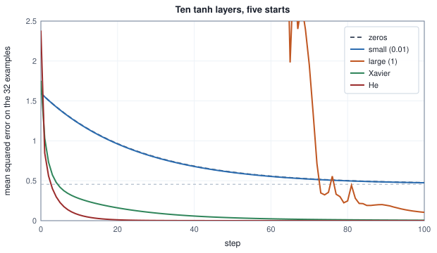
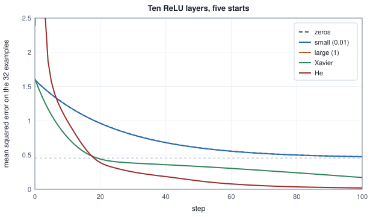
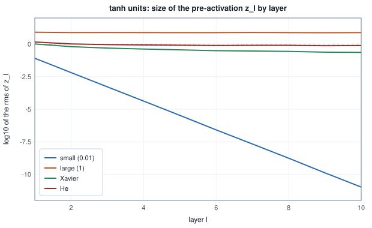
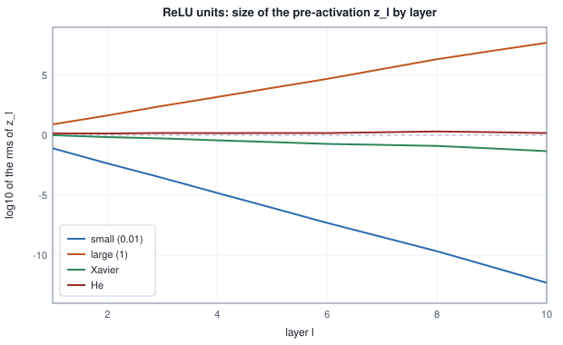
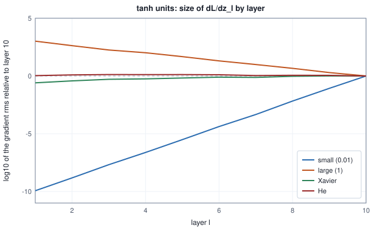
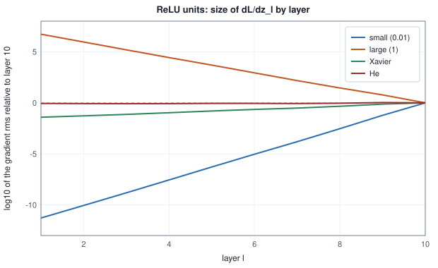
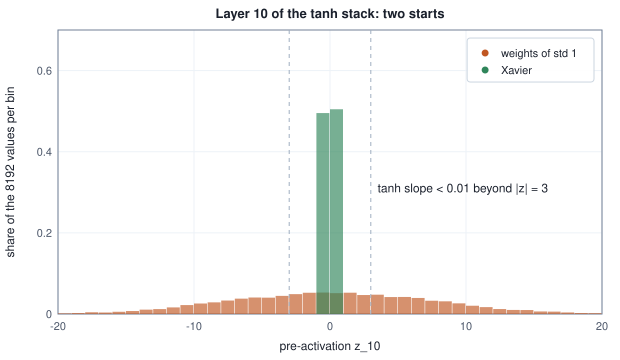

<!-- SPDX-License-Identifier: CC-BY-4.0 -->
<!-- Copyright (c) 2026 Martin Schröder <info@swedishembedded.com> -->

# Initialization: Where Training Starts

*Why does the random starting point decide whether a deep network trains at all?*

## The problem

Gradient descent needs a place to start. For a line fitted to data in Volume II the starting point hardly mattered: the loss was a bowl, and every start rolled to the same bottom. A deep network is not a bowl, and the chapters so far quietly assumed that the weights were already somewhere sensible. This chapter asks where, and the answer turns out to decide whether the first step of training does anything at all.

Take one network, used throughout this chapter and called the **deep stack**. It reads an input $\mathbf{x}$ of 64 numbers and has ten hidden layers of 64 units, each computing $\mathbf{z}_\ell = \mathbf{W}_\ell\mathbf{a}_{\ell-1} + \mathbf{b}_\ell$ and $\mathbf{a}_\ell = g(\mathbf{z}_\ell)$ with $\mathbf{a}_0 = \mathbf{x}$; a last weight vector, the read-out, turns $\mathbf{a}_{10}$ into one number $y$. It has $64\cdot 64 + 9\cdot 64\cdot 64 + 64 = 41{,}024$ weights, and $10\cdot 64 + 1 = 641$ biases (all starting at zero). The target is the smooth function $t = 1 + \sin(\mathbf{a}\cdot\mathbf{x})$ of a fixed direction $\mathbf{a}$, the loss is the mean squared error on 32 examples, and every run uses the same plain gradient descent with rate $0.01$ for 100 steps. (The direction $\mathbf{a}$, the data and the weights come from the book's generator with seeds and a draw order that the first table below prints, so every table of this chapter can be reproduced.) The only thing that changes between runs is the starting weights, in five ways:

- **zeros**: every weight $0$;
- **small**: every weight a draw of $\mathrm{normal}()$ times $0.01$;
- **large**: every weight a draw of $\mathrm{normal}()$ times $1$;
- **Xavier** and **He**: draws scaled by $\sqrt{2/(n_{\mathrm{in}} + n_{\mathrm{out}})}$ and by $\sqrt{2/n_{\mathrm{in}}}$, which this chapter derives ($n_{\mathrm{in}}$ is the number of inputs of a layer, its fan-in, and $n_{\mathrm{out}}$ its number of units, its fan-out; for the read-out $n_{\mathrm{out}} = 1$, so its Xavier scale is $\sqrt{2/65}$).

The standard normals are the same in every run, so two starts differ only in scale. Here is the mean squared error with tanh units:

<!-- worked: initialization.training_tanh -->
Setup: the deep stack with tanh units, 32 training examples (full batch), mean squared error, plain gradient descent with rate 0.01, 100 steps, biases start at 0. The target is t = 1 + sin(a . x) with mean of t^2 = 1.5965; predicting the mean of the targets gives the loss 0.4558. Weights: one generator `initialization.weights` (seed 0x1fd7def6cdf88dde, 2294547686767496670). The 10 hidden weight matrices (shape [64, 64], row j holds the weights of unit j) and then the read-out vector (64 entries) are drawn in this order, layer by layer, row by row, entry i = 0, ..., 63 within a row; each weight is scale * normal(), and every scheme draws every normal() (a zero scale still consumes it), so all schemes see the same standard normals. Scales: zeros 0; small 0.01; large 1; Xavier sqrt(2 / (n_in + n_out)) with n_in = n_out = 64 in the hidden layers and n_in = 64, n_out = 1 in the read-out, so sqrt(2 / 65); He sqrt(2 / n_in) = sqrt(2 / 64) in every layer. Data: one generator `initialization.data` (seed 0x155d7f43c18852c4, 1539526576617050820). First the direction a: 64 draws of normal() each multiplied by 3/16 = 0.1875; then the examples, example after example, each 64 consecutive normal() draws (so the 128 inputs of the later tables extend the 32 training inputs, which are their first 32); the target of an example x is t = 1 + sin(a . x) (radians). The loss is the mean over the examples of (y - t)^2, with y = w_out . a_10 + b_out. A number that comes from a chaotic run is printed with only the digits that are the same in the run and in four copies of it whose first weight is changed by +1e-12, -1e-12, +3e-12 and -3e-12: in full if all agree on it, as 'about x' with the leading digits on which all agree, or as 'unstable' when not even one digit survives; the other digits cannot be reproduced in another implementation.

| start | step 0 | step 10 | step 30 | step 60 | step 100 |
|---|---:|---:|---:|---:|---:|
| zeros | 1.5965 | 1.2173 | 0.7952 | 0.5568 | 0.4759 |
| small (0.01) | 1.5965 | 1.2150 | 0.7917 | 0.5541 | 0.4747 |
| large (1) | 82.7552 | unstable | unstable | unstable | unstable |
| Xavier | 1.7530 | 0.2766 | 0.0957 | 0.0235 | 0.0053 |
| He | 2.3814 | 0.0719 | 0.0020 | 3.50e-05 | 4.55e-07 |
<!-- /worked -->

and with ReLU units:

<!-- worked: initialization.training_relu -->
Setup: the deep stack with relu units, 32 training examples (full batch), mean squared error, plain gradient descent with rate 0.01, 100 steps, biases start at 0. The target is t = 1 + sin(a . x) with mean of t^2 = 1.5965; predicting the mean of the targets gives the loss 0.4558. Weights and data exactly as in the tanh table above (same generators, seeds, draw order and scales). A number that comes from a chaotic run is printed with only the digits that are the same in the run and in four copies of it whose first weight is changed by +1e-12, -1e-12, +3e-12 and -3e-12: in full if all agree on it, as 'about x' with the leading digits on which all agree, or as 'unstable' when not even one digit survives; the other digits cannot be reproduced in another implementation.

| start | step 0 | step 10 | step 30 | step 60 | step 100 |
|---|---:|---:|---:|---:|---:|
| zeros | 1.5965 | 1.2173 | 0.7952 | 0.5568 | 0.4759 |
| small (0.01) | 1.5965 | 1.2163 | 0.7937 | 0.5556 | 0.4754 |
| large (1) | 8.03e+15 | not finite | not finite | not finite | not finite |
| Xavier | 1.6143 | 0.7556 | 0.3831 | 0.3050 | 0.1717 |
| He | 2.3880 | 0.9916 | 0.2525 | 0.0782 | 0.0190 |
<!-- /worked -->





The same architecture, the same data, the same optimiser, and results that differ by orders of magnitude. The zero start and the small start end where a model that ignores its input would end, near the loss of always predicting the mean of the targets, $0.4558$ (they are still sliding down to it at step 100); that is all that a network can learn when the gradient never reaches the hidden layers. The large start either wanders (tanh, chaotically) or leaves the floating-point numbers in one step (ReLU). The scaled starts learn. The rest of the chapter explains each of these behaviours, and ends with a rule that you can state in one line and apply to any layer.

The chapter has seven steps.

1. **Symmetry.** Why a start in which units are equal can never be repaired by training, and why the weights must be random but the biases may be zero.
2. **The size of a signal.** How the typical size of an activation changes from layer to layer, measured first and derived second: the variance of a sum of independent products.
3. **Keeping it constant.** The condition for the size neither to shrink nor to grow, and the two recipes it gives: Xavier initialization for units that behave like the identity near zero, He initialization for ReLU.
4. **The backward pass sees the same problem.** Gradients obey a mirror-image recursion, which is where the compromise in Xavier's formula comes from.
5. **The shape of the draw.** Normal, uniform and truncated draws with the same variance.
6. **Special cases.** The output layer, residual branches, embeddings, the bias of a classifier, and the adapter of low-rank fine-tuning.
7. **Seeds and reproducibility.** What a seed fixes, and why one run is not evidence.

You may use from earlier chapters: the variance of a sum of independent variables and of a scaled variable (Volume I, chapters 10 and 11), the book's random generator and its `normal()` call (Volume I, chapter 17), the layers and activations of the multilayer network (chapter 2), the slopes that multiply along a chain (chapter 2) and the backward pass (chapters 4 and 5).

## Before you begin

Five questions on ideas from earlier chapters, to answer from memory. The answers are at the end of the chapter. If one is hard, go back to the chapter named before reading on.

1. (Volume I, "Probability and Random Variables", variance.) $X$ and $Y$ are independent with $\mathrm{Var}[X] = 2$ and $\mathrm{Var}[Y] = 3$. What is $\mathrm{Var}[3X - Y]$?
2. (Volume I, "Probability and Random Variables", expectation and variance.) For a variable with mean $0$, how is $\mathbb{E}[X^2]$ related to $\mathrm{Var}[X]$? What is it if the mean is $\mu$?
3. (Chapter 2, "Multilayer Networks", ReLU.) A layer of three ReLU units has pre-activations $\mathbf{z} = (-1.5, 0.5, 2)$. What are its outputs and the slopes the backward pass uses?
4. (Chapter 4, "Backpropagation Derived from Scratch", the backward pass of a linear layer.) For $\mathbf{Z} = \mathbf{A}\mathbf{W}^\top$ with $\mathbf{W}$ of shape $[H, D]$, what is $d\mathbf{A}$ in terms of $d\mathbf{Z}$ and $\mathbf{W}$, and what are the two shapes?
5. (Volume I, "Randomness on a Deterministic Machine", three chapters and a volume back.) What does a seed fix in a program that draws random numbers, and what else must stay the same for two runs to give identical numbers?

## Symmetry: why the weights must be random

Start with the smallest network that has a hidden layer with more than one unit. One example $\mathbf{x} = (1, 2)$ with target $t = 1$; three tanh hidden units that each read both inputs; one output. Give every weight the same value, $0.5$, and every bias $0$. One forward and backward pass:

<!-- worked: initialization.symmetry_one_step -->
Setup: one example x = (1, 2) with target t = 1; three tanh hidden units, every incoming weight 0.5 (W1 is [[0.5, 0.5], [0.5, 0.5], [0.5, 0.5]]), every outgoing weight 0.5, all biases 0. Output y = 1.3577, error e = y - t = 0.3577, loss e^2 = 0.1280, dL/dy = 0.7154.

| unit j | z_j | h_j = tanh(z_j) | dL/dz_j | row j of dL/dW1 | dL/dW2_j |
|---|---:|---:|---:|---:|---:|
| 1 | 1.5000 | 0.9051 | 0.0646 | (0.0646, 0.1293) | 0.6476 |
| 2 | 1.5000 | 0.9051 | 0.0646 | (0.0646, 0.1293) | 0.6476 |
| 3 | 1.5000 | 0.9051 | 0.0646 | (0.0646, 0.1293) | 0.6476 |
<!-- /worked -->

The three units computed the same $z_j = 0.5\cdot 1 + 0.5\cdot 2 = 1.5$, hence the same $h_j$. The gradient reaching each of them is the same too: the same $\mathrm{d}L/\mathrm{d}y$ times the same outgoing weight times the same slope $1 - h_j^2$. So every row of $d\mathbf{W}_1$ is identical, and every entry of $d\mathbf{W}_2$ is identical. A gradient step subtracts the same amount from each unit, and the three units are again identical.

That is not an accident of this example, and it is worth proving, because the proof is the reason for the rest of the section. Take a hidden layer of $H$ units, $h_j = g(\mathbf{w}_j\cdot\mathbf{x} + b_j)$, and an output $y = \sum_j v_j h_j + c$.

**Claim.** If before a gradient step all rows $\mathbf{w}_j$ are equal, all $b_j$ are equal and all $v_j$ are equal, then they are still equal after the step, for any batch and any loss.

*Proof.* Equal inputs and equal parameters give equal pre-activations $z_j$ and equal outputs $h_j$ for every example. The loss sees the units only through $y$, so $\mathrm{d}L/\mathrm{d}y$ is one number per example, shared by the units. By the backward rules of chapter 4:

- $\mathrm{d}L/\mathrm{d}v_j = \sum_n \bar y_n h_{jn}$ is the same for all $j$, because every $h_{jn}$ is;
- $\mathrm{d}L/\mathrm{d}h_{jn} = \bar y_n v_j$ is the same for all $j$, because all $v_j$ are, and so is $\mathrm{d}L/\mathrm{d}z_{jn} = \bar y_n v_j\,g'(z_{jn})$;
- $\mathrm{d}L/\mathrm{d}\mathbf{w}_j = \sum_n \bar z_{jn}\mathbf{x}_n$ and $\mathrm{d}L/\mathrm{d}b_j = \sum_n \bar z_{jn}$ are the same for all $j$.

An update $\theta \leftarrow \theta - \eta\,\mathrm{d}L/\mathrm{d}\theta$ with a common $\eta$ subtracts the same number from equal parameters, which leaves them equal. $\square$

By induction on the step number, the units stay equal for ever, from step 0 to step $10^6$. A layer of $H$ identical units computes the same function as one unit whose outgoing weight is $H$ times larger: the layer has width $H$ on paper and width 1 in effect. The same argument applies to every layer, and to the rows of any weight matrix whose rows start equal. Breaking the tie is **symmetry-breaking**, and the only thing that can break it, since gradient descent is deterministic and symmetric in the units, is to start the units different. The table shows it on a small network with four hidden units and four training examples, from an identical start and from a random one:

<!-- worked: initialization.symmetry_run -->
Setup: four examples (x = (1, 2), t = 1; x = (-1, 0.5), t = 0; x = (0.5, -1), t = -1; x = (-2, -1), t = 0.5); a network with 4 tanh hidden units and no biases (y = sum_j W2_j tanh(W1_j . x)); mean squared error over the four examples; gradient descent with rate 0.1; the identical start has every weight 0.5. Generator: the book's SplitMix64, seed 0x3f59f414d0259c8b (4564948067545357451). The random start draws W1[j][i] = 0.5 * normal() for j = 0 .. 3, i = 0, 1 (row by row), then W2[j] = 0.5 * normal(). "Spread" is the largest difference between two units' entries (of W1 rows, or of W2).

| step | loss (identical) | spread W1 (identical) | spread W2 (identical) | loss (random) | spread W1 (random) | spread W2 (random) |
|---|---:|---:|---:|---:|---:|---:|
| 0 | 1.623564 | 0.000000 | 0.000000 | 0.278613 | 1.544438 | 1.208095 |
| 1 | 0.927414 | 0.000000 | 0.000000 | 0.212001 | 1.535125 | 1.181222 |
| 10 | 0.462877 | 0.000000 | 0.000000 | 0.146978 | 1.503666 | 1.150296 |
| 100 | 0.169688 | 0.000000 | 0.000000 | 0.045556 | 1.559001 | 1.897288 |
| 1000 | 0.165407 | 0.000000 | 0.000000 | 0.000000 | 1.940439 | 2.477298 |
<!-- /worked -->

The "spread" columns are exactly $0$ for the identical start at every step, to the last digit printed: the units never separate. Its loss stops at $0.1654$, the best that one unit can do on these four points. The random start has spread in the order of $1$, and its loss reaches zero. The cure is the one the table used: draw each weight at random, so that no two units are equal with probability one.

### All zeros is the extreme case of symmetry

Zero weights are the case where *all* units of *all* layers are equal, and also the case where there is nothing to differentiate. Look at the gradient of each layer of the deep stack at the first step:

<!-- worked: initialization.start_gradients -->
Setup: the deep stack (10 layers of 64 units, a read-out), the first 32 inputs of the data, all biases 0, loss = mean of (y - t)^2. Entries are the Euclidean norm of the gradient of each layer's weight matrix and bias vector at step 0. Weights: all zero (tanh and ReLU), or He normal (ReLU); weights and data are those of the first training table (generators `initialization.weights` and `initialization.data`, seeds 0x1fd7def6cdf88dde and 0x155d7f43c18852c4).

| layer | tanh, zeros: norm of dW | tanh, zeros: norm of db | ReLU, zeros: norm of dW | ReLU, zeros: norm of db | ReLU, He: norm of dW | ReLU, He: norm of db |
|---|---:|---:|---:|---:|---:|---:|
| 1 | 0.00e+00 | 0.00e+00 | 0.00e+00 | 0.00e+00 | 3.70e+00 | 5.68e-01 |
| 2 | 0.00e+00 | 0.00e+00 | 0.00e+00 | 0.00e+00 | 4.45e+00 | 6.97e-01 |
| 3 | 0.00e+00 | 0.00e+00 | 0.00e+00 | 0.00e+00 | 5.49e+00 | 8.09e-01 |
| 4 | 0.00e+00 | 0.00e+00 | 0.00e+00 | 0.00e+00 | 8.72e+00 | 9.83e-01 |
| 5 | 0.00e+00 | 0.00e+00 | 0.00e+00 | 0.00e+00 | 9.85e+00 | 1.24e+00 |
| 6 | 0.00e+00 | 0.00e+00 | 0.00e+00 | 0.00e+00 | 1.37e+01 | 1.45e+00 |
| 7 | 0.00e+00 | 0.00e+00 | 0.00e+00 | 0.00e+00 | 1.43e+01 | 1.49e+00 |
| 8 | 0.00e+00 | 0.00e+00 | 0.00e+00 | 0.00e+00 | 1.90e+01 | 1.72e+00 |
| 9 | 0.00e+00 | 0.00e+00 | 0.00e+00 | 0.00e+00 | 2.54e+01 | 2.24e+00 |
| 10 | 0.00e+00 | 0.00e+00 | 0.00e+00 | 0.00e+00 | 1.78e+01 | 2.22e+00 |
| 11 (read-out) | 0.00e+00 | 2.14e+00 | 0.00e+00 | 2.14e+00 | 2.14e+01 | 2.66e+00 |
<!-- /worked -->

With zero weights the gradient is exactly $0$ everywhere except the bias of the read-out. The reason follows the chain rule backwards. The read-out weights get $\bar y\,\mathbf{a}_{10}$, which is zero because $\mathbf{a}_{10} = g(\mathbf{0})$ is zero for tanh and for ReLU. The gradient entering layer 10 is $\bar y$ times the read-out weights, zero again; and so on to the first layer. The only parameter that moves is the read-out bias, which learns the mean of the targets and nothing else: this is the plateau at $0.4558$ in the problem section. (A ReLU network has a second reason, chapter 4's convention $g'(0) = 0$, which would kill the gradient even if the activations were not zero.)

### Zero biases are fine

Symmetry is a property of units that share their incoming and outgoing weights. A bias does not link units: it is one number belonging to one unit. Two units with different weight vectors differ whatever their biases are, so the weights alone break the symmetry. And a zero bias does not stop its own gradient, which is the gradient arriving at its unit; the last two columns of the table above, for the He start, are far from zero in every layer. This is why the biases of almost every network start at zero in this book: a zero bias starts the unit in the middle of its activation (the steepest part of a tanh, the corner of a ReLU) without hiding anything from the gradient. Section "Special cases" gives the exceptions, where a bias is *set* to a chosen value.

## How big is the signal after ten layers?

With the weights random, there is a second question: how big are they? Measure first. Take 128 inputs of independent standard normals (so the rms of the input is about $1$), run the deep stack forward from each of the starts, and print the root mean square of the pre-activations $\mathbf{z}_\ell$ of layer $\ell$, taken over all examples and units. The weights are $\text{scale}\times\mathrm{normal}()$ from the generator `initialization.weights` and the inputs come from `initialization.data`, with the seeds and the draw order printed in the first table of the chapter (layer by layer, row by row, so every start sees the same standard normals). With tanh units:

<!-- worked: initialization.forward_rms_tanh -->
Setup: the deep stack with tanh units, 128 inputs (rms of the inputs 0.996), biases 0. Entries: the root mean square of z_l over all 128 x 64 pre-activations of layer l. Weights and data: as in the first training table of the chapter (weights generator `initialization.weights`, seed 0x1fd7def6cdf88dde; data generator `initialization.data`, seed 0x155d7f43c18852c4, the 128 inputs being the first 128 examples of that stream); scale * normal(), the same draws for every row.

| start | z_1 | z_2 | z_3 | z_5 | z_7 | z_10 |
|---|---:|---:|---:|---:|---:|---:|
| zeros | 0 | 0 | 0 | 0 | 0 | 0 |
| small (0.01) | 8.12e-02 | 6.45e-03 | 5.18e-04 | 3.35e-06 | 2.13e-08 | 1.05e-11 |
| large (1) | 8.12e+00 | 7.59e+00 | 7.68e+00 | 7.50e+00 | 7.72e+00 | 7.56e+00 |
| Xavier | 1.02e+00 | 6.31e-01 | 4.91e-01 | 3.59e-01 | 2.92e-01 | 2.28e-01 |
| He | 1.44e+00 | 1.02e+00 | 9.06e-01 | 8.13e-01 | 7.98e-01 | 7.72e-01 |
<!-- /worked -->

and with ReLU units:

<!-- worked: initialization.forward_rms_relu -->
Setup: the deep stack with relu units, 128 inputs (rms of the inputs 0.996), biases 0. Entries: the root mean square of z_l over all 128 x 64 pre-activations of layer l. Weights and data: as in the first training table of the chapter (weights generator `initialization.weights`, seed 0x1fd7def6cdf88dde; data generator `initialization.data`, seed 0x155d7f43c18852c4, the 128 inputs being the first 128 examples of that stream); scale * normal(), the same draws for every row.

| start | z_1 | z_2 | z_3 | z_5 | z_7 | z_10 |
|---|---:|---:|---:|---:|---:|---:|
| zeros | 0 | 0 | 0 | 0 | 0 | 0 |
| small (0.01) | 8.12e-02 | 4.45e-03 | 2.78e-04 | 8.85e-07 | 3.28e-09 | 5.06e-13 |
| large (1) | 8.12e+00 | 4.45e+01 | 2.78e+02 | 8.85e+03 | 3.28e+05 | 5.06e+07 |
| Xavier | 1.02e+00 | 6.96e-01 | 5.43e-01 | 2.70e-01 | 1.57e-01 | 4.71e-02 |
| He | 1.44e+00 | 1.39e+00 | 1.54e+00 | 1.53e+00 | 1.77e+00 | 1.51e+00 |
<!-- /worked -->





The small start loses about a factor $12.6$ per layer with tanh and about $17.6$ with ReLU and ends ten or eleven orders of magnitude below where it began: by the last layer the network's hidden state is numerically a constant. The large start does the opposite for ReLU: it multiplies the size by about $5.7$ per layer and ends seven orders of magnitude up. With tanh it stops growing at about $8$, because tanh cannot exceed $1$ in absolute value: the units are saturated, with a slope near zero (later). The Xavier start shrinks gently, and He holds. We now derive why, because the measured factors are not mysterious: each is a number you can compute before running anything.

## The variance of one layer's output

A single unit computes $z = \sum_{i=1}^{n_{\mathrm{in}}} w_i x_i$ (the bias is zero). At the start the weights are random: independent of each other, each with mean $0$ and variance $\sigma_w^2$, and independent of the inputs, which were produced by earlier layers and the data. We want the typical size of $z$ in terms of $\sigma_w^2$ and the inputs. Volume I's rule for the variance of a sum of independent variables gives it, but the inputs $x_i$ of a layer are not independent of each other, so check what the rule needs. Square the sum:

$$
z^2 = \sum_{i}\sum_{j} w_i w_j\,x_i x_j .
$$

Take the expectation over the random weights, holding the inputs fixed. For $i \neq j$ the weights are independent with mean zero, so $\mathbb{E}[w_i w_j] = \mathbb{E}[w_i]\,\mathbb{E}[w_j] = 0$ and the cross term disappears *whatever the inputs are*. Only $i = j$ remains:

$$
\mathbb{E}_w[z^2] = \sum_{i=1}^{n_{\mathrm{in}}} \sigma_w^2\,x_i^2 = \sigma_w^2\lVert\mathbf{x}\rVert^2 .
$$

If the typical input has second moment $\mathbb{E}[x_i^2] = q$ (the **second moment** of a variable is the mean of its square; the same $q$ for all $i$), then $\lVert\mathbf{x}\rVert^2 \approx n_{\mathrm{in}} q$ and

$$
\boxed{\;\mathrm{Var}[z] = \mathbb{E}[z^2] = n_{\mathrm{in}}\,\sigma_w^2\,\mathbb{E}[x^2] .\;}
$$

The mean of $z$ is zero, so its variance equals its second moment. $n_{\mathrm{in}}$, the number of terms in the sum, is called the **fan-in** of the unit. Notice what the derivation used: the *weights* must be independent and centred; the inputs may be correlated. A check with four combinations, $n_{\mathrm{in}} = 64$, $\sigma_w^2 = 1/64$, $\mathbb{E}[x^2] = 1$:

<!-- worked: initialization.variance_of_a_sum -->
Generator: the book's SplitMix64, seed 0xff04ee1516c0d6bf (18376074153921926847). z = sum_i w_i x_i with n = 64 terms, weight standard deviation sigma_w = 1/sqrt(n) = 0.1250, E[x_i^2] = 1. Each of 4000 trials in turn draws x first (n calls of normal() for "independent" inputs, one call whose value is copied n times for "equal"), then w (n calls of normal() times sigma_w, or one call copied n times). The measured value is the mean of z^2 over the trials.

| weights | inputs | prediction | measured E[z^2] |
|---|---|---:|---:|
| independent | independent | 1.0 | 0.981 |
| independent | equal | 1.0 | 1.020 |
| equal | independent | 1.0 | 1.047 |
| equal | equal | 64.0 | 64.251 |
<!-- /worked -->

The first three rows all give $n_{\mathrm{in}}\sigma_w^2\mathbb{E}[x^2] = 1$, even when all 64 inputs are the same number or all 64 weights are the same draw (one source of randomness is enough to cancel the cross terms). Only when *both* are perfectly tied does the cross term survive and the answer is $n_{\mathrm{in}}^2\sigma_w^2$, $64$ times larger. This is the same reason symmetry matters again: tied weights add their contributions coherently, independent weights add them like a random walk.

## Keeping the size constant through depth

Let $q_\ell = \mathbb{E}[z_\ell^2]$ be the second moment of a pre-activation of layer $\ell$. The inputs of layer $\ell$ are the activations $a = g(z_{\ell-1})$ of the layer before, so by the boxed formula

$$
q_\ell = n_{\mathrm{in}}\,\sigma_w^2\,\mathbb{E}[g(z_{\ell-1})^2] .
$$

Define the ratio $\kappa_g = \mathbb{E}[g(z)^2]/\mathbb{E}[z^2]$ of the second moment after the activation to the one before (it depends on $g$ and on how large $z$ is). Then

$$
q_\ell = \Gamma\,q_{\ell-1}, \qquad \Gamma = n_{\mathrm{in}}\,\sigma_w^2\,\kappa_g ,
$$

and after the first layer, whose input is the data, $q_\ell = \Gamma^{\ell-1}q_1$. This is a geometric sequence, and its fate is decided by one number. If $\Gamma < 1$ the signal shrinks by $\sqrt{\Gamma}$ in rms per layer and vanishes exponentially with depth. If $\Gamma > 1$ it explodes. Only $\Gamma = 1$ passes a signal through any number of layers with its size unchanged, the property we call **variance-preservation**. (For identity activations the same recursion is the product of chapter 2's collapsed matrices.)

The measured factors of the previous section are now predictions. For ReLU, computing $\kappa_g$ is done in the next section and gives $\frac12$; with it, the recursion is a statement about the table above:

<!-- worked: initialization.forward_prediction -->
Setup: ReLU deep stack (weights and data as in the first training table of the chapter), mean of x^2 over the 128 inputs q_0 = 0.9916. Prediction: E[z_1^2] = 64 Var(w) q_0 and E[z_l^2] = c E[z_(l-1)^2] with c = 64 Var(w) / 2 for the 64-unit layers.

| start | Var(w) | c = 64 Var(w)/2 | predicted rms z_1 | measured rms z_1 | predicted rms z_10 | measured rms z_10 |
|---|---:|---:|---:|---:|---:|---:|
| small (0.01) | 0.000100 | 0.0032 | 7.97e-02 | 8.12e-02 | 4.73e-13 | 5.06e-13 |
| large (1) | 1.000000 | 32.0000 | 7.97e+00 | 8.12e+00 | 4.73e+07 | 5.06e+07 |
| Xavier | 0.015625 | 0.5000 | 9.96e-01 | 1.02e+00 | 4.40e-02 | 4.71e-02 |
| He | 0.031250 | 1.0000 | 1.41e+00 | 1.44e+00 | 1.41e+00 | 1.51e+00 |
<!-- /worked -->

The small start has $\Gamma = 0.0032$ per layer, the large start $32$, Xavier $0.5$ and He $1$. The prediction of the size of $z_{10}$ and the measurement agree to within the sampling fluctuation of one random draw of the weights (the second moments of the table are one realisation, that is, one particular draw of the weights, not an average over weights; the He row differs by 7 percent). Two things follow. First, initialization is a design problem with a closed-form answer: choose $\sigma_w^2$ so that $\Gamma = 1$. Second, the answer depends on $g$ through $\kappa_g$, so each activation has its own recipe.

### ReLU zeroes half of the signal: He initialization

For the ReLU, $g(z) = \max(0, z)$. If $z$ is distributed symmetrically around zero, half of the time it is positive and passes unchanged, and half of the time it is negative and gives $0$:

$$
\mathbb{E}[\mathrm{relu}(z)^2] = \mathbb{E}[z^2\,\mathbf{1}(z > 0)] = \tfrac12\,\mathbb{E}[z^2],
\qquad\text{so}\qquad \kappa_{\mathrm{relu}} = \tfrac12 .
$$

The second step uses the symmetry: by $z \mapsto -z$ the positive half and the negative half contribute equally to $\mathbb{E}[z^2]$. Is $z$ symmetric? It is a sum of $n_{\mathrm{in}}$ products of symmetric zero-mean weights with inputs, so yes, given the inputs. The identity does not depend on the scale or on the shape of the distribution; and it fails for tanh, whose ratio depends on the scale:

<!-- worked: initialization.relu_second_moment -->
Generator: the book's SplitMix64, seed 0x30b9619a95fae5fe (3510944701081118206). For each distribution in turn, 50000 draws, one call each (normal() times the standard deviation, or sqrt(3) * (2 * uniform() - 1)), all from one generator in the order of the rows.

| distribution of z | E[z^2] | E[relu(z)^2] | ratio | E[tanh(z)^2] | ratio |
|---|---:|---:|---:|---:|---:|
| N(0, 0.1^2) | 0.0100 | 0.0050 | 0.4992 | 0.0098 | 0.9806 |
| N(0, 1) | 1.0075 | 0.5038 | 0.5000 | 0.3959 | 0.3930 |
| N(0, 3^2) | 8.9894 | 4.5088 | 0.5016 | 0.7461 | 0.0830 |
| uniform on [-sqrt 3, sqrt 3] | 0.9989 | 0.5008 | 0.5014 | 0.4568 | 0.4573 |
<!-- /worked -->

The ReLU ratio is $0.5$ for every row, as the derivation says, while for tanh it is $0.98$ when $z$ has standard deviation $0.1$, $0.39$ at $1$ and $0.08$ at $3$. Setting $\Gamma = n_{\mathrm{in}}\sigma_w^2/2 = 1$ gives

$$
\boxed{\;\sigma_w^2 = \frac{2}{n_{\mathrm{in}}}\;}
$$

**He initialization**: the weights of a ReLU layer get twice the variance that a layer of identity units would need. The factor $2$ is exactly the ReLU's $1/\kappa$. With He weights the table of the previous section shows the size of $z_\ell$ staying near $1.4$ to $1.8$ across ten layers; the wobble is the random walk of one realisation of the weights, since the recursion holds for the average over weights.

### Units that look like the identity: Xavier initialization

A tanh unit is close to the identity for small inputs: $\tanh z \approx z$ for $|z| \ll 1$. If the pre-activations stay small, $\kappa_g \approx 1$ and the condition $\Gamma = n_{\mathrm{in}}\sigma_w^2 = 1$ gives $\sigma_w^2 = 1/n_{\mathrm{in}}$. The forward argument alone would stop here; the next section explains why the usual form is $2/(n_{\mathrm{in}} + n_{\mathrm{out}})$, and for the 64-by-64 layers of the deep stack the two are the same, $1/64$. Measured, the Xavier tanh stack loses about 15 percent of its rms per layer (from $1.02$ at layer 1 to $0.228$ at layer 10, nine steps of a factor $0.847$ each): gentle, but a decay, and the reason is visible in the first table: $\kappa_{\mathrm{tanh}}$ is *below* $1$ as soon as $z$ is of order $1$, so the assumption $\kappa \approx 1$ was optimistic. The self-consistent choice is the one for which a pre-activation of second moment $1$ stays at second moment $1$: $\sigma_w^2 = 1/(n_{\mathrm{in}}\kappa_g)$ with $\kappa_g$ evaluated at the operating scale. For a standard normal $z$ it can be computed by integrating, for any $g$:

<!-- worked: initialization.gain_by_activation -->
kappa = E[g(zeta)^2] for zeta standard normal, computed by the trapezoid rule on [-10, 10] with 4000 intervals. A layer with weight variance 1/(kappa n) and inputs of second moment 1 gives pre-activations of second moment 1.

| activation g | kappa = E[g(zeta)^2] | n * Var(w) = 1/kappa | gain sqrt(1/kappa) |
|---|---:|---:|---:|
| identity | 1.0000 | 1.0000 | 1.0000 |
| relu | 0.5000 | 2.0000 | 1.4142 |
| tanh | 0.3943 | 2.5362 | 1.5925 |
| gelu | 0.4252 | 2.3517 | 1.5335 |
| silu | 0.3558 | 2.8108 | 1.6765 |
<!-- /worked -->

The factor $\sqrt{1/\kappa}$ in the last column is the **gain** of the activation: the weights should be $\sqrt{1/\kappa}$ times larger than the identity would need. ReLU needs $\sqrt2 = 1.414$, tanh $1.59$, and the smooth units GELU and SiLU of chapter 2 about $1.53$ and $1.68$. (The identity is the baseline, gain $1$.) The general recipe is therefore "$\sigma_w^2 = \text{gain}^2/n_{\mathrm{in}}$", with the gain of the activation. He's $\sqrt2$ and the value close to it for tanh are the two cases that matter in the rest of the book. The training table of the problem section is consistent with this: with tanh units, He ($1.41$, close to $1.59$) learned faster than Xavier ($1$), though both learned.

## The backward pass has the same problem

A forward signal that survives is only half of what training needs. The update uses the gradient, and the gradient is carried backwards through the same weights. Take the backward rule of chapter 4 for one layer: for unit $i$ of layer $\ell - 1$ and unit $j$ of layer $\ell$,

$$
dz_{\ell-1,i} = g'(z_{\ell-1,i})\sum_{j=1}^{n_{\mathrm{out}}} W_{\ell,ji}\,dz_{\ell,j} .
$$

It is a weighted sum with $n_{\mathrm{out}}$ terms (the layer's number of units, its **fan-out**), the weights independent and centred, so the same derivation applies. Assuming as before that the weights of layer $\ell$ are independent of the gradient $dz_\ell$ arriving at it (a simplification, since both depend on the same network, but a standard one that the measurements will test):

$$
q^{\mathrm{b}}_{\ell-1} = n_{\mathrm{out}}\,\sigma_w^2\,\mathbb{E}[g'(z)^2]\;q^{\mathrm{b}}_\ell, \qquad q^{\mathrm{b}}_\ell = \mathbb{E}[dz_\ell^2] .
$$

Compare the forward recursion $q_\ell = n_{\mathrm{in}}\sigma_w^2\kappa_g\,q_{\ell-1}$. The structure is the same; the count is $n_{\mathrm{out}}$ instead of $n_{\mathrm{in}}$; and the activation enters through $\mathbb{E}[g'^2]$, which is $1$ for the identity, close to $1$ for a small tanh, and $\mathbb{E}[\mathbf{1}(z>0)] = \frac12$ for the ReLU. So the ReLU factor $\frac12$ appears in the backward pass too. For a layer with equal numbers of inputs and outputs, as in the deep stack, one choice of $\sigma_w^2$ preserves both. When $n_{\mathrm{in}} \neq n_{\mathrm{out}}$, no single $\sigma_w^2$ does:

- $\sigma_w^2 = 1/n_{\mathrm{in}}$ keeps the forward signal and multiplies the backward one by $n_{\mathrm{out}}/n_{\mathrm{in}}$ per layer;
- $\sigma_w^2 = 1/n_{\mathrm{out}}$ keeps the backward signal and multiplies the forward one by $n_{\mathrm{in}}/n_{\mathrm{out}}$.

Take a *funnel*: a linear network whose widths halve, $256 \to 128 \to 64 \to 32 \to 16 \to 8$, so that every layer has $n_{\mathrm{in}} = 2n_{\mathrm{out}}$ and the five layers have fan-ins $256, 128, 64, 32, 16$. The rules, with measured and predicted overall second-moment factors:

<!-- worked: initialization.funnel -->
Generator: the book's SplitMix64, seed 0x113ab9680a249782 (1241508503791900546). A linear network (identity activations, no biases) with widths 256 -> 128 -> 64 -> 32 -> 16 -> 8: five weight matrices W_l of shape [fan_out, fan_in]. For each rule in the order of the rows: first 128 inputs of 256 normal() draws (row by row), then the weights layer by layer (row by row, scale times normal()), then, for the backward pass, 128 upstream gradient vectors of 8 normal() draws. Forward: output second moment divided by input second moment. Backward: the upstream gradient is multiplied by W_5^T, ..., W_1^T and the second moment of the result divided by that of the upstream gradient. The prediction is the product over layers of fan_in Var(w) (forward) and of fan_out Var(w) (backward).

| Var(w) of each layer | forward: predicted | forward: measured | backward: predicted | backward: measured |
|---|---:|---:|---:|---:|
| 1/fan_in (forward-exact) | 1.0000 | 1.0887 | 0.0312 | 0.0330 |
| 1/fan_out (backward-exact) | 32.0000 | 35.9637 | 1.0000 | 1.1944 |
| 2/(fan_in + fan_out) (Xavier) | 4.2140 | 4.1523 | 0.1317 | 0.1348 |
<!-- /worked -->

The fan-in rule keeps the forward signal and shrinks the backward one by $1/32$ in second moment ($2^{-5}$). The fan-out rule does the reverse. A compromise is needed, and **Xavier initialization** takes the harmonic mean of the two ideal variances $1/n_{\mathrm{in}}$ and $1/n_{\mathrm{out}}$:

$$
\sigma_w^2 = \frac{2}{\,n_{\mathrm{in}} + n_{\mathrm{out}}\,} = \frac{2}{1/a + 1/b}\ \text{ with } a = \frac{1}{n_{\mathrm{in}}},\ b = \frac{1}{n_{\mathrm{out}}} ,
$$

the harmonic mean $2/(1/a + 1/b)$ of $a$ and $b$, which is also the reciprocal of the average of the two fans. Its per-layer factors are $n_{\mathrm{in}}\sigma_w^2 = 2n_{\mathrm{in}}/(n_{\mathrm{in}}+n_{\mathrm{out}})$ forward and $2n_{\mathrm{out}}/(n_{\mathrm{in}}+n_{\mathrm{out}})$ backward. They always add to exactly $2$, so each is the other's mirror image around $1$: where the forward factor is $4/3$, the backward factor is $2/3$. Neither is perfect, and neither is off by more than the fan ratio. In the funnel table the forward growth is $4.2$ and the backward decay $0.13$ (predicted) against $32$ and $1/32$ at the extremes. When the layer is square both factors are $1$ and Xavier is $1/n_{\mathrm{in}}$.

Measured on the deep stack, the backward signal tells the same story as the forward one. The tables give the size of $dz_\ell$ relative to the top layer:

<!-- worked: initialization.backward_rms_tanh -->
Setup: as above, tanh units. Entries: the root mean square of d(loss of one example)/d z_l over the 128 examples and 64 units, divided by the same quantity at layer 10 (so layer 10 reads 1). The loss of one example is (y - t)^2 with the target t = 1 + sin(a . x) of the first training table; weights and data as in that table (generators `initialization.weights` and `initialization.data`).

| start | layer 1 | layer 2 | layer 3 | layer 5 | layer 7 | layer 10 |
|---|---:|---:|---:|---:|---:|---:|
| zeros | 0 | 0 | 0 | 0 | 0 | 0 |
| small (0.01) | 1.17e-10 | 1.50e-09 | 2.09e-08 | 3.08e-06 | 4.62e-04 | 1.00e+00 |
| large (1) | 1.03e+03 | 4.22e+02 | 1.78e+02 | 4.74e+01 | 9.81e+00 | 1.00e+00 |
| Xavier | 2.55e-01 | 3.77e-01 | 5.17e-01 | 6.70e-01 | 7.54e-01 | 1.00e+00 |
| He | 1.07e+00 | 1.24e+00 | 1.33e+00 | 1.32e+00 | 1.09e+00 | 1.00e+00 |
<!-- /worked -->

<!-- worked: initialization.backward_rms_relu -->
Setup: as above, relu units. Entries: the root mean square of d(loss of one example)/d z_l over the 128 examples and 64 units, divided by the same quantity at layer 10 (so layer 10 reads 1). The loss of one example is (y - t)^2 with the target t = 1 + sin(a . x) of the first training table; weights and data as in that table (generators `initialization.weights` and `initialization.data`).

| start | layer 1 | layer 2 | layer 3 | layer 5 | layer 7 | layer 10 |
|---|---:|---:|---:|---:|---:|---:|
| zeros | 0 | 0 | 0 | 0 | 0 | 0 |
| small (0.01) | 5.24e-12 | 8.92e-11 | 1.55e-09 | 5.22e-07 | 1.57e-04 | 1.00e+00 |
| large (1) | 5.26e+06 | 9.05e+05 | 1.55e+05 | 4.95e+03 | 1.50e+02 | 1.00e+00 |
| Xavier | 3.90e-02 | 5.31e-02 | 7.38e-02 | 1.59e-01 | 3.06e-01 | 1.00e+00 |
| He | 8.68e-01 | 8.40e-01 | 8.23e-01 | 8.80e-01 | 8.51e-01 | 1.00e+00 |
<!-- /worked -->





Read the small row as a vanishing gradient: the weights of layer 1 receive a gradient about $10^{-10}$ of the size of layer 10's, so under gradient descent they do not move while the top layer learns. The large ReLU row is an exploding one, in which a single step moves the lower layers by an amount a million times that of the top and leaves the range of the numbers. And the large tanh row is a surprise that deserves a sentence: its forward values are saturated at about $8$ and yet its gradient *grows* toward the input by about $10^3$. Saturated units have a near-zero slope $g'$, but the backward factor is $n_{\mathrm{out}}\sigma_w^2\,\mathbb{E}[g'^2] = 64\,\mathbb{E}[g'^2]$ in second moment, so a small share of unsaturated units is enough: the measured growth of about $2.2$ per layer in rms implies $\mathbb{E}[g'^2] \approx 0.075$. A forward signal in range does not guarantee a backward signal in range; the measurement of both is the test.

### Seeing the saturation

The pre-activations of layer 10 of the tanh stack for two starts, as histograms:



<!-- worked: initialization.layer10_summary -->
Setup: z_10 of the deep stack (weights and data as in the first training table of the chapter) for the 128 inputs and 64 units (8192 values per row).

| activation | start | mean of z_10 | rms of z_10 | measure | share |
|---|---|---:|---:|---|---:|
| tanh | Xavier | +4.324e-03 | 2.28e-01 | slope tanh'(z) below 0.01 | 0.000 |
| tanh | He | +1.650e-02 | 7.72e-01 | slope tanh'(z) below 0.01 | 0.000 |
| tanh | large (1) | +1.129e-01 | 7.56e+00 | slope tanh'(z) below 0.01 | 0.696 |
| relu | He | -1.061e-01 | 1.51e+00 | z > 0 (unit active) | 0.444 |
| relu | small (0.01) | -3.559e-14 | 5.06e-13 | z > 0 (unit active) | 0.444 |
| relu | large (1) | -3.559e+06 | 5.06e+07 | z > 0 (unit active) | 0.444 |
<!-- /worked -->

Under Xavier the pre-activations are within $\pm 1$ almost always, where tanh is nearly linear and its slope is near one: none of the 8192 units has a slope below $0.01$. Under the large start the pre-activations spread over $\pm 15$ and $69.6$ percent of units have a slope below $0.01$. Their output is $\pm 1$ and does not respond to their input: they are **saturated**, chapter 2's word. For the ReLU, the share of active units under He is $0.444$ (about the half the theory used), and the table shows a property of the ReLU stack without biases: the share is the same for the small and large starts, $0.444$, because scaling all weights by a positive constant scales every $z$ by a positive constant and does not change a sign. Only the size changes, which is why the ReLU failures are failures of scale and not of pattern.

## The shape of the draw

Everything above used only the variance of a weight. The mean and the variance fix $\mathbb{E}[z^2]$ completely; the shape of the distribution of the weights does not enter. Three shapes are in common use, each matched to the same $\sigma_w$:

- **normal**: $w = \sigma_w\,\mathrm{normal}()$, variance $\sigma_w^2$ by definition;
- **uniform** on $[-a, a]$: the variance is $\int_{-a}^{a}\frac{x^2}{2a}\,dx = \frac{a^2}{3}$, so $a = \sqrt3\,\sigma_w$ gives variance $\sigma_w^2$. In Xavier form $a = \sqrt{6/(n_{\mathrm{in}} + n_{\mathrm{out}})}$ and in He form $a = \sqrt{6/n_{\mathrm{in}}}$;
- **truncated normal**: a normal that is redrawn when it falls beyond $c$ standard deviations. Truncation at $c = 2$ removes the tails, and the variance of what remains is $1 - 2c\varphi(c)/(2\Phi(c) - 1) = 0.773741$ (to six digits, with $\varphi$ and $\Phi$ the standard Gaussian density and cumulative distribution), so the draw is divided by $\sqrt{0.773741}$ to restore the target variance.

The variances match and the tails do not:

<!-- worked: initialization.draw_shapes -->
Generator: the book's SplitMix64, seed 0x012db5d56d64c4cf (84923896257889487). sigma = 1. 100000 draws per shape, one after the other from one generator in the order of the rows. The variance of a standard normal conditioned on abs(z) <= 2 is 0.773741 (use this value or the formula, not a shorter one). Fourth moment = mean of w^4 divided by the squared variance (3 for a normal, 1.8 for a uniform). Variance is the mean of w^2 (the mean is 0 by symmetry).

| shape | draw | variance | fourth moment | largest absolute w |
|---|---|---:|---:|---:|
| normal | sigma * normal() | 0.9972 | 2.991 | 4.125 |
| uniform | sigma * sqrt(3) * (2 uniform() - 1) | 0.9944 | 1.807 | 1.732 |
| truncated normal | sigma * z / sqrt(0.773741), z = normal() redrawn while abs(z) > 2 | 0.9973 | 2.377 | 2.274 |
<!-- /worked -->

The fourth moment of a normal is $3$; of a uniform, $1.8$; the truncated normal is between. The largest weight shows the effect: $4.1$ standard deviations for the normal, $1.73$ for the uniform (a hard bound, $\sqrt3$), $2.27$ for the truncated one. What do the tails change? The central limit theorem of Volume I says the pre-activation $z$, a sum of 64 terms, is close to normal whatever the weights' shape, so the layer's output hardly notices. Network by network:

<!-- worked: initialization.shape_in_network -->
Setup: the ReLU deep stack with He scale sigma = sqrt(2/fan_in), but each weight drawn with the named shape (one generator per row: `initialization.shape-net.normal` = 0xd46492fdd4c58570, `initialization.shape-net.uniform` = 0xc8d73cb61fc60766, `initialization.shape-net.truncated` = 0x786739af9b79be90; weights layer by layer, row by row, one draw per weight in the shape's rule, the truncated shape redrawing a normal() until it passes). 128 inputs, the first 128 examples of the data stream of the first training table (generator `initialization.data`, seed 0x155d7f43c18852c4), biases 0. The predicted rms of z_1 is sqrt(2 q_0) with q_0 the mean of x^2.

| weight shape | rms z_1 | rms z_5 | rms z_10 |
|---|---:|---:|---:|
| normal | 1.398e+00 | 1.163e+00 | 1.219e+00 |
| uniform | 1.416e+00 | 1.561e+00 | 1.485e+00 |
| truncated | 1.404e+00 | 1.665e+00 | 1.521e+00 |
<!-- /worked -->

The three shapes give the same $z_1$ to two digits (as they must: it is a single layer) and similar sizes at layers 5 and 10, within the realisation-to-realisation fluctuation seen before. The shape is therefore a minor choice: a hard bound is a defence against the rare large weight of a heavy tail, and the normal is what the book's generator gives with one call. Pseudocode for a layer, in the book's conventions; the draws come from the generator `rng` passed in and happen in a fixed order, row by row, so the layer is reproducible from the seed:

```text
function init_linear(n_out: int, n_in: int, scheme: text, shape: text,
                     rng: Generator) -> array<real>[n_out, n_in]:
    require n_out > 0 and n_in > 0, "empty layer"
    var = 0.0
    if scheme == "he":
        var = 2.0 / n_in
    else if scheme == "xavier":
        var = 2.0 / (n_in + n_out)
    else:
        require false, "unknown scheme"
    sigma = sqrt(var)
    W = zeros(real, [n_out, n_in])
    for j in 0 .. n_out:
        for i in 0 .. n_in:
            if shape == "normal":
                W[j, i] = sigma * rng.normal()
            else if shape == "uniform":
                W[j, i] = sigma * sqrt(3.0) * (2.0 * rng.uniform() - 1.0)
            else:
                loop:                              # truncated at 2 standard deviations
                    z = rng.normal()
                    if abs(z) <= 2.0:
                        break
                W[j, i] = sigma * z / sqrt(0.773741)
    return W
```

The biases are `zeros(real, [n_out])`. For the truncated shape the constant $0.773741$ is the variance of the truncated standard normal to six digits (use the formula $1 - 2c\varphi(c)/(2\Phi(c) - 1)$ with $c = 2$ if your check needs more).

## Back to the three starts

The training tables of the problem section can now be read. **Zeros** is the symmetric start with no gradient: only the read-out bias learns, and the loss goes to the mean predictor. **Small** has $\Gamma \ll 1$: the signal and the gradient decay by 10 orders of magnitude across the stack, the hidden layers do not move at the rate $0.01$, and the loss again goes to the mean predictor; it is the vanishing-gradient failure that chapter 12 names. **Large** has $\Gamma \gg 1$ and exploding or saturating signals: the tanh stack starts at loss $82.8$ and then wanders (the run is chaotic: a change of one part in $10^{12}$ in one weight changes its later losses in their first digits, so the table prints none of them, and the figure shows one such run), noisier and slower than the scaled starts; the ReLU stack's first loss is already $8.0\times10^{15}$ and the first step takes it out of the double-precision range. **Xavier** and **He** are the scaled starts: both learn, and with tanh He is faster (loss $4.6\times10^{-7}$ against $5.3\times10^{-3}$ at step 100) because its gain is nearer to the self-consistent $1.59$; with ReLU, He reaches $0.0190$ at step 100 and Xavier $0.1717$ because Xavier's $\Gamma = \frac12$ halves the second moment in each of ten layers. One caution about what this shows. The runs are 100 steps of plain gradient descent on 32 examples at one rate, and the claim is only about the starting point: it is not a statement about the best optimiser or about generalisation.

## Special cases

The rule $\sigma_w^2 = \text{gain}^2/n_{\mathrm{in}}$ is for a layer that sits in a stack of similar layers. Five situations call for something else.

### The output layer

The last layer feeds the loss directly, and there is no later layer to rescale its output. Its scale decides the size of the first loss and with it the first gradient. With a read-out whose weights are scaled by a factor $m$:

<!-- worked: initialization.output_scale -->
Setup: ReLU deep stack (weights and data as in the first training table), He normal in the ten hidden layers; the read-out weights are multiplied by the factor in the first column. 32 examples; the mean of t^2 is 1.5965.

| read-out factor | rms of the output y | loss at step 0 |
|---|---:|---:|
| 1 | 4.72e-01 | 2.3880 |
| 0.1 | 4.72e-02 | 1.6556 |
| 0 | 0.00e+00 | 1.5965 |
<!-- /worked -->

At $m = 1$ the starting loss ($2.388$) is above the loss of predicting zero ($1.5965$, the mean of $t^2$). At $m = 0.1$ the output is small and the loss starts near that of a model that outputs zero. At $m = 0$ it is exactly that. A smaller read-out starts the loss at a sensible place; and a *zero* read-out is safe where a zero hidden layer was not, because the read-out is the last layer: its weights have a nonzero gradient ($\bar y\,\mathbf{a}_{10}$ with nonzero $\mathbf{a}_{10}$) from the first step on, and the gradient reaching the layer below becomes nonzero as soon as those weights have moved. The symmetry argument does not apply, since the *input* weights of the units are random. Many models therefore start their final projection small or at zero.

### Residual branches

A residual block, forward-pointer to chapter 12, adds a branch to its input: $\mathbf{x} \leftarrow \mathbf{x} + f(\mathbf{x})$. Variance-preservation then fails for a new reason: even if the branch preserves the size, the sum adds a second moment on top of the input. If the branch's output has second moment $\omega$ times the input's, and (weights being independent and centred) is uncorrelated with the input, the block multiplies the second moment by $1 + \omega$. After $L$ blocks that is $(1+\omega)^L$. The branch is a ReLU layer pair, $\mathbf{W}_2\,\mathrm{relu}(\mathbf{W}_1\mathbf{x})$, with $\mathbf{W}_1$ He and $\mathbf{W}_2$ of variance $\omega/n_{\mathrm{in}}$:

<!-- worked: initialization.residual_growth -->
Generator: the book's SplitMix64, seed 0xef3250c54935592a (17235927532167321898). A stack of L blocks x <- x + W2 relu(W1 x) on 64 units; W1 is He normal (sigma^2 = 2/64), W2 has sigma^2 = gamma/64, no biases. Cells in the order of the rows; for each cell, 128 inputs of 64 normal() draws (row by row), then for each block W1 and W2 (row by row, scale times normal()), all from one generator. Growth = mean of x^2 after the last block divided by the mean of x^2 at the input.

| blocks L | gamma | gamma value | predicted (1 + gamma)^L | measured growth |
|---:|---|---:|---:|---:|
| 10 | 1 | 1.0000 | 1.024e+03 | 1.156e+03 |
| 10 | 1/(2L) | 0.0500 | 1.629e+00 | 1.612e+00 |
| 20 | 1 | 1.0000 | 1.049e+06 | 1.083e+06 |
| 20 | 1/(2L) | 0.0250 | 1.639e+00 | 1.695e+00 |
| 40 | 1 | 1.0000 | 1.100e+12 | 3.320e+11 |
| 40 | 1/(2L) | 0.0125 | 1.644e+00 | 1.646e+00 |
<!-- /worked -->

With full-size branches ($\omega = 1$) the second moment doubles per block: a factor around a thousand after 10 blocks, a million after 20. If the last weights of each branch are scaled so that $\omega = 1/(2L)$, the product $(1 + 1/(2L))^L$ stays near $\sqrt e = 1.65$ however deep the stack: the table shows $1.6$ to $1.7$ for 10, 20 and 40 blocks. The same remedy appears in practice as "scale the output weights of every residual branch by a function of the depth".

### Embeddings

An embedding looks up a row of a table: the input is a one-hot vector, so the sum $\sum_i w_ix_i$ has exactly one nonzero term and $n_{\mathrm{in}}$ in the formula is effectively $1$. There is no sum to balance, so the variance of an embedding is a free choice, made so that what the next layer sees has the second moment that layer expects (about $1$ per entry after He or Xavier weights), or so that the next operation, a normalization (the next chapter), makes the scale irrelevant.

### The bias of a classifier

Biases start at zero except where we know something. A classifier with $C$ classes whose training data have class frequencies $\pi_1, \dots, \pi_C$ has a trivial best answer before it has seen any input: predict $\pi$. Setting the bias of the final layer to $b_c = \log\pi_c$ makes the softmax of zero-weight logits equal $\pi$, and the initial cross-entropy equals the entropy of $\pi$ instead of $\log C$. For a single yes/no output the rule is the log-odds, $b = \log\frac{\pi}{1-\pi}$.

<!-- worked: initialization.class_prior_bias -->
Binary case: the logit is the bias b alone (the rest of the network contributes nothing yet), the label is 1 with frequency pi, loss = mean cross-entropy. "Steps" counts gradient steps of rate 0.5 on b alone, starting at b = 0, until the loss is within 0.01 of its minimum H(pi).

| frequency pi of label 1 | b = log(pi/(1-pi)) | loss at b = 0 | loss at b = log odds = H(pi) | steps from b = 0 to within 0.01 |
|---|---:|---:|---:|---:|
| 0.5 | +0.0000 | 0.6931 | 0.6931 | 0 |
| 0.1 | -2.1972 | 0.6931 | 0.3251 | 23 |
| 0.01 | -4.5951 | 0.6931 | 0.0560 | 80 |
| 0.001 | -6.9068 | 0.6931 | 0.0079 | 157 |

Four classes with prior [0.7, 0.2, 0.07, 0.03]: all logits zero give the loss log 4 = 1.3863; biases log(prior) = [-0.3567, -1.6094, -2.6593, -3.5066] give the entropy of the prior, 0.8629.
<!-- /worked -->

For balanced data it changes nothing. For rare positives it removes a long, uninformative start in which the gradient pushes all the logits down: with $\pi = 0.001$ gradient descent on the bias alone needs 157 steps to get within $0.01$ of the best loss, and those are steps in which the rest of the network receives a gradient dominated by "say no to everything". This is the bias of the base rate of Volume II (the share of class 1 in chapter 5 and the shift of the calibration of chapter 6, which is the same intercept added after training).

### The adapter that starts at zero

Low-rank adaptation (Volume I, chapter 6; Volume XIII) leaves a weight $\mathbf{W}$ alone and trains a correction $\mathbf{B}\mathbf{A}$ with $\mathbf{A}$ of shape $[r, n_{\mathrm{in}}]$ and $\mathbf{B}$ of shape $[n_{\mathrm{out}}, r]$, so that the adapted layer starts as exactly the original. That needs $\mathbf{B}\mathbf{A} = \mathbf{0}$ at the start, so one of the factors must be zero. The factors cannot both be: with $\hat{\mathbf{y}} = \mathbf{W}\mathbf{x} + \mathbf{B}(\mathbf{A}\mathbf{x})$ and $d\mathbf{y}$ the gradient reaching the output,

$$
d\mathbf{B} = d\mathbf{y}\,(\mathbf{A}\mathbf{x})^\top, \qquad d\mathbf{A} = \mathbf{B}^\top d\mathbf{y}\,\mathbf{x}^\top .
$$

Each factor's gradient is built from the *other*. If $\mathbf{A} = \mathbf{0}$ and $\mathbf{B} = \mathbf{0}$ both gradients are exactly zero for ever. If $\mathbf{B} = \mathbf{0}$ and $\mathbf{A}$ is random, $d\mathbf{B}$ is nonzero and $d\mathbf{A}$ is exactly zero at the first step; $\mathbf{B}$ moves, after which $d\mathbf{A}$ is no longer zero. This is symmetry-breaking again, with the randomness placed in the factor whose gradient does not pass through the zero:

<!-- worked: initialization.lora_zero_start -->
Generator: the book's SplitMix64, seed 0xd47045662f646831 (15307811438616406065). A frozen layer W (3 x 4) = [identity of size 3 | zero column] applied to x = (1, 2, 3, 4), so W x = (1, 2, 3); the target is (2, 1, 3.5). The adapter adds B (A x) with A of shape [2, 4] and B of shape [3, 2]; A = 0.5 * normal() (draws row by row) in the first start. Loss = squared distance of the output from the target, |y - target|^2 (its gradient with respect to y is 2 (y - target)); gradient descent on A and B with rate 0.05. Columns: loss, norm of B, norm of dL/dB, norm of dL/dA.

| start | step | loss | norm of B | norm of dB | norm of dA |
|---|---:|---:|---:|---:|---:|
| B = 0, A random | 0 | 2.2500 | 0.00e+00 | 1.30e+01 | 0.00e+00 |
| B = 0, A random | 1 | 1.7665 | 6.51e-01 | 1.15e+01 | 9.48e+00 |
| B = 0, A random | 2 | 1.8781 | 7.42e-02 | 4.78e+00 | 1.11e+00 |
| B = 0, A random | 5 | 0.0035 | 5.18e-01 | 3.56e-01 | 3.36e-01 |
| B = 0, A random | 10 | 0.0000 | 5.07e-01 | 4.05e-02 | 3.81e-02 |
| B = 0, A random | 20 | 0.0000 | 5.08e-01 | 5.12e-04 | 4.82e-04 |
| B = 0, A random | 40 | 0.0000 | 5.08e-01 | 8.21e-08 | 7.74e-08 |
| A = 0, B = 0 | 0 | 2.2500 | 0.00e+00 | 0.00e+00 | 0.00e+00 |
| A = 0, B = 0 | 40 | 2.2500 | 0.00e+00 | 0.00e+00 | 0.00e+00 |
<!-- /worked -->

At step 0 the norm of $d\mathbf{A}$ is $0$ and the norm of $d\mathbf{B}$ is $13$; one step later $\mathbf{B}$ has moved and $d\mathbf{A}$ is of order $10$. The all-zero start is stuck at its initial loss. The product $d\mathbf{A} \propto \mathbf{B}$ also says that $\mathbf{A}$ learns slowly as long as $\mathbf{B}$ is small, which is the mechanism behind a stall recorded in brain (below).

## Seeds and reproducibility

A random start is a draw, and a draw has a seed. Volume I (chapter 17) fixed the rule: the seed and the *order* of the draws determine the numbers. For initialization the order is part of the specification: the deep stack draws layer 1 first, row by row, and so on. A model that draws layers in another order starts from different weights under the same seed, so a checkpoint recipe states its seed and its draw order.

The result of one start is a random variable, not a number. The same architecture, data and optimiser, five generators `initialization.seed-run.k`, and one repeat of the first:

<!-- worked: initialization.seed_table -->
Setup: the ReLU deep stack, He normal start, the training run of the previous tables, but the weights come from the generator named `initialization.seed-run.<k>` (k = 0 .. 4); the last row repeats k = 0. The data and everything else are unchanged.

| run k | seed | loss at step 0 | loss at step 30 | loss at step 100 |
|---|---:|---:|---:|---:|
| 0 | 0x29844ecb31da860a | 1.1362 | 0.0248 | 3.15e-04 |
| 1 | 0xf9823387663fabc0 | 1.0664 | 0.0461 | 0.0024 |
| 2 | 0x04418717e4886529 | 5.3339 | 0.0546 | 5.13e-04 |
| 3 | 0x1bcf258513bfdad2 | 0.7274 | 0.0130 | 4.63e-05 |
| 4 | 0x57d01544c55ea5da | 1.2260 | 0.0441 | 5.59e-04 |
| 0 again | 0x29844ecb31da860a | 1.1362 | 0.0248 | 3.15e-04 |
<!-- /worked -->

The repeated seed reproduces the loss to every digit printed (the draws and the arithmetic are the same, and both are deterministic); different seeds change the starting loss from $0.73$ to $5.33$ (one realisation of the read-out weights happens to be large) and the loss after 100 steps from $4.6\times10^{-5}$ to $2.4\times10^{-3}$, a factor of about 50. A claim that one start is better than another is a claim about a distribution over seeds, which needs several; this is the lesson of chapter 17's section on hard-coded seeds, and the reason this chapter's tables name their generators.

## Making it work

**Know the fan-in of the tensor in front of you.** The formulas count inputs summed per output. For a matrix stored as `[out, in]` it is the last axis; for a convolution it is the number of input channels times the kernel height times the kernel width (Volume VII), which is what dividing the number of elements by the first axis gives. A mistake of this kind gives a start that is off by the ratio of the two counts, and nothing fails loudly.

**Measure, do not trust.** The two things to print after building a model are the rms of every layer's pre-activations on a real batch, and the rms of every layer's gradient after one backward pass. Both should be of order one and of similar size across layers; a decade per layer is a defect. It costs one forward and one backward pass, and finds a wrong fan-in, a missing scale or a dead layer before an hour of training does.

**A start that is too tidy hides bugs.** Gradient checks (chapter 6) compare a derivative against a finite difference at the starting point. At a start where a gradient is exactly zero, such as an adapter at $\mathbf{B} = \mathbf{0}$, a check compares zero with zero and passes whatever the backward code does. A start that leaves every unit in the linear regime makes the nonlinearity invisible. Check at a generic point: random, of moderate scale, off any kink (chapter 6's rule never to initialise at a kink applies to a *parameter* that starts exactly where a clamp's slope is zero).

**Normalization changes the stakes, not the recipe.** In a stack followed by normalization (next chapter) the scale of the weights matters less, because the normalization removes it in the forward pass; the initial variance still sets the size of the gradient and so the effective learning rate of the early steps. The default is to keep the formulas above regardless.

## Where this appears in brain

brain has no single initializer. Models that are trained from scratch (small ones, tests and gradient checks) each carry an `init.rs`, while production models are imported with trained weights. Four files show the ideas of this chapter.

**Fan-in scaling.** `crates/toyautoencoder/src/init.rs` draws each linear weight as a normal with standard deviation $1/\sqrt{n_{\mathrm{in}}}$, with the fan-in of each tensor looked up by name (`fan_in_of`), and sets every bias to zero. The same scheme was in the first version of the crate, commit `306ef3471` (24 June 2026, then named `autoencoder`), whose header says the scaling is chosen "so the four matmuls keep activations in range across the bottleneck". This is variance-preservation for a network four layers deep; the rule $1/n_{\mathrm{in}}$ is the identity-unit case above.

**A scale chosen for the test, not for training.** `crates/yolov8/src/init.rs` uses a small standard deviation, $0.1$, and a comment in `init_model` gives the reason: larger weights drove the SiLU and normalization layers into "curved, ill-conditioned regions" where the central difference over the deep cascade disagrees with the analytic gradient. A later file, `crates/clip/src/init.rs`, goes the other way and explains why, in the header it has had since commit `3b15554a1` (4 August 2026): the reference initialization's tiny deviations, at a gradient check's 16 channels, put every activation in the linear regime of the activation function and the softmax, so "the finite-difference comparison tests almost nothing". It uses $1/\sqrt{n_{\mathrm{in}}}$ and jitters the gains instead. The same file computes the fan-in as the number of elements divided by the first axis, so that a four-dimensional convolution weight has fan-in $3k^2$ for a patch of $k\times k$ pixels. A gradient check is a measurement at the starting point, so the scale of the start is a test parameter: too large and the check is ill-conditioned, too small and it is vacuous.

**A bias that is set.** `crates/yolov8/src/init.rs` sets the bias of the final class layer to $-\ln\frac{1-p}{p}$ with $p = 0.01$, which is $-4.595$: the class logits start at a prior of one percent, and the box-regression bias starts at zero. The code has had it since the model's first commit, `a835e6691` (25 June 2026), with a comment that the purpose is to stop the early loss being dominated by the background-class imbalance. It is this chapter's log-odds rule with $\pi = 0.01$. `crates/horizon/src/init.rs` does the same for a hazard model: the bias of every outcome code starts at the configured `initial_log_hazard`, $-4.6$ by default (about one event per hundred units of time at risk), and a test asserts that all of them equal it. Commit `d7c32d0e2` (5 October 2026) made the value configuration, with the reason that it was "choices for human cohorts in years, inside a model meant for any timeline". The same file scales the output projections of the attention and feed-forward blocks of the stack by $1/\sqrt{2n}$ for $n$ blocks, from its first commit `4211e41bc` (5 October 2026): the residual-branch scaling of the previous section, with $\omega = 1/(2n)$.

**An adapter that starts at zero.** `crates/model/src/lora.rs` builds a pair with `A` drawn by the caller's closure and `B` zero (`Pair::new`, "initial no-op"), exactly the start of the previous section. Two lessons from the history. In commit `be9cd3527` (27 June 2026) the gradient check of a LoRA model takes a few AdamW steps first "to move B off its zero init so both A and B carry real gradients", and the check for another model, `crates/gradcheck/src/timesfm3.rs`, says why in its documentation: at $\mathbf{B} = \mathbf{0}$ the gradient $d\mathbf{A}$ is identically zero, so a finite-difference check at the initial point would report a clean pass for any implementation of $d\mathbf{A}$ whatsoever. Knowledge #86 records the other face: a tiny randomly initialised model with a randomly initialised adapter plateaued at the same non-trivial loss whatever the rank, rate or clipping, while full training of the same model fell to zero. The mechanism is the $d\mathbf{A} \propto \mathbf{B}$ of this chapter, and the rule it leaves is to look at per-parameter gradient norms and to run the full-training control before suspecting the wiring. Knowledge #166 is the kink-start of the same family: a parameter that starts at the point where a clamp's slope is zero never receives a gradient. The ControlNet code, `crates/controlnet/src/init.rs`, documents the zero-initialised convolutions of the real model and notes that its synthetic test weights deliberately are *not* zero, for the reason of the gradient-check bullet above: with zeros every residual is zero whatever went into it, and the smoke test would pass on any graph.

**Seeds.** The initializers take the seed as an argument, and the tests assert the contract of the last section: `the_init_seed_decides_the_initial_adapter` in `crates/wan/src/lora.rs` (and in `crates/ltxv/src/finetune.rs`) checks that equal seeds start equal and different seeds start different, and `initialisation_is_deterministic_and_complete` in `crates/horizon/src/init.rs` checks determinism and that a different seed changes the tensors.

## Check your understanding

Answers are at the end of the chapter.

1. **Explain.** A hidden layer of 100 units is initialised with every weight $0.3$ and every bias $0$. After a million gradient steps, how many distinct units does the layer have, and why?
2. **Find the error.** "If all the biases are equal, the symmetry between units is never broken, so biases must be drawn at random." What is wrong?
3. **Predict.** A layer of 400 inputs and 100 units has ReLU activation and weights of variance $2/400$. Inputs have second moment $3$. What is the second moment of the pre-activation, and of the output of the activation?
4. **Find the error.** "He initialization has variance $2/n_{\mathrm{in}}$ because the ReLU has a derivative of 1 for positive inputs, and doubling compensates for the derivative." Give the correct reason.
5. **Predict.** A network has widths $100 \to 400 \to 100$. With $\sigma_w^2 = 1/n_{\mathrm{in}}$ in both layers, by what factor does the second moment of the gradient change between the output and the input of the network (identity units)? And with Xavier?
6. **Explain.** Why is a zero read-out layer safe when zero hidden layers are not?
7. **Find the error.** "The LoRA factors $\mathbf{A}$ and $\mathbf{B}$ should both be initialised with small random numbers, so the adapter starts breaking symmetry." What property is lost, and what is the standard alternative?
8. **Explain.** Two runs with the same seed give different final losses. Name two causes the seed does not control.

## Exercises

1. **[Calculate]** For the pencil example of the symmetry section ($\mathbf{x} = (1, 2)$, $t = 1$, three tanh units, all weights $0.5$), compute by hand $z_j$, $h_j$, $y$, $\mathrm{d}L/\mathrm{d}y$, the common gradient of $\mathbf{w}_j$ and of $v_j$, and the weights after one step with rate $0.1$. Check they equal the table of `initialization.symmetry_one_step` and that the three units are still equal.
2. **[Calculate]** A layer has 50 inputs and 200 units, tanh units in the linear regime. Give $\sigma_w^2$ under the fan-in rule, the fan-out rule and Xavier; the forward and the backward factor per layer for each; and the uniform bound $a$ for Xavier.
3. **[Calculate]** Derive $\mathbb{E}[\mathrm{relu}(z)^2]$ for $z \sim \mathcal{N}(0, s^2)$ by integrating, and show it is $s^2/2$. Then do the same for $\mathbb{E}[g'(z)^2]$.
4. **[Calculate]** For a residual stack with branch gain $\omega$ and $L$ blocks, find the $\omega$ that makes the total growth equal to 2. Compare with $1/(2L)$ for $L = 10$ and 40.
5. **[Calculate]** For $\pi = 0.02$ compute the initial loss of a binary classifier with the bias at $0$ and at the log-odds, and the number of gradient steps of rate $0.5$ on the bias alone to get within $0.01$ (reproduce the method of `initialization.class_prior_bias`).
6. **[Implement]** Implement `init_linear` from the pseudocode and the deep stack with 10 layers of 64 units, and reproduce the table of `initialization.forward_rms_relu` for the He and large rows, using the seeds, scales and draw order printed with the first training table. Print the rms of $z_\ell$ for every layer and plot it.
7. **[Implement]** Add a backward pass and reproduce `initialization.backward_rms_relu` and `initialization.start_gradients` (the zero start must give exactly zero everywhere except the read-out bias).
8. **[Implement]** Reproduce `initialization.variance_of_a_sum` (four combinations, 4000 trials each, in the stated draw order) and `initialization.relu_second_moment`.
9. **[Investigate]** Train the deep stack with ReLU and the He start for 100 steps at the rates $0.001$, $0.003$, $0.01$, $0.03$ and $0.1$. Which diverge? Repeat with Xavier and explain why the largest stable rate differs.
10. **[Investigate]** Replace the gain of the ReLU layers by $1.0, 1.2, 1.414, 1.6, 2.0$ times $1/\sqrt{n_{\mathrm{in}}}$ and plot the rms of $z_{10}$ against the gain. Fit the slope on a log scale and compare with the $\Gamma^{9/2}$ prediction.
11. **[Investigate]** Make the layers of the deep stack alternate in width, $64, 256, 64, 256, \dots$. Compare fan-in, fan-out and Xavier rules for the forward and backward rms across ten layers. Why do the errors of the fan-in rule cancel in pairs?

## Summary

A deep network's starting weights decide whether the first steps of training do anything. Two failures are structural. Units that start equal stay equal for ever, because their gradients are equal at every step (proved by induction), so the weights must be random: **symmetry-breaking** is the job of the draw, and the all-zero start is its extreme case, with a gradient that is exactly zero everywhere except the final bias. Biases can start at zero, since a bias is not shared between units. The size of the weights is the second failure. A unit's output has variance $n_{\mathrm{in}}\sigma_w^2\,\mathbb{E}[x^2]$ for independent centred weights, whatever the correlation of the inputs, so a stack multiplies the second moment of its signal by $\Gamma = n_{\mathrm{in}}\sigma_w^2\kappa_g$ per layer; $\Gamma < 1$ makes signals and gradients vanish exponentially, $\Gamma > 1$ makes them explode, and **variance-preservation** is $\Gamma = 1$. The ReLU keeps half of the second moment ($\kappa = \frac12$, derived from the symmetry of $z$), giving **He initialization**, $\sigma_w^2 = 2/n_{\mathrm{in}}$. For units near the identity at zero the forward condition is $1/n_{\mathrm{in}}$ and the backward condition $1/n_{\mathrm{out}}$, and **Xavier initialization**, $2/(n_{\mathrm{in}} + n_{\mathrm{out}})$, is their harmonic mean, with forward and backward factors adding to $2$. In the deep stack, the measured sizes by layer follow these factors, the scaled starts learn, and the zero and small starts learn only the mean. Uniform, normal and truncated draws with matched variance behave alike. The exceptions are the output layer (small or zero), residual branches (scaled by the depth, $\omega = 1/(2L)$), embeddings (no fan-in), classifier biases (the log prior) and low-rank adapters (one factor zero, the other random). A seed fixes a start; one seed is one sample.

The limits are the ones named along the way. The derivations assume independent centred weights and a gradient independent of the weights at each layer, and are exact for the mean of the second moment, not for one realisation; they describe the first step, not the path afterwards; and the recipes take $\kappa_g$ at one scale. They keep the sizes of signals right at the start. Nothing keeps them right during training, and the next chapter, Normalization Layers, adds layers that rescale activations inside the network at every step, so that the scale chosen at the start no longer has to survive.

## Key terms

- **symmetry-breaking**: starting the units of a layer with different weights, by random draws, so that their gradients differ; units that start identical stay identical forever. <!-- concept: symmetry-breaking -->
- **variance-preservation**: choosing the scale of the weights so that the typical size of activations (and of gradients) is the same in every layer, neither shrinking nor growing with depth. <!-- concept: variance-preservation -->
- **xavier-initialization**: drawing the weights of a layer with variance $2/(n_{\mathrm{in}} + n_{\mathrm{out}})$, the harmonic mean of the forward-preserving and backward-preserving variances, for units that behave like the identity near zero. <!-- concept: xavier-initialization -->
- **he-initialization**: drawing the weights of a ReLU layer with variance $2/n_{\mathrm{in}}$, the factor 2 compensating for the ReLU zeroing half of the second moment. <!-- concept: he-initialization -->

## Answers

**Before you begin**

1. $\mathrm{Var}[3X - Y] = 9\cdot 2 + 1\cdot 3 = 21$: variances of independent variables add, each scaled by the square of its multiplier, and the sign disappears.
2. $\mathbb{E}[X^2] = \mathrm{Var}[X] + \mathbb{E}[X]^2$, so for mean $0$ they are equal, and for mean $\mu$ the second moment is $\mathrm{Var}[X] + \mu^2$.
3. The outputs are $(0, 0.5, 2)$ and the slopes $(0, 1, 1)$.
4. $d\mathbf{A} = d\mathbf{Z}\,\mathbf{W}$, with $d\mathbf{Z}$ of shape $[B, H]$, $\mathbf{W}$ of shape $[H, D]$ and $d\mathbf{A}$ of shape $[B, D]$.
5. The seed fixes the state before the first draw, so with the same seed the same numbers come out in the same order. The order and number of the draws, and the floating-point arithmetic (the same operations in the same grouping), must also be the same.

**Check your understanding**

1. One distinct unit. The induction of the symmetry section: equal weights give equal gradients, so the updates are equal, whatever the number of steps. The layer is a single unit with a weight scaled by 100.
2. Symmetry needs units with equal incoming weight vectors. Random weights make the units differ whatever their biases are, and the gradient of a zero bias is the (nonzero) gradient arriving at its unit, so biases can start at zero.
3. $q = n_{\mathrm{in}}\sigma_w^2\cdot 3 = 400\cdot(2/400)\cdot 3 = 6$; after the ReLU it is $6/2 = 3$ (equal to the input's, which is how He initialization is meant to behave).
4. The factor 2 is $1/\kappa_{\mathrm{relu}}$: the ReLU keeps half of the second moment, $\mathbb{E}[\mathrm{relu}(z)^2] = \frac12\mathbb{E}[z^2]$, so the variance of the weights is doubled to restore $\Gamma = n_{\mathrm{in}}\sigma_w^2\cdot\frac12 = 1$. (The derivative enters the backward pass through $\mathbb{E}[g'^2] = \frac12$, which has the same value.)
5. With the fan-in rule the backward factor per layer is $n_{\mathrm{out}}/n_{\mathrm{in}}$: $4$ for the first layer (100 to 400) and $1/4$ for the second, product $1$. Xavier: first layer $2\cdot400/500 = 1.6$, second $2\cdot100/500 = 0.4$, product $0.64$. So the paired errors cancel exactly for the fan-in rule and leave $0.64$ for Xavier.
6. The read-out's weight gradient is $\bar y\,\mathbf{a}$ with $\mathbf{a}$ the nonzero activations of the random hidden layers, so it is nonzero from step 1 and breaks nothing; the hidden layers' own weights are random, so symmetry is already broken.
7. With $\mathbf{B} \neq \mathbf{0}$ the adapter does not start as a no-op: the adapted layer begins perturbed. The standard start keeps the layer unchanged by setting one factor ($\mathbf{B}$) to zero and drawing the other at random; both zero gives zero gradients for ever.
8. For example, the order of floating-point additions (a different thread schedule), and the data order or any other random stream not derived from the same seed; also a different library version or hardware changing the arithmetic.

## References

- Xavier Glorot and Yoshua Bengio, "Understanding the difficulty of training deep feedforward neural networks", 2010.
- Kaiming He, Xiangyu Zhang, Shaoqing Ren and Jian Sun, "Delving deep into rectifiers: surpassing human-level performance on ImageNet classification", 2015.
- Edward J. Hu et al., "LoRA: low-rank adaptation of large language models", 2021.
