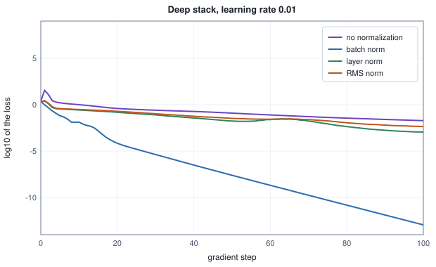

<!-- SPDX-License-Identifier: CC-BY-4.0 -->
<!-- Copyright (c) 2026 Martin Schröder <info@swedishembedded.com> -->

# Normalization Layers

*How does rescaling activations inside a network make it train faster and more stably?*

## The problem

The last chapter chose the starting weights of the deep stack so that the typical size of an activation is the same in every layer. It worked: at step 0 the pre-activations of all ten layers have a root-mean-square value (rms) between 1.4 and 2.1. The choice protects the first step and nothing after it. Gradient descent changes every weight at every step, and the size of a layer's output depends on all the weights below it. Here is the same stack with the same start and the same data (He weights, ReLU units, 32 examples, mean squared error), trained by plain gradient descent at the rate 0.01 that chapter 9 used, with the rms of the pre-activation $\mathbf{z}_\ell$ of selected layers measured as it trains:

<!-- worked: normalization.stack_drift -->
Setup: the deep stack of the initialization chapter (10 layers of 64 units, a read-out; ReLU), He start (the stream `initialization.weights` of that chapter, seed 0x1fd7def6cdf88dde, scale sqrt(2 / 64) times each normal() in the order of that chapter's table: layer by layer, row by row, read-out last), biases 0, the first 32 inputs and targets of the stream `initialization.data` (seed 0x155d7f43c18852c4), mean squared error, full batch, plain gradient descent with rate 0.01 for 100 steps. Entries are the rms of the pre-activations z_l of the layer, over the 32 examples and 64 units; "loss" is the loss before that step.

| step | loss | rms z_1 | rms z_2 | rms z_3 | rms z_5 | rms z_7 | rms z_10 |
|---|---:|---:|---:|---:|---:|---:|---:|
| 0 | 2.3880 | 1.44 | 1.37 | 1.53 | 1.52 | 1.78 | 1.50 |
| 1 | 34.3116 | 1.44 | 1.37 | 1.52 | 1.49 | 1.81 | 2.04 |
| 10 | 0.9916 | 1.41 | 1.24 | 1.06 | 0.77 | 0.34 | 0.17 |
| 30 | 0.2525 | 1.41 | 1.25 | 1.09 | 0.87 | 0.48 | 0.35 |
| 100 | 0.0190 | 1.41 | 1.26 | 1.11 | 0.92 | 0.54 | 0.42 |
<!-- /worked -->

At step 0 the layers are matched, as designed. The first step raises the loss from 2.39 to 34.31 (the rate is large for this start), and ten steps later the deepest layer has rms 0.17 while the first layer is unchanged at 1.41: a gap of a factor of eight between layers that were built to be equal. By step 100 the network has learned, but layer 10 still sits at 0.42 against 1.41. Every layer above the first now receives inputs of a size that it has never seen and that its own weights were not tuned for, and the next step moves the sizes again.

This chapter adds a small layer that makes the size of what a layer receives independent of what happened below it. The layer is the oldest tool of Volume II applied inside the network: the **z-score**. Volume II rescaled each input feature to mean 0 and standard deviation 1 before training, and gradient descent on the z-scored voltage needed 3 steps where the raw feature needed 166 (Volume II, chapter 2). A **normalization layer** does the same to the activations of a hidden layer, at every step, with a gain and a shift that the network learns. There are several such layers, and they differ in one choice only: which numbers are averaged together. The chapter has eight steps.

1. **The idea.** The z-score of a group of numbers, and why a learned gain and shift are added to it.
2. **Batch normalization.** The group is one feature across the examples of a batch; the forward pass, its running statistics, and the difference between train mode and eval mode.
3. **The cost of using the batch.** Output that depends on the other examples, a batch of one, and gradient accumulation.
4. **The backward pass.** Through the mean and the variance, derived with the rules of chapter 5 and checked against central differences.
5. **Layer, RMS and group normalization.** The same operation over other groups, what each costs in arithmetic and memory, and the epsilon that keeps them finite.
6. **Scale invariance.** Why the output of a normalized layer does not care about the size of the weights below it, and what that does to the gradient.
7. **Does it train?** The deep stack with each normalization, at three learning rates.
8. **At inference and in practice.** Folding batch normalization into the layer before it, where to place the layer, and numerical care.

You may use from earlier chapters: the sample mean and variance (Volume I, chapter 12) and the z-score (Volume II, chapter 2); the batch dimension (Volume I, chapter 5); the backward pass of a reduction and of a broadcast (chapter 5); and the deep stack with its starting weights (chapter 9).

## Before you begin

Five questions on ideas from earlier chapters, to answer from memory. The answers are at the end of the chapter. If one is hard, go back to the chapter named before reading on.

1. (Volume I, "Statistics", the sample mean and variance.) What are the mean and the variance, with divisor $n$, of the three numbers $1, 2, 6$?
2. (Volume II, "Linear Regression and the First Descent", feature scaling.) Why did z-scoring the voltage make gradient descent so much quicker, in one sentence?
3. (Chapter 5, "The Backward Pass of Every Layer", reductions.) $r = \frac1n\sum_i x_i$ for $n = 4$, and the gradient arriving at $r$ is $dr = 2$. What is $dx_i$?
4. (Chapter 5, broadcasting.) A scale $\boldsymbol{\gamma}$ of shape $[D]$ multiplies every row of a $[B, D]$ array $\mathbf{A}$ to give $\mathbf{Y}$. What is the gradient of $\boldsymbol{\gamma}$ in terms of the gradient $d\mathbf{Y}$ arriving at the result and $\mathbf{A}$, and what is its shape?
5. (Chapter 9, "Initialization: Where Training Starts", variance-preservation, three chapters back.) A layer has $n_{\mathrm{in}} = 64$ inputs and weights of variance $1/64$. If its inputs have second moment 2, what is the second moment of its (identity-unit) pre-activations?

## The idea: a z-score inside the network

Start with five numbers, the output of one layer for one example: $x = (2, 4, 4, 6, 9)$. The z-score subtracts their mean and divides by their standard deviation:

<!-- worked: normalization.zscore_row -->
The five numbers x = (2, 4, 4, 6, 9): mean mu = 5.0000, variance sigma2 = 5.6000 (divisor n = 5), standard deviation 2.3664.

| i | x_i | x_i - mu | (x_i - mu) / sqrt(sigma2) | (x_i - mu) / sqrt(sigma2 + 1e-05) |
|---|---:|---:|---:|---:|
| 0 | 2.0 | -3.0 | -1.2677 | -1.267730 |
| 1 | 4.0 | -1.0 | -0.4226 | -0.422577 |
| 2 | 4.0 | -1.0 | -0.4226 | -0.422577 |
| 3 | 6.0 | 1.0 | 0.4226 | 0.422577 |
| 4 | 9.0 | 4.0 | 1.6903 | 1.690307 |

With epsilon = 1e-05 the standardized values have mean -2.22e-17 (a rounding error) and variance 0.99999821, which is sigma2 / (sigma2 + epsilon) = 0.99999821.
<!-- /worked -->

The normalized values have mean 0 and variance 1 whatever the size and offset of the five numbers were: multiply them by 100 or add 1000 and the third and fourth columns do not change. That is what a hidden layer needs. Whatever the weights below it have done to the scale of its input, the layer is handed numbers of a known size.

Two details of the table matter later. The divisor is $n$, the number of values normalized, not $n-1$: we are not estimating the variance of a population from a sample (Volume I, chapter 12), we are rescaling these $n$ numbers, and with divisor $n$ the result has variance exactly 1. And the denominator carries a small number $\epsilon_{\mathrm{norm}}$ under the square root, $\sigma_\epsilon = \sqrt{\sigma^2 + \epsilon_{\mathrm{norm}}}$, so that a group of equal numbers (variance 0) gives 0 instead of 0/0. The price is visible in the last line: with $\epsilon_{\mathrm{norm}} = 10^{-5}$ the variance of the output is $\sigma^2/(\sigma^2+\epsilon_{\mathrm{norm}})$, which is $0.99999821$ and not 1. The default is $\epsilon_{\mathrm{norm}} = 10^{-5}$; a later section shows when it stops being negligible.

A group of $n$ values $x_1, \dots, x_n$ with mean $\mu$ and variance $\sigma^2$ becomes

$$
\hat x_i = \frac{x_i - \mu}{\sigma_\epsilon}, \qquad \mu = \frac1n\sum_{i} x_i, \qquad \sigma^2 = \frac1n\sum_i (x_i - \mu)^2, \qquad \sigma_\epsilon = \sqrt{\sigma^2 + \epsilon_{\mathrm{norm}}} .
$$

(In this chapter the hat on $\hat x_i$ marks the normalized value, not an estimate.)

### A learned gain and shift

Forcing every layer's output to have mean 0 and variance 1 would also take something away. A sigmoid unit may want its inputs centred at 2, and a layer that feeds a ReLU may be better off with a negative shift that switches half its units off. So the layer follows the z-score with a learned **gain** $\gamma$ and **shift** $\beta$ (one pair per feature or channel):

$$
y_i = \gamma\,\hat x_i + \beta .
$$

Nothing is lost by this. With $\gamma = \sigma_\epsilon$ and $\beta = \mu$ the layer returns its input exactly, $y_i = \sigma_\epsilon\hat x_i + \mu = x_i$, so a network with normalization layers can represent everything a network without them can. What changes is the parametrization: the mean and the scale of what the next layer receives are now the two parameters $\beta$ and $\gamma$ of this layer, which gradient descent adjusts directly, instead of a tangle of all the weights below. The layer starts at $\gamma = 1$ and $\beta = 0$, the identity on the normalized values.

### Why it helps

The original explanation was that each layer's input distribution keeps shifting while the layers below it learn, and normalizing stops the shifting. That account has been disputed since, and this chapter does not rely on it. What we can measure and derive is this: the size of every layer's input is fixed by $\gamma$ and $\beta$ whatever the weights below do (the table above is the failure this prevents, and the last sections measure it); the output does not change when the weights below are rescaled, which changes how large the gradient steps effectively are; and a layer whose inputs have mean 0 and a similar spread in every feature has a better-conditioned loss in its own weights (for a squared loss the curvature in a layer's weights is set by the second moments of its inputs), which is the lesson of Volume II, chapter 2 applied to the hidden layer. The question that remains is the one that gives the layers their names: which numbers form a group?

## Batch normalization

Take a layer whose output is an array $\mathbf{X}$ of shape $[B, D]$: $B$ examples (the batch dimension of Volume I) and $D$ features. **Batch normalization** takes the group to be one feature across the whole batch: for each feature $j$, the $B$ numbers $X_{0j}, \dots, X_{B-1,j}$ are normalized together.

$$
\mu_j = \frac1B\sum_{i} X_{ij}, \qquad \sigma_j^2 = \frac1B\sum_i (X_{ij} - \mu_j)^2, \qquad \hat X_{ij} = \frac{X_{ij} - \mu_j}{\sigma_{\epsilon,j}}, \qquad Y_{ij} = \gamma_j\hat X_{ij} + \beta_j .
$$

Here is a batch of four examples with three features of very different scales (the middle feature is ten times larger than the others), and the layer with $\boldsymbol{\gamma} = (1, 0.5, 2)$ and $\boldsymbol{\beta} = (0, 1, -1)$:

<!-- worked: normalization.batchnorm_forward -->
Input x of shape [B, D] = [4, 3]; gamma = (1.0, 0.5, 2.0), beta = (0, 1.0, -1.0), epsilon = 1e-05. Statistics are taken down each column (over the 4 examples), divisor 4.

| column j | mean mu_j | variance sigma2_j | r_j = 1/sqrt(sigma2_j + eps) |
|---|---:|---:|---:|
| 0 | 4.0000 | 5.0000 | 0.447213 |
| 1 | 20.0000 | 150.0000 | 0.081650 |
| 2 | 1.0000 | 5.0000 | 0.447213 |

| example i | x_i | xhat_i | y_i = gamma * xhat_i + beta |
|---|---:|---:|---:|
| 0 | (1.0, 10.0, -2.0) | (-1.3416, -0.8165, -1.3416) | (-1.3416, 0.5918, -3.6833) |
| 1 | (3.0, 20.0, 0) | (-0.4472, 0, -0.4472) | (-0.4472, 1.0000, -1.8944) |
| 2 | (5.0, 10.0, 2.0) | (0.4472, -0.8165, 0.4472) | (0.4472, 0.5918, -0.1056) |
| 3 | (7.0, 40.0, 4.0) | (1.3416, 1.6330, 1.3416) | (1.3416, 1.8165, 1.6833) |

Column means of y: (0, 1.0000, -1.0000) (= beta); column variances of y: (1.0000, 0.2500, 4.0000) (= gamma^2 sigma2 / (sigma2 + epsilon) = (1.0000, 0.2500, 4.0000)).
<!-- /worked -->

After the layer the three features have the means $\boldsymbol{\beta}$ and the variances $\boldsymbol{\gamma}^2$ that were asked for, and the size of the original columns is gone. The same operation reads, as pseudocode (the book's conventions: 0-indexed, row-major, explicit loops):

```text
function batch_norm_train(x: array<real>[B, D], gamma: array<real>[D], beta: array<real>[D],
                          eps: real) -> (y: array<real>[B, D], xhat: array<real>[B, D],
                                         inv_std: array<real>[D]):
    require B >= 2, "a batch of one has variance 0: every output would be beta"
    y = zeros(real, [B, D])
    xhat = zeros(real, [B, D])
    inv_std = zeros(real, [D])
    for j in 0 .. D:
        mu = sum(x[:, j]) / B
        var = 0.0
        for i in 0 .. B:
            var = var + (x[i, j] - mu)^2
        var = var / B                              # divisor B, not B - 1
        inv_std[j] = 1 / sqrt(var + eps)
        for i in 0 .. B:
            xhat[i, j] = (x[i, j] - mu) * inv_std[j]
            y[i, j] = gamma[j] * xhat[i, j] + beta[j]
    return (y, xhat, inv_std)
```

The function returns `xhat` and `inv_std` because the backward pass needs them. For an image tensor $[B, C, H, W]$ the group is one channel over the batch and over every position, $B\cdot H\cdot W$ numbers, and `gamma` and `beta` have $C$ entries. The figures below draw all of these choices side by side.

### Running statistics, and two modes

Batch normalization has a problem that the z-scores of Volume II did not. There the mean and standard deviation of the voltage were computed once from the training rows and then fixed, so a new voltage was scaled by the same numbers as the training rows. Inside a network the batch statistics change at every step, and at prediction time there may be no batch at all: a single image arrives, or the batch is whatever happens to be waiting. If the output for an example depended on which other examples were in the batch, the same input would get different answers on different days.

The fix is to keep **running statistics**: during training, alongside the batch mean and variance that are used, the layer keeps an exponential average of them across steps,

$$
\boldsymbol{\mu}_{\mathrm{run}} \leftarrow \beta_{\mathrm{run}}\,\boldsymbol{\mu}_{\mathrm{run}} + (1 - \beta_{\mathrm{run}})\,\boldsymbol{\mu}_{\mathrm{batch}}, \qquad \boldsymbol{\sigma}^2_{\mathrm{run}} \leftarrow \beta_{\mathrm{run}}\,\boldsymbol{\sigma}^2_{\mathrm{run}} + (1 - \beta_{\mathrm{run}})\,\boldsymbol{\sigma}^2_{\mathrm{batch}},
$$

with $\beta_{\mathrm{run}}$ close to 1 (many libraries expose $1 - \beta_{\mathrm{run}}$ as a parameter called the momentum, 0.1 being common; the word means something else here than the optimizer's momentum of Chapter 7). At prediction time the layer normalizes with these fixed numbers and no longer looks at the batch. One feature whose values are $3 + 2\cdot\mathrm{normal}()$, batches of 8, $\beta_{\mathrm{run}} = 0.9$:

<!-- worked: normalization.running_statistics -->
Setup: one feature whose values are 3 + 2 * normal() (mean 3, variance 4). Generator: the book's SplitMix64, seed 0x7514b1d0f691daa4 (8436563513019849380); batch t takes the next 8 draws in order. Running averages start at mean 0 and variance 1 and update as run = beta_run * run + (1 - beta_run) * batch with beta_run = 0.9 (weight 0.1 on the new batch), batch variance with divisor 8.

| step t | batch mean | batch variance | running mean | running variance | weight of the start, beta_run^t |
|---|---:|---:|---:|---:|---:|
| 1 | 2.8647 | 5.4407 | 0.2865 | 1.4441 | 0.9000 |
| 2 | 3.1998 | 6.7503 | 0.5778 | 1.9747 | 0.8100 |
| 5 | 2.4505 | 2.3398 | 1.1874 | 2.2415 | 0.5905 |
| 10 | 1.9262 | 4.3099 | 1.8862 | 2.4778 | 0.3487 |
| 20 | 2.2223 | 2.8661 | 2.5794 | 3.4998 | 0.1216 |
| 40 | 3.1831 | 2.0724 | 3.2056 | 3.5103 | 0.0148 |

The mean of the batch variance over 2000 further batches of 8 (the next draws of the same stream) is 3.4569; the variance of the source is 4 and 4 * 7/8 = 3.5.
<!-- /worked -->

Three facts are in the table. The averages start from an arbitrary guess (mean 0, variance 1) and forget it geometrically: after $t$ steps the guess still has weight $\beta_{\mathrm{run}}^t$, which is $0.0148$ at $t = 40$, so a layer that is evaluated before enough steps have been taken is normalizing with mostly the guess. The average has a window of about $1/(1-\beta_{\mathrm{run}}) = 10$ batches, so it is noisy (running variance 3.50 against a true value of 4) and follows a drifting distribution with a lag. And the batch variance with divisor $B$ is biased low: the mean of the batch variance over 2000 batches of 8 is 3.4569, close to $4\cdot 7/8 = 3.5$, the expected value for a variance of 4 and divisor 8 (Volume I, chapter 12 derived this $n/(n-1)$ factor). When each feature is averaged over thousands of numbers, as a channel of an image batch is, the bias is negligible; for a dense layer with a batch of 8 it is 12.5%, and a layer may multiply the running variance by $B/(B-1)$ to remove it.

The layer now behaves in two ways. In **train mode** it normalizes with the statistics of the current batch and updates the running statistics. In **eval mode** it normalizes with the running statistics, using nothing from the batch and updating nothing. The word mode is exactly right: it is a flag on the layer's state, set by whoever runs the network, that changes what the same function computes. Layer, RMS and group normalization, below, have no running statistics and their two modes are identical.

### The same input, different answers

How different? Put a probe value, 5, first in a batch whose other members are draws from the same source (mean 3, variance 4), so that its correct standardized value is $(5-3)/2 = 1$, and compute its output in train mode over 1000 random batches for several batch sizes:

<!-- worked: normalization.batch_size_dependence -->
Setup: the feature of the previous example (population mean 3, variance 4). The probe example has the value 5, whose standardized value is (5 - 3) / 2 = 1. It is placed first in a batch of B values (the other B - 1 are 3 + 2 * normal() draws, in order). Train mode normalizes with the batch's mean and variance (divisor B, epsilon = 1e-05, gamma = 1, beta = 0). 1000 batches per B; 'sd of output' is the standard deviation of the 1000 outputs with divisor 1000, and the percentiles use the book's percentile rule. Generator: the book's SplitMix64, seed 0x94c12fe3bf4ab7e9 (10718901243331917801); sizes are run in the order 1, 2, 4, 8, 32, 128, continuing one stream.

| B | mean of output | sd of output | 5th percentile | 95th percentile |
|---|---:|---:|---:|---:|
| 1 | 0 | 0 | 0 | 0 |
| 2 | 0.7105 | 0.7028 | -1.0000 | 1.0000 |
| 4 | 0.9471 | 0.5110 | 0.0334 | 1.6624 |
| 8 | 1.0038 | 0.4116 | 0.3540 | 1.6957 |
| 32 | 1.0066 | 0.2080 | 0.6831 | 1.3605 |
| 128 | 1.0011 | 0.1129 | 0.8228 | 1.1827 |

Eval mode with the exact population statistics (mean 3, variance 4) gives 0.999999 for every batch.
<!-- /worked -->


At a batch of 128 the answer is 1.00 give or take 0.11, and at 8 it is 1.00 give or take 0.41: the mean is right, but any single answer carries the noise of its companions. Two ends deserve a name. At $B = 1$ the batch variance is 0 and the output is exactly 0, the value $\beta$, for every input: the layer has erased the example. At $B = 2$ the two values $a < b$ have $\hat x = \mp\frac{(b-a)/2}{\sqrt{((b-a)/2)^2 + \epsilon_{\mathrm{norm}}}}$, which is $\mp 1$ whatever the gap $b - a$ (the 5th and 95th percentile columns are $-1.0000$ and $1.0000$). Neither end is an exotic case: it is what a training run with a small batch, or an evaluation of one image in train mode, does.

The mistakes with modes are common and silent, because every one of them produces plausible, finite numbers:

<!-- worked: normalization.eval_mode_bug -->
The probe value 5 through a batch-norm layer with gamma = 1, beta = 0, epsilon = 1e-05; the running statistics are those of the table above (beta_run = 0.9). The correct standardized value is 1.

| situation | mean used | variance used | output for the probe |
|---|---:|---:|---:|
| train mode, a batch of one | the batch's own | 0 | 0 |
| eval mode, running statistics never updated | 0 | 1 | 5.0000 |
| eval mode, after 5 updates | 1.1874 | 2.2415 | 2.5466 |
| eval mode, after 40 updates | 3.2056 | 3.5103 | 0.9577 |
| eval mode, the exact statistics | 3 | 4 | 1.0000 |
<!-- /worked -->

A prediction made in train mode on a batch of one returns the constant $\beta$. A prediction made in eval mode before the running statistics have been updated normalizes with the guess (mean 0, variance 1) and returns 5.0 for a value that should read 1.0; the result looks like a layer that does almost nothing. After 5 updates the output is 2.55 and after 40 it is 0.96, approaching the exact 1. The brain history below contains this bug, and the test that now guards it.

## The cost of using the batch

Batch normalization makes the output for an example a function of the whole batch, and that has a consequence for the training procedure of chapter 5. There, gradient accumulation computed the gradient of a large batch as the mean of the gradients of several small ones, and the two agreed because the loss of a batch is the mean of per-example losses. With batch normalization the loss of an example depends on its batch, so the identity fails. One norm layer, 32 examples of 4 features, with a loss that compares $\mathbf{y}$ to random targets, once as one batch and once as four micro-batches of 8:

<!-- worked: normalization.accumulation -->
Setup: B = 32 examples of D = 4 features, x = 2 + 1.5 * normal() and targets t = normal(), both drawn in row-major order, x first. Generator: the book's SplitMix64, seed 0xc1a3f061311f67db (13953260370750564315). The layer applies the normalization then y = gamma * xhat + beta with gamma = (1.0, 1.5, 0.5, 2.0), beta = (0, 0.5, -0.5, 1.0); the loss is the mean of (y - t)^2 over all elements. "Accumulated" is the mean of the gradients of the four micro-batches of 8 rows, each with the mean loss of its own rows, as in the gradient-accumulation section of chapter 5.

| layer | d loss / d gamma, one batch of 32 | mean over 4 micro-batches of 8 | largest difference |
|---|---:|---:|---:|
| batch norm | (0.5576, 0.7426, 0.2330, 1.1221) | (0.5003, 0.7510, 0.2064, 1.1720) | 5.73e-02 |
| layer norm | (0.4037, 0.8059, 0.3836, 0.7641) | (0.4037, 0.8059, 0.3836, 0.7641) | 2.22e-16 |
<!-- /worked -->

The gradient of the gain $\boldsymbol{\gamma}$ is different by up to $0.057$, which is the same order as the gradient itself (0.56 against 0.50 in the first entry). Layer normalization, whose group is one row, gives the same gradient to the last digit. A training run that splits a batch to fit in memory is training a different function with batch normalization than the one it intended. This, together with the batch-size dependence above, is why the later layers of this chapter exist. Whenever the group sits inside one example, the layer is a function of that example alone, the same in train and eval mode, the same at any batch size.

## The backward pass

A normalization layer is trained by gradient descent like any layer, so it needs a backward pass, and the pass has to go through the mean and the variance, both of which depend on every number of the group. Chapter 5's two rules are all that is needed: the backward pass of a reduction (a mean) spreads the gradient to its inputs, and the backward pass of a broadcast (a value used by many outputs) sums the gradients of its uses.

Take one group of $n$ values and write the forward pass as five steps, each a node of the graph:

1. $\mu = \frac1n\sum_i x_i$ (a mean, a reduction);
2. $c_i = x_i - \mu$ ($\mu$ is broadcast to all $i$);
3. $\sigma^2 = \frac1n\sum_i c_i^2$ (a square, then a mean);
4. $r = (\sigma^2 + \epsilon_{\mathrm{norm}})^{-1/2}$, which is $1/\sigma_\epsilon$ (in this section only, $r$ abbreviates $1/\sigma_\epsilon$, as the kernels' `inv` does);
5. $\hat x_i = c_i\,r$ ($r$ is broadcast to all $i$).

Suppose the gradient $d\hat x_i$ arrives at the normalized values. Walk the graph backwards:

- Step 5 uses $r$ in $n$ places, so $dr = \sum_i d\hat x_i\,c_i$ (the backward pass of a broadcast is a sum), and $c_i$ receives $d\hat x_i\,r$ directly.
- Step 4: $\mathrm{d}r/\mathrm{d}\sigma^2 = -\frac12(\sigma^2+\epsilon_{\mathrm{norm}})^{-3/2} = -\frac12 r^3$, so $d\sigma^2 = -\frac12 r^3\,dr$.
- Step 3: the mean spreads $d\sigma^2/n$ to every square, and the square multiplies by $2c_i$: $c_i$ receives $d\sigma^2\cdot 2c_i/n$ in addition.
- Step 2: $x_i$ receives the whole $dc_i$; and $\mu$, used in $n$ places with a minus sign, receives $d\mu = -\sum_i dc_i$.
- Step 1: the mean spreads $d\mu/n$ to every $x_i$ in addition.

Every one of these is computed in the table below for $n = 4$, $x = (1, 3, 2, 6)$ and an arbitrary arriving gradient, next to the closed form derived next and a central difference (chapter 6):

<!-- worked: normalization.backward_graph -->
One group of n = 4 values x = (1.0, 3.0, 2.0, 6.0), epsilon = 1e-05, and an arriving gradient dxhat = (1.0, -2.0, 0.5, 3.0) at xhat (so the loss is L = sum_i dxhat_i * xhat_i). Forward: mu = 3.0000, sigma2 = 3.5000, r = 0.534522. Backward: dr = sum_i dxhat_i c_i = 6.50000, dsigma2 = -r^3 dr / 2 = -0.496340, dmu = -sum_i dc_i = -1.336304.

| i | x_i | c_i = x_i - mu | xhat_i |
|---|---:|---:|---:|
| 0 | 1.0 | -2.0 | -1.06904 |
| 1 | 3.0 | 0 | 0 |
| 2 | 2.0 | -1.0 | -0.53452 |
| 3 | 6.0 | 3.0 | 1.60357 |

| i | dxhat_i | dxhat_i r | dsigma2 * 2 c_i / n | dc_i | dmu / n | dx_i (graph) | dx_i (closed form) | central difference |
|---|---:|---:|---:|---:|---:|---:|---:|---:|
| 0 | 1.0 | 0.53452 | 0.49634 | 1.03086 | -0.33408 | 0.696786 | 0.696786 | 0.696786 |
| 1 | -2.0 | -1.06904 | 0 | -1.06904 | -0.33408 | -1.403120 | -1.403120 | -1.403120 |
| 2 | 0.5 | 0.26726 | 0.24817 | 0.51543 | -0.33408 | 0.181355 | 0.181355 | 0.181355 |
| 3 | 3.0 | 1.60357 | -0.74451 | 0.85905 | -0.33408 | 0.524979 | 0.524979 | 0.524979 |

Sum of dx_i: 1.11e-16. Sum of dx_i * xhat_i: 5.31e-06; the closed form says it equals r * n * mean(dxhat xhat) * epsilon * r^2 = 5.31e-06. Largest difference between the graph, the closed form and the central difference (step 1e-6): 1.21e-09.
<!-- /worked -->

The closed form comes from collecting terms. The total gradient at $c_i$ is

$$
dc_i = r\,d\hat x_i + \frac{2c_i}{n}\Bigl(-\tfrac12 r^3\sum_k d\hat x_k\,c_k\Bigr) = r\,d\hat x_i - \frac{r^3 c_i}{n}\sum_k d\hat x_k\,c_k = r\Bigl(d\hat x_i - \hat x_i\cdot\frac1n\sum_k d\hat x_k\,\hat x_k\Bigr),
$$

where the last step substitutes $c_i = \hat x_i/r$ twice. Because the $c_i$ sum to zero, so do the $\hat x_i$, and $\sum_i dc_i = r\sum_i d\hat x_i$, so $d\mu = -r\sum_i d\hat x_i$. Then $dx_i = dc_i + d\mu/n$ gives the whole result:

$$
\boxed{\;dx_i = \frac{1}{\sigma_\epsilon}\Bigl(d\hat x_i - \frac1n\sum_k d\hat x_k - \hat x_i\,\frac1n\sum_k d\hat x_k\,\hat x_k\Bigr)\;}
$$

The right-hand side is a recipe: subtract the mean of the arriving gradient, subtract its component along $\hat x$, and divide by the standard deviation. Two numbers per group, $\sum d\hat x$ and $\sum d\hat x\,\hat x$, are all that couples the entries, and neither requires the Jacobian to be built (it is a vector-Jacobian product, chapter 4). The gradient of the parameters follows the rules of chapter 5 for the broadcast of $\gamma$ and $\beta$ over the rows: $d\hat x_{ij} = dY_{ij}\gamma_j$, $d\gamma_j = \sum_i dY_{ij}\hat x_{ij}$, $d\beta_j = \sum_i dY_{ij}$.

The result carries two checks that need no code. The input gradient of each group sums to zero, $\sum_i dx_i = 0$, because adding a constant to every $x_i$ changes nothing (the table: $1.1\times10^{-16}$). And it is orthogonal to $\hat x$ up to $\epsilon_{\mathrm{norm}}$, $\sum_i dx_i\,\hat x_i = \epsilon_{\mathrm{norm}}\,r^3\sum_k d\hat x_k\hat x_k$, because scaling all $x_i$ about their mean changes nothing either (the table: $5.3\times10^{-6}$, equal to the formula, which it prints as $r\,n\,\mathrm{mean}(d\hat x\,\hat x)\,\epsilon_{\mathrm{norm}}r^2$). These are the invariances of the next-but-one section seen from the gradient's side.

### One derivation for every layer

The derivation never used which numbers the group held. For batch normalization the group is a column and the formula applies to each of the $D$ columns; for layer normalization it is a row; for group normalization it is a set of channels of one example. The **RMS normalization** layer of a later section does not subtract the mean: steps 1 and 2 are absent, $c_i = x_i$, and the same walk gives the same formula without the middle term, $dx_i = \frac{1}{\sigma_\epsilon}\bigl(d\hat x_i - \hat x_i\frac1n\sum_k d\hat x_k\hat x_k\bigr)$, with $\sigma^2$ now the mean square. The gradient of an RMS group does not sum to zero. One routine does all of them:

```text
function norm_backward_group(dxhat: array<real>[n], xhat: array<real>[n],
                             inv_std: real, centre: bool) -> array<real>[n]:
    # centre is true when the mean was subtracted in the forward pass
    m1 = 0.0
    if centre:
        m1 = sum(dxhat) / n
    m2 = 0.0
    for i in 0 .. n:
        m2 = m2 + dxhat[i] * xhat[i]
    m2 = m2 / n
    dx = zeros(real, [n])
    for i in 0 .. n:
        dx[i] = inv_std * (dxhat[i] - m1 - xhat[i] * m2)
    return dx
```

Checking all four layers on a $[4, 4]$ array against central differences, for the input, the gain and the shift:

<!-- worked: normalization.norm_gradcheck -->
Setup: a [4, 4] array x, gamma (1 + 0.3 * normal() per column), beta (0.3 * normal() per column) and an arriving gradient dy, all drawn in that order, x first, row-major. Generator: the book's SplitMix64, seed 0xaaa060781e3ec3c8 (12294933051741225928). The loss is L = sum(dy * y), epsilon = 1e-05, central differences with step 1e-06; the differences of a central difference are rounding noise, so values under 1e-8 are printed as a bound. "Sum of dx over a group" is for the first group (column 0 for batch norm, row 0 otherwise); for RMS norm it is not zero and is shown for contrast. RMS norm has no shift, so its beta is zero and it has no dbeta.

| layer | largest |dx - numeric| | largest |dgamma - numeric| | largest |dbeta - numeric| | sum of dx over a group |
|---|---:|---:|---:|---:|
| batch | below 1e-8 | below 1e-8 | below 1e-8 | below 1e-14 |
| layer | below 1e-8 | below 1e-8 | below 1e-8 | below 1e-14 |
| rms | below 1e-8 | below 1e-8 | none (no shift) | 3.25e+00 |
| group (2 per row) | below 1e-8 | below 1e-8 | below 1e-8 | below 1e-14 |
<!-- /worked -->

Every difference is rounding noise of a central difference with step $10^{-6}$ (in practice at the $10^{-10}$ level, printed as a bound because its digits depend on the order of the arithmetic). RMS normalization has no shift $\beta$, so it has no $d\boldsymbol\beta$ to check. The last column confirms the structure: the gradient sums to zero over a group for batch, layer and group normalization, and does not for RMS normalization.

### A bias before batch normalization does nothing

A linear layer is $\mathbf{z} = \mathbf{W}\mathbf{a} + \mathbf{b}$. If a batch-normalized layer follows, the bias is a constant added to every example of a feature, which the mean subtraction removes. The backward pass says the same: the gradient of the bias is $db_j = \sum_i dZ_{ij}$, and $dZ$ is what the batch-norm backward returned, whose column sums are zero. In the deep stack at step 0:

<!-- worked: normalization.bias_before_norm -->
Setup: the deep stack of the initialization chapter (10 layers of 64 units, a read-out; ReLU), He start (the stream `initialization.weights` of that chapter, seed 0x1fd7def6cdf88dde, scale sqrt(2 / 64) times each normal() in the order of that chapter's table: layer by layer, row by row, read-out last), biases 0, the first 32 inputs and targets of the stream `initialization.data` (seed 0x155d7f43c18852c4), mean squared error, full batch, plain gradient descent. Entries are the Euclidean norm of the gradient of the bias vector b_l (64 numbers) at step 0; a value at the level of rounding error (under 1e-14) is printed as a bound.

| layers | layer 1 | layer 5 | layer 10 |
|---|---:|---:|---:|
| no normalization | 5.68e-01 | 1.24e+00 | 2.22e+00 |
| batch norm | below 1e-14 | below 1e-14 | below 1e-14 |
| layer norm | 4.34e-01 | 1.27e+00 | 1.97e+00 |
| RMS norm | 3.29e-01 | 1.20e+00 | 2.50e+00 |
<!-- /worked -->

The gradient of every bias before a batch-norm layer is zero to rounding error, so the layer needs no bias of its own (the shift $\beta$ of the norm layer replaces it) and a network that has one wastes 64 parameters per layer. Before layer or RMS normalization the bias is not removed, because a bias that differs by feature is not a constant over a group that runs along the features.

## Layer normalization

**Layer normalization** takes the group to be one example: the $D$ features at one position. For an array $[B, T, D]$ (sequences of vectors), every one of the $B\cdot T$ positions is normalized on its own over its $D$ numbers, with a gain and a shift per feature:

$$
\mu = \frac1D\sum_{d} x_d, \qquad \sigma^2 = \frac1D\sum_d (x_d - \mu)^2, \qquad y_d = \gamma_d\,\frac{x_d - \mu}{\sigma_\epsilon} + \beta_d .
$$

The figure draws the choice for the sequence tensor, flattened to its $B\cdot T$ rows; a shaded set of cells is one group.


The pseudocode is the batch-norm routine with the roles of the axes exchanged, and its backward pass is `norm_backward_group` applied to each row:

```text
function layer_norm(x: array<real>[R, D], gamma: array<real>[D], beta: array<real>[D],
                    eps: real) -> (y: array<real>[R, D], xhat: array<real>[R, D],
                                   inv_std: array<real>[R]):
    # R = B * T rows; each row is one group
    y = zeros(real, [R, D])
    xhat = zeros(real, [R, D])
    inv_std = zeros(real, [R])
    parallel for i in 0 .. R:
        mu = sum(x[i, :]) / D
        var = 0.0
        for d in 0 .. D:
            var = var + (x[i, d] - mu)^2
        var = var / D
        inv_std[i] = 1 / sqrt(var + eps)
        for d in 0 .. D:
            xhat[i, d] = (x[i, d] - mu) * inv_std[i]
            y[i, d] = gamma[d] * xhat[i, d] + beta[d]
    return (y, xhat, inv_std)
```

No iteration reads another row (the `parallel for` promise of the book's pseudocode), which is what makes the layer independent of the batch: the output at one position is a function of that position's $D$ numbers and of $\boldsymbol{\gamma}$, $\boldsymbol{\beta}$, and nothing else. Three consequences follow, all of them the opposite of the previous section.

- No running statistics, no modes. The computation in training is the computation in prediction.
- No batch-size dependence: a batch of one is as good as a batch of a thousand, and the accumulated gradient of chapter 5 equals the full-batch gradient (the second row of the accumulation table above, equal to $2\times10^{-16}$).
- For sequence models, no mixing of positions. A group over a batch of sequences would let the output at position $t$ depend on tokens after $t$ during training, which a causal language model must never allow; a group inside one position cannot. This, and the fact that sequences have variable length and a decoder processes one token at a time, are the reasons layer normalization is the choice of the transformer (Volume V).

## RMS normalization

Layer normalization does two things to a vector: it removes its mean and it divides by its spread. **RMS normalization** keeps only the second:

$$
y_d = \gamma_d\,\frac{x_d}{\sqrt{\frac1D\sum_k x_k^2 + \epsilon_{\mathrm{norm}}}} .
$$

The denominator is the root-mean-square of the row (hence the name) with the same $\epsilon_{\mathrm{norm}}$ inside the root. When the row already has mean 0 the two layers are identical, since then the variance is the mean square. When it does not they differ, and a row with a large offset is the instructive case: $x = (100, 101, 99, 100)$ is mapped by RMS normalization to $(0.99998, 1.00997, 0.98998, 0.99998)$, a vector that is nearly constant, and by layer normalization to $(0, 1.414, -1.414, 0)$. The offset survives, the information in the small wiggle is compressed into a 1% variation, and the layers after it must read that variation. The claim that RMS normalization works is the claim that in practice the offset is small or harmless: the scale invariance is doing the stabilizing work, and the re-centring is not needed. The training table below shows this once, on the deep stack: at the rate 0.01 layer norm and RMS norm train alike.

It is cheaper, and the saving can be counted. With the counting rule below, per row of $d$ numbers:

<!-- worked: normalization.norm_costs -->
Counting rule: one addition, subtraction, multiplication, division or square root is one flop; a sum of d numbers is d - 1 additions; r = 1 / sqrt(v + eps) is a square root and a division. Per row of d numbers:

| layer | pass | flops per row | d = 64 | d = 4096 |
|---|---|---:|---:|---:|
| layer norm | forward | 7d + 3 | 451 | 28675 |
| RMS norm | forward | 4d + 3 | 259 | 16387 |
| layer norm | backward | 11d | 704 | 45056 |
| RMS norm | backward | 8d | 512 | 32768 |

A linear layer of width d to d costs 2d^2 flops per row (d multiplications and d additions per output): 8192 at d = 64 and 33554432 at d = 4096. The ratio of forward layer norm to it is 0.0551 at d = 64 and 0.00085 at d = 4096; the ratio of RMS norm forward to layer norm forward is 0.571 at d = 4096.

Memory traffic of one forward call on R = 1024 rows of d = 4096 in 32-bit numbers: x read, y written, parameters read once: layer norm 33587200 bytes (32.03 MiB), RMS norm 33570816 bytes (32.02 MiB). Flops per byte: layer norm 0.87, RMS norm 0.50, against 341.3 for the linear layer on the same rows (x in, y out, the d x d weight read once).
<!-- /worked -->

RMS normalization drops the mean (one reduction and one subtraction pass over the row), the centred squares become plain squares, and it has one learned vector instead of two: forward $4d+3$ flops against $7d+3$, a ratio of 0.571 at $d = 4096$, backward $8d$ against $11d$, and $d$ learned numbers against $2d$. Without the epsilon, $x_d/\sqrt{\frac1D\sum_k x_k^2} = \sqrt{D}\,x_d/\lVert\mathbf{x}\rVert$: RMS normalization is the L2 normalization of Volume I, chapter 3 with the length set to $\sqrt{D}$ instead of 1. The pseudocode is the layer routine without `mu`:

```text
function rms_norm(x: array<real>[R, D], gamma: array<real>[D], eps: real)
        -> (y: array<real>[R, D], xhat: array<real>[R, D], inv_std: array<real>[R]):
    y = zeros(real, [R, D])
    xhat = zeros(real, [R, D])
    inv_std = zeros(real, [R])
    parallel for i in 0 .. R:
        ms = 0.0
        for d in 0 .. D:
            ms = ms + x[i, d]^2
        ms = ms / D
        inv_std[i] = 1 / sqrt(ms + eps)
        for d in 0 .. D:
            xhat[i, d] = x[i, d] * inv_std[i]
            y[i, d] = gamma[d] * xhat[i, d]
    return (y, xhat, inv_std)
```

The table also shows the limit of counting flops. A normalization layer is a small fraction of the work of the linear layers around it, a ratio of 0.00085 to one at $d = 4096$, so removing $3d$ of its $7d$ flops is a rounding error in the total. What the layer costs is data movement: it reads the row and writes the row, with 0.87 flops per byte moved for layer norm and 0.50 for RMS norm, against 341 for the linear layer on the same rows. It is limited by memory bandwidth, not by arithmetic (the roofline model of Volume IV), and RMS normalization moves the same bytes; its real saving is one fewer reduction in the order of the kernel and one fewer vector of parameters. We come back to this in the brain section, where a norm that did the same arithmetic but walked the memory badly cost almost half of a decode step.

## Group normalization

For images the group has more choices, and batch normalization has a practical problem: the activations of a large detector or segmenter are so big that only a few examples fit on a device, and a batch of 2 or 4 gives the noisy statistics of the previous sections. **Group normalization** keeps everything inside the example and takes a middle path between normalizing the whole example and normalizing each channel: the $C$ channels of an $[N, C, H, W]$ tensor are divided into $G$ groups of $C/G$ consecutive channels, and each group of one example, with all its $H\cdot W$ positions, is normalized together. The gain and the shift stay per channel. The two ends are known layers: $G = 1$ is layer normalization over $(C, H, W)$, and $G = C$ is **instance normalization**, one channel of one example on its own.

![Four panels of a grid of 4 examples (rows n0 to n3) by 4 channels (columns c0 to c3), each cell standing for the H by W plane of one channel of one example. Batch norm shades one column of 4 cells (C groups of B times H times W values); layer norm shades one row (B groups of C times H times W); group norm with G equal to 2 shades the two cells of one row that form one group, with the other group of the row in grey (B times G groups of C over G times H times W values); instance norm shades a single cell (B times C groups of H times W).](img/norm-axes-image.svg)

A tensor of $2$ examples, $4$ channels and $2\times 2$ positions, filled with 32 draws of `integer(10)`, shows the statistics for $G = 1, 2, 4$ and the property that matters:

<!-- worked: normalization.groupnorm_example -->
Input x of shape [N, C, H, W] = [2, 4, 2, 2]: 32 integers, each `integer(10)` of the stream below in row-major order. Generator: the book's SplitMix64, seed 0x767c4e9b70e31b51 (8537785423108447057).

Example 0 (rows are channels c, columns are the positions (h, w) = (0,0), (0,1), (1,0), (1,1)):

| c | (0,0) | (0,1) | (1,0) | (1,1) |
|---|---:|---:|---:|---:|
| 0 | 1 | 1 | 7 | 4 |
| 1 | 9 | 8 | 7 | 5 |
| 2 | 7 | 5 | 0 | 4 |
| 3 | 5 | 8 | 4 | 8 |

Example 1 (rows are channels c, columns are the positions (h, w) = (0,0), (0,1), (1,0), (1,1)):

| c | (0,0) | (0,1) | (1,0) | (1,1) |
|---|---:|---:|---:|---:|
| 0 | 1 | 2 | 7 | 5 |
| 1 | 8 | 0 | 6 | 8 |
| 2 | 5 | 9 | 3 | 6 |
| 3 | 1 | 3 | 8 | 4 |

Statistics of example 0 (divisor = values per group):

| groups per example G | group k | channels | values | mean | variance |
|---|---:|---:|---:|---:|---:|
| 1 | 0 | 0 .. 3 | 16 | 5.1875 | 7.1523 |
| 2 | 0 | 0 .. 1 | 8 | 5.2500 | 8.1875 |
| 2 | 1 | 2 .. 3 | 8 | 5.1250 | 6.1094 |
| 4 | 0 | 0 | 4 | 3.2500 | 6.1875 |
| 4 | 1 | 1 | 4 | 7.2500 | 2.1875 |
| 4 | 2 | 2 | 4 | 4.0000 | 6.5000 |
| 4 | 3 | 3 | 4 | 6.2500 | 3.1875 |

Largest change of the normalized example 0 when example 1 is replaced by zeros (epsilon = 1e-05):

| layer | largest change |
|---|---:|
| batch norm (per channel over N, H, W) | 1.19e+00 |
| group norm, G = 1 (= layer norm over C, H, W) | 0.00e+00 |
| group norm, G = 2 | 0.00e+00 |
| group norm, G = 4 (= instance norm) | 0.00e+00 |
<!-- /worked -->

With $G = 2$ the first group of example 0 is channels 0 and 1, the eight numbers $1, 1, 7, 4, 9, 8, 7, 5$ with mean $5.25$ and variance $8.19$; the second group is channels 2 and 3. The bottom table replaces example 1 by zeros: batch normalization changes the normalized example 0 (by up to $1.19$), every group-normalized variant does not change it at all. The pseudocode is the layer routine with a different index set, here for $[N, C, H, W]$ and a gain and shift per channel:

```text
function group_norm(x: array<real>[N, C, H, W], gamma: array<real>[C], beta: array<real>[C],
                    G: int, eps: real) -> array<real>[N, C, H, W]:
    require C mod G == 0, "the channels must divide into G equal groups"
    cpg = C // G                                   # channels per group
    y = zeros(real, [N, C, H, W])
    for n in 0 .. N:
        for g in 0 .. G:
            m = cpg * H * W                        # values in the group
            mu = 0.0
            for c in g * cpg .. (g + 1) * cpg:
                for h in 0 .. H:
                    for w in 0 .. W:
                        mu = mu + x[n, c, h, w]
            mu = mu / m
            var = 0.0
            for c in g * cpg .. (g + 1) * cpg:
                for h in 0 .. H:
                    for w in 0 .. W:
                        var = var + (x[n, c, h, w] - mu)^2
            var = var / m
            inv_std = 1 / sqrt(var + eps)
            for c in g * cpg .. (g + 1) * cpg:
                for h in 0 .. H:
                    for w in 0 .. W:
                        y[n, c, h, w] = gamma[c] * (x[n, c, h, w] - mu) * inv_std + beta[c]
    return y
```

The number of groups, the number of values in each and the learned parameters of all the layers of the chapter, for an image tensor $[8, 64, 16, 16]$ and a sequence tensor $[8, 128, 512]$:

<!-- worked: normalization.norm_axes -->
| layer | input shape | number of groups | values per group | learned numbers (gamma, beta) |
|---|---|---|---|---|
| batch norm | [8, 64, 16, 16] | C = 64 | B*H*W = 2048 | 2C = 128 |
| layer norm (over C, H, W) | [8, 64, 16, 16] | B = 8 | C*H*W = 16384 | 2C = 128 |
| group norm, G = 32 | [8, 64, 16, 16] | B*G = 256 | (C/G)*H*W = 512 | 2C = 128 |
| instance norm (G = C) | [8, 64, 16, 16] | B*C = 512 | H*W = 256 | 2C = 128 |
| channels-first layer norm (over C at each position) | [8, 64, 16, 16] | B*H*W = 2048 | C = 64 | 2C = 128 |
| batch norm | [8, 128, 512] | D = 512 | B*T = 1024 | 2D = 1024 |
| layer norm | [8, 128, 512] | B*T = 1024 | D = 512 | 2D = 1024 |
| RMS norm | [8, 128, 512] | B*T = 1024 | D = 512 | D = 512 |
<!-- /worked -->

(The row "channels-first layer norm" is a variant used in some vision networks: the statistics run over the channel axis at each pixel, which is layer normalization of the vector of channels at every position.) The choice among these is a choice of the axis along which the network is allowed to forget scale, and it should match what varies in the data: batch normalization suits large batches of independent examples, layer normalization sequences, group normalization images when the batch is small.

## The epsilon

The constant $\epsilon_{\mathrm{norm}}$ is meant to be negligible, and for rows of order one it is. When the spread of a group falls toward $\sqrt{\epsilon_{\mathrm{norm}}}$ it becomes the denominator. The same eight numbers $u$, multiplied by a scale $s$ and normalized with $\epsilon_{\mathrm{norm}}$ at $10^{-5}$ and $10^{-6}$:

<!-- worked: normalization.epsilon_effect -->
Setup: layer norm (gamma = 1, beta = 0) of the row s * u with u = (0.5, -1.5, 1.0, 2.0, -0.5, 1.5, -1.0, 0) (mean 0.2500, sd with divisor n = 8 1.1456), for a scale s. "Relative difference" is the Euclidean norm of the difference between the two outputs divided by the norm of the output at epsilon = 1e-6.

| scale s | sd of the row | rms of output, eps = 1e-5 | rms of output, eps = 1e-6 | relative difference |
|---|---:|---:|---:|---:|
| 1.0000 | 1.145644 | 1.0000 | 1.0000 | 3.43e-06 |
| 0.1000 | 0.114564 | 0.9996 | 1.0000 | 3.43e-04 |
| 0.0100 | 0.011456 | 0.9640 | 0.9962 | 3.24e-02 |
| 0.0030 | 0.003437 | 0.7359 | 0.9602 | 2.34e-01 |
| 0.0010 | 0.001146 | 0.3406 | 0.7534 | 5.48e-01 |
| 1.00e-04 | 1.15e-04 | 0.0362 | 0.1138 | 6.82e-01 |
<!-- /worked -->

At $s = 1$ the two epsilons differ by a relative $3.4\times10^{-6}$ in the output, and $\epsilon_{\mathrm{norm}} = 10^{-5}$ leaves the rms of the output at 1.0000. At $s = 0.01$, where the standard deviation of the row is $0.011$, the layer already gives 0.9640 instead of 1: it no longer normalizes. At $s = 10^{-4}$ the output has rms 0.0362 with the larger epsilon, and 0.1138 with the smaller: it is the input again, scaled by $1/\sqrt{\epsilon_{\mathrm{norm}}}$, and the two epsilons now differ by 68%. A layer that sees tiny groups is a layer whose output depends on a constant that nobody tuned; this is the failure of the story told in the brain section, and the reason a test of an epsilon must use inputs small enough that the epsilon moves the answer. The constant lives in the units of the squared data: the right $\epsilon_{\mathrm{norm}}$ for activations of order $10^{-3}$ is not the right one for order one.

## Scale invariance

Pull a normalized layer apart: $\mathbf{z} = \mathbf{W}\mathbf{x}$ is followed by a normalization of $\mathbf{z}$. Multiply $\mathbf{W}$ by $a > 0$ and $\mathbf{z}$ is multiplied by $a$: the mean is multiplied by $a$, the standard deviation by $a$, so $\hat z$ is unchanged, up to the $\epsilon_{\mathrm{norm}}$ in $\sigma_\epsilon$. The output of the layer is **invariant to the scale of the weights** below it. Its gradient inherits the invariance: the output does not change along the direction of $\mathbf{W}$ itself, so the gradient is orthogonal to $\mathbf{W}$, and if the output at $a\mathbf{W}$ equals the output at $\mathbf{W}$, then the Jacobian at $a\mathbf{W}$ is the Jacobian at $\mathbf{W}$ divided by $a$, so the gradient at $a\mathbf{W}$ is the gradient at $\mathbf{W}$ divided by $a$. A layer normalization after a $[4, 5]$ linear layer, $\mathbf{W}$ multiplied by $a$:

<!-- worked: normalization.scale_invariance -->
Setup: a layer z = x W^T (no bias) with x of shape [8, 5] and W of shape [4, 5], followed by layer norm (gamma = 1, beta = 0, epsilon = 1e-05), and the loss L = sum(dy * y). Draws in order: x (40 values, normal()), W (20 values, normal() / sqrt(5)), dy (32 values, normal()). Generator: the book's SplitMix64, seed 0xc5d9b458050f488e (14256624385553025166). W is multiplied by a.

| a | largest change of y | |dW(aW)| / |dW(W)| | 1 / a | |sum of W * dW| |
|---|---:|---:|---:|---:|
| 0.1 | 2.42e-02 | 10.0552 | 10.0000 | 6.14e-02 |
| 0.5 | 7.49e-04 | 2.0003 | 2.0000 | 2.59e-03 |
| 1.0 | 0.00e+00 | 1.0000 | 1.0000 | 6.47e-04 |
| 2.0 | 1.88e-04 | 0.5000 | 0.5000 | 1.62e-04 |
| 10.0 | 2.48e-04 | 0.1000 | 0.1000 | 6.48e-06 |
<!-- /worked -->

The output moves by less than $10^{-3}$ for $a \ge 0.5$ (more at $a = 0.1$, where the pre-activation standard deviation is close to $\sqrt{\epsilon_{\mathrm{norm}}}$ and the epsilon of the previous section starts to matter), the gradient norm is $1/a$ of the original to four digits, and $\sum \mathbf{W}\cdot d\mathbf{W}$ is small, going to zero as $1/a^2$. Two consequences. First, the initial scale of the weights no longer determines the scale of the activations, which makes the careful starting point of chapter 9 less critical (it still sets the size of the gradient, and so the step in the first updates). Second, a gradient step $\mathbf{W} \leftarrow \mathbf{W} - \eta\,d\mathbf{W}$ taken orthogonally to $\mathbf{W}$ makes the weights longer, $\lVert\mathbf{W}'\rVert^2 = \lVert\mathbf{W}\rVert^2 + \eta^2\lVert d\mathbf{W}\rVert^2$, and a longer $\mathbf{W}$ has a gradient smaller by the same factor: the effective step size, $\eta\lVert d\mathbf{W}\rVert/\lVert\mathbf{W}\rVert \propto \eta/\lVert\mathbf{W}\rVert^2$, decays by itself as the weights grow. This is why a normalized network tolerates a larger rate than its plain twin, and why the weight decay of the next chapter acts differently on it.

The same fact has a cost for testing, which brain's history records below: a gate that measures the output downstream of a normalization cannot see an error in the scale upstream of it.

## Does it train?

Back to the problem. The deep stack gets a normalization layer between each of its ten linear layers and the ReLU that follows it: $\mathbf{a}_\ell = \mathrm{relu}(N(\mathbf{W}_\ell\mathbf{a}_{\ell-1}+\mathbf{b}_\ell))$, with $\boldsymbol{\gamma} = 1$ and $\boldsymbol{\beta} = 0$ at the start. First the sizes of the activations, which were the problem:

<!-- worked: normalization.scale_by_layer -->
Setup: the deep stack of the initialization chapter (10 layers of 64 units, a read-out; ReLU), He start (the stream `initialization.weights` of that chapter, seed 0x1fd7def6cdf88dde, scale sqrt(2 / 64) times each normal() in the order of that chapter's table: layer by layer, row by row, read-out last), biases 0, the first 32 inputs and targets of the stream `initialization.data` (seed 0x155d7f43c18852c4), mean squared error, full batch, plain gradient descent with rate 0.01. Entries are root-mean-square values over the 32 examples and 64 units of the layer: of the pre-activation z_l = W_l a_{l-1} + b_l, and, for the normalized stacks, of the output of the normalization layer, which is the input of the ReLU.

| layers | step | layer 1 | layer 2 | layer 3 | layer 5 | layer 7 | layer 10 |
|---|---:|---:|---:|---:|---:|---:|---:|
| no normalization | 0 | 1.44 | 1.37 | 1.53 | 1.52 | 1.78 | 1.50 |
| no normalization | 10 | 1.41 | 1.24 | 1.06 | 0.77 | 0.34 | 0.17 |
| no normalization | 100 | 1.41 | 1.26 | 1.11 | 0.92 | 0.54 | 0.42 |
| batch norm: z before the norm | 10 | 1.44 | 0.95 | 1.03 | 1.00 | 1.04 | 1.04 |
| layer norm: z before the norm | 10 | 1.44 | 0.96 | 1.11 | 1.02 | 1.07 | 1.09 |
| RMS norm: z before the norm | 10 | 1.44 | 0.95 | 1.10 | 0.98 | 1.20 | 0.98 |
| batch norm: output of the norm | 10 | 1.00 | 1.00 | 1.00 | 1.00 | 1.00 | 1.00 |
| layer norm: output of the norm | 10 | 1.00 | 1.00 | 1.00 | 1.00 | 1.00 | 1.00 |
| RMS norm: output of the norm | 10 | 1.00 | 1.00 | 1.00 | 1.00 | 1.00 | 1.00 |
<!-- /worked -->


With a normalization layer the input of every ReLU has rms $1.00$ by construction at every step, however much the linear layers below drift. The "z before the norm" rows show that the linear layers themselves stay close to their designed size in these runs (between 0.95 and 1.44); the point of the layer is that the network no longer depends on it. Now the loss, for three learning rates, 100 steps each:

The same fact for layer 10 alone, as a distribution of the 2048 values it feeds to its ReLU:


<!-- worked: normalization.stack_training -->
Setup: the deep stack of the initialization chapter (10 layers of 64 units, a read-out; ReLU), He start (the stream `initialization.weights` of that chapter, seed 0x1fd7def6cdf88dde, scale sqrt(2 / 64) times each normal() in the order of that chapter's table: layer by layer, row by row, read-out last), biases 0, the first 32 inputs and targets of the stream `initialization.data` (seed 0x155d7f43c18852c4), mean squared error, full batch, plain gradient descent, 100 steps. A normalization (gamma = 1 and, for batch and layer norm, beta = 0 at the start, trained with the same rate, epsilon = 1e-05) sits between each of the ten linear layers and its ReLU; batch norm takes its statistics over the 32 examples, layer norm and RMS norm over the 64 units of an example. "not finite" means the loss overflowed or exceeded 1e30 before that step. A loss that changes in its third significant digit when the first weight of the first layer is changed by 1e-12 is printed with the leading digits that survive ('about 0.45') or as 'unstable'. RMS norm has only the vector gamma (no shift beta); batch norm and layer norm have gamma and beta, trained with the same rate; the weights, biases and gamma and beta are all updated by plain gradient descent.

| rate | layers | step 0 | step 10 | step 30 | step 100 |
|---:|---|---:|---:|---:|---:|
| 0.01 | no normalization | 2.3880 | 0.9916 | 0.2525 | 0.0190 |
| 0.01 | batch norm | 2.2475 | 0.0131 | 4.25e-06 | 1.14e-13 |
| 0.01 | layer norm | 1.8074 | 0.2667 | 0.0788 | 0.0011 |
| 0.01 | RMS norm | 2.0645 | 0.3008 | 0.1044 | 0.0044 |
| 0.03 | no normalization | 2.3880 | not finite | not finite | not finite |
| 0.03 | batch norm | 2.2475 | 0.0525 | 2.40e-05 | 4.25e-08 |
| 0.03 | layer norm | 1.8074 | 0.4563 | 0.4543 | 0.4476 |
| 0.03 | RMS norm | 2.0645 | 0.4524 | 0.4420 | 0.0706 |
| 0.1 | no normalization | 2.3880 | not finite | not finite | not finite |
| 0.1 | batch norm | 2.2475 | 0.0122 | 3.96e-04 | 3.54e-07 |
| 0.1 | layer norm | 1.8074 | not finite | not finite | not finite |
| 0.1 | RMS norm | 2.0645 | not finite | not finite | not finite |
<!-- /worked -->




Read the table for what it shows, no more. At the rate 0.01 every variant learns and each normalization is ahead of the plain stack (loss $1.1\times10^{-13}$ with batch norm, $1.1\times10^{-3}$ with layer norm, $4.4\times10^{-3}$ with RMS norm and $1.9\times10^{-2}$ plain at step 100). At 0.03 the plain stack has left the finite range after the first step and batch norm trains to $4.2\times10^{-8}$; layer and RMS norm do not blow up but stall near $0.45$, close to the $0.4558$ of a network that ignores its input (chapter 9); the layer-norm run is still there at step 100 ($0.4476$) and the RMS-norm run has left the stall by then ($0.0706$ against $0.4420$ at step 30). At 0.1 only batch norm survives. This is one network, one data set, one seed, and chapter 9 explained why one run is not a ranking: the table shows that a normalization layer can widen the range of usable rates by a factor of ten on this problem, and that the layers are not interchangeable in it; it does not show that batch norm is better than layer norm in general (an exercise asks why the stall happens).

## Where to put it

In the stack above the normalization sits between the linear layer and its activation, the position of the original batch-norm networks, $\mathrm{relu}(N(\mathbf{W}\mathbf{x}))$. Putting it after the activation is also done. In residual networks, where a layer adds its output to a running sum, the question becomes whether the normalization goes before the sublayer (inside the branch) or after the addition (on the sum), and the two placements behave very differently in deep stacks. That is the subject of the transformer block (Volume V), where the choice is called pre-norm or post-norm; chapter 12 of this volume uses layer normalization when it diagnoses training. Here it is enough to know that the position is a design choice, not a detail.

## Work and memory

Chapter 5 asked what each layer must keep for its backward pass. A normalization layer needs $\hat{\mathbf{x}}$ and $1/\sigma_\epsilon$: $d+1$ numbers per row for layer norm, against the $d$ numbers of the input $\mathbf{x}$ that the layer below has to keep anyway. A layer can therefore choose between storing $\hat{\mathbf{x}}$ (more memory, no extra arithmetic) and recomputing the statistics from $\mathbf{x}$ during the backward pass (no extra memory, the forward's reduction work again: the first five lines of the layer-norm count, about $4d$ flops). Because the layer is bandwidth-bound, recomputation costs little, and brain's backward kernels recompute.

How the variance is computed matters when the row is read once. The textbook shortcut $\mathrm{mean}(x^2) - \mathrm{mean}(x)^2$ needs one pass but subtracts two nearly equal numbers when the row has a large offset. Three ways to get the variance of a row $c + u$ with $u$ of variance $0.0525$, in 32-bit arithmetic:

<!-- worked: normalization.variance_one_pass -->
The row x = c + u with u = (0.1, 0.4, 0.2, 0.7, 0.3, 0.6, 0.5, 0) has variance 0.0525 for every c (in exact arithmetic; the inputs themselves are rounded to 32 bits). Each entry is computed in 32-bit floating point, rounding after every addition, subtraction, multiplication and division, with divisor 8. Naive: mean of squares minus square of the mean. Two-pass: the mean first, then the mean of the squared deviations. Shifted: the same formula as the naive one applied to x - x_0, where x_0 is the first element of the row.

| offset c | naive | two-pass | shifted by x_0 |
|---|---:|---:|---:|
| 0 | 0.0525 | 0.0525 | 0.0525 |
| 10 | 0.0525 | 0.0525 | 0.0525 |
| 100 | 0.0527 | 0.0525 | 0.0525 |
| 1000 | 0.1875 | 0.0525 | 0.0525 |
| 1.00e+04 | 8.0000 | 0.0525 | 0.0525 |
<!-- /worked -->

At an offset of 1000 the naive formula returns $0.1875$ for a true $0.0525$, and at 10,000 it returns 8, because squares of the order $10^8$ have a spacing of 8 in 32 bits and the difference of two such numbers is rounding noise (Volume I, chapter 15). Shifting the row by its first element before accumulating (the third column) keeps the one-pass form and is as accurate as the two-pass: the cancellation now depends on how far the first element is from the mean, not on the absolute size of the row. A row with outlier features of size hundreds or thousands is normal in the residual stream of a trained language model, which is why the choice matters.

## Folding batch norm into the layer before it

In eval mode batch normalization is an affine function of its input, because $\boldsymbol{\mu}_{\mathrm{run}}$ and $\boldsymbol{\sigma}^2_{\mathrm{run}}$ are constants. An affine function of the output of a linear layer is again a linear layer. Write the linear layer as $z_j = \mathbf{w}_j\cdot\mathbf{x} + b_j$ and the eval-mode normalization as $y_j = \gamma_j(z_j - \mu_j)/\sigma_{\epsilon,j} + \beta_j$. With $s_j = \gamma_j/\sigma_{\epsilon,j}$:

$$
y_j = s_j\,(\mathbf{w}_j\cdot\mathbf{x} + b_j - \mu_j) + \beta_j = (s_j\mathbf{w}_j)\cdot\mathbf{x} + \bigl(s_j(b_j - \mu_j) + \beta_j\bigr),
$$

so the pair $\mathbf{W}' = \mathrm{diag}(\mathbf{s})\,\mathbf{W}$, $\mathbf{b}' = \mathbf{s}\odot(\mathbf{b} - \boldsymbol{\mu}) + \boldsymbol{\beta}$ is an ordinary linear layer that computes the same numbers with no separate normalization. A random layer of 3 inputs and 2 outputs:

<!-- worked: normalization.fold_batchnorm -->
Setup: a linear layer with W of shape [2, 3] and bias b, followed by batch norm in eval mode with running mean mu, running variance var, gamma, beta and epsilon = 1e-05. Draws in order: W row by row (6), b (2), gamma = 1 + 0.3 * normal() (2), beta = 0.3 * normal() (2), mu (2, normal()), var = 1 + 0.5 * |normal()| (2), then five inputs of 3 values. Generator: the book's SplitMix64, seed 0x99ca2f02c5a4f596 (11081721522050889110).

W = [[-0.5122, -1.362, -0.4771], [1.2236, 1.4513, 0.2199]], b = (1.4282, -0.9483), gamma = (0.6658, 0.6490), beta = (0.0335, 0.1676), mu = (0.6774, -0.1612), var = (1.0968, 1.6205).

s = gamma / sqrt(var + eps) = (0.635774, 0.509835); W' = diag(s) W = [[-0.325636, -0.86595, -0.303313], [0.623851, 0.739913, 0.112137]]; b' = s * (b - mu) + beta = (0.510886, -0.233721).

| input x | batch norm after the layer | folded layer W' x + b' |
|---|---:|---:|
| (-0.363, 1.020, -0.396) | (-0.134366, 0.250571) | (-0.134366, 0.250571) |
| (1.248, 1.169, -1.166) | (-0.554001, 1.278904) | (-0.554001, 1.278904) |
| (-0.119, -2.520, -0.541) | (2.896451, -2.233729) | (2.896451, -2.233729) |
| (-1.510, 0.163, 1.828) | (0.306618, -0.849739) | (0.306618, -0.849739) |
| (-0.472, 0.826, -2.115) | (0.590459, -0.153706) | (0.590459, -0.153706) |

Largest difference over the five inputs: 8.88e-16. The gain of a norm folds into the next layer in the same way: for the second layer W2 of shape [2, 3] and gain gamma_g, W2 (gamma_g * xhat) and (W2 diag(gamma_g)) xhat differ by 0.00e+00.

Work saved per output element of a 3x3 convolution with 64 input channels: the convolution costs 2 * 64 * 9 = 1152 flops; the separate eval-mode batch norm then costs 3 flops (subtract, multiply, add, with s precomputed) and one extra pass that reads and writes the element (8 bytes in 32-bit numbers); folding removes both.
<!-- /worked -->

The fused and the unfused outputs agree to $10^{-15}$. For a convolution the same derivation holds with one $s_j$ per output channel and the kernel of that channel scaled by it. The saving is the three flops of the separate pass (subtract, multiply, add) for every output element, which is 3 of the 1152 flops of a $3\times 3$ convolution over 64 channels, and the whole extra pass over the output: write the convolution result to memory, read it, write the normalized one. The fold requires eval mode and fixed statistics; in train mode the statistics are those of the batch and nothing can be precomputed. And what it computes is a derived value: it must be recomputed whenever the weights, the running statistics or $\boldsymbol{\gamma}$, $\boldsymbol{\beta}$ change, which in practice means folding once when a trained model is exported, or invalidating a cache when the layer re-enters train mode.

Layer and RMS normalization cannot be folded into the layer before them, since their scale $1/\sigma_\epsilon$ depends on the input. Their gain can: the next linear layer sees $\mathbf{W}(\boldsymbol{\gamma}\odot\hat{\mathbf{x}}) = (\mathbf{W}\,\mathrm{diag}(\boldsymbol{\gamma}))\hat{\mathbf{x}}$, so $\boldsymbol{\gamma}$ can be absorbed into the weights that follow (the last paragraph of the table's text above; the two sides differ by $0$ in the check).

## Making it work

**Set the mode, and test it.** A batch-norm network has two behaviours and the bug is nearly always in the flag: train mode left on for prediction, eval mode while the statistics were never updated, a model reloaded without its running statistics (they are state, not weights that the optimizer touches, and a checkpoint that stores only parameters loses them). A test that trains for a few steps, switches to eval mode, and checks that the output for a fixed input does not depend on the other inputs in the batch, finds all three.

**Small batches.** With fewer than about 16 examples per group, batch normalization's statistics are noisy (the table: standard deviation 0.41 at 8). Use group normalization or layer normalization. If batch normalization must be kept, take statistics over more than one device's batch.

**Initialize the gain at 1.** A scale started at 0 or at a random value near 0 turns the layer off at the start, and the network "builds, runs and trains to garbage"; the brain history below has a case where the code that initializes the weights mistook a norm's gain for a convolution weight.

**Keep the statistics in 32 bits.** A mean and a variance of thousands of numbers accumulated in a narrow format lose digits in the way the naive variance does above (Volume IV treats the formats). The input and the output may be narrow; the accumulators should not be.

**Pick $\epsilon_{\mathrm{norm}}$ for the data.** Ten to the minus five is right for activations of order one and wrong for activations of order $10^{-3}$ (the table above).

## Where this appears in brain

brain has no normalization layer type; each model composes kernels, and the kernels are where the ideas of this chapter live. They are the case study of one lesson of the chapter: all the norms do about the same arithmetic, and what separates a good implementation from a bad one is how the memory is walked.

**RMS normalization and a kernel nobody selected.** `crates/kernels/wgsl/rmsnorm.wgsl` computes the layer of this chapter with one thread per row: it loops over the $d$ squares, takes `inverseSqrt(ss / d + eps)`, and scales. Its backward is `crates/kernels/wgsl/rmsnorm_dx.wgsl`, whose comment gives $dX_i = r\,w_i\,dY_i - (r^3 x_i/d)\sum_c dY_c w_c x_c$, the formula of this chapter written with $r = 1/\sigma_\epsilon$ (the terms rewrite into the boxed result without the mean term, as shown above). `crates/kernels/wgsl/rmsnorm_rows.wgsl` computes the same numbers with one workgroup of 64 threads per row: each thread sums a strided share of the squares into workgroup memory, one barrier, and every thread folds the 64 partial sums. Both do the $4d+3$ flops of the table. Knowledge #76 and commit `757c27ec6` (29 August 2026) tell what the difference cost: a decode-mode profile of a 27-billion-parameter int8 model across two cards found the one-row-per-thread kernel running the whole $d = 5120$ reduction on a single thread, with each 32-byte memory sector it fetched serving one useful number. The kernel's own comment says so, and it follows from the access pattern: in a warp of 32 threads, thread $t$ reads row $t$, so the 32 loads of one step are $d$ numbers apart, and a sector holding 8 numbers is fetched for one of them.

<!-- perf-number: historical measurement, commit 757c27ec6 -->
In the commit's own profile, on 29 August 2026 with the real model on two cards, the per-element norm took 48.2% of the device time of a generated token (117.5 ms of about 254 ms) and, after routing the decode path to the cooperative kernel, 4.6% (6.1 ms) of a pass that was 1.82 times quicker overall.

The lesson the entries draw is about code organization, and it is worth reading critically. Knowledge #76 counted fourteen model crates that dispatched the slow kernel by hard-coded index while the fast one and a selection helper (`rms_variant` in `crates/model/src/block.rs`) already existed; its conclusion is that a selection seam only reaches the callers that opt in. Knowledge #78 and commit `792780263` moved the selection into the shared builder `rmsnorm_fwd` of that file, so that one registered slot per model switches every RMS norm the model composes, including those inside the shared attention mixers that a model cannot reach. The code today has that shape: `rmsnorm_fwd` asks `rms_variant`, which asks the device's capabilities through `gpu_core::select`, never a backend name. Two cautions on the entries. The numbers in #78 (a factor of 8.7 to 23.5 on one card) come from a measurement that the repository keeps as an ignored test, `crates/model/tests/it/rmsnorm_decode_cost.rs`, whose own header calls it an upper bound on the win and not a whole-pass figure, so only the profile above is quoted here. And the swap is not bit-identical: 64 partial sums are folded in a different order than the serial loop, which is the order-dependence of floating-point addition (Volume I, chapter 15). The gate is `assert_rmsnorm_variant_agrees` in `crates/model/src/block.rs`, which compares the selected kernel with a host reference (`rmsnorm_rows` in `crates/model/src/hostmath.rs`) and not with the other kernel, because two kernels that agree with each other can be wrong in the same way; its tolerance is $2\times10^{-5}$ relative.

**The epsilon that was a constant.** Knowledge #173 and commit `89d7e151e` (29 September 2026) record the next step. `rmsnorm.wgsl` and three of its siblings had added a literal `1e-6`, and the helpers in `crates/model/src/block.rs` took no epsilon at all, so models whose configuration declared `1e-5` normalized at `1e-6` without any test noticing. The reason is in the table of this chapter: at inputs of order one the two epsilons differ in the output by a relative $3.4\times10^{-6}$, below the $2\times10^{-5}$ tolerance of the agreement gate, so a gate on order-one inputs cannot tell them apart. The commit makes the epsilon a field of every kernel's parameter block, and the guard is `every_variant_normalizes_at_the_callers_epsilon` in `crates/model/tests/it/rmsnorm_variant_agreement.rs`, which feeds inputs of about $10^{-3}$ at an epsilon of $10^{-2}$, where a kernel that still adds the old constant misses by two orders of magnitude. It is the section on the epsilon, turned into a test. The older knowledge #40 is the same failure from the other side: a tiny test configuration shrank the inputs of an L2 normalization (`crates/kernels/wgsl/l2norm_scale.wgsl`, the query-key normalization of Volume I, chapters 3 and 15) to about $10^{-6}$, where its epsilon of $10^{-6}$ became the denominator, and a gradient check passed with numeric gradients of exactly zero.

**Layer normalization.** `crates/kernels/wgsl/layernorm.wgsl` is the forward of this chapter with the biased variance (divisor $d$) and the epsilon as a parameter; `crates/kernels/wgsl/layernorm_dx.wgsl` computes `inv * (g - mean(g) - xhat * mean(g * xhat))` with $g = dy\cdot\gamma$, the boxed result with the gain folded in, recomputing the mean and `inv` from `x` as the work section describes. `layernorm_dgamma.wgsl` and `layernorm_dbeta.wgsl` are the two column sums over rows. The coalesced `layernorm_rows.wgsl` (commit `6559bc7fe`, 30 July 2026) needs one barrier only, because the CPU backend's code generator splits a kernel at exactly one, so it cannot use the two-pass variance; it uses the shifted one-pass form of the work section, with the row's first element as the shift and a `max(..., 0.0)` that keeps rounding from producing a negative variance. The host references `layernorm_rows` and `rmsnorm_dx_rows` in `crates/model/src/hostmath.rs` are the oracles. `crates/kernels/wgsl/layernorm2d.wgsl` is the channels-first variant of the axes table.

**Batch normalization and its running statistics.** `crates/kernels/wgsl/bn_stats.wgsl` computes the per-channel mean and the population variance (divisor $N\cdot H\cdot W$) of an image tensor, `bn_running.wgsl` is the exponential average above with the weight on the new batch (0.1 in `crates/vision/src/bn.rs`), `bn_train.wgsl` and `bn_eval.wgsl` apply the normalization with batch or running statistics, and `bn_dx.wgsl` is the boxed result written for a channel with $M = N\cdot H\cdot W$. The train-mode and the eval-mode forward are two different kernels, and the flag that chooses between them is `set_eval` on a convolution block in `crates/vision/src/blocks.rs`, with a separate switch for whether the running statistics are updated at all. Three stories.

*The running statistics nobody updated.* The first commit of the YOLO-family detector, `a835e6691` (25 June 2026), already contained the test `crates/yolov8/tests/it/p11_eval_inference.rs`, whose header describes this chapter's eval-mode bug: the running-statistics update defaults to off, because gradient checks need a deterministic forward, and it "was never enabled during training", so `run_mean` and `run_var` stayed at their initial 0 and 1; the train-mode forward, which uses batch statistics, looked fine on the overfitting test, while the detection path, which flips every block to eval mode, "reads those never-updated running stats and produces garbage". The test overfits one scene with the update on and with it off, asserts that eval-mode detection recovers every object in the first case and strictly fewer in the second, and the training command in `crates/cli/src/yolo_cli.rs` now turns the update on, with a comment that says why. The eval-mode table of this chapter (5.0 for a value that should read 1.0) is the same failure in one feature.

*The frozen backbone that moved.* The same state, from the other side, is knowledge #102 and commit `f460c3736` (10 September 2026). Fine-tuning a pretrained detector with its backbone frozen withdrew the backbone's tensors from the optimizer, and a test that trained for five real steps and compared bit patterns (`freezing_the_backbone_leaves_every_trunk_tensor_bit_for_bit_unchanged` in `crates/yolov8/src/finetune.rs`) failed on `backbone.0.bn.run_mean`: the running statistics are updated by the forward pass, no gradient is involved, and no freeze that reasons about gradients can stop it, so a "frozen" backbone renormalized itself to the statistics of a narrow fine-tuning set. The cure is in `freeze_backbone` of `crates/yolov8/src/model.rs`, which pins the frozen modules to eval mode with the update off, and re-asserts the pin after any later call that switches the network into train mode. A mode is state, and "frozen" has to cover every path by which state moves.

*The gradient that sums to zero.* Commit `261aaf7d5` (26 October 2026) fixed the finite-difference test of the batch-norm backward, `crates/yolov8/tests/it/p1_bn.rs`: it failed on about two random seeds in three, because the input gradients of batch normalization "sum to zero per channel", so their entries are small differences of larger terms, and an f32 central difference lost them to rounding. The fix takes the reference loss in f64 and floors the denominator of the relative check. The reason is the property proved above, $\sum_i dx_i = 0$, together with chapter 6's step-size lesson; the table of this chapter shows $dx$ of a four-number group at $10^{-1}$ to $10^{0}$ with a sum of $10^{-16}$.

*The `bn_eval` trap.* The depth-model ledger entry of commit `2a942088f` (17 July 2026) records a mistake that follows from the fold: `bn_eval.wgsl` takes four buffers (input, interleaved running mean and variance, interleaved gain and shift, output), the same layout as `bn_train.wgsl`, while the fused convolution kernels (`crates/kernels/wgsl/conv_act.wgsl`) take the already folded per-channel scale and bias, $s_j = \gamma_j/\sqrt{\sigma^2_j+\epsilon_{\mathrm{norm}}}$ and $\beta_j - \mu_j s_j$ in the file's comment, which is the $\mathbf{s}$ and the shift of the folding section applied after the accumulation instead of inside the weights. Binding the folded buffer where `bn_eval` expects the running statistics reads past the end of a buffer, and the ledger says the CPU backend crashes instead of reporting an error, because its generated code does not check bounds. The mechanism is visible in `crates/wgsl-cpu/src/lib.rs`, whose loads and stores carry `MemFlags::trusted()`, the code generator's promise that the access is in range. The general lesson is that an operation which exists in two parameter layouts, raw statistics and folded constants, needs the layout in its name; this is also why `fold_bn` lives in `crates/vision/src/fold.rs` (commit `c93484b91`, 17 July 2026) with a test, `folded_conv_reproduces_conv_then_bn`, that checks the fold against the convolution followed by the normalization on a case small enough to compute by hand: three consumers needed the formula (the fused kernel's packing, the exporter for a hardware runtime, and the merging of three branches of a re-parameterized convolution), and they now agree by construction instead of by three derivations. Re-entering train mode invalidates the cached fold (`set_eval` in `crates/vision/src/blocks.rs` clears `sb_ready`), the cache invalidation the folding section asked for.

The initialization of the depth model adds the gain rule: `crates/zipdepth/src/init.rs` identifies a batch-norm layer structurally, by the presence of a sibling `running_var`, because classifying its gain by name pattern as a convolution weight would start it near 0 instead of 1; the code asserts the 43 batch-norm layers of the checkpoint, and a test, `batchnorm_starts_as_a_near_identity_affine`, checks that every gain starts near 1.

**Group normalization.** Commit `28b75136d` (15 July 2026) added the GroupNorm kernels for the world-model and diffusion models: `crates/kernels/wgsl/gn_stats.wgsl` (one invocation per (example, group), mean and `rstd` with the epsilon inside the root), `gn_apply.wgsl` (`gamma_c * (x - mean_k) * rstd_k + beta_c`, the gain per channel as in the section above) and the backward kernels (`gn_dx.wgsl` and the sums behind it). They are used by the autoencoder and U-Net models (for example `crates/vqgan` and `crates/diamond`). Knowledge #2 records a neighbouring defect: a mis-read GroupNorm gain passed a cosine-only parity ladder, because cosine is scale-invariant.

**The scale blindness of normalization in tests.** Knowledge #47 is this chapter's scale-invariance section met in a quantization gate. A gate compared an int8 layer with its fp32 reference on the real checkpoint; mutating it by halving every per-channel weight scale, an error of a factor of two, did not make it fail, because the block's output sat after a normalization that divides the injected factor back out and a residual add that dominates what survives. The cure was to compare on the tap before the normalization, with a relative-error metric, not the block's output. The rule it draws is general: before asserting that a test catches a scale error, ask whether a normalization stands between the error and the tap.

**Fused norms and the Volume IV pointer.** The decode step of a quantized model runs, between two weight multiplications, an add of the residual, an RMS norm, a search for the maximum of each group of 32 values and an int8 packing: four kernels, each reading and writing the row. Commit `524f5a742` (2 October 2026) fused them into one native kernel, `crates/kernels-cuda/cu/add_rms_quant.cu`, that reads the row once and keeps it in registers; its header states that it reproduces the chain's results to the last bit, by giving each of 64 lanes the same elements in the same order as `rmsnorm_rows.wgsl`. The WGSL twin of the last two stages is `crates/kernels/wgsl/rmsnorm_quant_fused.wgsl`, and for training, commit `d62a15239` (17 October 2026) folds the residual adds into the norm passes (`add_rmsnorm_fwd`, `rmsnorm_dx_add`). What this saves is words moved, not flops. Counting in 4-byte words for one row of 5120:

<!-- worked: normalization.fused_front_end -->
One row of d = 5120 numbers, counted in 4-byte words, each pass reading and writing exactly the arrays named, once, with no reuse between passes:

| pass | words read | words written | words moved |
|---|---:|---:|---:|
| add: read a, b; write sum | 10240 | 5120 | 15360 |
| RMS norm: read sum, gain w; write xn | 10240 | 5120 | 15360 |
| group maxima: read xn; write d/32 scales | 5120 | 160 | 5280 |
| pack: read xn and the scales; write d/4 words | 5280 | 1280 | 6560 |
| the four passes | 30880 | 11680 | 42560 |
| one fused pass: read a, b, w; write sum, xn, d/4 words, d/32 scales | 15360 | 11680 | 27040 |

The ratio of the words moved by the fused pass to those of the chain is 0.635; the arithmetic is the same.
<!-- /worked -->

The fused pass moves 0.635 of the words of the four-pass chain with identical arithmetic, and the saving of launch overheads, which this count ignores, is the other half of the story; Volume IV returns to both.

## Check your understanding

Answers are at the end of the chapter.

1. **Explain.** A normalization layer ends with $y = \gamma\hat x + \beta$. What would the network lose without $\gamma$ and $\beta$, and why is nothing lost with them?
2. **Predict.** A batch-norm layer in train mode sees a batch of two values, $3.000$ and $3.001$, for one feature ($\boldsymbol{\gamma} = 1$, $\boldsymbol{\beta} = 0$, $\epsilon_{\mathrm{norm}} = 10^{-5}$). What are the two outputs? What would they be for the values $3$ and $30$?
3. **Find the error.** "A deployed image classifier gets one picture at a time, so it should keep its batch-norm layers in train mode: the mean of one picture is the picture's own mean, and that is what the layer was trained with." What is wrong?
4. **Find the error.** A colleague implements the backward pass of layer normalization as $dx_i = \frac{1}{\sigma_\epsilon}(d\hat x_i - \hat x_i\cdot\frac1n\sum_k d\hat x_k\hat x_k)$. For $d\hat x = (1, -2, 0.5, 3)$ and $x = (1, 3, 2, 6)$, by how much does the sum of the returned gradient miss the value it must have, and which layer is that formula the correct backward pass of?
5. **Predict.** The weights of the linear layer in front of a layer normalization are all multiplied by 10. What happens to the output of the normalization, to the gradient with respect to the weights, and to the gradient with respect to the layer's input?
6. **Explain.** Why can batch normalization be folded into the linear layer before it for inference, but layer normalization cannot?
7. **Explain.** Training with an effective batch of 32 as four accumulated micro-batches of 8 gives the same weights as one batch of 32 for a network with layer normalization, and different weights with batch normalization. Why?
8. **Predict.** A tiny test configuration makes the activations of a layer about $10^{-3}$ in size before an RMS norm with $\epsilon_{\mathrm{norm}} = 10^{-6}$. Roughly what is the rms of the output, and what does that say about the layer?

## Exercises

1. **[Calculate]** For the single feature $x = (2, 4, 4, 6)$ in a batch, with $\gamma = 2$, $\beta = 1$ and $\epsilon_{\mathrm{norm}} = 0$, compute the mean, the variance (divisor 4), $\hat x$ and $y$. Verify that $y$ has mean $\beta$ and variance $\gamma^2$.
2. **[Calculate]** Show that for a batch of two values $a < b$ and $\epsilon_{\mathrm{norm}} = 0$ batch normalization returns $(-\gamma + \beta, \gamma + \beta)$ whatever $a$ and $b$ are. What does that say about training with a batch of 2?
3. **[Calculate]** Derive the backward pass of RMS normalization from the graph (steps 3 to 5 only), and check it by hand on $x = (1, 2, 2)$, $\gamma = 1$, $\epsilon_{\mathrm{norm}} = 0$, $d\hat x = (1, 0, -1)$ against the central difference of $L = \sum_i d\hat x_i\hat x_i$.
4. **[Calculate]** Count the flops of the forward pass of group normalization of one $[N, C, H, W]$ tensor with the rule of the cost table, as a function of $N\cdot C\cdot H\cdot W$ and $N\cdot G$. Compare with layer normalization over $(C, H, W)$.
5. **[Calculate]** A linear layer has $\mathbf{W} = \begin{pmatrix}2 & -1\\ 0 & 4\end{pmatrix}$, $\mathbf{b} = (1, -2)$, followed by batch norm in eval mode with $\boldsymbol{\mu}_{\mathrm{run}} = (3, 0)$, $\boldsymbol{\sigma}^2_{\mathrm{run}} = (4, 1)$ (take $\epsilon_{\mathrm{norm}} = 0$), $\boldsymbol{\gamma} = (1, 2)$, $\boldsymbol{\beta} = (0, 1)$. Compute $\mathbf{W}'$ and $\mathbf{b}'$, and check them on $\mathbf{x} = (1, 1)$.
6. **[Implement]** Implement the one routine of the chapter (groups of indices, a flag for the mean) for the forward and backward pass, and reproduce `normalization.backward_graph` and `normalization.norm_gradcheck`, including the sum of the gradient over a group.
7. **[Implement]** Reproduce `normalization.batchnorm_forward`, `normalization.running_statistics` and `normalization.batch_size_dependence` with the generators and draw order named in their setups, and `normalization.eval_mode_bug`.
8. **[Implement]** Reproduce `normalization.groupnorm_example` (the 32 integers, the statistics for $G = 1, 2, 4$ and the change under replacing example 1 by zeros) and `normalization.accumulation`.
9. **[Implement]** Build the deep stack of chapter 9 with the batch-norm layer between each linear layer and its ReLU, and reproduce the batch-norm rows of `normalization.stack_training` for the rates 0.01 and 0.1 and the first batch-norm row of `normalization.scale_by_layer`.
10. **[Implement]** Reproduce `normalization.fold_batchnorm` and `normalization.variance_one_pass` (the 32-bit rounding after every operation).
11. **[Investigate]** At the rate 0.03 layer norm (for the whole run) and RMS norm (for at least the first 30 steps) stall near the loss of predicting the mean. Measure, step by step, the fraction of ReLU units that are active in each layer, the norms of the gradients and the values of $\boldsymbol{\gamma}$ and $\boldsymbol{\beta}$, and explain the stall. Does a smaller rate (0.02, 0.015) escape it?
12. **[Investigate]** Run the experiment of `normalization.running_statistics` for $\beta_{\mathrm{run}} \in \{0.5, 0.9, 0.99, 0.999\}$ and report, after 40 and 400 updates, the error of the eval-mode output for the probe 5. Which $\beta_{\mathrm{run}}$ is best at each horizon, and what does the answer say about a layer that is evaluated early in training?

## Summary

A normalization layer applies the z-score to the activations inside the network, at every step, and follows it with a learned gain $\boldsymbol{\gamma}$ and shift $\boldsymbol{\beta}$ that keep the layer as expressive as the one without it. The layers differ only in which numbers form a group. **Batch normalization** takes a feature across the batch; it needs running statistics for prediction, so it has a **train mode** and an **eval mode** that give different answers to the same input, and its output depends on the other examples of the batch (a batch of one erases the example, a batch of two returns $\pm1$, a split batch has a different gradient). **Layer normalization** takes one example's features, and so has one behaviour at every batch size and suits sequences; **RMS normalization** drops the mean subtraction and needs $4d$ forward flops where layer norm needs $7d$, and half of its parameters; **group normalization** takes groups of channels inside one example and suits small-batch images. One derivation gives the backward pass of all of them: $dx_i = \frac{1}{\sigma_\epsilon}\bigl(d\hat x_i - \frac1n\sum_k d\hat x_k - \hat x_i\frac1n\sum_k d\hat x_k\hat x_k\bigr)$, with the middle term absent without centring, a result checked against central differences to $10^{-10}$. The output of a normalized layer is invariant to the scale of the weights below it, so the gradient is orthogonal to the weights and shrinks as they grow, and the starting scale matters less. On the deep stack the input of every ReLU is held at rms 1 where the plain stack's deepest layer fell to 0.17 in ten steps, and batch norm trained at a rate ten times beyond where the plain stack diverged. In eval mode batch normalization folds exactly into the linear layer before it.

The limits are the ones named along the way. The epsilon makes the layer fail quietly on tiny inputs, a normalization removes scale and so blinds any test downstream of it to scale errors, the batch statistics of batch normalization are a source of noise and of train-eval bugs, and the deep-stack runs are one network and one seed. The numbers say a layer is stable; they do not say it generalizes. The next chapter takes up the opposite concern: with a network that trains well, how do we stop it from memorizing its training set?

## Key terms

- **batch-normalization**: normalizing each feature of a layer's output with the mean and variance taken over the examples of the batch, then applying a learned gain and shift; it keeps running averages of the statistics for use at prediction time. <!-- concept: batch-normalization -->
- **layer-normalization**: normalizing each example's features with the mean and variance taken over the features of that one example, then applying a learned gain and shift; it does not depend on the batch or the mode. <!-- concept: layer-normalization -->
- **rms-normalization**: layer normalization without the subtraction of the mean: dividing each example's features by their root mean square and applying a learned gain. <!-- concept: rms-normalization -->
- **group-normalization**: normalizing groups of consecutive channels of one example, over the group's channels and all spatial positions, with a learned gain and shift per channel; one group is layer normalization and one group per channel is instance normalization. <!-- concept: group-normalization -->
- **train-vs-eval-mode**: the two behaviours of a layer that has a state of its own: in train mode batch normalization uses the batch statistics and updates its running averages, in eval mode it uses the running averages and changes nothing. <!-- concept: train-vs-eval-mode -->

## Answers

**Before you begin**

1. The mean is $(1+2+6)/3 = 3$ and the variance is $((1-3)^2 + (2-3)^2 + (6-3)^2)/3 = (4+1+9)/3 = 14/3 \approx 4.667$.
2. It made the loss surface round: the inputs of the fit had similar scale and zero mean, the Hessian's eigenvalues were close (condition number 1.1 against 48.5 for the raw volts), so a single learning rate suited every direction and the descent needed 3 steps where the raw feature needed 166.
3. $dx_i = dr/n = 2/4 = 0.5$ for every $i$: the backward pass of a mean divides the arriving gradient equally among its inputs.
4. $d\gamma_j = \sum_b dY_{bj}A_{bj}$: the product rule gives each use of $\gamma_j$ the gradient $dY_{bj}$ times the other factor $A_{bj}$, and the backward pass of a broadcast sums the $B$ uses. The shape is $[D]$. (For an additive shift the other factor is 1 and $d\beta_j = \sum_b dY_{bj}$.)
5. $n_{\mathrm{in}}\sigma_w^2 \cdot 2 = 64\cdot\frac{1}{64}\cdot 2 = 2$: the second moment is preserved.

**Check your understanding**

1. Without $\gamma$ and $\beta$ every layer's output would be forced to mean 0 and variance 1, so a unit that wants inputs centred at 2, or half its inputs negative to switch off, cannot have them. With them the layer can reproduce any mean and scale, including its own input ($\gamma = \sigma_\epsilon$, $\beta = \mu$ gives $y = x$), so no function of the network without normalization is lost, and the two numbers are directly adjustable parameters.
2. The mean is $3.0005$, the deviations $\mp0.0005$, the variance $2.5\times10^{-7}$, so $\hat x = \mp0.0005/\sqrt{2.5\times10^{-7} + 10^{-5}} = \mp0.0005/0.0032016 \approx \mp0.156$. The variance is far below $\epsilon_{\mathrm{norm}}$ and the epsilon dominates, so the layer does not stretch the pair to $\pm1$. For $3$ and $30$ the variance is $182.25 \gg 10^{-5}$, and the outputs are $\mp 1$ to six digits.
3. Train mode normalizes with the batch's own statistics, and for a batch of one the variance is 0, so the output is $\beta$ whatever the picture is: the classifier would give one answer for every input. A deployed model must be in eval mode, with the running statistics from training; the picture's own mean is not what the layer was trained with (it was trained with the mean of a batch).
4. The formula omits the term $\frac1n\sum_k d\hat x_k$. Its sum over the group is $\frac{1}{\sigma_\epsilon}\sum_i d\hat x_i = 0.534522\times 2.5 = 1.336$ instead of $0$ (the value $-d\mu$ of the backward-graph table). It is the correct backward pass of RMS normalization, where no mean is removed.
5. The output of the normalization is unchanged (up to $\epsilon_{\mathrm{norm}}$), because the pre-activation is multiplied by 10 along with its mean and spread. The gradient with respect to the weights becomes one tenth of what it was, and is orthogonal to the weights. The gradient with respect to the layer's input is unchanged: the normalization's gradient with respect to $\mathbf{z}$ is ten times smaller (the scale-invariance rule), and the weights that carry it back to $\mathbf{x}$ are ten times larger.
6. Batch normalization in eval mode uses constants, so it is an affine map of its input and the product of two affine maps is affine: the scale $s$ and the shift can be multiplied into the weights and bias. Layer normalization divides by a standard deviation that depends on each input row, so it is not a fixed affine map and cannot be absorbed; only its gain, which is constant, can be folded into the next layer.
7. With layer normalization each example's output depends only on that example, so the loss of a batch is the mean of per-example losses and the mean of the micro-batch gradients equals the full-batch gradient (the accumulation table: difference $2\times10^{-16}$). With batch normalization the output of an example depends on the mean and variance of its micro-batch, so the micro-batch losses are not the terms of the full-batch loss and their gradients average to something else (difference up to 0.057 in the table).
8. The mean square of the row is about $10^{-6}$, the size of $\epsilon_{\mathrm{norm}}$, so the denominator is about $\sqrt{10^{-6}+10^{-6}} = 1.4\times10^{-3}$ and the output has rms about $10^{-3}/1.4\times10^{-3} \approx 0.7$ instead of 1. The layer is only half normalizing: its output is still proportional to its input, and the epsilon, not the data, sets the scale. In a test configuration this makes a parameter below the norm matter less than in the real model (knowledge #40 is the extreme case, where the output was dominated by the epsilon and the numeric gradients were exactly zero).

## References

- Sergey Ioffe and Christian Szegedy, "Batch normalization: accelerating deep network training by reducing internal covariate shift", 2015.
- Jimmy Lei Ba, Jamie Ryan Kiros and Geoffrey E. Hinton, "Layer normalization", 2016.
- Biao Zhang and Rico Sennrich, "Root mean square layer normalization", 2019.
- Yuxin Wu and Kaiming He, "Group normalization", 2018.
- Dmitry Ulyanov, Andrea Vedaldi and Victor Lempitsky, "Instance normalization: the missing ingredient for fast stylization", 2016.
