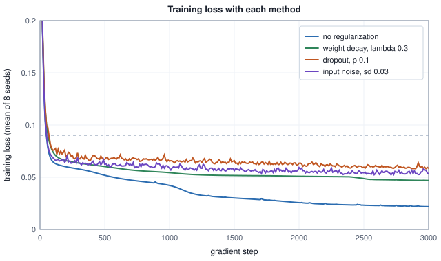

<!-- SPDX-License-Identifier: CC-BY-4.0 -->
<!-- Copyright (c) 2026 Martin Schröder <info@swedishembedded.com> -->

# Regularization in Neural Networks

*How do we stop a network with millions of parameters from memorizing its training set?*

## A training loss of a third of the noise

A training loss of 0.0274 sounds like a triumph. On the task below it is a warning: the labels carry noise whose variance alone is 0.09, so a network that has learned only the underlying curve would sit near that figure on average, and one that goes far below it has learned something it should not have. A network with more parameters than examples can drive its training loss to nothing by remembering each example, noise included, and it is then wrong on every example it has not seen. Volume II named the failure (overfitting) and taught how to see it: keep some data back and score the model on it. The question here is what to do once you see it, for the networks of this volume.

The failure is easiest to study on a task small enough to follow completely. A curve, $y = \sin(2\pi x)$, is observed at 16 random points with Gaussian noise of standard deviation $\sigma = 0.3$, so even the true curve has a mean squared error of $\sigma^2 = 0.09$ on fresh labels: that number is the **noise floor**, the best any model can do. The network has one hidden layer of 64 tanh units, which is 193 parameters for 16 examples. Everything is specified here, and every later table of the chapter uses the same task, the same network and the same eight seeds.

<!-- worked: regularization_nn.task_setup -->
Task: x ~ uniform on [0, 1), y = sin(2 pi x) + 0.3 * normal(); the noise floor of the mean squared error is 0.09. Network: u = (x - 0.5) * sqrt(12); 64 hidden units tanh(w_j u + b_j); output c + sum_j v_j h_j. Parameters: 64 + 64 + 64 + 1 = 193, against 16 training examples (12.1 per example).

Loss: mean squared error over the 16 training points. Optimizer: AdamW, full batch, learning rate 0.01, beta1 0.9, beta2 0.999, epsilon 1e-08, 3000 steps, no schedule; the validation loss (200 points) is computed every 10 steps.

Generators (the book's SplitMix64; k is the seed number 0 .. 7; a generator named `regularization_nn.<stream>.k` is seeded with the seed printed in the table below, so each of the eight seeds has its own seed for each of the three streams):

- `train.k`: for i = 0 .. 15, x_i = uniform() then e_i = normal(); y_i = sin(2 pi x_i) + 0.3 e_i (for a training set of N > 16 points the same rule continues to i = N - 1).
- `init.k`: w_j = normal() for j = 0 .. 63, then b_j = normal() for j = 0 .. 63, then v_j = normal() / 8 for j = 0 .. 63; c = 0.
- `noise.k`: masks and augmentations (draw order in the examples that use them).

| k | train.k | init.k | noise.k |
|---:|---|---|---|
| 0 | 0xafafb1e96dba2278 | 0x9b92927c65f97bf1 | 0x506586d6384f3f45 |
| 1 | 0x90ba10dda9accf97 | 0x0001027ff18cec5b | 0x069b3c226268c598 |
| 2 | 0x35a921376df1cf6c | 0x1478f0047523ca96 | 0x181fa71de7dd6fc4 |
| 3 | 0xe8662c575fa3f4ad | 0xb02ce4fe574c7374 | 0x5cbccc886012e023 |
| 4 | 0x7307018ffbb216a9 | 0xbace3f74e1f1a969 | 0x36e69cdf840ca544 |
| 5 | 0x426710f3906aaa42 | 0x29108e5cef0fedae | 0xb99d5e622872d4cf |
| 6 | 0xacc80cf5dc9ed1d9 | 0x54f44750ba20751f | 0x410f414e3a9c8298 |
| 7 | 0xcde1d06cdfc4d1d0 | 0x3b8db135575bd159 | 0x1d58f0f3d2a6bd9b |

- `regularization_nn.validation` seed 0x20ff207307b8362f: 200 validation points, drawn like the training points. `regularization_nn.test` seed 0x2fecc37ae6bdd0af: 1000 test points, same rule.

Training points of seed 0:

| i | x_i | sin(2 pi x_i) | y_i |
|---|---:|---:|---:|
| 0 | 0.0814 | 0.4896 | 0.3508 |
| 1 | 0.6300 | -0.7291 | -0.7335 |
| 2 | 0.5347 | -0.2161 | -0.1009 |
| 3 | 0.4883 | 0.0735 | -0.4251 |
| 4 | 0.2462 | 0.9997 | 0.9287 |
| 5 | 0.3613 | 0.7652 | 1.1554 |
| 6 | 0.0355 | 0.2210 | -0.5015 |
| 7 | 0.0366 | 0.2282 | 0.3610 |
| 8 | 0.5354 | -0.2208 | -0.1582 |
| 9 | 0.7840 | -0.9772 | -1.0134 |
| 10 | 0.9016 | -0.5794 | -0.7454 |
| 11 | 0.6201 | -0.6849 | -1.1946 |
| 12 | 0.5017 | -0.0105 | -0.3700 |
| 13 | 0.4046 | 0.5644 | 0.2313 |
| 14 | 0.5214 | -0.1339 | -0.4309 |
| 15 | 0.4654 | 0.2154 | 0.9645 |
<!-- /worked -->

Train it by full-batch AdamW (chapter 7) with no weight decay and watch two numbers: the mean squared error on the 16 training points, and on 200 validation points drawn from the same source.

<!-- worked: regularization_nn.memorisation -->
Seed 0, no regularization (AdamW with weight decay 0). Training loss is the mean squared error on the 16 training points in eval mode; validation is the mean squared error on the 200 validation points; the noise floor is 0.09; the norm of the parameters is the Euclidean norm of the 193 parameters (w, b, v and c together). The late rows come from a chaotic run, so a number that comes from a chaotic run is printed with only the digits that are the same in the run and in four copies of it whose first weight is changed by +1e-12, -1e-12, +3e-12 and -3e-12: in full if all agree on it, as 'about x' with the leading digits on which all agree, or as 'unstable' when not even one digit survives; the other digits cannot be reproduced in another implementation. The same rule applies to every number of this chapter's tables that comes from training.

| step | training loss | validation loss | norm of the parameters |
|---|---:|---:|---:|
| 10 | 0.2140 | 0.3293 | 11.2 |
| 50 | 0.1139 | 0.1479 | 11.6 |
| 100 | 0.1108 | 0.1451 | 11.4 |
| 200 | 0.1099 | 0.1380 | 11.5 |
| 400 | 0.1094 | 0.1367 | 11.7 |
| 600 | 0.1086 | 0.1377 | 12.4 |
| 1000 | about 0.093 | about 0.156 | 17.3 |
| 1500 | 0.0315 | about 0.193 | 25.5 |
| 2000 | 0.0298 | about 0.207 | 26.7 |
| 3000 | 0.0274 | about 0.28 | 28.8 |

Over the 8 seeds: the validation loss is lowest at step 449 on average (range 40 to 1780), where it is 0.138; at step 3000 it is 0.436 on average (range 0.128 to 0.890), while the training loss is 0.0218.
Seed 0 alone: the lowest validation loss is 0.1367, at step 380; a patience of 10 evaluations (100 steps) fires at step 480.
<!-- /worked -->

The training loss falls below the noise floor of 0.09 around step 1000 and ends at 0.0274. A network that had learned only the curve could not do that: on average its training loss would sit near the floor, because the labels it is asked to reproduce carry noise it cannot predict. A training loss of a third of the floor means that the network is following the noise of these 16 points. The validation loss says what that costs: it is lowest early (0.1367 at step 380 for this seed) and then climbs to about 0.28 at step 3000 (the late rows of the table are chaotic, so only their leading digits are printed), while the norm of the parameters more than doubles, from 11.2 to 28.8. Over the eight seeds the end-of-training validation loss averages 0.436, three times the 0.138 that the same runs reached at their best step. Figure 1 draws what the trained function looks like.


Figure 1 shows the function after 3000 steps for seed 0. The unregularized network passes through the cluster of points near $x = 0.5$ by swinging up and down by more than the noise; the two regularized networks (settings chosen later in the chapter) do not.

Regularization (Volume II, chapter 4) is the name for everything that reduces this gap: any change to the training that trades a little fit to the training set for a better fit to new data. Volume II used one, the penalty of the prior. Four more follow, each with a different mechanism. Weight decay is that penalty inside a neural-network optimizer, and the first question is what it does to the weights and to the function they compute. Dropout removes units at random during training; it needs a scaling that keeps the expectation right, a behaviour in train and in eval mode, a backward pass, and an account of the ensemble it stands for and of the cases where it does nothing. Data augmentation trains on altered copies of the examples, and is the strongest regularizer when the alteration is valid and a source of wrong labels when it is not. Early stopping uses the validation curve to decide when to quit, and on a quadratic loss it turns out to be an L2 penalty in disguise. The chapter ends by setting all of them side by side over eight paired seeds, in the paired practice of Volume II, chapter 8, and by counting what each costs in arithmetic and memory.

Five ideas from earlier chapters carry the rest, and it is worth answering them from memory before going on. The answers are at the end of the chapter; if one is hard, go back to the chapter named.

1. (Volume II, "Generalization, Overfitting and Honest Evaluation", overfitting and the validation set.) A model has training loss 0.02 and validation loss 0.44. What is this called, and why can the training loss alone never reveal it?
2. (Volume II, "Maximum Likelihood, Priors and Regularization", the L2 penalty, four chapters back.) Which prior on the weights gives the penalty $\frac{\lambda}{2}\lVert\mathbf{w}\rVert^2$, and what does a larger $\lambda$ say about the prior?
3. (Chapter 7, "Optimizers: From SGD to AdamW", decoupled weight decay.) With $\eta = 0.01$ and $\lambda = 0.3$, what fraction of a weight whose loss gradient is always zero is left after 100 steps of decoupled decay?
4. (Chapter 10, "Normalization Layers", train and eval mode.) Name a layer that has two modes and say what differs between them.
5. (Volume I, "Statistics", expectation and variance, many chapters back.) A random variable $B$ equals 1 with probability 0.8 and 0 otherwise. What are the mean and the variance of $B$, and of $5B$?

Label smoothing (chapter 3) returns near the end as the fifth member of the family.

## Weight decay

The first method needs nothing new: it is the penalty of Volume II applied to the weights of a network. What it does to a network is not obvious from the formula, though. A network with small weights is a smooth function, and smoothness is what the noisy points above lack.

Two forms of the same idea were met before. Volume II added $\frac{\lambda}{2}\lVert\mathbf{w}\rVert^2$ to the loss, which is the maximum a posteriori estimate under a Gaussian prior on each weight. Chapter 7 turned it into an update: one step of gradient descent on loss plus penalty is $\theta \leftarrow (1 - \eta\lambda)\theta - \eta\,\mathbf{g}$, "shrink, then step", and for Adam the shrink must be applied to the weights directly (decoupled weight decay) because a penalty inside Adam's gradient is divided by the gradient's own scale. In this chapter **weight decay** means the shrinking of every weight toward zero by the fraction $\eta\lambda$ at every step, as a regularizer of a neural network; the update rule is chapter 7's, and what is new is the evidence about what it does.

Run the task with decoupled decay at four strengths. The strength has a meaning that does not depend on the optimizer: $\eta\lambda$ is the fraction of every weight removed per step, so a weight that the data never touches is multiplied by $(1 - \eta\lambda)^{3000}$ over the run. And chapter 4's relation $\lambda_{\mathrm{ridge}} = \sigma^2/\sigma_w^2$ turns it into a statement about the weights: the penalty $\frac{\lambda}{2}\lVert\theta\rVert^2$ added to the *mean* squared error of $N$ examples stands for a Gaussian prior with $\sigma_w^2 = 2\sigma^2/(N\lambda)$ on each parameter (multiply the negative log posterior of chapter 4 by $2\sigma^2/N$ to see it).

<!-- worked: regularization_nn.weight_decay_sweep -->
Decoupled weight decay (AdamW, theta <- theta - eta lam theta - eta mhat / (sqrt(vhat) + eps)), applied to all 193 parameters, eta = 0.01, 3000 steps; every row is the mean over the 8 seeds of the same 8 trainings that differ only in lam. 'eta lam' is the fraction of every weight removed per step; 'shrink' = (1 - eta lam)^3000 is what is left of a weight the data never touches; the prior sd is sqrt(2 * 0.09 / (16 lam)) (the Gaussian prior whose MAP estimate is this penalty, Volume II chapter 4). 'Steepest slope' is the largest |f(x1) - f(x0)| / (x1 - x0) between neighbouring points of the grid x = 0, 0.002, ..., 1 (the true curve's is 2 pi = 6.3). Training loss is eval-mode on the 16 training points; validation has 200 points, test 1000; the noise floor is 0.09.

| lam | eta lam | shrink | prior sd | norm of the parameters | steepest slope | training loss | validation loss | test loss |
|---|---:|---:|---:|---:|---:|---:|---:|---:|
| 0 | 0.0000 | 1 | no prior | 23.9 | about 34 | 0.0218 | 0.436 | about 0.4 |
| 0.1 | 0.0010 | 4.97e-02 | 0.335 | 15.5 | 21.0 | 0.0299 | 0.222 | 0.204 |
| 0.3 | 0.0030 | 1.22e-04 | 0.194 | 7.8 | 11.1 | 0.0469 | 0.155 | 0.140 |
| 1 | 0.0100 | 8.05e-14 | 0.106 | 3.5 | about 7 | about 0.074 | about 0.17 | about 0.1 |
| 3 | 0.0300 | 2.07e-40 | 0.061 | 2.7 | 4.3 | 0.1362 | 0.215 | 0.199 |
<!-- /worked -->

Read the table from the top. Without decay the norm of the parameters is 23.9 and the fitted function reaches a slope of about 34, against a slope of at most $2\pi = 6.3$ for the true curve: that steepness is the oscillation of Figure 1. With $\lambda = 0.3$ the norm is 7.8, the steepest slope 11.1, the training loss rises from 0.0218 to 0.0469 (the network may no longer follow every point), and the test loss falls from about 0.4 to 0.140. At $\lambda = 1$ the slope, about 7, is near that of the truth and the test loss is about 0.1 (the table prints only the digits that survive a nudge of $10^{-12}$); at $\lambda = 3$ the penalty wins over the data: the training loss is 0.1362, above the noise floor, the network is underfitting, and the test loss is back to 0.199. So the strength has an optimum, and the validation loss (0.155 at $\lambda = 0.3$, about 0.17 at 1, 0.215 at 3) finds it without the test set. The prior column says what the optimum believes: weights of standard deviation about 0.19, against a standard deviation of 1 at the start of training.

The mechanism is a bound. A hidden unit $v_j\tanh(w_j u + b_j)$ has slope at most $\lvert v_j w_j\rvert$ in $u$, so the slope of the whole function is at most $\sum_j \lvert v_j w_j\rvert$, which the product of two small weights keeps small. Shrinking all weights shrinks the largest slope the network can build, and with it the size of the swings that fit a point away from its neighbours.

### Where the penalty enters

Chapter 7 showed on a single weight that putting the penalty in Adam's gradient makes its meaning depend on the gradient scale. Does that show up on a whole network? The same eight trainings, with the penalty either applied to the weights (decoupled) or added to the gradient, over four decades of $\lambda$ each:

<!-- worked: regularization_nn.coupled_vs_decoupled -->
The same network and seeds, with the penalty (lam / 2) ||theta||^2 either applied to the weights directly (decoupled) or added to the gradient that Adam then rescales (g <- g + lam theta, no decay term). Means over the 8 seeds, 3000 steps, validation loss on the 200 validation points.

| how the penalty enters | lam | norm of the parameters | training loss | validation loss |
|---|---|---:|---:|---:|
| decoupled (AdamW) | 0.1 | 15.5 | 0.0299 | 0.222 |
| decoupled (AdamW) | 0.3 | 7.8 | 0.0469 | 0.155 |
| decoupled (AdamW) | 1 | 3.5 | about 0.074 | about 0.17 |
| decoupled (AdamW) | 3 | 2.7 | 0.1362 | 0.215 |
| in the gradient (Adam + L2) | 0.0001 | 9.9 | about 0.039 | about 0.3 |
| in the gradient (Adam + L2) | 0.001 | 4.1 | about 0.057 | about 0.14 |
| in the gradient (Adam + L2) | 0.01 | 3.0 | about 0.068 | about 0.14 |
| in the gradient (Adam + L2) | 0.1 | 1.3 | 0.1951 | 0.248 |
<!-- /worked -->

The best validation loss is about the same for both, 0.155 for decoupled decay at $\lambda = 0.3$ and about 0.14 for the coupled penalty at both $\lambda = 0.001$ and $0.01$, but the two rules are not tuned in the same way. For the decoupled rule the norm falls steadily as the strength grows (15.5, 7.8, 3.5, 2.7): a tenfold change in $\lambda$ is a visible change in the network, and $\eta\lambda$ is the fraction removed per step whatever the network is doing. For the coupled penalty a hundredfold change, $\lambda = 0.001$ to $0.1$, moves the norm from 4.1 to 1.3, and two neighbouring decades ($0.001$ and $0.01$) give the same validation loss: the penalty is divided by the running gradient scale that Adam divides everything by, so its effective size depends on the gradients and not only on $\lambda$. Neither rule is wrong on this problem; the decoupled one is the one whose strength you can reason about, which is why chapter 7 recommends it and why the rest of this chapter uses it.

### What to decay

The formula shrinks every parameter. Common practice does not: it leaves biases and the gains of normalization layers alone, because the prior "weights are small" is a statement about the connections between units, and a bias that carries the mean of a target has no reason to be near zero. This chapter's network decays all 193 parameters, which is the simplest setting and one of the two conventions (Exercise 11 measures the other). The convention to avoid is an unstated one: the strength means different things depending on which tensors it touches, so a recipe names them.

## Dropout

Weight decay restrains the weights. Dropout restrains something else: it prevents units from depending on each other, by making any unit disappear at random, so that no unit can count on another being there to correct it.

Start with the smallest case. A layer produces six activations $a = (1, -0.5, 2, 0.5, -1.5, 0.25)$. During training, for each unit independently, a coin decides whether the unit is **dropped**: with probability $p_{\mathrm{drop}}$ its output is replaced by 0. The array of zeros and ones that records the decision (1 for a kept unit) is the **mask** $\mathbf{M}$. Take $p_{\mathrm{drop}} = 0.5$, and send the kept units on at twice their value:

<!-- worked: regularization_nn.dropout_masks -->
Six activations a = (1, -0.5, 2, 0.5, -1.5, 0.25) and p = 0.5, so the scale is 1 / (1 - p) = 2. Each mask is six uniform() draws in the order of the units (`regularization_nn.three-masks` seed 0xfb485ddaf0a12250); a unit is dropped (mask 0) when its draw is below 0.5. The output of the layer is a_j m_j / (1 - p).

|  | draws | mask m | output a_j m_j / (1 - p) | sum |
|---|---|---|---|---|
| eval mode | - | - | (1, -0.5, 2, 0.5, -1.5, 0.25) | 1.75 |
| mask 1 | (0.956, 0.297, 0.578, 0.918, 0.590, 0.406) | (1, 0, 1, 1, 1, 0) | (2, 0, 4, 1, -3, 0) | 4 |
| mask 2 | (0.372, 0.557, 0.835, 0.031, 0.465, 0.818) | (0, 1, 1, 0, 0, 1) | (0, -1, 4, 0, 0, 0.5) | 3.5 |
| mask 3 | (0.306, 0.411, 0.875, 0.573, 0.714, 0.415) | (0, 0, 1, 1, 1, 0) | (0, 0, 4, 1, -3, 0) | 2 |
<!-- /worked -->


Figure 2 draws three masks of the table above. Each training step sends the next layer a different random subset of the units, scaled up.

The three rows have sums 4, 3.5 and 2, different from each other and from the 1.75 of eval mode. That is the point of the method: the layer after this one never sees the same input twice. It is also a problem, which the factor 2 solves.

### Why the kept units are scaled by $1/(1-p_{\mathrm{drop}})$

Take one activation $a$ and its mask entry $m \in \{0, 1\}$, which is 1 with probability $1 - p_{\mathrm{drop}}$. Without any scaling the layer passes $a\,m$ on, whose expectation is

$$
\mathbb{E}[a\,m] = a\,(1 - p_{\mathrm{drop}}).
$$

In training the next layer would see, on average, $1 - p_{\mathrm{drop}}$ of the activation; at prediction time, when nothing is dropped, it would see all of it. A network trained on the first and used on the second is mismatched by a constant factor in every layer. One cure is to multiply by $1 - p_{\mathrm{drop}}$ at prediction time. The other, which is the one used everywhere, is to divide during training. **Inverted dropout** sends

$$
\tilde a = \frac{a\,m}{1 - p_{\mathrm{drop}}},
\qquad
\mathbb{E}[\tilde a] = \frac{a\,(1 - p_{\mathrm{drop}})}{1 - p_{\mathrm{drop}}} = a,
$$

so that the expectation of what the next layer receives is exactly the activation, and prediction needs no change at all: in eval mode the layer is skipped. The price is variance, which is computed from the variance of the Bernoulli variable $m$, $(1 - p_{\mathrm{drop}})\,p_{\mathrm{drop}}$:

$$
\mathrm{Var}[\tilde a] = \frac{a^2}{(1 - p_{\mathrm{drop}})^2}\,(1 - p_{\mathrm{drop}})\,p_{\mathrm{drop}} = a^2\,\frac{p_{\mathrm{drop}}}{1 - p_{\mathrm{drop}}}.
$$

The variance grows without bound as $p_{\mathrm{drop}} \to 1$, which is why large dropout rates are rare. A table of one activation, $a = 2$, over 100,000 masks per rate checks the three formulas:

<!-- worked: regularization_nn.dropout_expectation -->
One activation a = 2.0, dropped with probability p. For each p in the order of the table, 100000 masks: 100000 uniform() draws from one generator (`regularization_nn.expectation` seed 0x11fa18e00be6eb1f); the activation is dropped when the draw is below p. 'raw' is the activation times the mask (0 or a); 'scaled' is the raw value times 1 / (1 - p). Variances use divisor n. The values in the columns 'expected' are the formulas of the text.

| p | 1 / (1 - p) | mean of raw | expected (1 - p) a | mean of scaled | expected a | variance of scaled | expected a^2 p / (1 - p) |
|---|---:|---:|---:|---:|---:|---:|---:|
| 0.1 | 1.1111 | 1.7986 | 1.8000 | 1.9984 | 2.0000 | 0.4472 | 0.4444 |
| 0.25 | 1.3333 | 1.4936 | 1.5000 | 1.9914 | 2.0000 | 1.3447 | 1.3333 |
| 0.5 | 2.0000 | 0.9977 | 1.0000 | 1.9955 | 2.0000 | 4.0000 | 4.0000 |
| 0.75 | 4.0000 | 0.4948 | 0.5000 | 1.9794 | 2.0000 | 11.9170 | 12.0000 |
<!-- /worked -->

The unscaled mean is $(1-p_{\mathrm{drop}})a$ (1.7986 against 1.8000 at $p_{\mathrm{drop}} = 0.1$), the scaled mean is $a$, and the scaled variance is $a^2 p_{\mathrm{drop}}/(1-p_{\mathrm{drop}})$: at $p_{\mathrm{drop}} = 0.5$ it is 4.0000 as predicted, at $0.75$ it is 11.9170 against 12, with the sampling error of 100,000 draws.

### Train mode and eval mode

Dropout is the second layer of this volume with two modes, and a simpler one than batch normalization (chapter 10): in train mode it draws a mask and scales, in eval mode it is the identity and keeps no state at all, so nothing needs to be stored in a checkpoint. The bugs are the same kind. Train mode left on at prediction time gives a different answer on every call. Take the network of seed 0 trained with dropout $p_{\mathrm{drop}} = 0.3$ and ask it for $\sin(2\pi\cdot 0.75) = -1$:

<!-- worked: regularization_nn.train_vs_eval -->
The network of seed 0 trained with dropout p = 0.3 on its hidden layer (3000 steps, otherwise the recipe of the chapter), evaluated at x = 0.75. Each train-mode output uses 64 fresh uniform() draws, one per unit, from `regularization_nn.predict` seed 0x00b4c16b234a4d23: the five rows, then 2000 more.

| output | value |
|---|---:|
| train mode, mask 1 | -0.8732 |
| train mode, mask 2 | -0.9137 |
| train mode, mask 3 | -1.0512 |
| train mode, mask 4 | -0.8639 |
| train mode, mask 5 | -0.8677 |
| eval mode (no mask, no scaling) | -0.9634 |
| mean of 2000 further train-mode outputs | -0.9616 |
| standard deviation of those 2000 | 0.1911 |
| true value sin(2 pi x) | -1.0000 |
<!-- /worked -->

Each train-mode answer is a different number (between $-1.0512$ and $-0.8639$ in the five rows), and over 2000 masks their mean is $-0.9616$ with a standard deviation of 0.1911, which is the noise that left on at prediction time would add to every output. The eval-mode answer, $-0.9634$, is the average. The test that finds a mode bug is the one of chapter 10: two eval-mode calls must be identical, and the mean of many train-mode calls must agree with one eval-mode call (here to $2\times10^{-3}$, about what 2000 samples give).

The layer is short, in the book's pseudocode, where `rng` is the generator of Volume I, chapter 17. The mask carries the scale so that the backward pass below needs no other state:

```text
function dropout_train(a: array<real>[B, H], p_drop: real, rng: Generator)
        -> (y: array<real>[B, H], mask: array<real>[B, H])
    require 0 <= p_drop and p_drop < 1, "the dropout probability is in [0, 1)"
    scale = 1 / (1 - p_drop)
    y = zeros(real, [B, H])
    mask = zeros(real, [B, H])
    for b in 0 .. B:
        for j in 0 .. H:
            if rng.uniform() >= p_drop:        # kept
                mask[b, j] = scale
            y[b, j] = a[b, j] * mask[b, j]
    return (y, mask)
```

One draw per element, in row-major order, and a unit is dropped when its draw is below $p_{\mathrm{drop}}$: the convention every table here uses, so a reader's masks match.

### The ensemble that dropout trains

Every mask names a smaller network: the one made of the kept units. A layer of $H$ units has $2^H$ of them, and these share their weights. Each training step trains one, and never the same one twice ($2^{64}$ is $1.8\times10^{19}$). Prediction in eval mode uses all the units together. The claim that justifies this is that eval mode is the average of the subnetworks. For a small layer the average can be computed exactly, by listing all $2^6 = 64$ masks of six units:

<!-- worked: regularization_nn.dropout_ensemble -->
A layer of six units with fixed activations h = (1, -0.5, 2, 0.5, -1.5, 0.25), output weights v = (0.5, 1, -0.25, 2, 0.4, -1), bias c = 0.1 and p = 0.5. All 2^6 = 64 masks are enumerated, each with probability (1/2)^6, so the 'mean over masks' is exact; 'eval' is the output with no mask and no scaling. The standard deviation of the linear output over the masks is 1.4739.

| quantity | mean over the 64 masks | eval mode | difference | smallest | largest |
|---|---:|---:|---:|---:|---:|
| linear output c + sum_j v_j h_j m_j / (1 - p) | -0.250000 | -0.250000 | 5.6e-17 | -3.600 | 3.100 |
| tanh of that output | -0.109884 | -0.244919 | 1.4e-01 | -0.999 | 0.996 |
<!-- /worked -->

When the dropped layer feeds a linear layer, as in the first row, the output is linear in the mask, so its mean over masks is the output with the mean mask: since $\mathbb{E}[m_j/(1-p_{\mathrm{drop}})] = 1$, it is exactly the eval-mode output ($-0.250000$ for both, a difference of $5.6\times10^{-17}$). The subnetworks disagree a lot, with a standard deviation of 1.4739 and outputs from $-3.600$ to $3.100$, and the average is stable. When a nonlinearity follows the dropped layer the equality is only approximate. The second row applies tanh to the same sum: the exact average over masks is $-0.1099$ and the eval-mode output is $-0.2449$. Eval mode is then a cheap approximation to the ensemble average, not the average itself, and for deep networks it is a good one in practice rather than by a theorem.

### The backward pass reuses the mask

The mask is part of the function that was computed, so the gradient must be the gradient of that function. With $y = \mathbf{M}\odot a$ (the mask carrying the scale) the gradient arriving at $y$ gives, by the rule of an elementwise product (chapter 5),

$$
da_{bj} = M_{bj}\,dy_{bj}.
$$

A dropped unit gets gradient 0, and every parameter below it is untouched by this example; a kept one passes the gradient on, multiplied by the scale. The same mask must be used, which means it must be kept from the forward pass or recomputed identically. A test with a four-unit network and one example checks the formula against central differences (chapter 6) with the forward mask held fixed, and shows what happens if the backward pass draws its own mask:

<!-- worked: regularization_nn.dropout_backward -->
A network of 4 hidden units, one example x = 0.7 (u = (x - 0.5) sqrt(12) = 0.6928), y = 0.3, L = (o - y)^2, p = 0.25 so the scale is 1.3333. Parameters from `regularization_nn.dropout-gradient` seed 0xf98006af225457e2: w_j (4 normal() draws), then b_j (4), then v_j (4); c = 0.1. Then the mask used in the forward pass: 4 uniform() draws (kept when the draw is at least p); then a second mask of 4 draws, used only in the last column, where the forward pass uses the first mask and the backward pass the second. Forward mask m = [1, 1, 0, 0] (times the scale); second mask = [0, 1, 1, 1]. Central differences with step 1e-06 on the loss with the forward mask held fixed.

| parameter | backward, mask reused | central difference | difference | backward with a fresh mask |
|---|---:|---:|---:|---:|
| w0 | -0.521856 | -0.521856 | 2.0e-11 | 0.000000 |
| w1 | -0.440503 | -0.440503 | 3.3e-11 | -0.440503 |
| w2 (unit dropped) | 0.000000 | 0.000000 | 0.0e+00 | -0.286052 |
| w3 (unit dropped) | 0.000000 | 0.000000 | 0.0e+00 | 3.204657 |
| b0 | -0.753234 | -0.753234 | 2.7e-10 | 0.000000 |
| b1 | -0.635812 | -0.635812 | 1.9e-11 | -0.635812 |
| b2 (unit dropped) | 0.000000 | 0.000000 | 0.0e+00 | -0.412881 |
| b3 (unit dropped) | 0.000000 | 0.000000 | 0.0e+00 | 4.625524 |
| v0 | 2.217361 | 2.217361 | 6.2e-11 | 0.000000 |
| v1 | -1.395711 | -1.395711 | 2.2e-11 | -1.395711 |
| v2 (unit dropped) | 0.000000 | 0.000000 | 0.0e+00 | -0.788475 |
| v3 (unit dropped) | 0.000000 | 0.000000 | 0.0e+00 | 0.986131 |
| c | -1.995912 | -1.995912 | 2.4e-11 | -1.995912 |
<!-- /worked -->

With the mask reused, every entry agrees with the central difference to $10^{-9}$ or better, and the dropped units' entries are exactly 0. With a fresh mask the answer is wrong in both directions: unit 0 was in the forward pass and contributed to the loss, but gets gradient 0 (`w0`, 0.000000 against $-0.521856$), and unit 3 was not in the forward pass but gets a gradient (`w3`, 3.204657 where the true value is 0). Nothing crashes. The gradient is merely of a function that was never computed, and gradient checking with the mask held fixed is what catches it. The backward is one multiplication:

```text
function dropout_backward(dy: array<real>[B, H], mask: array<real>[B, H]) -> array<real>[B, H]
    da = zeros(real, [B, H])
    for b in 0 .. B:
        for j in 0 .. H:
            da[b, j] = dy[b, j] * mask[b, j]
    return da
```

### What dropout does to the training

Dropout on the 64 hidden units of the task, at three rates:

<!-- worked: regularization_nn.dropout_sweep -->
Dropout on the 64 hidden units, p as listed, the recipe of the chapter, means over the 8 seeds. Training loss is eval mode on the 16 training points; 'best validation' is the lowest validation loss met during the run (checked every 10 steps), 'at step' the step where it was met.

| p | norm of the parameters | training loss | validation loss at step 3000 | best validation | at step |
|---|---:|---:|---:|---:|---:|
| 0 | 23.9 | 0.0218 | 0.436 | 0.138 | 449 |
| 0.1 | 20.0 | 0.0585 | 0.163 | 0.139 | 1184 |
| 0.3 | 21.5 | 0.0684 | 0.175 | 0.145 | 1276 |
| 0.5 | 22.3 | 0.0818 | 0.181 | 0.155 | 1926 |
<!-- /worked -->

The validation loss at step 3000 falls from 0.436 to 0.163 at $p_{\mathrm{drop}} = 0.1$, 0.175 at $0.3$, and 0.181 at $0.5$. The training loss, measured in eval mode on the 16 points, is higher (0.0218 without, 0.0585 at 0.1, 0.0818 at 0.5) because the network is trained on its damaged versions. The best validation loss met during the run, which is the better judge of the final quality, gets worse as the rate grows (0.139, 0.145, 0.155), and the step where it is met moves later (449 for none, 1184 at 0.1, 1926 at 0.5): dropout slows memorization more than it slows learning, and the larger the rate the more it slows both. Note what the norm column says: the norm of the parameters barely changes (23.9 without, 20.0 to 22.3 with), unlike weight decay. Dropout does not make the weights small; it makes the function insensitive to losing any one unit, which is a different restraint.

### Where dropout helps and where it does nothing

Dropout was designed for a network whose capacity far exceeds its data. The same experiment at several training-set sizes, with the same network and $p_{\mathrm{drop}} = 0.3$, shows where that design applies:

<!-- worked: regularization_nn.dropout_by_size -->
The same network and recipe with N training examples (N = 16 is the chapter's task; for the others the training points are the first N pairs of a stream `regularization_nn.train.k` drawn by the same rule), without dropout and with p = 0.3, 3000 steps, test loss on the 1000 test points, means over the 8 seeds. The difference is dropout minus none for each seed; 'wins' counts the seeds where dropout has the lower test loss.

| N | parameters per example | training loss, none | test loss, none | test loss, p = 0.3 | mean difference | paired t | wins |
|---|---:|---:|---:|---:|---:|---:|---:|
| 8 | 24.1 | 0.010 | about 1 | 0.226 | about -0.8 (SE about 0.35) | -2.4 | 7 of 8 |
| 16 | 12.1 | 0.022 | about 0.4 | 0.153 | about -0.25 (SE 0.099) | -2.5 | 8 of 8 |
| 32 | 6.0 | about 0.05 | about 0.14 | 0.127 | about -0.01 (SE 0.006) | about -2 | 5 of 8 |
| 64 | 3.0 | 0.062 | 0.113 | 0.112 | -0.000 (SE 0.003) | unstable | 5 of 8 |
| 128 | 1.5 | about 0.07 | about 0.1 | 0.102 | unstable (SE 0.003) | unstable | 3 of 8 |
<!-- /worked -->

With 8 examples (24 parameters per example) dropout takes the test loss from about 1 to 0.226, and wins on 7 of the 8 seeds; at 16 it takes it from about 0.4 to 0.153. At 32 examples the gain (about 0.01) has shrunk to within the spread of seeds, at 64 it is zero to the printed digits, and at 128 examples (1.5 parameters per example) dropout wins on only 3 of 8 seeds and the mean difference is too small to print (unstable). The unregularized network at 128 examples has a test loss of about 0.1, close to the noise floor, so there is nothing left to regularize, and the noise that dropout injects only slows the fit. A regularizer is a bias that you buy variance reduction with; when the variance is already small the purchase is a loss. The same reasoning applies to a very large network trained for a single pass over a very large dataset: if no example is seen twice there is nothing to memorize.

## Data augmentation

The methods so far work on the model. The next one works on the data: if the amount of data is what limits generalization, make more. **Data augmentation** replaces a training example by an altered copy of it whose label is known to be unchanged, a fresh copy at every pass.

The alteration comes from what you know about the problem, and it is a statement about **invariance**: the label does not depend on the thing that you change. For an image of an object, a shift by a few pixels, a small rotation and a flip (for some objects), a change of brightness or a crop do not change what is in it. For a sensor reading, additive noise of the size of the sensor's own noise and a small calibration gain do not change which state the machine is in. For audio, a small time shift or background noise does not change the words. Each such statement is knowledge about the world that the network, which sees only 16 points, cannot learn from them. An augmentation adds that knowledge to the training set, which is why it is the most powerful regularizer when it is valid: it is the only one that adds information.

### Noise on the inputs is a ridge penalty

For one model augmentation can be computed exactly. Take a linear model and add Gaussian noise of standard deviation $s_{\mathrm{aug}}$ to the input of every example, with the label unchanged. The expected squared error of one example $(\mathbf{x}, y)$ over the noise $\boldsymbol{\varepsilon}$, whose entries are independent with mean 0 and variance $s_{\mathrm{aug}}^2$, is

$$
\mathbb{E}\big[(\mathbf{w}\cdot(\mathbf{x} + \boldsymbol{\varepsilon}) - y)^2\big]
= (\mathbf{w}\cdot\mathbf{x} - y)^2 + 2(\mathbf{w}\cdot\mathbf{x} - y)\,\mathbb{E}[\mathbf{w}\cdot\boldsymbol{\varepsilon}] + \mathbb{E}[(\mathbf{w}\cdot\boldsymbol{\varepsilon})^2]
= (\mathbf{w}\cdot\mathbf{x} - y)^2 + s_{\mathrm{aug}}^2\lVert\mathbf{w}\rVert^2,
$$

because the cross term has mean zero and $\mathbb{E}[(\mathbf{w}\cdot\boldsymbol{\varepsilon})^2] = \sum_i w_i^2 s_{\mathrm{aug}}^2$. Summed over $N$ examples this is the squared error plus $N s_{\mathrm{aug}}^2\lVert\mathbf{w}\rVert^2$: **L2 regularization with strength $\lambda = N s_{\mathrm{aug}}^2$** in the form of Volume II, chapter 4 ($\frac12\sum r^2 + \frac\lambda2\lVert\mathbf{w}\rVert^2$ up to the factor 2 on both). Noise on the inputs penalizes the weights that read them. A check by sampling: fit the least squares model on $K$ noisy copies of each of 12 examples and compare with the ridge solution of strength $N s_{\mathrm{aug}}^2$.

<!-- worked: regularization_nn.augmentation_ridge -->
A linear model y = w . x with 3 features on 12 examples, features and noise from one generator (`regularization_nn.ridge` seed 0x6509d1b4d5518d57): first all 12 feature rows, row by row (3 normal() draws per row, 36 draws in all), and only then the 12 label noises (one normal() each, in the order of the rows), so that y_i = 1 x_i0 - 2 x_i1 + 0.5 x_i2 + 0.5 e_i with e_i the i-th noise draw. Least squares without any augmentation: w = (1.2028, -1.9723, 0.6152). 'Ridge' solves (X^T X + N s^2 I) w = X^T y. 'K copies' replaces each example by K noisy copies x + s * (three normal() draws), with the same label, and solves ordinary least squares on the 12 K rows (the draws continue the same generator: first all rows of s = 0.3 with K = 10, then K = 1000, then s = 0.6 with K = 10, then K = 1000; within one setting example after example, K copies of an example one after the other, each copy three normal() draws, one per feature). 'Max difference' is the largest difference of an entry from the ridge solution.

| noise sd s | ridge strength N s^2 | ridge w | K = 10 copies: w | max difference | K = 1000 copies: w | max difference |
|---|---:|---|---:|---:|---:|---:|
| 0.3 | 1.080 | (1.1485, -1.7737, 0.4643) | (1.0877, -1.7779, 0.4606) | 0.0608 | (1.1501, -1.7751, 0.4505) | 0.0137 |
| 0.6 | 4.320 | (1.0029, -1.3789, 0.2385) | (0.9437, -1.4579, 0.2168) | 0.0790 | (0.9912, -1.3969, 0.2498) | 0.0180 |
<!-- /worked -->

With $K = 1000$ copies the fitted weights are within 0.0137 (for $s_{\mathrm{aug}} = 0.3$) and 0.0180 (for 0.6) of the ridge solution, and with $K = 10$ within 0.0608 and 0.0790: the sampled solution approaches the penalized one as the number of draws grows. For a neural network the same calculation gives, to first order in $s_{\mathrm{aug}}^2$, a penalty on the squared slope of the function with respect to its input, which is the smoothness that the fits of Figure 1 lacked. The penalty is a consequence of the noise. Noise is not a trick to produce the penalty; it states how much the input is allowed to wobble before the answer should change.

### The network with augmentation, and with a wrong augmentation

Three augmentations on the task, all online (a fresh draw at every step for every example) and all keeping the label: additive noise on $x$ at three sizes, a multiplicative gain on $x$ (the "sensor calibration" of the list above), and a shift of $x$ by half a period of the curve half the time. The last is a deliberate mistake. The label of the training point $(x, y)$ is the value of $\sin(2\pi x)$ plus noise, so moving $x$ by half a period without changing $y$ asserts that $\sin(2\pi(x + 0.5)) = \sin(2\pi x)$, which is false: it flips the sign. The table measures the **label drift** of each, the root mean square change of the true curve at the altered input, which is the amount of wrong label the augmentation adds.

<!-- worked: regularization_nn.augmentation_table -->
Augmentation by changing the input of a training example, with its label kept, a fresh draw at every step for every example (online). Draw order of the stream `regularization_nn.noise.k`: for each step, for each example in order, one draw, then (when dropout is on, which it is not here) the 64 mask draws. 'noise' adds sd * normal() to x; 'gain' multiplies x by 1 + 0.1 (2 uniform() - 1); 'shift' adds 0.5 to x when uniform() < 0.5. 'Label drift' is sqrt(E (sin(2 pi x') - sin(2 pi x))^2), the change in the true label that the augmentation causes, over 20000 points x = uniform() with the augmentation drawn from `regularization_nn.drift` seed 0xbf24634ffb7de612 (one generator, rows in the order of the table, per point first x then the augmentation draw). Training loss is eval mode on the unaugmented training points. Means over 8 seeds; the difference is the test loss minus that of no augmentation, per seed, 3000 steps.

| augmentation | label drift | training loss | validation loss | test loss | mean difference in test loss | paired t |
|---|---:|---:|---:|---:|---:|---:|
| none | 0.000 | 0.0218 | 0.436 | about 0.4 | - | - |
| noise sd 0.03 | 0.133 | 0.0532 | 0.162 | 0.141 | about -0.26 | -2.6 |
| noise sd 0.1 | 0.418 | 0.0991 | 0.176 | 0.155 | about -0.25 | -2.7 |
| noise sd 0.2 | 0.738 | 0.1887 | 0.240 | 0.222 | -0.178 | -1.9 |
| gain 1 +- 0.1 | 0.148 | 0.0575 | 0.182 | 0.170 | -0.230 | -2.5 |
| shift by 0.5, half the time | 1.004 | 0.2815 | 0.426 | 0.430 | about +0.03 | +0.3 |
<!-- /worked -->

Noise with standard deviation 0.03 has a drift of 0.133, well below the label noise of 0.3, and takes the test loss from about 0.4 to 0.141. Raising the noise to 0.1 (drift 0.418) gives 0.155 and to 0.2 (drift 0.738) 0.222: the larger the noise, the more wrong labels the network is trained on, and the fit gets worse again, although it is still better than none because the unaugmented network overfits so badly. The gain of $\pm10\%$ is a different case. Its drift, 0.148, is small, and the test loss is 0.170: it helped, but it was not a valid invariance here, because the target depends on $x$ and the gain moves $x$. For a classifier of the *shape* of a trace, where the class does not depend on the gain, the same augmentation would be valid. The invariance is a fact about the task, not about the augmentation. The half-period shift has drift 1.004, as large as the signal itself, the training loss stays at 0.2815, and the test loss is 0.430, slightly worse than no augmentation (about $+0.03$, paired $t = 0.3$ over 8 seeds, so no evidence of a difference). It could not help, because it trains the network to give the same answer for two inputs where the correct answers differ.

A rule falls out: an augmentation is safe when its label drift is small against the label noise, and the drift can be measured when the true function is known. When it is not known (almost always), the question is the one that the invariance list answers: does what I changed alter the answer? A vertical flip of a photograph of a "6" turns it into a "9"; a horizontal flip of text reverses it; a crop that removes the object keeps the label of an image that no longer shows it. Each is a wrong label produced silently, and no loss curve will say so.

```text
function noisy_inputs(x: array<real>[B, D], s_aug: real, rng: Generator) -> array<real>[B, D]
    require s_aug >= 0, "the noise standard deviation is not negative"
    out = zeros(real, [B, D])
    for b in 0 .. B:
        for d in 0 .. D:
            out[b, d] = x[b, d] + s_aug * rng.normal()
    return out
```

## Early stopping

The three methods so far change what is trained. Early stopping changes how long. Look again at the validation loss of the unregularized network: it does not rise from the start, it falls to a minimum and then rises. If the weights at the minimum are kept, nothing else is needed.


Figure 3 is the unregularized run of the opening section. The validation loss is evaluated every 10 steps. The best checkpoint is at step 380; the run could have stopped at step 480.

**Early stopping** is this: evaluate the validation loss at regular intervals, keep a copy of the parameters with the lowest value seen, and stop training when it has not improved for a fixed number of evaluations, the **patience**. Two choices are in the rule and both matter.

*Restore the best checkpoint.* The weights at the moment of stopping are $\text{patience}\times E$ steps past the best, where $E$ is the number of steps between evaluations. The rule only works if what you keep is the checkpoint of the best evaluation, not the last one.

*Choose the patience against the noise in the curve.* If the validation loss is smooth, a patience of one or two evaluations is enough; if it is noisy (dropout, small batches), a single bad evaluation says nothing. The rule, with the comparison written so that a loss that is not a number never counts as an improvement:

```text
function train_with_early_stopping(theta0: array<real>[K], max_steps: int, E: int, patience: int,
        step: function(array<real>[K], int) -> array<real>[K],
        val_loss: function(array<real>[K]) -> real) -> (best: array<real>[K], t_best: int)
    require E >= 1 and patience >= 1, "evaluate at least every step and wait at least once"
    theta = copy(theta0)
    best = copy(theta)
    best_loss = infinity
    t_best = 0
    since = 0
    for t in 1 ..= max_steps:
        theta = step(theta, t)
        if t mod E == 0:
            v = val_loss(theta)
            if v < best_loss:                    # false when v is not a number
                best_loss = v
                best = copy(theta)
                t_best = t
                since = 0
            else:
                since = since + 1
                if since >= patience:
                    break
    return (best, t_best)
```

Replay this rule on the recorded validation curves of the eight runs of the task, without regularization and with dropout (whose curve is noisier), for several patiences. The test loss is measured at the restored checkpoint, and, for contrast, at the weights at the moment of stopping:

<!-- worked: regularization_nn.patience_rules -->
The recorded validation losses (one every 10 steps) of the 8 runs of each setting, replayed with a patience rule: keep the lowest validation loss so far (only a strictly lower value counts as an improvement) and stop at the first evaluation at which `patience` evaluations in a row have not improved on it. 'Stop' is the mean step at which the rule fires, 'best' the mean step of the checkpoint it keeps; 'test at best' is the mean test loss of that restored checkpoint, 'test at stop' of the weights at the moment of stopping (no restore). 'Test at 3000' is the same runs never stopped, and 'oracle' the test loss at the best-validation checkpoint over all 3000 steps (patience without limit).

| setting | patience (evaluations) | stop (step) | best (step) | test at best | test at stop | test at 3000 | oracle |
|---|---:|---:|---:|---:|---:|---:|---:|
| no regularization | 1 | 49 | 39 | 0.203 | 0.218 | about 0.4 | 0.121 |
| no regularization | 2 | 162 | 142 | 0.128 | 0.133 | about 0.4 | 0.121 |
| no regularization | 5 | 315 | 265 | 0.122 | 0.130 | about 0.4 | 0.121 |
| no regularization | 10 | 365 | 265 | 0.122 | 0.133 | about 0.4 | 0.121 |
| no regularization | 20 | 465 | 265 | 0.122 | 0.139 | about 0.4 | 0.121 |
| no regularization | 50 | 765 | 265 | 0.122 | 0.151 | about 0.4 | 0.121 |
| dropout p = 0.3 | 1 | 56 | 46 | 0.205 | 0.223 | 0.153 | 0.127 |
| dropout p = 0.3 | 2 | 84 | 64 | 0.170 | 0.200 | 0.153 | 0.127 |
| dropout p = 0.3 | 5 | 171 | 121 | 0.149 | 0.161 | 0.153 | 0.127 |
| dropout p = 0.3 | 10 | 312 | 212 | 0.137 | 0.150 | 0.153 | 0.127 |
| dropout p = 0.3 | 20 | 515 | 315 | 0.133 | 0.147 | 0.153 | 0.127 |
| dropout p = 0.3 | 50 | 1170 | 670 | 0.128 | 0.150 | 0.153 | 0.127 |
<!-- /worked -->

For the smooth curve of the unregularized network a patience of 5 evaluations (50 steps) already recovers the best the whole run offered: 0.122 against the oracle's 0.121, stopping at step 315 on average instead of 3000. A patience of one stops far too soon (step 49 on average, test loss 0.203), because the curve starts with a short plateau. For the dropout runs the curve is noisy, and the same patience of 5 gives 0.149, patience 10 gives 0.137 and patience 50 gives 0.128, which is within 0.001 of the oracle 0.127. The noisier the curve, the longer the wait. The column "test at stop" is the loss without the restore: always worse than the restored one (0.133 against 0.122 for patience 10, unregularized), and the gap grows with the patience. A run that stops without restoring keeps the weights that are $\text{patience}\times E$ steps into the climb.

Early stopping has three costs, none of them in the arithmetic of a step. A validation pass is needed every $E$ steps (the cost section counts it). A copy of the best parameters must be held. And the validation set is now used for a decision, so the minimum of its loss is optimistic as an estimate of the loss on new data, exactly the selection effect of Volume II, chapter 5: report the test loss at the checkpoint, never the validation loss (here the validation loss at the best step, 0.138 on average, against a test loss of 0.121 at the checkpoints of the same runs).

### Early stopping is an L2 penalty on a quadratic

On the quadratic loss of Volume II early stopping can be shown to be an L2 penalty, which is why the two are used almost interchangeably. Take a loss whose Hessian has eigenvalue (curvature) $\lambda_i$ along its $i$-th eigenvector, with the error $\xi_i(t)$ of the weight along it. Gradient descent from zero with rate $\eta$ multiplies the error by $1 - \eta\lambda_i$ per step (Volume II, chapter 2), so after $t$ steps the weight along that direction is

$$
w_i(t) = \big(1 - (1 - \eta\lambda_i)^t\big)\,w_i^\star ,
$$

a fraction of its least squares value $w_i^\star$. Ridge regression with strength $\lambda$ (Volume II, chapter 4: $(\mathbf{H} + \lambda\mathbf{I})\mathbf{w} = \mathbf{b}$) keeps

$$
w_i(\lambda) = \frac{\lambda_i}{\lambda_i + \lambda}\,w_i^\star .
$$

Both are filters on the least squares solution. Both keep the directions with large curvature (they are fitted fast, and the data pin them down) and suppress those with small curvature (the directions the data say little about, where noise dominates). The first filter reaches the value $\frac12$ when $(1-\eta\lambda_i)^t \approx \frac12$, that is for $\eta\lambda_i t \approx \ln 2 \approx 0.7$, the second when $\lambda_i = \lambda$. Matching the two gives $\lambda \approx 0.7/(\eta t)$; the factor $0.7$ is of order one and the rule of thumb drops it (the table below uses $\lambda = 1/(\eta t)$ exactly, and shows that the paths stay close):

$$
\lambda \approx \frac{1}{\eta\,t}:
$$

**the number of steps is a stand-in for the inverse of the penalty**, twice the steps being half the penalty. A table follows the correspondence on a problem with two correlated features (20 rows; the loss $\frac{1}{2N}\sum(\mathbf{w}\cdot\mathbf{x} - y)^2$, so that $\mathbf{H} = \mathbf{X}^\top\mathbf{X}/N$), reading the gradient descent weights after $t$ steps and the ridge weights at $\lambda = 1/(\eta t)$.

<!-- worked: regularization_nn.quadratic_paths -->
Twenty rows with two correlated features from `regularization_nn.quadratic` seed 0x147ea8f974abded0: for i = 0 .. 19, x1 = normal(), then x2 = 0.9 x1 + 0.3 normal(), then y = x1 - 0.5 x2 + 0.5 normal(). Loss (1/2N) sum (w . x - y)^2 with N = 20, so the Hessian is H = X^T X / N and the gradient H w - b with b = X^T y / N. H = [[1.5768, 1.3725], [1.3725, 1.2605]] with eigenvalues 2.8002 and 0.0370; the least squares solution is w* = (0.9568, -0.3774). Gradient descent starts at w = (0, 0) with eta = 0.25 and is read after t steps. Ridge regression minimises the loss plus (lam / 2) ||w||^2, that is (H + lam I) w = b, at lam = 1 / (eta t).

| t | lam = 1 / (eta t) | gradient descent w | norm | ridge w | norm | distance between them |
|---:|---:|---|---:|---|---:|---:|
| 1 | 4.0000 | (0.2477, 0.2094) | 0.3243 | (0.1480, 0.1206) | 0.1909 | 0.1335 |
| 2 | 2.0000 | (0.3259, 0.2678) | 0.4218 | (0.2128, 0.1673) | 0.2707 | 0.1513 |
| 5 | 0.8000 | (0.3726, 0.2762) | 0.4639 | (0.2959, 0.2093) | 0.3625 | 0.1018 |
| 10 | 0.4000 | (0.4000, 0.2472) | 0.4702 | (0.3543, 0.2115) | 0.4126 | 0.0580 |
| 20 | 0.2000 | (0.4495, 0.1917) | 0.4887 | (0.4182, 0.1805) | 0.4554 | 0.0333 |
| 50 | 0.0800 | (0.5730, 0.0531) | 0.5755 | (0.5295, 0.0826) | 0.5359 | 0.0526 |
| 100 | 0.0400 | (0.7158, -0.1071) | 0.7238 | (0.6347, -0.0259) | 0.6352 | 0.1148 |
| 200 | 0.0200 | (0.8618, -0.2708) | 0.9033 | (0.7401, -0.1393) | 0.7531 | 0.1792 |
| 500 | 0.0080 | (0.9510, -0.3709) | 1.0208 | (0.8473, -0.2566) | 0.8853 | 0.1544 |
| 1000 | 0.0040 | (0.9568, -0.3774) | 1.0285 | (0.8968, -0.3111) | 0.9492 | 0.0894 |
<!-- /worked -->

<!-- worked: regularization_nn.quadratic_filters -->
The same problem. Along the eigenvector of H with curvature c (the eigenvalue; H and eta of the previous example), gradient descent from zero has kept the fraction 1 - (1 - eta c)^t of the least squares coefficient after t steps, and ridge regression with lam = 1 / (eta t) keeps c / (c + lam). The two curvatures are 2.8002 and 0.0370.

| t | lam = 1 / (eta t) | gradient descent, c = 2.800 | ridge | gradient descent, c = 0.037 | ridge |
|---|---:|---:|---:|---:|---:|
| 1 | 4.0000 | 0.7001 | 0.4118 | 0.0093 | 0.0092 |
| 5 | 0.8000 | 0.9976 | 0.7778 | 0.0455 | 0.0443 |
| 20 | 0.2000 | 1.0000 | 0.9333 | 0.1698 | 0.1563 |
| 100 | 0.0400 | 1.0000 | 0.9859 | 0.6056 | 0.4808 |
| 500 | 0.0080 | 1.0000 | 0.9972 | 0.9905 | 0.8224 |
<!-- /worked -->


Figure 4 compares the weights reached by stopping gradient descent early with those of ridge regression; they are two routes to the same family of solutions.

The second table shows both the agreement and its limit. Along the flat direction (curvature 0.037) the two fractions are close at small $t$ (0.0093 and 0.0092 at $t = 1$, 0.1698 and 0.1563 at $t = 20$) and drift apart in the middle (0.6056 against 0.4808 at $t = 100$); along the steep direction (curvature 2.800) gradient descent has fitted everything by $t = 5$ while the ridge still keeps 0.7778 of it. The paths of Figure 4 never differ by more than 0.18 in the plane (the first table's last column, largest at $t = 200$) though the norms of the weight vectors there are between 0.3 and 1.0. So the two methods are not identical, and early stopping with a given number of steps is not the same function as any single ridge penalty. They are the same kind of thing: a smooth shrinkage that spares the well-determined directions. For a neural network there is no clean eigendecomposition, and the equivalence is only a way of thinking: training longer is training with a weaker penalty, which is what the climbing curves of Figure 3 and the curves of the weight decay table say from two sides.

## Label smoothing

Chapter 3 introduced label smoothing (the target $(1 - \epsilon_{\mathrm{ls}})$ one-hot plus $\epsilon_{\mathrm{ls}}/C$ on every class) as a repair for an infinite appetite: with a hard target, cross-entropy keeps pushing the logit gap between the right class and the others to infinity, and the weights that carry it grow without bound. That is overfitting in the same sense as above, expressed in the units of a classifier, and label smoothing is a regularizer in the sense of this chapter: it changes the target so that the loss has its minimum at a finite logit gap, which limits the size of the weights in the last layer. For four classes the gap that minimizes the loss against a smoothed target is $\ln\!\big((C(1-\epsilon_{\mathrm{ls}}) + \epsilon_{\mathrm{ls}})/\epsilon_{\mathrm{ls}}\big)$:

<!-- worked: regularization_nn.label_smoothing_gap -->
Four classes. The logits are (g, 0, 0, 0) for a correct example with a gap g; the target is (1 - eps) one-hot + eps / 4 on every class. The cross-entropy as a function of g is minimised where the predicted probability of the true class equals the target, found here by 200 bisection steps on d(loss)/dg = p_true(g) - t_true over [0, 40]; the closed form is g = ln((4 (1 - eps) + eps) / eps). The last column is the minimum loss (the entropy of the target).

| eps | target of the true class | best gap (bisection) | best gap (closed form) | minimum loss |
|---|---:|---:|---:|---:|
| 0 | 1 | never (the gap grows without limit) | - | 0.0000 |
| 0.05 | 0.9625 | 4.3438 | 4.3438 | 0.2011 |
| 0.1 | 0.9250 | 3.6109 | 3.6109 | 0.3488 |
| 0.2 | 0.8500 | 2.8332 | 2.8332 | 0.5875 |
<!-- /worked -->

At $\epsilon_{\mathrm{ls}} = 0.1$ the loss is minimal at a gap of 3.6109 ($\ln 37$, chapter 3's number), at 0.05 at 4.3438, at 0.2 at 2.8332, and with no smoothing never. The task of this chapter is a regression, so label smoothing does not enter the comparison below; the chapter on softmax has its derivation and its cost.

## Putting the methods together

Each method has one setting to choose, and the choice is made the way Volume II prescribes: on the validation set, never the test set. For each of weight decay, dropout and input noise the grid is listed in the table below, the value with the lowest mean validation loss at step 3000 is chosen (over the 8 seeds, with the 200 validation points shared by all of them), and the three are combined in pairs and all together at their chosen values. Every row uses the same eight seeds, so the same training points and the same starting weights: the comparison is paired, and the standard error of a difference is that of the per-seed differences (Volume II, chapter 8), which removes the large spread between seeds that the unregularized network has (the standard deviation of its test loss over the seeds is 0.274, against 0.014 to 0.029 for the regularized ones).

<!-- worked: regularization_nn.method_comparison -->
Settings: the value of each method's grid with the lowest mean validation loss at step 3000 (weight decay lam in (0.1, 0.3, 1.0, 3.0), dropout p in (0.1, 0.3, 0.5), noise sd in (0.03, 0.1, 0.2)); the combinations use those values. The chosen values are lam = 0.3, p = 0.1, noise sd = 0.03. Every row is the same 8 seeds (same training points, same initial weights); test loss is on the 1000 test points, which were not used to choose anything. 'Test (sd over seeds)' is the standard deviation with divisor 7 of the eight test losses. 'Difference' is the method's test loss minus that of 'none' per seed: mean (standard error = sd / sqrt(8), sd with divisor 7), paired t with 7 degrees of freedom (|t| above 2.36 is significant at 5%), and the number of seeds where the method is better. The noise floor of the test loss is 0.09.

Trained for 3000 steps and taken as they are:

| method | setting | validation | test (mean) | test (sd over seeds) | difference to none (SE) | paired t | better in | norm |
|---|---|---:|---:|---:|---:|---:|---:|---:|
| none | - | 0.436 | about 0.4 | 0.274 | - | - | - | 23.9 |
| weight decay | lam 0.3 | 0.155 | 0.140 | 0.029 | about -0.26 (SE 0.098) | -2.7 | 8 of 8 | 7.8 |
| dropout | p 0.1 | 0.163 | 0.142 | 0.021 | -0.258 (SE about 0.1) | -2.6 | 8 of 8 | 20.0 |
| augmentation | noise sd 0.03 | 0.162 | 0.141 | 0.018 | about -0.26 (SE 0.099) | -2.6 | 8 of 8 | 13.6 |
| weight decay + dropout | lam 0.3, p 0.1 | 0.158 | 0.138 | 0.026 | -0.262 (SE 0.096) | -2.7 | 8 of 8 | 6.4 |
| weight decay + augmentation | lam 0.3, noise sd 0.03 | 0.145 | 0.124 | 0.017 | -0.277 (SE 0.097) | -2.8 | 8 of 8 | 4.4 |
| dropout + augmentation | p 0.1, noise sd 0.03 | 0.163 | 0.142 | 0.014 | -0.258 (SE 0.097) | -2.7 | 8 of 8 | 18.9 |
| all three | lam 0.3, p 0.1, noise sd 0.03 | 0.149 | 0.129 | 0.019 | -0.271 (SE 0.096) | -2.8 | 8 of 8 | 6.0 |

The same runs, each stopped at its own best validation step (the checkpoint with the lowest validation loss, as the early-stopping rule of this chapter would keep). The difference is to the unregularized network stopped at its own best step (test loss 0.121, the first row), per seed.

| method | best validation | at step | test (mean) | difference to none, early stopped (SE) | paired t | better in |
|---|---:|---:|---:|---:|---:|---:|
| none | 0.138 | 449 | 0.121 | - | - | - |
| weight decay | 0.139 | about 1000 | 0.122 | unstable (SE 0.004) | unstable | 6 of 8 |
| dropout | 0.139 | 1184 | 0.120 | -0.000 (SE 0.004) | -0.1 | 5 of 8 |
| augmentation | 0.133 | 1092 | 0.116 | -0.004 (SE 0.004) | -1.2 | 4 of 8 |
| weight decay + dropout | 0.138 | 1531 | 0.120 | -0.001 (SE 0.006) | -0.2 | 6 of 8 |
| weight decay + augmentation | 0.130 | 1378 | 0.112 | -0.009 (SE 0.005) | -1.8 | 6 of 8 |
| dropout + augmentation | 0.140 | 811 | 0.121 | +0.001 (SE 0.005) | +0.1 | 4 of 8 |
| all three | 0.138 | 2164 | 0.120 | -0.000 (SE 0.006) | -0.1 | 6 of 8 |
<!-- /worked -->

Read the first table. Every regularizer beats the unregularized network on all 8 seeds: the test loss falls from about 0.4 to between 0.124 and 0.142, and the spread over seeds falls by a factor of ten or more. The paired $t$ is about $-2.7$, not larger, because the unregularized network's own seeds vary so much that the standard error of the differences, 0.1, is large; this is the situation that makes "better in 8 of 8" the more useful number. Weight decay (0.140), dropout (0.142) and input noise (0.141) are indistinguishable; the combination of weight decay with input noise is best (0.124) and the others are not better than their best part. The three chosen values are small ($\lambda = 0.3$, $p_{\mathrm{drop}} = 0.1$, noise standard deviation 0.03): on this task a little of anything is enough, and none of the methods is gentle with the other: each of them already removes the overfit that the others would remove.

The second table stops each run at its best validation step. Now the unregularized network scores 0.121, and the regularized networks are no better: the differences to it are between $-0.009$ and $+0.001$ with standard errors of 0.004 to 0.006, the largest paired $t$ is $-1.8$. At the checkpoint of the best validation loss all the methods are already as good as this network gets (the noise floor is 0.09 and 0.12 is what 16 points can give), and what the regularizers do is to make the stopping point unimportant: the validation curves of Figure 5 are flat after step 500 for weight decay, dropout and noise, and not for the unregularized network, so that "train for 3000 steps" is a safe recipe for them and a bad one for it.


Figure 5 gives the validation loss, mean of 8 seeds. The two noisy curves are the ones with random draws in the training step.



Figure 6 gives the training loss in eval mode for the same runs. A regularizer's job is to keep this number from going below the noise floor on its own.

Figure 6 shows the other side of the same trade. The training loss of the unregularized network ends at 0.022, a quarter of the noise floor; the three regularized ones end near 0.05, and none is below 0.047. The gap between the training and validation curves, which was 0.414 for the unregularized network at step 3000 (0.436 against 0.022), is 0.108 for weight decay (0.155 against 0.047). Regularization is paid for in training loss, and it is the validation loss that tells you whether the price was right.

This is one task, eight seeds and a coarse grid, and it gives evidence for the pattern and not for a ranking: on another task with another ratio of parameters to data the order would change, as the dropout table already showed. What the evidence supports without reservation is the shape: unregularized training followed to its end is clearly worse; any of the four methods repairs most of it; the methods substitute for each other more than they add.

## What each method costs in work and bytes

The methods differ more in what they cost than in what they buy on this task, and the cost is stated, as everywhere in the book, as work: arithmetic and bytes. The task above is too small to show it, so the table counts the operations on one dense hidden layer of a size where the counts matter: 256 examples, 1024 inputs, 1024 outputs.

<!-- worked: regularization_nn.regularizer_costs -->
One dense hidden layer with B = 256 examples, D = 1024 inputs and H = 1024 outputs, 32-bit floats. FLOPs: a multiply-add counts 2, so the layer forward is 2 B D H and its backward (the gradient of the weights and of the input) 4 B D H. Dropout forward: one comparison and one multiplication per output element; backward: one multiplication. Bytes moved: the layer forward reads x and W and writes y; the backward reads dy, x and W and writes dx and dW; dropout forward reads x, writes y and a one-byte mask, backward reads dy and the mask and writes dx. Weight decay: 2 FLOPs per parameter (the 'decay 2' of the AdamW count of chapter 7, whose update is 16 FLOPs and 28 bytes of traffic per parameter).

| item | FLOPs | random draws | bytes moved | memory held |
|---|---:|---:|---:|---|
| hidden layer forward | 536,870,912 | 0 | 6,291,456 | the activations kept for backward |
| hidden layer backward | 1,073,741,824 | 0 | 11,534,336 | - |
| dropout forward | 524,288 | 262,144 | 2,359,296 | mask: 262,144 B (bool), 1,048,576 B (f32), 32,768 B (bits), 0 B (replayed) |
| dropout backward | 262,144 | 0 (or 262,144 if the mask is replayed) | 2,359,296 | - |
| weight decay, per step | 2,097,152 | 0 | 0 extra (fused in the optimizer step) | none |
| AdamW update altogether | 16,777,216 | 0 | 29,360,128 | 8,388,608 B of moments |
| one validation pass of 2048 examples | 4,294,967,296 | 0 | - | a copy of the best weights: 4,194,304 B |

Dropout forward arithmetic / layer forward arithmetic = 0.00098; dropout forward bytes / layer forward bytes = 0.375.
Weight decay arithmetic / AdamW update arithmetic = 0.1250 (2 of 16 FLOPs per parameter).
Early stopping with one validation pass of 2048 examples every 100 steps adds 0.0267 of the training arithmetic (forward and backward of the layer).
<!-- /worked -->

*Weight decay* is free in memory and nearly so in arithmetic: it is two FLOPs per parameter, one eighth of the sixteen of the AdamW update of chapter 7, and it reads and writes the weight that the update already moves, so it adds no bytes when it is fused into the update (applied as a separate pass it would add a read and a write of every weight). *Dropout* adds almost no arithmetic, 0.00098 of the layer's, and a lot of traffic: an elementwise pass over the activations that reads and writes the whole array again and, in the backward pass, reads the mask. The pass moves 0.375 of the bytes the matrix multiply moves, and the cost of a pass like this is its bytes, not its arithmetic, which is the lesson of chapter 7's optimizer table too. It also needs one random number per element, 262,144 draws per layer per step, and a mask that the backward pass needs. The mask can be stored (a byte per element, or a bit if packed, or a float, four times as much) or regenerated in the backward pass from the generator's state: with a counter-based generator, whose output is a function of (seed, step, element index) and needs no state carried between elements, the mask costs no memory and a second round of draws. *Augmentation* costs one draw per input element, trivial next to the model and often paid by the data pipeline on another processor. *Early stopping* costs a validation pass every $E$ steps, 0.0267 of the training arithmetic for 2048 validation examples every 100 steps, and one copy of the parameters.

## Habits that make a regularized run trustworthy

**Order of work.** Start with the cheapest and the one whose strength you can reason about: early stopping (or simply watch the validation curve), then weight decay, then augmentation if you know a valid invariance, and dropout last, when the model is still far over capacity. Add a second regularizer only when the first has been tuned and the validation curve still diverges: the comparison above shows the gains do not add.

**Tune on validation, report on test.** Every setting of this chapter (strength, rate, noise, patience) is a decision, and the validation set is where decisions are made. The test set is read once, for the chosen configuration.

**Set the mode and test it.** Dropout has no state, but it has the mode bug of chapter 10. Test that two eval calls on one input are identical, that the mean of many train-mode calls matches one eval call, and that a gradient check with the mask held fixed passes. Set $p_{\mathrm{drop}} = 0$ and check that the network equals the one without the layer.

**Seeds and masks.** A run with dropout or augmentation draws random numbers, so it is reproducible only if their stream is part of the run's identity. The draw order of this chapter's tables is written next to each one for that reason. A resumed run must continue the stream, not restart it.

**Do not regularize the early part of a run with a patience tuned on the late part.** With dropout the best step moved from 449 to 1926 as the rate went from 0 to 0.5 (the sweep table); a patience or a step budget chosen for the unregularized run stops the regularized one before it has learned.

**Match the regularizer to the data.** An augmentation that is valid for one task is a wrong label for another (the gain above), and dropout on a model that does not overfit costs accuracy (the 128-example row).

## Regularization in brain's training code

brain's training is built from the optimizer and the loop of the previous chapters, and it uses the four methods of this chapter very unequally. Two are well developed, one is a deliberate absence, and one is absent from training altogether.

**Weight decay: in the optimizer, decoupled, with one default that was turned off.** `crates/optim/src/lib.rs` implements AdamW as in chapter 7: `Adam::update` first does `*w -= lr * wd * *w` and then the Adam step, to every parameter it is given, and chapter 7's account of the three variants in `crates/optim/src/rule.rs` applies unchanged. The shared training loop's options, `FitOpts` in `crates/model/src/train.rs`, default to a decay of 0.1. The history has a case for the question "what to decay". Commit `95c484b98` (6 October 2026) changed the default weight decay of a chat fine-tune from 0.1 to 0 (`LORA_WEIGHT_DECAY` in `crates/sdk/src/finetune.rs`), with the reason in the code comment: a low-rank adapter starts at zero, so decay "only pulls what it has learned back towards it". That is the prior of this chapter read with its centre in view: weight decay is a prior that the weights are near zero, and for an adapter on a pretrained model zero means the base model, which is the thing the adapter is trying to move away from. The same repository passes a decay of 0.1 for the time-to-event models of `crates/horizon/src/fit.rs`, where the weights are trained from scratch and zero is a sensible centre. The tension between the two settings is the lesson: the strength and the centre are part of the model's design, not a constant to copy. A smaller piece of the same idea is in `crates/decide/src/routing.rs`, whose two-layer network applies `l2 * w` in the update of its two weight matrices but not of its biases, the common convention of the "what to decay" paragraph. (That file's plain gradient step makes the coupled and decoupled forms coincide, as chapter 7 showed they do for SGD.) The same file prefers, in its comment, ridge regression and L2 without the dropout and batch normalization of the paper it follows, because "at calibration-set sizes" they "cost more in variance than they return", an application of the dropout-by-size table to a small fit. The penalties of Volume II also appear in the splat fit: the header of `crates/kernels/wgsl/splat_adam.wgsl` lists an opacity regularizer, `opacity_reg * sum o`, and a scale regularizer, both "added to the gradient" of each Gaussian before the Adam step (the coupled form of chapter 7, an L1 penalty here because opacities are positive).

**Dropout: no kernel exists, and the one place it was requested fails loudly.** A search of `crates/kernels/wgsl/` and of the CUDA kernels finds no dropout kernel, and the kernel catalogue has no entry for one. The architectures that brain ports say so: `crates/gpt2/src/model.rs` and `crates/toyseq2seq/src/model.rs` declare "dropout disabled", `crates/toypid/src/model.rs` "dropout disabled for parity", and `crates/horizon/src/ensemble.rs` notes that the architecture has no dropout and so offers no Monte-Carlo dropout. There is one request for it: a LoRA configuration has a `dropout` field (`TargetHp::dropout` in `crates/model/src/adapter/mod.rs`). Commit `5ad2be624` (8 September 2026) made a nonzero value on the host adapter path a hard error, `LoraPair::new` in `crates/model/src/lora.rs`, tested by `crates/model/tests/it/adapter_dropout.rs`. The reason is the backward pass of this chapter. The host path projects a dense gradient of the effective weight and never sees the adapter's input activation, so there is nothing to mask and nothing to reuse the mask on; ignoring the field would train without dropout while the configuration claimed it. The commit also records what an implementation needs: a mask generated by a counter-based hash, because no random-number kernel existed, which a backward pass recomputing the activation can re-derive identically, the regenerate-instead-of-store option of the cost section. It is recorded as open work in `.agents/roadmap/peft.md`. For the sake of accuracy: a counter-based hash to a uniform number, of the kind that mask would need, does exist in the tree since commit `2e838f2a6` (25 September 2026), in `crates/kernels/wgsl/splat_adam.wgsl`, where its header says the noise of a sampling step is a counter-based hash of the (Gaussian, step) pair, so that a fit is the same twice; it serves that noise, not a dropout mask. A related meaning of the word is in `crates/januspro/src/train.rs`: `cfg_dropout` replaces the *prompt* of a share of the training steps by padding, with a draw per example, to teach the unconditional branch that guided generation contrasts against. That is dropout of the conditioning rather than of units, but it has the same property of drawing a random subset during training.

**Early stopping: the shared loop has it, and its history is the chapter's second lesson.** `EarlyStop` and `Watch` in `crates/model/src/train.rs` are the rule of the pseudocode above: `observe` takes a validation loss, records an improvement only if it is strictly lower, counts the evaluations since the last improvement, answers `Stop` when the count reaches the patience, and treats a NaN as no improvement; the documentation of the type says why the watch is on the validation loss: training loss "looks healthy all the way into memorisation, and on a small dataset it reaches ~0 while the model gets worse at everything it was not shown". Commit `a64f293bd` (24 September 2026) introduced it. Before it, the trainer printed the held-out loss, "never tracked the best, never stopped, always saved the LAST model"; the commit's own log of a small fine-tune is the shape of Figure 3 (training loss 0.0384 and held-out loss 0.3818 at step 40, the best; 0.0012 and 0.4369 at step 60; 0.0002 and 0.4395 at step 100, stopped, kept step 40). The same commit separated a validation set, spent on the stopping decision, from a probe set that is never used to choose, which is Volume II's reason for three sets. A second commit shows the cost of getting the restore wrong. Knowledge #209 and commit `5e3b0afe3` (5 October 2026): the loop kept the best parameters only when it was given a checkpoint path to write them to, so a caller that kept the returned model in memory got the model `patience` evaluations past its best, while its documentation promised the best. Every printed signal looked right: the log showed the best held-out loss, the run stopped where it should, and the checkpoint tests, which all passed a path, found the best step's parameters on disk. The case recorded in the knowledge entry, a survival-model sample whose held-out loss bottomed at step 200 and was reported at its step-800 value, is the "test at stop" column of the patience table. The fix holds the best parameters whenever early stopping is armed and restores them into the returned model, and its regression test, now `the_model_handed_back_holds_the_best_evaluation_and_the_report_names_it` in `crates/model/src/train.rs`, calls the loop with no checkpoint path and reads what the caller receives: the parameters of the best evaluation, and a report that names its step. The lesson generalizes: test the object the caller gets, and compare the final reported loss with the best one the log printed. The loop also has a `cooldown_steps` option (commit `95c484b98`): a run that stops on a plateau spends a few steps annealing its learning rate to the floor before stopping, still selecting on every evaluation, because a schedule planned for the full run never reaches its end when the run stops early (chapter 8). The time-to-event trainer of `crates/horizon/src/fit.rs` uses all of it, with a default patience of 8 evaluations (`DEFAULT_PATIENCE`) and an early stop on the held-out negative log-likelihood. The default patience of the loop itself is 0, which means off and leaves every older caller unchanged. A knowledge entry for the neighbouring failure is #145: a held-out split drawn like the training set cannot see a skew that the deployed model meets, so a validation loss that selects the checkpoint should be drawn like the data the model will meet.

**Data augmentation: not in training.** A search of `crates/` for augmentation finds none that changes training examples. The nearest names are not it: `crates/imaging/src/views.rs` prepares the "global" and "local" views a document-OCR model is fed at inference (an aspect-preserving pad and a tile mosaic), the same arithmetic every time, and its `mosaic_tiles` is a tiling of the page, not an augmentation. The overfitting test of the detector, `crates/yolov8/tests/it/p5_overfit.rs`, says in a comment that it runs with "no weight decay, no augmentation", because its purpose is the opposite of regularization: to prove the model *can* memorize a batch, a diagnostic that chapter 12 builds on. The regularization that brain's training does rely on, besides weight decay, is the one that comes free with fine-tuning from pretrained weights and with low-rank adapters: starting at the base model and changing few parameters is a strong prior.

## Check your understanding

Answers are at the end of the chapter.

1. **Explain.** Dropout divides the kept activations by $1 - p_{\mathrm{drop}}$ during training. What would go wrong at prediction time if it did not, and what is the alternative that gives the same expectation?
2. **Predict.** A network trained with $p_{\mathrm{drop}} = 0.5$ on its hidden layer is deployed with the mode left at "train". Without running anything, what happens to its outputs, and how does the effect scale with a larger rate?
3. **Find the error.** "Weight decay of $\lambda = 0.3$ with $\eta = 0.01$ removes 0.3% of every weight per step, so this is the same as adding $\frac{0.3}{2}\lVert\theta\rVert^2$ to the loss, whatever the optimizer." For which optimizer is that wrong, and why?
4. **Find the error.** A backward pass for dropout draws a new mask "to save the memory of storing the forward one". Name the two kinds of wrong gradient it produces.
5. **Explain.** Early stopping picks the checkpoint with the lowest validation loss. Why is that validation loss no longer a fair estimate of the loss on new data, and what number do you report instead?
6. **Predict.** A run with dropout is stopped with a patience of one evaluation. Using the patience table's pattern, is the stop likely to be early or late, and why?
7. **Explain.** Dropout reduced the test loss by about 0.8 with 8 examples and, with 128, won on only 3 of 8 seeds with a mean difference too small to print. What differs between the two settings?
8. **Find the error.** "An augmentation never hurts, since it only adds training examples." Use the half-period shift to say what is wrong, and say how you would measure the damage if you knew the true function.

## Summary

A network with more parameters than examples can lower its training loss below the noise floor by following the noise, and the validation loss, which kept falling to its minimum, then climbs: on the task of this chapter 0.138 at the best step against 0.436 at the end, over eight seeds. Regularization is every change that trades training loss for validation loss. **Weight decay** shrinks every weight by the fraction $\eta\lambda$ per step; it is the Gaussian prior of Volume II and the decoupled decay of chapter 7, and it works by bounding the slope of the function (a steepest slope of about 34 against 11.1 at the best strength). **Dropout** removes units at random during training and rescales the kept ones by $1/(1-p_{\mathrm{drop}})$ so that the expectation is the activation; its backward pass multiplies by the same mask, a fresh mask gives a gradient of a function that was not computed, eval mode is the identity and is the average of the exponentially many subnetworks exactly when a linear layer follows. It helped at 8 and 16 examples and did nothing at 64 and above. **Data augmentation** adds knowledge in the form of invariances: noise on the inputs is a ridge penalty of strength $N s_{\mathrm{aug}}^2$ for a linear model, and an augmentation that changes the label, measured by its label drift, adds wrong labels instead. **Early stopping** keeps the checkpoint of the lowest validation loss, needs a patience matched to the noise of the curve, and on a quadratic loss is a shrinkage of the same family as ridge with $\lambda \approx 1/(\eta t)$. Compared over eight paired seeds, each method beats no regularization on all eight; the methods are substitutes, and at the best validation step none improves on the others.

The limits are the ones named along the way. One task, one network and a coarse grid give a pattern, not a ranking; every setting is chosen on a validation set that early stopping has also used, so the validation loss of the chosen model is optimistic; the equivalences are exact for a linear model or a quadratic and approximate for a network. The methods also cost: dropout adds a pass over the activations and a mask, weight decay two FLOPs per parameter, early stopping a validation pass and a copy. The next chapter turns from preventing one failure to finding them all: when a loss curve looks wrong, which of the many things that can be wrong is it?

## References

- Geoffrey E. Hinton, Nitish Srivastava, Alex Krizhevsky, Ilya Sutskever and Ruslan R. Salakhutdinov, "Improving neural networks by preventing co-adaptation of feature detectors", 2012.
- Nitish Srivastava, Geoffrey Hinton, Alex Krizhevsky, Ilya Sutskever and Ruslan Salakhutdinov, "Dropout: a simple way to prevent neural networks from overfitting", 2014.
- Ilya Loshchilov and Frank Hutter, "Decoupled weight decay regularization", 2019.
- Chris M. Bishop, "Training with noise is equivalent to Tikhonov regularization", 1995.
- Lutz Prechelt, "Early stopping - but when?", 1998.
- Ian Goodfellow, Yoshua Bengio and Aaron Courville, "Deep Learning", chapter 7, "Regularization for deep learning", 2016.
- Christian Szegedy, Vincent Vanhoucke, Sergey Ioffe, Jonathon Shlens and Zbigniew Wojna, "Rethinking the Inception architecture for computer vision", 2016.

## Exercises

1. **[Calculate]** A weight with zero loss gradient is decayed with $\eta = 0.01$ and $\lambda = 0.3$. What is left of it after 100, 200 and 1000 steps? After how many steps is it below 1% of its start?
2. **[Calculate]** A unit with activation $a = 3$ is dropped with $p_{\mathrm{drop}} = 0.2$. Give the two values the inverted-dropout output can take, the mean and the variance of the output, and the same for the variant that does not rescale during training (and multiplies by $1 - p_{\mathrm{drop}}$ at prediction time).
3. **[Calculate]** Layer output $\mathbf{h} = (0.5, -1, 2)$, output weights $\mathbf{v} = (2, 1, -1)$, bias $c = 0$, target $y = 0.5$, loss $(o - y)^2$, $p_{\mathrm{drop}} = 0.5$, mask $(1, 0, 1)$ with the scale in the kept entries. Compute $o$, $L$, and the gradients with respect to $\mathbf{v}$ and $\mathbf{h}$, by hand, with the mask reused.
4. **[Calculate]** For one direction of curvature $\lambda_1 = 0.5$ and $\eta = 0.5$, compute the fraction of the least squares weight that gradient descent has after $t = 4$ steps, and that of ridge regression with $\lambda = 1/(\eta t)$. Repeat for $\lambda_1 = 4$ (is $\eta$ stable?).
5. **[Calculate]** A linear model is trained on $N = 50$ examples with Gaussian input noise of standard deviation 0.1. What is the equivalent ridge strength $\lambda$? For the same model with $N = 500$, what noise gives the same strength?
6. **[Calculate]** With 10 classes and $\epsilon_{\mathrm{ls}} = 0.1$, what logit gap minimizes the loss against the smoothed target, and what probability does the model then give the true class?
7. **[Implement]** Reproduce `regularization_nn.dropout_expectation`, `regularization_nn.dropout_masks`, `regularization_nn.dropout_ensemble` and `regularization_nn.dropout_backward` from the draw orders in their setups, including the central-difference check and the column with the wrong mask.
8. **[Implement]** Implement the task (generators, network, AdamW, MSE) and reproduce `regularization_nn.memorisation` for seed 0, and the row $\lambda = 0.3$ of `regularization_nn.weight_decay_sweep` for seed 0. Agreement to the printed digits needs the draw orders of `regularization_nn.task_setup`.
9. **[Implement]** Reproduce `regularization_nn.quadratic_paths`, `regularization_nn.quadratic_filters`, `regularization_nn.augmentation_ridge` and `regularization_nn.label_smoothing_gap`.
10. **[Implement]** Using your implementation of the task and the rule of the pseudocode, reproduce the unregularized rows of `regularization_nn.patience_rules` for patience 5 and 50. Report the stop step and the test loss at the restored checkpoint, and the test loss without the restore.
11. **[Investigate]** Rerun the weight-decay experiment at $\lambda = 0.3$ with decay on the 128 hidden weights and biases and the 64 output weights but not on the output bias $c$, then not on the 64 hidden biases either. Does the result of the table change? What does that say about which tensors need decay in this network?
12. **[Investigate]** The dropout table says it does nothing at 128 examples. Increase the hidden layer to 256 units and rerun the 64-example row with $p_{\mathrm{drop}} = 0.3$ and $0.5$. Does dropout help more when the layer is wider, and how do the best validation step and the final test loss move?

## Key terms

- **dropout**: randomly setting each unit of a layer to zero with probability $p_{\mathrm{drop}}$ during training, and scaling the kept units by $1/(1 - p_{\mathrm{drop}})$ so that the expected output is unchanged; the layer is the identity at prediction time. <!-- concept: dropout -->
- **data augmentation**: training on altered copies of the examples, with their labels kept, where the alteration encodes a known invariance of the task; an alteration that changes the true label adds wrong training data. <!-- concept: data-augmentation -->
- **early stopping**: evaluating the validation loss at intervals, keeping the parameters of the lowest value seen, and stopping when it has not improved for a number of evaluations (the patience). <!-- concept: early-stopping -->
- **weight decay**: shrinking every weight toward zero by the fraction $\eta\lambda$ at each step, as a regularizer of a neural network; the L2 penalty of Volume II, applied directly to the weights in the decoupled form of chapter 7. <!-- concept: weight-decay -->

## Answers

**Recall questions.**

1. It is overfitting: the model has fitted accidents of its 16 or so training examples, so it is excellent on them and poor on others. The training loss cannot reveal it because the model was optimized on exactly those examples, so its training loss is a flattering estimate and falls with every extra parameter; only data the model did not train on measures generalization.
2. A Gaussian prior with mean 0 and variance $\sigma_w^2$ on each weight; the penalty is $\frac{\lambda}{2}\lVert\mathbf{w}\rVert^2$ with $\lambda = \sigma^2/\sigma_w^2$, $\sigma$ being the noise of the labels. A larger $\lambda$ is a smaller $\sigma_w$: a stronger belief that the weights are close to zero, or noisier data that deserve less trust.
3. Each step multiplies the weight by $1 - \eta\lambda = 1 - 0.003 = 0.997$, so after 100 steps a fraction $0.997^{100} = 0.7405$ is left.
4. Batch normalization: in train mode it normalizes with the statistics of the batch and updates running averages; in eval mode it uses the running averages and changes nothing.
5. $\mathbb{E}[B] = 0.8$ and $\mathrm{Var}[B] = 0.8 \times 0.2 = 0.16$. For $5B$ the mean is $4$ and the variance is $25 \times 0.16 = 4$ (the mean scales by 5, the variance by 25).

**Check your understanding**

1. Without the scaling, in training the next layer receives on average $1 - p_{\mathrm{drop}}$ of each activation, and at prediction time all of it, so every layer would be mismatched by a constant factor between training and use. The alternative is not to scale in training and to multiply every activation by $1 - p_{\mathrm{drop}}$ at prediction time; the expectation is the same, but then the prediction path differs from the training path, which inverted dropout avoids.
2. Every output becomes random: each call draws new masks, and the answer varies by an amount that (in the chapter's table, at $p_{\mathrm{drop}} = 0.3$) is a standard deviation of 0.19, comparable to the label noise and to the differences between the methods. The per-unit variance is $a^2 p_{\mathrm{drop}}/(1 - p_{\mathrm{drop}})$, so at 0.5 it is $a^2$, three times larger than at 0.25, and it grows without limit as the rate approaches 1. The mean is right (the scaling guarantees it), so averaging many calls recovers the eval answer, at the price of many forward passes.
3. It is wrong for Adam (and any adaptive rule) with the penalty added to the loss: the penalty's gradient $\lambda\theta$ is then divided by the optimizer's running gradient scale, so it removes a different fraction of every weight and depends on the gradients (chapter 7). The statement holds for decoupled decay, and for SGD, where the two coincide.
4. A unit that was in the forward pass but dropped in the backward pass gets gradient 0 although it contributed to the loss, and a unit that was not in the forward pass but is kept in the backward pass gets a gradient although it did not contribute (`w0` and `w3` of the dropout-backward table). Nothing crashes; the gradient is of a function that was never evaluated.
5. The checkpoint was selected because its validation loss was the lowest of many evaluations, so it is flattered by chance in the validation set (the selection effect of Volume II, chapter 5). Report the loss of the chosen checkpoint on a test set that played no part in the choice.
6. Early. A dropout curve is noisy, so a single evaluation without improvement is likely just noise, and a patience of one stops in the first few dozen steps (step 56 on average in the table, with a test loss of 0.205 against 0.128 for a patience of 50), before the curve has had time to fall.
7. With 8 examples the network has 24 parameters per example and memorizes noise, so there is a large variance for dropout to remove. With 128 examples (1.5 per example) the unregularized network is already near the noise floor and there is little variance to remove, while the noise that dropout injects slows the fit.
8. The half-period shift gives every training point a wrong label for the shifted input, because the true curve changes sign there. An augmentation adds wrong labels whenever the label depends on what is changed. If the true function $f$ were known, the damage is the label drift, $\sqrt{\mathbb{E}[(f(x') - f(x))^2]}$: 1.004 for the half-period shift, 0.133 for noise of standard deviation 0.03, against label noise of 0.3.
