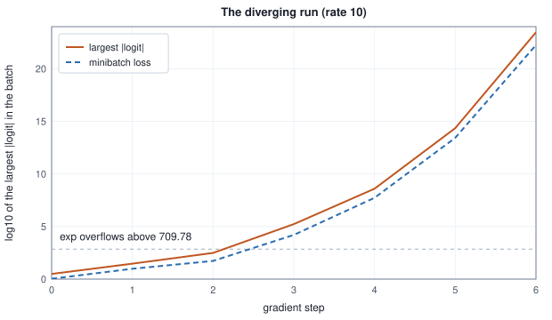
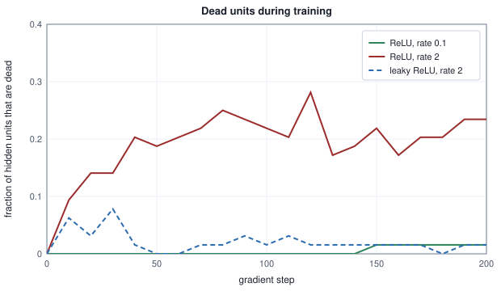

<!-- SPDX-License-Identifier: CC-BY-4.0 -->
<!-- Copyright (c) 2026 Martin Schröder <info@swedishembedded.com> -->

# Training Dynamics and Debugging

*When a loss curve looks wrong, how do we find out why?*

## A curve that sits at 1.08

One run sits at 1.08 and never moves. Another climbs to $10^{22}$. A third prints `NaN` at its third step. In all three nothing crashes: a number is printed at every step, and after a few hundred steps you plot the numbers. The picture is the **loss curve**, the loss on the vertical axis and the step (or the epoch) on the horizontal one, and a healthy curve falls and flattens. A network is a pipeline of a dozen interacting parts (data, initialization, forward pass, loss, backward pass, optimizer, schedule), and a flat or exploding curve is the same symptom for many different faults. Guessing is expensive, because each guess is a new run.

What follows turns the symptom into a procedure, built on one small network and one small task so that every claim is something you can reproduce.

The **gallery network** reads an input of 8 numbers and has two hidden layers of 32 ReLU units and 3 output logits; it is trained with softmax cross-entropy (chapter 3) by minibatch gradient descent, with backward-pass gradients (chapters 4 and 5). It has 1443 parameters. The task has three classes, a label being the largest of three quadratic-plus-linear scores of the input, so that a hidden layer is needed. Seven runs of this one network are the gallery of the chapter; each differs from a healthy run in one way, and each of them is a loss curve you will meet again in a real project.

<!-- worked: training_dynamics.gallery_setup -->
| item | value |
|---|---|
| network | 8 -> 32 -> 32 -> 3, ReLU, softmax cross-entropy, 1443 parameters |
| start | hidden weights sqrt(2 / fan_in) * normal(), read-out weights sqrt(1 / fan_in) * normal(), biases 0 |
| start draws | Generator: the book's SplitMix64, seed 0xd16dd9e5998c6b2c (15090957506535254828); layer by layer, row by row |
| task | 3 classes, label = argmax_k [2 (u_k . x) + (v_k . x)^2] (first index on a tie), the teacher vectors u_k, v_k drawn as below |
| task draws | Generator: the book's SplitMix64, seed 0x221223156ea44bbd (2455063321827888061); order: u_0, u_1, u_2, v_0, v_1, v_2 (8 normal() each), 512 training inputs, 400 validation inputs (8 normal() each) |
| training set | 512 examples, class counts [158, 218, 136], entropy of the label distribution 1.0785; ln 3 = 1.0986 |
| validation set | 400 examples, teacher labels |
| step | plain gradient descent, minibatch of 32 indices drawn with replacement by integer(512) from the stream 0x28e8e3949e5963e6; 400 steps; learning rate 0.1 |
| overfitting task | 24 training examples, 400 validation examples with the teacher's labels; generator seed 0xaea5e79bfc3cbf36; the draws are the 48 of the teacher, the 24 training inputs, the 400 validation inputs, then for each training example in order one uniform() and, when it is below 0.25, one integer(2): the label moves by 1 + integer(2) classes (mod 3); the run uses the same start, minibatches of 8 indices drawn with replacement by integer(24) from the batch stream above, 600 steps at rate 0.1 |
| evaluation | 'loss after t updates' is the mean cross-entropy (log-sum-exp form) of the whole training set of the run, or of the 400 validation examples, with the weights after t gradient steps; accuracy takes the first largest logit |
<!-- /worked -->

The inputs, the teacher and the validation labels of the main task are fixed by the two generator seeds above. The teacher's score of class $k$ is $2\,(\mathbf{u}_k\cdot\mathbf{x}) + (\mathbf{v}_k\cdot\mathbf{x})^2$, with $\mathbf{u}_k$ and $\mathbf{v}_k$ the vectors drawn in the stated order; the label is the index of the largest score, the first on a tie. Here is what the seven runs did.

<!-- worked: training_dynamics.gallery_table -->
A number that comes from a chaotic run is printed with only the digits that are the same in the run and in four copies of it whose first weight is changed by +1e-12, -1e-12, +3e-12 and -3e-12: in full if all agree on it, as 'about x' with the leading digits on which all agree, or as 'unstable' when not even one digit survives; the other digits cannot be reproduced in another implementation. The diverging run, whose loss reaches 1e22, is chaotic after its first steps and can only be reproduced to those digits. 'Log10 slope per 100 steps' is the least-squares slope of log10 of the training loss against the step over the evaluations at steps 100, 120, ..., 400 (the overfitting run, which is trained for 600 steps, over steps 100, 120, ..., 600), times 100.

| run | what differs from the healthy run | step 0 | step 20 | step 100 | step 200 | step 400 | largest step loss | log10 slope per 100 steps | val acc |
|---|---|---:|---:|---:|---:|---:|---:|---:|---:|
| healthy | nothing: He start, rate 0.1, batch 32 | 1.260 | 0.953 | 0.642 | 0.362 | 0.144 | 1.251 | -0.225 | 0.860 |
| diverging | rate 10 instead of 0.1 | 1.260 | 2.811 | about 2 | unstable | unstable | 1.78e+22 | unstable | unstable |
| plateau | every weight 0.02 times its He scale | 1.099 | 1.085 | 1.080 | 1.080 | 1.079 | 1.213 | -7.74e-05 | 0.393 |
| too slow | rate 0.003 instead of 0.1 | 1.260 | 1.196 | 1.080 | 1.029 | 0.975 | 1.471 | -0.014 | 0.510 |
| noisy | batch 2 instead of 32 | 1.260 | 1.289 | 0.847 | 0.686 | 0.506 | 4.025 | -0.063 | 0.762 |
| overfitting | 24 training examples, 25% wrong labels | 1.481 | 0.763 | 0.094 | 0.021 | 0.006 | 1.294 | -0.257 | 0.438 |
| NaN | the diverging run with the textbook softmax | 1.260 | NaN | NaN | NaN | NaN | NaN | NaN | - |
<!-- /worked -->

Read the table before reading any explanation. The healthy run falls from $1.260$ to $0.144$. The diverging run has a largest minibatch loss of $1.78\times10^{22}$. The plateau run starts at $1.099$, which is $\ln 3$, and has moved by $0.02$ after 400 steps. The too-slow run is falling, but about sixteen times more slowly than the healthy one (the section on reading curves counts the steps). The noisy run is falling too, along a path that its per-step losses (the column "largest step loss" shows a single step at $4.025$) hide. The overfitting run has a training loss of $0.006$ and a validation accuracy of $0.438$. The NaN run is the diverging run again, with a different formula for the same loss.


The rest of the chapter is the method for telling these apart without running the experiment that finds out, and the tools that make it cheap. It starts with how to read a curve: which loss is plotted, why it is noisy, what smoothing and a logarithmic axis reveal, and what the first number of a curve already says. Then each failure of the gallery is taken in turn, with the measurement that confirms its cause and the fix. Two of the causes need more room. Vanishing and exploding gradients are one mechanism, a product of layer Jacobians, behind plateaus and blow-ups in deep networks, and it is derived and measured per layer; residual connections are the identity path that keeps that product from shrinking, derived and measured on the same deep network. Dead units, the ReLU's way of switching a unit off for good, get their own measurement and cures. The chapter closes with a debugging practice: the overfit-one-batch test, a checklist ordered from cheapest to most expensive with its cost counted in FLOPs, and a method for hunting a NaN.

Six ideas from earlier chapters (backpropagation and the multilayer network, He initialization, clipping, layer normalization, and two pieces of numerical arithmetic from Volume I) come up repeatedly, and it is worth answering these from memory first. The answers are at the end of the chapter; if one is hard, go back to the chapter named.

1. ("Backpropagation Derived from Scratch" and "Multilayer Networks".) In one layer, the gradient arriving at the previous layer is $d\mathbf{a}_{\ell-1} = \mathbf{W}_\ell^\top\,(g'(\mathbf{z}_\ell)\odot d\mathbf{a}_\ell)$. If $g$ is tanh and every pre-activation is $z = 2$, by what factor does the slope alone scale the gradient, and what is the factor after 10 such layers?
2. ("Initialization: Where Training Starts", He initialization.) What variance does He initialization give the weights of a ReLU layer with 32 inputs, and why is the factor 2 there?
3. ("Learning-Rate Schedules and Gradient Clipping", clipping.) The global gradient norm of a step is 40 and the clip threshold is 5. What is the clip coefficient (ignore the small constant in the denominator), and what is the norm of the clipped gradient?
4. ("Normalization Layers", layer normalization.) What does layer normalization compute for the vector $(1, 3)$ if the small constant under the root is ignored, and what goes wrong with the formula for the vector $(3, 3)$ if that constant is exactly zero?
5. ("Backpropagation Derived from Scratch" and Volume II, "Linear Regression and the First Descent".) The one-weight model of chapter 4 has an error that is multiplied by $1 - 2\eta x^2$ at every step. For $x = 2$, for which learning rates does the descent diverge?
6. (Volume I, "Floating Point and Numerical Error", and "Softmax, Logits and Cross-Entropy".) What does $\exp(1000)$ evaluate to in IEEE double precision, and what does the textbook softmax formula $p_i = e^{z_i}/\sum_j e^{z_j}$ then return for the logits $(1000, 0)$?

## Reading a loss curve

A curve is only as informative as what you choose to plot, so start with what the three common curves are.

The loop computes, at step $t$, the loss $L_t$ of the minibatch it just used: it is free, since the loss is needed for the backward pass anyway. It is a mean over $B$ examples and so a random variable that depends on which examples were drawn. The loss on the whole training set, and the loss on a held-out validation set, are separate quantities that cost a forward pass over every example each time they are measured. A run records all three, at different frequencies, and a curve is always one of them.

### The minibatch loss is noisy by construction

If the per-example losses at fixed weights have standard deviation $\sigma_{\mathrm{ex}}$, the mean of $B$ independent draws has standard deviation $\sigma_{\mathrm{ex}}/\sqrt{B}$ (Volume II). Take the healthy run's final weights and resample minibatches many times:

<!-- worked: training_dynamics.noise_by_batch_table -->
Fixed weights: the healthy run after 400 steps; loss of one example, mean 0.1439, standard deviation 0.2542 over the 512 training examples. Generator: the book's SplitMix64, seed 0x1be4f306ac42812e (2009998543699476782); for each B, 2000 minibatches in turn, each of B indices from integer(512) drawn with replacement, B = 1, 2, 8, 32, 128 in that order. The spread is the standard deviation (divisor n) of the minibatch means.

| batch B | mean of minibatch loss | standard deviation | std * sqrt(B) | predicted: example std / sqrt(B) |
|---|---:|---:|---:|---:|
| 1 | 0.1481 | 0.2644 | 0.2644 | 0.2542 |
| 2 | 0.1429 | 0.1836 | 0.2596 | 0.1797 |
| 8 | 0.1413 | 0.0886 | 0.2506 | 0.0899 |
| 32 | 0.1439 | 0.0453 | 0.2562 | 0.0449 |
| 128 | 0.1436 | 0.0225 | 0.2548 | 0.0225 |
<!-- /worked -->

The last two columns agree: $\sqrt{B}$ times the spread is the same number for every $B$, up to the sampling error of 2000 draws. Quadrupling the batch halves the noise. At $B = 2$ the step-to-step spread of the loss ($0.184$) is larger than the loss itself ($0.143$), so a curve of per-step losses of a batch-2 run is jagged however well the run is going. A jagged curve is therefore not, by itself, a symptom. The noisy run of the gallery is exactly this: nothing is wrong with its optimization, and its per-step curve says almost nothing.

### Smoothing: an exponential average

The cheap remedy is to average the per-step loss over a window. The book already has the tool, the exponential average of chapter 7. With a decay $\beta_{\mathrm{sm}}$ in $[0, 1)$,

$$
s_t = \beta_{\mathrm{sm}}\,s_{t-1} + (1 - \beta_{\mathrm{sm}})\,L_t, \qquad s_{-1} = 0, \qquad L^{\mathrm{sm}}_t = \frac{s_t}{1 - \beta_{\mathrm{sm}}^{\,t+1}} .
$$

The division is chapter 7's bias correction: $s_t$ starts at 0 and would otherwise report a loss too small in the first steps. The average has a memory of about $1/(1-\beta_{\mathrm{sm}})$ steps, ten for $\beta_{\mathrm{sm}} = 0.9$, and the data it reports is on average about $\beta_{\mathrm{sm}}/(1 - \beta_{\mathrm{sm}}) = 9$ steps old: smoothing buys a steadier curve with a lag. Here is the noisy run in three readings.

<!-- worked: training_dynamics.smoothing_table -->
The noisy run (batch 2). Smoothing: beta = 0.9, s_t = beta s_(t-1) + (1 - beta) loss_t with s_(-1) = 0, reported divided by 1 - beta^(t+1). Full-set loss: the 512 training examples after t updates.

| step t | minibatch loss at step t | smoothed s_t | full-set training loss |
|---|---:|---:|---:|
| 100 | 1.196 | 0.790 | 0.847 |
| 120 | 0.629 | 0.854 | 0.830 |
| 140 | 0.819 | 0.802 | 0.793 |
| 160 | 0.412 | 0.638 | 0.755 |
| 180 | 0.301 | 0.458 | 0.751 |
| 200 | 0.646 | 0.554 | 0.686 |

Over the 19 steps t = 20, 40, ..., 380, the mean absolute difference from the full-set loss is 0.343 for the minibatch loss and 0.132 for the smoothed loss.
<!-- /worked -->


At the 19 steps $t = 20, 40, \dots, 380$ the raw minibatch loss differs from the full-set loss by $0.343$ on average and the smoothed loss by $0.132$: less than half. The smoothed value is still an estimate from about twenty examples (ten batches of two), so it is not exact; at step 180 it is $0.458$ against $0.751$. What it does show is the direction, and the figure shows the same thing for all 400 steps.

### A logarithmic axis shows the rate

A loss that falls by the same factor at every step, $L_t = L_0\,r^t$ with $r < 1$, has $\log_{10}L_t = \log_{10}L_0 + t\log_{10}r$: a straight line on a logarithmic axis with slope $\log_{10}r$. The slope is the rate, and it can be read at any height of the curve; on a linear axis everything near the bottom is squeezed into the same few pixels. Reading a curve on a log scale therefore asks one question, what the slope is, and the answer converts directly into a prediction.

<!-- worked: training_dynamics.log_scale_table -->
Slope: least-squares slope of log10 of the full-set training loss against the step, per 100 steps, over the evaluations at step >= 100 (at step >= 40 for the overfitting run); the evaluations are those of the gallery table, every 20 steps up to step 400 (up to step 600 for the overfitting run). Steps per decade: 100 divided by minus the slope, the steps the loss needs to fall by a factor of 10 if the slope persisted.

| run | slope per 100 steps | steps per decade |
|---|---:|---:|
| healthy | -0.225 | 445 |
| too slow | -0.014 | 7220 |
| noisy | -0.063 | 1579 |
| overfitting (training loss, steps 40 to 600) | -0.321 | 311 |
<!-- /worked -->

The healthy run needs about 445 steps for each factor of 10 of loss; the too-slow run, at the same slope for the rest of its life, 7220. A slope that changes is information too: it bends upward at a floor, which is either the irreducible noise of the data or the point where an effect of the learning rate takes over (chapter 8). A log axis does not help where the loss can be negative or crosses zero, and it exaggerates a floor, so it is a second view, not a replacement for the linear one.

### Per-step against per-evaluation

The full-set and validation losses are the trustworthy ones and they are not free. Counted in work, one evaluation of 512 training and 400 validation examples is a forward pass over each:

<!-- worked: training_dynamics.evaluation_cost_table -->
One evaluation of both full sets is a forward pass over 512 + 400 examples: 2,509,824 FLOPs (2 FLOPs per multiply-add, M = 1376 multiply-adds per example). One training step costs 247,808 FLOPs.

| evaluate every k steps, k = | FLOPs per evaluation | FLOPs of k training steps | evaluation as % of training |
|---|---:|---:|---:|
| 1 | 2,509,824 | 247,808 | 1012.8 |
| 10 | 2,509,824 | 2,478,080 | 101.3 |
| 20 | 2,509,824 | 4,956,160 | 50.6 |
| 100 | 2,509,824 | 24,780,800 | 10.1 |
<!-- /worked -->

For this tiny network, evaluating every 20 steps adds about half again to the arithmetic of training; evaluating at every step would cost ten times the training itself. The practical rule is to evaluate on a fixed subset, every $k$ steps with $k$ large enough that the overhead is a few percent, and to treat the per-step loss as a heartbeat (is it finite, is it of the right size) rather than as a measurement of progress.

### The first number of a curve

Before the first step, the loss already says something. A classifier with $C$ classes whose output is uniform has the loss $\ln C$ for every example, $\ln 3 = 1.0986$ for the gallery. A network that starts with small output weights should start near it. The healthy gallery run starts at $1.260$ on the training set (a random start is not exactly uniform, and a random assignment of logits is wrong more often than right, which costs a little more than $\ln 3$); the plateau run starts at $1.099$. A start far from $\ln C$ is a defect of the output scale (chapter 9) or of the data scale, and the check costs one forward pass. A start of $4.5$, as for the residual stack of the later section, is not a subtle signal.

Four questions go with every curve, and the rest of the chapter answers each of them with a measurement: where it starts (against $\ln C$), which way it moves, how fast it moves (the log slope), and how far the validation curve stays from the training curve.

## The gallery, one cause at a time

Each failure below is handled the same way: say what the curve shows, name the hypotheses it allows, take the cheapest measurement that separates them, and fix the one that survives.

### Diverging

The curve starts at $1.08$ and the next steps print $9.6$, $53$, $1.6\times10^4$. A rising loss at a single step could be an unlucky batch (the noise section above), so the first measurement is whether it keeps rising, and how the gradient behaves.

<!-- worked: training_dynamics.divergence_table -->
A number that comes from a chaotic run is printed with only the digits that are the same in the run and in four copies of it whose first weight is changed by +1e-12, -1e-12, +3e-12 and -3e-12: in full if all agree on it, as 'about x' with the leading digits on which all agree, or as 'unstable' when not even one digit survives; the other digits cannot be reproduced in another implementation. (as in the gallery table).

| step t | minibatch loss | global gradient norm | norm / previous norm | largest |logit| |
|---|---:|---:|---:|---:|
| 0 | 1.080 | 1.043 |  | 3.113 |
| 1 | 9.606 | 8.821 | 8.46 | 29.466 |
| 2 | 53.445 | 37.795 | 4.28 | 309.438 |
| 3 | 1.59e+04 | 1408.662 | 37.27 | 1.69e+05 |
| 4 | 5.38e+07 | 8.52e+05 | 605.04 | 3.95e+08 |
| 5 | 2.72e+13 | 3.13e+09 | 3669.73 | 2.26e+14 |
| 6 | 1.78e+22 | 3.88e+15 | 1.24e+06 | 2.92e+23 |
| 7 | 1.56e+10 | 3.27e+11 | 8.42e-05 | 3.62e+11 |
<!-- /worked -->

The loss rises by a factor of about 9 at step 1 and keeps rising; the global gradient norm rises with it, by a factor of $8.5$, $4.3$, $37$, $605$ from one step to the next. A gradient that grows at every step is not noise. The hypothesis that fits is a step that is too long. Chapter 4 derived what a too-long step does for one weight: the error is multiplied at every step by $1 - 2\eta x^2$, and when $\lvert 1 - 2\eta x^2\rvert > 1$ it grows geometrically. For a network, take any direction in which the loss has a curvature $\lambda$ (the second derivative along it, Volume I): along that direction a gradient step multiplies the error by $1 - \eta\lambda$, and the descent is unstable along it once $\eta > 2/\lambda$. The loss of a network is not a quadratic, and the bigger weights then make the activations and the gradients bigger still, which is why the table shows the norm growing by more each step. The size of the first step is the measurement that exposes it:

<!-- worked: training_dynamics.update_ratio_table -->
The update ratio of a step is (rate * gradient norm) / (norm of all weights before the step), the relative size of the step, with the gradient norm before any clipping. The median is the book's median of the 100 ratios of steps 0 to 99 (the mean of the 50th and 51st smallest). A number that comes from a chaotic run is printed with only the digits that are the same in the run and in four copies of it whose first weight is changed by +1e-12, -1e-12, +3e-12 and -3e-12: in full if all agree on it, as 'about x' with the leading digits on which all agree, or as 'unstable' when not even one digit survives; the other digits cannot be reproduced in another implementation.

| run | rate | ratio at step 0 | step 1 | step 2 | median over steps 0 to 99 |
|---|---:|---:|---:|---:|---:|
| healthy | 0.1 | 9.45e-03 | 1.35e-02 | 9.65e-03 | 7.29e-03 |
| slow | 0.003 | 2.83e-04 | 4.61e-04 | 4.32e-04 | 2.88e-04 |
| diverging | 10 | 9.45e-01 | 5.98e+00 | 4.37e+00 | 1.55e-16 |
<!-- /worked -->

The **update ratio** of a step, $r_{\mathrm{upd}} = \eta\,\lVert\mathbf{g}\rVert/\lVert\boldsymbol{\theta}\rVert$, is the size of the change of the weights relative to the weights themselves (with $\mathbf{g}$ the gradient of the minibatch loss and $\boldsymbol{\theta}$ all weights). The healthy run moves its weights by about $0.7\%$ to $0.9\%$ per step; the diverging run, by $94.5\%$ at the first step and by six times their own norm at the second. A step that rewrites the weights is not a local move, and the local gradient is not information about where it lands. (The tiny median in the last column is what is left after the blow-up: the weights became so large that later steps are small by comparison.)

The remedy that the hypothesis predicts is a smaller rate, and a rate sweep checks it, at the cost of ten short runs:

<!-- worked: training_dynamics.lr_sweep_table -->
Each row is a fresh run of the healthy configuration with only the rate changed, 100 steps, the same start and the same batches. Largest step loss: the largest minibatch loss of the run divided by the loss at step 0. A number that comes from a chaotic run is printed with only the digits that are the same in the run and in four copies of it whose first weight is changed by +1e-12, -1e-12, +3e-12 and -3e-12: in full if all agree on it, as 'about x' with the leading digits on which all agree, or as 'unstable' when not even one digit survives; the other digits cannot be reproduced in another implementation.

| rate | largest step loss / step-0 loss | full-set training loss after 100 steps | training accuracy |
|---|---:|---:|---:|
| 0.003 | 1.362 | 1.080 | 0.451 |
| 0.01 | 1.267 | 0.990 | 0.564 |
| 0.03 | 1.226 | 0.891 | 0.607 |
| 0.1 | 1.158 | 0.642 | 0.756 |
| 0.3 | 1.052 | 0.298 | 0.889 |
| 1 | 1.165 | 0.448 | 0.824 |
| 2 | 2.638 | 0.844 | 0.621 |
| 3 | 2.241 | 0.846 | 0.611 |
| 5 | 8.426 | 1.317 | 0.426 |
| 10 | 1.65e+22 | about 2 | 0.426 |
<!-- /worked -->

Rates up to $1$ train. At $2$ and $3$ the loss spikes to more than twice its starting value and recovers, at $5$ it reaches $8.4$ times and does not recover, and at $10$ the largest step loss is $1.65\times10^{22}$ times the first. The best rate of the sweep, $0.3$, is three times the healthy run's $0.1$: the healthy run was safe but not fast. (The threshold $2/\lambda_{\max}$ is a first guess about where the cliff is; the sweep measures where it is. We do not compute $\lambda_{\max}$ here.)

A different fix is to cap the step instead of the rate. The clip of chapter 8 multiplies the gradient by $\min(1, \tau_{\mathrm{clip}}/\lVert\mathbf{g}\rVert)$:

<!-- worked: training_dynamics.clip_table -->
A number that comes from a chaotic run is printed with only the digits that are the same in the run and in four copies of it whose first weight is changed by +1e-12, -1e-12, +3e-12 and -3e-12: in full if all agree on it, as 'about x' with the leading digits on which all agree, or as 'unstable' when not even one digit survives; the other digits cannot be reproduced in another implementation.

| rate | clip threshold (global norm) | steps clipped of 100 | largest step loss | full-set training loss after 100 steps |
|---|---:|---:|---:|---:|
| 10 | none | 0 | 1.78e+22 | about 2 |
| 10 | 1 | 14 | 38.148 | 3.029 |
| 10 | 0.1 | 100 | 1.273 | 0.408 |
| 10 | 0.01 | 100 | 1.255 | 0.577 |
| 0.1 | none | 0 | 1.251 | 0.642 |
| 0.1 | 0.1 | 100 | 1.386 | 0.983 |
<!-- /worked -->

At rate $10$ a threshold of $0.1$ does rescue the run (loss $0.408$ after 100 steps), because it fires at every step and so makes every update exactly $10 \times 0.1 = 1.0$ in norm: a normalized step, equivalent to a rate of $1.0/\lVert\mathbf{g}\rVert$. At the healthy rate $0.1$ the same threshold also fires at every step and slows the run from $0.642$ to $0.983$. A clip that fires on every step is a learning rate in disguise; chapter 8's rule is a threshold that fires on rare, outlying steps, and it protects against an occasional bad batch, not against a rate that is wrong at every step. The cause of this curve was the rate; the cure is the rate.

### The same run with a different softmax: NaN

The last row of the gallery is the diverging run with softmax cross-entropy written as the textbook formula. Its loss is finite for three steps and then `NaN` for ever. Both runs are the same run until the logits exceed $709.78$, the largest argument for which $e^x$ is finite in double precision. That is a case of its own, with its own tools, and it is handled in the section on NaN hunting below.



### Plateau

The plateau run starts at $1.099$ and ends at $1.079$. Two numbers identify it before anything else is run. The first is the start: $\ln 3 = 1.0986$, the loss of a network whose output is the same for every input. The second is where it stops: the entropy of the training labels, $1.0785$, the loss of a model that predicts the class frequencies and nothing else. The network has learned the prior and nothing about the inputs. The hypotheses are that the gradient does not reach the hidden weights (the signal is too small, or the units are off), or that it reaches them and the rate is too low to matter. The per-layer gradient norms separate them at the cost of one backward pass:

<!-- worked: training_dynamics.plateau_table -->
Loss and gradient on the first 32 training examples at step 0; the norm of a layer is that of its weights and biases together. ln 3 = 1.0986; entropy of the training labels = 1.0785.

| start | loss at step 0 | gradient norm, layer 1 | layer 2 | layer 3 (read-out) | of which the read-out bias | layer 1 / layer 3 |
|---|---:|---:|---:|---:|---:|---:|
| healthy start | 1.1278 | 3.61e-01 | 6.35e-01 | 9.77e-01 | 2.73e-01 | 3.70e-01 |
| 0.02 times the He scale | 1.0986 | 1.30e-04 | 2.59e-03 | 1.55e-01 | 1.55e-01 | 8.40e-04 |
<!-- /worked -->

In the healthy start the three layers have gradient norms within a factor of three of each other. With every weight scaled by $0.02$ the read-out layer's norm is $0.155$ and the first layer's is $1.30\times10^{-4}$: a ratio of $8.4\times10^{-4}$. All of the $0.155$ is the read-out's bias, whose gradient is the mean of $\mathbf{p} - \mathbf{t}$ (the column "of which the read-out bias"), a vector that is not zero because the classes are not equally frequent. The bias can learn the prior and the weights cannot learn anything: the gradient to a weight of an early layer is a product of the small weights of the layers above it, derived in the next section. The remedy is the start of chapter 9. The same flat curve at the label entropy has another possible cause, dead units, which a later section produces with a different start and separates with a different measurement; a plateau at the prior is a diagnosis to be completed, not a single fault.

### Too slow

The too-slow run falls from $1.260$ to $0.975$ in 400 steps. After 100 steps, its loss ($1.080$) is the loss of the plateau run, and the two curves cannot be told apart by the loss alone. They are told apart by the size of the step, since the update ratio table above gives $2.9\times10^{-4}$ at the median for the slow run against $7.3\times10^{-3}$ for the healthy one: the ratio of the two, $0.04$, is the ratio of the rates ($0.003/0.1 = 0.03$) up to the difference in gradient norms. The log slope says the same thing in the units of the curve, $-0.014$ against $-0.225$ per 100 steps. A run with a gradient that is normal and a step that is tiny is a rate problem, and the rate sweep above finds its best value. A run with a tiny gradient is the plateau case. Both have a flat loss; the gradient norm tells which.

### Noisy

The noisy run is the one failure of the gallery that is not a failure of training. Its smoothed curve and full-set points fall together, from $1.260$ to $0.506$, behind a per-step curve that cannot show it. What is true of it is that it ends higher than the healthy run ($0.144$): with a batch of 2 the weights keep being kicked by noise of the size computed above, and the floor that noise sets is proportional to the rate divided by the batch (chapter 7). The remedies are a larger batch, a smaller rate near the end of the run (chapter 8), or averaging. The lesson for monitoring is the one of the smoothing section: make a decision from a smoothed or full-set value, never from one step.

Knowledge #66 records a gate that did not follow this lesson. An overfit test of a fine-tuning loop asserted that the final loss was below a fraction of the starting loss and failed after 120 steps (from $0.706$ to $0.468$), while a sibling test passed; the first suspicion was a defective backward pass for the parameters only the failing test trained. A directional finite-difference sweep over all 263 of those tensors (chapter 6) found nothing. What found the cause was printing every step instead of every twentieth: the run was a limit cycle, a slow descent punctuated by excursions that reached $1.40$ times the starting loss, and the assertion had read the loss at whichever step it happened to end on (commit `4e9b7ece5`, 28 August 2026, which lowered the rate and added an assertion on the worst loss after a warmup, the check that sees the oscillation instead of its phase). The entry's explanation is that the optimizer's update moves each entry by about the rate whatever its gradient, so the largest stable rate depends on which parameters are free; this book has not rederived that, and the lesson that does not depend on it is the one above.

### Overfitting

The overfitting run trains on 24 examples, a quarter of whose labels were flipped, so that a perfect fit of the training set must memorize noise.

<!-- worked: training_dynamics.overfit_table -->
Training set of 24 examples (batch 8), validation set of 400. Lowest validation loss 1.223 after 40 updates.

| updates | training loss | validation loss | training accuracy | validation accuracy |
|---|---:|---:|---:|---:|
| 0 | 1.481 | 1.494 | 0.375 | 0.328 |
| 20 | 0.763 | 1.285 | 0.583 | 0.328 |
| 40 | 0.410 | 1.223 | 0.833 | 0.468 |
| 60 | 0.238 | 1.448 | 1.000 | 0.422 |
| 100 | 0.094 | 1.761 | 1.000 | 0.420 |
| 200 | 0.021 | 2.206 | 1.000 | 0.435 |
| 400 | 0.006 | 2.594 | 1.000 | 0.435 |
| 600 | 0.003 | 2.799 | 1.000 | 0.438 |
<!-- /worked -->


The training curve alone looks like a success: it reaches $0.003$ and the accuracy reaches $1$ at update 60. Only the validation curve says that the generalization is gone: its minimum, $1.223$, is at update 40, and by update 600 it is $2.799$, worse than the starting $1.494$. The cause of the gap is the one that chapter 11 and Volume II ("Generalization, Overfitting and Honest Evaluation") name: many parameters, few and partly wrong examples. The measurement that confirms it is the validation curve; the remedies are more data, regularization, and stopping at the minimum (early stopping, chapter 11), which here means stopping at update 40.

## Vanishing and exploding gradients

Two of the gallery's failures, the plateau and the blow-up, have a common mechanism in a deep network, and it deserves its own derivation.

### A gradient is a product

Take a stack of layers $\mathbf{z}_\ell = \mathbf{W}_\ell\mathbf{a}_{\ell-1} + \mathbf{b}_\ell$, $\mathbf{a}_\ell = g(\mathbf{z}_\ell)$. One layer maps $\mathbf{a}_{\ell-1}$ to $\mathbf{a}_\ell$ with the Jacobian (Volume I)

$$
\mathbf{J}_\ell = \frac{\partial\mathbf{a}_\ell}{\partial\mathbf{a}_{\ell-1}} = \mathbf{S}_\ell\mathbf{W}_\ell, \qquad \mathbf{S}_\ell = \mathrm{diag}\big(g'(\mathbf{z}_\ell)\big),
$$

the diagonal matrix of the slopes of the activation at this layer's pre-activations times the weights. The backward pass of chapter 4 is the chain rule applied from the top: the gradient with respect to $\mathbf{a}_{\ell-1}$ is $\mathbf{J}_\ell^\top$ applied to the gradient with respect to $\mathbf{a}_\ell$, and so, after $k$ layers,

$$
d\mathbf{a}_{\ell-k} = \mathbf{J}_{\ell-k+1}^\top\,\mathbf{J}_{\ell-k+2}^\top\cdots\mathbf{J}_\ell^\top\; d\mathbf{a}_\ell .
$$

This is chapter 2's "slopes multiply", with the weights included. The size of the gradient that reaches layer $\ell - k$ is the size of a product of $k$ matrices applied to a vector. Two facts about such products give everything that follows.

**A bound from the norms.** For any matrices, $\lVert\mathbf{A}\mathbf{x}\rVert \le \lVert\mathbf{A}\rVert_2\lVert\mathbf{x}\rVert$, with $\lVert\mathbf{A}\rVert_2$ the largest singular value of $\mathbf{A}$ (the longest stretch it can give a vector). Applied $k$ times,

$$
\lVert d\mathbf{a}_{\ell-k}\rVert \;\le\; \prod_{i}\lVert\mathbf{S}_i\rVert_2\,\lVert\mathbf{W}_i\rVert_2\;\lVert d\mathbf{a}_\ell\rVert ,
$$

and $\lVert\mathbf{S}_i\rVert_2 = \max_j\lvert g'(z_{ij})\rvert$, which is at most $\tfrac14$ for the sigmoid and at most $1$ for tanh and ReLU. If every factor $\lVert\mathbf{S}_i\rVert_2\lVert\mathbf{W}_i\rVert_2$ is at most $r < 1$, the gradient at depth $k$ is at most $r^k$ times the gradient at the top, and it shrinks geometrically however the input looks. A **vanishing gradient** is this: the gradient that reaches the early layers of a deep network is a tiny fraction of the one at the top, so that those layers receive updates that are zero in any practical sense. A sigmoid network with weights of spectral norm below 4 is guaranteed to have one.

The bound is an upper bound, so it proves vanishing and cannot prove the opposite: a product of norms larger than 1 says only that the gradient *may* grow, since a vector need not be stretched in the direction where the matrix stretches most.

**A typical gain.** What the gradient does on a typical vector is governed by the mean log of the stretch, and that is the average case computed in chapter 9. For weights drawn independently with variance $\sigma_w^2$ and $n$ units, a vector's squared norm is multiplied by $\Gamma_{\mathrm{b}} = n\,\sigma_w^2\,\mathbb{E}[g'^2]$ per layer on average (the backward factor of that chapter, with $n_{\mathrm{out}} = n$), so the norm is multiplied by $\sqrt{\Gamma_{\mathrm{b}}}$. After $k$ layers this is $\Gamma_{\mathrm{b}}^{k/2}$, which is the point: a per-layer factor of $0.9$ is $0.08$ over 24 layers, and $1.1$ is about $10$; a factor of $0.5$ is $6\times10^{-8}$. When the factor is above 1 the gradient grows geometrically with depth, an **exploding gradient**, and the step on the early layers becomes enormous. Both failures are the same arithmetic on either side of $\Gamma_{\mathrm{b}} = 1$.

### Measuring the product

The deep stack of this section has an input layer ($8\to16$), 24 hidden matrices of $16\times16$ and a read-out ($16\to3$). It is plain (each layer $\mathbf{a} = g(\mathbf{W}\mathbf{a}+\mathbf{b})$) at its start, with weights $\text{gain}\cdot c/\sqrt{n_{\mathrm{in}}}\cdot$`normal()`, where $c = 1$ for sigmoid and tanh and $\sqrt2$ for ReLU, so gain 1 is He for ReLU and the variance-preserving scale of chapter 9 for tanh; the read-out is the exception, $\mathrm{normal}()/\sqrt{16}$ with no gain and no $c$. First the product itself. For 16 inputs, each with a random unit vector at the top, the table gives the geometric mean of the norm after passing back through $k$ layers, the typical-gain prediction (with $\mathbb{E}[g'^2]$ measured from the same layers) and the norm bound.

<!-- worked: training_dynamics.jacobian_table -->
Plain stack of 24 layers of width 16 (start of training). Generator: the book's SplitMix64, seed 0x70a0199053f0467b (8115514636195874427); draws in the order: input layer (16 x 8), the 24 hidden matrices, read-out (rows one after the other, biases 0). Weights of the input layer and of the hidden matrices = gain * c / sqrt(fan_in) * normal() with c = 1 for sigmoid and tanh (fan_in 8 for the input layer, 16 for the hidden matrices); the read-out is normal() / sqrt(16), without gain. The spectral norm of a matrix (for the norm bound) is its largest singular value, found by 60 power iterations on W^T W from a start vector of 16 normal() draws of the generator `training_dynamics.spectral` (seed 0x20287cd37f8599fc), restarted for each matrix, each iteration normalising the vector. Slopes use the activation's derivative at the pre-activation (sigmoid s(1 - s), tanh 1 - a^2). 16 pairs (first 16 training inputs, unit vector at the output of the last hidden layer from normal() draws normalised, stream 0xb546f4b44d8a777c). Entries are geometric means over the pairs of the norm of the gradient after passing back through k layers, started from a vector of norm 1. The prediction for a pair and a depth k is (n sigma^2 s2)^(k/2) with n = 16, sigma^2 = gain^2 / 16 and s2 the mean of g'(z)^2 over all the units of the last k hidden layers (one pooled mean over the 16 k units, for that example); the table gives the geometric mean of that prediction over the pairs.

| configuration | quantity | k = 1 | k = 2 | k = 4 | k = 8 | k = 16 | k = 24 |
|---|---|---:|---:|---:|---:|---:|---:|
| sigmoid, gain 1 | measured | 2.14e-01 | 4.11e-02 | 2.71e-03 | 5.35e-06 | 5.99e-11 | 3.91e-16 |
|  | predicted | 2.38e-01 | 5.32e-02 | 2.91e-03 | 9.40e-06 | 8.61e-11 | 8.16e-16 |
|  | norm bound | 3.79e-01 | 1.73e-01 | 3.56e-02 | 1.36e-03 | 3.43e-06 | 8.37e-09 |
| tanh, gain 0.5 | measured | 4.51e-01 | 1.98e-01 | 5.91e-02 | 2.33e-03 | 1.19e-05 | 2.93e-08 |
|  | predicted | 5.00e-01 | 2.50e-01 | 6.25e-02 | 3.91e-03 | 1.53e-05 | 5.70e-08 |
|  | norm bound | 7.58e-01 | 6.93e-01 | 5.71e-01 | 3.49e-01 | 2.26e-01 | 1.42e-01 |
| tanh, gain 1 | measured | 8.95e-01 | 7.73e-01 | 9.06e-01 | 5.13e-01 | 4.11e-01 | 1.08e-01 |
|  | predicted | 9.92e-01 | 9.80e-01 | 9.55e-01 | 8.63e-01 | 6.16e-01 | 2.58e-01 |
|  | norm bound | 1.52e+00 | 2.77e+00 | 9.14e+00 | 8.91e+01 | 1.47e+04 | 2.34e+06 |
| tanh, gain 2.5 | measured | 1.10e+00 | 1.45e+00 | 1.84e+00 | 4.59e+00 | 1.62e+01 | 2.59e+01 |
|  | predicted | 1.34e+00 | 1.83e+00 | 2.66e+00 | 8.81e+00 | 4.52e+01 | 2.21e+02 |
|  | norm bound | 3.64e+00 | 1.59e+01 | 2.96e+02 | 9.73e+04 | 1.69e+10 | 2.90e+15 |
<!-- /worked -->

Each row group is one configuration. The sigmoid stack at gain 1 reaches $3.9\times10^{-16}$ after 24 layers, against a typical-gain prediction of $8.2\times10^{-16}$: the prediction is right to a factor of two across fifteen orders of magnitude. The norm bound is $8.4\times10^{-9}$, which is true and far from tight (its factor per layer is the *largest* slope times the *largest* singular value, while the vector sees averages), but it proves what the measurement shows: the gradient vanishes. Tanh at gain 0.5 shows the same shape ($2.9\times10^{-8}$ against a prediction of $5.7\times10^{-8}$) and here the bound ($0.142$) proves little. At gain 1 the product shrinks mildly ($0.108$ at 24 layers, the prediction being $0.258$: the independence assumption of the average case is too kind), and at gain 2.5 it grows, to $25.9$, where the bound is $2.9\times10^{15}$, useless, and the prediction ($221$) is too large by a factor of eight. The two derivations agree on what matters: the exponent. A per-layer factor that is slightly off is the whole problem, and a prediction within a factor of a few of an exponential is as good as an estimate gets.

Now the quantity a training loop can actually log, the gradient norm of each weight matrix. The weight gradient of a layer is $d\mathbf{W}_\ell = \sum_n d\mathbf{z}_{\ell,n}\,\mathbf{a}_{\ell-1,n}^\top$, so its norm carries the backward signal $d\mathbf{z}_\ell$ and the forward activation $\mathbf{a}_{\ell-1}$ at that layer.

<!-- worked: training_dynamics.stack_gradient_table -->
Gradient of the loss (mean over the batch of the cross-entropy) on the first 32 training examples at the start; 'dW norm' is the Euclidean (Frobenius) norm of the gradient of the 16 x 16 weight matrix of the mean loss (the sum over the 32 examples of the outer products, each example's gradient at the logits carrying the factor 1 / 32 of the mean), the bias gradient not included. Weights: input layer and hidden matrices gain * c / sqrt(fan_in) * normal() with c = sqrt(2) for ReLU and 1 for sigmoid and tanh (the gain is 1 for the ReLU rows), the read-out normal() / sqrt(16) without gain, biases 0. Matrix 1 is the one nearest the input layer and matrix 24 the one nearest the read-out. Same normal() draws for every row (Generator: the book's SplitMix64, seed 0x70a0199053f0467b (8115514636195874427)), only the scales differ; the residual stack adds s = sqrt(1 / 48) times the layer's output to its input. Last column: the Frobenius norm of the whole [32, 16] matrix of gradients arriving at the output of hidden layer 1 (all 32 rows together, not their mean) divided by the same norm at the output of hidden layer 24, which is the product of the 23 layers' Jacobians seen from above.

| stack | loss | dW norm, matrix 1 | matrix 6 | matrix 12 | matrix 18 | matrix 24 | matrix 1 / matrix 24 | gradient at layer 1 / at layer 24 |
|---|---:|---:|---:|---:|---:|---:|---:|---:|
| plain, sigmoid, gain 1 | 1.212 | 5.0e-16 | 9.9e-13 | 2.8e-09 | 1.4e-05 | 1.8e-01 | 2.8e-15 | 2.9e-15 |
| plain, tanh, gain 0.5 | 1.099 | 1.1e-08 | 1.0e-08 | 1.6e-08 | 2.6e-08 | 3.7e-08 | 3.0e-01 | 4.3e-08 |
| plain, tanh, gain 1 | 1.096 | 3.3e-02 | 2.2e-02 | 3.5e-02 | 5.8e-02 | 8.0e-02 | 4.1e-01 | 1.4e-01 |
| plain, tanh, gain 2.5 | 1.205 | 6.1e+01 | 1.4e+01 | 3.1e+00 | 6.5e-01 | 2.7e-01 | 2.3e+02 | 2.8e+02 |
| plain, ReLU, He | 1.108 | 1.2e-01 | 1.6e-01 | 2.6e-02 | 5.6e-02 | 1.1e-01 | 1.2e+00 | 3.5e-01 |
| residual, ReLU, He | 3.366 | 2.3e-01 | 3.6e-01 | 7.2e-01 | 1.1e+00 | 1.6e+00 | 1.4e-01 | 1.9e+00 |
<!-- /worked -->


Read the rows in turn.

- **Sigmoid, gain 1.** The matrix nearest the read-out has a gradient norm of $0.18$ and the matrix nearest the input $5.0\times10^{-16}$. A step of rate $0.1$ on that matrix changes each of its 256 entries by about $3\times10^{-18}$, less than half the spacing of double-precision numbers near a weight of size $0.25$ ($5.6\times10^{-17}$), so the update rounds away entirely: those weights are frozen, not slow. The backward signal reaching hidden layer 1 is $2.9\times10^{-15}$ of the one at layer 24.
- **Tanh, gain 0.5.** The profile is flat, at about $10^{-8}$ everywhere. This looks balanced and is not: the backward signal still shrinks by $4.3\times10^{-8}$ from layer 24 to layer 1, but the forward activations shrink in the opposite direction, toward the output (the forward factor of chapter 9 is below 1 for these small weights too), and the weight gradient is the product of the two. Every layer has a gradient of $10^{-8}$ and none learns. **A flat profile is not enough; the absolute size matters.** The loss at the start, $1.099$, is $\ln 3$: the network ignores its input.
- **Tanh, gain 1 and ReLU He.** Norms between $0.02$ and $0.2$ at every depth: a healthy profile.
- **Tanh, gain 2.5.** The gradient norm falls from $61$ at the first matrix to $0.27$ at the last, a growth toward the input by 230: an exploding gradient. A rate of $0.1$ moves that matrix by a step of norm $6$.

The cost of this diagnosis is small. The squared norm of every layer's gradient is a sum the optimizer is about to read anyway: $2P$ FLOPs in all, $1.16\%$ of a training step of the gallery network (counted in the monitoring section below). The profile of a deep network at its first step is the cheapest direct measurement of everything in this section, and chapter 9 already named it as the test.

### What cures it

Each remedy is a way to keep the per-layer factor near $1$:

- the scale of the start, so that $\Gamma_{\mathrm{b}} = 1$ (chapter 9: He for ReLU, Xavier for tanh);
- an activation with slope $1$ over most of its range (ReLU), which removes the $\tfrac14$ of the sigmoid;
- a normalization layer (chapter 10), which rescales the activations at every step so that the scale chosen at the start does not have to survive training;
- for exploding gradients, a smaller rate and the clip of chapter 8, which bound one step but not the product that caused it;
- and a change of the architecture that stops the gradient from being only a product of layer Jacobians: the residual connection.

## Residual connections

The last row of the figure is a stack whose gradient norm is healthy at every depth and larger than the plain one, and it has the same 24 weight matrices as the plain ones above it. The only change is what a layer returns.

A plain layer returns $\mathbf{a}' = g(\mathbf{W}\mathbf{a} + \mathbf{b})$. A **residual connection** adds the layer's input to its output: the layer computes only a correction $f$ to its input,

$$
\mathbf{y} = \mathbf{x} + f(\mathbf{x}) .
$$

In this chapter $f(\mathbf{x}) = \sqrt{\omega}\,g(\mathbf{W}\mathbf{x} + \mathbf{b})$, one linear layer and an activation with a fixed scale $\sqrt\omega$ whose reason is given below. The picture of both layers:


### Why the gradient has an identity path

Differentiate $\mathbf{y} = \mathbf{x} + f(\mathbf{x})$. The Jacobian of $\mathbf{y}$ with respect to $\mathbf{x}$ is the identity plus the Jacobian of the branch,

$$
\frac{\partial\mathbf{y}}{\partial\mathbf{x}} = \mathbf{I} + \mathbf{J}_f, \qquad\text{so}\qquad d\mathbf{x} = d\mathbf{y} + \mathbf{J}_f^\top\,d\mathbf{y} .
$$

For the layer above, $\mathbf{J}_f = \sqrt\omega\,\mathbf{S}\mathbf{W}$. The first term of $d\mathbf{x}$ is the gradient arriving from above, copied unchanged: it passes through no weights and no slopes. The sum of two gradients is the backward rule of a sum (chapter 5): the output of a sum sends its gradient to each of its inputs. Over $L$ residual layers the product of Jacobians becomes

$$
(\mathbf{I} + \mathbf{J}_1)(\mathbf{I} + \mathbf{J}_2)\cdots(\mathbf{I} + \mathbf{J}_L) = \mathbf{I} + \sum_i\mathbf{J}_i + \sum_{i<j}\mathbf{J}_i\mathbf{J}_j + \cdots ,
$$

a sum of $2^L$ paths through the network, of which one is the identity, with coefficient exactly 1. In a plain network every term has all $L$ Jacobians in it, so a factor below 1 per layer is $r^L$. Here, if the branch Jacobian of layer $i$ has norm $s_i = \lVert\mathbf{J}_i\rVert_2 < 1$, the triangle inequality gives for any vector $\mathbf{v}$

$$
(1 - s_i)\lVert\mathbf{v}\rVert \;\le\; \lVert(\mathbf{I} + \mathbf{J}_i)^\top\mathbf{v}\rVert \;\le\; (1 + s_i)\lVert\mathbf{v}\rVert ,
$$

and applying it layer by layer, the gradient at the bottom is between $\prod(1 - s_i)$ and $\prod(1 + s_i)$ times the gradient at the top. The two bounds are within a constant of each other if the $s_i$ sum to something moderate, since $\prod(1 \pm s_i)\approx e^{\pm\sum s_i}$: a residual stack whose branches are small enough, $s_i \sim 1/L$, passes a gradient through any depth with a bounded change of size. Compare the plain case, where the same weights give $\prod s_i$.

The table tests this on the two vanishing stacks of the previous section: the very same weights, plain and residual, and the bounds computed from the layer Jacobians.

<!-- worked: training_dynamics.residual_identity_table -->
The same 16 (example, vector) pairs and the same weights as the plain stack of the previous table; the residual stack adds s = sqrt(1 / 48) = 0.1443 times each layer's output to its input. Entries: geometric means over the pairs of the norm of the gradient after passing back through k layers, from a vector of norm 1, and the bounds prod(1 - s_i) and prod(1 + s_i) with s_i the spectral norm of the branch Jacobian s D_i W_i (power iteration, 60 steps). The largest difference over all pairs and depths between the backward pass and the formula d + J^T d, with J built explicitly, is 1.1e-16.

| configuration | quantity | k = 1 | k = 2 | k = 4 | k = 8 | k = 16 | k = 24 |
|---|---|---:|---:|---:|---:|---:|---:|
| tanh, gain 0.5 | plain: measured | 4.51e-01 | 1.98e-01 | 5.91e-02 | 2.33e-03 | 1.19e-05 | 2.93e-08 |
|  | residual: measured | 1.01e+00 | 1.02e+00 | 1.03e+00 | 1.06e+00 | 1.06e+00 | 1.08e+00 |
|  | residual: lower bound | 8.96e-01 | 7.81e-01 | 5.98e-01 | 3.54e-01 | 1.16e-01 | 3.74e-02 |
|  | residual: upper bound | 1.10e+00 | 1.25e+00 | 1.58e+00 | 2.51e+00 | 6.69e+00 | 1.80e+01 |
| sigmoid, gain 1 | plain: measured | 2.14e-01 | 4.11e-02 | 2.71e-03 | 5.35e-06 | 5.99e-11 | 3.91e-16 |
|  | residual: measured | 1.00e+00 | 1.00e+00 | 1.00e+00 | 1.01e+00 | 1.01e+00 | 1.01e+00 |
|  | residual: lower bound | 9.54e-01 | 9.06e-01 | 8.14e-01 | 6.69e-01 | 4.36e-01 | 2.64e-01 |
|  | residual: upper bound | 1.05e+00 | 1.10e+00 | 1.22e+00 | 1.47e+00 | 2.20e+00 | 3.53e+00 |
<!-- /worked -->

The plain tanh stack at gain 0.5 lets $2.9\times10^{-8}$ of the gradient through 24 layers, and the same weights in a residual stack let $1.08$ through, inside the bounds $0.0374$ and $18.0$. The sigmoid stack goes from $3.9\times10^{-16}$ to $1.01$. The bounds are loose here (the branch Jacobians have a norm of about $0.1$ each in the tanh stack, and the two bounds at depth 24 say that $\sum s_i$ is about 3), as the largest-stretch bounds of the previous section were, but the measured value is where an argument about the identity path says it should be, close to $1$. The table's note records that the backward pass and the formula $d\mathbf{y} + \mathbf{J}_f^\top d\mathbf{y}$ with $\mathbf{J}_f$ built explicitly agree to $1.1\times10^{-16}$ in every pair and at every depth.

Written as an algorithm in the book's pseudocode, with a ReLU branch, a residual layer is a few lines forward and backward. The second function shows the identity path in code: `da` starts as `dout` and the branch adds to it.

```text
function residual_forward(a: array<real>[B, n], W: array<real>[n, n], b: array<real>[n],
                          s: real) -> (array<real>[B, n], array<real>[B, n]):
    require s > 0.0, "the branch scale must be positive"
    z = matmul(a, transpose(W))                  # [B, n]
    out = zeros(real, [B, n])
    for r in 0 .. B:
        for j in 0 .. n:
            z[r, j] = z[r, j] + b[j]             # add b to every row
            out[r, j] = a[r, j] + s * relu(z[r, j])
    return (out, z)

function residual_backward(dout: array<real>[B, n], a: array<real>[B, n], z: array<real>[B, n],
                           W: array<real>[n, n], s: real)
        -> (array<real>[B, n], array<real>[n, n], array<real>[n]):
    dz = zeros(real, [B, n])
    for r in 0 .. B:
        for j in 0 .. n:
            slope = 1.0 if z[r, j] > 0.0 else 0.0
            dz[r, j] = s * dout[r, j] * slope
    dW = matmul(transpose(dz), a)                # [n, n]
    db = sum(dz, 0)                              # [n]
    da = dout + matmul(dz, W)                    # identity path plus the branch
    return (da, dW, db)
```

### The branch has to be small at the start

A residual layer adds to its input at every layer, so the size of the stream grows with depth unless each branch is small, which is the problem chapter 9 gave a rule for. If each branch has second moment $\omega$ times its input's, $L$ layers multiply the stream's second moment by $(1+\omega)^L$, and the same arithmetic applies to the gradient. Chapter 9's rule is $\omega = 1/(2L)$, so that the product stays near $\sqrt{e} = 1.65$. In the stack here $s = \sqrt\omega$. The table varies $\omega$ on a residual tanh stack of 24 layers:

<!-- worked: training_dynamics.residual_scale_table -->
Residual tanh stack, 24 layers, gain 1 start (weights as in the previous tables), branch s = sqrt(omega), evaluated on the first 32 training examples. Predicted growth (1 + omega)^24 of the second moment of the stream (chapter 9, upper bound for a branch that preserves the second moment); measured growth: the ratio of two means, the mean of the squares of all 32 x 16 entries of the stream after layer 24 over the mean of the squares of all entries after the input layer. Backward growth: the Frobenius norm of the whole [32, 16] matrix of gradients arriving at hidden layer 1's output (all rows of the batch, each carrying the 1 / 32 of the mean loss) over the same norm at layer 24's output; the loss is the mean cross-entropy of those examples.

| omega | predicted growth (1 + omega)^24 | measured forward growth | backward growth | loss at step 0 |
|---|---:|---:|---:|---:|
| 1 | 1.68e+07 | 52.1972 | 9.6005 | 1.961 |
| 1/4 | 211.7582 | 9.9202 | 3.1100 | 0.858 |
| 1/(2L) = 1/48 | 1.6403 | 1.5779 | 1.2620 | 0.913 |
<!-- /worked -->

At $\omega = 1$ the stream's mean square grows by a factor of $52$ and the gradient at the bottom is $9.6$ times the one at the top; the start has a loss of $1.961$. At $\omega = 1/48$ the growth is $1.58$ (the bound from the rule is $1.64$) and $1.26$, and the loss is $0.913$. The measured forward growth is far below $(1+\omega)^{24}$ at $\omega = 1$ because the formula is for a branch that preserves the second moment of its input, and the second moment of a tanh output is smaller; the formula is an upper bound here, and the effect of the choice of $\omega$ is large.

### Training deep plain and deep residual stacks

The test is training. The four runs share the data and the batch stream of the gallery, a rate of $0.1$, 300 steps, and in each pair the same 24 matrices:

<!-- worked: training_dynamics.deep_training_table -->
24-matrix stacks of width 16, rate 0.1, batch 32, 300 steps, the gallery data and batch stream; the plain and the residual stack of a pair have the same 24 matrices (the weights of the previous tables: Generator: the book's SplitMix64, seed 0x70a0199053f0467b (8115514636195874427)), and the residual stack adds s = sqrt(1 / 48) = 0.1443 times each layer's output to its input. All parameters train: the input layer (8 -> 16), the 24 matrices and the read-out (16 -> 3), with their biases. Full-set training loss after t updates.

| stack | step 0 | step 50 | step 100 | step 200 | step 300 | train acc | val acc |
|---|---:|---:|---:|---:|---:|---:|---:|
| plain, tanh, gain 0.5 | 1.099 | 1.079 | 1.081 | 1.082 | 1.079 | 0.426 | 0.393 |
| residual, tanh, gain 0.5 | 1.104 | 0.917 | 0.903 | 0.886 | 0.842 | 0.654 | 0.598 |
| plain, ReLU, He | 1.125 | 1.072 | 1.048 | 1.080 | 1.078 | 0.426 | 0.393 |
| residual, ReLU, He | 4.517 | 0.888 | 0.753 | 0.513 | 0.389 | 0.850 | 0.790 |
<!-- /worked -->


The plain tanh stack with the vanishing start stays at $1.079$, the entropy of the labels: it learned the prior through its read-out bias and nothing else. Its residual twin, with identical weights, falls to $0.842$ (training accuracy $0.654$, validation accuracy $0.598$, against $0.426$ and $0.393$ for the plain stack, the share of the most frequent class). That is the identity path doing what the derivation says, for the stack where the plain gradient vanished.

The ReLU pair deserves a more careful reading. At the start the plain He-initialized ReLU stack has a healthy gradient profile (the table of the section on vanishing gradients: norms of $0.03$ to $0.2$, a first-to-last ratio of $0.35$). By the measurement above it should train, and it does not: after 300 steps at this rate it is at $1.078$, the prior. The residual stack falls to $0.389$. Balanced gradient norms at the start are a necessary condition for a deep network to train, not a sufficient one, and this chapter has no measurement that explains why a plain 24-layer ReLU stack stalls here while its residual twin does not; the experiment is reported for what it is (one rate, one data set, plain gradient descent, 300 steps), and an exercise asks the reader to vary the rate. Two details of the residual ReLU run are worth noticing too: it starts at a loss of $4.5$, far above $\ln 3$ (every ReLU branch adds a non-negative number to the stream, so the stream drifts upward and the read-out sees large inputs; a normalization before the read-out, chapter 10, or a smaller read-out, chapter 9, would remove it), and it recovers within 25 steps. The initial-loss check flags exactly this, and the run shows that a flagged start is not always fatal, only a thing to look at.

A residual connection costs one addition per layer ($Bn$ FLOPs against the $2Bn^2$ of the matrix product) and the memory to keep the input until the sum, which the forward pass of a layer holds anyway for the backward pass of the weights. Deep networks of any kind built since this idea (the residual stream of a transformer, volume V; residual learning in vision, volume VII) are built on it, and chapter 9's rule for the branch's scale is why their output projections are initialized small.

## Dead units

A ReLU unit computes $\max(0, z)$ with $z = \mathbf{w}\cdot\mathbf{a} + b$. If $z \le 0$ on every input the unit ever sees, it outputs $0$ for all of them. The slope of the ReLU is $0$ there as well, which makes this a different failure from a unit that is merely quiet, and the gradient shows why. The gradient arriving at the unit's pre-activation is $dz = da\cdot g'(z) = da\cdot 0 = 0$, so the gradient of the unit's incoming weights, $d\mathbf{w} = \sum_n dz_n\,\mathbf{a}_n$, and of its bias, $db = \sum_n dz_n$, is exactly zero for every example. Units with this property are **dead units**: permanently off, since no gradient step can change the weights that determine whether they are on. (The word "dead" is about this, the zero gradient, not about a small output.)

### Measuring them

The dead fraction is a count over a probe batch. For every hidden unit, check whether its pre-activation is positive on any example; the unit is dead on the probe if it is not.

```text
function dead_fraction(Z: list<array<real>[N, n]>) -> real
    # Z[l] holds the pre-activations of hidden layer l on N probe inputs
    require len(Z) > 0, "no hidden layer to inspect"
    dead = 0
    total = 0
    for l in 0 .. len(Z):
        for j in 0 .. Z[l].shape[1]:
            total = total + 1
            if max(Z[l][:, j]) <= 0.0:
                dead = dead + 1
    return dead / total
```

The count is relative to the probe: a unit that is off on all 256 probe inputs and on for a rare input is counted. It costs $B\cdot U$ comparisons, $0.83\%$ of a step of the gallery network, from activations the forward pass has already produced. Here are five runs of the gallery network, counted on 256 fixed training inputs.

<!-- worked: training_dynamics.dead_units_table -->
Fraction of the 64 hidden units (32 in each of the two hidden layers) that are not positive on any of the first 256 training inputs, after t updates; the same start, data and batches as the gallery, 200 steps. The leaky ReLU is x for x > 0 and 0.1 x otherwise. Last column: full-set training loss after 200 updates (the healthy run reaches 0.362 at step 200). A number that comes from a chaotic run is printed with only the digits that are the same in the run and in four copies of it whose first weight is changed by +1e-12, -1e-12, +3e-12 and -3e-12: in full if all agree on it, as 'about x' with the leading digits on which all agree, or as 'unstable' when not even one digit survives; the other digits cannot be reproduced in another implementation.

| run | t = 0 | t = 10 | t = 20 | t = 50 | t = 100 | t = 200 | loss at t = 200 |
|---|---:|---:|---:|---:|---:|---:|---:|
| ReLU, rate 0.1 | 0.000 | 0.000 | 0.000 | 0.000 | 0.000 | 0.016 | 0.362 |
| ReLU, rate 2 | 0.000 | 0.094 | 0.141 | 0.188 | 0.219 | about 0.2 | unstable |
| leaky ReLU, rate 2 | 0.000 | 0.062 | 0.031 | 0.000 | 0.016 | 0.016 | 0.246 |
| ReLU, rate 0.1, hidden biases start at -2 | 0.422 | 0.422 | 0.422 | 0.422 | 0.422 | 0.422 | 1.078 |
| ReLU, rate 0.1, weights 0.02 times He (the plateau start) | 0.000 | 0.000 | 0.000 | 0.000 | 0.000 | 0.016 | 1.080 |
<!-- /worked -->



Three causes show up, each with its own signature.

**A step that is too big.** At rate $0.1$ the dead fraction is $0.000$ until step 100 and $0.016$ (one unit in 64) at step 200. At rate 2, the fraction is $0.094$ after 10 steps and reaches about $0.2$ at step 200 (the table prints only the digits that survive a nudge of $10^{-12}$): at the first steps the big updates push biases and weights so that some units are negative on everything. The healthy rate's loss at step 200 is $0.362$; the rate-2 run's is chaotic by then and the table prints it as unstable.

**A bad start.** With every hidden bias started at $-2$ (at the healthy rate $0.1$) the fraction at step 0 is $0.422$ and at step 200 it is the same, $0.422$: the units that were dead at the start have no gradient to ever move them, and the loss sits at $1.078$, the label entropy. This is the same curve as the plateau of the gallery (the last row of the table is the plateau start itself, at $1.080$), from a different fault, and the dead fraction separates them: $0.422$ here against $0.000$ for the small-weight start, whose units are all alive and whose gradients are merely tiny. It is the situation that chapter 2 set up by putting a bias of $-12$ on one unit.

**Bias drift.** The two mechanisms above both work through the bias, which shifts $z$ for every input at once. The table of the gradient of a dead unit makes the effect visible:

<!-- worked: training_dynamics.dead_gradient_table -->
Gradient of the loss on the 256 probe examples, rate-2 ReLU run after 200 updates (loss unstable). Every bias started at 0. A number that comes from a chaotic run is printed with only the digits that are the same in the run and in four copies of it whose first weight is changed by +1e-12, -1e-12, +3e-12 and -3e-12: in full if all agree on it, as 'about x' with the leading digits on which all agree, or as 'unstable' when not even one digit survives; the other digits cannot be reproduced in another implementation.

| layer | dead units | alive units | largest |dW| entry in a dead unit's row | largest |db| of a dead unit | median row norm of an alive unit | mean bias of dead units | mean bias of alive units |
|---|---:|---:|---:|---:|---:|---:|---:|
| hidden layer 1 | 0 | 32 | 0.0e+00 | 0.0e+00 | unstable | - | about -1 |
| hidden layer 2 | unstable | about 20 | 0.0e+00 | 0.0e+00 | unstable | unstable | about -0.2 |
<!-- /worked -->

The incoming weights and the bias of every dead unit have a gradient of exactly $0.0$ (not tiny: zero), while an alive unit's row has a gradient that is not zero. At the first hidden layer no unit is dead, but their biases have drifted from $0$ to a mean of about $-1$ at rate 2, pushed negative together; at the second hidden layer about 20 of 32 units are alive (the count of dead units and their mean bias are chaotic and the table prints them as unstable), and the alive ones have a mean bias of about $-0.2$. A unit can also come back: layer 2's inputs come from layer 1, which keeps changing, and a layer-2 unit can leave the dead set when its inputs shift (the figure's curve for the rate-2 run goes down as well as up). A first-layer unit has no such help, since its input is the data.

### Remedies

The leaky ReLU, $x$ for $x > 0$ and $\alpha_{\mathrm{leak}}\,x$ otherwise (here $\alpha_{\mathrm{leak}} = 0.1$), never has a zero slope. A unit that is negative on every input still passes a gradient $\alpha_{\mathrm{leak}}\,da$, so its weights keep moving and it can recover.

At rate 2 the leaky network has a dead fraction near $0.016$ at step 200 (it counts a unit as inactive when it is not positive anywhere, even though its gradient is not zero) against about $0.2$ for the ReLU, and its loss at step 200 is $0.246$ (the ReLU run's is unstable in the table). The leaky network costs nothing extra in arithmetic: the same multiply by a constant on the negative side. Other remedies attack the causes: a smaller rate and a warmup (chapter 8) against the big step, a start whose biases are zero or a normalization before the activation (chapter 10) against the start and the drift, and the smooth activations of chapter 2, whose slope is small but nonzero for moderately negative inputs, against all three.

## The overfit-one-batch test

Suppose the gallery is not the problem: the curve falls, the gradients look reasonable, and it still does not learn as well as it should. The model and the loop are new code, and the question is whether they can learn at all. The cheapest experiment that answers it is a test of the whole pipeline on the smallest possible problem: take **one** small batch, fix it, and train on it for a few hundred steps. A correct network with a correct loss, backward pass and update has enough parameters (here $1443$) to memorize 8 examples and must drive their loss to nearly zero. The **overfit-one-batch** test is this check: the loss of one fixed small batch must go to zero, and if it does not, something between the data and the update is broken.

```text
function overfit_one_batch(theta: array<real>[P], X: array<real>[B, D], y: array<int>[B],
        eta: real, steps: int,
        loss_and_gradient: function(array<real>[P], array<real>[B, D], array<int>[B])
                -> (real, array<real>[P])) -> (real, real)
    require steps > 0 and eta > 0.0, "need at least one step and a positive rate"
    w = copy(theta)
    (first, g) = loss_and_gradient(w, X, y)
    for t in 0 .. steps:
        (loss, g) = loss_and_gradient(w, X, y)
        w = [w[i] - eta * g[i] for i in 0 .. P]
    (last, g) = loss_and_gradient(w, X, y)
    return (first, last)             # the test passes when last < 0.01 * first
```

### What it proves, and what it does not

The test passes only if the forward pass, the loss, the backward pass and the update all work together on one batch. That makes it different from the gradient check of chapter 6, which tests only that the backward pass is the derivative of the forward pass. The table runs both on the gallery network, with one deliberate defect at a time:

<!-- worked: training_dynamics.overfit_one_batch_table -->
The first 8 training examples as one batch (or random labels), network 8 -> 32 -> 32 -> 3 from the gallery start, 300 steps of plain gradient descent at rate 0.1 on the whole batch. Gradient check: one random unit direction over all 1443 parameters (normal() draws, stream 0x995ad90a97622bfe), central difference with h = 1e-5, at the start; 'fails' when the relative error exceeds 1e-4. Random labels: 8 draws of integer(3) from stream 0x65414a9c627a7efe. Loss and accuracy are the usual (correct) cross-entropy and argmax accuracy on the batch after the last update; overfit one batch passes when that loss is below 1% of the loss at step 0 and the accuracy is 1. A relative error under 1e-8 is rounding noise of the central difference and is printed as a bound. 'The labels are reshuffled at every step': at each step the 8 labels, in their original order, are shuffled with the book's shuffle by the generator of the gallery's batch stream (seed 0x28e8e3949e5963e6), which continues from step to step. 'The gradient of the first layer is dropped': the whole gradient of layer 1, weights and bias vector, is set to zero before the update.

| defect | lives in | gradient check: relative error | gradient check | loss at step 0 | loss after 300 steps | accuracy | overfit one batch |
|---|---|---:|---|---:|---:|---:|---|
| no defect | - | below 1e-8 | passes | 1.220 | 0.0025 | 1.000 | passes |
| no defect, labels replaced by random ones | data | below 1e-8 | passes | 2.049 | 0.0026 | 1.000 | passes |
| the update adds the gradient instead of subtracting it | update | below 1e-8 | passes | 1.220 | NaN | 0.375 | fails |
| the labels are reshuffled against the inputs at every step | data | below 1e-8 | passes | 1.220 | 0.9937 | 0.375 | fails |
| the softmax runs over the batch instead of over the classes | loss | below 1e-8 | passes | 1.220 | 0.0941 | 1.000 | fails |
| backward forgets the ReLU slope (passes the gradient of every unit) | backward | 5.8e-01 | fails | 1.220 | 0.0021 | 1.000 | passes |
| the gradient of the first layer (weights and biases) is dropped | backward | 1.2e+00 | fails | 1.220 | 0.0048 | 1.000 | passes |
<!-- /worked -->

The two checks catch different defects. A **correct** network passes both, and passes the overfit test also on random labels, which shows that what it does is memorization of a fixed batch, not a property of the data. The defects:

- *The update adds the gradient* (a sign error in the optimizer): the gradient check passes, since the gradient is right and the update is not; the overfit test fails at once, the loss going to `NaN`.
- *Labels reshuffled against the inputs at every step* (a data-pipeline bug): the gradient check passes, since the gradient is right for the loss it is given; the overfit loss stays at $0.994$.
- *The softmax over the batch axis* (a shape bug that mixes examples): the gradient check passes with a relative error below $10^{-8}$, since the gradient is the right one for the loss as written, which is the wrong loss; the overfit test fails (a loss of $0.094$, under eight percent of the start and above the $1\%$ of the test, though the accuracy is $1$).
- *The backward pass forgets the ReLU slope*, or *drops the gradient of the first layer* (weights and bias): the gradient check fails (relative errors $0.58$ and $1.2$), and **the overfit test passes**: the network has more than enough free parameters in the other layers and descends a direction that is not the gradient but still decreases the loss.

The two tests together cover the table. Neither is enough alone: the overfit test is the one that sees the loop, the loss and the data, and the gradient check is the one that sees a wrong gradient that the remaining parameters can compensate for. A permanent label misalignment, which memorization cannot see, is caught by a model that has to generalize:

<!-- worked: training_dynamics.misalignment_table -->
Shuffle: Fisher-Yates of the 512 training labels with the stream 0xe8a3b8aba5821884 (validation labels untouched). Overfit one batch: the first 8 examples, 300 steps at rate 0.1. Baseline: the linear softmax model of the checklist table, trained on all 512 (possibly shuffled) labels and scored against the true validation labels. The linear baseline is the softmax model 8 -> 3 (weights sqrt(1 / 8) * normal() from the gallery's start generator `training_dynamics.init`, 24 draws row by row, biases 0) trained by plain gradient descent at rate 0.1, minibatches of 32 indices from the gallery's batch stream (seed 0x28e8e3949e5963e6), 400 steps, no clipping.

| training labels | overfit one batch: loss | overfit one batch: accuracy | linear baseline: training accuracy | linear baseline: validation accuracy |
|---|---:|---:|---:|---:|
| correct labels | 0.0025 | 1.000 | 0.576 | 0.580 |
| labels shuffled once, before training | 0.0026 | 1.000 | 0.414 | 0.365 |
<!-- /worked -->

Memorizing a fixed batch works with the labels shuffled once ($0.0026$, accuracy $1$), exactly as with the correct labels. The linear baseline does not: its validation accuracy falls from $0.580$ to $0.365$, below the $0.393$ of the label prior. A test for generalization on a simple model is the other half of the pair.

## A debugging practice

The tools of this chapter cost different amounts, and the order in which to use them follows the cost. The table counts each in FLOPs for the gallery network, with a training step counted as in the monitoring table below, and as a share of one 400-step run.

<!-- worked: training_dynamics.checklist_table -->
Network [8, 32, 32, 3]. Cost in FLOPs (counted as in the previous table) and as a share of the 400-step run. The monitoring row is spread over the run, the others are paid before or beside it. The linear baseline is the softmax model 8 -> 3 (weights sqrt(1 / 8) * normal() from the gallery's start generator `training_dynamics.init`, 24 draws row by row, biases 0) trained by plain gradient descent at rate 0.1, minibatches of 32 indices from the gallery's batch stream (seed 0x28e8e3949e5963e6), 400 steps, no clipping.

| check | what it costs | FLOPs | % of the run | what it tells |
|---|---|---:|---:|---|
| 1. shapes, types, finiteness of the inputs | every array has the expected shape and no NaN enters | 0 | 0.00 |  |
| 2. initial loss against ln C | one forward pass of 32 examples | 88,064 | 0.09 |  |
| 3. the label prior | counting the labels | 0 | 0.00 | validation loss 1.0947, validation accuracy 0.393 |
| 4. a gradient check | one backward pass of 8 examples and 4 directions of 2 forward passes | 238,080 | 0.24 |  |
| 5. a linear baseline | a linear softmax model, 400 steps of 32 examples | 1,228,800 | 1.24 | validation loss 0.9317, validation accuracy 0.580 |
| 6. monitoring during the run | five monitors at every step (previous table) | 5,343,600 | 5.39 |  |
| 7. overfit one batch | 300 steps of 8 examples | 18,585,600 | 18.75 |  |
| 8. a rate sweep | 10 rates of 100 steps of 32 examples | 247,808,000 | 250.00 |  |
| the run itself | 400 steps of 32 examples | 99,123,200 | 100.00 |  |
<!-- /worked -->

The order is the order of the rows.

1. **Shapes, types, finiteness of the data.** Free: assertions on metadata, and a scan of the inputs for non-finite values. A mismatch of shapes that broadcasts silently (chapter 5) is the commonest bug that no other check finds early.
2. **The initial loss against $\ln C$.** One forward pass ($0.09\%$ of the run). The start should be near $\ln C$, as the section on the first number of a curve said.
3. **The label prior.** Free: count the labels. Any model must beat the validation loss of the training prior ($1.0947$) and the accuracy of the majority class ($0.393$). The values are in the table. A run that ends at the prior has learned nothing.
4. **A gradient check** (chapter 6) on a tiny batch ($0.24\%$): it certifies the backward pass against the forward pass and nothing else, as the table of defects showed.
5. **A baseline.** A linear model on the same data: $1.2\%$ of the run, and a number the network must beat (validation accuracy $0.580$; the healthy network reaches $0.860$). It is also the test that sees a data misalignment.
6. **Monitoring during the run.** The five monitors of the next table at every step, $5.4\%$ of the run, or at every tenth step, $0.5\%$. They turn a failed run from a mystery into a log.
7. **Overfit one batch** ($18.8\%$): the whole pipeline on one batch.
8. **A rate sweep** ($250\%$ for ten rates of 100 steps, two and a half full runs): the most expensive diagnosis, and the one that finds the best rate; run it on a prefix of the data, and with fewer, coarser values, when the run itself is large.

The numbers are small for a network this small and the proportions are what carries over: the early checks are a fraction of a percent of a run, the late ones a multiple of it.

### What to log at every step

Monitoring is only worth running if it is cheap. All five monitors read arrays the step has already produced:

<!-- worked: training_dynamics.monitoring_cost_table -->
Network [8, 32, 32, 3], P = 1443 parameters, batch B = 32. One training step costs 247,808 FLOPs: per example 2M for the forward pass, 2M for the weight gradients and 2(M - 256) for the gradients passed down, with M = 1376 multiply-adds. Every monitor reads arrays the step has already produced.

| monitor | operations | FLOPs per step | % of a training step |
|---|---|---:|---:|
| global gradient norm (and each layer's share of it) | P multiplies and P adds (the sum starts from 0, so every product has its add) | 2,886 | 1.16 |
| update ratio | the norm of the weights: P multiplies and adds (the update norm is the rate times the gradient norm) | 2,886 | 1.16 |
| activation rms of each hidden layer | B * U squares and adds, U = 64 hidden units | 4,096 | 1.65 |
| fraction of dead units on the minibatch | B * U comparisons | 2,048 | 0.83 |
| finiteness scan of the gradient | P comparisons | 1,443 | 0.58 |
| all five |  | 13,359 | 5.39 |
| all five, every 10th step |  | 1,335 | 0.54 |
<!-- /worked -->

They add up to $5.39\%$ of a training step for this network at batch 32, and a tenth of that if computed every tenth step. For a larger batch the share is smaller, since the step cost grows with $B$ while the gradient norm does not. The five numbers and what each shows:

| monitor | what it tells | symptom it explains |
|---|---|---|
| global gradient norm (and per layer) | whether the gradient reaches every layer, at which size | plateau, blow-up |
| update ratio $\eta\lVert\mathbf{g}\rVert/\lVert\boldsymbol{\theta}\rVert$ | the relative size of a step | too slow, diverging |
| rms of each hidden layer's activations | whether the forward signal keeps its size | a bad start, a missing normalization |
| dead fraction | how many units no longer learn | a plateau at the prior, a slow decline |
| finiteness of loss and gradient | the first step at which anything became `inf` or `NaN` | NaN |

The symptom column is the practice in one line: a curve suggests two or three hypotheses, and one of these numbers, read at the right step, removes all but one.

## NaN hunting

A `NaN` loss is the gallery's one failure that is not about the size or direction of a step but about arithmetic: an operation was applied outside the range where it has a value. `NaN` propagates (every operation with a `NaN` input has a `NaN` output), so by the time the loss prints it, the original fault is many operations upstream and the weights may be ruined. The first rule is that **a NaN is a symptom, and the work is to find the first non-finite value**. The tool is a scan, at the step where the loss first became `NaN`, of every intermediate array of the forward pass in the order it was computed, and then of the backward pass.

```text
function first_nonfinite(values: list<array<real>[N]>) -> int
    # values[k] is the k-th intermediate array of a pass, flattened, in the order computed
    for k in 0 .. len(values):
        for i in 0 .. len(values[k]):
            if not is_finite(values[k][i]):
                return k
    return -1                        # every value is finite
```

The scan costs one comparison per stored value, the finiteness monitor of the table above ($P$ comparisons for the gradient, $0.58\%$ of a step). The gallery's NaN run:

<!-- worked: training_dynamics.nan_hunt_table -->
The diverging run (rate 10) with the textbook loss. exp overflows above 709.78.

| step t | textbook softmax: minibatch loss | log-sum-exp form: minibatch loss | largest |logit| (log-sum-exp run) |
|---|---:|---:|---:|
| 0 | 1.080 | 1.080 | 3.113 |
| 1 | 9.606 | 9.606 | 29.466 |
| 2 | 53.445 | 53.445 | 309.438 |
| 3 | NaN | 1.59e+04 | 1.69e+05 |
| 4 | NaN | 5.38e+07 | 3.95e+08 |

A scan of every array of the forward pass of step 3, with the weights as they are at the start of that step:

| array at step 3, in the order computed | largest finite |value| | non-finite entries |
|---|---:|---:|
| z1 = W1 a0 + b1 | 98.389 | 0 |
| a1 = relu(z1) | 68.770 | 0 |
| z2 = W2 a1 + b2 | 1.01e+04 | 0 |
| a2 = relu(z2) | 6549.967 | 0 |
| z3 = W3 a2 + b3 | 1.69e+05 | 0 |
| e = exp(z3) | 1.66e+280 | 61 |
| s = sum of e | NaN | 32 |
| p = e / s | 0.000 | 61 |
| -log p[c] | NaN | 32 |
<!-- /worked -->

The textbook softmax gives a finite loss at steps 0 to 2 and `NaN` at step 3, where the log-sum-exp form gives $1.59\times10^4$ with the same weights. The scan shows the first array containing a non-finite value, in the order of the forward pass: the pre-activations $\mathbf{z}_1$, $\mathbf{a}_1$, $\mathbf{z}_2$, $\mathbf{a}_2$, and the logits $\mathbf{z}_3$ (largest value $1.69\times10^5$) are all finite; the first non-finite entries are in $e = \exp(\mathbf{z}_3)$ (61 of them equal to infinity: every logit above $709.78$, since the largest finite value is $1.66\times10^{280}$) and so in the sum $s$ (infinity, hence the quotient $e/s$ is `inf/inf = NaN` or $0$, and the loss is non-finite for every example). The hunt ends at an operation, `exp`, and at a cause one level above it: the logits were finite and enormous. The two defects are different: the **amplifier** is a softmax written so that it overflows at logits above $709.78$ (fixed by the log-sum-exp form of chapter 3, which turns the same run into a finite, enormous loss), and the **root cause** is the rate that made the logits enormous (fixed as in the diverging section). Fixing only the amplifier gives a run that diverges quietly; fixing only the root cause leaves a softmax that fails the next time the logits are large. Both are needed.

The same shape of problem has a handful of sources in practice, and each has a standard guard:

<!-- worked: training_dynamics.nan_sources_table -->
| source | computation (IEEE double) | result | guard | guarded result |
|---|---|---|---|---|
| exp overflow in a softmax | z = (710, 0, -5); p = exp(z) / sum(exp(z)) | NaN | subtract max(z) first (log-sum-exp) | 1.0000 |
| log of zero in a cross-entropy | p = (1, 0, 0), t = (1, 0, 0); L = -sum t_i log p_i | NaN | L = -log p_c (only the true class) | 0.0000 |
| 0 / 0 in a layer norm | x = (3, 3, 3, 3); (x - mean) / sqrt(var + eps) with eps = 0 | NaN | eps = 1e-5 under the root | 0.0000 |
| negative variance | x = (30000000.1, 30000000.1, 30000000.1); var = mean(x^2) - mean(x)^2, then sqrt | -0.2500 -> NaN | var = mean((x - mean(x))^2) | 3.73e-09 |
| 0 * infinity in a mask | a = (inf, 2); mask = (0, 1); a * mask summed | NaN | select: take a_i where mask_i = 1, else 0 | 2.0000 |
<!-- /worked -->

- **Overflow in an exponential.** $e^{710} = \infty$ and the quotient is `inf/inf`. Subtract the maximum (chapter 3).
- **A logarithm of zero.** $0\cdot\log 0 = 0\cdot(-\infty) = \mathrm{NaN}$ for a cross-entropy written as a sum over every class with a one-hot target; with only the true class, $-\log p_c$, the zero terms are never formed. The usual cure is the log-softmax form.
- **A division by a zero variance.** A layer normalization of a constant row computes $0/\sqrt{0}$; the small constant under the root of chapter 10 (here $10^{-5}$) is exactly this guard, and it is why that constant is never set to zero.
- **A negative variance from rounding.** The one-pass formula $\mathbb{E}[x^2] - \mathbb{E}[x]^2$ subtracts two numbers near $10^{15}$ and gets $-0.25$ for three copies of $3\times10^7+0.1$, where the true variance is $0$, and its square root is `NaN`. The two-pass formula (subtract the mean first, then square) cannot be negative.
- **A product with infinity.** $0\times\infty = \mathrm{NaN}$, so a mask applied by multiplication, $a_i m_i$, turns an overflowed activation under a zero mask into `NaN`; a select (take $a_i$ where the mask is one) does not.

A guard against the weights being ruined is a step that refuses to update from a non-finite loss or gradient:

```text
function guarded_update(theta: array<real>[P], loss: real, g: array<real>[P],
                        eta: real, tau: real, bad: int) -> (array<real>[P], int)
    # bad is the number of consecutive skipped steps so far
    require eta > 0.0 and tau > 0.0, "the rate and the clip threshold must be positive"
    norm = sqrt(sum([g[i]^2 for i in 0 .. P]))
    if not is_finite(loss) or not is_finite(norm):
        skipped = bad + 1
        require skipped < 3, "the loss or the gradient was not finite on 3 steps in a row"
        return (copy(theta), skipped)          # skip: weights unchanged
    c = min(1.0, tau / (norm + 0.000001))      # the clip of chapter 8
    return ([theta[i] - eta * c * g[i] for i in 0 .. P], 0)
```

The finiteness test comes before the clip. With a `NaN` norm, `tau / (norm + 0.000001)` is `NaN`, comparisons with `NaN` are false and `min(1.0, NaN)` carries the `NaN` into every weight; the clip of chapter 8 protects against a large finite gradient and is no defence against a non-finite one. The guard skips and counts rather than hiding: a single bad step may be a bad batch, three in a row is a run that is broken, and the abort says so, with the number.

## Habits for diagnosing a run

**Change one thing and measure one thing.** The gallery is built this way: each run differs from the healthy one in a single setting. A run that changes three things at once cannot tell which one mattered.

**Look at the log before the plot.** A plot smooths the very steps that matter. Print the loss, the global gradient norm and the update ratio at every step for the first hundred, and read the numbers: a blow-up is visible in the third step, not the thousandth.

**Prefer a measurement to a hypothesis.** Each failure above has several explanations and one cheap measurement that separates them. The skill is knowing which measurement, and the table of monitors is the shortlist.

**Keep a run record.** The seed, the data order, the rate and the start must be recoverable (chapter 17 of Volume I and the seeds section of chapter 9); a bug that cannot be reproduced cannot be bisected.

**Debug on the smallest model that shows the failure.** Every table above was computed by a network that trains in seconds. A failure that appears only at scale is still diagnosed by the same measurements on a prefix of the run.

## Where brain watches its own curves

brain trains models from tiny test networks to a fine-tune of a 27-billion-parameter model, and the practices of this chapter appear in four places.

**The step log.** The fit loop of `crates/model/src/train.rs` prints one line per step, `step N  loss L  grad_norm G  lr R`, when the model can report its global gradient norm. Chapter 8 told how the global norm entered the log (knowledge #344). The same entry is also this chapter's story of a diverging run whose cause was not the rate: a 27-billion-parameter LoRA fine-tune diverged at every learning rate that moved, while a smaller model through the same path improved. The entry records that the global gradient norm of step 1 was $2.8\times10^5$ where the true norm is $0.98$, because a backward kernel *added* a chunk of gradient into memory that was not cleared first, so the clip scaled the true gradient by about $4\times10^{-6}$ and the optimizer followed stale data (the fix is commit `8ad0ab962`, 21 October 2026). That is the reasoning of the gallery in a real system: a loss that rises at every rate that moves is not a rate problem, and a gradient norm a million times too large is the measurement that says so. (The numbers are the entry's; this book has not re-measured them.)

**The finiteness guard.** `crates/rl/src/objective/grpo.rs` decides, once the gradients of a step are accumulated, whether to apply the optimizer step: a non-finite loss, log-probability or gradient (`gradients_are_finite`) makes `rule` return `StepVerdict::Skip`, and after `MAX_CONSECUTIVE_NONFINITE = 3` consecutive skips (`crates/rl/src/objective/grpo_stats.rs`) it returns `StepVerdict::Abort` with a typed `NonFiniteSteps` error, so the weights stay as they were. It is the `guarded_update` function above, with the same skip-count-abort policy, added in commit `d1807c4ed` (16 October 2026); `non_finite_values_skip_the_step_and_three_in_a_row_abort` in `crates/rl/tests/grpo_fixes.rs` poisons one weight with a `NaN` and asserts that two steps are skipped, the third aborts and no step was applied. The skip verdict is part of the loop's general `StepVerdict` of `crates/model/src/objective.rs`. A second place is older and simpler. Commit `5d44946db` (15 July 2026) records a world-model fine-tune with a batch of one that diverged to `NaN` by step 50 at a rate of $3\times10^{-4}$ (and was stable at $10^{-4}$, the commit's measurement); it made the loop stop on a non-finite loss and the command-line tool refuse to save. The refusal survives in the served `finetune` action of `crates/diamond/src/caps.rs`, which returns an error saying the run diverged without writing the weights: a guard at the cheapest possible place, the end of the run, so that a ruined model is never written as a good one. At the arithmetic level `crates/model/src/hostmath.rs` implements the stable softmax of chapter 3 (subtract the maximum), and leaves a row alone when its maximum is already non-finite, which is the "do not make it worse" policy of the guards above (commit `8aec6bec2`, 28 July 2026, which collected the host math into one place).

**A trend guard, read per epoch.** The 3D-reconstruction optimizer of `crates/splat/src/opt.rs` applies this chapter's reading of curves to itself. Commit `36bc0fdea` (21 September 2026) records that a rate which converged on one capture rose from $0.0294$ to $0.0372$ over twenty iterations on the next, while a smaller one fell to $0.0124$; both runs finished, printed a number and wrote a scene, and nothing noticed. The commit made the step sizes halve after consecutive rises of the loss and made a fit that ends worse than it began return its input. In the code now, the comparison is between the means of the loss over windows (an "epoch", at least ten steps), not between single steps, and it takes three consecutive rises to halve the step sizes (`rises >= 3`). The commit message said two rises; the code, after a later change, says three, and the reason (the window mean) is the section on smoothing: a decision on one step reads noise.

**Overfit tests.** The same test is at the base of three kinds of brain tests. `crates/model/src/acceptance.rs` runs one LoRA training workflow over every architecture and every base encoding the engine supports, on a fixed batch: the loss and the adapter must stay finite, the training loss must fall below a fraction of the start's after a fixed number of steps, the adapter must change and the frozen base must not (commit `3bb497b6a`, 21 October 2026). `crates/yolov8/tests/it/p5_overfit.rs` is the whole detector's overfit gate, created with the model in commit `a835e6691` (25 June 2026), and its header says the part of the argument above that matters most: a finite-difference gradient check "catches per-op numerical errors, but not 'the full loop fails to learn'", and an overfit failure is "a real pipeline bug, not a threshold to relax". The commit message adds shuffled-label and random-image *negative controls*, the counterpart of the label-misalignment row above. `crates/s3dit/tests/it/block_overfit.rs` (commit `a27ec76d1`, 26 July 2026) drives one block's gradients with Adam until the loss is below $10^{-3}$ of its start, and its header makes the same point as the table: the gradients are "not just correct" but "usable for optimization". The story of knowledge #66 above is an overfit test that failed for a reason that was neither the gradient nor the model, and the repair (commit `4e9b7ece5`) added the stability assertion on the worst loss, with a threshold lowered by three and a half orders of magnitude.

**The residual stream.** `crates/model/src/block.rs` has one copy of the attention sublayer shared by the models that use it, and its last step is this chapter's layer: `gqa_attn_out` computes `xmid = x + ctx @ wo`, an output projection followed by an `add2` kernel that adds the sublayer's input to its result. The backward of a sum (chapter 5) hands its gradient to both addends, which is the identity path of the derivation; the file holds the forward kernels, and the backward of the model is built on the same rule. The residual-branch scaling of chapter 9 appears in `crates/horizon/src/init.rs`, which scales the output projections by $1/\sqrt{2n}$ for $n$ blocks.

**Dead gradients in the checker.** `Report::dead_gradients` and `zero_grad_params` of `crates/gradcheck/src/lib.rs` (chapter 6) test for the structural version of this chapter's dead unit: a gradient that is exactly zero where the numerical derivative is not. A dead *unit* has a legitimately zero gradient because its slope is zero; a dead *gradient* in a check is a defect; both show as zeros in a table of norms.

## Check your understanding

Answers are at the end of the chapter.

1. **Explain.** A ten-class network prints a first loss of $23.0$ at step 0. What does this say before any training has happened, and what would you look at first?
2. **Predict.** On a logarithmic axis the loss of a run falls with a slope of $-0.2$ per 100 steps. From a loss of $0.8$, what is it after 100 more steps at that slope, and how many steps does it take to fall to $0.08$?
3. **Find the error.** "Clipping the gradient at a threshold of 1 stopped the blow-up, so the learning rate of 10 was fine and the divergence was caused by one bad batch." Which measurement in the diverging section contradicts this?
4. **Predict.** A 20-layer sigmoid network has weight matrices of spectral norm $3$ in every layer. Give the upper bound on the gradient at layer 1 relative to the gradient at layer 20 (19 layers in between), and say whether the bound proves that the gradient vanishes.
5. **Explain.** A residual stack and a plain stack have the same weights. Using $d\mathbf{x} = d\mathbf{y} + \mathbf{J}_f^\top d\mathbf{y}$, say why the residual stack's gradient through 24 layers is not the product of 24 small numbers, and give the two bounds if each branch has $\lVert\mathbf{J}_f\rVert_2 = 0.1$ over 10 layers.
6. **Find the error.** "The overfit-one-batch loss reached $10^{-3}$, so the backward pass is correct and the gradient check is not needed." Name two defects of the gallery table that fall to zero loss and are still wrong.
7. **Predict.** A ReLU unit has weights $(0.5, -0.5)$ and bias $-3$, and every input lies in $[-2, 2]^2$. What is the largest pre-activation, and what is the gradient of its incoming weights?
8. **Explain.** A run prints `NaN` at step 3, with finite weights at step 2. Give two different kinds of cause and say which measurement separates them.

## Summary

A loss curve is a measurement with a noise level, and it is read with the tools of a measurement: the minibatch loss is noisy by construction, with a spread that falls as $1/\sqrt{B}$ (the table of the standard deviations times $\sqrt{B}$, constant at about $0.25$); an exponential average with bias correction smooths it at the cost of a lag of about $\beta_{\mathrm{sm}}/(1-\beta_{\mathrm{sm}})$ steps; a logarithmic axis turns a geometric decay into a line whose slope is the rate; and the full-set curves are the ones to trust, at the price of a forward pass over their examples. The first number of a curve, compared with $\ln C$, is already a test. With these, the gallery of failures turns into a table of causes: a diverging curve has a gradient that grows with the step (the update ratio is of order one) and is cured by the rate; a plateau at the label prior has gradients that do not reach the hidden weights, or dead units; a too-slow curve has a normal gradient and a tiny update ratio; a noisy curve is a measurement problem; an overfitting curve is told by the validation curve alone; and a NaN is an operation applied outside its range, found by scanning the arrays in the order they were computed and fixed in two places, the operation and the rate that drove it there.

Two mechanisms explain much of what goes wrong with depth. The gradient is a product of layer Jacobians, $d\mathbf{a}_{\ell-k} = \mathbf{J}_{\ell-k+1}^\top\cdots\mathbf{J}_\ell^\top d\mathbf{a}_\ell$, whose norm is bounded above by the product of the norms and typically scaled by $\sqrt{\Gamma_{\mathrm{b}}}$ per layer. The **vanishing gradient** (a factor below one, geometric in depth) and the **exploding gradient** (above one) are one effect on both sides of one threshold; in the measured stacks the sigmoid reaches $10^{-16}$ in 24 layers and a tanh gain of 2.5 grows by a factor of about 230 toward the input. A **residual connection**, $\mathbf{y} = \mathbf{x} + f(\mathbf{x})$, makes the layer's Jacobian $\mathbf{I} + \mathbf{J}_f$ and so gives the gradient a path with no weights; with branches small enough the norm is held between $\prod(1\mp s_i)$, and in the measured stack the same weights that pass $3\times10^{-8}$ of the gradient plain pass $1.08$ residual, and train where the plain network sits at the prior. The branch must start small ($\omega = 1/(2L)$), or the stream and the gradient grow as $(1+\omega)^L$. **Dead units** are ReLU units that are off on every input: their slope is zero, so their incoming gradient is exactly zero, and they come only from a step that is too big, a bad start or a drifted bias; they are counted at the cost of one comparison per unit and example, and a leaky slope keeps their gradient alive.

The **overfit-one-batch** test is the cheapest end-to-end check of the pipeline: a correct network must drive one fixed small batch to a loss near zero, and it fails for a wrong sign, wrong labels or a wrong loss, but it passes a wrong gradient that the other parameters can compensate for, so it is paired with the gradient check, the initial loss, the label prior, a linear baseline, five cheap monitors, and only then the rate sweep, in the order of their cost in FLOPs. The limits are those of the experiments: one network, one task, plain gradient descent, a few hundred steps; the plain 24-layer ReLU stall is reported without a mechanism; and the typical-gain prediction is within an order of magnitude, not a proof. What the chapter has built is a practice, not a library, and the next chapter, First Complete Models, applies it: it builds, trains and verifies a first complete model from the pieces of this volume, with the checks of this chapter as its acceptance tests.

## References

- Yoshua Bengio, Patrice Simard and Paolo Frasconi, "Learning long-term dependencies with gradient descent is difficult", 1994.
- Kaiming He, Xiangyu Zhang, Shaoqing Ren and Jian Sun, "Deep residual learning for image recognition", 2015.
- Andrew L. Maas, Awni Y. Hannun and Andrew Y. Ng, "Rectifier nonlinearities improve neural network acoustic models", 2013.
- Andrej Karpathy, "A recipe for training neural networks", 2019 (a blog post; the source of the habit of overfitting a single batch first).

## Exercises

1. **[Calculate]** For the one-hidden-layer, single-weight model of chapter 4 ($x = 2$, $t = 3$, start $w = 0.5$), find the rate above which the descent diverges, run six steps at a rate $10\%$ above it and report the update ratio $\eta\lvert g\rvert/\lvert w\rvert$ at every step. Compare with the update ratios of `training_dynamics.update_ratio_table` for the diverging run.
2. **[Calculate]** A 24-layer plain stack has a typical per-layer backward gain of $\sqrt{\Gamma_{\mathrm{b}}} = 0.8$. What fraction of the top gradient reaches layer 1? Find the gain at which that fraction is $10^{-6}$, and the gain above which a tenfold growth over 24 layers occurs. Compare with the rows of `training_dynamics.jacobian_table`.
3. **[Calculate]** Count the FLOPs of one training step of a network $8\to64\to64\to3$ at batch 128, using the counting rule of `training_dynamics.monitoring_cost_table` (forward $2M$, weight gradients $2M$, and the gradients passed down $2(M - n_0 n_1)$ per example). Then count the five monitors and give their share of the step.
4. **[Calculate]** A residual stack of $L$ layers has branch norm $s_i = c/L$. Compute the lower and upper bounds $\prod(1\mp s_i)$ for $L = 10, 24, 100$ and $c = 1$, and the limits as $L\to\infty$ ($e^{\mp c}$). Compare with the table of `training_dynamics.residual_identity_table`.
5. **[Implement]** Implement the gallery network (8, 32, 32, 3, ReLU, He start, softmax cross-entropy) and the training loop in your language, with the generator and draw orders of `training_dynamics.gallery_setup`, and reproduce the healthy and diverging rows of `training_dynamics.gallery_table` (the full-set training loss at steps 0, 20, 100, 200, 400 to three decimals).
6. **[Implement]** Implement the five monitors and the guarded update of the pseudocode, and reproduce `training_dynamics.divergence_table` (loss, global gradient norm, ratio and largest logit of the first eight steps of the rate-10 run) and the NaN column of `training_dynamics.nan_hunt_table`.
7. **[Implement]** Implement the plain and the residual layers of the pseudocode and the 24-matrix stack, and reproduce `training_dynamics.stack_gradient_table` (all six rows at the first, sixth, twelfth, eighteenth and twenty-fourth matrix) and the last line of the note of `training_dynamics.residual_identity_table` (the largest difference between the backward pass and $d\mathbf{y} + \mathbf{J}_f^\top d\mathbf{y}$).
8. **[Implement]** Implement the overfit-one-batch test and the five defects of `training_dynamics.overfit_one_batch_table`, including the directional gradient check, and reproduce the table's relative errors to two significant digits and its pass/fail columns.
9. **[Investigate]** Repeat the plain-ReLU against residual-ReLU comparison of `training_dynamics.deep_training_table` at rates $0.01$, $0.03$, $0.3$ and $1$ and with three different seeds. Does the plain 24-layer stack ever train? If it does, at what rate, and what does its gradient profile at that point look like? State what your results do and do not show about the explanation in the text.
10. **[Investigate]** Reproduce `training_dynamics.dead_units_table` and add a run with the same high rate and weight decay on the biases, and one with a bias initialized at $+0.5$. Which cause of death of the chapter does each change? Plot the dead fraction against the rate for rates from $0.1$ to $4$ at step 200.
11. **[Investigate]** Replace the plain gradient descent in the gallery by a version with an exponential average of the gradient (chapter 7) and by AdamW (chapter 7), at their own best rate of a sweep, and describe which curves of the gallery change shape. Which failure is least affected by the optimizer, and why?

## Key terms

- **loss curve**: the loss plotted against the training step or epoch; it can show the minibatch loss, the loss on the whole training set or on a validation set, each with a different noise level and cost, and it is read by its start, direction, slope and gap. <!-- concept: loss-curve -->
- **vanishing-gradient**: the gradient reaching the early layers of a deep network is a tiny fraction of the one at the top, because it is a product of layer Jacobians whose factors are below one; those layers do not learn. <!-- concept: vanishing-gradient -->
- **exploding-gradient**: the same product with factors above one, so that the gradient grows geometrically toward the early layers and a step on them is enormous. <!-- concept: exploding-gradient -->
- **residual-connection**: a layer that returns its input plus a correction, $\mathbf{y} = \mathbf{x} + f(\mathbf{x})$, so that its Jacobian is $\mathbf{I} + \mathbf{J}_f$ and the gradient has a path through it that passes no weights. <!-- concept: residual-connection -->
- **overfit-one-batch**: the test of training a network on one fixed small batch for a few hundred steps; the loss must fall to nearly zero, and if it does not the model, loss, data or update is broken. <!-- concept: overfit-one-batch -->
- **dead-units**: ReLU units whose pre-activation is not positive on any input, so that their output and slope are zero, their incoming gradient is exactly zero and no gradient step can revive them. <!-- concept: dead-units -->

## Answers

**Recall questions.**

1. $g'(2) = 1 - \tanh^2(2) = 0.0707$, so each layer scales the gradient by at most $0.0707$ from the slope alone, and 10 such layers by $0.0707^{10} = 3.1\times10^{-12}$ (the tanh row of chapter 2's table).
2. $\sigma_w^2 = 2/32 = 0.0625$. The ReLU keeps half the second moment of its input, so the variance of the weights is doubled to restore a layer gain of 1.
3. The coefficient is $\min(1, 5/40) = 0.125$, and the clipped gradient has norm $0.125\times40 = 5$: the threshold.
4. The mean is $2$, the variance $1$, and the result is $(-1, +1)$. For $(3, 3)$ the variance is $0$ and with a zero constant the formula is $0/0$, which is `NaN`.
5. The error is multiplied by $1 - 8\eta$ for $x = 2$. It grows when $\lvert 1 - 8\eta\rvert > 1$, which means $\eta > 0.25$ (the factor is below $-1$); for $\eta = 0.25$ it oscillates at a constant size.
6. $\exp(1000) = \infty$. The textbook softmax gives $\infty/(\infty + 1) = \infty/\infty = \mathrm{NaN}$ for the first logit, and $1/\infty = 0$ for the second.

**Check your understanding**

1. $\ln 10 = 2.30$, so $23.0$ is ten times the loss of a uniform prediction: the output scale or the input scale is wrong at the start (the logits are of order 10 to 20 instead of order 1). Look first at the size of the inputs and of the read-out weights, then at the largest logit; the cost is one forward pass.
2. After 100 steps: $0.8\times10^{-0.2} = 0.505$. To fall by a factor of 10 takes $100/0.2 = 500$ steps (from $0.8$ to $0.08$).
3. The measurement that contradicts it is the update ratio and the gradient norms: the norm grows at every step ($8.5$, $4.3$, $37$ times), not at one, and the first update changes the weights by $94.5\%$ of their norm. A bad batch makes one step bad. Also the clip table: a threshold of $0.1$ that fires on every step makes the step a fixed length, which stabilizes it without making the rate right.
4. The factor per layer is at most $\tfrac14\cdot 3 = 0.75$, so the gradient at layer 1 is at most $0.75^{19} = 4.2\times10^{-3}$ of the one at layer 20. Yes: an upper bound that is already small proves that the gradient vanishes by at least that factor (a bound above 1 would prove nothing).
5. Because the Jacobian of each layer is $\mathbf{I} + \mathbf{J}_f$: the expansion of the product has one term that is the identity, with no factor $\mathbf{J}$ in it, so the sum cannot be driven to zero by the $\mathbf{J}$'s alone. With $s_i = 0.1$ over 10 layers the gradient is between $0.9^{10} = 0.349$ and $1.1^{10} = 2.59$ of the gradient at the top.
6. A wrong ReLU slope in the backward pass, and a dropped gradient of the first layer: both reach a loss near zero, since the other parameters have enough capacity and the update still decreases the loss, and both fail the gradient check with relative errors of $0.58$ and $1.2$.
7. The largest pre-activation is $0.5\cdot2 + 0.5\cdot2 - 3 = -1 < 0$, at the corner $(2, -2)$: for every input the pre-activation is at most $-1$, so the unit is dead on all of them. The slope of a ReLU for $z \le 0$ is $0$, so the gradient of its incoming weights and bias is exactly $0$.
8. One kind is an arithmetic fault that turns a finite value into a non-finite one at that step (an `exp` overflow, a division by zero, a negative variance under a root); the other is a divergence that drove a value to a magnitude where the fault occurs. The scan of the arrays of the forward pass of step 3, in order, separates them: the first non-finite array names the operation, and the magnitudes of the arrays before it (largest finite value) say whether the inputs of that operation were already enormous (divergence) or ordinary (a defect in the operation itself, as with a constant row under a zero epsilon).
