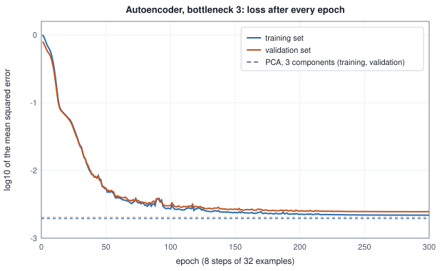
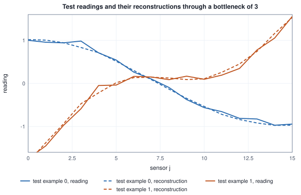
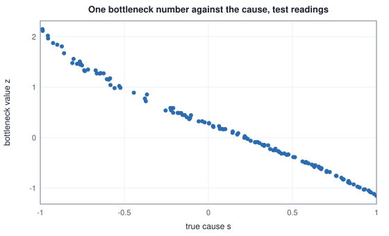

<!-- SPDX-License-Identifier: CC-BY-4.0 -->
<!-- Copyright (c) 2026 Martin Schröder <info@swedishembedded.com> -->

# First Complete Models

*What does it take to build, train and verify a small network end to end?*

## From parts to two models

A layer is not a model, and neither is a loss, a backward pass or an optimizer. A model is a decision about every one of them at once, written down so that someone else can run it again and get the same numbers, and checked at every joint. Two such models are built here from a blank page to a verified result, and the work each one costs is counted.

The first is an **autoencoder**. Sixteen sensors stand along a pipe and report one reading each, every second. You want to store three numbers per second instead of sixteen, and to be able to rebuild the sixteen from the three. The recipe of the readings is known in this chapter (three hidden causes drive all sixteen sensors, plus a little noise), so the answer is known too: three numbers should be enough. The model has to find that out by itself, from examples, with no label anywhere. A reading in which only the first cause is active, with strength 1, is the pattern $\cos(\pi\,\mathrm{pos})$ at the sensor positions $\mathrm{pos}_j = j/15$: it reads $1.0000$ at sensor 0 and $-1.0000$ at sensor 15. Rebuilding such a reading from three numbers means that the network has found the three patterns.

The second is a **learned controller**. A tank follows the law $y_{t+1} = y_t + 0.05\,(-y_t + G_{\mathrm{p}}\,u_t)/T_{\mathrm{p}}$, where $y$ is its level, $u$ is the valve command (kept between $-1$ and $1$), and $T_{\mathrm{p}} = 0.65$ and $G_{\mathrm{p}} = 1.25$ say how slowly it responds and how strongly the valve acts. At $y = 0$ with the valve fully open, $u = 1$, one step gives $0.05 \times 1.25 / 0.65 = 0.0962$. You want a small network that sees how far the level is from the target and decides the command, and you want to know whether the level reaches the target. Here the labels come from a classical controller that already works; the network must imitate it, and then be judged not by how well it imitates one decision but by how the tank behaves when the network is in charge.

Both builds use only what earlier chapters taught: layers with GELU (chapter 2), the mean squared error (Volume II, chapter 2), the backward pass (chapters 4 and 5), the gradient check (chapter 6), AdamW (chapter 7), the schedule and the clip (chapter 8), the starting scale (chapter 9), the checklist (chapter 12) and the principal components of Volume II, chapter 7. Every table of this chapter was produced by the chapter's reference program, with randomness from the book's own generator, so that you can rebuild each model in your own language and compare numbers.

Six ideas from the earlier chapters will be used at once, and it is worth answering these from memory before the first build. The answers are at the end of the chapter; if one is hard, go back to the chapter named.

1. ("Multilayer Networks", chapter 2 of this volume.) Two linear layers follow each other with no activation between them, $16 \to 3 \to 16$. What single map do they compute, and what is the largest rank it can have?
2. ("Optimizers: From SGD to AdamW", chapter 7.) What is the size of the first AdamW step of a weight whose first gradient is $g = 0.002$, with rate $\eta = 0.01$ and no weight decay?
3. ("Proving Gradients Correct", chapter 6.) Write the central difference estimate of $\partial L/\partial\theta_i$ and the gate that compares it with the backward pass's value.
4. ("Linear Regression and the First Descent", Volume II, chapter 2.) Predictions $0.5, 1.0, 2.0$ are scored against targets $1, 1, 1$ by the mean squared error. What is the loss, and what is its gradient with respect to the third prediction?
5. ("Generalization, Overfitting and Honest Evaluation", Volume II, chapter 5.) A run keeps the parameters of the epoch with the lowest validation loss. Why is the validation loss of that epoch not an honest estimate of the model's error on new data, and what is?
6. ("Eigenvalues, Rotations and Low-Rank Structure", Volume I, chapter 6, and "Classical Methods", Volume II, chapter 7.) The covariance of a cloud of rows has eigenvalues $9$, $1$ and $0.1$. If each row is replaced by its projection onto the first principal direction, what is the mean squared distance between rows and projections?

## Sixteen sensors, three causes

To check what the autoencoder finds against the truth, the data must have a structure we know. Sensor $j$ stands at position $\mathrm{pos}_j = j/15$. Three smooth patterns run along the pipe, $\mathrm{pat}_1 = \cos(\pi\,\mathrm{pos})$, $\mathrm{pat}_2 = \sin(2\pi\,\mathrm{pos})$ and $\mathrm{pat}_3 = \cos(2\pi\,\mathrm{pos})$. A reading is a mixture of them with random strengths plus a little noise, one noise value per sensor:

$$
x_j = 1.0\, s_1\, \mathrm{pat}_{1,j} + 0.5\, s_2\, \mathrm{pat}_{2,j} + 0.25\, s_3\, \mathrm{pat}_{3,j} + 0.05\, n_j ,
$$

with $s_1, s_2, s_3$ and every $n_j$ drawn independently from the standard normal distribution. Five hundred and twelve readings are drawn, the first 256 are the training set, the next 128 the validation set and the last 128 the test set (Volume II, chapter 5). The table lists the patterns and two training readings, so that you can check your own generator against it.

<!-- worked: first_models.ae_data -->
Sensor j sits at position pos_j = j/15. The patterns are pat1 = cos(pi pos), pat2 = sin(2 pi pos), pat3 = cos(2 pi pos). A reading is x_j = 1.0 s1 pat1_j + 0.5 s2 pat2_j + 0.25 s3 pat3_j + 0.05 n_j with s1, s2, s3 and n_j drawn from N(0, 1). Generator: `first_models.ae_data` (seed 0xc915087bc5669401). Draw order, per example: s1, s2, s3, then n_0 .. n_15 (19 normals); 512 examples in all, split in order into 256 training, 128 validation and 128 test examples. The last two columns are training examples 0 and 1 (causes s = (0.3607, 0.6020, -0.9461) and (-0.1902, -0.9558, 0.8096)). Mean of the squared readings about the training mean (per sensor): 0.6969.

| j | pos_j | pat1 | pat2 | pat3 | x (example 0) | x (example 1) |
|---|---:|---:|---:|---:|---:|---:|
| 0 | 0.0000 | 1.0000 | 0.0000 | 1.0000 | 0.0941 | 0.0822 |
| 1 | 0.0667 | 0.9781 | 0.4067 | 0.9135 | 0.2522 | -0.2040 |
| 2 | 0.1333 | 0.9135 | 0.7431 | 0.6691 | 0.3898 | -0.3428 |
| 3 | 0.2000 | 0.8090 | 0.9511 | 0.3090 | 0.4599 | -0.5383 |
| 4 | 0.2667 | 0.6691 | 0.9945 | -0.1045 | 0.5499 | -0.6192 |
| 5 | 0.3333 | 0.5000 | 0.8660 | -0.5000 | 0.5651 | -0.6362 |
| 6 | 0.4000 | 0.3090 | 0.5878 | -0.8090 | 0.4618 | -0.5713 |
| 7 | 0.4667 | 0.1045 | 0.2079 | -0.9781 | 0.3197 | -0.2876 |
| 8 | 0.5333 | -0.1045 | -0.2079 | -0.9781 | 0.1327 | -0.0992 |
| 9 | 0.6000 | -0.3090 | -0.5878 | -0.8090 | -0.0914 | 0.2152 |
| 10 | 0.6667 | -0.5000 | -0.8660 | -0.5000 | -0.2388 | 0.3993 |
| 11 | 0.7333 | -0.6691 | -0.9945 | -0.1045 | -0.5383 | 0.6022 |
| 12 | 0.8000 | -0.8090 | -0.9511 | 0.3090 | -0.5797 | 0.7362 |
| 13 | 0.8667 | -0.9135 | -0.7431 | 0.6691 | -0.6991 | 0.6729 |
| 14 | 0.9333 | -0.9781 | -0.4067 | 0.9135 | -0.7597 | 0.6464 |
| 15 | 1.0000 | -1.0000 | 0.0000 | 1.0000 | -0.6041 | 0.4488 |
<!-- /worked -->

Two facts about this data decide what a good model looks like. The readings live, up to noise, in a three-dimensional flat sheet (the span of the three patterns) inside the sixteen-dimensional space. And the noise cannot be predicted: sixteen independent values of variance $0.05^2$ cannot be rebuilt from three numbers, so the best any three-number code can do leaves a squared error of at least $13/16 \times 0.05^2 = 0.00203$ per value (the noise in the 13 directions out of 16 that the sheet does not contain). That is the floor to aim at.

## The autoencoder

Many problems come without labels, and a network whose target is its own input needs none: the only way to succeed is to find structure. An **autoencoder** is a network trained to output its own input after passing it through a **bottleneck**, a layer much narrower than the input. The part before the bottleneck, the encoder, turns the sixteen readings into a short vector $\mathbf{z}$ called the **code**; the part after it, the decoder, turns the code back into sixteen numbers $\hat{\mathbf{x}}$. The **reconstruction loss** is the mean squared error between the output and the input, the loss of Volume II, chapter 2 with the input as its own target:

$$
L_{\mathrm{rec}} = \frac{1}{B\,D}\sum_{n=0}^{B-1}\sum_{j=0}^{D-1}\left(\hat{x}_{nj} - x_{nj}\right)^2 ,
$$

for a batch of $B$ readings of width $D = 16$. Its gradient with respect to the output is $2(\hat{x}_{nj} - x_{nj})/(BD)$, the starting gradient of the backward pass in chapter 4, so the backward pass of this model is the one you already know. Nothing in it asks for a label; the bottleneck alone forces the network to choose what to keep.

The network of this chapter has four layers:

<!-- worked: first_models.ae_architecture -->
Layer shapes are [n_out, n_in] (weight matrix of `x @ W^T`), activations GELU (exact erf form) after the encoder and the decoder. Initial weights N(0, 1/n_in), biases 0, stream `first_models.ae_init` (seed 0x51b9ca7767371d9a): the weights of layers 1 to 4 in order, row-major.

| layer | W shape | bias | parameters | multiply-adds per example | activation |
|---|---:|---:|---:|---:|---:|
| encoder | 12 x 16 | 12 | 204 | 192 | gelu |
| bottleneck | 3 x 12 | 3 | 39 | 36 | none |
| decoder | 12 x 3 | 12 | 48 | 36 | gelu |
| output | 16 x 12 | 16 | 208 | 192 | none |
| total |  |  | 499 | 456 |  |
<!-- /worked -->

Three design choices are worth a sentence each. GELU rather than ReLU, because it has no kink, so that the gradient check of chapter 6 meets no point where the central difference is ill-defined. No activation after the bottleneck, so that the encoder's last layer is a plain linear map, and the whole path from the encoder's hidden layer to the decoder's is the collapse of two linear layers of chapter 2: a map of rank at most 3, which is there to force the bottleneck's width. A width of 3 and not 16, because a bottleneck as wide as the input lets the network learn to copy, a solution of zero loss that has learned nothing.

There is also a baseline to beat before any training: the **mean predictor**, which outputs the mean of the training readings for every input. Its squared error is the variance of the data, and the model must be far below it.

## Before training: three checks

The checklist of chapter 12 orders its checks from cheapest to most expensive, and three of them can be done before the first update. They certify the model and the loss on a handful of examples, at a cost of a few percent of one run, before the run is paid for. Each is a measurement with an expected value:

- **The initial loss.** With weights drawn as in chapter 9 ($N(0, 1/n_{\mathrm{in}})$, biases zero) the output starts as a random mixture of the input's directions, not as zero, so the loss starts above the mean predictor's: about the variance of the data plus the variance of the random output.
- **The gradient check** of chapter 6, of the whole model, on every one of its 499 parameters, on a fixed batch of 8 readings. The central difference uses $h = 10^{-5}$ in double precision and the gate $\mathrm{atol} = 10^{-8}$, $\mathrm{rtol} = 10^{-5}$.
- **Overfit one batch.** Eight readings through the bottleneck, 400 steps of AdamW at rate $0.01$ without clip or decay: a model that can reconstruct only 8 examples to a tiny error has a working pipeline.

<!-- worked: first_models.ae_prechecks -->
| check | result | reference |
|---|---|---|
| 1. shapes and finiteness | inputs 256 x 16, targets the same; every value finite: True |  |
| 2. initial loss | training 1.0337, validation 0.8172 | the mean predictor scores 0.6969 (training), 0.5804 (validation) |
| 3. gradient check, all 499 entries | worst gate ratio abs(ana - num) / (atol + rtol max(abs(ana), abs(num))) = 0.0013, failing 0 | gate: h = 1e-5, atol = 1e-8, rtol = 1e-5 |
|    worst relative error per tensor | W1 8.0e-08, b1 2.3e-08, W2 7.5e-09, b2 9.8e-10, W3 6.4e-08, b3 2.0e-09, W4 2.4e-08, b4 3.4e-09 | entries with max(abs(ana), abs(num)) above 1e-4 |
| 4. overfit one batch (8 examples, 400 steps, rate 0.01) | loss 0.3848 -> 1.82e-04 | no clip, no decay |
<!-- /worked -->

The loss starts at $1.0337$ on the training set, above the mean predictor's $0.6969$, as predicted. The gradient check passes on all 499 entries: the worst value of $|\mathrm{ana} - \mathrm{num}|/(\mathrm{atol} + \mathrm{rtol}\max(|\mathrm{ana}|, |\mathrm{num}|))$ is $0.0013$ against a gate at 1, and the worst relative error of a tensor is $8.0\times10^{-8}$, the truncation of a central difference at this step and the roundoff of two loss evaluations (chapter 6). Eight readings are rebuilt to a loss of $1.82\times10^{-4}$ after 400 steps. These checks say that the gradients are the gradients of this loss and that the pipeline can learn. They do not say that the loss is the right one or that 12 hidden units suffice, which only a full run answers.

## The training loop, written in full

The stages of the earlier chapters meet in one function, so that nothing between the data and the checkpoint is left to a framework. An **end-to-end training loop** is the whole path from the data to the saved model: it shuffles the training set, cuts it into batches, runs the forward pass, the loss and the backward pass on each batch, clips the gradient, takes an AdamW step at the rate the schedule gives, logs what the step did, and after every epoch evaluates on the validation set and keeps the best parameters. The figure shows the order. Each box is a chapter of this volume.


In the book's pseudocode, with the pieces of chapters 7 and 8 and the generator of Volume I, chapter 17:

```text
function fit(theta0: array<real>[P], X: array<real>[N, D], T: array<real>[N, O],
             Xv: array<real>[Nv, D], Tv: array<real>[Nv, O],
             loss_grad: function(array<real>[P], array<real>[B, D], array<real>[B, O])
                        -> (real, array<real>[P]),
             loss_only: function(array<real>[P], array<real>[M, D], array<real>[M, O]) -> real,
             corrupt: function(array<real>[B, D], Generator) -> array<real>[B, D],
             n_epochs: int, B: int, peak: real, floor: real, tau_clip: real, lam: real,
             rng_batches: Generator, rng_noise: Generator)
        -> (array<real>[P], array<real>[P], list<array<real>[5]>):
    require N mod B == 0, "an epoch is a whole number of batches"
    require n_epochs >= 1 and B >= 1, "at least one epoch of at least one example"
    theta = copy(theta0)
    m = zeros(real, [P])                                   # AdamW's two state arrays
    v = zeros(real, [P])
    S = N // B                                             # steps per epoch
    total = n_epochs * S
    warmup = total // 10
    order = [i for i in 0 .. N]
    best_val = loss_only(theta, Xv, Tv)                    # the checkpoint of epoch 0
    best = copy(theta)
    log = []
    t = 0                                                  # 0-based step index
    for epoch in 1 ..= n_epochs:
        shuffle(order, rng_batches)                        # data order
        norm_sum = 0.0
        for k in 0 .. S:
            idx = order[k * B : (k + 1) * B]               # batch
            xb = rows(X, idx)
            tb = rows(T, idx)
            (loss, g) = loss_grad(theta, corrupt(xb, rng_noise), tb)   # forward, loss, backward
            require is_finite(loss), "the loss is not finite"
            norm = global_norm_clip([g], tau_clip)         # clip (chapter 8), g scaled in place
            eta = schedule_rate(t, peak, floor, warmup, 0, total)      # schedule (chapter 8)
            adam_step(theta, g, m, v, t + 1, eta, 0.9, 0.999, 0.00000001, lam, true)  # AdamW
            norm_sum = norm_sum + norm
            t = t + 1
        train = loss_only(theta, X, T)                     # evaluate
        val = loss_only(theta, Xv, Tv)
        append [epoch, train, val, norm_sum / S, eta] to log             # log
        if val < best_val:                                 # checkpoint
            best_val = val
            best = copy(theta)
    return (theta, best, log)
```

Every line is one of the loop's duties. Two details carry the weight. First, the **order of the clip and the update**: the clip comes before AdamW, because the moments must see the clipped gradient (chapter 8), and it returns the norm *before* scaling, which is the number the log needs. Second, the **checkpoint is chosen on the validation set and scored once on the test set**: the validation loss of the best epoch is optimistic because it was selected for being low (question 5 of "Before you begin"), and the test loss is the estimate that was never selected on. The `corrupt` argument is the identity for the plain autoencoder and the controller; the denoising variant below passes a function that adds noise to the inputs.

The settings of the autoencoder's run are these. Batch 32 of the 256 training readings, so $S = 8$ steps per epoch; 300 epochs, so 2400 steps; AdamW with $(\beta_1, \beta_2, \epsilon) = (0.9, 0.999, 10^{-8})$ and decay $\lambda = 0.01$; a clip at global norm $\tau_{\mathrm{clip}} = 1$; a peak rate of $0.01$ reached after a warmup of 240 steps (a tenth of the run) and decayed along a cosine to a floor of $10^{-4}$. The log:

<!-- worked: first_models.ae_training_log -->
300 epochs of 8 steps at batch 32 (2400 steps). AdamW (0.9, 0.999, 1e-8), decay 0.01, clip 1.0, warmup 240 steps then cosine from 0.01 to 1.0e-04. Shuffle stream `first_models.batches` (seed 0x5f7fd7d74373e82b), one shuffle of 0 .. 255 per epoch. Loss columns are the mean squared error over the whole training and validation sets after the epoch; 'grad norm' is the mean over the epoch's steps of the global norm before the clip; 'clipped' counts the steps of the epoch whose norm exceeded the threshold; 'rate' is the rate of the epoch's last step. The best validation loss 0.00246 is at epoch 281; the checkpoint kept is that epoch's. Test loss of the checkpoint: 0.00254.

| epoch | training loss | validation loss | grad norm | clipped | rate |
|---|---:|---:|---:|---:|---:|
| 0 | 1.03367 | 0.81718 |  |  |  |
| 1 | 1.00545 | 0.79637 | 1.6061 | 7 | 3.33e-04 |
| 2 | 0.93328 | 0.74333 | 1.4314 | 6 | 6.67e-04 |
| 5 | 0.67616 | 0.56194 | 0.5516 | 0 | 1.67e-03 |
| 10 | 0.31445 | 0.27236 | 0.3902 | 0 | 3.33e-03 |
| 20 | 0.06187 | 0.06101 | 0.0739 | 0 | 6.67e-03 |
| 40 | 0.00862 | 0.00860 | 0.0727 | 0 | 9.97e-03 |
| 60 | 0.00393 | 0.00411 | 0.0872 | 0 | 9.70e-03 |
| 80 | 0.00306 | 0.00335 | 0.0603 | 0 | 9.19e-03 |
| 100 | 0.00271 | 0.00301 | 0.0432 | 0 | 8.45e-03 |
| 150 | 0.00239 | 0.00267 | 0.0296 | 0 | 5.92e-03 |
| 200 | 0.00226 | 0.00251 | 0.0254 | 0 | 3.10e-03 |
| 250 | 0.00220 | 0.00247 | 0.0199 | 0 | 9.18e-04 |
| 300 | 0.00219 | 0.00246 | 0.0164 | 0 | 1.00e-04 |
<!-- /worked -->



Read it with the tools of chapter 12. The curve starts at 0 on the logarithmic axis (the initial loss $1.03$), falls through the warmup and settles within a factor of $1.25$ of the PCA level, and the validation curve follows the training curve at a small distance ($0.00219$ against $0.00246$ at epoch 300): no overfitting, the gap of a model that has only 499 parameters for 256 readings of 16 values. The global norm of the gradient starts above the clip threshold, $1.61$ in epoch 1, so the clip fires on 7 of the 8 steps of epoch 1 and on 21 of the 2400 steps in all, all in the first four epochs. A clip that fires on almost every step of a stretch is the same constant factor each time, which AdamW does not feel (chapter 8's note on Adam and the clip), so it did little here; it is a guard for the step the data has not yet shown. The best validation loss, $0.00246$, is at epoch 281 and the checkpoint kept is that epoch's. Its test loss is $0.00254$.

## What the network rebuilds

A single number such as $0.00254$ hides what kind of error it is made of, so look at the output itself. Take test reading 0 and pass it through the checkpoint:

<!-- worked: first_models.ae_reconstruction -->
Test example 0 through the checkpoint. The code is z = (0.2224, -0.0525, 1.2969): three numbers stand for sixteen. Mean squared error of this one example: 0.00277.

| sensor j | reading x_j | reconstruction | difference | PCA, 3 components |
|---|---:|---:|---:|---:|
| 0 | 1.0012 | 1.0180 | 0.0167 | 0.9953 |
| 1 | 0.9570 | 1.0056 | 0.0486 | 0.9972 |
| 2 | 0.9427 | 0.9461 | 0.0033 | 0.9488 |
| 3 | 0.9839 | 0.8351 | -0.1488 | 0.8455 |
| 4 | 0.7101 | 0.7141 | 0.0039 | 0.7039 |
| 5 | 0.5434 | 0.5150 | -0.0284 | 0.5211 |
| 6 | 0.2624 | 0.3000 | 0.0377 | 0.3092 |
| 7 | 0.1024 | 0.0868 | -0.0156 | 0.0838 |
| 8 | -0.0944 | -0.1324 | -0.0380 | -0.1392 |
| 9 | -0.3751 | -0.3472 | 0.0279 | -0.3646 |
| 10 | -0.5625 | -0.5344 | 0.0281 | -0.5423 |
| 11 | -0.6556 | -0.7189 | -0.0633 | -0.7162 |
| 12 | -0.8106 | -0.8383 | -0.0276 | -0.8329 |
| 13 | -0.8261 | -0.9189 | -0.0928 | -0.9060 |
| 14 | -0.9705 | -0.9730 | -0.0025 | -0.9385 |
| 15 | -0.9440 | -0.9694 | -0.0254 | -0.9273 |

Mean squared error over each whole set:

| method | training | validation | test |
|---|---:|---:|---:|
| mean predictor (training means) | 0.69693 | 0.58044 | 0.72837 |
| PCA with 3 components | 0.00194 | 0.00202 | 0.00203 |
| autoencoder, bottleneck 3 (checkpoint) | 0.00219 | 0.00246 | 0.00254 |
| noise floor: 13/16 of the sensor noise variance | 0.00203 |  |  |
<!-- /worked -->



The three numbers $(0.2224, -0.0525, 1.2969)$ stand for sixteen. The reconstruction follows the reading to a few hundredths; the largest miss, at sensor 3, is $-0.1488$, which is three standard deviations of the sensor noise ($0.05$), and the PCA reconstruction misses it by almost the same amount ($0.8455$ against the reading $0.9839$). That is the signature of noise: an error that two quite different models make together cannot be structure the network failed to learn, because the readings contain no structure left at that sensor. The table at the end of the block gives the whole picture: the mean predictor is at $0.728$ on the test set, the autoencoder at $0.00254$, PCA with three components at $0.00203$, and the noise floor computed above at $0.00203$. The network is a factor of about $287$ below the baseline and $25\%$ above the best a linear bottleneck of width 3 can do on this data, a comparison the next section explains.

## What the bottleneck learns: the principal components

What the three-number code means can be said with numbers by comparing it with the method of Volume II, chapter 7. Principal component analysis finds the directions of largest variance of the readings. For $k$ components the mean squared distance of the training rows to their projection onto the first $k$ principal directions is, per value, the sum of the discarded eigenvalues of the covariance divided by $D = 16$ (Volume II, chapter 7: the discarded variance is the cost). Among all rank-$k$ linear summaries of the data this is the smallest squared error (the low-rank approximation of Volume I, chapter 6). The table computes it for $k = 0$ to $7$.

<!-- worked: first_models.pca_spectrum -->
Covariance of the 256 training readings (divisor 256), its eigenvalues by the Jacobi rotation method. Error with k components = (sum of the discarded eigenvalues) / 16, which the next column confirms by reconstructing; the last column is the same error on the test set.

| k | eigenvalue k | variance kept (%) | (sum of discarded) / 16 | training error | test error |
|---|---:|---:|---:|---:|---:|
| 0 |  | 0.000 | 0.69693 | 0.69693 | 0.72837 |
| 1 | 9.98492 | 89.544 | 0.07287 | 0.07287 | 0.06868 |
| 2 | 0.70395 | 95.857 | 0.02887 | 0.02887 | 0.03394 |
| 3 | 0.43097 | 99.722 | 0.00194 | 0.00194 | 0.00203 |
| 4 | 0.00347 | 99.753 | 0.00172 | 0.00172 | 0.00192 |
| 5 | 0.00307 | 99.780 | 0.00153 | 0.00153 | 0.00175 |
| 6 | 0.00296 | 99.807 | 0.00135 | 0.00135 | 0.00161 |
| 7 | 0.00292 | 99.833 | 0.00116 | 0.00116 | 0.00145 |
<!-- /worked -->

The first three directions hold $99.722\%$ of the variance, and the fourth eigenvalue ($0.00347$) is already at the level of the noise variance $0.05^2 = 0.0025$ (a sample of 256 readings spreads sixteen noise eigenvalues around it). The three causes of the data are exactly the three directions that stand out.

Now a claim and its test. A **linear autoencoder** (no activations: $\hat{\mathbf{x}} = \mathbf{W}_2(\mathbf{W}_1\mathbf{x} + \mathbf{b}_1) + \mathbf{b}_2$ with a bottleneck of width $k$) trained to minimize $L_{\mathrm{rec}}$ cannot do better than PCA with $k$ components, because its map has rank at most $k$ (chapter 2's collapse), and it reaches PCA's error exactly when the span of its decoder's columns is the span of the first $k$ principal directions. Training finds this span, with no eigenvalue ever computed. (This was proved for linear autoencoders by Baldi and Hornik in 1989.) The table trains linear autoencoders of widths 1 to 4 with the same loop and compares:

<!-- worked: first_models.linear_vs_pca -->
Linear autoencoders 16 -> k -> 16 (no activation), trained by the loop of the autoencoder's training log: AdamW (0.9, 0.999, 1e-8), batch 32, 400 epochs of 8 steps, clip 1.0, decay 0, warmup of a tenth of the steps then cosine from 0.03 to 0.0003, the shuffle stream of that log (one shuffle of 0 .. 255 per epoch); weights N(0, 1/n_in) row by row, layer by layer, biases 0, from the generator `first_models.lin_init.k` with seeds k = 1: `first_models.lin_init.1` (seed 0x10fa37c9705a3b38), k = 2: `first_models.lin_init.2` (seed 0xd8f0d6bc739f959e), k = 3: `first_models.lin_init.3` (seed 0x2b52136dc1d1681d), k = 4: `first_models.lin_init.4` (seed 0x6fbd362ef893eba5). The reported weights are those of the epoch with the lowest validation loss; training, validation and test errors are the mean squared error per entry on the three splits. The PCA errors are those of the best rank-k reconstruction fitted on the training set.

| bottleneck k | PCA training error | linear autoencoder training error | excess over PCA (%) | PCA test error | linear autoencoder test error |
|---|---:|---:|---:|---:|---:|
| 1 | 0.07287 | 0.07308 | 0.28 | 0.06868 | 0.06984 |
| 2 | 0.02887 | 0.02906 | 0.65 | 0.03394 | 0.03473 |
| 3 | 0.00194 | 0.00195 | 0.39 | 0.00203 | 0.00205 |
| 4 | 0.00172 | 0.00181 | 4.84 | 0.00192 | 0.00194 |

Bottleneck 3. Length of the projection of each principal direction (unit vector) onto the span of the decoder's three columns (1 means inside the span):

| direction | length of projection |
|---|---:|
| principal direction 1 | 1.00000 |
| principal direction 2 | 1.00000 |
| principal direction 3 | 1.00000 |
| principal direction 4 | 0.00082 |

Absolute cosine between each decoder column and each principal direction (a column is not a principal direction, only the span is):

|  | PC 1 | PC 2 | PC 3 |
|---|---:|---:|---:|
| decoder column 1 | 0.169 | 0.765 | 0.622 |
| decoder column 2 | 0.790 | 0.097 | 0.605 |
| decoder column 3 | 0.296 | 0.483 | 0.824 |
<!-- /worked -->

For $k = 3$ the trained linear autoencoder reaches $0.00195$ against PCA's $0.00194$ (a $0.39\%$ excess after 3200 steps), and the lengths of the projections of the first three principal directions onto the span of the decoder's columns are all $1.00000$: the three principal directions lie inside the span the training found. The fourth principal direction has length $0.00082$ in it, so the span excludes it. The last table shows what training does *not* find. No decoder column is a principal direction (the largest cosine in the table is $0.824$), because the code can be any invertible recombination $\mathbf{A}$ of the principal coordinates (decoder $\mathbf{D}\mathbf{A}^{-1}$, encoder $\mathbf{A}\mathbf{E}$ give the same output as $\mathbf{D}$ and $\mathbf{E}$) and the loss cannot tell them apart. What a trained autoencoder determines is a subspace; a basis in it is a choice made by the initialization. The three code values of the example above are therefore coordinates in an arbitrary basis of the sheet, not the strengths $s_1, s_2, s_3$ of the data's recipe.


The figure is the test version of the table. The error falls from $0.0687$ at width 1 to $0.0339$ at 2 and to $0.00203$ at 3, then flattens at the noise: widening the bottleneck beyond the number of causes buys almost nothing, and a width of 16 would let the network copy the noise as well. The choice of a bottleneck width is the choice of how many causes the data has, and the elbow of this curve is the way to read it.

The autoencoder with GELU layers of this chapter ($0.00254$ on the test set) is above the linear ones. The data are exactly linear in the causes, so the nonlinear layers have nothing to find, and with 2400 steps of a rate that decays to a hundredth of its peak the run has not tuned its subspace as exactly as a model with fewer parameters and a rate three times higher did. The next section shows data on which the nonlinear model's extra freedom pays.

## Where a nonlinear autoencoder beats PCA

A linear bottleneck cannot follow a curved structure, and a data set with one shows it. Replace the recipe by one cause $s$ uniform on $[-1, 1)$ and a quadratic dependence on it,

$$
x_j = s\, \mathrm{pat}_{1,j} + 1.5\,(s^2 - 1/3)\, \mathrm{pat}_{2,j} + 0.05\, n_j ,
$$

so that the readings lie on a *curve* through sixteen-dimensional space, a parabola in the plane of the first two patterns. A bottleneck of width 1 is enough to describe a point on a curve, but no straight line is. The network is $16 \to 12 \to 1 \to 12 \to 16$ with the same loop.

<!-- worked: first_models.curved_table -->
Curved data: x_j = s pat1_j + 1.5 (s^2 - 1/3) pat2_j + 0.05 n_j, with s uniform on [-1, 1) (`bookrng` uniform, then 16 normals n_j per example), stream `first_models.curve_data` (seed 0x0927392a3e19bf27), same split sizes. Autoencoder 16-12-1-12-16, rate 0.01, 300 epochs, decay 0, stream `first_models.curve_init` (seed 0x7b4f47cc4857b0a6). Mean squared error on the test set. Correlation of the learned one-number code with the true cause s on the test set: -0.9952.

| method | test error |
|---|---:|
| mean predictor | 0.28929 |
| PCA, 1 component | 0.02734 |
| autoencoder, bottleneck 1 | 0.00256 |
| noise floor 15/16 of the sensor noise variance | 0.00234 |
<!-- /worked -->

PCA with one component leaves an error of $0.02734$, because it can only project onto the best straight line; the autoencoder with a one-number code reaches $0.00256$, within $10\%$ of the noise floor $0.00234$. The code it learns is a clean function of the true cause (the figure; the correlation is $-0.9952$, with a sign the training chose arbitrarily).



This is the whole case for the nonlinear autoencoder: its code can follow a curved set that no linear projection can. Where the structure is flat, as in the recipe of the previous sections, it matches PCA and no better.

## A denoising variant

To make the bottleneck's filtering explicit, ask the network to rebuild the clean reading from a corrupted one. A **denoising autoencoder** is trained on pairs (corrupted input, clean target): the loop is the same and only `corrupt` changes. Here each of the 16 values is moved by $0.3$ times a standard normal draw, a corruption much larger than the sensors' own noise, with a fresh draw at every step. The network cannot copy its input to get the clean target (the copy would carry the corruption), so it must learn which parts of a reading are structure.

<!-- worked: first_models.denoising_table -->
Corruption: add 0.3 times a N(0, 1) draw to every one of the 16 values. The denoising autoencoder has the architecture, start, shuffle and settings of the plain one; each step draws fresh noise from `first_models.dae_train_noise` (seed 0xf8d187007ee83262) (the batch's 32 examples in order, 16 values each, a corruption per step), start stream `first_models.dae_init` (seed 0x02a17e833af2a9a8). The test noise is drawn once from `first_models.dae_eval_noise` (seed 0x44e98a7a0bcb101a) (128 examples in order, 16 values each). Every row is the mean squared error against the clean test readings.

| method | test error against the clean reading |
|---|---:|
| no model (use the noisy reading) | 0.08489 |
| PCA, 3 components, of the noisy reading | 0.01852 |
| autoencoder trained on clean readings | 0.02530 |
| denoising autoencoder | 0.01718 |
| denoising autoencoder, on clean test readings | 0.00382 |
<!-- /worked -->

Using the noisy reading as it is scores $0.08489$ against the clean one, close to the $0.3^2 = 0.09$ of the corruption. Keeping only three principal directions of the noisy reading removes the noise in the other 13 of 16 directions: $0.0188 \approx 3/16 \times 0.09 + 0.0019$ is the estimate from the variance of what is left (the measured $0.01852$). The autoencoder trained on clean readings, which never saw corruption, scores $0.02530$: its decoder responds to the corrupted code in ways it has no reason to be good at. The denoising autoencoder scores $0.01718$, $7\%$ below PCA, by learning to shrink the noisy coordinates. It pays for it on clean readings: $0.00382$ against $0.00254$ for the plain model, because it has learned to distrust small details.

## A learned controller

The second kind of model produces an action, its labels come from a classical controller, and the test of success is how a system behaves under the model's decisions.

### The plant and the controller it imitates

A **plant** is the system being controlled; here, the tank of the introduction, $y_{t+1} = y_t + \Delta t\,(-y_t + G_{\mathrm{p}}\,u_t)/T_{\mathrm{p}}$ with $\Delta t = 0.05$ and the command clamped to $[-1, 1]$. A **setpoint** $y^\ast_t$ is the level we want, and the **error** is $e_t = y^\ast_t - y_t$. The classical solution is a **PID controller**; this chapter uses its PI part, a command made of a term proportional to the error and a term proportional to its accumulated sum. In continuous time, $T_{\mathrm{p}}\dot y = -y + G_{\mathrm{p}}u$ with $u = K_{\mathrm{p}}e + K_{\mathrm{i}}\int e\,dt$ and a constant setpoint gives, after differentiating once,

$$
T_{\mathrm{p}}\ddot y + (1 + G_{\mathrm{p}}K_{\mathrm{p}})\dot y + G_{\mathrm{p}}K_{\mathrm{i}}\, y = G_{\mathrm{p}}K_{\mathrm{i}}\, y^\ast ,
$$

a second-order system. Choosing its damping $\zeta_{\mathrm{d}}$ and natural frequency $\omega_{\mathrm{n}}$ means matching $\ddot y + 2\zeta_{\mathrm{d}}\omega_{\mathrm{n}}\dot y + \omega_{\mathrm{n}}^2 y$: this is **pole placement**, and it gives

$$
K_{\mathrm{p}} = \frac{2\zeta_{\mathrm{d}}\omega_{\mathrm{n}}T_{\mathrm{p}} - 1}{G_{\mathrm{p}}}, \qquad K_{\mathrm{i}} = \frac{T_{\mathrm{p}}\,\omega_{\mathrm{n}}^2}{G_{\mathrm{p}}} .
$$

In discrete time, in the **velocity form** that stores the last command instead of an accumulated sum, the command of step $t$ is

$$
u^\ast_t = \operatorname{clamp}\!\left(u_{t-1} + K_{\mathrm{p}}\,(e_t - e_{t-1}) + K_{\mathrm{i}}\,\Delta t\; e_t,\; -1,\; 1\right),
$$

where $u_{t-1}$ is the command that was actually applied. (Clamping the stored command is the simplest protection against the accumulated sum growing while the valve is saturated.) With $\zeta_{\mathrm{d}} = 1$ and $\omega_{\mathrm{n}} = 3.5$, and the plant's own $T_{\mathrm{p}}$ and $G_{\mathrm{p}}$:

<!-- worked: first_models.ctrl_plant_expert -->
The plant is y(t+1) = y(t) + 0.05 (-y(t) + gain u(t)) / tau with the command clamped to [-1, 1]. The expert is the velocity-form PI u(t) = clamp(u(t-1) + kp (e(t) - e(t-1)) + ki 0.05 e(t)) with kp = (2 1.0 3.5 tau - 1)/gain and ki = tau 3.5^2/gain (poles placed at damping 1 and natural frequency 3.5). Gains:

| tau | gain | kp | ki | ki dt |
|---|---:|---:|---:|---:|
| 0.65 | 1.25 | 2.8400 | 6.3700 | 0.3185 |
| 0.55 | 1.125 | 2.5333 | 5.9889 | 0.2994 |
| 0.55 | 1.375 | 2.0727 | 4.9000 | 0.2450 |
| 0.75 | 1.125 | 3.7778 | 8.1667 | 0.4083 |
| 0.75 | 1.375 | 3.0909 | 6.6818 | 0.3341 |

The nominal plant (tau 0.65, gain 1.25) under the expert, from y = 0, u = 0, setpoint 0.70 (first hold, steps 0 to 44):

| t | setpoint | y(t) | e(t) | u(t) |
|---|---:|---:|---:|---:|
| 0 | 0.70 | 0.0000 | 0.7000 | 1.0000 |
| 1 | 0.70 | 0.0962 | 0.6038 | 0.9192 |
| 2 | 0.70 | 0.1771 | 0.5229 | 0.8558 |
| 3 | 0.70 | 0.2458 | 0.4542 | 0.8054 |
| 4 | 0.70 | 0.3043 | 0.3957 | 0.7652 |
| 5 | 0.70 | 0.3545 | 0.3455 | 0.7328 |
| 6 | 0.70 | 0.3977 | 0.3023 | 0.7064 |
| 8 | 0.70 | 0.4674 | 0.2326 | 0.6669 |
| 10 | 0.70 | 0.5201 | 0.1799 | 0.6395 |
| 15 | 0.70 | 0.6042 | 0.0958 | 0.6000 |
| 20 | 0.70 | 0.6485 | 0.0515 | 0.5810 |
| 30 | 0.70 | 0.6850 | 0.0150 | 0.5661 |
| 44 | 0.70 | 0.6973 | 0.0027 | 0.5611 |

Overshoot of the first hold: 0.00 % of the step; first step after which |e| stays within 5 % of the step: 24.
<!-- /worked -->

On the nominal plant the level rises to the setpoint in a smooth exponential-like curve without overshoot, and stays within $5\%$ of the step from step 24 on.

### What brain's `toypid` is

The brain crate `crates/toypid` is a learned controller for exactly this setting, but a different model from the one built here. Reading its code (`crates/toypid/src/model.rs` and `crates/toypid/src/data.rs`):

- **The plant and the expert are the same ones.** The plant is the first-order tank above with $\Delta t = 0.05$ and a clamped command; the expert is the velocity-form PI controller with $\zeta_{\mathrm{d}} = 1$ and $\omega_{\mathrm{n}} = 3.5$ computed per plant (`pole_place_pi`, `velocity_pi_bin`).
- **The model is a transformer, not a multilayer network.** It has one layer, width 32, four attention heads, a feed-forward width of 128, layer normalization and learned position embeddings (`PidConfig::default_small`): 36,273 parameters. It reads a *sequence of tokens*. Each control step is written as an event (a start token, a small CBOR-style array of the setpoint, the measurement and the error, each quantised to one of 101 levels in $[-1.5, 1.5]$, and an end token), a decide token, and an effect (the applied command quantised to one of 81 levels in $[-1, 1]$). The model is trained with the cross-entropy of chapter 3, masked so that only the decide positions count, to predict the expert's command level.
- **It is trained on nine plants and checked on four others.** The training plants are the grid $T_{\mathrm{p}} \in \{0.45, 0.65, 0.85\}$, $G_{\mathrm{p}} \in \{1.00, 1.25, 1.50\}$; the validation plants lie between them ($T_{\mathrm{p}} \in \{0.55, 0.75\}$, $G_{\mathrm{p}} \in \{1.125, 1.375\}$). A sequence model sees the history of measurements and commands, so it can in principle infer which plant it is controlling, which a network that sees only the current error cannot.
- **The data are explored and relabeled.** Trajectories are driven by a mixture (the expert in $62\%$ of steps, the expert plus noise of standard deviation $0.25$ in $30\%$, a uniformly random command in $8\%$), and every visited state is labeled with what the *expert* would do there. The step-change schedule of the test is the one drawn in this chapter: setpoints $0.70, -0.60, 0.40, -0.85$, 45 steps each.
- **It is judged in closed loop.** `rollout_on_plant` runs the model as the controller for 180 steps and reports the mean squared tracking error and the steady-state error (both defined below), next to the expert's.

The controller of this chapter keeps the plant, the expert, the data recipe, the schedule and the closed-loop test, and changes three things: a multilayer network of the previous chapters instead of a transformer (attention is a later chapter), a real-valued command with the mean squared error instead of 81 classes with cross-entropy, and one plant (the middle of the training grid, $T_{\mathrm{p}} = 0.65$, $G_{\mathrm{p}} = 1.25$) so that three numbers describe a state.

### The data

The network sees the state $(e_t, e_{t-1}, u_{t-1})$ and must output the expert's $u^\ast_t$. That is **behaviour cloning**: supervised learning of a policy from the examples of one that works. Two training sets are built, to see whether the exploration of `toypid` matters: the expert alone drives the plant (set "expert"), or the mixture above drives it and every state is relabeled with the expert's command (set "explore"). The validation set is expert-driven.

<!-- worked: first_models.ctrl_data -->
24 trajectories of 90 steps on the nominal plant, so 2160 samples per training set, and 8 validation trajectories (720 samples, the expert driving). Per trajectory, in this draw order: y(0) = -0.6 + 1.2 u (one uniform u); the setpoint, the previous command u_prev and the previous error e_prev start at 0. At step t = 0 a new setpoint -1 + 2 u is drawn (one uniform) and no c is drawn; at every later step c = uniform and, if c < 0.10, a new setpoint -1 + 2 u (one more uniform). Then e = setpoint - y and u* is the expert's command from e, e_prev and u_prev (chapter section above); for the 'explore' set then r = uniform and, if r < 0.3, a normal draw g and the applied command clamp(u* + 0.25 g, -1, 1), else if r < 0.38 a uniform draw and the applied command -1 + 2 u, else the applied command u*. The plant then advances with the applied command, u_prev becomes the applied command and e_prev becomes e. The sample is (e, e_prev, u_prev) -> u* (the expert's command at that state, whatever was applied). The mean predictor is the constant equal to the mean of the explore training targets. Streams: `first_models.ctrl_data_expert` (seed 0x46f1d32b7760701e), `first_models.ctrl_data_explore` (seed 0x7cafca0a966a4871), `first_models.ctrl_val` (seed 0xc0b4624bb37b8f54). The 'expert' set draws no r and no g.

|  | explore set | expert set |
|---|---:|---:|
| samples in the training set | 2160 | 2160 |
| fraction of targets at the clamp (abs(u*) = 1) | 0.090 | 0.082 |
| mean predictor: validation error | 0.35002 |  |
| linear baseline on (e, e_prev, u_prev, 1): validation error | 0.02040 |  |
| the linear baseline's weights | 1.416, -1.143, 0.844, 0.004 |  |
<!-- /worked -->

The table already contains the problem's difficulty. The expert is a linear function of the three inputs except at the clamp (the fraction of training targets sitting at $\pm 1$ is $9.0\%$), so a *linear* model of the three inputs is a strong baseline: it reaches a validation error of $0.0204$ against $0.350$ for the mean predictor. A network is justified only by beating it, and what it has to learn beyond the linear part is the clamp.

### The network, and the checks again

The network is $3 \to 16 \to 16 \to 1$ with GELU after both hidden layers: 353 parameters. The checks of the checklist, on the explore set:

<!-- worked: first_models.ctrl_prechecks -->
| check | result | reference |
|---|---|---|
| 1. shapes and finiteness | inputs 2160 x 3, targets 2160 x 1; every value finite: True |  |
| 2. initial loss | training 0.9252, validation 0.8486 | the mean predictor scores 0.3500 on validation |
| 3. gradient check, all 353 entries | worst gate ratio abs(ana - num) / (atol + rtol max(abs(ana), abs(num))) = 0.0007, failing 0 | gate: h = 1e-5, atol = 1e-8, rtol = 1e-5 |
|    worst relative error per tensor | W1 5.4e-08, b1 1.8e-09, W2 1.1e-08, b2 2.6e-09, W3 3.7e-10, b3 3.5e-11 | entries with max(abs(ana), abs(num)) above 1e-4 |
| 4. overfit one batch (8 samples, 400 steps, rate 0.01) | loss 0.8141 -> 7.77e-06 | no clip, no decay |
<!-- /worked -->

All pass: the gradient of all 353 entries agrees with finite differences (gate ratio $0.0007$), eight samples are fit to $7.77\times10^{-6}$, and the initial loss is above the mean predictor's, as for the autoencoder. A **learned controller**, in the sense of this chapter, is a network trained in this way to produce control commands, and the rest of the section is about the one question that these checks cannot answer: whether it controls.

### Training

The loop is the same function `fit` with the same optimizer, clip and schedule; the settings are batch 72 of the 2160 samples ($S = 30$), 100 epochs (3000 steps), a peak rate of $0.01$ and decay $0.01$.

<!-- worked: first_models.ctrl_training_log -->
100 epochs of 30 steps at batch 72 (3000 steps), on the explore set. AdamW (0.9, 0.999, 1e-8), decay 0.01, clip 1.0, warmup 300 steps then cosine from 0.01 to 1.0e-04; init `first_models.ctrl_init` (seed 0x43c217b1b9a99519), shuffle `first_models.batches` (seed 0x5f7fd7d74373e82b) (one shuffle of 0 .. 2159 per epoch). Columns as in the autoencoder's log. The validation set is the expert-driven one.

| epoch | training loss | validation loss | grad norm | clipped | rate |
|---|---:|---:|---:|---:|---:|
| 0 | 0.92523 | 0.84860 |  |  |  |
| 1 | 0.63035 | 0.58769 | 1.8026 | 29 | 1.00e-03 |
| 2 | 0.21367 | 0.19681 | 0.9558 | 12 | 2.00e-03 |
| 3 | 0.12466 | 0.11569 | 0.3361 | 0 | 3.00e-03 |
| 5 | 0.03731 | 0.03599 | 0.1525 | 0 | 5.00e-03 |
| 8 | 0.01655 | 0.01266 | 0.1083 | 0 | 8.00e-03 |
| 12 | 0.00372 | 0.00284 | 0.0597 | 0 | 9.99e-03 |
| 20 | 0.00087 | 0.00069 | 0.0419 | 0 | 9.70e-03 |
| 40 | 0.00047 | 0.00038 | 0.0202 | 0 | 7.53e-03 |
| 70 | 0.00036 | 0.00031 | 0.0251 | 0 | 2.58e-03 |
| 100 | 0.00034 | 0.00030 | 0.0122 | 0 | 1.00e-04 |
<!-- /worked -->

The validation loss falls from $0.849$ to $0.00030$, a factor of 68 below the linear baseline. The clip fires on 29 of the 30 steps of epoch 1 and on 12 of epoch 2, never again.

### Closed-loop evaluation

The validation loss measures *one* decision at a time, on states that someone else (the expert) chose. A controller is not used that way. It is used in a **closed loop**: its command moves the plant, the plant's new state is what it sees next, and its own errors determine the states it will be asked about. The test is therefore to run the loop, for 180 steps from $y = 0$ with the four setpoints of `toypid`, and to measure what the plant does. In the book's pseudocode:

```text
function rollout(controller: function(real, real, real) -> real,
                 T_p: real, G_p: real, setpoint: function(int) -> real,
                 n_steps: int) -> array<real>[n_steps, 4]:
    require T_p > 0.0, "the time constant is positive"
    y = 0.0
    u_prev = 0.0
    e_prev = 0.0
    out = zeros(real, [n_steps, 4])
    for t in 0 .. n_steps:
        r = setpoint(t)
        e = r - y
        u = min(1.0, max(-1.0, controller(e, e_prev, u_prev)))   # the command, clamped
        out[t, :] = [r, y, e, u]                                   # y is the measurement before the command acts
        y = y + 0.05 * (-y + G_p * u) / T_p
        u_prev = u
        e_prev = e
    return out
```

and with the expert as the controller,

```text
function pi_command(u_prev: real, e: real, e_prev: real, K_p: real, K_i: real, dt: real) -> real:
    return min(1.0, max(-1.0, u_prev + K_p * (e - e_prev) + K_i * dt * e))
```

Five numbers per run: the mean squared tracking error $e_t^2$ over all 180 steps, the steady-state error (the mean of $|e|$ over the last ten steps of each hold, where the plant should have settled), the overshoot and the settling step of each hold, the largest command used, and the difference between the command the controller used and the expert's command at the same state.

<!-- worked: first_models.ctrl_closed_loop -->
Closed loop on the nominal plant, 180 steps, setpoint 0.70, -0.60, 0.40, -0.85 held for 45 steps each, from y = 0, u_prev = 0, e_prev = 0. Each network is its training run's best-validation checkpoint (the weights of the epoch with the lowest validation loss, as kept in the training log), not the weights of the last epoch. 'Tracking error' is the mean of e(t)^2 over the 180 steps; 'steady error' the mean |e| over steps 35 .. 44 of each hold; overshoot is (largest excursion beyond the setpoint) / |step| in percent; settling is the first step of the hold after which |e| stays within 5 % of the step; 'action error' is the RMS difference between the commands used and the expert's command at the states visited; 'largest deviation' is the maximum of |y - y_PID|.

| controller | tracking error | steady error | overshoot % (4 holds) | settling steps (4 holds) | largest abs(u) | action error, on its own states | largest deviation from PID |
|---|---:|---:|---:|---:|---:|---:|---:|
| expert (PID) | 0.11869 | 0.00849 | 0.0 / 0.0 / 0.0 / 0.0 | 24 / 25 / 23 / 26 | 1.000 | 0.0000 | 0.0000 |
| network, trained on expert states | 0.12475 | 0.01533 | 1.6 / 0.0 / 1.0 / 0.0 | 22 / 26 / 22 / 31 | 0.990 | 0.0088 | 0.0437 |
| network, trained on explored states | 0.12718 | 0.02863 | 2.3 / 0.0 / 2.1 / 0.0 | 22 / 27 / 21 / 43 | 0.978 | 0.0124 | 0.0596 |
<!-- /worked -->


Both networks control the tank. They are stable, settle in $21$ to $43$ steps (the expert $23$ to $26$), overshoot by at most $2.3\%$ of a step, and never deviate from the expert's trajectory by more than $0.06$ (largest deviation, in the units of the level). The tracking error is almost the expert's $0.11869$: $0.12475$ and $0.12718$. That number is dominated by the steps themselves, which the expert itself needs about 25 steps to follow and which no controller can follow faster, so it is a poor discriminator; the steady-state error is the sensitive one. The expert's is $0.00849$ (the exponential tail of the response at step 44); the network trained on expert states ends $0.01533$ from its setpoint, and the one trained on explored states $0.02863$. With one run of each, this cannot rank the two recipes. It is a measurement of one seed, and the exercises repeat it.

### Open loop and closed loop are different errors

The previous table also shows something the training log did not. During the run, the one-step error on validation samples (every input an expert state) and the closed-loop behaviour were measured after every epoch:

<!-- worked: first_models.ctrl_open_vs_closed -->
The explore-trained network at the end of epoch n. 'one-step error' is the RMS error of the network's raw output (before any clamp to [-1, 1]; the square root of the validation loss) against the expert's command on the validation samples (teacher forcing: every input is an expert state). 'action error, own states' is the RMS difference between the command the loop applies (the network's output clamped to [-1, 1]) and the expert's command at the same state, measured at the states the network itself visits in the 180-step closed loop. The expert's own closed loop has tracking error 0.11869 and steady error 0.00849.

| epoch | one-step error | action error, own states | tracking error | steady error | largest deviation from PID |
|---|---:|---:|---:|---:|---:|
| 1 | 0.7666 | 0.4259 | 1.18322 | 1.1429 | 2.034 |
| 2 | 0.4436 | 0.2054 | 0.28065 | 0.4100 | 0.627 |
| 3 | 0.3401 | 0.1494 | 0.14899 | 0.2653 | 0.332 |
| 5 | 0.1897 | 0.0679 | 0.11989 | 0.2091 | 0.276 |
| 8 | 0.1125 | 0.0386 | 0.10935 | 0.1366 | 0.170 |
| 12 | 0.0533 | 0.0252 | 0.10747 | 0.0599 | 0.096 |
| 20 | 0.0262 | 0.0096 | 0.12464 | 0.0163 | 0.036 |
| 40 | 0.0195 | 0.0123 | 0.12487 | 0.0176 | 0.046 |
| 100 | 0.0174 | 0.0109 | 0.12549 | 0.0251 | 0.046 |
<!-- /worked -->


Three things stand out. First, the one-step error and the tracking error disagree early: at epoch 5 the one-step error is $0.19$ (RMS, in units of the command, a fifth of the valve's range) and the tracking error is $0.11989$, within $1\%$ of the expert's $0.11869$: the plant's feedback hides a poor controller as long as it points the right way. Second, the steady error does not follow the one-step error down. From epoch 20 to epoch 100 the one-step error falls from $0.0262$ to $0.0174$ and the steady error rises from $0.0163$ to $0.0251$, and the figure shows it wobbling by a factor of about 4 from epoch to epoch. The weights that make validation samples better are not the weights that make the settled level better; no epoch's validation loss is a measurement of the closed loop. Third, the command error at the states the network visits itself is *smaller* than the one-step error ($0.0109$ against $0.0174$ at epoch 100), because the validation samples contain a setpoint change at about one step in ten, far more than the four of the test.

So where do errors compound? Not in the size of the command error, but in what the loop does with a small, *persistent* one. At a settled state the error and the command are constant, so the expert's command at that state is $u_t = u_{t-1} + K_{\mathrm{i}}\Delta t\, e$. If the network's command is off by $\delta_u$ at the settled state, the loop settles where the network's command equals the previous one, that is where $K_{\mathrm{i}}\Delta t\, e = -\delta_u$:

$$
e_{\mathrm{settled}} = -\frac{\delta_u}{K_{\mathrm{i}}\,\Delta t} .
$$

On the nominal plant $K_{\mathrm{i}}\Delta t = 0.3185$, so a constant command error is multiplied by $1/0.3185 = 3.14$. The table adds a constant error to every command of the expert itself and measures where the level settles:

<!-- worked: first_models.ctrl_bias_amplification -->
The expert on the nominal plant with a constant error eps added to every command it makes (the added error is part of the stored u(t-1)), setpoint held at 0.70 for 150 steps from y = 0. ki dt = 0.3185, so 1 / (ki dt) = 3.140. Settled error e(150) = 0.70 - y(150) against the prediction -eps / (ki dt).

| added error eps | settled error e(150) | predicted -eps / (ki dt) | ratio e / eps |
|---|---:|---:|---:|
| 0.000 | 0.00000 | 0.00000 |  |
| 0.001 | -0.00314 | -0.00314 | -3.140 |
| 0.005 | -0.01570 | -0.01570 | -3.140 |
| 0.020 | -0.06279 | -0.06279 | -3.140 |
| 0.050 | -0.15699 | -0.15699 | -3.140 |
<!-- /worked -->

The prediction is exact to five decimals. An error of $0.005$ in the command, one-fifth of a percent of the valve's range and invisible next to the one-step RMS error of $0.0174$, is a settled error of $0.0157$ in the level. The integral term of the controller is a gain that the network's small errors pass through, and no amount of reading the training loss alone shows it.

### A plant the network did not see

The network was trained on one plant. The four validation plants of `toypid`, on the same 180-step test:

<!-- worked: first_models.ctrl_held_out -->
The same 180-step test on the nominal plant and on the four plants between the nominal grid of crates/toypid (never used for training here). 'plant PID' is the expert tuned for that plant; 'nominal PID' is the nominal plant's gains used on it; 'network' is the explore-trained network.

| tau | gain | tracking, plant PID | tracking, nominal PID | tracking, network | steady, plant PID | steady, nominal PID | steady, network |
|---|---:|---:|---:|---:|---:|---:|---:|
| 0.65 | 1.25 | 0.11869 | 0.11869 | 0.12718 | 0.0085 | 0.0085 | 0.0286 |
| 0.55 | 1.125 | 0.11212 | 0.11647 | 0.12277 | 0.0078 | 0.0117 | 0.0337 |
| 0.55 | 1.375 | 0.10120 | 0.10939 | 0.11386 | 0.0066 | 0.0117 | 0.0224 |
| 0.75 | 1.125 | 0.13704 | 0.13462 | 0.14489 | 0.0105 | 0.0045 | 0.0368 |
| 0.75 | 1.375 | 0.12388 | 0.12112 | 0.13106 | 0.0090 | 0.0059 | 0.0243 |
<!-- /worked -->

The tracking error of the network is $0.114$ to $0.145$ against the plant-tuned PID's $0.101$ to $0.137$, and the nominal PID (the expert of the nominal plant used on the others) is within the same band. The network has learned the nominal plant's controller, not a controller that adapts. Where the plant changes more than this small grid, that would break; `toypid` feeds its transformer the history so that it can adapt, which a three-number state cannot support.

## The checklist, applied to both builds

Each check of chapter 12 cost something and found something on the two models, and they are set out here in the order of the practice. The numbered checks of chapter 12 were: shapes and finiteness; the initial loss against what it should be; the label prior; the gradient check; a baseline; monitoring; overfit one batch; a rate sweep. For these two models they read as follows.

| check | autoencoder | controller |
|---|---|---|
| 1. shapes, finiteness | $256 \times 16$ in and out, all finite | $2160 \times 3$ in, $2160 \times 1$ out, all finite |
| 2. initial loss | $1.0337$, above the mean predictor's $0.6969$ (random output adds variance) | $0.9252$, above the mean predictor's $0.350$ |
| 3. the prior | mean predictor $0.6969$ (training), $0.5804$ (validation) | mean predictor $0.350$ (validation) |
| 4. gradient check | 499 entries, worst relative error $8.0\times10^{-8}$ | 353 entries, worst gate ratio $0.0007$ |
| 5. baseline | PCA with 3 components: $0.00203$ (test) | linear model: $0.0204$ (validation) |
| 6. monitoring | global norm, clip count, rate per epoch (in the log) | the same, plus the closed-loop errors per epoch |
| 7. overfit one batch | 8 readings to $1.82\times10^{-4}$ | 8 samples to $7.77\times10^{-6}$ |
| 8. rate sweep | not run; the peak rate $0.01$ was chosen once and the run is cheap | not run; same |

The cost of the cheap checks, in FLOPs, counted as in chapter 12:

<!-- worked: first_models.checklist_table -->
| model | check | FLOPs | % of the run |
|---|---|---:|---:|
| autoencoder | 2. initial loss: one forward pass of a batch | 29,184 | 0.009 |
| autoencoder | 4. gradient check: 2 P forward passes of 8 examples and one backward | 7,300,224 | 2.367 |
| autoencoder | 7. overfit one batch: 400 steps of 8 examples | 10,720,000 | 3.475 |
| autoencoder | the run itself | 308,450,400 | 100 |
| controller | 2. initial loss: one forward pass of a batch | 46,080 | 0.008 |
| controller | 4. gradient check: 2 P forward passes of 8 examples and one backward | 3,629,312 | 0.606 |
| controller | 7. overfit one batch: 400 steps of 8 examples | 8,096,000 | 1.353 |
| controller | the run itself | 598,425,000 | 100 |
<!-- /worked -->

The gradient check of the autoencoder costs $2.4\%$ of its run, and the overfit test $3.5\%$; the check of the controller costs $0.6\%$ and $1.4\%$. As chapter 12 predicted, the checks that find the most are a small fraction of the run. Here they found nothing, as they should in a correct model: a check is judged by what it would have caught. The initial loss would have flagged a loss with the wrong scale, the gradient check a wrong derivative, the overfit test a broken update, the baselines a model that is not better than a line. What *no* check of this table covers is the closed-loop behaviour of the controller, which is its own measurement, as the section above showed.

## Same seed, same result

A run that cannot be repeated cannot be debugged or compared. Every source of randomness of both builds is a named stream of the book's generator: the data, the initial weights, the order of the batches, the noise of the denoising run. The loop has no other. To check that this is enough, run each training twice from the start in the same process and compare every parameter bit for bit.

<!-- worked: first_models.determinism -->
The hashed bytes: the parameters after the last epoch (the final weights, not the best-validation checkpoint), layer by layer from the first layer to the last; within a layer the weight matrix W of shape [n_out, n_in] in row-major order (row j holds the weights of output unit j), then the bias vector b of n_out entries; every number as an IEEE 754 binary64 value in 8 bytes, least significant byte first (little-endian), with no header, separator or padding (499 numbers, 3992 bytes for the autoencoder; 353 numbers, 2824 bytes for the controller). The digest is SHA-256 of that byte string, written as lowercase hexadecimal and cut to its first 16 digits.

| model | run 1: SHA-256 of the final parameters (first 16 hex) | run 2 | largest parameter difference | all logged losses equal |
|---|---:|---:|---:|---:|
| autoencoder | dbc7fcad7354ac5b | dbc7fcad7354ac5b | 0.0e+00 | True |
| controller | 9fedc37cfdad4278 | 9fedc37cfdad4278 | 0.0e+00 | True |
<!-- /worked -->

The final parameters of both runs are identical, and so is every logged loss. This is a statement about one implementation: it holds because the order of every floating-point addition is fixed by the code. A reimplementation in another language will agree to about twelve decimals but not bit for bit unless it sums in the same order and uses the same exponential and error function, and a parallel implementation that sums in a different order from run to run is not deterministic even with the same seeds (Volume IV). The practical rule is to pin everything that decides the sequence of arithmetic: every stream, the order of every reduction, and the number of steps.

## What it costs

The speed of both builds is stated as work, in FLOPs and bytes, before anyone quotes a time.

<!-- worked: first_models.work_counts -->
Matrix-product FLOPs follow chapter 12's rule: forward 2 M B, weight gradients 2 M B, gradients passed down 2 (M - M_1) B with M_1 the first layer's multiply-adds; the clip costs 3 FLOPs and AdamW 16 per parameter (chapter 7). An epoch adds one forward pass over the training and the validation set. All arrays are counted as 4-byte floats. The last column divides the 19 FLOPs per parameter of the clip and AdamW together (3 + 16) by the 28 bytes the optimizer step moves; AdamW alone is 16 / 28 = 0.571 (chapter 7).

| model | parameters P | multiply-adds M per example | forward | weight gradients | gradients passed down | clip and AdamW | FLOPs per step | FLOPs per epoch (steps and two evaluations) | FLOPs per run |
|---|---:|---:|---:|---:|---:|---:|---:|---:|---:|
| autoencoder | 499 | 456 | 29,184 | 29,184 | 16,896 | 9,481 | 84,745 | 1,028,168 | 308,450,400 |
| controller | 353 | 320 | 46,080 | 46,080 | 39,168 | 6,707 | 138,035 | 5,984,250 | 598,425,000 |

Memory and traffic of the same runs:

| model | parameter bytes | gradient bytes | AdamW state bytes (m and v) | persistent total | saved activations of one step (bytes) | bytes moved by one optimizer step | clip and AdamW FLOPs per byte (19 / 28) |
|---|---:|---:|---:|---:|---:|---:|---:|
| autoencoder | 1,996 | 1,996 | 3,992 | 7,984 | 8,576 | 13,972 | 0.679 |
| controller | 1,412 | 1,412 | 2,824 | 5,648 | 19,296 | 9,884 | 0.679 |
<!-- /worked -->

A training step of the autoencoder is $84{,}745$ FLOPs of which $75{,}264$ are matrix products; an epoch is $1.03$ million FLOPs including the two evaluations, and the 300-epoch run $3.08\times10^{8}$. The controller's step costs more ($138{,}035$ FLOPs) because its batch is larger and its first layer is narrow (the gradient passed down to the inputs is computed for the later layers only), and its run is $5.98\times10^{8}$ FLOPs. The memory view is the more instructive one. The AdamW state is twice the parameters ($3{,}992$ bytes for $1{,}996$ bytes of weights in the autoencoder), and the persistent state is $16$ bytes per parameter in all, but the activations saved for the backward pass of a *single step*, $8{,}576$ bytes for the autoencoder and $19{,}296$ for the controller, are larger than that whole persistent state at these batch sizes ($7{,}984$ and $5{,}648$ bytes), because the backward pass needs every layer's input and every GELU's pre-activation (chapter 5's rule). The optimizer step has an arithmetic intensity of $19/28 = 0.68$ FLOPs per byte moved: it reads and writes about as many bytes as it does operations, which is why an optimizer step is limited by memory traffic and not by arithmetic (Volume IV).

The controller is also run as a policy, so its cost per decision matters, and it can be compared with the transformer of `toypid`:

<!-- worked: first_models.toypid_counts -->
toypid's default model (`default_small`: vocabulary 263, window 256, one layer, width 32, four heads, feed-forward width 128, 81 command bins) against this chapter's controller. FLOPs of a decision count the matrix products of the whole window (the model recomputes its window, and applies its output head at every position): per token 3 d^2 + d^2 for the attention projections, 3 d d_ff for the three feed-forward matrices and 81 d for the head, plus 2 T^2 d for the dense attention scores and weighted sums, each multiply-add as two FLOPs, T = 256.

|  | toypid transformer (window of 256 tokens) | this chapter's controller |
|---|---:|---:|
| parameters | 36,273 | 353 |
| parameter bytes (4-byte floats) | 145,092 | 1,412 |
| FLOPs for one control decision | 18,104,320 | 640 |
| ratio of the FLOPs | 28288 | 1 |
<!-- /worked -->

One decision of the book's controller is $640$ FLOPs. One decision of `toypid`'s default model, with a full window of 256 tokens, is $18.1$ million FLOPs by the counting rule stated: a factor of about $28{,}000$ for a model that sees the history and can infer the plant. Whether that is a good trade depends on whether the plant is known; the book's controller is the right size for a plant that is.

## The two builds in brain's crates

**`crates/toyautoencoder`** is this chapter's autoencoder. `crates/toyautoencoder/src/model.rs` states the architecture in its header, four matrix products with a GELU after the encoder and the decoder, and `crates/toyautoencoder/src/init.rs` draws each weight from a normal with standard deviation $1/\sqrt{n_{\mathrm{in}}}$ and sets every bias to zero, the initialization used above. The objective is the mean squared reconstruction error, computed by two kernels, `mse_value` and `mse_grad`, whose gradient $2(\hat{x} - x)/n$ is the one derived above. The crate's tests are the chapter's checks. `forward_finite_and_deterministic` runs the forward pass twice and requires the same finite loss. `overfit_reduces_reconstruction_loss` trains on 4 fixed vectors for 100 AdamW steps with a clip of 1 and requires the loss to fall below half. The gradient check is `check_autoencoder` in `crates/gradcheck/src/lib.rs`, with the configuration $12 \to 16 \to 4 \to 16 \to 12$ and two examples, the engine's directional check of chapter 6, along four random directions with a step of $5\times10^{-3}$; and the loss kernels are checked on their own, apart from any model, in `crates/gradcheck/tests/it/mse_fd.rs`. The model is first used by a benchmark: `crates/bench/src/mad_compress.rs` squeezes a short token sequence through a one-vector bottleneck and asks the decoder to rebuild every token, an autoencoder task that a causal language model cannot express (the file's own argument). History: the crate was added, with the MSE kernels, the gradient check and the benchmark, in one change (commit `306ef3471`, 24 June 2026, under its first name, `autoencoder`), and renamed with brain's other toy architectures to the `toy` prefix on 13 August 2026 (commit `a126e9b22`: they are registered with `Source::Toy` in `crates/arch`, gradient-checked like every other architecture but, as the commit says, excluded from `brain caps` and the model list of the docs). A later change, commit `355f6c28f` (26 October 2026), lets the encoder's and the decoder's pre-activations share one buffer and rebuilds the encoder's from the input before its backward, with bit-equal loss and gradients (the trade of chapter 4); its test is `crates/toyautoencoder/tests/it/recompute.rs`.

**`crates/toypid`** is the learned controller of the section above, and the code confirms what that section says. It is a transformer with a token-level data pipeline (`crates/toypid/src/model.rs`, `crates/toypid/src/data.rs`), trained with the masked cross-entropy to reproduce the pole-placed velocity-form PI command per plant, on trajectories with exploration noise relabeled by the expert, and judged by `rollout_on_plant`, the closed-loop test: the mean squared tracking error and the steady-state error over the last ten steps of each 45-step hold, which are this chapter's two numbers. `brain toypid train`, `rollout` and `profile` are its served actions (`crates/toypid/src/caps.rs`); the training loop in `crates/toypid/src/train.rs` is the loop of this chapter with its default of 2000 steps, an effective batch of 32 and a clip of 1. The model was first gradient-checked, with the masked cross-entropy over the command levels, in commit `760a47739` (24 June 2026), which says in its message that GPT, the sparse mixture of experts and this model were then all checked. The crate came into the workspace in commit `d9bfa70d4` (24 June 2026) as the crate `pid`, when the single-crate predecessor was split into a Cargo workspace, and was renamed in commit `a126e9b22`; its model file first appears in this history one day earlier as `moe-rs/src/pid.rs` (commit `0ac3bba95`, 23 June 2026).

**`crates/web`** is the browser demo of that model. The same commit `d9bfa70d4` moved the demo's Next.js application and Makefile into the new crate. `crates/web/src/web.rs` is compiled only for the `wasm32` target with the `webgpu` feature and exposes three functions through `wasm-bindgen`: `run_inference` and `run_inference_argmax` take the bytes of a weights file and a token sequence and return the 81 command logits (or their argmax); `rollout_compare` runs *both* closed loops, the transformer's and the expert's, on the same plant and the same setpoint schedule and returns the two time series and their squared tracking errors as JSON, using the same `toypid::data` plant, expert and schedule as the native test, so that no physics is reimplemented in the page. `crates/web/app` is the page (charts of the two responses, with sliders for the plant's time constant and gain and a label that says whether the chosen plant was a training node, a held-out validation node or off the grid); it fetches the weights file (`moe_pid.safetensors`, named for the predecessor project) at run time and does not contain it, so the repository does not hold a trained controller. The demo is this chapter's closed-loop figure made interactive: the lesson of the section on open and closed loops is built into its design, which compares the model with the expert in a loop and not by a loss.

## Check your understanding

Answers are at the end of the chapter.

1. **Explain.** A linear autoencoder of width 3 is trained to the same error as PCA with three components, yet none of its decoder's three columns is a principal direction. Why is that no contradiction, and which property of the trained model is fixed by the data?
2. **Predict.** From the PCA table, what is the training error of a width-4 bottleneck on the sensor data, and why is the improvement over width 3 much smaller on the test set than a naive reading of that number suggests?
3. **Find the error.** "The autoencoder's test loss is $0.00254$ against $0.728$ for the mean predictor, a factor of 287, so the model is almost perfect." Name the baseline that should have been used and the number it gives.
4. **Explain.** In the first epochs of both runs the clip fires on nearly every step, yet the learning curve is almost the same as it would be without the clip. Why?
5. **Find the error.** "The controller's validation error is $0.0174$ in RMS command error, so in closed loop it will settle within $0.0174$ of the setpoint." Use the chapter's relation to say what error a persistent command error of $0.01$ gives on the nominal plant, and on the plant $T_{\mathrm{p}} = 0.55$, $G_{\mathrm{p}} = 1.375$ whose $K_{\mathrm{i}}$ is $4.9$.
6. **Predict.** A controller is trained on expert-driven states only, and in its own loop an error of the network moves the plant to a state the expert never visits. Which of the chapter's quantities would show the damage, and which would hide it?
7. **Explain.** The gradient check is run on a fixed batch of 8 examples and not on the training run's batches. Why must the batch be fixed, and why do 8 examples and not 256 suffice?
8. **Explain.** Two runs with the same seeds give different final parameters in the last digits. Give two causes that the chapter's list of pinned quantities does not cover, and say what each does to the result.

## Summary

A model is a set of decisions made together and checked at every joint. The **end-to-end training loop** of this chapter is one function from the data to a checkpoint (shuffle, batch, forward, loss, backward, clip, AdamW at the scheduled rate, log, evaluate, checkpoint), and every number it produces is fixed by named streams of a generator, so that two runs of it give identical parameters. Each build was verified before it was trained (shapes, the initial loss, a gradient check of every parameter, overfitting one batch, a baseline) at a cost of a few percent of a run, and counted afterwards in FLOPs and bytes.

The **autoencoder** compresses sixteen readings to a code of three numbers under the **reconstruction loss**, with no labels. On data with three causes it reaches $0.00254$ on the test set against $0.728$ for the mean predictor and $0.00203$ for PCA with three components, which is also the floor set by the noise. A linear autoencoder reaches PCA's error and spans PCA's subspace without computing an eigenvalue, but its code is an arbitrary basis of that subspace. A nonlinear one earns its extra layers only on curved data, where it beats the best straight projection by a factor of about 10, and a denoising variant, trained on corrupted inputs, learns to shrink noise.

The **learned controller** imitates a pole-placed PI controller on a first-order plant from states labeled by the expert, and tracks the setpoints with a tracking error of $0.12475$ and $0.12718$ against the expert's $0.11869$. Its validation loss is a poor guide to its closed-loop behaviour: the tracking error is dominated by the setpoint changes, the settled error does not follow the one-step error, and a small persistent command error is multiplied by $1/(K_{\mathrm{i}}\Delta t) = 3.14$ by the integral term of the loop. Brain's `toypid` and the browser demo of `crates/web` do the same job with a transformer that can infer the plant from history, and test it exactly as this chapter does, in closed loop.

These two builds finish what the volume taught: a model, a loss, a verified gradient, an optimizer with its schedule, a start, a practice for reading the run. The project that ends the volume asks you to do it yourself, in your own language, with a library of your own whose every gradient is proven, and then to train it.

## References

- Pierre Baldi and Kurt Hornik, "Neural networks and principal component analysis: learning from examples without local minima", 1989.
- Geoffrey E. Hinton and Ruslan R. Salakhutdinov, "Reducing the dimensionality of data with neural networks", 2006.
- Pascal Vincent, Hugo Larochelle, Yoshua Bengio and Pierre-Antoine Manzagol, "Extracting and composing robust features with denoising autoencoders", 2008.
- Stephane Ross, Geoffrey J. Gordon and J. Andrew Bagnell, "A reduction of imitation learning and structured prediction to no-regret online learning", 2011 (the source of the relabeling of a learner's own states by an expert).

## Exercises

1. **[Calculate]** For the autoencoder $16 \to 24 \to 2 \to 24 \to 16$, count the parameters, the multiply-adds per example, the FLOPs of one training step at batch 64 by the rule of `first_models.work_counts`, and the bytes of the parameters and of the AdamW state in 4-byte floats.
2. **[Calculate]** On the plant $T_{\mathrm{p}} = 0.75$, $G_{\mathrm{p}} = 1.125$, compute $K_{\mathrm{p}}$ and $K_{\mathrm{i}}$ for $\zeta_{\mathrm{d}} = 1$, $\omega_{\mathrm{n}} = 3.5$, the amplification $1/(K_{\mathrm{i}}\Delta t)$ and the settled error caused by a constant command error of $0.01$. Compare with the table of `first_models.ctrl_plant_expert`.
3. **[Calculate]** Starting from $y = 0$, $u_{-1} = 0$ and $e_{-1} = 0$ with setpoint $0.70$ on the nominal plant, compute $u_0$, $y_1$, $e_1$ and $u_1$ by hand with the velocity-form law and compare with the first two rows of the response table.
4. **[Calculate]** A linear autoencoder $16 \to 3 \to 16$ has $48 + 3 + 48 + 16 = 115$ parameters. Using the eigenvalues of `first_models.pca_spectrum`, compute the training error of PCA with $k = 2$ and check it against the table's $(\text{sum of discarded eigenvalues})/16$.
5. **[Implement]** Implement the sensor data and the autoencoder's forward pass, the reconstruction loss, the backward pass of chapters 4 and 5 and the gradient check of chapter 6, and reproduce `first_models.ae_data` (the first two readings) and the gradient-check row of `first_models.ae_prechecks`.
6. **[Implement]** Implement the loop `fit` with AdamW, the global-norm clip and the warmup-and-cosine schedule, and reproduce the epochs 1, 10, 40 and 300 rows of `first_models.ae_training_log` to three significant digits (the first epoch exactly to four).
7. **[Implement]** Implement PCA by an eigenvalue routine of your choice and the linear autoencoder, and reproduce `first_models.pca_spectrum` and the $k = 3$ rows of `first_models.linear_vs_pca`, including the length of the projection of each principal direction onto the decoder's span.
8. **[Implement]** Implement the plant, the velocity-form PI expert and the closed-loop test of `rollout`, and reproduce the first block of `first_models.ctrl_plant_expert` and the PID row of `first_models.ctrl_closed_loop`, then `first_models.ctrl_bias_amplification`.
9. **[Investigate]** Repeat the training of the controller on the expert set and on the explore set with five different initialization streams and report the mean and the spread of the steady-state error of each. Does the ranking of `first_models.ctrl_closed_loop` survive? What does the result say about how many runs a comparison of two data recipes needs?
10. **[Investigate]** Add one round of DAgger to the controller: roll out the trained network in the closed loop, label each visited state with the expert's command, add the states to the training set and train again. Compare the steady-state error and the command error on the network's own states with those of `first_models.ctrl_closed_loop`.
11. **[Investigate]** Train the denoising autoencoder at corruptions $0.1$, $0.3$ and $1.0$ and report its error against the clean test readings next to PCA with three components. At which corruption does the denoising autoencoder gain the most over PCA, and why does the gain vanish at both ends?
12. **[Investigate]** Train the controller on data from all nine training plants of `toypid` with the same three inputs, and test on the four validation plants. What is the best error it can reach, and what does adding $y_{t-1}$ and $u_{t-2}$ to the state change? Explain with the relation between $K_{\mathrm{p}}$, $K_{\mathrm{i}}$ and the plant's two numbers.

## Key terms

- **autoencoder**: a network trained to output its own input after passing it through a bottleneck layer much narrower than the input, so that it must learn a short code from which the input can be rebuilt. <!-- concept: autoencoder -->
- **reconstruction-loss**: the mean squared error between an autoencoder's output and its input, $L_{\mathrm{rec}} = \frac{1}{BD}\sum(\hat{x} - x)^2$; it needs no labels. <!-- concept: reconstruction-loss -->
- **learned-controller**: a network trained to produce a control command from the state of a system, here by imitating the commands of a classical controller, and judged by the behaviour of the system when it is in charge. <!-- concept: learned-controller -->
- **end-to-end-training-loop**: the whole path from data to saved model in one function: shuffle, batch, forward, loss, backward, clip, optimizer step at the scheduled rate, log, evaluate on the validation set, keep the best checkpoint. <!-- concept: end-to-end-training-loop -->

## Answers

**Recall questions.**

1. The map is $\mathbf{x} \mapsto \mathbf{W}_2(\mathbf{W}_1\mathbf{x} + \mathbf{b}_1) + \mathbf{b}_2 = (\mathbf{W}_2\mathbf{W}_1)\mathbf{x} + (\mathbf{W}_2\mathbf{b}_1 + \mathbf{b}_2)$: one linear map plus a constant. $\mathbf{W}_2\mathbf{W}_1$ has shape $[16, 16]$ and rank at most the smallest of the widths it passes through, which is 3.
2. At $t = 1$, $\hat{m} = g$ and $\hat{v} = g^2$, so the step is $\eta\,g/(|g| + \epsilon)$, almost exactly $\eta\,\mathrm{sign}(g)$: $0.01$, whatever the size of the gradient.
3. $(L(\boldsymbol{\theta} + h\mathbf{e}_i) - L(\boldsymbol{\theta} - h\mathbf{e}_i))/(2h)$ is the estimate, and the gate is $|\mathrm{ana} - \mathrm{num}| \le \mathrm{atol} + \mathrm{rtol}\cdot\max(|\mathrm{ana}|, |\mathrm{num}|)$.
4. $((0.5 - 1)^2 + 0 + (2 - 1)^2)/3 = 1.25/3 = 0.4167$. The gradient with respect to the third prediction is $2(2 - 1)/3 = 0.6667$.
5. The epoch was chosen because its validation loss was the lowest of many, so it is the minimum of noisy values and a little too low. The test loss, computed once on data that took no part in any choice, is the honest estimate.
6. The mean squared distance between rows and projections is the sum of the discarded eigenvalues, $1 + 0.1 = 1.1$ (per row, over all coordinates), or $1.1/3 = 0.3667$ per coordinate.

**Check your understanding**

1. Any invertible $3 \times 3$ matrix $\mathbf{A}$ gives a decoder $\mathbf{D}\mathbf{A}^{-1}$ and an encoder $\mathbf{A}\mathbf{E}$ with the same output and the same loss, so the loss cannot prefer one basis of the code; the initialization picks one. The data fix the span of the decoder's columns, the three-dimensional subspace of the first three principal directions (lengths of projection $1.00000$ in the chapter's table), and with it the error.
2. $0.00172$ (the sum of the discarded eigenvalues from the fifth on, divided by 16). The fourth direction holds only noise, whose training value is fitted by the extra direction; on the test set the fall is from $0.00203$ to $0.00192$, about $5\%$, because the direction found on 256 noisy rows does not carry over to new noise.
3. The right baseline is PCA with three components, $0.00203$ on the test set, which is also the noise floor. The autoencoder is $25\%$ above it, so it is good but not near perfect; the mean predictor only shows that structure was found, not how well.
4. The norms of the first epochs ($1.4$ to $1.6$) are only a little above the threshold, so the clip multiplies the gradient by almost the same factor at every step, and AdamW divides the moment by the root of its second moment, which is unchanged by a constant factor on the gradient (chapter 8). The clip would matter if it fired on some steps and not on others.
5. The settled error is $\delta_u/(K_{\mathrm{i}}\Delta t)$. On the nominal plant $0.01/0.3185 = 0.0314$; on the plant with $K_{\mathrm{i}} = 4.9$, $K_{\mathrm{i}}\Delta t = 0.245$, so $0.0408$. The RMS error over validation samples measures errors at states of all kinds, most of them transient, not the persistent error at the settled state, which the loop amplifies.
6. The command error on the network's own states, and the closed-loop tracking and steady-state errors, would show it; the one-step validation error on expert-driven states would hide it, because it never asks about those states. (Exploration data, and rounds of relabeling the learner's own states, are the answers; the data of this chapter did not show a clear gain for them with one seed.)
7. The loss must be the same function in the two evaluations of a central difference and in the backward pass, which a fresh batch would change. The check costs two forward passes per parameter, $2P$ in all, so a small batch is chosen; a gradient formula is right for 8 examples exactly when it is right for 256, because the loss is a mean of per-example terms.
8. Two causes: the order of a floating-point sum that is not fixed (a parallel reduction that adds in a different order each run), which changes the last bits and then, through the nonlinear training, more; and a library function that differs between runs or machines (a different implementation of `exp` or `erf`). A third is a stream consumed in an order that depends on timing.
