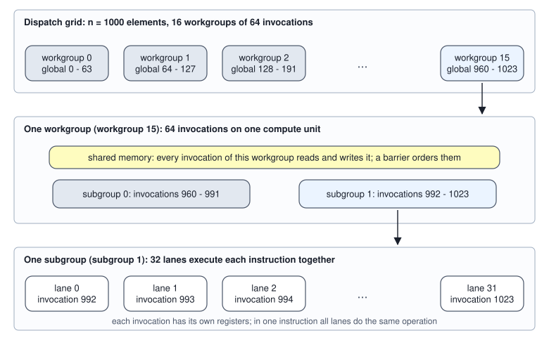
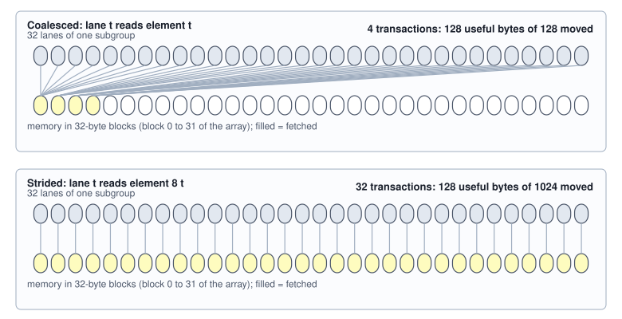

<!-- SPDX-License-Identifier: CC-BY-4.0 -->
<!-- Copyright (c) 2026 Martin Schröder <info@swedishembedded.com> -->

# The GPU: Thousands of Small Workers

*How does a GPU organize its thousands of threads, and what does that demand of our algorithms?*

## The problem

Add two vectors of 16 million floating-point numbers, $c_i = a_i + b_i$ for $i = 0, \ldots, 2^{24} - 1$. The work is as
plain as work gets: $2^{24}$ additions, each reading two numbers and writing one, so 201,326,592 bytes cross between memory
and the arithmetic (Volume IV, Chapter 3 counted 12 bytes per element). Here are the three machines of the last two
chapters doing it: one core of the CPU, the whole 10-core CPU, and the GPU of the roofline chapter, whose lanes the next
section builds.

<!-- worked: gpu.vector_add -->
c = a + b with n = 2^24 = 16,777,216 fp32 numbers. Work: 16,777,216 additions and 201,326,592 bytes (12 per element, 192 MiB). A round is every lane doing one addition; rounds = ceil(n / lanes). Arithmetic time = rounds / clock; memory time = bytes / bandwidth with the whole machine's bandwidth (80 and 800, in GB/s). Both are model outputs in milliseconds.

| machine | lanes | rounds | arithmetic (ms) | memory (ms) |
|---|---:|---:|---:|---:|
| one CPU core | 16 | 1,048,576 | 0.4194 | 2.5166 |
| the 10-core CPU | 160 | 104,858 | 0.0419 | 2.5166 |
| the GPU | 10,240 | 1,639 | 0.0008 | 0.2517 |
<!-- /worked -->

Read the table by columns. A GPU has 64 times
the lanes of the CPU (10,240 against 160) and finishes the arithmetic in 1,639 rounds instead of 104,858, but even the
CPU's arithmetic takes about a sixtieth of the time its memory needs. For this problem the arithmetic of every machine is
nearly free and the bytes decide, as Chapter 3 taught: the GPU's lead is its memory, 800 against 80 (GB/s), a factor of 10 and
not 64. Its 10,240 lanes sit idle for 99.7 percent of the time it takes to read the vectors ($0.0008 / 0.2517$).

Why, then, does a GPU come with ten thousand lanes? Because of a different question that the table leaves open. Memory
that can deliver 800 billion bytes in a second does not do so by magic: every request takes a few hundred cycles to come
back, and to receive bytes at the full rate the machine must have a very large number of requests outstanding at once.
Someone has to issue them. A single thread asks for a number and waits; a GPU keeps tens of thousands of threads asking at
the same time. This chapter is about how such a machine is built, how its threads are grouped, and what a program must do so
that the grouping works for it and not against it: which threads may cooperate, what happens when they disagree, how many
fit at once, and which addresses they must ask for so that memory answers all of them with few transactions.

## Before you begin

Answer from memory; the answers are at the end of the chapter.

1. (Volume I, Chapter 4, matrix multiplication.) How many floating-point operations does the product of an $[n, n]$ matrix
   with an $[n, n]$ matrix cost, counting a multiplication and an addition as one operation each?
2. (Volume I, Chapter 5, row-major layout and stride.) In a row-major $[1024, 1024]$ matrix of 4-byte numbers, how many bytes
   separate element $[i, j]$ from element $[i, j + 1]$, and how many separate it from element $[i + 1, j]$?
3. (Volume IV, Chapter 2, cache line.) A program reads one byte that is in no cache. How many bytes travel from memory?
4. (Volume IV, Chapter 2, SIMD.) What does one instruction do to a 256-bit register holding eight f32 numbers, and what is
   one of its eight positions called?
5. (Volume IV, Chapter 2, thread parallelism.) What does a `parallel for` promise about its iterations, and what must a
   program do when the iterations have to combine a result?
6. (Volume IV, Chapter 3, memory bandwidth and the roofline.) The vector addition has an arithmetic intensity of $1/12$
   FLOP per byte. On the GPU of Chapter 3 (peak 40,000 (GFLOP/s), bandwidth 800 (GB/s)), what fraction of the peak can it reach?

## The design of a GPU

*What this is for: the table of the problem leaves one fact unexplained, why a machine with ten thousand lanes is built at
all. We count what such a machine must contain, so that the rules of the later sections (groups of threads, limits on
residents, addresses) read as consequences of the design and not as arbitrary rules.*

Start from the counts. The CPU of Chapter 3 has 10 cores, each issuing vector instructions on 2 units of 8 lanes: 160
lanes. The GPU has 10,240. A CPU core is built to make one thread fast. It spends most of its silicon on caches, on a
machinery that finds independent instructions and runs them out of order, and on predicting branches, all so that a single
sequence of instructions waits as little as possible. A GPU spends the same silicon on lanes instead. Each thread gets little:
no large cache of its own, no reordering. A thread that asks memory for a number really does wait for hundreds of cycles.

The design is a trade: **throughput over latency**. The machine is not built to finish one thread quickly but to finish many
threads per second, and it keeps its lanes busy by never letting them depend on one thread's wait. The remaining question
is how, and it can be answered with the numbers of this section.

The **GPU architecture** that follows from the trade has four parts, in the model of this book (all numbers are parameters
invented for the book, not a product):

- Many **compute units** (80 here), each an independent small processor with its own lanes (128 here), its own register file,
  its own on-chip scratch memory (shared memory, a later section) and a scheduler that chooses, every cycle, which group of
  waiting threads issues the next instruction.
- A register file that is very large (65,536 32-bit registers per compute unit) because the registers of every resident
  thread live in it at once. Switching from a thread that waits to one that is ready therefore costs nothing: no registers
  are saved or restored, the scheduler just issues from a different thread.
- A memory system with high bandwidth and high latency: device memory shared by all compute units, behind a cache that is
  small per thread.
- A host, the CPU, which sends work to the device over a bus much slower than the device's memory (a later section).

<!-- worked: gpu.machine -->
Model parameters, round numbers invented for the book (not any product). The last column is the value the roofline chapter rounded to; the two differ by the rounding of 10,240 lanes to 10,000.

| quantity | this chapter | Chapter 3 |
|---|---:|---:|
| compute units | 80 | 80 |
| lanes per compute unit | 128 | - |
| lanes in all | 10,240 | about 10,000 |
| clock (GHz) | 2.0 | 2 |
| peak fp32 (GFLOP/s) = lanes x 2 x clock | 40,960 | 40,000 |
| memory bandwidth BW (GB/s) | 800 | 800 |
| subgroup size (invocations) | 32 | - |
| registers per compute unit (32-bit) | 65,536 | - |
| shared memory per compute unit (bytes) | 65,536 | - |
| resident invocations per compute unit, at most | 2,048 | - |
| resident workgroups per compute unit, at most | 16 | - |
| memory latency (cycles) | 400 | - |
| memory transaction (bytes) | 32 | - |
| host-device bus (GB/s) | 32 | - |
<!-- /worked -->

The peak in the table is the product of the three factors of Chapter 2: $10{,}240 \times 2 \times 2 \times 10^9 = 40{,}960
\times 10^9$ operations per second, which the roofline chapter rounded to 40,000. Chapter 3's comparisons keep that rounded
value (its ridge point is 50); this chapter uses only the bandwidth from it, and the one place where the peak enters, it says so.

### Hiding latency by having others to run

How many threads must be resident for the memory to be kept busy? This is a counting argument and needs no hardware detail.
The memory delivers $\mathrm{BW} = 800$ (GB/s). Each byte arrives $t_{\mathrm{lat}} = 400$ cycles at 2 GHz, 200 ns, after it was
requested. So at any moment the requests issued in the last 200 ns have not arrived yet: the data in flight is

$$
\mathrm{BW} \times t_{\mathrm{lat}} = 800 \times 10^9 \times 200 \times 10^{-9} = 160{,}000 \text{ bytes}.
$$

If fewer bytes than that are outstanding, the memory sits idle part of the time and the bandwidth is not reached. (Any
pipeline obeys the same arithmetic: the number of items in transit equals the rate times the time each spends in transit.)
Each thread keeps a few 4-byte loads outstanding; the rest of the 160,000 bytes must come from the number of threads:

<!-- worked: gpu.latency_hiding -->
BW = 800 (GB/s), latency = 400 cycles at 2 GHz = 200 ns, so bytes in flight = BW x latency = 160,000 bytes = 5,000 transactions of 32 bytes. Each invocation keeps `loads` independent 4-byte loads outstanding; every byte requested is used (perfect coalescing). Invocations needed = ceil(bytes in flight / (4 loads)); per compute unit = ceil(needed / 80); the last column is that as a percentage of the 2,048 resident invocations a compute unit can hold.

| loads in flight per invocation | invocations needed | per compute unit | % of a compute unit's 2,048 |
|---|---:|---:|---:|
| 1 | 40,000 | 500 | 24.4 |
| 2 | 20,000 | 250 | 12.2 |
| 4 | 10,000 | 125 | 6.1 |
| 8 | 5,000 | 63 | 3.1 |
<!-- /worked -->

With one load per thread in flight, 40,000 threads must be waiting on memory at the same moment, 500 on each compute unit.
That is the reason a GPU holds thousands of threads: not to do more arithmetic, but to have enough outstanding requests.
A thread that issues two independent loads before using either needs half as many threads, and so on down the table. The
same count for the CPU of Chapter 3 is 80 (GB/s) $\times$ 100 ns (250 cycles at 2.5 GHz) = 8,000 bytes, 125 cache lines of 64
bytes for the whole chip: a few outstanding requests per core, which a core's out-of-order execution and prefetching can
provide. A CPU hides latency with caches and speculation on a few threads, a GPU with a crowd of threads.

The crowd has a price that shapes everything below. Every resident thread holds its registers and, through its workgroup,
its share of the on-chip memory, and a compute unit has only so much of both. How many threads fit, and whether 500 of them
fit, is the question of the section on occupancy.

## SIMT: one instruction for a group of threads

*What this is for: a scheduler that chose an instruction for each of 10,240 lanes separately would cost more than the
arithmetic. The GPU's answer is to decide once for a group of lanes. We count what that costs when the lanes of a group
want different things.*

The lanes of Chapter 2 were the positions of a vector register, and one instruction worked on all of them: SIMD. A GPU
is programmed differently. The program describes one **thread**'s work, using scalar code for its own data, and the hardware
runs many copies of it. But it does not run them independently. The hardware gathers the threads into fixed groups of
$n_{\mathrm{sg}}$ threads (32 in this book's model; some hardware uses 64) and issues each instruction once for the whole
group, every lane applying it to its own registers. This is **SIMT execution**: single instruction, multiple threads. A group
of threads executed together in this way is a **subgroup**. (Some hardware and programming interfaces call it a warp or a
wavefront.) Compare with Chapter 2: a SIMD register has 8 or 16 lanes that the programmer or compiler fills explicitly; a
subgroup has 32 lanes that the hardware fills by grouping threads, and each lane has its own registers and, as far as
the program is concerned, its own control flow.

That last sentence is the catch. Suppose the program says: if the value is positive, do 10 instructions of work $A$, else do
6 instructions of work $B$. Lanes whose values differ in sign disagree about the next instruction. One instruction cannot be
issued for the whole subgroup as long as some lanes want $A$'s instruction and others $B$'s. The hardware runs the two paths
one after the other, with a mask that switches off the lanes that did not take the path being run: it issues the instructions of
$A$ with the $B$ lanes idle, then those of $B$ with the $A$ lanes idle. This is **divergence**. A subgroup in which all lanes
agree runs only the path they took, and costs nothing extra.

Count it. In the model, every invocation runs a test (1 instruction), then path $A$ (10) or path $B$ (6). A subgroup issues
the test once, then $A$ if any lane needs it, then $B$ if any lane needs it. The *issue slots* of a subgroup are its issued
instructions times 32 lanes; the *useful* ones are what each lane needs for itself.

<!-- worked: gpu.divergence -->
1024 invocations i = 0 .. 1023 in 32 subgroups of 32. Every invocation runs the test (1 instruction), then path A (10 instructions) or path B (6). A subgroup issues the test once, path A if any lane takes it, path B if any lane takes it. Issue slots = issued instructions x 32 lanes; useful slots = the instructions each lane needs itself; utilization = useful / slots. Generator: the book's SplitMix64, seed 0x852873088c080294 (the seed of the name `gpu.divergence`); u_0 .. u_1023 are 1024 calls of `uniform` in index order, the same draws for the two random rows.

| rule | invocations on A | subgroups with both paths | instructions issued | useful lane-instructions | issue slots | utilization (%) |
|---|---:|---:|---:|---:|---:|---:|
| path A when i is even | 512 | 32 | 544 | 9,216 | 17,408 | 52.9 |
| path A when (i // 32) is even | 512 | 0 | 288 | 9,216 | 9,216 | 100.0 |
| path A when u_i < 0.5 | 528 | 32 | 544 | 9,280 | 17,408 | 53.3 |
| path A when u_i < 0.05 | 56 | 27 | 494 | 7,392 | 15,808 | 46.8 |
| same flags as the row above, A elements first | 56 | 1 | 238 | 7,392 | 7,616 | 97.1 |

Probability that a subgroup of 32 disagrees with itself when each lane takes A independently with probability p: 1 - p^32 - (1 - p)^32 = 1.0000 (p = 0.5), 0.8063 (p = 0.05), 0.2750 (p = 0.01), 0.0315 (p = 0.001).
<!-- /worked -->

Read the rows. When lanes alternate (even and odd $i$), every subgroup diverges: it issues $1 + 10 + 6 = 17$ instructions to
do work that an agreeing subgroup finishes in 7 or 11, and 52.9 percent of the slots are useful. When the choice is made by
blocks of 32 (the second row) no subgroup disagrees with itself, though half the work is of each kind, and utilization is 100
percent. The two random rows disagree for the same reason: with probability $p$ per lane of taking $A$, a subgroup is mixed
with probability $1 - p^{32} - (1-p)^{32}$, which is 0.8063 even when only 1 lane in 20 takes $A$. The branch is rare per
lane and still occurs in four of every five subgroups. The last row arranges the same 56 lanes so that those taking $A$ come
first: one subgroup is mixed instead of 27 and utilization rises from 46.8 to 97.1 percent. The cost of divergence belongs to
subgroups, so the data layout and the assignment of work to lanes decide it.


The curve is not monotone, and the reason is worth seeing. For tiny $p$ almost every subgroup takes only $B$. For $p = 0.5$ almost
all are mixed, but the two paths together cost 17 against an average of 9 that each lane needs. Between, the rare path
$A$ is the long one (10 instructions) and nearly every subgroup pays for it while only a few lanes use it. The worst case is
a subgroup that pays for a long path that one lane needs.

Divergence has a cousin that needs no `if`. A loop whose trip count differs by lane runs until the slowest lane finishes, and
the others idle. And the last workgroup of a grid (next section) usually holds invocations past the end of the data, which
return at once while their subgroup mates work: a small, bounded divergence that is the price of whole groups.

## The programming hierarchy: invocation, workgroup, grid

*What this is for: a GPU is told what to do by one call that says "run this program for each of these many items". We name
the units of that call, show how a thread finds its own item, and see which units may cooperate.*

Take the vector addition of $n = 1000$ elements. The program for one **invocation**, one running copy of the program (this
book also says thread), handles one element. Where does it learn which one? Each invocation is given an index. The 1000
invocations are not numbered in a single flat space that the hardware schedules freely, for that would give no room for
cooperation. They are cut into **workgroups** of $n_{\mathrm{wg}}$ invocations (64 here). A workgroup is a set of invocations
that run together on one compute unit, can share an on-chip memory and can wait for each other. Workgroups are independent: they
may run in any order, on any compute unit, and nothing inside one dispatch orders one against another. The whole set of
workgroups of one call is the **dispatch grid**.

The grid has $\lceil n / n_{\mathrm{wg}} \rceil$ workgroups. Each holds $n_{\mathrm{wg}}/n_{\mathrm{sg}}$ subgroups, because the hardware
cuts a workgroup into subgroups of consecutive invocations. An invocation's global index is
$g = w \, n_{\mathrm{wg}} + l$ for its workgroup $w$ and its local index $l$ inside the workgroup.

<!-- worked: gpu.grid_indices -->
n = 1000 elements, workgroup size 64, subgroup size 32. Workgroups = ceil(n / 64) = 16; invocations dispatched = 16 x 64 = 1,024; idle = 24; subgroups per workgroup = 2. For global index g: workgroup = g // 64, local index = g mod 64, subgroup = (g mod 64) // 32, lane = g mod 32.

| global index g | workgroup | local index | subgroup in workgroup | lane | role |
|---:|---:|---:|---:|---:|---|
| 0 | 0 | 0 | 0 | 0 | works |
| 31 | 0 | 31 | 0 | 31 | works |
| 32 | 0 | 32 | 1 | 0 | works |
| 63 | 0 | 63 | 1 | 31 | works |
| 64 | 1 | 0 | 0 | 0 | works |
| 999 | 15 | 39 | 1 | 7 | works |
| 1000 | 15 | 40 | 1 | 8 | idle (g >= n) |
| 1023 | 15 | 63 | 1 | 31 | idle (g >= n) |
<!-- /worked -->



The program of the vector addition, in the book's pseudocode, is the pair of nested loops that the hardware runs
in parallel (`parallel for` was defined in Chapter 2 and is the contract: no iteration reads what another writes):

```text
require n >= 1, n_wg >= 1
n_grp = ceil(n / n_wg)
parallel for w in 0 .. n_grp:          # the workgroups of the grid
    parallel for l in 0 .. n_wg:       # the invocations of one workgroup
        g = w * n_wg + l
        if g < n:                      # the guard for the idle tail
            c[g] = a[g] + b[g]
```

For $n = 1000$ the grid holds $16 \times 64 = 1024$ invocations and 24 of them, all in workgroup 15, fail the guard and return:
the table shows `idle`. A grid is rounded up to whole workgroups, and the guard is what makes the rounding safe.

### Counting in the right unit

The dispatch call needs a number, and there are two plausible numbers: how many invocations, or how many workgroups. For the
vector addition each invocation owns one element, so the count is of invocations and the machine derives the workgroups. For a
program whose 64 invocations cooperate on one row of a matrix (the layer normalization of Volume III, Chapter 10, in the form
the last section shows), the unit of work is the workgroup, and the count must be rows, not invocations:

<!-- worked: gpu.dispatch_units -->
A kernel in which one workgroup of 64 invocations normalizes one row (the shape of a layer normalization over 512 rows). The dispatch must count workgroups, one per row. If the caller passes the row count as an invocation count, the grid holds ceil(512 / 64) workgroups.

| dispatch | workgroups | invocations | rows written | rows never written |
|---|---:|---:|---:|---:|
| one workgroup per row | 512 | 32,768 | 512 | 0 |
| row count taken as invocations | 8 | 512 | 8 | 504 |
<!-- /worked -->

Handing the row count to a call that counts invocations dispatches 8 workgroups, and 504 of 512 rows are never written. The
program does not crash, and the buffer holds whatever was there before. This is a hard mistake to see, because a wrong count
gives wrong numbers, not an error. The last section tells how brain made the unit part of the call.

## Shared memory: a cache you manage

*What this is for: invocations of one workgroup can read each other's results without going to device memory. We count the
reads this saves in a case small enough to trace by hand, and then in the matrix product that the next chapters build on.*

Each compute unit has an on-chip scratch memory, fast and small, that all invocations of a workgroup can read and write. It
is the **shared memory** of the workgroup: memory that belongs to the workgroup, lives as long as it runs and is invisible to
every other workgroup. Chapter 2's caches decide by themselves what to keep; shared memory keeps exactly what the program
puts in it, so it is a cache managed by the programmer: nothing enters or leaves without an instruction saying so. That is
more work and gives a guarantee: data placed there stays until the workgroup ends or overwrites it.

A small case. Each output is the sum of three neighbours, $y_t = x_{t-1} + x_t + x_{t+1}$, with zero beyond the ends. Done
directly, an invocation reads three numbers from device memory, and each number is read three times by three invocations.
Instead, a workgroup first loads its numbers into shared memory, each number by one invocation, and then every invocation reads
its three neighbours from there. For a workgroup of 64 that is $64 + 2$ reads of device memory instead of $3 \times 64$.

The loading is a phase and the summing is another phase, and the second must not start before the first is complete. A
**barrier** is a point that every invocation of a workgroup must reach before any continues; it separates the phases. In the book's
pseudocode it is the boundary between two consecutive `parallel for` loops over the invocations of a workgroup: the second starts only after
the first has finished for every invocation. To see what the barrier is for, run the case with 8 invocations in three orders. The shared memory
begins with leftover contents, 99 in every slot.

<!-- worked: gpu.stencil_barrier -->
x = [3, 1, 4, 1, 5, 9, 2, 6], y_t = x_(t-1) + x_t + x_(t+1) with x_(-1) = x_8 = 0, one workgroup of 8 invocations. Shared slots start as 99 (leftover). The sums of the first row are the correct answer.

| schedule | y0 | y1 | y2 | y3 | y4 | y5 | y6 | y7 |
|---|---:|---:|---:|---:|---:|---:|---:|---:|
| all writes, barrier, all reads | 4 | 8 | 6 | 10 | 15 | 16 | 17 | 8 |
| no barrier, threads run 0, 1, ..., 7 in turn | 102 | 103 | 104 | 104 | 105 | 113 | 110 | 8 |
| no barrier, threads run 7, 6, ..., 0 in turn | 4 | 104 | 104 | 105 | 113 | 110 | 107 | 105 |

Global reads for a workgroup of 64: without staging 3 x 64 = 192; staging in shared memory 64 + 2 = 66. For the workgroup of 8: 24 against 10.
<!-- /worked -->

The first row is the correct answer. In the second row each invocation runs completely before the next begins; invocation 0
reads slot 2 before invocation 1 has written it and gets the leftover 99 (and sums to 102, not 4). In the third row the order
is reversed and different outputs are wrong. Neither order is wrong for the hardware: with no barrier the program says nothing
about the order, and any order is legal. A program whose result depends on which one happens is a data race. With the barrier
between the writing phase and the reading phase every legal schedule gives the first row.

### The tile: reuse that the programmer arranges

The matrix product is the computation that the rest of the volume cares about, and the same idea applies. In $C = AB$ with
$[n, n]$ matrices every element of $A$ is needed by $n$ outputs. Chapter 2 tiled loops for a CPU cache and Chapter 3 counted the bytes that saves. On a GPU a workgroup of
$T \times T$ invocations computes a $T \times T$ tile of $C$. For each of the $n/T$ steps along the shared dimension it loads one
$T \times T$ tile of $A$ and one of $B$ into shared memory (one number per invocation), a barrier follows, every invocation does $T$
multiply-adds from shared memory, and another barrier precedes the next step. A workgroup loads $2 T^2 \cdot n/T = 2nT$ numbers
and there are $(n/T)^2$ workgroups, so global loads in all are $2n^3/T$.

<!-- worked: gpu.tile_reuse -->
C = A B with n = 1024, fp32, one workgroup per T x T tile of C; for each of n/T steps along the shared dimension it loads one T x T tile of A and one of B into shared memory (2 T^2 numbers, 8 T^2 bytes), so global loads = (n/T)^2 x (n/T) x 2 T^2 = 2 n^3 / T. Bytes = 4 x (loads + n^2 stores of C). N_flop = 2 n^3 = 2,147,483,648. 'Portable' asks for at most 256 invocations and 16 KiB of shared memory per workgroup (the baseline of the WebGPU floor).

| T | invocations per workgroup | shared bytes per workgroup | global loads | bytes moved | FLOP per byte | portable |
|---|---:|---:|---:|---:|---:|---:|
| 1 | 1 | 8 | 2,147,483,648 | 8,594,128,896 | 0.25 | yes |
| 4 | 16 | 128 | 536,870,912 | 2,151,677,952 | 1.00 | yes |
| 8 | 64 | 512 | 268,435,456 | 1,077,936,128 | 1.99 | yes |
| 16 | 256 | 2,048 | 134,217,728 | 541,065,216 | 3.97 | yes |
| 32 | 1,024 | 8,192 | 67,108,864 | 272,629,760 | 7.88 | no |
<!-- /worked -->

The loads fall in proportion to $T$, because every number loaded is used $T$ times, the same law as the tiling of Chapter 3. Two
limits appear at once. The shared memory per workgroup is $8T^2$ bytes and the invocations per workgroup are $T^2$, and both are capped:
brain's portable floor is 256 invocations and 16 KiB per workgroup (the last section), so $T = 32$ does not fit that floor even
though it fits this chapter's 64 KiB model. And even $T = 32$ reaches 7.88 FLOP per byte, below the ridge point of 50 of
Chapter 3: a tile in shared memory alone does not make the product compute-bound on this GPU. Chapter 6 adds the second level,
a small tile held in each invocation's registers, which is where the remaining factor comes from. The point for now is the
mechanism: reuse is something the program arranges, and it is limited by the size of shared memory.

## Occupancy

*What this is for: the previous sections asked for thousands of resident threads, each holding registers, and for shared
memory per workgroup. A compute unit has fixed amounts of both. We count how many workgroups fit.*

A compute unit holds a workgroup only if it can give it everything the workgroup needs for its whole life: its registers, its
shared memory and a slot. In the model a compute unit has 65,536 registers, 65,536 bytes of shared memory, room for 2,048
resident invocations and for at most 16 resident workgroups. A kernel (the program that every invocation runs) uses $N_{\mathrm{reg}}$ registers
per invocation, has $n_{\mathrm{wg}}$ invocations per workgroup and $N_{\mathrm{sh}}$ bytes of shared memory per workgroup. The number of workgroups
resident on one compute unit is the smallest of four limits:

$$
n_{\mathrm{res}} = \min\!\left(\left\lfloor \frac{65536}{N_{\mathrm{reg}}\, n_{\mathrm{wg}}} \right\rfloor,\;
\left\lfloor \frac{65536}{N_{\mathrm{sh}}} \right\rfloor,\;
\left\lfloor \frac{2048}{n_{\mathrm{wg}}} \right\rfloor,\; 16\right),
$$

with the second term absent when $N_{\mathrm{sh}} = 0$. The **occupancy** of the kernel is the fraction of the compute unit's
2,048 resident-invocation slots that this fills, $n_{\mathrm{res}}\, n_{\mathrm{wg}} / 2048$.

<!-- worked: gpu.occupancy_table -->
Per compute unit: 65,536 registers, 65,536 bytes of shared memory, 2,048 resident invocations, 16 resident workgroups. Resident workgroups = the smallest of 65,536 // (registers x size), 65,536 // shared bytes, 2,048 // size and 16; occupancy = resident invocations / 2,048. A model: real hardware allocates registers in blocks.

| kernel | workgroup size | registers per invocation | shared bytes per workgroup | resident workgroups | resident invocations | occupancy (%) | limited by |
|---|---:|---:|---:|---:|---:|---:|---|
| vector add | 256 | 8 | 0 | 8 | 2,048 | 100.0 | invocation slots |
| row normalization, 64 invocations | 64 | 24 | 512 | 16 | 1,024 | 50.0 | workgroup cap |
| matmul tile T = 16 | 256 | 40 | 2,048 | 6 | 1,536 | 75.0 | registers |
| matmul tile T = 32 | 1024 | 40 | 8,192 | 1 | 1,024 | 50.0 | registers |
| register-heavy kernel | 256 | 128 | 0 | 2 | 512 | 25.0 | registers |
| shared-memory-heavy kernel | 256 | 32 | 24,576 | 2 | 512 | 25.0 | shared memory |
<!-- /worked -->

Each row is limited by something different. The vector addition uses few registers and no shared memory and fills every slot. The
row normalization has small workgroups of 64 invocations, so the cap of 16 workgroups, not registers, stops it at 1,024 resident
invocations. The matrix tiles are limited by registers, 40 per invocation. The register-heavy and the shared-memory-heavy kernels
reach the same 25 percent by different routes. The numbers are a model: real hardware gives out registers and shared memory in
blocks, so real calculators have more terms, and the right way to know a kernel's occupancy is to ask the driver. The method
of counting does not change.


Why does anyone care about the percentage? Because of the latency count of the first section: with one 4-byte load per
invocation in flight, a compute unit needs 500 resident invocations (24.4 percent of 2,048) to keep its share of memory
busy, and occupancy below that leaves the memory idle part of the time and the kernel starved. The staircase turns that into a
rule for registers:

<!-- worked: gpu.register_cliff -->
Resident invocations per compute unit as the registers per invocation grow, no shared memory. One 4-byte load in flight per invocation needs 500 resident invocations per compute unit (the first row of the latency table). The cliff after 128 registers is the integer division 65,536 // (r x size).

| registers per invocation | size 64 | size 256 |
|---|---:|---:|
| 64 | 1024 (enough) | 1024 (enough) |
| 96 | 640 (enough) | 512 (enough) |
| 128 | 512 (enough) | 512 (enough) |
| 129 | 448 (too few) | 256 (too few) |
| 160 | 384 (too few) | 256 (too few) |
| 255 | 256 (too few) | 256 (too few) |
<!-- /worked -->

Up to 128 registers per invocation, workgroups of 256 keep 512 invocations resident, enough. At 129 the integer division gives 1
workgroup, 256 invocations, and the compute unit can no longer hide its latency. One extra register halves the resident
threads: this is why the registers of a kernel matter to a speed that no count of its arithmetic shows. A workgroup of 1,024 with
65 registers per invocation does not fit at all, and the plot's line falls to zero.

Occupancy is a means. A kernel with 4 independent loads per invocation needs only 125 resident invocations (6.1 percent), so a
kernel that keeps more of its own work in flight can run with fewer, fatter threads, and many fast kernels do exactly this
(more registers per invocation, lower occupancy). A kernel with a chain of dependent instructions, each waiting for the last,
has no such alternative and needs the crowd. The honest summary: the number to compare with occupancy is the
bytes in flight that the kernel's threads keep outstanding, and high occupancy is one way of getting it.

## Memory coalescing

*What this is for: the memory delivers bytes in blocks, and a subgroup asks for 32 addresses at once. Whether those addresses
fall in few blocks or in many decides how much of the bandwidth the program uses.*

Device memory does not return single numbers. It answers in aligned blocks of a fixed size, which the model takes to be 32
bytes and calls a **transaction** (Chapter 2's cache line, for the GPU's memory system). When a subgroup issues one load, the
hardware looks at the 32 addresses, finds the distinct blocks they fall in, and issues one transaction for each. Adjacent
invocations reading adjacent addresses fall in the same blocks and are merged into few transactions; this merging is **memory coalescing**.

Count it. Each lane reads one 4-byte number, 128 useful bytes in all. Lane $t$ reads element $\mathit{start} + t \times \mathit{stride}$:

<!-- worked: gpu.coalescing_strides -->
One load instruction of a subgroup of 32 invocations; lane t reads the 4-byte number at element start + t x stride of an array that begins on a 32-byte boundary. Transactions = number of distinct 32-byte aligned blocks touched. Useful bytes = 32 x 4 = 128. The last column is the model's streaming bandwidth, 800 (GB/s) times the useful fraction.

| stride (elements) | transactions | bytes moved | useful (%) | effective GB/s |
|---|---:|---:|---:|---:|
| 1 | 4 | 128 | 100.0 | 800.0 |
| 1, starting at element 1 | 5 | 160 | 80.0 | 640.0 |
| 2 | 8 | 256 | 50.0 | 400.0 |
| 3 | 12 | 384 | 33.3 | 266.7 |
| 4 | 16 | 512 | 25.0 | 200.0 |
| 8 | 32 | 1024 | 12.5 | 100.0 |
| 16 | 32 | 1024 | 12.5 | 100.0 |
| 1,024 | 32 | 1024 | 12.5 | 100.0 |
<!-- /worked -->

With stride 1 the 32 numbers fill 4 blocks completely: 4 transactions, 128 bytes moved for 128 useful, every byte used. With stride 2
half of every block is wasted; at stride 8 each lane lands in a block of its own, 32 transactions move 1,024 bytes for 128 useful,
and the program uses one byte in eight. Beyond that nothing gets worse, since 32 lanes cannot touch more than 32 blocks. The
second row shows an effect that needs no stride: a subgroup that starts one element past a block boundary reads 5 blocks, not 4.
If all 32 lanes read the same address (a broadcast, such as the first element of a row) they share one transaction.

The last column turns the count into a bandwidth: with stride 8 the program receives 12.5 percent of the 800 (GB/s), 100 (GB/s), however
well everything else is arranged. In the language of Chapter 3, strided access lowers the effective bandwidth, so the roofline of
a kernel that reads that way is not the one drawn from the peak bandwidth.



### Rows and columns of a matrix

Volume I's row-major layout makes the stride concrete. In a $[1024, 1024]$ matrix of 4-byte numbers, neighbours in a row are 4 bytes
apart and neighbours in a column are 4,096. A subgroup whose lane $t$ reads $A[i, j_0 + t]$ reads consecutive addresses; one whose
lane $t$ reads $A[i_0 + t, j]$ reads addresses 4,096 bytes apart, 32 blocks. So the lane index should be the index that varies fastest
in memory. Reading the whole matrix once, and then transposing it, shows the size of the effect:

<!-- worked: gpu.matrix_access -->
A is [1024, 1024] fp32 in row-major layout, 4 MiB, starting on a 32-byte boundary: 32,768 subgroup loads cover it once. Lane t of a subgroup reads A[i, j0 + t] (row) or A[i0 + t, j] (column); the transactions are counted per load instruction, as if no cache held the blocks between instructions (the count of requests, an upper bound on the bytes from memory). A transpose does the same number of loads and stores.

| access | subgroup instructions | transactions each | transactions | MiB moved |
|---|---:|---:|---:|---:|
| read all of A, lanes along a row | 32,768 | 4 | 131,072 | 4 |
| read all of A, lanes down a column | 32,768 | 32 | 1,048,576 | 32 |
| transpose, rows read and columns written | 65,536 | - | 1,179,648 | 36 |
| transpose through a 32 x 32 tile in shared memory | 65,536 | - | 262,144 | 8 |
<!-- /worked -->

Reading by columns requests 8 times the transactions of reading by rows. A transpose that reads rows (coalesced) must write
columns (strided), 1,179,648 transactions in all, because one of its two sides is always against the layout. The remedy is the
shared memory of the last section. A workgroup reads a $32 \times 32$ tile with its lanes along rows, stores it in shared
memory, and after a barrier writes it back with its lanes again along rows of the *output*, taking the numbers from shared memory
in the transposed order. Both global sides are coalesced and the count falls to 262,144, 4.5 times fewer. The transposition happens in
shared memory, where the access order costs nothing in transactions. (Shared memory is itself organized in banks that have their own
conflicts, a detail left to the later chapters on matrix products.)

The counts above are of *requests* per load instruction, as if nothing remembered a block between instructions. A real memory
system has caches, and in the column read the blocks fetched for column $j$ are needed again for column $j + 1$ and may still be
in cache then, as in the cliff of Chapter 2. The requests still occupy the load units, and the working set must stay resident
long enough, so the count is an upper bound on the bytes from device memory and not a prediction of them.
The remedy does not depend on this: make the consecutive lanes consecutive in memory.

## Host and device

*What this is for: the GPU is a second computer attached to the first by a bus. The cheapest computation on the device can still be
the most expensive part of a program if its data has to cross the bus each time.*

Everything so far took the data as already being in device memory. A GPU is a separate computer with its own memory, attached
to the host by a bus that is much slower than the memory on either side of it: 32 (GB/s) in the model, against the GPU's 800. (Integrated GPUs, which share memory with the
host, have no such copy, and a program can ask the device whether it is one.) The host prepares work and sends it; the device
executes it later, on its own. Take the addition of the first section with its vectors starting on the host and the result needed on the host:

<!-- worked: gpu.transfers -->
c = a + b of Section 1 with the data starting on the host: bytes over the bus = 201,326,592 (a and b up, c back), bus 32 (GB/s), device memory 800 (GB/s). Times are bytes / rate, a model.

| step | bytes | milliseconds |
|---|---:|---:|
| a and b up, c down over the bus | 201,326,592 | 6.2915 |
| the addition itself, memory bound on the device | 201,326,592 | 0.2517 |
| bus time / device time | - | 25.0 |
<!-- /worked -->

The three vectors cross the bus once each, 201,326,592 bytes, and moving them takes 25 times as long as the addition. The device does
the arithmetic in 4 percent of the time that the program spends. When does moving the data pay for itself? Only when the work done on it
is large compared with the bytes moved. The peak of 40,000 (GFLOP/s) against the bus of 32 (GB/s) gives $40000/32 = 1250$ operations that
the device could do per byte that crosses. A computation must do more than that per bus byte for the arithmetic, not the bus, to be the
longer time. For a matrix product of two $[n, n]$ matrices, $n/6$ operations per bus byte:

<!-- worked: gpu.bus_break_even -->
C = A B for [n, n] fp32 matrices that start on the host: A and B go up, C comes back, 12n^2 bytes over a 32 (GB/s) bus; the arithmetic runs at the 40,000 (GFLOP/s) peak of Chapter 3. Intensity per bus byte = 2 n^3 / (12 n^2) = n / 6; the break-even is F_pk / bus = 1,250 FLOP per bus byte, so n = 7,500.

| n | FLOP per bus byte | bus (ms) | arithmetic at peak (ms) | longer |
|---:|---:|---:|---:|---|
| 1,024 | 170.7 | 0.3932 | 0.0537 | bus |
| 4,096 | 682.7 | 6.2915 | 3.4360 | bus |
| 8,192 | 1,365.3 | 25.1658 | 27.4878 | arithmetic |
| 16,384 | 2,730.7 | 100.6633 | 219.9023 | arithmetic |
<!-- /worked -->

Only beyond $n = 7500$ does the arithmetic take longer than the bus, and the bus times use only the bandwidth, no latency or setup.
The rule that follows is the most important one for a program: data goes to the device once and stays. Weights are uploaded when
the model is loaded, activations are produced and consumed on the device, and what comes back is the small result that the host
needs (a loss, a token), not the intermediates. The host and the device also run at different times: the host *enqueues* a
dispatch and goes on, and the device performs it later. A program that measures the time of a loop of enqueues measures the host.
The last section tells what that did to a measurement in brain.

## What a GPU demands of an algorithm

Collect what the sections counted, in the order an algorithm meets it:

- Enough independent work items: tens of thousands in flight (40,000 loads in the model), or fewer with more independent loads per
  item, for the memory to be saturated, and many more items than lanes for the compute to be.
- Uniform control flow inside a subgroup: choose the assignment of items to lanes so that the lanes of one group of 32 take the same
  branch, and sort or bucket the data when they cannot.
- Coalesced access: the lane index is the fastest-varying index in memory, rows start on block boundaries (a row of 770 numbers
  has one start in four on a boundary and the rest cost a fifth block).
- Reuse through shared memory when each number is needed by many invocations, with the tile limited by shared memory and workgroup size.
- Resources per invocation low enough for the occupancy that the latency needs.
- Data on the device, and a dispatch that does enough work to pay for its start (Chapter 3).

None of these changes the arithmetic of the algorithm. All of them change how many bytes move, how many lanes work, and how many waits are hidden.
The next chapter turns them into programs.

## Where this appears in brain

brain is organized so that a model never states any of this. `crates/gpu-core` is the one facade over the compute devices, and
its code is the book's hierarchy made explicit.

**The facade: `crates/gpu-core/src/lib.rs`.** A `Gpu` wraps a backend (`backend_api::Backend`) chosen at run time among the four
that the repository rules name: wgpu (the default), a CPU just-in-time compiler of the same shaders, Vulkan and CUDA. Model code
holds only the neutral types `DeviceBuffer` (a buffer in device memory) and `Step` (one recorded dispatch). It allocates with
`Gpu::storage` or `Gpu::storage_init` (an upload, once), records a dispatch with `Gpu::dispatch(kind, bufs, params, grid)`, hands a list of steps to
`Gpu::submit`, and brings a result back with `Gpu::read`. `kind` is the position of a
kernel in the list of programs the `Gpu` was built with, and `params` are the 32-bit words of its small uniform block. Which devices
a process may use is the `--device` grammar of `crates/gpu-core/src/devices.rs`: `gpu`, `cpu`, `gpu0`, `gpu0,gpu1`, `cpu0-7`, `gpu1,cpu0-3`
and so on, parsed by a pure function (`DeviceSpec::parse`) that needs no hardware, and resolved against the machine in a second step.

**The device queried, not assumed: `DeviceCaps`.** The numbers that this chapter took as parameters are fields that
the backend asks the device for: `compute_units` (absent where the interface does not report it, as in wgpu),
`max_workgroup_size`, `workgroup_mem_bytes`, `subgroup_size` (`None` on the WebGPU baseline), `unified_memory`, and the
`peak_bandwidth_gbs` and `peak_gflops` (no interface reports those two, so `crates/gpu-core/src/roof.rs` measures them, as Chapter 3 told). Commit
2a3aff233 (July 2026) introduced the structure, with the rule that every value is queried and an unknowable one is
`None` or `false`, never a guess. The portable baseline in the code (`DeviceCaps::portable_baseline`) is a workgroup of at most 256 invocations and 16 KiB of
shared memory, which are the numbers of the tile table above.

**The unit of a dispatch.** The `Dispatch` type of `crates/gpu-core/src/lib.rs` is the section "Counting in the right unit" as code:
`Dispatch::Threads(n)` dispatches $n$ invocations and `Dispatch::Workgroups(n)` dispatches $n \times n_{\mathrm{wg}}$, where the
workgroup size is read from the kernel's own `@workgroup_size` at registration. A kernel that calls `workgroupBarrier` is a *cooperative* one,
and `Gpu::step`, which takes a raw invocation count, refuses it with a panic that names the kernel. Commit 5fecb11ff (September 2026)
records why. Dozens of kernels were cooperative, their threads sharing a row or a tile, and every call site multiplied the item count by
the workgroup size itself. A site that got the unit wrong dispatched too few workgroups, the kernel wrote the first slice of its
output, and no loss or crash showed it, because training read those buffers through a different kernel. The commit message reports a
checkpoint that scored 16 percent where the same weights scored 98 percent; this was not rechecked here, but the mechanism is the
504-of-512 table above. A second commit, 1ec9416cf, shows how a guard can be wrong in the other direction: the function that
reads a shader to decide whether it is cooperative read its raw text, so eight shaders whose headers only *mention* a barrier (most
to say they have none) were refused their correct dispatches. The reading is now of the code with comments removed
(`wgsl_code_only`). The two commits count 77 and then 69 cooperative kernels; that count is theirs, and the number is not
what the lesson depends on. The lesson is to put the unit into the type and to read facts about a program from the program.

**Why the portable kernels are written as they are.** The repository's rule (`AGENTS.md`) is that the reference shaders live in
`crates/kernels/wgsl/` and stay core-compute: fp32 arithmetic, at most 8 storage buffers, no atomics, no subgroups, no
half-precision. Faster providers (tensor cores, CUDA, cooperative matrices) are selected through a seam and gated against them. The
reason is portability: the same files run on old desktop GPUs, in the browser and on the CPU compiler, and the portable subset is
what all of them accept. For the subgroups of this chapter, a program may not assume that 32 invocations move in lockstep: some devices run 64, and the
baseline exposes no subgroup operation at all (`DeviceCaps::subgroup_size` is `None` there, and where it is reported it is a
minimum). So a reduction is never written as a lane-to-lane shuffle. It goes through shared memory and a barrier, which every
device has, and this costs a few more instructions than a subgroup operation, in exchange for one file that runs everywhere. The limit of 8 storage
buffers is the downlevel default of the wgpu backend raised to 8 and then held (`crates/backend-wgpu/src/lib.rs`). The default
workgroup is 64 invocations, with 256 for the register-tiled matrix products.
A capability still gates the choice: a variant that needs a barrier is selected only where `DeviceCaps::workgroup_reductions` is
true. It is false on the CPU compiler, and knowledge #26 records what happens without the gate: a kernel with barriers recorded on the CPU backend
aborted the whole process with a memory error and no kernel name, because the guard had been put around the submission and not around the recording.

**Coalescing in a real kernel: `layernorm.wgsl` and `layernorm_rows.wgsl`.** The two layer-normalization kernels are the chapter's two
access patterns in code. In `crates/kernels/wgsl/layernorm.wgsl` invocation $t$ owns row $t$ and walks it with three serial loops, so
the 32 lanes of a subgroup read addresses $d$ numbers apart. In `crates/kernels/wgsl/layernorm_rows.wgsl` one workgroup of 64 invocations
walks one row with stride 64, two subgroups reading 32 consecutive numbers each, and the partial sums go through a 64-entry shared
array and one barrier. The table counts the transactions of both for 32 rows:

<!-- worked: gpu.layernorm_access -->
Reading 32 rows of a [rows, d] fp32 matrix once. 'Row per invocation': lane t owns row t and reads column c at step c (d steps). 'Workgroup per row': 64 invocations read one row, invocation u reading columns u, u + 64, ... (two subgroups, lane t of subgroup b reading column 64 k + 32 b + t at step k; lanes past d idle). Transactions are counted per subgroup load as in the previous table; the row is a multiple of 32 bytes only when 4 d is. Ideal = 32 d x 4 / 32.

| d | row per invocation | workgroup per row | ideal | first / second |
|---|---:|---:|---:|---:|
| 768 | 24,576 | 3,072 | 3,072 | 8.00 |
| 1000 | 32,000 | 4,000 | 4,000 | 8.00 |
| 1024 | 32,768 | 4,096 | 4,096 | 8.00 |
| 3072 | 98,304 | 12,288 | 12,288 | 8.00 |
| 770 | 24,640 | 3,680 | 3,080 | 6.70 |
<!-- /worked -->

The first four rows are the ratio of 8 that the stride table predicts, and the last row is the row of 770 numbers, whose rows are not
block-aligned and cost a fifth block. Commit 6559bc7fe (July 2026) made the change and says what it saw: a warp's 32 loads `d` floats
apart, each 32-byte sector serving one useful float, which is the 12.5 percent of the table. The commit reports a measured gain:

<!-- perf-number: historical measurement, commit 6559bc7fe -->
In July 2026, on one older discrete GPU, the commit measured the workgroup-per-row kernels between 2.8 and 9.7 times as fast as the row-per-thread ones over the sizes it swept.

The range contains the count of 8, but the two are different things: the count is of requested transactions in one pass, the
measurement is of whole kernels. The commit also records a limit worth keeping: the layer normalization was a small part of the whole training step, which was dominated
by a different serial reduction. The selection rule that keeps the kernel in use is in `crates/backend-api/src/select.rs`.

**An idle part of a tile: knowledge #15.** A selection rule can also be wrong about waste. `pick_gemm` in `crates/model/src/block.rs`
returned a count of $\lceil m/128 \rceil \lceil n/128 \rceil$ workgroups for a $128 \times 128$ tile, and used to refuse the tile when $m < 128$ on the
reading that a partial tile wastes lanes. The case that exposed it was $m = 77$, $n = 2560$: 20 workgroups, of which the
rows are $77/128 = 60.2$ percent full. In this chapter's model, 20 workgroups also occupy 20 of 80 compute units at most. Knowledge #15
and commit 6cfc15861 (August 2026) report that the alternative, one invocation per output element each walking the shared dimension
serially, was far worse: the tile kernel was faster from 8 rows on, and the threshold is now 8
(`GEMM_TILE_MIN_ROWS`, tested in `pick_gemm_routes_by_the_measured_crossover`). The idle fraction of a partial tile is a cost
that has to be compared with the cost of the other choice and not with zero.

**One device per process.** The rule of `AGENTS.md` is that a process holds one GPU device and shares it (`Gpu::share`, `Gpu::new_like`,
`share_or_new`), and that tests get theirs from `gpu_core::testgpu::dev`. Knowledge #13 states a consequence of the `kind` index
described above: kernel indices are positions in a crate's own list, so a `Gpu` built from one crate's kernel set binds the wrong pipelines
for another's, and a process that mixes models uses `Gpu::new_like`, which gives a different kernel set on the same device. The rule itself came from
commit 061202f6c (July 2026). A test binary running eight tests at once built a device for every model object, and on the machine it was
developed on this put some two dozen live devices on one card, which deadlocked the driver in about half of the runs. The commit
also reports that a device surviving into process exit crashed the driver's thread after all tests had passed.
Those numbers belong to one driver and one box. The general lesson is that a GPU is a shared resource with one queue of work, and the facade should make
the number of devices something a reader can count by reading the code, which is why sharing is explicit and the test fixture
is a pool of weak handles that lets the device die in an orderly way with its last user.

**Timing: knowledge #6.** `Gpu::submit` on the wgpu backend usually only *enqueues* work: with no buffers to clear it appends the steps to a pending list. A loop of
bare `submit` calls therefore timed the host building bind groups and reported it as device bandwidth.

<!-- perf-number: historical measurement, commit 883b40b0c -->
In July 2026, on one discrete card, the lesson's example reported 377 (GB/s) on a card whose roof was about 346 (GB/s).

Two tells gave it away, a number above the physical roof and a cost that did not change
with size. The remedy is `Gpu::poll_wait`, which flushes the queue and blocks until the device is done, around every timed
region (`.agents/rules/kernels.md`, section E.0), and the habit of the roofline chapter: compute the roof first, and distrust a result above it.

## Check your understanding

1. A student says: "The GPU has 64 times as many lanes as the CPU, so adding two vectors of 16 million numbers is about 64 times
   faster on it." Using the table of the problem, find the error and give the factor that the model does support.
2. A kernel has each lane test `x[i] > 0` and take a long path ($A$, 10 instructions) or a short path ($B$, 6) as in this chapter's
   model. Explain why the utilization of a subgroup can be 100 percent when half the lanes take each path, and 47 percent when
   only one lane in twenty takes $A$.
3. A programmer dispatches a kernel with 64 invocations per workgroup for 100 rows, passing 100 as the count of invocations, and one workgroup
   per row is what the kernel needs. How many rows are written? Why does the program neither crash nor report an error?
4. In the three-neighbour sum of the stencil section, thread 3 reads slot $s[5]$, written by thread 4. Explain why the program can give a
   different answer on a different run without a barrier, and what the barrier changes.
5. A kernel uses 130 registers per invocation with workgroups of 256 and no shared memory. Use the model to compute $n_{\mathrm{res}}$ and the
   occupancy, and say whether 500 resident invocations per compute unit are available. What single change brings the occupancy
   back above the needed 24.4 percent?
6. Find the error: "To make the column-wise read of a $[1024, 1024]$ matrix as fast as the row-wise one, launch eight times as many
   invocations so that more transactions are in flight."
7. Two layers are alike, but the first has rows of 768 numbers and the second rows of 770 numbers. Both are read by a workgroup per row
   with 64 invocations. Explain from the table of the last section why the second reads more transactions than the ideal and the first does not.
8. A program computes a small function of two vectors of $2^{20}$ numbers on the device, once per training step, and uploads the
   vectors every step. Estimate the bus traffic and say what to change.

## Exercises

1. **[Calculate]** For the vector addition of $2^{26}$ elements, find the operations, the bytes, the rounds on the GPU of this chapter
   ($\lceil n/10240 \rceil$), the arithmetic time and the memory time. What fraction of the time are the lanes busy?
2. **[Calculate]** A GPU has 100 compute units, 60 ns of memory latency and 1,000 (GB/s) of bandwidth. Find the bytes in flight, the
   invocations needed with 2 four-byte loads per invocation, and the number per compute unit.
3. **[Calculate]** A subgroup of 32 lanes runs a loop whose trip count is the lane's own index plus 1 (lane $t$ does $t + 1$
   iterations of 3 instructions). How many instructions does the subgroup issue, how many do the lanes need together, and what is
   the utilization?
4. **[Calculate]** A kernel with workgroups of 128 invocations uses 48 registers per invocation and 12,288 bytes of shared memory per
   workgroup. Find $n_{\mathrm{res}}$, the limiting resource and the occupancy for this chapter's compute unit.
5. **[Calculate]** For a $[2048, 2048]$ fp32 matrix, count the transactions to read it by rows, to read it by columns, and to transpose
   it naively and through $32 \times 32$ tiles in shared memory.
6. **[Implement]** Reproduce `gpu.divergence`: draw $u_0, \ldots, u_{1023}$ with the book's generator from the seed
   printed in the table, count the mixed subgroups for the two random rows and the utilization of every row.
7. **[Implement]** Reproduce `gpu.occupancy_table` and `gpu.register_cliff` from the formula for $n_{\mathrm{res}}$, and extend the
   cliff table with workgroups of 128 and the registers 100 to 135.
8. **[Implement]** Reproduce `gpu.coalescing_strides` and `gpu.layernorm_access` by listing the 32 byte addresses of a load and counting
   the distinct 32-byte blocks. Add the row length $d = 771$ to the second table and explain the number.
9. **[Implement]** Reproduce `gpu.stencil_barrier` by simulating the shared array and the three schedules. Add a fourth schedule in which the
   threads run in the order $0, 2, 4, 6, 1, 3, 5, 7$ and give $y$.
10. **[Investigate]** Compute $\mathrm{BW} \times t_{\mathrm{lat}}$ for your own machine's GPU from its published bandwidth and a latency
    you measure with a pointer-chasing loop, and compare the bytes in flight with the capacity of its register file. State your
    device, its driver and the number of repetitions, and explain any case in which the register file cannot hold the invocations that the count asks for.
11. **[Investigate]** Write a kernel for your own device that copies a $[4096, 4096]$ matrix and another that transposes it, each in a
    coalesced and a strided form, and report the achieved bandwidth as a fraction of the device's measured copy bandwidth. State the timer, the
    way you wait for the device before reading it, and the minimum over repetitions.

## Summary

A GPU spends its silicon on lanes where a CPU spends it on making one thread fast. The machine is a set of compute units, each with
lanes, a large register file and a small on-chip memory, over a memory that has high bandwidth and high latency. It reaches its
bandwidth by having bytes in flight equal to the product of bandwidth and latency, 160,000 bytes in the model, which takes tens of thousands of
resident threads: waiting is hidden by running others, which costs nothing because the registers of every resident thread are in the
register file. The threads execute in subgroups of 32, one instruction at a time for the whole group, so lanes of a subgroup that
branch differently make the group run both paths, and the cost is set by how the data is assigned to lanes. A program names its work
as a grid of workgroups of invocations; the invocations of a workgroup share a memory on the compute unit that the programmer manages, and
wait for each other at barriers; workgroups are independent. A compute unit holds as many workgroups as its registers, its shared memory
and its slots allow, and the occupancy so computed has to supply the invocations that latency hiding needs. Memory is read in blocks, so
adjacent lanes should read adjacent addresses: a stride of eight numbers wastes seven eighths of the bandwidth. And the bus between
the host and the device is far slower than device memory, so data stays on the device.

All the counts are of work: invocations, rounds, bytes in flight, issue slots, resident workgroups, transactions and bus bytes. None
needs a clock beyond the model's stated parameters.

What this chapter could not say is how one writes the programs that run on this machine. It used a kernel as a given and named
its index arithmetic, its guard and its barriers in pseudocode. Chapter 5 turns that into the way a computation is expressed so that a GPU can
run it: the kernel, the dispatch, the buffers, and the discipline of describing their layout.

## Key terms

- **GPU architecture**: the organization of a graphics processor used for computing: many compute units, each with lanes, a large register file, a small on-chip memory and a scheduler, over a memory of high bandwidth and high latency, built for throughput and not for the speed of one thread. <!-- concept: gpu-architecture -->
- **SIMT execution**: single instruction, multiple threads: the hardware issues each instruction once for a fixed group of threads, each applying it to its own registers, so a program is written for one thread and the group's lanes are filled by the hardware. <!-- concept: simt-execution -->
- **workgroup**: a set of invocations of one dispatch that run together on one compute unit, share an on-chip memory and can wait for each other at a barrier, while different workgroups are independent. <!-- concept: workgroup -->
- **subgroup**: the group of consecutive invocations of a workgroup, 32 in this book's model, that the hardware executes with one instruction at a time. <!-- concept: subgroup -->
- **shared memory**: the small, fast, on-chip memory of a compute unit that all invocations of one workgroup can read and write and no other workgroup can see, a cache whose contents the programmer chooses. <!-- concept: shared-memory -->
- **occupancy**: the fraction of a compute unit's resident-invocation slots that a kernel fills, limited by the registers per invocation, the shared memory per workgroup, the workgroup size and the cap on resident workgroups. <!-- concept: occupancy -->
- **memory coalescing**: the merging of the loads or stores of the lanes of a subgroup into few memory transactions when they touch adjacent addresses, so that all the bytes of each block moved are used. <!-- concept: memory-coalescing -->

## Answers

**Before you begin**

1. $2n^3$: $n^2$ outputs, each a dot product of length $n$ with $n$ multiplications and about $n$ additions. (Volume I, Chapter 4.)
2. 4 bytes along a row and $1024 \times 4 = 4096$ bytes down a column, because an element is 4 bytes and a row holds 1024 of them. (Volume I, Chapter 5.)
3. 64: the whole cache line that contains the byte. (Volume IV, Chapter 2.)
4. It does the same operation, for example eight additions, on all eight positions at once; a position is a lane. (Volume IV, Chapter 2.)
5. That no iteration reads anything another writes, so they may run in any order or at once; iterations that must combine results use an
   explicit reduction (per-worker partial results combined afterwards), never a shared variable. (Volume IV, Chapter 2.)
6. $(1/12) \times 800 / 40000 = 0.00167$, about 0.17 percent of the peak: the bandwidth bounds it, as in Chapter 3.

**Check your understanding**

1. The arithmetic is not what limits the addition. The table gives $0.0008$ milliseconds for the GPU's arithmetic against 0.2517 milliseconds for its
   memory, so 99.7 percent of the time the lanes are idle. The factor the model supports is the bandwidth ratio, 800 / 80 = 10
   (2.5166 milliseconds against 0.2517 milliseconds), not the ratio of lanes.
2. The subgroup issues a path if any lane takes it. Splitting by blocks of 32 puts all lanes of a subgroup on the same path, so no
   subgroup runs both and nothing is wasted. With 1 lane in 20 taking $A$, 80.6 percent of subgroups contain at least one such lane and
   run the 10-instruction path for it, while the other lanes idle, so about half of the slots are useful (46.8 percent in the run).
3. $\lceil 100/64 \rceil = 2$ workgroups, so 2 rows are written and 98 are not. The count is a valid number for a dispatch, the grid is
   well formed, and nothing in the device knows how many rows the kernel meant to write; the unwritten part of the buffer holds earlier
   contents, which are plausible numbers.
4. Without a barrier nothing orders thread 3's read of $s[5]$ against thread 4's write; either may happen first, depending on how the hardware schedules
   the subgroups, and the read gets either the written value or the leftover. The barrier forces all writes before any read, so every legal
   schedule gives the same answer.
5. $\lfloor 65536 / (130 \times 256) \rfloor = \lfloor 1.97 \rfloor = 1$; the other limits are 8 (slots) and 16. So one workgroup, 256 invocations, occupancy 12.5
   percent: fewer than the needed 500. Using at most 128 registers per invocation gives 2 workgroups, 512 invocations, 25 percent, enough.
6. Launching more invocations does not change the addresses of a single subgroup load: each still touches 32 blocks. More requests in flight
   only increases the transactions, each carrying 4 useful bytes of 32. The fix is to change which index the lane takes, or to transpose through shared memory.
7. A row of 768 numbers is 3,072 bytes, a multiple of 32, so every row begins on a block boundary and a subgroup load of 32 consecutive numbers
   covers exactly 4 blocks. A row of 770 numbers is 3,080 bytes, 8 more than a multiple of 32: rows after the first start at offsets 8, 16, 24 bytes
   inside a block, so a 128-byte read spans 5 blocks. The table shows 3,680 against 3,080 ideal.
8. The two vectors are $2 \times 4 \times 2^{20}$ bytes = 8,388,608 bytes (8 MiB) up, and the result is a few bytes back. At 32 (GB/s) the bus needs
   about 0.262 milliseconds; the device reads the same bytes from its memory in about 0.0105 milliseconds ($8{,}388{,}608 / (800 \times 10^9)$), 25 times less. Keep the vectors on the device
   across steps and upload only what changes.

## References

- Vasily Volkov, "Better Performance at Lower Occupancy", 2010.
- Samuel Williams, Andrew Waterman and David Patterson, "Roofline: An Insightful Visual Performance Model for Multicore Architectures", 2009.
