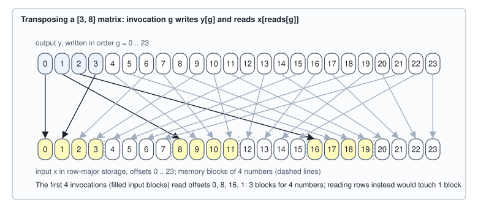
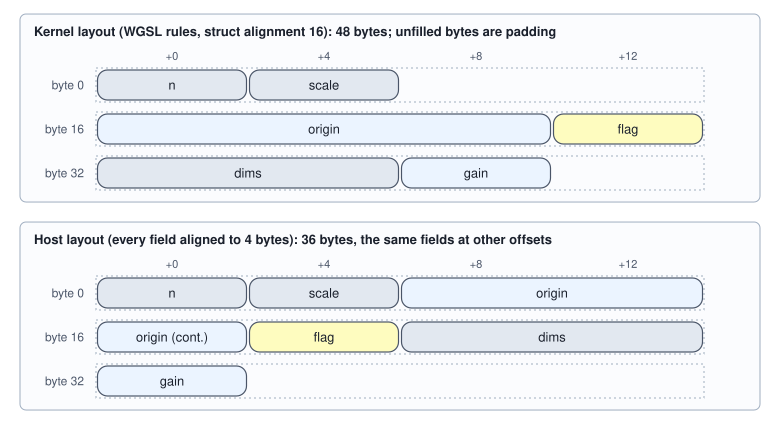

<!-- SPDX-License-Identifier: CC-BY-4.0 -->
<!-- Copyright (c) 2026 Martin Schröder <info@swedishembedded.com> -->

# Writing Compute Kernels

*How do we express one parallel computation so a GPU can run it?*

Ten numbers $x_0, \ldots, x_9$, and one rule for each of them: $y_i = 2 x_i + 1$. On a CPU this is a loop. Chapter 4 built a machine
with thousands of lanes that no loop can drive: a loop says "first this element, then the next", and the machine wants to be told what to
do with *one* element and to be given the whole set of elements at once. So the computation has to be written differently. Its
program is the body for one element, and everything the loop used to say (how many elements, which one am I, where do the numbers
live, what are the constants) has to arrive from outside.

Here is the whole computation for $N = 10$ elements in the form this chapter builds, run by a simulator that executes the body of one invocation for
every invocation of a grid, in plain Python. The workgroup size is 4, so the grid has $\lceil 10 / 4 \rceil = 3$ workgroups and 12 invocations,
two more than there are elements:

<!-- worked: compute_kernels.axpb_trace -->
y_g = 2 x_g + 1 for N = 10, x = [-3, -2, -1, 0, 1, 2, 3, 4, 5, 6], workgroup size 4. Workgroups = ceil(10 / 4) = 3; invocations launched = 12. Each invocation computes its global index g = w 4 + l and runs the guard g < N. The simulator ran all 12 invocations; y = [-5, -3, -1, 1, 3, 5, 7, 9, 11, 13], equal to the direct computation 2 x + 1: yes.

| g | workgroup w | local l | g < N | reads | writes |
|---:|---:|---:|---|---|---|
| 0 | 0 | 0 | yes | x[0] = -3 | y[0] = -5 |
| 1 | 0 | 1 | yes | x[1] = -2 | y[1] = -3 |
| 2 | 0 | 2 | yes | x[2] = -1 | y[2] = -1 |
| 3 | 0 | 3 | yes | x[3] = 0 | y[3] = 1 |
| 4 | 1 | 0 | yes | x[4] = 1 | y[4] = 3 |
| 5 | 1 | 1 | yes | x[5] = 2 | y[5] = 5 |
| 6 | 1 | 2 | yes | x[6] = 3 | y[6] = 7 |
| 7 | 1 | 3 | yes | x[7] = 4 | y[7] = 9 |
| 8 | 2 | 0 | yes | x[8] = 5 | y[8] = 11 |
| 9 | 2 | 1 | yes | x[9] = 6 | y[9] = 13 |
| 10 | 2 | 2 | no | - | - |
| 11 | 2 | 3 | no | - | - |
<!-- /worked -->

Each row is one invocation, which found its own element from two numbers it was given, its workgroup $w$ and its place $l$ in that
workgroup: $g = w \cdot 4 + l$. The last two invocations have no element and do nothing. Everything this chapter is about is visible
in this one table: a program for one invocation, a count of how many invocations to launch (and what happens when it is wrong), buffers
that hold $x$ and $y$, constants ($2$ and $1$) passed beside them, and a guard for the invocations that fall off the end.

The chapter proceeds from this case outward. It names the body a **compute kernel** and the language the book writes it in, then states the
full contract between a kernel and its host program: what a kernel is given, how many invocations to launch, and what each mistake in the count does.
Next come kernels that read tensors through strides, a kernel that uses shared memory and a barrier, the layout of the bytes of the
parameters (where the host and the kernel can silently disagree), and the host side that creates the buffers, launches the kernel and reads the answer
back. Every claim about a kernel is checked by the simulator against a direct computation.

Writing a kernel leans on four ideas from the chapter just behind us and one from much further back. Answer from memory; the answers are at the end of the chapter.

1. (Volume IV, Chapter 4, workgroup and grid.) A kernel is launched for 1000 elements with workgroups of 64 invocations. How many
   workgroups does the grid have, and how many invocations have no element?
2. (Volume IV, Chapter 4, shared memory and the barrier.) Why must a barrier lie between the invocations writing a tile into
   shared memory and the invocations reading it?
3. (Volume I, Chapter 5, strides.) A row-major array of shape $[3, 4]$ is a view with which strides? What is the storage offset of element
   $[2, 1]$ of the view of strides $(1, 3)$ over the same storage?
4. (Volume IV, Chapter 4, memory coalescing.) The 32 lanes of a subgroup each read the 4-byte number at element $8t$ for lane $t$. How
   many 32-byte transactions does the load take?
5. (Volume IV, Chapter 4, host and device.) The bus between host and device carries 32 (GB/s) in the model. How many bytes cross it when the host
   uploads two vectors of $2^{24}$ fp32 numbers and downloads one?

## The kernel: the program of one invocation

A data-parallel computation is written once, for one invocation, and the machine runs that program for all of them, so the first job is to fix what the program may see and do. A **compute kernel** is the program one invocation runs, together with the declaration of what it is given. The book writes
it in the pseudocode of `docs/book/pseudocode.md`, where a kernel has a header and a body and a `launch` statement runs it:

```text
kernel scale_shift(x: array<f32>[N], y: inout array<f32>[N], scale: f32, shift: f32, N: int) workgroup n_wg:
    if g >= N: return                  # the guard for the idle tail of the grid
    y[g] = scale * x[g] + shift

launch scale_shift(x, y, 2.0, 1.0, N) over ceil(N / n_wg) workgroups
```

Read the body as the program of a single worker. It is given three whole numbers: its local index $l$ in its workgroup, the
index $w$ of that workgroup, and the global index $g = w \cdot n_{\mathrm{wg}} + l$ that the previous chapter introduced. It may read $x$, write $y$, and use the
constants. It may not see another invocation's registers. The `launch` statement supplies what the body cannot: how many workgroups, and in
which order is up to the hardware. Workgroups run in any order, so a kernel in which one workgroup reads what another writes is
wrong, exactly as a `parallel for` whose iterations depend on one another is wrong (Chapter 2).

The guard `if g >= N: return` is needed because of the rounding in the launch. The hardware starts whole workgroups, so the number of invocations is
$n_{\mathrm{grp}} \, n_{\mathrm{wg}} = 12$ here and there are 10 elements. Invocations 10 and 11 would read and write elements that do not
exist. The kernel itself must say so, because only the kernel knows what $N$ means; the grid carries no memory of it.

The body is straight-line work for one element, and most of the kernels in a machine learning engine have this shape: an addition of two
tensors, an activation function, a scaled accumulate, a layout change. Their cost is the bytes they move (Chapter 3): for the
example, 4 bytes read and 4 written per element. A kernel with a loop inside, or one in which a workgroup cooperates on one output, is written
in the same frame with more in the body; the next sections add those.

## WGSL: the language the book writes kernels in

Pseudocode cannot be run by a device. To make the contract concrete, and because the engine this book follows uses it, the examples are also written in one real kernel language, with every construct mapped to the others. **WGSL** (the WebGPU Shading Language) is the kernel language that the book's examples use. It was designed to run in browsers and
to be translated to the native graphics interfaces, and a WGSL kernel compiles to Vulkan, Metal and DirectX programs. It is small, and only the
subset below appears here. This is the kernel above, as one WGSL file:

```wgsl
struct Params {
    n: u32,
    scale: f32,
    shift: f32,
};

@group(0) @binding(0) var<uniform> p: Params;
@group(0) @binding(1) var<storage, read>       x: array<f32>;
@group(0) @binding(2) var<storage, read_write> y: array<f32>;

@compute @workgroup_size(4)
fn main(@builtin(global_invocation_id) gid: vec3<u32>) {
    let g = gid.x;
    if (g >= p.n) { return; }
    y[g] = p.scale * x[g] + p.shift;
}
```

Line by line:

- `struct Params { n: u32, scale: f32, shift: f32 }` declares a record of three 4-byte fields: an unsigned 32-bit integer and two
  32-bit floats. WGSL has `u32`, `i32`, `f32` (and optionally `f16`), the vectors `vec2`, `vec3`, `vec4` of them, fixed arrays, runtime-sized arrays and
  structs. Integer arithmetic on `u32` wraps modulo $2^{32}$: `g - 1` at `g = 0` is $4{,}294{,}967{,}295$, a source of out-of-range indices.
- `@group(0) @binding(0) var<uniform> p: Params;` declares a global variable `p` in the **uniform** address space: small constants, the same for
  every invocation and read-only. `@group(0) @binding(0)` is the slot the host fills; a kernel has one group of numbered slots,
  and the book always puts the uniform at binding 0.
- `var<storage, read> x: array<f32>` and `var<storage, read_write> y: array<f32>` declare two **storage** buffers: large arrays in
  device memory whose length is chosen by the host when it binds them. `read` buffers cannot be written by the kernel; `read_write` ones can.
- `@compute @workgroup_size(4)` marks `main` as a compute kernel whose workgroups have 4 invocations (WGSL allows up to three
  dimensions of workgroup; this book uses one).
- `@builtin(global_invocation_id) gid: vec3<u32>` asks the hardware to supply the invocation's position in the grid, as three
  coordinates; `gid.x` is $g$ for a one-dimensional grid. Two more builtins appear later: `local_invocation_id` ($l$) and `workgroup_id`
  ($w$).
- `let g = gid.x;` binds a constant; `var` would bind a variable. `if (g >= p.n) { return; }` is the guard.
  `y[g] = p.scale * x[g] + p.shift;` is the whole computation: a load, a multiply, an add, a store.

Other kernel languages express the same four things, and the book uses WGSL only for examples. The vocabulary differs (a CUDA thread block is a
workgroup, a Metal threadgroup is a workgroup, an OpenCL work-item is an invocation); the constructs used in this chapter map to the two vendor languages as follows,

| this book and WGSL | CUDA | Metal |
|---|---|---|
| `@workgroup_size(64)` | block size given at launch, `<<<grid, 64>>>` | threads per threadgroup given at dispatch |
| `global_invocation_id` | `blockIdx * blockDim + threadIdx` | `[[thread_position_in_grid]]` |
| `local_invocation_id` | `threadIdx` | `[[thread_position_in_threadgroup]]` |
| `workgroup_id`, `num_workgroups` | `blockIdx`, `gridDim` | `[[threadgroup_position_in_grid]]`, `[[threadgroups_per_grid]]` |
| `var<storage, read>` / `read_write` | `const float*` / `float*` argument | `const device float*` / `device float*` |
| `var<uniform>` struct | argument passed by value | `constant Params&` |
| `var<workgroup>` | `__shared__` | `threadgroup` |
| `workgroupBarrier()` | `__syncthreads()` | `threadgroup_barrier(mem_flags::mem_threadgroup)` |
| the launch counts | workgroups | workgroups or invocations, by call |

and in the two portable compute languages:

| this book and WGSL | OpenCL C | GLSL compute |
|---|---|---|
| `@workgroup_size(64)` | local size given at enqueue | `layout(local_size_x = 64) in;` |
| `global_invocation_id` | `get_global_id` | `gl_GlobalInvocationID` |
| `local_invocation_id` | `get_local_id` | `gl_LocalInvocationID` |
| `workgroup_id`, `num_workgroups` | `get_group_id`, `get_num_groups` | `gl_WorkGroupID`, `gl_NumWorkGroups` |
| `var<storage, read>` / `read_write` | `__global const float*` / `__global float*` | `readonly buffer` / `buffer` block |
| `var<uniform>` struct | scalar arguments, or a `__constant` buffer | `uniform` block |
| `var<workgroup>` | `__local` | `shared` |
| `workgroupBarrier()` | `barrier(CLK_LOCAL_MEM_FENCE)` | `barrier()` with `memoryBarrierShared()` |
| the launch counts | invocations (global size) | workgroups |

In both tables the last row is the unit of Chapter 4's "Counting in the right unit": the same intention is a different number in different APIs, and a program ported
from one to another must change what it passes.

## The contract between kernel and host

A kernel is useless until a host program gives it buffers, constants and a grid. That contract has four parts, and each has a mistake that produces a wrong answer instead of an error.

**Buffers.** A **storage buffer** is the array a kernel reads from or writes to: a block of device memory, bound to a numbered slot, whose
element type the kernel declares and whose length the host chooses. A kernel declares each as `read` or `read_write`. The distinction is
a promise the compiler and the device use: the same bytes may be bound twice for reading, while in WebGPU (and so in the engine of this book) a buffer bound as
`read_write` in one slot must not be bound again in another slot of the same dispatch, since the two views would alias. A WGSL kernel can ask a runtime-sized
array for its length, but a buffer may be longer than the data in it, so the element count that the guard needs is passed as a constant.

**Constants.** The **uniform parameters** are the small values that are the same for every invocation: the element count, the
scale and shift, the shape and strides of a tensor. They travel in one small buffer, the uniform buffer, bound to its own slot. They
are separate from storage because the device treats them as a fast, small, read-only region (WebGPU guarantees 64 KiB at least), and because
changing a constant then costs the write of a few bytes rather than a new kernel. The alternative is to write constants into the kernel
source, which gives the compiler more to optimize and costs one compiled kernel per distinct value; engines do this for tile sizes and
keep the quantities that change per call, such as $N$, in the uniform. The layout of the uniform block in bytes is the subject of the section on alignment, below.

**The grid.** The host must say how many workgroups to launch, and the right number is
$$n_{\mathrm{grp}} = \left\lceil \frac{N}{n_{\mathrm{wg}}} \right\rceil.$$
Too few and the tail of the output is never written; none of the invocations knows. No guard, and the invocations of the last
workgroup that are past the end of the data read and write memory beyond the buffers. This table runs the opening kernel, $N = 10$ and
workgroup size 4, with each mistake in turn. The memory is one flat list in which the buffers sit one after another:

<!-- worked: compute_kernels.grid_failures -->
The kernel of the previous block, y = 2 x + 1 with workgroup size 4, launched with a wrong grid or without its guard. y starts at 1000 (a value the kernel never writes); the neighbour buffer z has 4 words 500, 501, 502, 503; memory words between buffers hold -777. 'clamped' is the language's robust-access rule: an index past the end is replaced by the last valid one. Last two columns: words of z changed, padding words changed.

| launch | N | workgroups | invocations | y correct | y never written | z changed | padding changed |
|---|---:|---:|---:|---:|---:|---:|---:|
| ceil(N / wg) groups, with the guard | 10 | 3 | 12 | 10 of 10 | 0 | - | - |
| floor(N / wg) groups, with the guard | 10 | 2 | 8 | 8 of 10 | 2 | - | - |
| ceil, no guard, z packed behind y | 10 | 3 | 12 | 10 of 10 | 0 | 2 | 0 |
| ceil, no guard, z at the next 32-byte boundary | 10 | 3 | 12 | 10 of 10 | 0 | 0 | 2 |
| ceil, no guard, accesses clamped to the buffer | 10 | 3 | 12 | 10 of 10 | 0 | 0 | 0 |
| N = 12, floor(N / wg) groups, with the guard | 12 | 3 | 12 | 12 of 12 | 0 | - | - |
<!-- /worked -->

The first row is the correct launch. The second launches $\lfloor 10 / 4 \rfloor = 2$ workgroups: it runs without complaint and leaves
`y[8]` and `y[9]` holding what was there before. The next two rows drop the guard, with $\lceil 10/4 \rceil = 3$ workgroups: invocations 10
and 11 store to $y[10]$ and $y[11]$, which are the first two words past the buffer. Whether that is visible depends entirely on what lies there.
If the next buffer is packed right behind $y$, two of its words are overwritten (third row); if buffers start on 32-byte boundaries, as
allocators usually arrange, the words fall in padding and nothing happens (fourth row). The bug is real in both and shows up in one. The
fifth row applies the rule that WGSL states for robust access: an index past the end of a buffer may be replaced by the last valid one. Then
the three invocations 9, 10 and 11 all store the same correct value to $y[9]$ and the answer is right *by accident*. The engine this book studies
turns that protection off by default to save an instruction on every access (see the brain section at the end), so a kernel's own guard is the only check. The last
row is the trap for tests: with $N = 12$, a multiple of the workgroup size, flooring the grid is harmless, and a kernel tested only at such sizes keeps its bug.

**Larger grids.** A grid has up to three dimensions and a limit per dimension; the baseline of the portable interfaces is 65,535 workgroups
in one dimension. A kernel launched over more workgroups than that must use a second dimension, and then $g$ is no longer `gid.x`.
With $n_x$ workgroups along $x$ and $n_y$ along $y$, the workgroup of coordinates $(w_x, w_y)$ has index
$w = w_y n_x + w_x$ and its invocation $l$ has the global index
$$g = (w_y\, n_x + w_x)\, n_{\mathrm{wg}} + l.$$
The host folds a long grid into rows of the maximum width:

```text
function grid_dims(N: int, n_wg: int, max_dim: int) -> (int, int):
    require N >= 1, n_wg >= 1, max_dim >= 1
    n_grp = ceil(N / n_wg)
    if n_grp <= max_dim:
        return (n_grp, 1)
    return (max_dim, ceil(n_grp / max_dim))
```

A kernel that forgets this and uses `gid.x` alone is right for every grid of one row and wrong beyond it. This table uses a limit of 3 workgroups per
dimension so that it can be simulated whole, then the real limit of 65,535:

<!-- worked: compute_kernels.grid_fold -->
A dispatch limited to 3 workgroups per dimension, y = 2 x + 1 for N = 30 with workgroup size 4: ceil(30 / 4) = 8 workgroups do not fit one row, so the grid is (3, 3) = 9 workgroups. (n_x = workgroups along x, w_x and w_y = the workgroup's coordinates.)

| kernel | grid (n_x, n_y) | invocations | y correct | never written |
|---|---:|---:|---:|---:|
| index g = gid.x only | (3, 3) | 36 | 12 of 30 | 18 |
| index g = (w_y n_x + w_x) n_wg + l | (3, 3) | 36 | 30 of 30 | 0 |

The real limit of 65,535 workgroups per dimension with workgroup size 64, applied to the weight-gradient tensor of a 3 x 3 convolution with 1024 input and 1024 output channels:

| quantity | value |
|---|---:|
| elements N = 1024 x 1024 x 3 x 3 | 9,437,184 |
| workgroups needed = ceil(N / 64) | 147,456 |
| grid (n_x, n_y), n_x at most 65,535 | (65,535, 3) |
| workgroups launched | 196,605 |
| invocations launched | 12,582,720 |
| idle (fail the guard) | 3,145,536 |
| elements a gid.x-only kernel can reach = 65,535 x 64 | 4,194,240 |
| elements it never writes | 5,242,944 |
| fraction never written | 55.6 percent |
<!-- /worked -->

With the toy limit the wrong kernel writes 12 of 30 outputs, the first row of workgroups, and its other rows of workgroups recompute the same 12 over
and over. At the real limit and a workgroup size of 64 the first row reaches $65{,}535 \times 64 = 4{,}194{,}240$ elements, so the weight gradient
of a $3 \times 3$ convolution with 1024 channels in and out, $9{,}437{,}184$ numbers, has 55.6 percent of its elements never written, and the answer
looks like any other tensor. A kernel is correct for every grid only if it computes $g$ from both coordinates, which is why every kernel in the engine of
this book starts with the same two lines (the brain section at the end tells the incident).

## Reading tensors through strides

A tensor in a kernel is a flat buffer plus a shape and strides, so every kernel that touches a tensor turns an output position into a storage offset. We can write that once, for any view, and count what it costs in memory transactions. Volume I, Chapter 5 defined a view of flat storage by a shape $[d_0, d_1]$, strides $(s_0, s_1)$ and an offset $o$, with element
$(i, j)$ at storage cell $o + i s_0 + j s_1$. A kernel that materializes a view gives each invocation one output element and lets it compute where to read. The output
is stored contiguously, so invocation $g$ owns output element $(i, j)$ with $i = \lfloor g / d_1 \rfloor$ and $j = g \bmod d_1$:

```text
kernel gather_view(x: array<f32>[S], y: inout array<f32>[d0 * d1], d0: int, d1: int, s0: int, s1: int, o: int) workgroup n_wg:
    if g >= d0 * d1: return
    i = g // d1
    j = g mod d1
    y[g] = x[o + i * s0 + j * s1]

launch gather_view(x, y, d0, d1, s0, s1, o) over ceil(d0 * d1 / n_wg) workgroups
```

The shape, strides and offset are uniform parameters, five integers, and one kernel serves every view. The case of Volume I,
Chapter 5, the storage $[0, 10, \ldots, 60]$ viewed with shape $[2, 3]$, strides $(1, 2)$ and offset 1, run through the simulator:

<!-- worked: compute_kernels.view_gather -->
x = [0, 10, 20, 30, 40, 50, 60], view of shape [2, 3], strides (1, 2), offset 1, as in Volume I, Chapter 5. Output element g = i d1 + j reads x[offset + i s0 + j s1] and writes y[g]. Workgroup size 4, ceil(6 / 4) = 2 workgroups. y = [10, 30, 50, 20, 40, 60], equal to the view read directly: yes.

| g | (i, j) | offset into x | y[g] |
|---:|---|---|---|
| 0 | (0, 0) | 1 + 0 x 1 + 0 x 2 = 1 | 10 |
| 1 | (0, 1) | 1 + 0 x 1 + 1 x 2 = 3 | 30 |
| 2 | (0, 2) | 1 + 0 x 1 + 2 x 2 = 5 | 50 |
| 3 | (1, 0) | 1 + 1 x 1 + 0 x 2 = 2 | 20 |
| 4 | (1, 1) | 1 + 1 x 1 + 1 x 2 = 4 | 40 |
| 5 | (1, 2) | 1 + 1 x 1 + 2 x 2 = 6 | 60 |
| 6 | - | idle (g >= 6) | - |
| 7 | - | idle (g >= 6) | - |
<!-- /worked -->

The simulated output $[10, 30, 50, 20, 40, 60]$ is the list Volume I printed for the same view. Three special cases are worth naming. A plain copy has shape
$[m, n]$ and strides $(n, 1)$. A transpose of an $[m, n]$ matrix has shape $[n, m]$ and strides $(1, n)$, since stepping along a row of the output steps down a column of the input. A
broadcast (Volume I, Chapter 5) is a stride of 0. The kernel is the same each time; only five integers change.



The figure draws the mapping for a $[3, 8]$ matrix, with a toy subgroup of 4 lanes and memory blocks of 4 numbers so that it fits the page. The writes
are consecutive and the reads jump by a row. Chapter 4 priced this: lanes reading addresses a row apart take one transaction each. The simulator records every load
and store and counts the 32-byte blocks that each subgroup instruction touches, so the cost can be measured on the kernels, not only argued. First a
$[128, 128]$ matrix, whose simulation is small enough to run in full:

<!-- worked: compute_kernels.transpose_traffic -->
A [128, 128] fp32 matrix a[i, j] = 128 i + j, 32-lane subgroups, 32-byte blocks, every buffer starting on a block boundary. Each row of a table is a simulated dispatch whose loads and stores were recorded and counted per subgroup instruction; 'equals direct' compares the simulated output with the transpose (or copy) computed directly. Useful bytes = 2 x 4 x 16,384 = 131,072.

| kernel | invocations | load blocks | store blocks | blocks | bytes moved | useful % | equals direct |
|---|---:|---:|---:|---:|---:|---:|---|
| copy, strides (n, 1) | 16,384 | 2,048 | 2,048 | 4,096 | 131,072 | 100.0 | yes |
| transpose, one invocation per output element, strides (1, n) | 16,384 | 16,384 | 2,048 | 18,432 | 589,824 | 22.2 | yes |
| transpose through a 16 x 16 tile in shared memory | 16,384 | 2,048 | 2,048 | 4,096 | 131,072 | 100.0 | yes |

The counts follow N/4 (copy, tiled) and N + N/8 (naive) for N elements, a formula that equals the simulation above. Applied to N = 1024 x 1024 = 1,048,576:

| kernel | load blocks | store blocks | blocks | MiB moved |
|---|---:|---:|---:|---:|
| copy, strides (n, 1) | 131,072 | 131,072 | 262,144 | 8 |
| transpose, one invocation per output element, strides (1, n) | 1,048,576 | 131,072 | 1,179,648 | 36 |
| transpose through a 16 x 16 tile in shared memory | 131,072 | 131,072 | 262,144 | 8 |
<!-- /worked -->

The copy is the floor: every byte moved is a byte needed, 4,096 blocks for 16,384 numbers read once and written once. The transpose with
one invocation per output element reads one block per lane, 16,384 blocks of loads for 16,384 numbers, and writes coalesced; it moves 4.5 times the blocks of the copy,
and only 22.2 percent of the bytes it moves are useful. At $1024 \times 1024$ the same formulas give the numbers Chapter 4 derived,
1,179,648 blocks (36 MiB) for the naive transpose and 262,144 (8 MiB) for the copy. The third row of the first table is the kernel of the next section; it meets the copy's floor.

Choosing which side the invocations follow does not help: let invocation $g$ own an input element instead and the reads are coalesced and the writes are strided, for the same count
in the other direction. The strided side can only be avoided by changing which numbers a *group* of invocations handles, and that is what shared memory is for.

## Shared memory and the barrier: a tiled transpose

The strided side of the transpose can be avoided if a workgroup reads a block of the input with its lanes along rows, keeps it in shared memory, and writes it out with its lanes along rows of the output. That takes two phases with a barrier between them, and the barrier has a rule. Let the workgroup own a $T \times T$ tile of the input: it loads the tile into a shared array, every invocation waits for the others, and then each stores one element of the
transposed tile. With $T = 16$ a workgroup has 256 invocations, the portable limit of Chapter 4, and the tile takes 1 KiB of shared memory. In the pseudocode (the
launch is two-dimensional, $n_x = \lceil n / T \rceil$ workgroups across and $n_y = \lceil m / T \rceil$ down):

```text
kernel transpose_tiled(x: array<f32>[m, n], y: inout array<f32>[n, m], T: int) workgroup T * T:
    shared tile: array<f32>[T * T]
    ly = l // T
    lx = l mod T
    r = w_y * T + ly                    # the row of x this invocation loads
    c = w_x * T + lx                    # the column of x this invocation loads
    if r < m and c < n:
        tile[ly * T + lx] = x[r, c]
    barrier                             # every invocation of the workgroup reaches it
    r_out = w_x * T + ly                # the row of y this invocation stores
    c_out = w_y * T + lx                # the column of y this invocation stores
    if r_out < n and c_out < m:
        y[r_out, c_out] = tile[lx * T + ly]

launch transpose_tiled(x, y, T) over ceil(n / T) by ceil(m / T) workgroups
```

Before the barrier, lane $l$ reads the element in row $w_y T + \lfloor l / T \rfloor$ and column $w_x T + (l \bmod T)$: consecutive lanes read consecutive
columns, a coalesced load. After it, lane $l$ writes the element of row $w_x T + \lfloor l / T \rfloor$ and column $w_y T + (l \bmod T)$ of $y$: consecutive
lanes write consecutive columns, a coalesced store. The transposition is the way the tile is *indexed*, `tile[lx * T + ly]` against `tile[ly * T + lx]`, and it happens in
shared memory, where an access order costs no memory transactions. In WGSL (the kernel the simulator runs, with $T = 16$):

```wgsl
struct Params { rows: u32, cols: u32 };

@group(0) @binding(0) var<uniform> p: Params;
@group(0) @binding(1) var<storage, read>       x: array<f32>;
@group(0) @binding(2) var<storage, read_write> y: array<f32>;

var<workgroup> tile: array<f32, 256>;

@compute @workgroup_size(256)
fn main(@builtin(local_invocation_id) li: vec3<u32>,
        @builtin(workgroup_id) wid: vec3<u32>) {
    let ly = li.x / 16u;
    let lx = li.x % 16u;
    let r = wid.y * 16u + ly;
    let c = wid.x * 16u + lx;
    if (r < p.rows && c < p.cols) {
        tile[ly * 16u + lx] = x[r * p.cols + c];
    }
    workgroupBarrier();
    let orow = wid.x * 16u + ly;
    let ocol = wid.y * 16u + lx;
    if (orow < p.cols && ocol < p.rows) {
        y[orow * p.rows + ocol] = tile[lx * 16u + ly];
    }
}
```

`var<workgroup>` declares the shared array, one copy per workgroup; `workgroupBarrier()` is the barrier. Note where the guards sit: each
one surrounds a load or a store, and the barrier is outside every `if`. The third row of the transaction table above is this kernel's simulation, and its counts are the copy's: 2,048 blocks of
loads and 2,048 of stores for the $[128, 128]$ case.

The edges deserve a trace, because a matrix whose sides are not multiples of the tile has ragged tiles. For a $[6, 10]$ matrix and $T = 4$ the grid is
$3 \times 2$ workgroups, and workgroup $(2, 1)$ owns only rows 4 to 5 and columns 8 to 9:

<!-- worked: compute_kernels.tile_trace -->
x is [6, 10] with x[i, j] = 10 i + j, tile 4 x 4, workgroups = ceil(10 / 4) x ceil(6 / 4) = 3 x 2 = 6 of 16 invocations; the shared tile starts as 99 in every slot. Workgroup (2, 1) owns rows 4 to 5 and columns 8 to 9 of x, a ragged tile (2 of 4 rows and 2 of 4 columns exist). Its shared tile at the barrier (invocations that skip a load leave 99):

| tile row | col 0 | col 1 | col 2 | col 3 |
|---|---:|---:|---:|---:|
| 0 | 48 | 49 | 99 | 99 |
| 1 | 58 | 59 | 99 | 99 |
| 2 | 99 | 99 | 99 | 99 |
| 3 | 99 | 99 | 99 | 99 |

and the 2 x 2 block of y = x^T it writes after the barrier (rows 8 to 9, columns 4 to 5):

| y row | col 4 | col 5 |
|---|---:|---:|
| 8 | 48 | 58 |
| 9 | 49 | 59 |

The whole simulated y equals the direct transpose of x: yes.
<!-- /worked -->

Twelve of the 16 invocations load nothing and leave their slot as it was; the four that did load wrote the 2 x 2 corner. After the barrier four invocations store, and the
block of $y$ is the transpose of the block of $x$. Slots that nobody wrote are never read, because the store guard excludes the invocations that would read them.

The barrier carries a rule of its own. Every invocation of the workgroup must reach it. The barrier is a rendezvous: if some invocations have returned, or are inside a branch that
skips it, the others wait for ones that never arrive. Some compilers refuse such a program; on some devices it hangs, and a CPU compiler that runs a workgroup as phases
computes something. The natural way to write the guard breaks the rule, and it is wrong in a way that only edge tiles reveal:

<!-- worked: compute_kernels.barrier_rule -->
The tiled transpose of the previous block (tile 4 x 4, 16 invocations per workgroup) with the guard written two ways, on a matrix whose sides are not multiples of the tile and on one whose sides are. A workgroup 'faults' when only some of its invocations reach the barrier; its result is then undefined. The last column lists the faulting workgroups (x, y) and how many invocations arrived.

| x | guard | workgroups | faulting | y equals direct | arrived at the barrier |
|---|---|---:|---:|---|---|
| [6, 10] | guard around the load and store, barrier reached by all | 6 | 0 | yes | - |
| [6, 10] | guard returns before the barrier | 6 | 4 | undefined | (2, 0): 8 of 16, (0, 1): 8 of 16, (1, 1): 8 of 16, (2, 1): 4 of 16 |
| [8, 12] | guard around the load and store, barrier reached by all | 6 | 0 | yes | - |
| [8, 12] | guard returns before the barrier | 6 | 0 | yes | - |
<!-- /worked -->

The early-return form, `if r >= m or c >= n: return` placed before the barrier, is the same kernel as far as every interior tile is concerned: all 16 invocations arrive. It breaks
exactly where tiles are ragged. On the $[6, 10]$ matrix four of the six workgroups fault, and on the $[8, 12]$ matrix, whose sides are multiples of the tile, none does. A kernel
tested on such shapes passes and fails in production, the same shape as the grid bug above. A `return` before a barrier is legal only when every invocation of the workgroup
takes it. The rule for writing: put the guard around the memory accesses, never around the barrier.

And the barrier itself cannot be dropped, which Chapter 4 showed for a stencil and the simulator shows here for the tile:

<!-- worked: compute_kernels.missing_barrier -->
The same [6, 10] transpose with and without the barrier. Inside each phase the invocations of a workgroup run in the order 0, 1, ..., 15 (ascending) or 15, ..., 0 (descending); both orders are legal on a device. Entries of y that differ from the direct transpose:

| kernel | ascending order | descending order |
|---|---:|---:|
| load phase, barrier, store phase | 0 of 60 | 0 of 60 |
| load and store in one phase, no barrier | 20 of 60 | 24 of 60 |
<!-- /worked -->

Without the barrier the load and the store share one phase, and an invocation reads a slot that another invocation of its workgroup has not written yet. The count of wrong entries depends on the
order the device happens to run the invocations in, 20 of 60 in one order and 24 of 60 in the other; both orders are legal, and a program whose answer depends on it
is racy. (The reads `tile[lx * T + ly]` of 16 lanes also hit shared memory in a pattern that real devices serve badly, a cost the chapter on matrix products takes up.)

## Buffer alignment: the layout of parameters in bytes

The host writes a block of bytes and the kernel reads fields from it at fixed offsets. The two must agree about every offset, and the rules that fix them are not the ones one would guess. **Buffer alignment** is the rule that a value of $s$ bytes starts at an address that is a multiple of its alignment (for a 4-byte number, 4), so that hardware can read it
in one piece; the bytes skipped to satisfy it are padding. Two places need it here. The first is the layout of the fields of a parameter struct.

The rules of WGSL, for the types of this chapter: a scalar (`u32`, `i32`, `f32`) has alignment 4 and size 4; `vec2` has alignment 8 and size 8; `vec3` has alignment 16 and
size 12; `vec4` has alignment 16 and size 16. A field starts at the first multiple of its alignment at or after the end of the previous field. The struct's alignment is the largest of its fields'; its size
is the end of its last field rounded up to the struct's alignment. (A struct nested in another, or an element of an array, in a uniform buffer has its alignment rounded up to 16 as well.) A `vec3` is the trap: it has size
12 and alignment 16, so the next *scalar* may start right after it, inside its 16 bytes, while a next vector may not.

An example with every kind of field, `Params { n: u32, scale: f32, origin: vec3<f32>, flag: u32, dims: vec2<u32>, gain: f32 }`, worked out byte by byte:

<!-- worked: compute_kernels.struct_layout -->
The parameter block `struct Params { n: u32, scale: f32, origin: vec3<f32>, flag: u32, dims: vec2<u32>, gain: f32 }`, laid out by the rules: a field starts at the next multiple of its alignment after the end of the previous field; a scalar has alignment and size 4, a vec2 of scalars 8 and 8, a vec3 alignment 16 and size 12, a vec4 16 and 16; the struct's alignment is the largest field alignment and its size is the end of the last field rounded up to it. 'gap' is the padding before the field in bytes.

| field | type | alignment | size | gap before | offset | bytes |
|---|---|---:|---:|---:|---:|---|
| n | `u32` | 4 | 4 | - | 0 | 0 to 3 |
| scale | `f32` | 4 | 4 | - | 4 | 4 to 7 |
| origin | `vec3<f32>` | 16 | 12 | 8 | 16 | 16 to 27 |
| flag | `u32` | 4 | 4 | - | 28 | 28 to 31 |
| dims | `vec2<u32>` | 8 | 8 | - | 32 | 32 to 39 |
| gain | `f32` | 4 | 4 | - | 40 | 40 to 43 |

The last field ends at byte 44; the struct alignment is 16, so its size is ceil(44 / 16) x 16 = 48 bytes. Of those, 36 bytes hold values and 12 are padding (8 before fields, 4 at the end).
<!-- /worked -->

`origin` could start at byte 8, the end of `scale`, but needs a multiple of 16, so it starts at 16 and 8 bytes are padding. `flag` fits in the 4 bytes left after the `vec3`, at byte 28.
`dims` needs a multiple of 8, and 32 is one. The last field ends at 44; the struct's alignment is 16 because of the `vec3`, so its size is 48. Of the 48 bytes, 36 are values.



Now the failure. A host program written in a language whose aggregates align to 4, a C struct of floats and arrays of them, lays the same fields out *without* the holes: 36 bytes. It uploads
its bytes (zero-padded to the 48 that the kernel's block occupies) and the kernel reads each field at its own offset:

<!-- worked: compute_kernels.host_disagreement -->
The host (a C-style struct of 4-byte scalars and arrays of them, every field aligned to 4) writes the values n = 1000, scale = 0.5, origin = (1, 2, 3), flag = 7, dims = (32, 16), gain = 2.5 at its own offsets; the struct is 36 bytes and the buffer is padded with zeros to the 48 bytes the kernel's block occupies. The kernel reads each field at ITS offset and type. Floats print with 6 significant digits; a u32 that is read as an f32 is a tiny subnormal number.

| field | host offset | kernel offset | host wrote | kernel reads | agree |
|---|---:|---:|---|---|---|
| n | 0 | 0 | 1000 | 1000 | yes |
| scale | 4 | 4 | 0.5 | 0.5 | yes |
| origin | 8 | 16 | (1, 2, 3) | (3, 9.80909e-45, 4.48416e-44) | no |
| flag | 20 | 28 | 7 | 16 | no |
| dims | 24 | 32 | (32, 16) | (1075838976, 0) | no |
| gain | 32 | 40 | 2.5 | 0 | no |
<!-- /worked -->

The two fields before the `vec3` agree, because both layouts put them in the same place, and every field after it is wrong. The kernel reads $\mathrm{origin} = (3, 9.8 \times 10^{-45}, 4.5 \times 10^{-44})$: its first component is the host's $z$ and the others are the bit patterns of the integers 7 and 32 read as floats. Nothing fails: no error
is raised by the device, the dispatch runs, and the numbers are plausible enough to train on. The only defence is to make both sides derive the layout from one description, or to keep the
parameter block to 4-byte scalars, which have alignment 4 in every language and need no padding. The kernels of this book's engine do the second, as the next table shows. Different languages differ on the same type too: a Metal `float3` has size 16 where a WGSL `vec3<f32>` has size 12, and a CUDA `float3` has size 12 and alignment 4. A layout that is right in one language is not right
in the next.

<!-- worked: compute_kernels.flat_blocks -->
Flat blocks of 4-byte scalars have alignment 4, so the struct is 4 x (number of fields) bytes, and the buffer that holds it is rounded up to a multiple of 16 bytes and filled with zeros. A list of words shorter than the block therefore still fills the buffer; the missing trailing fields read 0.

| kernel | fields | struct bytes | buffer bytes | zero words after the fields |
|---|---:|---:|---:|---:|
| add | 1 | 4 | 16 | 3 |
| axpy | 2 | 8 | 16 | 2 |
| clip_coef_wg | 3 | 12 | 16 | 1 |
| swap_axes12_vec | 4 | 16 | 16 | 0 |
| scale_add | 5 | 20 | 32 | 3 |
<!-- /worked -->

A block of 4-byte scalars needs no holes: its size is $4 \times$ the number of fields, and only the final rounding to 16 bytes remains. The zero words after the fields are the buffer's padding. They
make a second silent failure possible: if a host passes fewer words than the kernel's block has fields, the missing fields read zero, not an error (knowledge #171, in the brain section at the end). A scale or a tolerance that
is silently 0 is as hard to find as the misread `origin`. The same applies to arrays: an `array<vec3<f32>>` has a stride of 16 bytes, not 12, so a kernel that wants three floats per element reads a flat
`array<f32>` and computes `3 * i + c` itself.

The second place alignment appears is the *offset* at which a sub-range of a buffer is bound. A host often packs several tensors into one buffer and binds slices of it; the interface requires each
slice's offset to be a multiple of a device limit, 256 bytes on nearly every device (64 fp32 numbers). Tensors whose size is not a multiple of 256 bytes break this when stacked:

<!-- worked: compute_kernels.binding_offsets -->
Four per-head slices of a packed buffer, 200 positions of 4 fp32 numbers each, so a slice is 200 x 4 = 800 words. Binding a sub-range of a buffer requires its offset to be a multiple of 256 bytes (64 words). Raw stride 800 words = 3200 bytes; padded stride = ceil(800 / 64) x 64 = 832 words = 3328 bytes, 32 words (4.00 percent) of padding per slice.

| head | raw offset (bytes) | mod 256 | aligned | padded offset (bytes) | mod 256 | aligned |
|---|---:|---:|---:|---:|---:|---:|
| 0 | 0 | 0 | yes | 0 | 0 | yes |
| 1 | 3,200 | 128 | no | 3,328 | 0 | yes |
| 2 | 6,400 | 0 | yes | 6,656 | 0 | yes |
| 3 | 9,600 | 128 | no | 9,984 | 0 | yes |
<!-- /worked -->

Heads 1 and 3 start at bytes 3,200 and 9,600, which are 128 past a multiple of 256, and binding them is rejected; heads 0 and 2 are aligned by luck. Padding each slice from 800 words to 832
fixes every head at a cost of 4 percent of the buffer. Padding is a trade of bytes for legality, and the pad is added to the *stride* between slices and never to the data; the kernels that
read a slice see only its first 800 words.

## The host side: kernel dispatch

The kernel is half the program. The other half runs on the host, which sets up the buffers, launches the kernel and gets the answer, and its cost is counted in bytes over the bus and in the times the host waits. A **kernel dispatch** is the host-side act of running a kernel: bind buffers to the slots of a compiled kernel, write its uniform parameters, and enqueue it over a grid. The device
runs the queue in order, in its own time. The host program of the example, in the book's six host operations (defined in `docs/book/pseudocode.md`), is:

```text
function run(x: array<f32>[N], scale: f32, shift: f32, source: text, n_wg: int) -> array<f32>[N]:
    require N >= 1
    k = compile(source)                          # once per program, not once per launch
    bx = create_buffer(4 * N)
    by = create_buffer(4 * N)
    upload(bx, x)
    dispatch(k, [bx, by], [N, bits(scale), bits(shift)], ceil(N / n_wg))
    y = read_back(by, N)                         # waits for the device
    release(bx)
    release(by)
    return y
```

(`bits(scale)` is the 32-bit pattern of the float: a uniform block is a list of 4-byte words, and a float goes in as its bit pattern.) The figure shows the path of one dispatch for the $N = 10$ case,
with the byte counts of the simulation below.


Each step has a cost in a different unit. Compiling is paid once. The uploads and the read-back cross the bus (Chapter 4: 32 (GB/s) against the device memory's 800). The dispatch costs a few
bytes of parameters and a place in the queue, and *returns at once*: the host has only recorded the request. The `read_back` is the one step that cannot return at once, since it needs the answer: it must wait until
every dispatch before it has finished, and then copy. That makes it two costs in one: the bytes of the copy over the slow bus, and a synchronization point at which the host stops and the queue drains. With one
dispatch per read-back the device alternates between working and idling while the host handles the result, and the host alternates between waiting and preparing. The remedy of Chapter 4 ("data goes to the device once and stays") has a
form in the host program: enqueue a whole chain of dispatches, read back once. Three kernels run one after another, simulated both ways:

<!-- worked: compute_kernels.host_program -->
Three kernels y = scale x + shift with (scale, shift) = (2.0, 1.0), (0.5, -2.0), (3.0, 0.5) on x = [-3, -2, -1, 0, 1, 2, 3, 4, 5, 6] (N = 10, workgroup size 4), run by a host program that creates buffers, uploads, enqueues dispatches and reads back. Each dispatch uploads its 3-word parameter block into a uniform buffer padded to 16 bytes. A read-back first runs every dispatch still in the queue ('pending when the host waits'). Final y = [-13, -10, -7, -4, -1, 2, 5, 8, 11, 14].

| design | dispatches | read-backs (waits) | pending when the host waits | bytes up | bytes down | y equals direct |
|---|---:|---:|---|---:|---:|---|
| each result read back and uploaded again | 3 | 3 | 1, 1, 1 | 168 | 120 | yes |
| buffers stay on the device, one read-back | 3 | 1 | 3 | 88 | 40 | yes |
<!-- /worked -->

Both designs give the same $y$. The round-trip design reads back three times, and each time the host waits for one dispatch; it moves 168 bytes up and 120 down. The resident design enqueues all three, and its single
read-back finds 3 dispatches pending; it moves 88 up and 40 down. For a real size the same counting is

<!-- worked: compute_kernels.bus_traffic -->
The two designs of the previous block for N = 2^24 = 16,777,216 fp32 numbers and 3 kernels: bytes up = (vectors uploaded) x 4N + 3 parameter blocks of 16 bytes, bytes down = (vectors read back) x 4N. The last column is the model time of those bytes over the 32 (GB/s) bus of Chapter 4.

| design | bytes up | bytes down | waits | bus time (ms) |
|---|---:|---:|---:|---:|
| each result read back and uploaded again | 201,326,640 | 201,326,592 | 3 | 12.5829 |
| buffers stay on the device, one read-back | 67,108,912 | 67,108,864 | 1 | 4.1943 |
<!-- /worked -->

three times the bytes in each direction and three waits against one: the gap grows with the length of the chain, and a transformer layer has tens of kernels. What *must* be read back is the small
answer the host needs (a loss, a token), not the intermediates. A related problem is the cost of the queue itself, one dispatch per small kernel, which Chapter 8 takes up as kernel fusion.

## From kernel files to devices: `crates/kernels` and its backends

`crates/kernels` holds brain's kernels as text; `crates/vulkan` and the backend crates compile and run them.

### Kernels as files

`crates/kernels/wgsl/` has one WGSL file per kernel, and `crates/kernels/src/lib.rs` embeds each as a string constant (`pub const AXPY: &str = include_str!(...)`).
`crates/kernels/wgsl/axpy.wgsl` is this chapter's example almost word for word: a `Params { n: u32, s: f32 }` uniform at binding 0, a `read_write` buffer and a `read` buffer at 1 and 2,
`@workgroup_size(64)`, and the guard `if (idx >= p.n) { return; }`. Every one-invocation-per-element kernel starts with the 2D-safe index (`let gidx = gid.y * (nwg.x * 64u) + gid.x;`),
the formula of the section on larger grids. `crates/kernels/wgsl/swap_axes12_vec.wgsl` is the strided kernel of this chapter, written for one rank-4 permutation: one invocation
per output element, decomposing its index by division and remainder and reading `src[((i0 * a1 + i1) * a2 + i2) * d + k]`; `crates/kernels/wgsl/nchw_nlc.wgsl` is a layout change of the same form.
`crates/kernels/wgsl/clip_coef_wg.wgsl` is a small cooperative kernel: a `var<workgroup>` array of 64, a strided accumulation, one `workgroupBarrier()` and the finishing step in invocation 0. Each file starts
with `@what`, `@how` and similar header lines that scripts read. `crates/kernels/src/template.rs` rewrites the literals (tile sizes, the `@workgroup_size`) of a source before compilation, so tuned
variants are other `(name, source)` pairs rather than other files.

### Registering and compiling

A model lists the kernels it needs as `(name, source)` pairs, for example `("axpy", kernels::AXPY)` in `crates/arcface/src/model.rs`, and a dispatch names a kernel by its position in
that list (Chapter 4). At construction, `crates/backend-wgpu/src/lib.rs` compiles each source into a shader module and a compute pipeline with entry point `main`, once. A dispatch is one bind group: the uniform at
binding 0 and the storage buffers at bindings 1 and up, in the order of the list given (and at most 8, the rule Chapter 4 explained). The kernel's workgroup size is read from its own `@workgroup_size`
by `backend_api::workgroup_size_of`, and `backend_api::grid_ws` in `crates/backend-api/src/lib.rs` computes the grid by the formula of this chapter (`threads.div_ceil(wg)`) and folds it into rows of
`MAX_GROUPS_PER_DIM`, 65,535.

### How `crates/vulkan` relates to the wgpu path

`crates/vulkan` is the same idea built on the native interface without the portable layer. Its `VkContext`
(`crates/vulkan/src/context.rs`) creates the instance, device and queue, allocates buffers, records a one-dispatch command buffer and waits on a fence. `crates/vulkan/src/shader.rs` compiles the *same*
WGSL text to the intermediate form of Vulkan (`wgsl_to_spirv`, through the `naga` library) and reads the kernel's bindings back from the source (`wgsl_bindings`) to build the matching descriptor-set layout, with the uniform at 0 and the storage buffers
at 1 and up, which is the contract of this chapter. WGSL remains the source of truth; the crate adds a second route from it to a device, and one hand-written GLSL kernel
(`crates/vulkan/src/shaders_vk/matmul_coopmat.comp`) for matrix hardware that WGSL cannot express. The crate's own header says that it is optional and separate from the wgpu path. Commit fffeba448 (June 2026)
promoted it to a run-time-selected backend alongside wgpu and the CPU compiler, now in `crates/backend-vulkan`, which implements the same neutral `Backend` over `crates/vulkan`. What follows from this design for the
reader of this chapter is that a kernel is written once, in the layout rules of WGSL, and every backend sees the same bytes of parameters.

### Parameters are four-byte words

`crates/backend-wgpu/src/lib.rs` takes a dispatch's parameters as a list of 32-bit words and pads the uniform buffer with zeros to a multiple of 16 bytes (`uniform`); the Vulkan backend sizes
its buffers by `(len * 4).div_ceil(16) * 16`. The parameter structs of the kernels are, almost all of them, flat lists of `u32` and `f32` (a few nest a struct), which sidesteps the vector alignment rules; floats cross the host boundary as bit patterns. The padding has a cost that knowledge #171 records:
a dispatch that passed fewer words than the kernel's block declared was not an error, since the missing trailing fields read zero. An `eps` added to a kernel became 0.0 at every call site nobody had updated. Commit 365bb582d (September 2026) reads the
size of each kernel's block from the struct its source binds as `var<uniform>` and makes `Gpu::step`, `dispatch` and the sliced variants refuse a shorter list, naming the kernel. The function that reads the size, `parse_params_words` in `crates/gpu-core/src/lib.rs`,
counts only flat blocks of 4-byte scalars and declines vector or nested layouts: they carry the alignment padding of the section above, and a guessed size would refuse correct dispatches.

### A grid that dropped half its output: commit 3ad494a12

The kernel `crates/kernels/wgsl/dw_splitk_reduce.wgsl`, which folds partial sums into a weight gradient, took only `global_invocation_id` and used `gid.x` as its index. The commit (August 2026)
records that this is right only while the grid has one row; past 65,535 workgroups the backends tile the dispatch into two dimensions and the kernel left every output past $65535 \times 64 = 4{,}194{,}240$ untouched: "a wrong weight gradient with no crash", reachable at a 3 x 3 convolution over 1024 channels (the table of this chapter).
The fix was the two-line index of every other kernel, and the same missing argument had made the kernel fail to compile on the CPU backend, which is how the test `compile_all` was red on one kernel in 357. Its header also claimed a property the code did
not have. The lessons are those of this chapter: a grid is bigger than one row, and a failing test on one kernel is a finding.

### Alignment of binding offsets: commits bda58efb1 and 8d69f8b11, knowledge #41

The GEMM attention path of `crates/model/src/block.rs` bound per-head sub-ranges of shared scratch buffers, and its strides were raw products.
Commit bda58efb1 (July 2026) describes a test that failed on a real adapter with "Buffer offset 3200 does not respect device's requested min_storage_buffer_offset_alignment limit 256" for $h = 1$,
200 positions and head dimension 4, the number in the table of this chapter; the fix is `pad64`, which rounds each stride to 64 words, and it also resized the scratch buffers for the padded size, since padding without enlarging them would
have overflowed. The second case is knowledge #41 and commit 8d69f8b11 (August 2026): a decode step bound a source buffer at an offset that was not a multiple of 256. Knowledge #41 records that the obvious repair, passing the offset as a uniform instead, replaced the crash with a silent wrong value, because the existing kernel's `base`
parameter offset only its *destination*. The commit's repair is a new kernel, `crates/kernels/wgsl/splice_add_offset_src.wgsl`, that offsets the source. The general lesson is to read what a parameter addresses before reusing it, and to prefer a failure that is loud.

### The barrier rule in a compiler: commit 3f489e789

brain's CPU backend compiles a workgroup kernel as two loops split at the barrier, which is the simulator of this chapter's section on the barrier. September 2026's commit
shows two guarantees that WGSL makes and that model dropped: an early `return` before the barrier was scoped to the first loop only, so the invocations a padded-grid guard excludes ran the second half and wrote output, and `var<workgroup>` memory was reused from one
workgroup to the next instead of being zeroed. The commit's own account is that neither was reachable from a model run at the time, and that they were found by comparing the compiler with a second one over the same WGSL; its tests are
`an_invocation_that_returned_before_the_barrier_stays_returned` and `workgroup_memory_is_zero_at_the_start_of_every_workgroup` in `crates/wgsl-cpu/tests/it/workgroup_semantics.rs`. Knowledge #112 states the lesson: enumerate what a language guarantees and test each guarantee on every target. Here the
lesson restates the barrier rule: a return before a barrier is only legal when the whole workgroup takes it.

### Bounds: the guard is the only check

The language promises that an out-of-range access cannot touch memory outside the buffer (knowledge #202 records that a translation to CUDA had to reproduce that promise by clamping every index, because the target did not give it).
But `crates/backend-wgpu/src/lib.rs` creates its shader modules without runtime bounds checks unless the environment variable `BRAIN_GPU_CHECKED` is set, and `crates/vulkan/src/shader.rs` reads the same switch: the code's comments state the argument,
that every kernel bounds itself on its uniform and buffer sizes are fixed by the model. This is the "the guard is the only check" row of the table of launch mistakes, as a design decision. A related bug of the same kind is commit e3019d191 (August 2026): a shader-local
`array<f32, 64>` in `crates/kernels/wgsl/router_gate.wgsl` was a second literal that a bump of the maximum expert count from 64 to 128 never touched, so experts 64 and up indexed past it.

### Read-back

`read` in `crates/backend-wgpu/src/lib.rs` is the synchronizing step of this chapter's host section: it flushes the pending dispatches, copies the buffer into a staging buffer, maps it and waits
for the device (`poll_wait_bounded`) before copying the bytes out, reusing the staging buffer between reads. Chapter 4's timing story (knowledge #6) is the other face of the same fact: an enqueue returns at once, so only the read-back or an explicit wait shows when the device has finished.

## Check your understanding

1. A kernel runs over $N = 1000$ elements with workgroups of 64. Its host launches $\lfloor 1000 / 64 \rfloor = 15$ workgroups "to avoid idle invocations". Which outputs are wrong, and what tells the program?
2. A colleague removes the guard of a kernel because "the buffers are allocated in multiples of 256 bytes, so the extra writes land in padding". Using the table of launch mistakes, say when this is true, when it is false, and what the
   kernel's author should do instead.
3. A struct is `{ a: f32, b: vec3<f32> }`. The host writes the four numbers $a, b_x, b_y, b_z$ as 16 consecutive bytes. What does the kernel read for `b`, and what is the struct's size in a uniform buffer?
4. A tiled kernel with $16 \times 16$ tiles puts `if (r >= p.rows || c >= p.cols) { return; }` before its barrier. It passes its tests on $64 \times 64$ and $128 \times 256$ matrices and fails on $100 \times 100$. Explain.
5. Three kernels run in a chain on $2^{24}$ numbers. Compare reading back after each with reading back once, in bytes over the bus and in waits, using the table of the host section.
6. In the naive transpose each invocation writes a consecutive element and reads a strided one. A student proposes to swap the roles: invocation $g$ reads input element $g$ and writes to a strided output. Predict the
   transaction count against the original and say why shared memory is needed at all.
7. A uniform struct has two `vec3<f32>` fields one after the other. Where does the second start, and what is the struct's size?
8. Find the error: "My kernel uses `gid.x` as its index, and it is correct on the 10-element test and on a 4-million-element test, so it is correct."

## Summary

A compute kernel is the program of one invocation, written once and launched over a grid of workgroups. It is given storage buffers (read or read-write arrays), uniform parameters (a small block of constants) and its own indices,
and the book writes it in the pseudocode of the book and in WGSL, with every construct mapped to the other kernel languages. The host owes the kernel a grid of $\lceil N / n_{\mathrm{wg}} \rceil$ workgroups (folded into rows when it exceeds the per-dimension limit)
and the kernel owes the host a guard for the invocations past the end, and the mistakes that break this contract (too few workgroups, no guard, an index that ignores the second grid dimension) produce wrong output and no error, and are hidden at sizes that happen to
fit. A tensor in a kernel is a flat buffer read through a shape, strides and an offset; a transpose is a change of strides, and its cost, counted in 32-byte transactions, is $N + N/8$ for the naive kernel against the floor of $N/4$ for a copy. Shared memory and a barrier bring the transpose to the floor, and the barrier must be reached by every
invocation of the workgroup, so guards go around accesses and never around the barrier. The parameters are bytes: fields are aligned to their size, a `vec3` has size 12 and alignment 16, a struct is rounded up to its alignment (and the engine pads a uniform buffer to 16 bytes), and a
host and a kernel that disagree about any offset exchange wrong numbers silently; sub-ranges of a buffer must be bound at multiples of 256 bytes. And the host program creates buffers, uploads, enqueues, and reads back, where the read-back is the one synchronizing step, so the efficient program uploads once, enqueues a chain and reads back the small
result.

All the numbers of this chapter are counts: invocations, transactions, bytes, bytes over a bus and waits. The simulator is a second implementation that can be written in any language from the descriptions above, and checked against the direct computation.

What the chapter does not yet do is make a kernel *fast*. The transpose reached the copy's floor, but the matrix product, the operation that dominates a network, needs more than a tile in shared memory: Chapter 6 combines the tile of this chapter with a second
level of reuse in registers.

## Exercises

1. **[Calculate]** A kernel works on $N = 1{,}000{,}003$ elements with workgroups of 256. Find the number of workgroups, the invocations launched and the idle ones. Then take $N = 20{,}000{,}000$, workgroups of 256 and a limit of
   65,535 workgroups per dimension: find the grid $(n_x, n_y)$, the workgroups launched and the invocations that fail the guard.
2. **[Calculate]** Lay out `{ a: f32, b: vec3<f32>, c: f32, d: vec2<f32>, e: u32 }` by the rules of the alignment section: the offset of each field, the struct's alignment and size, the bytes of padding, and the bytes of the uniform buffer.
3. **[Calculate]** Transpose a $[64, 2048]$ fp32 matrix by the naive kernel (64 invocations per workgroup) and by the $16 \times 16$ tiled kernel. Using the formulas of the stride section, count the transactions of each and the bytes moved.
4. **[Calculate]** Slices of 50 positions of 6 fp32 numbers are stacked in one buffer and bound at offsets that must be multiples of 256 bytes. Find the padded stride in words, the offset in bytes of slice 5 with and without padding, which unpadded slices of the first eight are aligned, and the fraction of the buffer that is padding.
5. **[Calculate]** A chain of 5 kernels runs on $N = 2^{22}$ fp32 numbers, each with a 3-word parameter block. Find the bytes up, the bytes down and the number of waits for the round-trip design and for the resident design, and the model bus time of each at 32 (GB/s).
6. **[Implement]** Reproduce `compute_kernels.axpb_trace` and `compute_kernels.grid_failures`: write a simulator that runs the body of one invocation for every invocation of every workgroup over a flat memory with buffers laid out in it, with a clamp option. Add the case $N = 13$, workgroup size 4, no guard,
   and say which words of which buffer are changed.
7. **[Implement]** Reproduce `compute_kernels.view_gather` and `compute_kernels.transpose_traffic`: simulate the gather kernel, record every load and store, and count the 32-byte blocks per subgroup of 32. Add the view of shape $[3, 4]$, strides $(0, 1)$ over $x = [1, 2, 3, 4]$ and give its output and its load blocks.
8. **[Implement]** Reproduce `compute_kernels.tile_trace`, `compute_kernels.barrier_rule` and `compute_kernels.missing_barrier`: write the tiled transpose as phases with a barrier check between them. Add $T = 8$ and the shape $[20, 12]$ and report the faulting workgroups of the early-return form.
9. **[Implement]** Reproduce `compute_kernels.struct_layout` and `compute_kernels.host_disagreement` by packing and unpacking bytes with the rules of the alignment section. Add a field `tint: vec3<f32>` after `gain` and report the new offsets, the struct size and what the kernel reads for it.
10. **[Investigate]** Write the opening kernel of the chapter in a kernel language available on your device, run it for $N$ equal to the workgroup size and to the workgroup size plus one, with and without the guard. Report whether your runtime clamps, checks, or lets the write through,
    and how you found out. State the language, the driver and what your device did.
11. **[Investigate]** Query your device for the three limits of this chapter: the maximum workgroups per dimension, the required alignment of storage-buffer binding offsets, and the largest uniform buffer. Compare each with 65,535, 256 bytes and 64 KiB, and say which of this chapter's tables would change.

## Key terms

- **compute kernel**: the program that one invocation of a data-parallel computation runs, together with the declaration of the buffers and constants it is given, written once and launched over a grid of workgroups. <!-- concept: compute-kernel -->
- **kernel dispatch**: the host-side act of running a kernel: binding buffers to its slots, writing its uniform parameters and enqueueing it over a grid of workgroups, after which the host may continue while the device runs it. <!-- concept: kernel-dispatch -->
- **storage buffer**: a large array in device memory that a kernel reads or reads and writes, whose element type the kernel declares and whose length the host chooses when it binds the buffer. <!-- concept: storage-buffer -->
- **uniform parameters**: the small block of constants, the same for every invocation and read-only, that the host writes into a separate buffer for a kernel: element counts, scalars, shapes and strides. <!-- concept: uniform-parameters -->
- **buffer alignment**: the rule that a value starts at an address that is a multiple of its alignment, which fixes where the fields of a parameter block and the slices of a buffer may begin and leaves padding between them. <!-- concept: buffer-alignment -->
- **WGSL**: the WebGPU Shading Language, a small kernel language that compiles to the native graphics interfaces and in which the book writes its kernel examples. <!-- concept: wgsl -->

## Answers

**Recall questions.**

1. $\lceil 1000 / 64 \rceil = 16$ workgroups, $16 \times 64 = 1024$ invocations, so $1024 - 1000 = 24$ have no element. (Volume IV, Chapter 4.)
2. The reading invocations use values that other invocations of the workgroup wrote. Without a barrier nothing orders a write before the read that needs it, so a read may see a leftover value; the barrier makes every write finish before any read starts. (Volume IV, Chapter 4.)
3. Strides $(4, 1)$. Element $[2, 1]$ of the view with strides $(1, 3)$ is at offset $2 \times 1 + 1 \times 3 = 5$. (Volume I, Chapter 5.)
4. 32: the addresses are 32 bytes apart, each in a block of its own. (Volume IV, Chapter 4.)
5. Three vectors of $2^{24} \times 4 = 67{,}108{,}864$ bytes each, so $201{,}326{,}592$ bytes. (Volume IV, Chapter 4.)

**Check your understanding**

1. The last $1000 - 960 = 40$ elements, $y_{960}$ to $y_{999}$, are never written; they hold whatever the buffer held before. Nothing tells the program: the launch is valid, the invocations that did run are correct, and no access is out of range. Round up, not down.
2. The write lands in padding only if the buffer after the one being overrun begins at the next boundary, and only for as many words as the padding holds (third and fourth rows of the table: the same two stray writes changed two words of the neighbour in one layout
   and none in the other). It is false for any packed layout, for a larger overrun, for a buffer the allocator places adjacent, and on a device that checks. The kernel is wrong in every case, and the author should keep the guard, which costs one comparison per invocation.
3. `a` is read correctly at offset 0. `b` starts at the next multiple of 16, byte 16, so the kernel reads bytes 16 to 27, which the host never wrote (zeros, after the buffer is padded): $b = (0, 0, 0)$. The struct's alignment is 16, its last field ends at 28, so its size is 32 bytes.
4. $64 \times 64$ and $128 \times 256$ are multiples of the 16 x 16 tile, so every workgroup has all its invocations in range and all reach the barrier. At $100 \times 100$ the last tile row and tile column have 4 valid rows or columns of 16 ($100 = 6 \times 16 + 4$), so invocations in those tiles
   return before the barrier and the others wait for them. The test shapes never exercise a ragged tile.
5. Reading back after each uploads 3 vectors and downloads 3 (201,326,640 and 201,326,592 bytes, with the three 16-byte parameter blocks) and waits 3 times, while the resident design uploads and downloads one vector each (67,108,912 and 67,108,864 bytes) and waits once: three times the bytes, three
   times the waits.
6. The counts swap sides: the loads become coalesced, $N/8$ blocks (4 per 32 numbers), and the stores one block per lane, $N$, for the same $N + N/8$ in total. Swapping roles moves the strided access and does not remove it, since a transpose has to read along one axis and write along the other. Shared memory lets a *group* read a tile along rows and write it along rows.
7. The first starts at 0 and ends at 12; the second needs a multiple of 16, so it starts at 16 and ends at 28. The 4 bytes between are padding, the struct's alignment is 16, so its size is $\lceil 28 / 16 \rceil \times 16 = 32$ bytes.
8. The index `gid.x` alone is the global index only when the grid has one row. The 4-million-element test is $65{,}535 \times 64 = 4{,}194{,}240$ at most, so it still fits one row; at 4,194,241 or more elements the grid has two rows and the outputs past 4,194,240 are never written. Passing two sizes
   proves nothing about the sizes between and beyond them.
