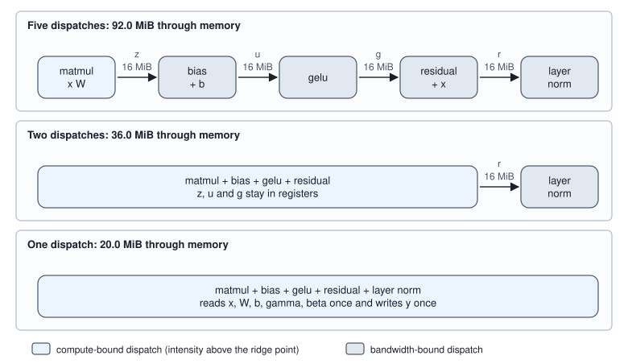
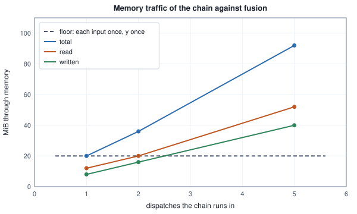
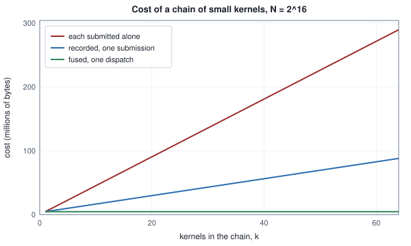

<!-- SPDX-License-Identifier: CC-BY-4.0 -->
<!-- Copyright (c) 2026 Martin Schröder <info@swedishembedded.com> -->

# Kernel Fusion and Memory Traffic

*Why is the cheapest computation the one whose intermediate result never touches memory?*

## The problem

A transformer layer contains a small piece of arithmetic that every framework writes in one line: take the activations $x$ of shape $[n, d]$, multiply by a weight matrix, add a bias, apply the GELU function, add the input back (the residual connection) and normalize each row,

$$y = \mathrm{layernorm}\bigl(x + \mathrm{gelu\_tanh}(x W + b)\bigr).$$

Written as a program for the machine of Chapters 4 to 7 it becomes five kernels, one per operation: a matrix product, a bias add, an activation, a residual add and a layer normalization, each a dispatch of its own that reads its inputs from memory and writes its result back. Take $n = 2048$ rows of width $d = 1024$ in float32. The activation is $4 n d = 8{,}388{,}608$ bytes. Here is what each kernel moves and computes, counted as in Chapter 3 (every distinct operand a kernel reads is counted once, every result it writes once):

<!-- worked: fusion.chain_traffic -->
x is [n, d] = [2048, 1024] in float32 (8,388,608 bytes), W is [d, d] (4,194,304 bytes), b, gamma and beta are [d]. Each kernel reads every distinct operand once and writes its result once. FLOPs: matmul 2 n d^2; bias n d; gelu_tanh 9 n d (u u, (u u) u, 0.044715 times that, u plus it, sqrt(2/pi) times the sum, tanh counted as one, 1 plus it, 0.5 u, their product); residual n d; layer norm n (7 d + 3) (Volume III, Chapter 10). Intensity is FLOPs divided by bytes read plus written; the ridge point of the model GPU is 50.

| kernel | FLOPs | bytes read | bytes written | FLOP per byte | bound |
|---|---:|---:|---:|---:|---|
| matmul z = x W | 4,294,967,296 | 12,582,912 | 8,388,608 | 204.800 | compute |
| bias u = z + b | 2,097,152 | 8,392,704 | 8,388,608 | 0.125 | bandwidth |
| gelu g = gelu_tanh(u) | 18,874,368 | 8,388,608 | 8,388,608 | 1.125 | bandwidth |
| residual r = g + x | 2,097,152 | 16,777,216 | 8,388,608 | 0.083 | bandwidth |
| layer norm y | 14,686,208 | 8,396,800 | 8,388,608 | 0.875 | bandwidth |
| total | 4,332,722,176 | 54,538,240 | 41,943,040 | 44.907 |  |
<!-- /worked -->

Read the last column against the ridge point of 50. The matrix product, at 204.8 FLOP per byte, is limited by arithmetic. The four others do between 0.08 and 1.1 FLOP per byte: each is a streaming pass, and its cost is its bytes. They add up to a good deal. Of the 96,481,280 bytes of the chain, 67,108,864 (69.6 percent) are the four intermediate tensors $z$, $u$, $g$ and $r$, each written by one kernel (8,388,608 bytes) and read back by the next (another 8,388,608). Nobody asked for those tensors. They exist only because the kernels are separate programs and memory is the only way one program can hand a result to another.

A single kernel could read $x$, $W$, $b$, $\gamma$ and $\beta$ once and write $y$ once. That is 20,983,808 bytes, 4.6 times fewer, and the numbers it computes are the same. This chapter is about when that is possible, what it saves, what it costs, and what changes in the last bits of the answer. Its central claim is the one in the title: the cheapest computation is the one whose intermediate result never touches memory.

## Before you begin

Answer from memory; the answers are at the end of the chapter.

1. (Volume IV, Chapter 3, bandwidth-bound.) For $c = a + b$ on $2^{20}$ float32 numbers, count the FLOPs, the bytes and the intensity. Is it limited by arithmetic or by bandwidth on the model GPU, whose ridge point is 50 FLOP per byte?
2. (Volume IV, Chapter 3, fixed costs.) Starting one dispatch costs 5 microseconds in the model, and the model GPU moves 800 (GB/s). How many bytes of memory traffic is the start worth?
3. (Volume IV, Chapter 4, occupancy.) A kernel with workgroups of 256 invocations uses 128 registers per invocation. How many workgroups are resident on a compute unit of the model and what is the occupancy?
4. (Volume IV, Chapter 5, kernel dispatch.) Of the host operations `upload`, `dispatch` and `read_back`, which returns before the device has finished and which waits?
5. (Volume IV, Chapter 7, two-pass reduction.) Why does the sum of $2^{24}$ numbers take two dispatches rather than one dispatch with a barrier across all workgroups?
6. (Volume III, Chapter 10, layer normalization.) How many of the $d$ numbers of a row must a layer normalization have read before it can write the first number of that row's output, and why?

## Counting what moves: memory-traffic accounting

*What this is for: to compare two ways of running the same arithmetic we need a count that does not depend on the machine. Chapter 3 gave the two quantities; this section turns them into a routine for a whole program.*

**Memory-traffic accounting** is the routine of listing, for every kernel of a program, the FLOPs it executes, the bytes it reads and the bytes it writes, and adding them up. The rule for one kernel is Chapter 3's: each distinct operand it reads counts once, each result it writes counts once, whatever the kernel does inside. The kernel reads $z$ and $b$ and writes $u$: $4nd + 4d$ bytes read, $4nd$ written. The count is a lower bound on what a real kernel moves (a kernel that reads an operand twice, or reads it with a stride that wastes part of every 32-byte transaction, moves more), and a lower bound is the right thing to compare, because it is the floor the kernel could reach.

Two derived quantities do the work. The arithmetic intensity $\mathcal{I} = N_{\mathrm{flop}} / N_{\mathrm{byte}}$ of a kernel against the ridge point $\mathcal{I}_{\mathrm{ridge}} = 50$ says which side of the roofline the kernel is on. And the **cost** of a kernel can be put in bytes. The roofline time of Chapter 3 is $\max(N_{\mathrm{flop}}/F_{\mathrm{pk}},\, N_{\mathrm{byte}}/\mathrm{BW})$; multiplied by the bandwidth it becomes

$$B_{\mathrm{eq}} = \max\bigl(N_{\mathrm{byte}},\; N_{\mathrm{flop}} / \mathcal{I}_{\mathrm{ridge}}\bigr),$$

in bytes, because $F_{\mathrm{pk}}/\mathrm{BW} = \mathcal{I}_{\mathrm{ridge}}$. A bandwidth-bound kernel costs its bytes. A compute-bound kernel costs the bytes its FLOPs are worth: the matrix product of the table costs $4{,}294{,}967{,}296 / 50 = 85{,}899{,}345.92$ equivalent bytes although it moves only 20,971,520. (Costs in bytes carry no seconds: the same count holds on any machine with that ridge point.)

The table fixes the convention for the nine operations of the GELU: the kernel computes $u^2$, $u^3$, $0.044715\,u^3$, the sum with $u$, the product with $\sqrt{2/\pi}$, a `tanh`, $1 + \tanh$, $0.5\,u$ and their product, with the tanh counted as one operation like the rest. A real unit spends more on a tanh, and the count is a lower bound in FLOPs as it is in bytes. Whether it matters can be asked directly:

<!-- worked: fusion.tanh_sensitivity -->
The gelu kernel of the chain reads u and writes g: 16,777,216 bytes. It does 8 ordinary operations and one tanh per element; the table counts the tanh at 1, 8 and 20 FLOPs.

| FLOPs counted for tanh | FLOPs per element | FLOPs | FLOP per byte | bound |
|---|---:|---:|---:|---:|
| 1 | 9 | 18,874,368 | 1.125 | bandwidth |
| 8 | 16 | 33,554,432 | 2.000 | bandwidth |
| 20 | 28 | 58,720,256 | 3.500 | bandwidth |
<!-- /worked -->

Even at 20 FLOPs for the tanh the activation does 3.5 FLOP per byte, 7 percent of the ridge point. It would need $392$ FLOPs for the tanh to cross it (intensity $(8 + t)/8 \ge 50$). So the conclusion that the four small kernels are bandwidth-bound does not rest on the counting rule, and their cost is their bytes.

That is the whole case for fusing them. A bandwidth-bound kernel does almost no arithmetic per byte, so the arithmetic units are idle while it runs; making the arithmetic faster changes nothing, and the only way to make it cheaper is to move fewer bytes.

## Fusing an elementwise chain

*What this is for: the simplest fusion has no obstacle, and it shows what fusion is.* Take the part of the chain that is elementwise, $r_i = \mathrm{gelu\_tanh}(z_i + b_{i \bmod d}) + x^{\mathrm{r}}_i$ (the residual input is called $x^{\mathrm{r}}$ here to keep it apart from the matrix product's input). Each output depends on one element of $z$, one of $b$ and one of $x^{\mathrm{r}}$, so each invocation of a kernel can compute its element start to finish. Three kernels, one per operation, store $u$ and $g$:

```text
kernel bias_add(z: array<f32>[N], b: array<f32>[d], u: inout array<f32>[N], N: int, d: int) workgroup n_wg:
    if g >= N: return
    u[g] = z[g] + b[g mod d]

kernel gelu(u: array<f32>[N], gl: inout array<f32>[N], N: int) workgroup n_wg:
    if g >= N: return
    gl[g] = gelu_tanh(u[g])

kernel residual_add(gl: array<f32>[N], xr: array<f32>[N], r: inout array<f32>[N], N: int) workgroup n_wg:
    if g >= N: return
    r[g] = gl[g] + xr[g]
```

and one kernel that does all three keeps $u$ and $g$ in registers of the invocation:

```text
kernel epilogue_fused(z: array<f32>[N], b: array<f32>[d], xr: array<f32>[N], r: inout array<f32>[N], N: int, d: int) workgroup n_wg:
    if g >= N: return
    u = z[g] + b[g mod d]               # a local variable: it never reaches memory
    r[g] = gelu_tanh(u) + xr[g]
```

**Kernel fusion** is replacing a chain of kernels, in which each consumes what the one before produced, by one kernel that computes the chain and keeps the intermediate results in registers or shared memory instead of buffers. The fused kernel is one dispatch; the intermediates are gone from memory; the arithmetic is unchanged.

Run both on the simulator of Chapter 5 and count. The inputs are drawn from the book's generator and every operation is rounded to float32 one at a time, as `docs/book/pseudocode.md` defines, so the comparison is between bit patterns:

<!-- worked: fusion.chain_sim -->
The epilogue of the chain on a [8, 8] activation (64 elements, workgroup size 32), run on the kernel simulator of Chapter 5: r[i] = f32(gelu_tanh(f32(z[i] + b[i mod 8])) + xr[i]), every operation rounded to float32 one at a time (`gelu_tanh` as in the previous block, constants rounded to float32, tanh the library tanh of the float32 argument rounded to float32). Generator: the book's SplitMix64, seed 0xf811431cafbfc072 (the seed of the name `fusion.chain_sim`). Draws in order: z[0..63] = normal(), b[0..7] = 0.5 normal(), xr[0..63] = normal(), each rounded to float32. First six results: [-0.134316, 1.023800, 0.727631, -0.061860, -1.678747, -0.215563]. Transactions are the simulator's 32-byte blocks (each workgroup reads b once). 'bit-identical' compares float32 bit patterns with the direct evaluation.

| design | dispatches | load transactions | store transactions | bytes moved | bit-identical to direct |
|---|---:|---:|---:|---:|---|
| three kernels: bias, gelu, residual | 3 | 34 | 24 | 1,856 | 64 of 64 |
| one fused kernel | 1 | 18 | 8 | 832 | 64 of 64 |
<!-- /worked -->

The two designs return the same 64 numbers to the last bit, and the fused kernel issues 26 of the 58 memory transactions of the three kernels (18 loads and 8 stores against 34 and 24). The loads fall from 34 to 18 because $u$ and $g$ are not read back; the stores fall from 24 to 8 because they are not written. (The ratio, 2.2, is near the $28 N$ to $12 N$ bytes of the counting rule, 2.3, and not equal to it because each of the two workgroups of this toy reads $b$.)

Why are the outputs identical, when the fused kernel never rounds $u$ to a stored word? Because it did not need to: a register in the model holds a float32, and the stored word is a float32 too. Each operation is rounded to float32 in both programs, in the same order, from the same operands. Fusion that keeps the format of the intermediate and the order of the operations changes where a value lives and not what it is. The section on numerics below shows what happens when either of those two things changes.

## Fusing into a matrix product: the epilogue

The matrix product is the large kernel, and it ends with the output tile in registers: the accumulator of Chapter 6 holds $z_{ij}$ right before the store. Whatever happens next to $z_{ij}$ alone can happen there, before the store. A computation applied to each output element of a kernel just before it is written is its **epilogue**:

```text
kernel matmul_epilogue(A: array<f32>[M, K], B: array<f32>[K, N], bias: array<f32>[N], xr: array<f32>[M, N],
                       C: inout array<f32>[M, N], M: int, N: int, K: int, T: int) workgroup T * T:
    ...                                  # the loop of matmul_tiled (Chapter 6), unchanged, ends with acc
    if row < M and col < N:
        u = acc + bias[col]
        C[row, col] = gelu_tanh(u) + xr[row, col]
```

The tiles, the barriers and the loads are the product's; the three added lines read two more operands (the bias element and the residual element of the output position) and write once. The chain has now three designs, five kernels, two (the product with its epilogue, then the layer norm) and one, and the accounting rule gives the bytes of each, with a group of kernels run together reading the operands none of its members produces and writing only the results a later dispatch or the caller needs:

<!-- worked: fusion.fusion_levels -->
The chain of the previous block, run as three designs. A group of kernels run together reads the operands no member produces (each once, x once although two members use it) and writes the results a later dispatch or the caller needs. FLOPs are 4,332,722,176 in every design. Cost is in millions of bytes: the larger of a dispatch's bytes and its FLOPs / 50, summed over the dispatches; 'with starts' adds 4,000,000 per dispatch (Chapter 3's 5 microsecond start at 800 (GB/s)). 'x' columns divide the first design's value by the row's.

| design | dispatches | bytes read | bytes written | total bytes | bytes x | cost (M) | cost x | with starts (M) | starts x |
|---|---:|---:|---:|---:|---:|---:|---:|---:|---:|
| five kernels, one per operation | 5 | 54,538,240 | 41,943,040 | 96,481,280 | 1.000 | 161.41 | 1.000 | 181.41 | 1.000 |
| matmul with bias, gelu and residual as its epilogue, then layer norm | 2 | 20,983,808 | 16,777,216 | 37,761,024 | 2.555 | 103.15 | 1.565 | 111.15 | 1.632 |
| everything in one kernel | 1 | 12,595,200 | 8,388,608 | 20,983,808 | 4.598 | 86.65 | 1.863 | 90.65 | 2.001 |
| floor: x, W, b, gamma, beta in, y out | - | 12,595,200 | 8,388,608 | 20,983,808 | 4.598 |  |  |  |  |
<!-- /worked -->



Fusing the epilogue removes $z$, $u$ and $g$ from memory and cuts the bytes by 2.555 times (96,481,280 to 37,761,024); fusing the layer norm too removes $r$ and brings the total to the floor of the table, 4.598 times fewer bytes. The last row of the table is that floor: every input read once, the output written once. No design can move fewer bytes, and a fully fused kernel reaches it exactly.



The bytes are not the cost. In bytes of cost, the product dominates: it is 85.9 million of the 161.4 million of the five-kernel design and stays at 85.9 million however much is fused into it, since the FLOPs of the epilogue are about 0.5 percent of the product's. So the 4.6-fold reduction in bytes is a 1.86-fold reduction in cost (with starts included, 2.00). That is the arithmetic of any speed-up: fusion removes the memory-bound kernels from the cost and leaves the compute-bound one alone, and the gain is large exactly when the memory-bound kernels were a large part of the total. Here the product is half of it. In a decode step on one row, where every product is a bandwidth-bound matrix-vector product (Chapter 3), nearly every kernel is of the other kind, and the weights are read once regardless, so the small kernels between two products are what remains to be removed.

## When a fusion is not allowed, or does not pay

*What this is for: fusion is not free and not always possible. Four obstacles recur, and each has a number.*

**The consumer needs a whole row.** A layer normalization cannot write element $j$ of its row until it has seen every element, to find the mean and the variance. The elementwise chain above is easy to fuse because every output depends on one input element; a reduction followed by an elementwise pass over the same row, as in normalization or softmax, can be fused only when one workgroup holds the whole row. For the matrix product that is a demand on the shape of its tile. The tiles of Chapter 6 are $T \times T$ squares, and a row of 1024 outputs is spread over $1024 / T$ workgroups, none of which sees the rest. To normalize in the epilogue a workgroup must compute $n_{\mathrm{rw}}$ whole rows of the output, each $d$ wide, so it holds $n_{\mathrm{rw}}\, d$ accumulators, and the matrix $W$ is loaded once per block of rows instead of once per tile of columns. Counting both with the rules of Chapters 4 and 6:

<!-- worked: fusion.row_owner -->
The whole chain in one kernel in which a workgroup of 256 invocations owns n_rw whole rows of the output, so that the layer norm can finish in it. n = 2048. The workgroup holds n_rw d accumulators, shared by its 256 invocations on top of 24 registers each; resident workgroups follow the occupancy rule of Chapter 4 (65,536 registers, 2,048 invocations, 16 workgroups per compute unit; at most 255 registers per invocation). Bytes count the loads the workgroups issue (Chapter 6's rule): x once, W once per row block (ceil(n / n_rw) times), b, gamma, beta, and y written. The last column divides by the bytes of the two-dispatch design of the previous section (epilogue fusion, then layer norm).

| d | n_rw | accumulators | registers per invocation | resident workgroups | occupancy (%) | bytes | FLOP per byte | bound | bytes / two-dispatch bytes |
|---|---:|---:|---:|---:|---:|---:|---:|---:|---:|
| 1024 | 1 | 1,024 | 28 | 8 | 100.0 | 8,606,724,096 | 0.5 | bandwidth | 227.93 |
| 1024 | 4 | 4,096 | 40 | 6 | 75.0 | 2,164,273,152 | 2.0 | bandwidth | 57.32 |
| 1024 | 16 | 16,384 | 88 | 2 | 25.0 | 553,660,416 | 7.8 | bandwidth | 14.66 |
| 1024 | 32 | 32,768 | 152 | 1 | 12.5 | 285,224,960 | 15.2 | bandwidth | 7.55 |
| 1024 | 64 | 65,536 | 280 (spills) | - | - | 151,007,232 | 28.7 | bandwidth | 4.00 |
| 8192 | 1 | 8,192 | 56 | 4 | 50.0 | 549,890,129,920 | 0.5 | bandwidth | 1024.06 |
| 8192 | 4 | 32,768 | 152 | 1 | 12.5 | 137,573,269,504 | 2.0 | bandwidth | 256.20 |
| 8192 | 16 | 131,072 | 536 (spills) | - | - | 34,494,054,400 | 8.0 | bandwidth | 64.24 |
| 8192 | 32 | 262,144 | 1048 (spills) | - | - | 17,314,185,216 | 15.9 | bandwidth | 32.24 |
| 8192 | 64 | 524,288 | 2072 (spills) | - | - | 8,724,250,624 | 31.5 | bandwidth | 16.25 |
<!-- /worked -->

Every row of the table is bandwidth-bound, and the last column puts every one far above the bytes of the two-dispatch design for its shape (37,761,024 for $d = 1024$). For $d = 1024$ and one row per workgroup the kernel loads $W$ 2,048 times and moves 227.93 times the bytes of the two-dispatch design; at 32 rows it moves 7.55 times and the 152 registers per invocation leave one resident workgroup (12.5 percent occupancy); at 64 rows the accumulators alone need 280 registers per invocation, past the 255 a kernel may use. With $d = 8192$ no row count of the table helps. The counts are loads issued by workgroups (the rule of Chapter 6); a cache large enough to hold $W$ while the workgroups run together would serve the repeats, and then the first rows of the table cost registers and occupancy and not bytes. That is a reason to measure, and the reason to prefer the second design on a shape like this one is that its cost is known: two dispatches and 36 MiB. Where the row owner costs nothing is where there is one row. A decode step normalizes a single row between two weight streams, the weights are read once whatever the layout, and a workgroup that owns the row loses no reuse. The fused kernels in brain that include a normalization are of that kind.

**The consumer needs other workgroups.** Dividing a vector by its own sum needs the sum of all of it, and the sum of all of it is known only when every workgroup has finished (Chapter 7: a grid-wide barrier inside one dispatch can deadlock, so the end of a dispatch is the barrier). A chain with a global reduction in the middle cannot be one dispatch; the best that fusion can do is to fuse on each side of the boundary. Sometimes a dispatch can be saved by recomputing instead of waiting: the division kernel can have each of its workgroups add the $n_{\mathrm{wg}}$ partial sums itself instead of reading one total:

<!-- worked: fusion.redundant_partials -->
y[i] = x[i] / s with s the sum of all x, N = 2^24 = 16,777,216 floats, workgroups of 256 invocations each adding n_el numbers, so n_wg = N / (256 n_el) workgroups. Three dispatches: partial sums (reads 4 N, writes 4 n_wg), the total by one workgroup (reads 4 n_wg, writes 4), the division (reads 4 N + 4, writes 4 N). Two dispatches: partial sums, then a division in which every workgroup first adds all n_wg partials itself (n_wg workgroups each reading 4 n_wg bytes). Cost in millions of bytes inside one recorded submission: bytes plus 800,000 per dispatch (the common submission cost 3,200,000 cancels). The extra reads of the two-dispatch design, 4 n_wg^2 bytes, equal the dispatch they save when n_wg = sqrt(800,000 / 4) = 447.2; if the dispatches were submitted alone (4,000,000 each) it would be n_wg = 1000.0.

| n_el | n_wg | dispatches | bytes | cost (M) | dispatches | bytes | cost (M) | cheaper |
|---:|---:|---:|---:|---:|---:|---:|---:|---|
| 256 | 256 | 3 | 201,328,648 | 203.73 | 2 | 201,589,760 | 203.19 | two dispatches |
| 128 | 512 | 3 | 201,330,696 | 203.73 | 2 | 202,377,216 | 203.98 | three dispatches |
| 64 | 1,024 | 3 | 201,334,792 | 203.73 | 2 | 205,524,992 | 207.12 | three dispatches |
| 16 | 4,096 | 3 | 201,359,368 | 203.76 | 2 | 268,451,840 | 270.05 | three dispatches |
<!-- /worked -->

The redundant sums cost $4 n_{\mathrm{wg}}^2$ extra bytes, and that is worth paying exactly while it is smaller than the start of the dispatch it saves: $n_{\mathrm{wg}} < \sqrt{L_{\mathrm{dsp}}/4} = 447$ when the dispatches are recorded together, and 1,000 when each would be submitted alone. The row of 256 workgroups saves a dispatch worth 800,000 bytes for about a quarter of a million extra bytes; from 512 workgroups the extra bytes (about a million) cost more than the dispatch. The term $L_{\mathrm{dsp}}$ is the next section's subject.

**Recompute or store.** Fusing the forward pass makes the intermediates disappear, and the backward pass of training may need them: the derivative of the GELU is a function of $u$. There are two ways to have $u$ again, store it (write 4 bytes in the forward pass, read 4 in the backward pass) or compute it again from what is stored. The recomputation costs FLOPs, and the FLOPs are worth bytes at the ridge point. For one element:

<!-- worked: fusion.recompute_store -->
For one element of an intermediate tensor the backward pass needs again: storing costs 8 bytes (4 written, 4 read back). Recomputing from tensors already in memory costs the FLOPs of the producing operation per element, worth FLOPs / 50 bytes on the model GPU (the ridge point of Chapter 3). The rule picks the smaller.

| intermediate | FLOPs per element | recompute cost (bytes) | store cost (bytes) | choice |
|---|---:|---:|---:|---|
| u = z + b, from z | 1 | 0.020 | 8 | recompute |
| r = g + x, from g and x | 1 | 0.020 | 8 | recompute |
| g = gelu_tanh(u), from u | 9 | 0.180 | 8 | recompute |
| y = layer norm(r), from r and 2 numbers per row | 7.003 | 0.140 | 8 | recompute |
| z = x W, from x and W | 2048 | 40.960 | 8 | store |
| score s = q . k, head width 64 | 128 | 2.560 | 8 | recompute |
<!-- /worked -->

Anything made of a few elementwise operations is cheaper to recompute than to store, by a factor of 40 or more. The matrix product's output is the opposite: recomputing one element costs a dot product of $2d = 2048$ FLOPs, worth 41 bytes against the 8 of storing it, so $z$ is stored (or the matrix product is the point at which the chain is cut). The attention score of the last section is the third kind: a score is a dot product of head width 64, 128 FLOPs, worth 2.56 bytes against 8, and so it is cheaper to compute twice than to store once, which is the basis of the memory saving of fused attention.

**Too many kernels to write.** Every choice a fused kernel offers multiplies the number of kernels, if each combination is its own program:

<!-- worked: fusion.variant_count -->
Choices a fused matmul epilogue might offer. 'Product' is the number of kernels to write and compile when every combination is its own kernel; 'sum' is the number of codes a kernel that reads one uniform integer per axis must understand.

| axis | choices | product so far | sum so far |
|---|---:|---:|---:|
| activation: identity, relu, silu, gelu | 4 | 4 | 4 |
| bias: yes or no | 2 | 8 | 6 |
| residual: yes or no | 2 | 16 | 8 |
| output format: float32, float16, bfloat16 | 3 | 48 | 11 |
| normalization: none, layer, RMS | 3 | 144 | 14 |
<!-- /worked -->

Five modest axes make 144 kernels to write, test and compile, against 14 codes for one kernel that reads a uniform integer per axis. A uniform branch is the same for every invocation of a dispatch, so it costs one comparison and no divergence (Chapter 4). That is the choice brain's epilogue kernels make for the activation, a selector word in the parameter block; the choice that trades the other way, a generated kernel per combination, is available where a code generator exists (Chapter 9). Fusion has a cost in code and in compile time, and the number of combinations is what to look at before promising it.

Two smaller obstacles belong with these. A fused kernel needs more registers and more shared memory than any of its members, so its occupancy (Chapter 4) falls and its memory latency is hidden less well; the table above is the example. And a fusion that keeps a value live across a long computation can spill it. Neither makes fusion wrong. Both are reasons to count before fusing, which is what the accounting is for.

## Launch overhead

*What this is for: the bytes of the intermediates are one cost of separate kernels. Starting each kernel is the other, and it matters most where the kernels are smallest.*

Every dispatch pays, before its first invocation runs, for work that does not depend on how big it is: the host builds the request, the driver checks and queues it, the device sets up a grid. That fixed cost per dispatch is the **launch overhead**. Chapter 3 took it as 5 microseconds and showed that a vector addition reached half its roofline only above 333,333 elements. The model now splits that cost in two, as two labelled parameters, round numbers invented for the book and not a measurement of any product:

- $L_{\mathrm{sub}}$, the cost of handing the device one **submission** (a list of dispatches given to it together): 4 microseconds, which at 800 (GB/s) is $L_{\mathrm{sub}} = 3{,}200{,}000$ bytes;
- $L_{\mathrm{dsp}}$, the cost of starting one more dispatch once the device is running a list: 1 microsecond, $L_{\mathrm{dsp}} = 800{,}000$ bytes.

A dispatch submitted alone pays both, 4,000,000 bytes, which is Chapter 3's 5 microseconds. The count the model needs from a program is therefore $N_{\mathrm{sub}}$, the number of submissions, and $N_{\mathrm{dsp}}$, the number of dispatches; its cost beyond the kernels' own is $N_{\mathrm{sub}} L_{\mathrm{sub}} + N_{\mathrm{dsp}} L_{\mathrm{dsp}}$. (The 1 microsecond is of the order of the time per dependent kernel in a captured chain of trivial kernels that knowledge #205 records for one CUDA setup, which is where the parameter's size comes from; a different device has a different one.)

<!-- perf-number: historical measurement, knowledge #205 -->
Knowledge #205 (October 2026) gives the floor as about 0.75 to 1.0 microseconds per node for a graph of 865 dependent trivial kernels; the entry does not name the device of that microbenchmark (the decode runs it describes were on a GH200 system).

A chain of $k = 16$ elementwise kernels, each reading and writing $N$ floats, makes the effect visible:

<!-- worked: fusion.launch_overhead -->
A chain of k = 16 elementwise kernels, each reading and writing N floats (8 N bytes), on the model GPU. Parameters: submission 3,200,000 bytes (4 microseconds at 800 (GB/s)), starting one dispatch 800,000 bytes (1 microsecond); a dispatch submitted alone pays both (4,000,000, Chapter 3's 5 microseconds). Separate: k (submission + dispatch + 8 N). Recorded: one submission + k dispatches + k 8 N. Fused: one submission + one dispatch + 8 N (the intermediates never leave registers). Costs in millions of bytes.

| N | bytes per kernel | separate (M) | starts' share (%) | recorded (M) | separate / recorded | fused (M) | separate / fused |
|---|---:|---:|---:|---:|---:|---:|---:|
| 2^12 | 32,768 | 64.52 | 99.2 | 16.52 | 3.90 | 4.03 | 16.00 |
| 2^16 | 524,288 | 72.39 | 88.4 | 24.39 | 2.97 | 4.52 | 16.00 |
| 2^20 | 8,388,608 | 198.22 | 32.3 | 150.22 | 1.32 | 12.39 | 16.00 |
| 2^24 | 134,217,728 | 2,211.48 | 2.9 | 2,163.48 | 1.02 | 138.22 | 16.00 |
<!-- /worked -->

Read the last two columns. At $N = 2^{12}$ the chain's 16 kernels move 32,768 bytes each and the starts are 99.2 percent of the cost; the data is so small that it makes no difference whether it travels once or sixteen times, and what matters is the 16 starts. At $2^{24}$ the starts are 2.9 percent and the 16 kernels' 134 million bytes each are what is left. The ratio of separate to fused is 16 in every row, because both terms shrink by 16, but the two reductions are different in kind. What recording removes (the next section) is the starts, and so it gives 3.90 at the smallest size and 1.02 at the largest; what fusion removes is the starts and the bytes together, and it gives 16.00 at both. The break-even size, where one kernel's bytes equal one start, is $8N = 4{,}000{,}000$, $N = 500{,}000$ elements: kernels over fewer elements than that are mostly starts.



For a chain of *small* kernels the first thing to do is to stop paying for each dispatch separately, and the second is to fuse.

## Command recording

*What this is for: a program often has several dispatches ready at once and the host should hand them over once.*

The host program of Chapter 5 makes one submission per dispatch: `dispatch` returns at once but each call hands the device one launch. **Command recording** is the alternative: the host appends launches to a list with `record`, and `submit` hands the whole list to the device as one submission (the three operations are defined in `docs/book/pseudocode.md`; `dispatch` is shorthand for a list of one). The device runs the list in order, each launch seeing the writes of those before it, so the chain of Chapter 5 needs no `read_back` between its kernels:

```text
function run_chain(x: array<f32>[N], k: kernel, scale: array<f32>[3], shift: array<f32>[3], n_wg: int) -> array<f32>[N]:
    require N >= 1
    b0 = create_buffer(4 * N)
    b1 = create_buffer(4 * N)
    b2 = create_buffer(4 * N)
    b3 = create_buffer(4 * N)
    upload(b0, x)
    c = begin_commands()
    record(c, k, [b0, b1], [N, bits(scale[0]), bits(shift[0])], ceil(N / n_wg))
    record(c, k, [b1, b2], [N, bits(scale[1]), bits(shift[1])], ceil(N / n_wg))
    record(c, k, [b2, b3], [N, bits(scale[2]), bits(shift[2])], ceil(N / n_wg))
    submit(c)                                    # one submission for the three launches
    y = read_back(b3, N)                         # waits for it
    release(b0)
    release(b1)
    release(b2)
    release(b3)
    return y
```

The host pays $L_{\mathrm{sub}}$ once instead of three times, and the device pays $L_{\mathrm{dsp}}$ per launch. Three host programs on the three kernels of Chapter 5, simulated, with their start costs under the model:

<!-- worked: fusion.command_recording -->
Chapter 5's three kernels y = scale x + shift with (scale, shift) = (2.0, 1.0), (0.5, -2.0), (3.0, 0.5) on x = [-3, -2, -1, 0, 1, 2, 3, 4, 5, 6] (N = 10, workgroup size 4), buffers resident on the device, written as host programs with the operations of the chapter. 'Start cost' is submissions x 3,200,000 + dispatches x 800,000 bytes. Final y = [-13, -10, -7, -4, -1, 2, 5, 8, 11, 14].

| host program | dispatches | submissions | read-backs | start cost (bytes) | y equals direct |
|---|---:|---:|---:|---:|---|
| each dispatch submitted alone | 3 | 3 | 1 | 12,000,000 | yes |
| three dispatches recorded, one submission | 3 | 1 | 1 | 5,600,000 | yes |
| recorded, but the host reads the middle result | 3 | 2 | 2 | 8,800,000 | yes |
<!-- /worked -->

Recording the three launches costs 5,600,000 bytes of starts against 12,000,000 for submitting each alone, and all three programs return the same $y$. The third program is the one to remember. A **read-back breaks the recording**: the host wants the middle result, so it must submit what it has recorded (a result that depends on commands still in the list cannot be waited for) and wait; the rest is a second submission. Anything that observes the device, a read of a buffer, a wait, a new allocation that forces the device to catch up, ends the list at that point. A program that is built to be recorded keeps its host-visible results at the end.

What recording does not do is move fewer bytes. Every kernel in the list still reads and writes its operands, which is the right-hand side of the last section's table: recording and fusion remove different costs, and a chain of small kernels wants both. A list also cannot grow without limit. The device must be able to run one submission to the end in bounded time, and a very long list hands it work it cannot interrupt; real backends cap the size of a list and submit and wait when it reaches the cap (the section on brain below shows where).

## The numbers change in the last bits

*What this is for: a fused kernel is a different program. Whether it is the same function in floating point depends on two things the table above did not show.*

In the first simulation the fused and unfused kernels agreed to the bit because each operation was rounded to float32 and the intermediate stored was float32. Change the second of those. A pipeline whose activations live in half precision stores $u$ and $g$ as float16 between the kernels; the fused kernel has no reason to, and keeps float32 in registers until the result. Both are legitimate, and they are different functions:

<!-- worked: fusion.precision -->
The epilogue chain r = gelu_tanh(z + b) + xr on N = 4096 elements with float16 inputs and a float16 result. Generator: the book's SplitMix64, seed 0x2dac3e0196658a47 (the seed of the name `fusion.precision`). Draws in order: z[0..4095] = 2 normal(), b[0..63] = 0.5 normal() (b[i mod 64] multiplies element i), xr[0..4095] = normal(), each rounded to float16 (ties to even). Every arithmetic operation is rounded to float32 one at a time; the unfused design also rounds u and g to float16 where they are stored. The reference evaluates the chain in float64 (library tanh) and rounds once to float16; errors are against the unrounded float64 value. The two designs differ in 924 of 4096 results.

| design | results differing from the reference | largest absolute error | mean absolute error |
|---|---:|---:|---:|
| three kernels, float16 buffers between them | 926 | 3.641e-03 | 3.074e-04 |
| one kernel, float32 in registers, float16 result | 3 | 2.441e-03 | 2.186e-04 |
<!-- /worked -->

The fused kernel rounds once to float16 where the unfused chain rounds three times (the stores of $u$, $g$ and the result), so it is closer to the reference. It matches the single-rounding reference in all but 3 of 4,096 results (the three whose exact value lies within float32 rounding error of a midpoint between two float16 numbers, so that the rounding of an intermediate to float32 tipped the final one), and its largest and mean errors are lower than the chain's. It is also not the same function as the chain: the two differ in 924 of 4,096 results. A test that holds the fused kernel to the bits of the unfused chain would fail, and be wrong to ask: the chain is not the more accurate of the two. (Perturbing the library tanh by one unit in the last place of double precision changes none of these results.)

A test needs a statement of what fusion promises. There are two kinds. A fusion that performs each operation in the same format and the same order (and, for a reduction, the same order of additions, as in Chapter 7) is *bit-identical* to the chain, and its gate can compare bits, which is the strongest check and cannot hide a defect behind a tolerance. A fusion that drops a rounding or reorders a sum is a *different rounded function* that is as accurate or more accurate, and its gate compares against a higher-precision reference with a tolerance written in the format's own step.

There is a third way a compiler can change the last bits of a fusion that was not asked for: the instruction that multiplies and adds with one rounding, the fused multiply-add. The name is an accident of language, since it fuses two arithmetic operations in one instruction and not two kernels. A compiler may contract $x y + z$ into one such instruction, which rounds once where a program that wrote the two operations rounds twice. The same fusion of operations changes bits:

<!-- worked: fusion.fma_rounding -->
x y + z for N = 4096 float32 triples. Generator: the book's SplitMix64, seed 0xa950f6b3545bf387 (the seed of the name `fusion.fma`). Draws in order: all x (normal()), then all y, then all z, each rounded to float32. 'Two roundings' computes f32(f32(x y) + z); 'one rounding' forms x y + z exactly and rounds once to float32 (a fused multiply-add instruction). A step is the distance between neighbouring float32 numbers.

| the two results are | triples |
|---|---:|
| identical | 3168 |
| 1 step apart | 753 |
| 2 steps apart | 60 |
| 3 or more steps apart | 115 |
<!-- /worked -->

928 of the 4,096 results differ (22.7 percent), mostly by one step and sometimes by many (115 of them by three or more steps, where $x y$ and $z$ nearly cancel and the single rounding keeps a difference the double rounding has already lost). The result with one rounding is the correctly rounded one; the result with two is what the portable reference computes. A project that asserts agreement between a native kernel and a portable reference to the last bit must therefore forbid contraction, as the section below shows brain's CUDA compiler flags doing.

## The famous fusion: attention in bytes

*What this is for: the largest saving in this chapter, and the reason a later volume exists. Here only the traffic is counted.*

Attention computes, for each of $n$ positions, scores against all $n$ positions, normalizes them (softmax) and averages the values by the normalized scores. Written as three kernels, the scores $S = Q K^{\mathsf T}$ are an $n \times n$ matrix that the first kernel writes, the softmax kernel reads and rewrites as $P$, and the third kernel reads. Counting one head of width $d = 64$ in float32:

<!-- worked: fusion.attention_bytes -->
One attention head in float32, head width d = 64, n positions, scores S = Q K^T of shape [n, n]. Unfused: QK^T reads Q and K and writes S; softmax reads S and writes P (same size); P V reads P and V and writes the output. Bytes = 4 (2 n d + n^2) + 4 (2 n^2) + 4 (n^2 + 2 n d) = 16 n^2 + 16 n d. Fused: Q, K, V in, output out: 16 n d. FLOPs 4 n^2 d for the two products plus n (5 n - 2) for the row softmaxes (maximum, subtraction, exp, sum, division). Ridge point 50.

| n | S in MiB | unfused bytes | fused bytes | ratio | FLOP per byte, unfused | FLOP per byte, fused |
|---|---:|---:|---:|---:|---:|---:|
| 512 | 1.0 | 4,718,592 | 524,288 | 9.0 | 14.5 | 130.5 |
| 4,096 | 64.0 | 272,629,760 | 4,194,304 | 65.0 | 16.1 | 1044.0 |
| 32,768 | 4,096.0 | 17,213,423,616 | 33,554,432 | 513.0 | 16.3 | 8352.0 |
<!-- /worked -->

The three kernels move $16 n^2 + 16 n d$ bytes and the fused one $16 n d$, a ratio of $1 + n/d$: 65 at $n = 4096$. The matrix $S$ at that length is 64 MiB for each head of each sequence, and at $n = 32{,}768$ it is 4,096 MiB, larger than the binding limits of many devices. The intensity changes class: the three kernels run at 16 FLOP per byte, below the ridge point and bandwidth-bound, while the fused kernel runs at 1,044, far above it and compute-bound. Fusion here does not remove a few memory passes from a compute-bound kernel; it turns a bandwidth-bound computation into a compute-bound one.

The fusion is possible because of something that is not obvious from the three kernels: the softmax of a row needs the whole row's maximum and sum, and the consumer ($P V$) needs the normalized weights. The way out is to process the keys in blocks and to keep a running maximum and a running sum that are corrected as each block arrives (the "online" softmax), so that no workgroup ever needs the whole row of scores at once; and the scores of a block are not stored but recomputed in the backward pass, as the recompute-or-store table above predicts. This is the subject of the volume on attention, and the algorithm of Dao and coauthors (2022) that gave the idea its name. This chapter claims only the byte count, and it needs nothing beyond what has been taught.

## Where this appears in brain

**`crates/kernels-cuda`: a registry of fused native kernels.** The crate holds native CUDA C++ sources (`crates/kernels-cuda/cu/*.cu`, included as text and compiled at run time by the CUDA backend) and a table in `crates/kernels-cuda/src/lib.rs`: one `CudaKernel` entry per kernel, with its name, the operator and weight tier it implements, its entry point, a one-line `what`, its block size and shared-memory use. It is a registry of its own, separate from the WGSL catalogue in `crates/kernels`; the crate header gives the reason, that four pieces of machinery (the generator, the catalogue-validation test, the cost-formula check, the metadata cross-checks) treat every WGSL entry as WGSL text and have no purchase on C++. Most of its kernels are the matrix kernels of Chapter 6 for the quantized and half-precision weights of Chapter 12, and the attention and recurrent-state kernels of later volumes. The ones that matter here are the fused front ends: `add_rms_quant.cu` (residual add, RMS normalization, per-group scale and int8 packing), `quant_epilogue.cu` (the SwiGLU product or a sigmoid gate, then the same scale and pack), `rmsnorm_fused.cu`, `silu_mul_quant_e4m3_128.cu`, `swiglu_bwd_fused.cu`, and the single-launch Gated DeltaNet decode step `gdn_decode.cu`.

**How a fused kernel relates to the WGSL chain.** A fused CUDA kernel has no WGSL twin. Its entry has `by_name: true`: the selector that picks a kernel by operator and weight tier never offers it, because it replaces a chain the *model* builds. The model asks for it by name, `Gpu::fused_step(Fused::AddRmsQuant, ...)` in `crates/gpu-core/src/lib.rs`, with the contract of each kernel documented on the `Fused` enum in `crates/gpu-core/src/native_upgrade.rs`, and gets `None` when the device is not offered it or the shape is not served; the caller then builds the WGSL chain the kernel replaces, so the chain stays the reference on every device. The accounting of this chapter is in the headers. `add_rms_quant.cu` states the chain it replaces (`add2`, `rmsnorm_rows`, `max_abs_rows`, `quant_pack`) and that it produces what the chain produces "to the last bit"; it explains how: the sum of squares is the only order-sensitive step, so the kernel keeps the reference's lane ownership and ascending order (the reduction order of Chapter 7), and an element stays in one thread's registers from its load to the quantizer, never visiting memory. It also records the register cost of that choice, the limit of the fusion: a row wider than the number of registers allows is not served and the host keeps the chain (the header names 5,120 elements). The gate `crates/gpu-core/tests/it/add_rms_quant_native.rs` compares the output byte for byte with the chain, and says why: with identity achievable, a tolerance would only hide a defect. And `crates/backend-cuda/src/nvrtc.rs` compiles every kernel with `--fmad=false`; its comment is this chapter's last paragraph, that NVRTC contracts `a*b + c` by default, rounding once where the portable reference rounds twice, and that the project's cross-backend agreement is absolute.

**Fused kernels in `crates/kernels/wgsl`.** The portable catalogue has the same pattern. `silu_mul.wgsl` is the SwiGLU product in one elementwise kernel. `conv_epilogue.wgsl` and `conv_act.wgsl` apply a per-channel affine (batch normalization at evaluation time, folded into one scale and one bias per channel, a change of algebra that costs nothing at run time) and an activation chosen by an `act` word of the parameter block, the one-kernel-per-selector design of the section on code explosion; the header of `conv_act.wgsl` notes that a uniform branch "is coherent across the dispatch, so it costs nothing". `rmsnorm_quant_fused.wgsl` fuses a normalization with the int8 quantization after it and never writes the normalized row; to find the group maximum and then quantize, it computes each value twice, "with the identical expression and operand order", instead of storing it, the recompute-or-store trade at the smallest scale. `qknorm_rope_fused.wgsl` applies a per-head RMS normalization and the rotary rotation in one workgroup per row: the rotation pairs two elements of the row the normalization has just finished, so the row never leaves the workgroup, and the kernel re-reads its own pair after the reduction instead of keeping a runtime-sized array per thread (the register argument). And the attention kernels (`flash_attn_bidir.wgsl` and `flash_attn_bidir_bias.wgsl`) say in their headers that scores, softmax and application are fused so that the $[B, H, T, T]$ matrices are never materialised and peak attention memory is $O(T \cdot \text{head dim})$, which is this chapter's last table; knowledge #240 records the unfused alternative at head width 256 as $24\,T^2 \cdot 4$ bytes per slab, about 1.6 billion bytes at $T = 4096$.

**Fusions as stories.** The first two are the same lesson in two backends.

<!-- perf-number: historical measurement, commit 660c91601 -->
*Commit 524f5a742* (October 2026) fused the chains that a decode token ran between two weight products in the CUDA path: residual add, normalization, quantization scale and int8 pack, and the SwiGLU or gate product with the same pack. Its message states the motive as launches and a slow generated normalization kernel, selects the new kernels by name with the WGSL chain as the fallback, and describes the gates: byte-for-byte against the chains (`add_rms_quant_native.rs`, `quant_epilogue_native.rs`), and against the whole decode tape (`decode_fusion.rs` in `crates/qwen35/tests/it`, "the fused and unfused hidden state after every position are identical"). Knowledge #206 records the part that the byte count does not cover: the first version, which interleaved each load with the arithmetic that used it, was barely faster than the chain, because brain's buffers alias by design and a load cannot be moved above an earlier store; the working kernel issues every load first, computes in registers, and stores last, and its price is registers (240 for an 80-element row), the limit on the rows it serves. *Commit 660c91601* (September 2026) did the same for the portable path: RMS normalization and int8 quantization fused in the Qwen serving engine, bit-identical to the three-kernel sequence by a test (`rms_quant_fused_is_bit_identical_to_the_unfused_triad` in `crates/qwen3/src/serve.rs`). It records, for a prefill pass on two Tesla P40 cards, a fall from 786 to 674 dispatches and a fall of about half in the device time of the fused region, and that the whole pass moved far less because the attention and the matrix products dominated, which is the cost column of the table above.

<!-- perf-number: historical measurement, commit 2c8eb0daa -->
*Commit 2c8eb0daa* (August 2026) is a fusion that pays for itself by counting passes. The channels-first layer norm of a vision model had been composed as a permute to channels-last, a row normalization and a permute back, six passes over the tensor (three reads and three writes); the fused `layernorm2d.wgsl` reads the data twice and writes once. The commit's table lists the composed form 4.38 times slower at its largest shape and 1.09 times at its smallest (one unstated device, 6 August 2026), more than the byte count predicts because the two permutes were also strided. It also records that the kernel was *not wired in*: the layer's forward pass fills the channels-last buffers its backward pass reads, so adopting it needed an evaluation-only path or a fused backward, the recompute-or-store obstacle of this chapter, in a real tree. *Commit b2d1b379e* (June 2026) is the same with a convolution: conv, batch norm at evaluation time and SiLU become one `conv_act` dispatch instead of three kernels and two intermediate buffers, with the training path left unchanged. *Commit 9ce5530a9* (July 2026) records the other cost: a depth-estimation frame found "dispatch-bound", whose evaluation graph went from 165 to 86 dispatches by fusing the structure (branches of a block merged by algebra on the weights, a copy dispatch removed, the activation selector added to the batch-norm kernel).

<!-- perf-number: historical measurement, knowledge #21 -->
Knowledge #21 (September 2026) is the warning that goes with all of these: a per-kernel table is an upper bound and only the whole pass is the truth. On a profile of a VQGAN backward pass that drained the queue between groups, the sum of the groups was 855 ms against a 574 ms pass; three changes that each looked like a clear win in the table were checked against the pass and one, which added two kernels and 88 dispatches for no whole-pass gain, was reverted.

**Command recording in gpu-core.** The model builds `Step` values (one recorded dispatch each) and the backend decides when they become a submission. `Gpu::submit` on the wgpu backend appends steps to a pending list (`pending` in `crates/backend-wgpu/src/lib.rs`) and returns; `flush`, which a `read` or `poll_wait` calls first, takes the whole list, records every dispatch into *one* compute pass and calls `queue.submit` once, leaving the ordering between dependent dispatches to the library's hazard tracking. `Gpu::queue_submits` counts the submissions so that a test can assert a batching contract without a clock. The list is bounded. Commit 09fc19d2e (September 2026) records the failure: a prefill that reads back once at the end let one command buffer grow with the prompt, until an Intel graphics driver could not preempt it and reset the engine, invalidating every buffer on the device, with an error naming whichever buffer was touched first. The fix tracks the accumulated *size* of the list in workgroups (`max_unsynced_workgroups` in `crates/backend-api/src/hardware.rs`) and flushes and waits when it passes the cap, and its tests (`a_long_unread_run_of_dispatches_flushes_along_the_way` and `a_short_run_of_small_dispatches_still_batches` in `crates/backend-wgpu/tests/it/batch_bounded.rs`) pin both halves: a long run flushes on the way, and 32 one-workgroup dispatches still cost one flush. The measure is size and not count because dispatches differ in cost by orders of magnitude, which the commit supports with a single naive matrix product dispatch. The backend keeps the opposite path, a pass, a submission and a wait per dispatch (`flush_serialized`), for a batch that one driver family corrupts, which shows what recording gives up when it cannot be used. The CUDA backend extends the idea to a whole pass: `begin_pass` and `end_pass` hold the submissions of a decode token and issue them as one, and knowledge #205 is the account of why that mattered: a decode token of thousands of kernel launches left the card idle for most of the token while the host built and issued them, and the repairs included holding a token's submissions and issuing them as one.

## Check your understanding

1. Fusing the bias, GELU and residual into the epilogue cuts the chain's bytes by 2.555 but its cost (in bytes) by only 1.565. Explain the difference, and say what would make the two ratios nearly equal.
2. Find the error: "The 16 elementwise kernels were recorded into one command buffer, so the chain now moves 16 times fewer bytes."
3. The GELU kernel does 9 FLOPs per element on 8 bytes. A colleague counts the tanh as 20 FLOPs and concludes the kernel is now compute-bound. Check the claim, and say at what FLOP count of the tanh it would be.
4. In the precision table the fused kernel matches the single-rounding reference in 4,093 of 4,096 results and the unfused chain in 3,170. A reviewer rejects the fused kernel because it differs from the chain in 924 results. What should the gate compare, and against what?
5. Why can the epilogue of a matrix product with $16 \times 16$ tiles not include the layer normalization of the row, and what does the row owner pay?
6. A reduction followed by an elementwise pass (a division by the sum) is to be fused into one dispatch. Why can it not be, for a vector of $2^{24}$ numbers, and what is the cheaper alternative while $n_{\mathrm{wg}}$ is small?
7. For the attention heads of a model at $n = 8192$, $d = 64$, find the ratio of the unfused to the fused bytes, and say why the fused kernel is compute-bound and the unfused is not.
8. Find the error: "recording the whole prefill into one command buffer is always best: one submission, minimum starts."

## Exercises

1. **[Calculate]** For the chain with $n = 4096$ and $d = 2048$, find the FLOPs, bytes read and bytes written of each of the five kernels, the totals, the bytes of the fully fused kernel and the ratio, with the counting rules of `fusion.chain_traffic`.
2. **[Calculate]** A chain of 6 elementwise kernels reads and writes $N = 2^{22}$ float32 numbers each. Find the bytes of the unfused chain and of the fused kernel, and the intensity of one kernel that does 1 FLOP per element.
3. **[Calculate]** For $k = 24$ elementwise kernels over $N = 2^{18}$ floats, find the cost in bytes of the three designs of `fusion.launch_overhead` (each submitted alone, recorded, fused) with $L_{\mathrm{sub}} = 3{,}200{,}000$ and $L_{\mathrm{dsp}} = 800{,}000$, and the share of the starts in the first.
4. **[Calculate]** For $n = 1024$ and $d = 4096$ and $n_{\mathrm{rw}} = 8$ rows per workgroup of 256 invocations, find the accumulators, the registers per invocation (24 for the rest), the resident workgroups and occupancy, the bytes of the fused kernel by the rule of `fusion.row_owner` and the ratio to the two-dispatch design.
5. **[Calculate]** A division by the sum of $2^{22}$ numbers uses workgroups of 256 invocations each adding 16 numbers. Find $n_{\mathrm{wg}}$, the extra bytes of the redundant-partials design, and whether it beats three dispatches inside a recorded submission and when each dispatch is submitted alone.
6. **[Calculate]** For one head of width $d = 128$ and $n = 2048$ positions in float32, find the bytes of the unfused and fused attention, their ratio, and the size of $S$ in MiB.
7. **[Implement]** Reproduce `fusion.chain_sim`: write the three kernels and the fused one for a simulator of the Chapter 5 kind, round every operation to float32, and compare bit patterns with a direct evaluation. Then run the workgroup size 16 and report the transactions.
8. **[Implement]** Reproduce `fusion.precision` (rounding to float16 with ties to even and the order of draws stated there). Then repeat with bfloat16 buffers and report the three counts that the table prints.
9. **[Implement]** Reproduce `fusion.command_recording` with a host that has `begin_commands`, `record`, `submit` and `read_back`. Add a program that records three launches and reads back without submitting, and make your host refuse it.
10. **[Implement]** Reproduce `fusion.chain_traffic` and `fusion.fusion_levels` from a list of (FLOPs, operands read, result written) triples and a partition into groups, then add the partition (matrix product and bias) and (GELU, residual and layer norm) and report its bytes and cost.
11. **[Investigate]** Time an elementwise chain of five operations over $2^{24}$ floats on your device as five kernels and as one, in a kernel language you have. Report the bytes by the accounting rule, the ratio of times and whether it lies near the ratio of bytes, and say what else the time contains.
12. **[Investigate]** Profile one layer of a model you have with the profiler of your framework. Count the dispatches, the share of them that are elementwise, estimate their bytes by the accounting rule, and list which could be fused by the rules of this chapter and which could not, with the reason.

## Summary

Memory-traffic accounting lists, for every kernel of a program, the FLOPs it does and the distinct bytes it reads and writes; the cost of a kernel is the larger of its bytes and its FLOPs divided by the ridge point. For the chain $y = \mathrm{layernorm}(x + \mathrm{gelu\_tanh}(xW + b))$ on a $[2048, 1024]$ activation the five kernels move 96,481,280 bytes, 69.6 percent of them intermediate tensors written and read back; the elementwise kernels are bandwidth-bound at 0.08 to 1.1 FLOP per byte, and their cost is their bytes. Kernel fusion removes the intermediates: two dispatches move 37,761,024 bytes, one moves the floor of 20,983,808, 4.6 times fewer, and, because the matrix product is compute-bound and unchanged, the cost falls by 1.9 times. A fusion is legal where each output element depends on one element of each input, in a matrix product's epilogue, and for a reduction whose consumer needs only the row a workgroup holds; it costs more where the consumer needs the whole row (the row owner multiplies the loads of $W$ and uses the register file), where it needs other workgroups (the end of a dispatch is the barrier), where the backward pass needs the intermediate (recompute where the FLOPs are worth fewer bytes than storing), and where the combinations multiply the number of kernels.

Launch overhead is a fixed cost per submission and per dispatch, here $L_{\mathrm{sub}} = 3{,}200{,}000$ and $L_{\mathrm{dsp}} = 800{,}000$ bytes; for a chain of 16 kernels over $2^{12}$ floats it is 99.2 percent of the cost. Command recording submits a list of dispatches once and removes starts, not bytes, and a read-back that the host needs ends the list; the list is bounded because a device cannot run an unbounded submission. A fused kernel is a different program in floating point: it is bit-identical to the chain when it keeps every format and every order, and more accurate and different (924 of 4,096 results) when it keeps a wider intermediate; contraction into one multiply-add changes 22.7 percent of the results of $x y + z$ in the example. Fused attention turns the $n \times n$ scores into registers: $16 n^2 + 16 n d$ bytes against $16 n d$, a factor $1 + n/d$ of 65 at $n = 4096$, moving the computation from bandwidth-bound to compute-bound.

Everything here is a count, and so it holds on any machine with the model's ridge point; the starts are the one place where an invented parameter enters, labelled as such. What the chapter has not done is to ask how one fused kernel is to run on a CPU, a Vulkan GPU and a CUDA GPU with the same results, which is the question of the next chapter.

## Key terms

- **memory-traffic accounting**: the routine of listing for every kernel of a program the FLOPs it executes and the distinct bytes it reads and writes, each operand counted once, so that designs of the same computation can be compared by bytes and by arithmetic intensity before anything is run. <!-- concept: memory-traffic-accounting -->
- **kernel fusion**: replacing a chain of kernels, each consuming what the one before produced, by one kernel that computes the whole chain and keeps the intermediate results in registers or shared memory instead of writing them to buffers and reading them back. <!-- concept: kernel-fusion -->
- **launch overhead**: the fixed cost of starting work on a device, paid per submission and per dispatch regardless of how much the kernel does, which makes many tiny kernels cost mostly their starts. <!-- concept: launch-overhead -->
- **command recording**: appending many dispatches to one list and handing the list to the device as a single submission, so that the host pays the submission cost once instead of once per dispatch; a read-back or any other observation of the device ends the list. <!-- concept: command-recording -->

## Answers

**Before you begin**

1. $2^{20} = 1{,}048{,}576$ FLOPs, $12 \cdot 2^{20} = 12{,}582{,}912$ bytes, intensity $1/12 = 0.083$: bandwidth-bound, at 0.17 percent of the ridge point (Volume IV, Chapter 3).
2. $5 \times 10^{-6} \cdot 800 \times 10^{9} = 4{,}000{,}000$ bytes (Volume IV, Chapter 3).
3. $\lfloor 65{,}536 / (128 \cdot 256) \rfloor = 2$ workgroups, 512 invocations of 2,048: 25 percent occupancy (Volume IV, Chapter 4).
4. `upload` and `dispatch` return after enqueueing; `read_back` waits until every queued operation has finished (Volume IV, Chapter 5).
5. $2^{24}$ numbers with one per invocation need 65,536 workgroups and only some are resident; those that are resident would wait at a grid-wide barrier for workgroups that never get a slot. The end of a dispatch is the barrier between workgroups (Volume IV, Chapter 7).
6. All $d$ of them: the first output needs the mean and the variance of the whole row (Volume III, Chapter 10).

**Check your understanding**

1. The matrix product is compute-bound and stays at 85.9 million bytes of cost however much is fused into it; the fused elementwise kernels were bandwidth-bound and their cost vanishes. The bytes ratio counts all kernels, the cost ratio counts only what limits each. The two would be nearly equal if the memory-bound kernels dominated the chain (a decode step of one row, where the products themselves are bandwidth-bound).
2. Recording removes starts, not bytes: each of the 16 kernels still reads and writes its operands. Only fusion removes the bytes (`fusion.launch_overhead`: recorded costs 1.02 times less at $N = 2^{24}$, fused 16).
3. With 20 FLOPs for the tanh the kernel does 28 FLOPs on 8 bytes, 3.5 FLOP per byte, against a ridge point of 50: still bandwidth-bound. It would need $(8 + t)/8 \ge 50$, $t \ge 392$ FLOPs.
4. Fused matches the single-rounding reference in $4096 - 3 = 4093$, and the unfused chain in $4096 - 926 = 3170$. The gate should compare against a higher-precision reference with a tolerance in float16 steps, not against the bits of a chain that rounds three times; bit identity is the right gate only for a fusion that keeps every format and order.
5. A $16 \times 16$ tile holds 16 of the 1024 outputs of a row; the mean and variance need all 1024, which other workgroups hold. A row owner computes whole rows, so it holds $n_{\mathrm{rw}} d$ accumulators (16,384 for 16 rows: 88 registers per invocation, two resident workgroups, 25 percent occupancy) and loads $W$ once per block of rows (128 times for 16 rows of 2048), 14.66 times the bytes of the two-dispatch design.
6. The division needs the sum of every workgroup's partial result, and a dispatch has no barrier across workgroups (the end of a dispatch is it), so the reduction and the division are at least two dispatches. While $n_{\mathrm{wg}} < \sqrt{L_{\mathrm{dsp}}/4} \approx 447$, the division kernel can add the partials itself and save the third.
7. $1 + n/d = 129$, since the unfused bytes are $16 n^2 + 16 n d = 1{,}082{,}130{,}432$ and the fused $8{,}388{,}608$. The FLOPs are 17,515,397,120: 16.2 FLOP per byte unfused (below the ridge point of 50) and 2,088 fused (above).
8. A command buffer that grows with the prompt hands the driver work it cannot preempt; commit 09fc19d2e records a reset of the engine on a long prefill. A list is bounded by accumulated workgroups, with a flush and a wait at the cap.

## References

- Tri Dao, Daniel Y. Fu, Stefano Ermon, Atri Rudra and Christopher Re, "FlashAttention: Fast and memory-efficient exact attention with IO-awareness", 2022.
- Maxim Milakov and Natalia Gimelshein, "Online normalizer calculation for softmax", 2018.
- Markus N. Rabe and Charles Staats, "Self-attention does not need O(n^2) memory", 2021.
