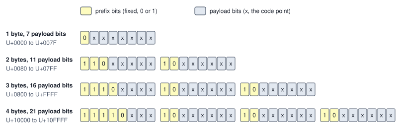
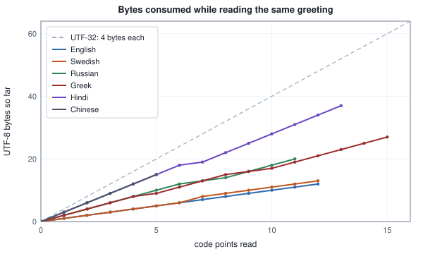

<!-- SPDX-License-Identifier: CC-BY-4.0 -->
<!-- Copyright (c) 2026 Martin Schröder <info@swedishembedded.com> -->

# Text as Data

*What is text to a computer, byte by byte?*

Take a string of four characters: a capital A, a small e with an acute accent, the
Chinese ideograph for "cat" (code point U+732B) and the grinning-face emoji
(U+1F600). Ask four programs how long it is. Python's `len` says 4. JavaScript's
`.length` says 5. The `len` of Go and the `len()` of a Rust string both say 10, and so
does C's `strlen`. Nobody is wrong. Each answer counts a different thing, and a
language model, which has to turn this string into numbers before it can do anything
with it, is going to need to know which thing it is counting.

Here is the string laid out. Where it says U+0041 and so on, the book writes a
character by its number and name, because the typeface this book is set in has no
glyph for most scripts, and a number is something a reader can check in any language.

<!-- worked: text.sample_string -->
The string has 4 code points; it is written out below.

| code point | name | binary | UTF-8 bytes | UTF-16 units | UTF-32 unit |
|---|---|---|---|---|---:|
| U+0041 | LATIN CAPITAL LETTER A | 1000001 | 41 | 0041 | 00000041 |
| U+00E9 | LATIN SMALL LETTER E WITH ACUTE | 11101001 | C3 A9 | 00E9 | 000000E9 |
| U+732B | CJK UNIFIED IDEOGRAPH-732B | 111001100101011 | E7 8C AB | 732B | 0000732B |
| U+1F600 | GRINNING FACE | 11111011000000000 | F0 9F 98 80 | D83D DE00 | 0001F600 |

Counted: 4 UTF-32 units (16 bytes), 5 UTF-16 units (10 bytes), 10 UTF-8 bytes. Python's `len` of the string is 4, its UTF-16 encoding has 5 units, its UTF-8 encoding 10 bytes.
<!-- /worked -->

Read across a row. Each character has a number (its code point), and the number
can be written to memory in three different ways. In 32-bit units every character
takes one unit of four bytes: simple, and 16 bytes for this string. In 16-bit
units the first three characters take one unit and the emoji takes two, so 5 units
and 10 bytes. In 8-bit units, which are bytes, the four characters take 1, 2, 3
and 4 of them, 10 in all. The three languages above are counting these three units:
Python code points, JavaScript 16-bit units, Go and Rust bytes. This chapter
explains where the numbers in the table come from, one column at a time, and why
the third column, the bytes of UTF-8, has become the layout nearly every file, web
page and model on a modern machine uses.

There is a second puzzle in the same neighbourhood. The word "café" can be typed
two ways: with the single character e-acute (U+00E9), or with a plain e followed by
a separate character, the combining acute accent (U+0301), which a screen draws on
top of the letter before it. Put the two words side by side on a screen and no
reader can tell them apart. A program that asks whether they are equal answers no,
because they are different sequences of numbers and, underneath, different
sequences of bytes. Anything that matches, counts or looks up text, the tokenizer of the next chapter included, has to decide what to do about that.

The two puzzles are one subject: text is a stack of three layers, a *numbering* of
characters, a *layout* of those numbers into bytes, and a *convention* about which
sequences of numbers mean the same thing. We will take them in that order, with
one rule throughout: nothing is stated about bytes that a small program in this
chapter does not compute.

A few things from earlier volumes will be used straight away. Answer from memory;
the answers are at the end of the chapter.

1. (Volume IV, Chapter 1, binary representation.) How many different patterns can
   7, 11, 16 and 21 bits take? Which whole numbers does an unsigned pattern of
   each width cover?
2. (Volume IV, Chapter 1, binary representation.) What is the number whose 8-bit
   pattern is `11000011`, from the place values of its bits?
3. (Volume IV, Chapter 1 and the pseudocode page, bit operations.) What are
   `0xE9 >> 6` and `0xE9 and 0x3F`? Write both results in binary.
4. (Volume I, Chapter 1, integers.) Compute $233 \mathbin{//} 64$ and $233 \bmod 64$
   (floor division and its remainder). How do they relate to your answers to
   question 3, and why?

## ASCII, and what happened to the eighth bit

Before any of the machinery, the simplest scheme that works. To store text we need
only agree on a table: this character is that number. A table like that is a
**character encoding** in the broad sense, and the first one in universal use was
ASCII, first standardized in 1963. It numbers 128 characters, the numbers
$0$ to $127$, so that each fits in 7 bits.

<!-- worked: text.ascii_layout -->
| character | decimal | hex | 7-bit pattern |
|---|---:|---:|---|
| NUL | 0 | 00 | 0000000 |
| LINE FEED | 10 | 0A | 0001010 |
| SPACE | 32 | 20 | 0100000 |
| DIGIT ZERO | 48 | 30 | 0110000 |
| DIGIT NINE | 57 | 39 | 0111001 |
| LATIN CAPITAL A | 65 | 41 | 1000001 |
| LATIN SMALL A | 97 | 61 | 1100001 |
| LATIN CAPITAL Z | 90 | 5A | 1011010 |
| LATIN SMALL Z | 122 | 7A | 1111010 |
| DELETE | 127 | 7F | 1111111 |

Of the 128 codes, 33 are control codes (0 to 31 and 127) and 95 print (32 to 126). Flipping bit 5 (value 32) changes the case of a letter: 1000001 xor 0100000 = 1100001 (65 to 97), 1001101 xor 0100000 = 1101101 (77 to 109), 1011010 xor 0100000 = 1111010 (90 to 122).
<!-- /worked -->

The layout is not arbitrary. The digits are consecutive ($48$ to $57$), so the
number of a digit character minus $48$ is its value. The capital letters are
consecutive from $65$ and the small letters from $97$, and the two blocks are exactly
32 apart, which is a single bit: flipping bit 5 of a letter changes its case. The
first 32 codes and the last one are *control codes*, instructions to a teletype
(carriage return, line feed, bell) rather than shapes to print, and they are why a
text file is not quite "just letters".

Seven bits fit a byte of eight with one bit to spare, and the spare bit got used.
Some systems used it as a parity check; most, once machines had 8-bit bytes,
used the second 128 values for the letters ASCII lacked: the accented letters of
Western Europe in one table (ISO 8859-1, called Latin-1), the Cyrillic letters in
another, Greek in a third, and so on, many such **code pages** in all. The
bytes of a file do not say which table they were written with. That label lived
in a header, in a setting, or in the head of the person who sent the file, and
when it was wrong the text came out as nonsense (the Japanese word is
**mojibake**, "character change"). Reading the UTF-8 bytes of some ordinary text
as if they were Latin-1 shows the failure exactly, because a Latin-1 reader
accepts every byte:

<!-- worked: text.mojibake -->
| text | UTF-8 bytes | intended code points | the same bytes read as ISO 8859-1 |
|---|---|---|---|
| e with acute | C3 A9 | 00E9 | U+00C3 U+00A9 |
| A, e with acute | 41 C3 A9 | 0041 00E9 | U+0041 U+00C3 U+00A9 |
| CJK ideograph for cat | E7 8C AB | 732B | U+00E7 U+008C U+00AB |
| Greek small alpha | CE B1 | 03B1 | U+00CE U+00B1 |

Reading a byte as a Latin-1 character is a table lookup that never fails: byte b is code point b.
<!-- /worked -->

Two bytes that were one e-acute become two unrelated characters, with no error
anywhere. Code pages also could not hold two scripts in one document, and a
language like Chinese, with thousands of characters, did not fit in 256 values at
all. The way out was to separate the two questions ASCII had answered at once:
*which number is this character* and *how are the numbers stored*. The first is
the job of Unicode; the second of UTF-8 and its relatives.

## Unicode numbers the characters, and stops there

**Unicode** is a standard that gives every character of every writing system a
number, its **code point**, and records what is known about it: its name, its
category (letter, digit, punctuation, mark), how it combines with others, how it
changes case. A code point is written U+ followed by its value in hexadecimal with
at least four digits, so U+00E9 is 233. The first 128 code points are ASCII's, and
the next 128 are Latin-1's, so every text that was valid in those encodings keeps
its numbers.

The numbers run from U+0000 to U+10FFFF, which is 17 blocks of 65,536 called
planes. Most of the space is empty, and some of it is not for characters at all:

<!-- worked: text.unicode_space -->
17 planes of 65,536 code points: 1,114,112 code points in U+0000 to U+10FFFF; minus the 2,048 surrogates U+D800 to U+DFFF leaves 1,112,064 scalar values.

| general category | code points |
|---|---:|
| letters (L*) | 141,028 |
| marks (M*) | 2,501 |
| numbers (N*) | 1,911 |
| punctuation (P*) | 855 |
| symbols (S*) | 8,514 |
| separators (Z*) | 19 |
| controls and format (Cc, Cf) | 235 |
| private use (Co) | 137,468 |
| surrogates (Cs) | 2,048 |
| unassigned (Cn) | 819,533 |
| all | 1,114,112 |

Counted with `unicodedata.category` of Python's Unicode database, version 16.0.0. The rows for private use and surrogates are fixed by the standard; the others grow as Unicode assigns more characters, so another version prints other numbers.

Not reproducible from the page: the counts of letters, marks, numbers, punctuation, symbols, separators, controls and format characters, and unassigned code points come from the Unicode Character Database, version 16.0.0 (here read through Python's `unicodedata`), a table of about a hundred thousand entries that this book does not print. What a reader can reproduce is the arithmetic: the 1,114,112 code points, the 2,048 surrogates, the 1,112,064 scalar values, the private-use row (137,468: 6,400 in the Basic Multilingual Plane plus two planes of 65,534 each) and the 'all' row. The other rows can be compared with a count made from the Database of the reader's own platform, which reproduces them when its version is the one printed.
<!-- /worked -->

Notice the two fixed rows. The 2,048 code points U+D800 to U+DFFF, the
**surrogates**, are never characters; a section below says what they are for.
Removing them leaves 1,112,064 **scalar values**, the code points that can
actually be a character in a text, and from here on "code point" in running
text will mean a scalar value unless a surrogate is the subject. The private-use
range is left to applications for their own symbols. Everything else is assigned by the standard, a little more with each release, which is why the counts for letters and symbols depend on the version of the Unicode database that computed them, printed under the table.

That database, the Unicode Character Database, is also the one source in this chapter that the page cannot stand in for. The
counts of the table above, the combining classes, the normalization and case mappings, and the segmentation properties behind the
grapheme clusters are entries of tables that the standard publishes and this book does not print. The blocks that depend on it say
so under their tables and name the version, 16.0.0, with which they were computed. A reader who implements the chapter in another
language reproduces everything else from the page (the encodings, the decoders, the counts by arithmetic, the Hangul formula, the
sorting of marks by class once the classes are given) and uses the numbers that come from the database as test vectors for a
routine of the language's own library: the same inputs must give the same outputs if the two versions of Unicode agree.

A code point is a number, not a picture. A picture of a character, the *glyph*,
is chosen by a font, and the same code point can have different glyphs in different
fonts. Unicode says nothing about bytes either: U+732B is the number 29,483 whichever
way it is stored. Storing it is the next question, and before that there is a
consequence of the numbering that explains the second puzzle of the opening.

## What a reader calls one character

Unicode is built from many small pieces rather than from one code point per
visible shape, because the shapes of some scripts are combinations. An accent is a
code point of its own (a **combining mark**) that attaches to the letter before it;
the vowel signs of Devanagari attach to consonants; an emoji can be modified by a
skin tone or joined to others by an invisible joiner (ZWJ, U+200D) into one picture.
What a reader sees as one unit, Unicode calls a **grapheme cluster**, and the rules
that group code points into clusters (Unicode Standard Annex 29) are part of the
standard. A cluster is as many code points as its script needs:

<!-- worked: text.graphemes -->
| text | code points (hex) | code points | UTF-8 bytes | UTF-16 units | seen by a reader |
|---|---|---:|---:|---:|---:|
| e with acute, precomposed | 00E9 | 1 | 2 | 1 | 1 |
| e then combining acute | 0065 0301 | 2 | 3 | 2 | 1 |
| Swedish flag (two regional indicators) | 1F1F8 1F1EA | 2 | 8 | 4 | 1 |
| thumbs up with a skin-tone modifier | 1F44D 1F3FD | 2 | 8 | 4 | 1 |
| family: man, woman, girl joined by ZWJ | 1F468 200D 1F469 200D 1F467 | 5 | 18 | 8 | 1 |
| Devanagari NA with vowel sign I | 0928 093F | 2 | 6 | 2 | 1 |
| the word 'Hej' | 0048 0065 006A | 3 | 3 | 3 | 3 |

The last column is not computed: it is what the rules of Unicode text segmentation (UAX 29) and a reader agree on, and those rules need the Grapheme_Cluster_Break property of every code point, which comes from the Unicode Character Database and is not on this page. The code point, byte and unit columns are reproducible from the page.
<!-- /worked -->

The last column is not computed; the segmentation rules decide it. Four counts of
the same text are in play, and none is "the" length: bytes, 16-bit code units,
code points and grapheme clusters. A family emoji is five code points, eighteen
bytes and one thing to a reader. The consequences are practical. Cutting a string
after its $k$-th code point can split a flag into its first half, which is displayed as a boxed letter. A text box that counts "characters" for a
limit, a model that is asked for the first 100 characters, a spelling checker
that moves the cursor one step: each must say which of the four it means.

Both halves of the first puzzle now have a place. The two spellings of "café" are
different *code point* sequences for the same cluster, a matter for the last part
of the chapter. The different lengths of the opening string are different *units*
of the same code point sequence, which is next.

## Three ways to spell a code point in bytes

A code point is a number below $2^{21}$, and a file is a sequence of
bytes, so some rule must turn the first into the second. The simplest rule gives
every code point four bytes, the 32-bit pattern of its value: **UTF-32**. Finding
the $i$-th code point is an index, and nothing is variable. The price is memory:
for ASCII text three of every four bytes are zero, and the byte count of a text is
four times its length.

Early Unicode had room for 65,536 characters, and the 16-bit **code unit** was its
natural storage: two bytes per character. When the standard outgrew 16 bits, the 16-bit encoding was extended, without changing the old texts, into **UTF-16**.
Code points below U+10000 stay one unit. A larger one is split into a pair of
units, a **surrogate pair**, borrowed from a range of 2,048 values that were
reserved for the purpose (this is what the surrogates of the last section are
for). The rule subtracts 0x10000, which leaves 20 bits; the top ten select a
*high* surrogate in U+D800 to U+DBFF and the bottom ten a *low* surrogate in U+DC00
to U+DFFF. For the grinning face:

<!-- worked: text.utf16_pair -->
| step | value |
|---|---|
| code point | U+1F600 |
| v = code point - 0x10000 | 0x0F600 = 00001111011000000000 |
| high 10 bits of v, v >> 10 | 0x03D = 0000111101 |
| low 10 bits of v, v and 0x3FF | 0x200 = 1000000000 |
| high surrogate, 0xD800 + high | 0xD83D = 1101100000111101 |
| low surrogate, 0xDC00 + low | 0xDE00 = 1101111000000000 |
| bytes, big-endian (UTF-16BE) | D8 3D DE 00 |
| bytes, little-endian (UTF-16LE) | 3D D8 00 DE |
| byte order mark U+FEFF, as UTF-16BE / UTF-16LE / UTF-8 | FE FF / FF FE / EF BB BF |
<!-- /worked -->

A reader seeing the unit D83D knows it begins a pair, and a unit in U+DC00 to
U+DFFF knows it ends one, because no character shares those values: this is why
the surrogates could never be code points. UTF-16 then has a byte-order question
that the others avoid. A 16-bit unit is two bytes and a machine may put either first; the
two byte orders are called big-endian and little-endian. Text that does not say
which it uses starts with the **byte order mark**, the code point U+FEFF
(zero-width no-break space): its bytes `FE FF` or `FF FE` reveal the order. The
last row of the table also shows its UTF-8 bytes, `EF BB BF`. UTF-8 has no byte
order, so a mark there carries no information; some programs write it anyway as a
signature that the file is UTF-8, and a reader that does not expect it sees an
invisible character at the start of the text.

Both encodings are fixed-pattern arithmetic on the number. The third spends the
design effort where the data is.

## Designing UTF-8

Ken Thompson and Rob Pike devised **UTF-8** for the Plan 9 operating system in 1992, and by now it is the encoding of nearly all web pages and source code. Its requirements are worth listing, because the byte layout follows
from them rather than from taste.

1. **ASCII text must be valid and unchanged.** Every program, file and protocol that
   spoke ASCII keeps working: a code point below 128 is the one byte of its value,
   whose top bit is 0.
2. **Every byte must say what it is.** A reader dropped into the middle of a
   stream has to find the next character boundary, so a byte must announce
   whether it is a whole character, the start of a longer one or a continuation.
3. **A character's bytes must not appear inside another's.** Then a plain
   byte-by-byte search for one string inside another finds only real matches.
4. **Comparing byte strings should agree with comparing code points**, so that
   sorting bytes sorts text.
5. Common characters should be short.

Requirement 1 gives the first pattern, `0xxxxxxx`: seven free bits, for the
numbers 0 to 127. By requirement 2, no other byte may start with 0, so every
other byte starts with 1. Now divide the bytes that start with 1 into roles.
A *continuation* byte will be `10xxxxxx`, with six free bits. A *lead* byte
must say how long its sequence is, and the cheapest way is to count the leading
ones: `110xxxxx` starts a sequence of two bytes, `1110xxxx` of three, `11110xxx`
of four. (A lead byte with one leading 1 would collide with the continuation
pattern, which is why the count starts at two.) The sequence for $n$ bytes
carries $7 - n$ free bits in its lead byte and six in each of the $n - 1$
continuations, so

$$
\text{payload}(n) = (7 - n) + 6(n - 1) = 5n + 1 \quad (n \ge 2),
$$

which is 11, 16 and 21 bits for $n = 2, 3, 4$, and 7 for the single byte. The
patterns, the code points each can hold and the number of scalar values each
actually encodes (counted by running the encoder over all of them) are:

<!-- worked: text.utf8_layout -->
| bytes | bit pattern | payload bits | scalar values it encodes | how many |
|---:|---|---:|---|---:|
| 1 | 0xxxxxxx | 7 | U+0000 to U+007F | 128 |
| 2 | 110xxxxx 10xxxxxx | 11 | U+0080 to U+07FF | 1,920 |
| 3 | 1110xxxx 10xxxxxx 10xxxxxx | 16 | U+0800 to U+FFFF | 61,440 |
| 4 | 11110xxx 10xxxxxx 10xxxxxx 10xxxxxx | 21 | U+10000 to U+10FFFF | 1,048,576 |

In total 1,112,064 scalar values. A 4-byte sequence could carry up to U+1FFFFF, but nothing above U+10FFFF is a code point.
<!-- /worked -->



To encode a code point, pick the shortest row whose range contains it, write the
code point in binary, left-pad with zeros to the row's payload width, and pour the
bits into the free positions from the left. The four characters of the opening
string come out as follows, with every intermediate step shown:

<!-- worked: text.utf8_bits -->
| code point | binary | padded to the payload width | payload split by the pattern | bytes in binary | hex |
|---|---|---|---|---|---|
| U+0041 | 1000001 | 1000001 | 1000001 | 01000001 | 41 |
| U+00E9 | 11101001 | 00011101001 | 00011 / 101001 | 11000011 10101001 | C3 A9 |
| U+732B | 111001100101011 | 0111001100101011 | 0111 / 001100 / 101011 | 11100111 10001100 10101011 | E7 8C AB |
| U+1F600 | 11111011000000000 | 000011111011000000000 | 000 / 011111 / 011000 / 000000 | 11110000 10011111 10011000 10000000 | F0 9F 98 80 |
<!-- /worked -->

Take the second row to see the arithmetic. $233 = 11101001_2$ needs eight bits,
so it does not fit in seven, and goes in the two-byte row with 11 payload bits:
`00011101001`. The lead byte takes the top five, `00011`, giving `110 00011`, which
is `0xC3`. The continuation takes the remaining six, `101001`, giving
`10 101001`, which is `0xA9`. In the integer operations of the pseudocode page,
that is `0xC0 or (c >> 6)` and `0x80 or (c and 0x3F)`, the two operations of the
recall questions: the shift drops the six low bits for the lead byte, and the mask
keeps only them for the continuation. Written out for all four lengths:

```text
function encode_utf8(cps: list<u32>) -> bytes:
    out = []
    for i in 0 .. len(cps):
        c = cps[i]
        require c <= 0x10FFFF and not (0xD800 <= c <= 0xDFFF), "not a Unicode scalar value"
        if c < 0x80:
            append c to out
        else if c < 0x800:
            append (0xC0 or (c >> 6)) to out
            append (0x80 or (c and 0x3F)) to out
        else if c < 0x10000:
            append (0xE0 or (c >> 12)) to out
            append (0x80 or ((c >> 6) and 0x3F)) to out
            append (0x80 or (c and 0x3F)) to out
        else:
            append (0xF0 or (c >> 18)) to out
            append (0x80 or ((c >> 12) and 0x3F)) to out
            append (0x80 or ((c >> 6) and 0x3F)) to out
            append (0x80 or (c and 0x3F)) to out
    return out
```

The bytes then have the properties we asked for. Requirement 4 holds because a longer sequence has a larger lead byte than any shorter one (`11110xxx` is above `1110xxxx`, which is above `110xxxxx`, which is above `0xxxxxxx`) and, within one length, the bits are poured in from the most significant down, so the bytes sort as the numbers do. Requirement 3 holds because a lead byte is never a continuation byte and the reverse, so the bytes of one whole character can only be matched starting at a boundary. The encoder can be checked against a reference that someone else wrote:

<!-- worked: text.check_encoder -->
Generator: the book's SplitMix64, seed 0x47564153f8b89746 (`seed_of` of the name `text.check_encoder`, defined on the pseudocode page). Each draw is `k = integer(1112064)`, then the scalar value `k` if `k < 0xD800` and `k + 0x800` otherwise (which skips the 2,048 surrogates and is uniform over the 1,112,064 scalar values).

| check | result |
|---|---|
| scalar values drawn | 20,000 |
| of 1 / 2 / 3 / 4 bytes | 5 / 33 / 1115 / 18847 |
| encoder equals Python's `str.encode('utf-8')` | 20,000 of 20,000 |
| strict decoding of the encoding gives the code point back | 20,000 of 20,000 |
| boundary values U+0000, U+007F, U+0080, U+07FF, U+0800, U+D7FF, U+E000, U+FFFF, U+10000, U+10FFFF | 10 of 10 equal |
| encoder refuses U+D800, U+DFFF, U+110000, -1 | 4 of 4 refused |
<!-- /worked -->

The encoder here is the independent implementation, written from the rules above;
Python's own codec is only the reference it is compared with. And the ordering
property, drawn the same way:

<!-- worked: text.order_preserved -->
Generator: the book's SplitMix64, seed 0x439ba62c885b0d55 (`seed_of` of the name `text.order_preserved`, defined on the pseudocode page).

Pairs (a, b) of scalar values, each scalar value drawn as in `text.check_encoder` (`k = integer(1112064)`, then `k` if `k < 0xD800` and `k + 0x800` otherwise; a first, then b): 20,000. `a < b` agrees with comparing the two byte strings byte by byte in 20,000 of 20,000.
<!-- /worked -->

(UTF-16 does *not* have this property. In code unit order the emoji U+1F600, whose
first unit is D83D, sorts before U+FF5E, whose only unit is FF5E, though its code
point is larger. UTF-8 and UTF-32 agree with code point order.)

### Why the largest code point is U+10FFFF

The four-byte pattern has 21 free bits and could hold values up to U+1FFFFF, and an
early version of the UTF-8 specification went further, with sequences of five
and six bytes. The limit that the standard now states, U+10FFFF, comes from
UTF-16: a surrogate pair carries 20 bits, which is 1,048,576 code points above
U+FFFF, and that is where the numbering ends. The three encodings must be able to
carry the same texts, so UTF-8 stops where UTF-16 does (this is RFC 3629). The
constants of the table follow: $17 \times 65{,}536$ code points, less 2,048
surrogates.

### Overlong forms and surrogates are not UTF-8

Look at the arithmetic once more. Nothing in the pouring rule says the *shortest*
row must be used. The code point 0 could be written `C0 80` (`110 00000`,
`10 000000`), or `E0 80 80`, or `F0 80 80 80`, and all four decode, by the
formula, to the same number. These are **overlong forms**, and they are invalid
for a reason that has nothing to do with taste: a text must have exactly one
spelling, or two byte strings that mean the same thing compare as different. The
reason that has done real damage is security. A filter that scans for the byte `2F`
(a slash) in a path to block directory tricks does not see `C0 AF`, a perfectly
decodable spelling of the same slash, and a later stage that decodes it leaves
the filter's check behind.

The decoder's rule is therefore the *shortest form only*, and it can be stated as
ranges of the first continuation byte, derived rather than memorized:

- `C0` and `C1` as lead bytes could only produce values below 0x80, which have a
  one-byte spelling, so they are never valid. The lowest valid two-byte lead is `C2`.
- A three-byte sequence must encode at least 0x800 $= 0000\;100000\;000000_2$,
  so after `E0` the first continuation's six bits must be at least `100000`:
  the byte is `A0` to `BF`, not `80` to `BF`.
- Likewise a four-byte sequence must encode at least 0x10000, so after `F0` the first
  continuation is `90` to `BF`.
- After `ED` the payload bits `1101` followed by a continuation at or above `100000`
  spell exactly the values D800 to DFFF, the surrogates, which are not scalar
  values. After `ED` the first continuation must therefore be `80` to `9F`.
- The largest value is 0x10FFFF, so after `F4` the first continuation is at most
  `8F`, and the lead bytes `F5` to `FF` are never valid.

Those five rules are the eight states of the next section.

## Decoding is a small state machine

Decoding runs the other way, one byte at a time, and what the decoder must
remember between bytes is little: how many continuation bytes it still expects,
and the range the next one must fall in (the range is `80` to `BF` except in the
three cases just derived). Call that triple (continuations still expected, lowest
allowed byte, highest allowed byte) the *state*. The decoder starts in the state
"expecting nothing". A byte arrives and one of three things happens: it is
valid in the current state, which changes the state and perhaps completes a
character, or it is invalid, which is an error. Counting what states are reachable
gives eight, and the picture is the whole decoder:


The figure is computed: the worked module found the eight states by trying every byte value
in every state it could reach from the start, and the edges are what it
found. In the pseudocode the state is the three variables `need`, `lo` and `hi`:

```text
function decode_utf8(b: bytes) -> list<u32>:
    out = []
    need = 0            # continuation bytes still expected
    lo = 0x80           # the next continuation byte must lie in lo .. hi
    hi = 0xBF
    value = 0           # the bits of the character so far
    for i in 0 .. len(b):
        byte = b[i]
        again = true    # an invalid byte inside a sequence is read again from the start
        while again:
            again = false
            if need > 0:
                if lo <= byte <= hi:
                    value = ((value << 6) or (byte and 0x3F))
                    need = need - 1
                    lo = 0x80
                    hi = 0xBF
                    if need == 0:
                        append value to out
                else:
                    append 0xFFFD to out        # the sequence broke off
                    need = 0
                    lo = 0x80
                    hi = 0xBF
                    again = true
            else if byte <= 0x7F:
                append byte to out
            else if 0xC2 <= byte <= 0xDF:
                need = 1
                value = (byte and 0x1F)
            else if 0xE0 <= byte <= 0xEF:
                need = 2
                value = (byte and 0x0F)
                if byte == 0xE0: lo = 0xA0
                if byte == 0xED: hi = 0x9F
            else if 0xF0 <= byte <= 0xF4:
                need = 3
                value = (byte and 0x07)
                if byte == 0xF0: lo = 0x90
                if byte == 0xF4: hi = 0x8F
            else:
                append 0xFFFD to out            # 80..C1 and F5..FF never start a character
    if need > 0:
        append 0xFFFD to out                    # the input ended inside a sequence
    return out
```

Every valid input passes through without ever reaching a `0xFFFD`. What
the decoder does with invalid input is a policy, and the book's choice is the one
the Unicode standard recommends. It could stop with an error (the *strict*
decoder, which is what you want when the input must be exactly text), or it could
substitute the **replacement character**, U+FFFD (usually drawn as a diamond with a
question mark), and go on (the *lenient* one, which is what you want when a
reader must show something, such as a terminal printing a model's output). The
lenient rule is: each *maximal invalid prefix*, the longest run of bytes that
could have begun a valid sequence, becomes one U+FFFD, and decoding restarts at
the byte that broke it. That is what `again` does in the pseudocode: an interrupting
byte is not consumed by the broken sequence, it is read again as the start of the
next one.

<!-- worked: text.invalid_inputs -->
| input | bytes | strict decoder | decoded with replacement (code points) |
|---|---|---|---|
| lone continuation byte | 80 | rejects | FFFD |
| byte never used (FF) | FF | rejects | FFFD |
| overlong NUL, 2 bytes | C0 80 | rejects | FFFD FFFD |
| overlong slash, 2 bytes | C0 AF | rejects | FFFD FFFD |
| overlong NUL, 3 bytes | E0 80 80 | rejects | FFFD FFFD FFFD |
| overlong NUL, 4 bytes | F0 80 80 80 | rejects | FFFD FFFD FFFD FFFD |
| surrogate U+D800 | ED A0 80 | rejects | FFFD FFFD FFFD |
| beyond U+10FFFF (110000) | F4 90 80 80 | rejects | FFFD FFFD FFFD FFFD |
| lead byte F5, never valid | F5 80 80 80 | rejects | FFFD FFFD FFFD FFFD |
| truncated at the end | 41 E7 8C | rejects | 0041 FFFD |
| interrupted by an ASCII byte | E7 8C 41 | rejects | FFFD 0041 |
| interrupted by a lead byte | E7 F0 9F 98 80 | rejects | FFFD 1F600 |
| valid text for contrast | 41 C3 A9 E7 8C AB F0 9F 98 80 | accepts | 0041 00E9 732B 1F600 |

The replacement output and the strict verdict equal Python's `bytes.decode('utf-8')` (`errors='replace'` and strict) in 13 of 13 rows.
<!-- /worked -->

The overlong NUL `C0 80` becomes two replacements, because `C0` is itself
invalid and `80` is a lone continuation byte; `E7 8C` followed by an ASCII `41`
becomes one replacement and then the `A`, because two valid-so-far bytes were
interrupted. The last line of the block compares each row with Python's decoder, which is used only as the reference. The same comparison on random inputs, strings made of the kinds of byte that stress a decoder (ASCII, continuation bytes, lead bytes and anything at all):

<!-- worked: text.check_decoder -->
Generator: the book's SplitMix64, seed 0x333291d0349c0922 (`seed_of` of the name `text.check_decoder`, defined on the pseudocode page). Each string has length `1 + integer(8)`; each byte draws `kind = integer(4)` and then `integer(128)` (kind 0), `128 + integer(64)` (kind 1), `192 + integer(64)` (kind 2) or `integer(256)` (kind 3).

| check | result |
|---|---|
| strings | 50,000 |
| valid UTF-8 (strict accepts) | 4,662 |
| invalid (replacement used) | 45,338 |
| decoding with replacement equals Python's | 50,000 of 50,000 |
| strict verdict (accept or reject) equals Python's | 50,000 of 50,000 |
<!-- /worked -->

A small share of the random strings is valid (the block counts them) and the rest exercise the error paths; the two decoders agree on all of them, both on the replacement
output and on which strings a strict decoder accepts.

### Chunks, truncation and a dropped byte

Input rarely arrives whole. A file is read in blocks, a network delivers
packets, a model emits its output a piece at a time. A character's bytes may then
be cut by the chunk boundary, and a decoder that treats each chunk as a complete
text will report an error where there is none. The state machine already has the
answer: it is *state*, so it can be kept between chunks. Feed it the first part,
emit the characters completed so far, keep the state and the partial value, and
resume with the next chunk. The only extra rule is at the very end of the stream,
where a state other than the start means truncated input. The check is that cutting
a stream into chunks at random changes nothing:

<!-- worked: text.check_stream -->
Generator: the book's SplitMix64, seed 0xb22a207a5b90f1a0 (`seed_of` of the name `text.check_stream`, defined on the pseudocode page). Each string is drawn by the rule of `text.check_decoder`; then chunk sizes `1 + integer(3)` are drawn, one per chunk, until the string is used up: the draws of one string are made in this order, first its length and bytes, then one chunk size at a time as the string is consumed (the last chunk is cut short when the string ends, but its size is still drawn), and the next string's draws follow at once on the same generator.

| check | result |
|---|---|
| strings | 20,000 |
| chunked decoding equals one-shot decoding | 20,000 of 20,000 |

Bytes of U+1F600 (F0 9F 98 80) fed one prefix at a time: nothing is emitted until the last byte arrives.

| bytes fed | code points emitted | state afterwards |
|---:|---:|---|
| 1 | 0 | after F0 |
| 2 | 0 | need2 |
| 3 | 0 | need1 |
<!-- /worked -->

The held-back bytes are at most three (a four-byte sequence minus the byte that has not
arrived), which bounds the memory the decoder needs. The last property in the
requirements list, that a byte tells you what it is, is what lets a damaged stream
heal:

<!-- worked: text.resync -->
The text is 41 C3 A9 E7 8C AB F0 9F 98 80 (code points 0041 00E9 732B 1F600).

| deleted byte index | its value | decoded code points (FFFD is the replacement) | replacements |
|---:|---|---|---|
| 0 | 41 | 00E9 732B 1F600 | 0 |
| 1 | C3 | 0041 FFFD 732B 1F600 | 1 |
| 2 | A9 | 0041 FFFD 732B 1F600 | 1 |
| 3 | E7 | 0041 00E9 FFFD FFFD 1F600 | 2 |
| 4 | 8C | 0041 00E9 FFFD 1F600 | 1 |
| 5 | AB | 0041 00E9 FFFD 1F600 | 1 |
| 6 | F0 | 0041 00E9 732B FFFD FFFD FFFD | 3 |
| 7 | 9F | 0041 00E9 732B FFFD | 1 |
| 8 | 98 | 0041 00E9 732B FFFD | 1 |
| 9 | 80 | 0041 00E9 732B FFFD | 1 |

Starting the decoder at byte k instead of byte 0 (code points, FFFD is the replacement):

- start at 0: 0041 00E9 732B 1F600
- start at 1: 00E9 732B 1F600
- start at 2: FFFD 732B 1F600
- start at 3: 732B 1F600
- start at 4: FFFD FFFD 1F600
- start at 5: FFFD 1F600
- start at 6: 1F600
- start at 7: FFFD FFFD FFFD
- start at 8: FFFD FFFD
- start at 9: FFFD
<!-- /worked -->

Deleting one byte damages the character it belonged to, and in most rows one
replacement is all the text loses; deleting the lead byte of the three-byte
character costs two (its two continuation bytes are orphans) and deleting the lead
byte of the four-byte one three. Starting the decoder in the middle of a text works the same way: at most three bytes are discarded (each shown as a replacement) before the first boundary.
Truncating a text at an arbitrary byte count does not preserve this, which is why a
program that must cut to a byte budget backs up while the byte at the cut is a
continuation byte (it matches `10xxxxxx`).

## Where text enters brain

brain's models never see characters; they see integer ids, and the first thing
between a user's text and those ids is a tokenizer, the subject of the next
chapter. Three facts about its text-handling are already visible here.

The tokenizers live under `crates/data`, and a byte-level one such as
`crates/data/src/bytebpe.rs` gives its first 256 ids to the 256 byte values
(`0..256` are the raw bytes, and learned pieces follow), so that every text, in
any script, can be encoded with no unknown symbol. Text arrives as a Rust `str`, which
the language guarantees is valid UTF-8, and a corpus is read with
`std::fs::read_to_string`, which refuses a file that is not (see
`crates/data/src/prepare.rs`). Going the other way, from ids back to text, is
where the state machine reappears. A generated token is a piece of bytes, not a
character, and a multi-byte character can be split between two tokens, so the
text of a half-finished generation can end in the middle of a character. Commit
22857460d made the detokenizer in `crates/data/src/qwen_tokenizer.rs`
(`Utf8Decoder`) *incremental*: it consumes only the tokens it has not seen,
keeps at most three bytes of an unfinished character (`pending`), emits the text
completed so far and turns each invalid byte into U+FFFD exactly as a lossy
decode does. The streaming server had been decoding the whole reply again at every
step, work that grows with the square of the reply length; the decoder makes the
total linear in it. The tests in that file check the two properties of this
chapter's check blocks: the output equals one-shot decoding for random ids and
any chunking, including invalid and split UTF-8, and a character split across two
calls is held back whole and never emitted as a replacement.

The other fact is about normalization, the next topic: a `tokenizer.json` can
declare an NFC normalizer, and `crates/data/src/hf_pretok.rs` reads it and applies
it before splitting the text (commit 375f55b8a, which reads the declared
pipeline instead of assuming one). The BERT-style tokenizer in
`crates/data/src/wordpiece.rs` also strips accents by decomposing each
character and dropping the combining marks; commit dd299929f replaced a generated
table of those decompositions with the normalization library already in the
dependency list, and deleted the table and the script that built it. The
parity test `crates/data/tests/it/wordpiece_parity.rs` pins brain's ids to the
reference tokenizer's, with the composed and decomposed spellings of "café" in the
corpus and an expectation that they get the same ids.

## The same word, two byte strings

Return now to the second puzzle with the vocabulary in hand. The two spellings of
the word are two different code point sequences:

<!-- worked: text.same_look_different_bytes -->
| spelling | code points | count | UTF-8 bytes | byte count |
|---|---|---:|---|---:|
| composed | 0063 0061 0066 00E9 | 4 | 63 61 66 C3 A9 | 5 |
| decomposed | 0063 0061 0066 0065 0301 | 5 | 63 61 66 65 CC 81 | 6 |

| compared | equal |
|---|---:|
| raw strings | false |
| after NFC | true |
| after NFD | true |
| after NFKC | true |
| after NFKD | true |

Not reproducible from the page: the four equalities of the second table (and the claim behind them, that U+00E9 is canonically equivalent to U+0065 U+0301) come from the Unicode Character Database, version 16.0.0 (here read through Python's `unicodedata`), a table of about a hundred thousand entries that this book does not print. The first table is reproducible from the page, from the code points and the UTF-8 rules. For these two spellings a reader can verify the equalities by hand with the single canonical mapping U+00E9 = U+0065 U+0301 (and the compatibility forms, which change neither spelling); for other strings a normalization routine needs the Database.
<!-- /worked -->

They differ in code point count, in bytes, and therefore in everything computed
from the bytes: the equality test, a hash, a dictionary lookup, the id a
tokenizer assigns, the position of a character in the sequence a model reads. A model
trained on text in which both spellings occur learns them as two unrelated words,
and a user whose keyboard produces one finds the other missing. The remedy is to
choose one spelling for every text before it is compared or counted.
**Normalization of text** is the conversion of a string to a canonical spelling,
so that strings the standard declares equivalent become identical sequences of code
points. The last four rows of the table are the point: after a normalization
form, the two strings compare equal.

Unicode defines two kinds of equivalence. **Canonical equivalence** is the one
in the example: the two sequences are the same abstract character and must look
and behave the same. **Compatibility equivalence** is weaker: the sequences are
related but may differ in presentation or meaning. A ligature U+FB01 is the two
letters f and i drawn as one shape; the superscript two (U+00B2) is a 2 raised;
the fullwidth A (U+FF21) is an A in a CJK typesetting grid. Replacing them loses
information (a formatting choice, an exponent), and it is the right trade for a
search index and the wrong one for a document. The two kinds of equivalence and the
two directions (expanded, composed) give the four **normal forms**:

| form | steps |
|---|---|
| NFD | decompose by canonical mappings, then put combining marks in canonical order |
| NFC | NFD, then compose pairs back where a precomposed character exists |
| NFKD | decompose by compatibility mappings (which include the canonical ones), then reorder |
| NFKC | NFKD, then compose |

Applied to the characters of the example and a few more:

<!-- worked: text.normalization_forms -->
| input | code points | NFC | NFD | NFKC | NFKD |
|---|---|---|---|---|---|
| e with acute (U+00E9) | 00E9 | 00E9 | 0065 0301 | 00E9 | 0065 0301 |
| e, combining acute | 0065 0301 | 00E9 | 0065 0301 | 00E9 | 0065 0301 |
| ANGSTROM SIGN (U+212B) | 212B | 00C5 | 0041 030A | 00C5 | 0041 030A |
| LATIN SMALL LIGATURE FI (U+FB01) | FB01 | FB01 | FB01 | 0066 0069 | 0066 0069 |
| SUPERSCRIPT TWO (U+00B2) | 00B2 | 00B2 | 00B2 | 0032 | 0032 |
| FULLWIDTH LATIN CAPITAL A (U+FF21) | FF21 | FF21 | FF21 | 0041 | 0041 |
| long s with dot above, dot below (U+1E9B U+0323) | 1E9B 0323 | 1E9B 0323 | 017F 0323 0307 | 1E69 | 0073 0323 0307 |

Not reproducible from the page: every cell of the four normalization columns (the decomposition and composition mappings and the combining classes) come from the Unicode Character Database, version 16.0.0 (here read through Python's `unicodedata`), a table of about a hundred thousand entries that this book does not print. The first two columns are the inputs. A reader who has the Database, or a library's normalization routine built from it, can use the seven rows as test vectors; nothing on this page lets a reader compute them. Code points are in hex.
<!-- /worked -->

Read the rows against the steps. The composed and decomposed e-acute meet in
either form (NFC gives U+00E9, NFD gives e and U+0301). The angstrom sign U+212B
is a different code point only for historical reasons; it is canonically
equivalent to the Swedish letter Å (U+00C5), and NFC replaces it. The ligature
and the superscript survive NFC and NFD, since they are only *compatibly*
equivalent to what the K forms turn them into. The last row is the case that
motivates the middle step: a letter with a dot above and a dot below, sharing
two marks that have to be ordered.

**Canonical ordering** is that middle step, and it is necessary because marks that
attach to different sides of a letter commute: s, dot above, dot below and s, dot
below, dot above draw the same shape, so a single spelling has to be forced. Each
code point has a *combining class*, a number (0 for ordinary characters, 230 for a
mark above, 220 for a mark below); marks of nonzero class are sorted by class, keeping
the order of marks of equal class, since those interact:

<!-- worked: text.reordering -->
| input | code points | combining classes | NFD | NFC |
|---|---|---|---|---|
| s, dot above, dot below | 0073 0307 0323 | 0 230 220 | 0073 0323 0307 | 1E69 |
| s, dot below, dot above | 0073 0323 0307 | 0 220 230 | 0073 0323 0307 | 1E69 |

The two inputs differ as raw strings (false for equality) and are equal after NFD (true).

Not reproducible from the page: the combining classes (230 for U+0307, 220 for U+0323, 0 for U+0073) and the composition U+1E69 of the NFC column come from the Unicode Character Database, version 16.0.0 (here read through Python's `unicodedata`), a table of about a hundred thousand entries that this book does not print. Given the classes, the NFD column follows from the page: the marks of nonzero class are sorted by class, stably. The NFC column needs the table of compositions and is a test vector only.
<!-- /worked -->

The composition step is where care is needed, because not every pair that could be merged may be: a short list of composition exclusions keeps some characters decomposed even in NFC. The decomposition step, by contrast, needs
only a table. For one script, no table is needed. The 11,172 precomposed Hangul
syllables (written as a block of two or three letter shapes, the *jamo*) decompose
by arithmetic: with $588 = 21 \times 28$ for vowels times trailing slots, a
syllable's index $i$ from U+AC00 gives a leading consonant $\lfloor i / 588 \rfloor$,
a vowel $\lfloor (i \bmod 588) / 28 \rfloor$ and a trailing consonant
$i \bmod 28$, with 0 meaning none:

<!-- worked: text.hangul -->
| syllable | index i | L index | V index | T index | jamo (hex) |
|---|---:|---:|---:|---:|---|
| U+AC00 | 0 | 0 | 0 | 0 | 1100 1161 |
| U+D55C | 10588 | 18 | 0 | 4 | 1112 1161 11AB |
| U+D7A3 | 11171 | 18 | 20 | 27 | 1112 1175 11C2 |

With N = 588 (vowels times trailing slots) and T = 28: L index = i // N, V index = (i mod N) // T, T index = i mod T. Constants: first syllable U+AC00, first leading jamo U+1100, first vowel U+1161, one before the first trailing consonant U+11A7; 19 leading consonants, 21 vowels, 28 trailing slots (slot 0 is none), so 11,172 syllables. The formula equals `unicodedata.normalize('NFD', ...)` for 11,172 of 11,172 syllables. The table and the constants are reproducible from the page; only the final comparison uses the Unicode Character Database (version 16.0.0), as the reader's own language ships it.
<!-- /worked -->

Two properties are worth knowing before a pipeline relies on any of this.
Normalization is idempotent: normalizing a normalized string changes nothing, so
a pipeline can apply it without tracking whether an earlier stage did. It does not
commute with concatenation: NFC of "e" followed by NFC of a lone combining acute is
the two code points, while the NFC of the concatenated text is a single U+00E9, so
text cut into pieces must be normalized after it is assembled, never piece by piece.

For a tokenizer the practical rule is: normalize first, in one chosen form
(NFC is the usual choice because it keeps the text close to how it was typed),
and then cut. Whatever the model never saw, it should not be asked about.

### Case folding

The last equivalence people want is that "STRASSE" and "straße" are the same word,
and it is the one where the intuitive tool, converting to lowercase, is not
enough.

<!-- worked: text.case_folding -->
| input | code points | lower | casefold | upper |
|---|---|---|---|---|
| sharp s (U+00DF) | 00DF | 00DF | 0073 0073 | 0053 0053 |
| Greek capitals omicron, delta, omicron, sigma | 039F 0394 039F 03A3 | 03BF 03B4 03BF 03C2 | 03BF 03B4 03BF 03C3 | 039F 0394 039F 03A3 |
| capital I with dot above (U+0130) | 0130 | 0069 0307 | 0069 0307 | 0130 |
| LATIN SMALL LIGATURE FI (U+FB01) | FB01 | FB01 | 0066 0069 | 0046 0049 |
| LATIN CAPITAL LETTER A | 0041 | 0061 | 0061 | 0041 |

Not reproducible from the page: the lower, casefold and upper columns (the case mappings and the case folding of the standard, and for the Greek row the context rule that gives the final sigma) come from the Unicode Character Database, version 16.0.0 (here read through Python's `unicodedata`), a table of about a hundred thousand entries that this book does not print. Python's `lower`, `casefold` and `upper` were used, with the language-independent mappings. The input columns are reproducible from the page; the other three are test vectors for a case-conversion routine built from the Database.
<!-- /worked -->

Lowering the sharp s leaves it, because its lowercase is itself; the **case
folding** of the standard maps it to the two letters "ss", the form two
spellings meet in. The Greek capital sigma at the end of a word lowers to the
*final* sigma, U+03C2, and elsewhere to U+03C3, a dependence on context that no
per-character table captures; the folding maps both to U+03C3. The capital I
with a dot above lowers to two code points, so case conversion can change the length of a string. Turkish and Azerbaijani pair I and i differently (a dotted and a dotless letter), a rule that depends on the language and that none of these tables captures. Folding is for comparison, not for display. Because it can produce sequences that are not normalized, a caseless comparison normalizes, folds and normalizes again.

## Bytes: the one alphabet every text shares

Whatever the script, the previous sections reduce a text to a sequence of bytes,
integers from 0 to 255, and that is the interface the rest of the book wants. A
sequence model handles a finite alphabet, and the 256 byte values are a
finite alphabet in which every text that can be written has a spelling, with no
unknown symbol and nothing to normalize at the byte level beyond what was done
above. But the bytes are not a fair measure. The same greeting in eight scripts:

<!-- worked: text.languages -->
Inputs, as code points in hex:

- English: `0048 0065 006C 006C 006F 002C 0020 0077 006F 0072 006C 0064`
- Swedish: `0048 0065 006A 002C 0020 0076 00E4 0072 006C 0064 0065 006E`
- Russian: `041F 0440 0438 0432 0435 0442 002C 0020 043C 0438 0440`
- Greek: `0393 03B5 03B9 03B1 0020 03C3 03BF 03C5 002C 0020 03BA 03CC 03C3 03BC 03B5`
- Hindi: `0928 092E 0938 094D 0924 0947 0020 0926 0941 0928 093F 092F 093E`
- Chinese: `4F60 597D FF0C 4E16 754C`
- Japanese: `3053 3093 306B 3061 306F 3001 4E16 754C`
- Emoji: `1F44B 1F30D`

| text | code points | UTF-8 bytes | UTF-8 bytes per code point | UTF-16 bytes | UTF-32 bytes |
|---|---:|---:|---:|---:|---:|
| English | 12 | 12 | 1.000 | 24 | 48 |
| Swedish | 12 | 13 | 1.083 | 24 | 48 |
| Russian | 11 | 20 | 1.818 | 22 | 44 |
| Greek | 15 | 27 | 1.800 | 30 | 60 |
| Hindi | 13 | 37 | 2.846 | 26 | 52 |
| Chinese | 5 | 15 | 3.000 | 10 | 20 |
| Japanese | 8 | 24 | 3.000 | 16 | 32 |
| Emoji | 2 | 8 | 4.000 | 8 | 8 |

Byte counts are exact; the ratio is rounded to three decimals.
<!-- /worked -->



Read the figure as slopes. English is one byte per character. Swedish is nearly
the same, with one two-byte letter. Russian and Greek letters take two bytes
each and their spaces and commas one, which averages a little below two. Chinese
and Japanese ideographs take three. Hindi is almost as high: every letter and vowel sign of Devanagari is three bytes (only the space is one), and the vowel signs and the virama are code points of their own, so a short phrase has many more code points than syllables. An emoji is four. In UTF-32 every
text costs four bytes per code point, so UTF-8 is smaller in every row except
the emoji, where they tie. The fraction is the work: moving a corpus of
English through memory as UTF-32 moves four times the bytes it needs to, and a corpus in Russian more than twice as many as UTF-8 would. A model that spends its
capacity or its context budget per byte spends it unevenly across languages. That
imbalance, and the fact that bytes are too small a unit for a model to learn
words from, is the pressure behind the next chapter, which builds
pieces larger than a byte out of them.

## Summary

Text, to a computer, is three layers. A character encoding in the broad sense is an
agreement between characters and numbers; ASCII made one for 128 characters,
the code pages made many incompatible ones for the eighth bit, and Unicode
replaced them with one numbering of 1,112,064 scalar values whose members are
code points, many smaller than what a reader calls a character. A byte layout
turns code points into bytes: UTF-32 gives a fixed four, UTF-16 one or two 16-bit
units (using the surrogates), and UTF-8 one to four bytes whose prefixes announce
their own role, which makes it ASCII compatible, self-synchronizing, order
preserving and compact for Latin text. Decoding is a state machine with eight
states, strict or lenient (one U+FFFD per maximal invalid prefix), resumable
across chunks with at most three bytes held back. And a normalization step settles
which of several spellings of the same text a program will see.

Each statement was computed: the encoder and decoder in the worked module were
written from the chapter's rules and agree with Python's codec on seeded random
inputs, the normalization tables are printed with the Unicode version that made them, and the Hangul decomposition is arithmetic checked against the
whole block.

The limits are the next chapter's reason to exist. Bytes are a universal alphabet and
a poor unit: they split words into fragments a model has to reassemble, and they
charge different languages different amounts for the same sentence. Choosing
pieces between bytes and words, learned from data, is tokenization.

## Check your understanding

1. A web application blocks paths containing a slash by searching the received
   UTF-8 bytes for `2F`, then passes the bytes to a library that decodes
   them. Find the flaw, and say where in the pipeline the check must move.
2. In the table of three spellings, a string has 5 UTF-16 units and 4 code points. A
   colleague says "UTF-8 needs 4 bytes for it, one per character". What is wrong
   with the argument, and what does the byte count depend on?
3. Decode `E2 82 41` and `E2 82` by hand with the lenient rule. How many U+FFFD are
   produced in each, and why not the same?
4. A streaming server decodes each chunk of model output as a complete text. When
   would the user see a U+FFFD that is not in the model's output, and how does a
   decoder that keeps state avoid it?
5. Is "two strings look the same, so their bytes are equal" true? What about
   "two strings have equal bytes, so they look the same"? Which direction is a
   tokenizer's problem?
6. Sort the two code points U+FF5E and U+1F600 by their UTF-8 bytes, by their
   UTF-16 code units and by code point. Which two orders agree?
7. A normalization step is applied to each *chunk* of a long document as it is
   read. Give a short input split in two where the result differs from normalizing
   the whole text.

## References

- The Unicode Consortium, *The Unicode Standard* (core specification, with Annex 15
  "Unicode Normalization Forms" and Annex 29 "Unicode Text Segmentation"), the version being the one printed under the chapter's tables.
- F. Yergeau, *UTF-8, a transformation format of ISO 10646* (RFC 3629), 2003.
- R. Pike and K. Thompson, "Hello world or Kalimera kosme or Konnichiwa sekai"
  (the paper's title is the same greeting in three scripts), on UTF-8 and Plan 9, 1993.

## Exercises

1. **[Calculate]** Encode U+20AC (the euro sign) in UTF-8 by hand: write its binary
   value, pick the row, pour the bits, and give the bytes in hex. Then give its UTF-16
   unit and its UTF-32 unit.
2. **[Calculate]** Decode the bytes `F0 9F 8E 89` by hand, bit by bit, to a code
   point, then compute its UTF-16 surrogate pair.
3. **[Calculate]** Derive the number of scalar values that need exactly three bytes
   in UTF-8 from the payload widths and the number of surrogates, and check it
   against the table of `text.utf8_layout`.
4. **[Calculate]** For each byte string say whether it is valid UTF-8 and, if it
   is not, which rule it breaks: `C3 28`, `E2 82`, `ED A0 80`, `F4 8F BF BF`,
   `F4 90 80 80`.
5. **[Calculate]** A buffer of the sample string's UTF-8 bytes must be cut to at most 6
   and then to at most 5 bytes without breaking a character. Give the cut points
   of the "back up over continuation bytes" rule and what remains.
6. **[Implement]** Write an encoder and a strict-and-lenient decoder for UTF-8 from the
   rules in this chapter, in the language of your choice and without its UTF-8
   routines. Reproduce `text.check_encoder` and `text.check_decoder` using the
   SplitMix64 generator of Volume I and the seeds the blocks print: your counts of
   valid strings and of agreements with your language's own codec must match the
   blocks.
7. **[Implement]** Make your decoder incremental (state kept between calls, at most
   three bytes held back) and reproduce `text.check_stream`, including the three-row
   table of the states reached by feeding the emoji one byte at a time.
8. **[Implement]** Implement the arithmetic decomposition of the Hangul syllables
   and reproduce the table of `text.hangul`; then check your function against your
   language's NFD for every syllable (the comparison needs the Unicode Character
   Database of your language, at the version the block prints or a later one for
   which Hangul has not changed).
9. **[Investigate]** Find out which of the four counts (bytes, 16-bit units, code
   points, grapheme clusters) the length operation and the indexing of your
   language's string type return for the four-character string of `text.sample_string`
   and for the family emoji of `text.graphemes`.
10. **[Investigate]** Take a text file in a language you read and measure its
    size in UTF-8, UTF-16 and UTF-32, its number of code points, and its bytes per code
    point; compare with the rows of `text.languages`. Then normalize it to NFC and NFD
    and report whether the size changes.
11. **[Investigate]** Feed `C0 AF`, `ED A0 80` and `F4 90 80 80` to your language's
    UTF-8 decoder in its strict and lenient modes, and compare with
    `text.invalid_inputs`. Does any mode accept a form this chapter calls invalid?

## Key terms

- **character encoding**: an agreement that maps characters to numbers and numbers to bytes, so that a sequence of bytes can be read back as the text it was written from; ASCII, the code pages and UTF-8 are examples. <!-- concept: character-encoding -->
- **Unicode**: the standard that numbers every character of every writing system once (its code point, from U+0000 to U+10FFFF) and records its properties, such as category, combining class and case; what a reader sees as one character is a grapheme cluster, a run of one or more code points (a letter with its accent, a flag, a family emoji) grouped by rules of the standard. <!-- concept: unicode -->
- **UTF-8**: the encoding that writes each Unicode scalar value as 1 to 4 bytes whose leading bits announce the sequence's length, compatible with ASCII, self-synchronizing and ordered like the code points; its decoder is a state machine of eight states. <!-- concept: utf8 -->
- **normalization of text**: converting a string to a canonical spelling (NFC, NFD, NFKC or NFKD) so that strings the standard declares equivalent become identical sequences of code points, before they are compared, counted or tokenized. <!-- concept: normalization-of-text -->

## Answers

**Recall questions.**

1. $2^7 = 128$, $2^{11} = 2{,}048$, $2^{16} = 65{,}536$ and $2^{21} = 2{,}097{,}152$ patterns; unsigned they cover $0$ to $2^n - 1$, so $0 \dots 127$, $0 \dots 2047$, $0 \dots 65535$ and $0 \dots 2{,}097{,}151$.
2. $128 + 64 + 2 + 1 = 195$.
3. `0xE9` is $233 = 11101001_2$. Shifting right by 6 drops the low six bits and leaves $11_2 = 3$. Masking with `0x3F` keeps the low six bits, $101001_2 = 41$.
4. $233 \mathbin{//} 64 = 3$ and $233 \bmod 64 = 41$. They are the same numbers: a right shift by $k$ is floor division by $2^k$ and masking the low $k$ bits is the remainder modulo $2^k$. UTF-8 uses this to split a number into a high part and a six-bit low part.

**Check your understanding.**

1. The check sees the bytes before they are decoded, and `C0 AF` is an overlong spelling of the slash that a lenient decoder may turn into `2F` afterwards. The text must be decoded and validated (a strict decoder rejects the overlong form) first, and the check applied to the code points; or the input must be rejected on any invalid UTF-8.
2. The 4-byte total assumes one byte per character. UTF-8 uses 1 to 4 bytes per code point by its value; the string of the table has 10. The byte count depends on which code points are in the string, not on how many.
3. `E2 82 41`: `E2` expects two continuations; `82` is valid, and `41` is not a continuation. One U+FFFD for the maximal prefix `E2 82`, then `41` is read again as ASCII: FFFD, 0041. `E2 82` alone: the input ends inside the sequence, one U+FFFD. Both give one replacement for the broken prefix; the first also keeps the following ASCII byte.
4. When a chunk ends inside a multi-byte character, the first half is a truncated sequence and is replaced, and the second half, now a lone continuation, is replaced again. A decoder that keeps `need`, `lo`, `hi` and `value` between calls waits for the rest of the sequence and emits the whole character once.
5. The first direction is false: a composed and a decomposed spelling look the same and have different bytes. The second is true for the same font, since equal code points give equal glyphs. The tokenizer's problem is the first: strings it should treat as one differ in bytes, so normalization comes before it.
6. By code point U+FF5E < U+1F600. UTF-8 bytes: `EF BD 9E` against `F0 9F 98 80`, so U+FF5E < U+1F600 as well. UTF-16 units: U+FF5E is `FF5E`, the emoji is `D83D DE00`, and `D83D < FF5E`, so the emoji sorts first. UTF-8 and code point order agree; UTF-16 differs.
7. Split "e" and the combining acute accent U+0301 across the chunk boundary. Normalizing each chunk leaves "e" and U+0301 as they are (two code points); normalizing the whole gives one U+00E9 in NFC.

**Exercises (answers to the calculations).**

1. `0x20AC` is `0010 0000 1010 1100` in binary, 14 significant bits, so the three-byte row (16 payload bits): `0010 000010 101100`, with lead `1110 0010` which is `E2`, then `10 000010` which is `82`, then `10 101100` which is `AC`. UTF-8 `E2 82 AC`; UTF-16 unit `20AC` (below U+10000); UTF-32 unit `000020AC`.
2. Payload bits: `F0` gives `000`, `9F` gives `011111`, `8E` gives `001110`, `89` gives `001001`; joined, `000 011111 001110 001001` is `0x1F389`, the code point U+1F389. For the pair, `v = 0x1F389 - 0x10000 = 0xF389`; the high surrogate is `0xD800 + (v >> 10) = 0xD800 + 0x3C = 0xD83C` and the low surrogate is `0xDC00 + (v and 0x3FF) = 0xDC00 + 0x389 = 0xDF89`.
3. Three bytes cover $2^{16} = 65{,}536$ values minus the 128 + 1,920 values below U+0800 (which have shorter forms), which is $65{,}536 - 2{,}048 = 63{,}488$, minus the 2,048 surrogates, which is $61{,}440$, the table's number.
4. `C3 28`: invalid, `28` is not a continuation. `E2 82`: invalid, truncated. `ED A0 80`: invalid, it would be the surrogate U+D800 (after `ED` the first continuation must be at most `9F`). `F4 8F BF BF`: valid, U+10FFFF. `F4 90 80 80`: invalid, it would be above U+10FFFF.
5. The bytes are `41 C3 A9 E7 8C AB F0 9F 98 80`. Cutting at 6 bytes leaves `41 C3 A9 E7 8C AB`, the byte after the cut is a lead (`F0`), so the cut is on a boundary and nothing is dropped. Cutting at 5 leaves `41 C3 A9 E7 8C`, the cut would be inside the three-byte character (the byte after, `AB`, is a continuation), so back up over `8C` and `E7` to the cut at 3 bytes: `41 C3 A9`.

**Implement and investigate.** The [Implement] exercises are checked against the worked blocks they name; the [Investigate] exercises have no single answer, and the blocks give the values to compare with. The cells that come from the Unicode Character Database (the category counts, the normalization and case-mapping columns, the combining classes and the grapheme segmentation) are test vectors for your language's library, not results you can compute from this chapter.
