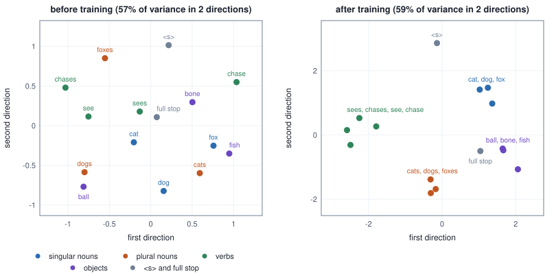

<!-- SPDX-License-Identifier: CC-BY-4.0 -->
<!-- Copyright (c) 2026 Martin Schröder <info@swedishembedded.com> -->

# Embeddings

*How does a model turn a token id into numbers it can compute with, and how do those numbers come to mean something?*

Sort the parameters of a decoder of the Qwen3 0.6B shape by what they do, and one group stands out. A single layer holds 155,582,464 of the model's 596,049,920 numbers, 26.1% of the whole, and it never multiplies anything. It is handed an integer between 0 and 151,935 and hands back the row of a table that has that number. The other 28 layers, the attention and feed-forward blocks that the chapters after this one build, are arithmetic. This quarter of the model is a filing cabinet.

Two things about the cabinet look wrong at first. The first is that it is there at all. A token id is a name: id 3 is not a little more than id 2, and a network that multiplied the id by a weight would be claiming that the token numbered 3 sits between the tokens numbered 2 and 4, which is a fact about the order in which a tokenizer happened to write its vocabulary down and about nothing in the language. The second is that nobody designs the contents. The rows begin as random numbers and are changed by gradient descent like every other weight, under a loss that mentions no meaning at all, and yet at the end the row for `cat` lies near the row for `dog` and far from the row for `sat`.

The table turns out to be a one-hot layer in disguise and its gradient a sum, so five earlier results are worth recalling first.

1. (Volume V, [Chapter 2](02-tokenization.md), tokens.) A byte-level tokenizer with 40 merges has a vocabulary of how many tokens, and what does the number of rows of a model's embedding table have to equal?
2. (Volume III, [Chapter 3](../v03-neural-networks/03-softmax.md), one-hot encoding.) Write token 3 of a vocabulary of six as a one-hot vector. What is the dot product of that vector with any vector $\mathbf{u}$ of length six?
3. (Volume I, [Chapter 4](../v01-mathematics/04-matrices.md), the matrix-vector product.) For $\mathbf{A} = \begin{pmatrix}1&2&3\\4&5&6\end{pmatrix}$ and $\mathbf{x} = (0, 1, 0)^\top$, what is $\mathbf{A}\mathbf{x}$, and which part of $\mathbf{A}$ is it?
4. (Volume III, [Chapter 5](../v03-neural-networks/05-layer-gradients.md), the backward pass of a reduction and of a shared value.) For $r = x_1 + x_2 + x_3$ and an upstream gradient $dr = 2$, what does each $x_i$ receive? If one value feeds two different places in a network, how is its gradient formed from the two?
5. (Volume I, [Chapter 3](../v01-mathematics/03-vectors.md), cosine similarity.) What is the cosine similarity of $(1, 0)$ and $(1, 1)$, and what happens to it if the second vector is replaced by $(5, 5)$?

## One row per token

The smallest table that shows everything has six tokens, `the`, `cat`, `dog`, `sat`, `ran` and `.`, and three numbers for each. It is filled with random numbers, so nothing in it means anything yet; the drawing rule is printed so that you can fill your own.

<!-- worked: embeddings.lookup -->
Generator: the book's SplitMix64, seed 0x581f79d29c854a7f (`seed_of` of the name `embeddings.table`).
The table has V = 6 rows (one per token) and D = 3 columns. It is filled row by row, three draws a row, each entry `0.5 * rng.normal()` rounded to two decimals (18 draws of `normal`, so nine pairs of Box-Muller).

| id | token | col 0 | col 1 | col 2 |
|---:|---|---:|---:|---:|
| 0 | `the` | -0.52 | 0.62 | 0.75 |
| 1 | `cat` | -1.04 | -0.67 | -0.15 |
| 2 | `dog` | 0.04 | -0.10 | -0.09 |
| 3 | `sat` | 0.16 | -0.30 | 0.53 |
| 4 | `ran` | -0.43 | 0.37 | -0.53 |
| 5 | `.` | -0.37 | -0.36 | 0.51 |

The sentence `the cat sat` has the ids (0, 1, 3). Lookup, one row of the table per id:

| position t | id | token | row of the table |
|---:|---:|---|---:|
| 0 | 0 | `the` | (-0.52, 0.62, 0.75) |
| 1 | 1 | `cat` | (-1.04, -0.67, -0.15) |
| 2 | 3 | `sat` | (0.16, -0.30, 0.53) |

The lookup reads T D = 3 * 3 = 9 numbers and multiplies nothing.
<!-- /worked -->

Row $i$ of this table is the vector the model will use for token $i$. The **embedding table** is the array $\mathbf{W}_{\mathrm{emb}}$ of shape $[V, D]$, with one row for each of the $V$ tokens of the vocabulary and $D$ columns, the width the rest of the model works in; row $i$ is the *embedding* of token $i$. To embed a sequence of ids $x_0, \dots, x_{T-1}$ is to copy out the rows,

$$
\mathbf{X}[t, :] = \mathbf{W}_{\mathrm{emb}}[x_t, :] \qquad (t = 0, \dots, T-1),
$$

an array of shape $[T, D]$ that is the input of everything that follows. The word is chosen well. To embed something is to set it inside something else, and here a token, which is a name with no geometry, is set inside a space of $D$ dimensions where there are distances, directions and dot products. Which row a token gets is the only thing the table knows about it.

The first table above is $6 \times 3$ and the sentence `the cat sat` is three lookups. The one in the Qwen3 0.6B shape is $151{,}936 \times 1{,}024$, and a sequence of a thousand tokens is a thousand lookups; nothing else about the operation changes.

In the book's pseudocode it is the `rows` operation of the pseudocode page, which gathers rows by an index list and rejects an index outside the table:

```text
function embed(W: array<real>[V, D], ids: list<int>) -> array<real>[T, D]:
    # every id must satisfy 0 <= ids[t] < V; rows(...) treats anything else as an error
    return rows(W, ids)
```

That the error is built into the operation matters more than it looks, because a table in memory does not check what it is asked for: a lookup is an address computed from the id, and an id past the end of the table reads whatever happens to lie there. The section on brain's kernels returns to one such bug.

## The lookup is a matrix product that nobody computes

Why a table, and why these particular numbers of rows and columns? Begin from what the earlier volumes already know how to do. A network takes a vector, and the vector for a class label, in Volume III, was the one-hot vector: $V$ entries, a 1 in the position of the class and 0 elsewhere. Feed a token's one-hot vector $\mathbf{e}_i$ into the first layer of a network, a linear layer with no bias, and the layer computes a matrix-vector product, which is a weighted sum of the columns of its matrix with the entries of the vector as the weights. All the weights but one are zero and the one is 1, so the product *is* the column of the matrix that belongs to token $i$. Stack the one-hot vectors of a sequence into the **selection matrix** $\mathbf{N}$ of shape $[T, V]$, with $N_{ti} = 1$ when $x_t = i$ and $0$ elsewhere, and the layer's output for the whole sequence is

$$
\mathbf{X} = \mathbf{N}\,\mathbf{W}_{\mathrm{emb}},
$$

whose row $t$ is $\sum_i N_{ti}\,\mathbf{W}_{\mathrm{emb}}[i, :] = \mathbf{W}_{\mathrm{emb}}[x_t, :]$. So the embedding table is nothing exotic. It is the first linear layer of a network whose input is a one-hot vector, stored with one row per token because rows are what get read. In the book's convention for a layer, weights of shape $[\text{outputs}, \text{inputs}]$, the weight matrix of that layer is $\mathbf{W}_{\mathrm{emb}}^\top$.

Here is the identity on the three rows of the first example, and the figure shows both computations side by side.

<!-- worked: embeddings.onehot_product -->
The table is the one of the first example and the sentence is `the cat sat`, ids (0, 1, 3). N has one row per position, with a 1 in the column of that position's id:

| position t | row of N (V = 6 entries) | row of N times the table |
|---:|---|---:|
| 0 | (1, 0, 0, 0, 0, 0) | (-0.52, 0.62, 0.75) |
| 1 | (0, 1, 0, 0, 0, 0) | (-1.04, -0.67, -0.15) |
| 2 | (0, 0, 0, 1, 0, 0) | (0.16, -0.30, 0.53) |

The three rows are the rows the lookup returned, entry for entry (largest difference 0): in every sum all terms but one are an entry times 0. The product counts T V D = 3 * 6 * 3 = 54 multiply-adds, of which 45 multiply by zero.
<!-- /worked -->


The identity is the reason the lookup is correct, and also the reason nobody computes it that way. The product multiplies by zero almost everywhere: for the small table it forms $T V D = 54$ products to deliver nine numbers, and the lookup delivers the same nine and multiplies nothing. At real sizes the gap is the vocabulary itself, since the product costs $V$ times what the lookup does:

<!-- worked: embeddings.lookup_cost -->
T is the number of positions, B the bytes of one table entry (4 for `f32`, 2 for `bf16`). A multiply-add is two FLOPs. The product reads the whole table and the matrix N of T rows of V entries; the lookup reads T rows of D entries and T ids of 4 bytes.

| case | V | D | T | B | multiply-adds of N times table (T V D) | bytes of the table (V D B) | bytes of N (T V B) | bytes the lookup reads (T D B + 4 T) |
|---|---:|---:|---:|---:|---:|---:|---:|---:|
| the table above | 6 | 3 | 3 | 4 | 54 | 72 | 72 | 48 |
| GPT, tiny | 65 | 32 | 64 | 4 | 133,120 | 8,320 | 16,640 | 8,448 |
| Qwen3, 0.6B | 151,936 | 1,024 | 1,024 | 2 | 159,316,443,136 | 311,164,928 | 311,164,928 | 2,101,248 |

For the last row the product needs 318,632,886,272 FLOPs and reads at least 311,164,928 bytes of table; the lookup needs no FLOPs and reads 2,101,248 bytes, 148.1 times fewer.
<!-- /worked -->

Read the last row in the two currencies of Volume IV. In arithmetic, the product would need 318,632,886,272 FLOPs for one sequence of 1,024 tokens, and the lookup needs none. In bytes, the product has to read the whole table, 311,164,928 bytes in `bf16` (the selection matrix would be another 311,164,928 bytes if anyone built it), where the lookup reads the 1,024 rows it needs and their ids, 2,101,248 bytes, 148.1 times fewer. Lookup is a gather, an operation whose cost is the bytes it moves. That is what a table of this size should be: its price is the memory it occupies, and the memory traffic of a step is proportional to the tokens in it, not to the vocabulary.

The product earns its place in another way: from $\mathbf{X} = \mathbf{N}\mathbf{W}_{\mathrm{emb}}$ the gradient of a lookup follows by rules already known, and it is then implemented as a cheap loop, never as the product.

## Where the gradient goes

Suppose the loss $L$ depends on the looked-up rows $\mathbf{X}$ through the rest of the model, and the backward pass has delivered $d\mathbf{X}$, the gradient of $L$ with respect to each entry of $\mathbf{X}$, shape $[T, D]$. What is the gradient of the table? Volume III, Chapter 5, gave the backward pass of a matrix product: for $\mathbf{C} = \mathbf{A}\mathbf{B}$ it is $d\mathbf{B} = \mathbf{A}^\top d\mathbf{C}$. Here $\mathbf{A} = \mathbf{N}$, $\mathbf{B} = \mathbf{W}_{\mathrm{emb}}$ and $\mathbf{C} = \mathbf{X}$, so

$$
d\mathbf{W}_{\mathrm{emb}} = \mathbf{N}^\top d\mathbf{X}, \qquad
d\mathbf{W}_{\mathrm{emb}}[i, :] = \sum_{t}\, N_{ti}\, d\mathbf{X}[t, :] = \sum_{t\,:\,x_t = i} d\mathbf{X}[t, :].
$$

The last form is the whole story, and it has three consequences that can be read off it without any machinery. A token that did not occur in the batch has no $t$ with $x_t = i$, so its row of the gradient is exactly zero. A token that occurred once receives the gradient row of the position where it stood. A token that occurred twice receives the *sum* of the two rows, because the table row was read twice and every read becomes an addition, which is the reduction rule of Volume III, Chapter 5, applied to a value that is used in several places. The **embedding gradient** is this array: for each row of the table, the sum of the gradient rows of the positions that looked it up, zero for the rows nobody looked up. Writing it as an *addition into a zeroed array* is called a scatter-add, the mirror image of a gather: the gather copies rows out of the table, the scatter-add adds rows back into it.

The $\mathbf{N}^\top d\mathbf{X}$ form has $V \times T \times D$ multiply-adds and so is no more worth computing than the forward product. The loop is cheap:

```text
function embed_backward(dX: array<real>[T, D], ids: list<int>, V: int) -> array<real>[V, D]:
    dW = zeros(real, [V, D])
    for t in 0 .. T:
        for j in 0 .. D:
            dW[ids[t], j] = dW[ids[t], j] + dX[t, j]      # added, never assigned
    return dW
```

Here it is on an input with a repeated token. The sequence is `cat sat cat .`, so `cat` is read twice; the loss is $L = \tfrac12\sum_{t,j}(X_{tj} - R_{tj})^2$ against a printed target $\mathbf{R}$, which makes the gradient arriving at the lookup simply $d\mathbf{X} = \mathbf{X} - \mathbf{R}$.

<!-- worked: embeddings.gradient -->
The table is the one above. The input is `cat sat cat .`, ids (1, 3, 1, 5), so `cat` (id 1) is used twice. The loss is L = 1/2 sum over t and j of (X[t, j] - R[t, j])^2, with the target R below, so the gradient arriving at the lookup is dX = X - R.

| position t | id | X[t] (row of the table) | R[t] | dX[t] = X[t] - R[t] |
|---:|---:|---|---|---|
| 0 | 1 | (-1.04, -0.67, -0.15) | (0.50, -0.25, 0.00) | (-1.54, -0.42, -0.15) |
| 1 | 3 | (0.16, -0.30, 0.53) | (0.00, 0.25, -0.50) | (0.16, -0.55, 1.03) |
| 2 | 1 | (-1.04, -0.67, -0.15) | (-0.25, 0.50, 0.25) | (-0.79, -1.17, -0.40) |
| 3 | 5 | (-0.37, -0.36, 0.51) | (0.25, 0.00, 0.50) | (-0.62, -0.36, 0.01) |

L = 3.3133. The gradient of the table, row by row:

| id | token | uses | dW[i] = sum of dX[t] with ids[t] = i |
|---:|---|---:|---:|
| 0 | `the` | 0 | (0.00, 0.00, 0.00) |
| 1 | `cat` | 2 | (-2.33, -1.59, -0.55) |
| 2 | `dog` | 0 | (0.00, 0.00, 0.00) |
| 3 | `sat` | 1 | (0.16, -0.55, 1.03) |
| 4 | `ran` | 0 | (0.00, 0.00, 0.00) |
| 5 | `.` | 1 | (-0.62, -0.36, 0.01) |

Row 1 is dX[0] + dX[2] = (-1.54, -0.42, -0.15) + (-0.79, -1.17, -0.40) = (-2.33, -1.59, -0.55). Rows 0, 2 and 4 were never used and are zero. The same table from the product N^T dX (N the matrix of the previous example): largest difference from the loop above, below 1e-15. Largest difference from a central difference over all 18 entries (step h = 1e-5, applied to L): below 1e-8.

A loop that assigns, `dW[ids[t]] = dX[t]`, leaves row 1 equal to dX[2] = (-0.79, -1.17, -0.40); the correct row minus this wrong row is (-1.54, -0.42, -0.15), which is exactly dX[0], the use that was overwritten.
<!-- /worked -->


Three things in the example are worth reading twice. The row of `cat` is the sum of two position gradients, so a token that is frequent in a batch gets a larger gradient than a rare one for the same per-position error; if the loss is a mean over positions, the $1/T$ is already in $d\mathbf{X}$ and the table does not divide again. Three of the six rows are exactly zero: one step of training moves only the rows of the tokens in the batch. And the central difference over all 18 entries agrees with the loop, the same check that Volume III, Chapter 6, applied to every layer gradient.

The last line of the example shows the usual mistake in this gradient, and an example with a repeated id is what catches it. A loop that *assigns*, `dW[ids[t]] = dX[t]`, is right whenever every id in the batch is distinct and wrong the moment one repeats: the later use overwrites the earlier one, and the lost gradient is exactly the overwritten row. A test that draws distinct ids passes it, so the gradient check of an embedding must use a batch with a repeat.

A position that the loss ignores contributes no gradient. This is the whole mechanism by which a padding token stays out of training: padding positions are masked out of the loss, so $d\mathbf{X}[t, :]$ is zero there and the token adds nothing to its row. The padding token's row still exists, is still initialized and is still gathered into the sequence; what keeps it constant is that nothing pushes it, and that holds only while nothing else does, which is the next section's subject.

## Rows that were not in the batch

Almost every row of the gradient is zero. In the Qwen3 shape of the opening, a batch of 1,024 positions looks up at most 1,024 distinct rows of 151,936, at most 0.67% of the table. An optimizer that sees the table as one tensor of 155,582,464 numbers does not know that; it applies its rule to all of them. For plain stochastic gradient descent that costs nothing in correctness, because $w \leftarrow w - \eta\cdot 0$ changes nothing. For an optimizer with memory it changes the result. Adam, the optimizer of Volume III, Chapter 7, keeps a running average $m$ of the gradient and $v$ of its square, and moves a weight by $\eta\,\hat m/(\sqrt{\hat v} + \epsilon)$ with the bias corrections $\hat m = m/(1-\beta_1^t)$, $\hat v = v/(1-\beta_2^t)$. When a token leaves the batch its gradient is zero but its $m$ is not: the average decays by the factor $\beta_1 = 0.9$ a step, and the weight keeps moving while it does.

The two ways to run the rule can be put side by side on one entry of one row, whose token appears at steps 1 and 6 and is absent in between. A **dense update** runs the rule on every entry at every step. A **lazy update** runs it only on the rows of the tokens present, and leaves the moments of the others untouched, taking the bias corrections from the global step $t$:

```text
function lazy_adam_step(W: inout array<real>[V, D], m: inout array<real>[V, D], v: inout array<real>[V, D],
                        dW: array<real>[V, D], used: list<int>, t: int,
                        lr: real, beta1: real, beta2: real, eps: real):
    for i in used:                                  # the distinct ids of this batch, each once
        for j in 0 .. D:
            g = dW[i, j]
            m[i, j] = beta1 * m[i, j] + (1 - beta1) * g
            v[i, j] = beta2 * v[i, j] + (1 - beta2) * g * g
            mhat = m[i, j] / (1 - beta1 ^ t)
            vhat = v[i, j] / (1 - beta2 ^ t)
            W[i, j] = W[i, j] - lr * mhat / (sqrt(vhat) + eps)
```

<!-- worked: embeddings.adam_rows -->
One entry of a table, starting at w = 0.3. Adam with learning rate 0.1, beta1 = 0.9, beta2 = 0.999, epsilon = 1e-08, no weight decay, update w <- w - lr * mhat / (sqrt(vhat) + epsilon) with the bias corrections mhat = m / (1 - beta1^t) and vhat = v / (1 - beta2^t). Its token is in the batch at steps 1 and 6 (gradient 0.5) and absent at steps 2 to 5 (gradient 0). *Dense* Adam runs the rule on every entry at every step; *lazy* Adam runs it only at the steps where the token is present, with the global step t in the corrections, and leaves m and v alone otherwise. m and v are those of dense Adam.

| t | g | m (dense) | v (dense) | dense change of w | w (dense) | lazy change of w | w (lazy) |
|---:|---:|---:|---:|---:|---:|---:|---:|
| 1 | 0.50 | 0.050000 | 0.00025000 | -0.10000 | 0.20000 | -0.10000 | 0.20000 |
| 2 | 0.00 | 0.045000 | 0.00024975 | -0.06701 | 0.13299 | 0.00000 | 0.20000 |
| 3 | 0.00 | 0.040500 | 0.00024950 | -0.05180 | 0.08120 | 0.00000 | 0.20000 |
| 4 | 0.00 | 0.036450 | 0.00024925 | -0.04243 | 0.03877 | 0.00000 | 0.20000 |
| 5 | 0.00 | 0.032805 | 0.00024900 | -0.03586 | 0.00291 | 0.00000 | 0.20000 |
| 6 | 0.50 | 0.079524 | 0.00049875 | -0.05879 | -0.05588 | -0.07016 | 0.12984 |

At the end, lazy Adam holds m = 0.095000 and v = 0.00049975, dense Adam m = 0.079524 and v = 0.00049875.
<!-- /worked -->

The dense column is the surprise. After one appearance of the token at step 1, dense Adam goes on moving the entry for four steps in which the token is absent, by 0.06701, 0.05180, 0.04243 and 0.03586: the entry travels 0.19710 further in the direction of a gradient it saw once, and only the decay of $m$ slows it. The lazy column moves exactly as often as the token is seen. Neither is wrong; they are two different algorithms: dense Adam keeps the momentum the rule defines, lazy Adam gives a rare token a clean update at the step it appears and does not let the moments of a row evolve while the row is not read. When the token returns at step 6 the two disagree on the size of the step (0.05879 against 0.07016) because the stale moments of the lazy run have not decayed.

What the choice costs is traffic. A step of Adam reads $w$, $g$, $m$ and $v$ and writes $w$, $m$ and $v$, seven words per entry, and the sizes below treat all four arrays as `f32`.

<!-- worked: embeddings.update_cost -->
The table of each model, with `f32` values, gradients and moments (4 bytes each). A step of Adam reads w, g, m and v and writes w, m and v: 7 words per entry. The lazy column assumes at most 1,024 distinct tokens in the batch (a batch of 1,024 positions has no more), each row D entries.

| table of | entries V D | bytes held: w, g, m, v (16 per entry) | bytes moved per step, dense | bytes moved per step, lazy (at most) | ratio |
|---|---:|---:|---:|---:|---:|
| Qwen3, 0.6B | 155,582,464 | 2,489,319,424 | 4,356,308,992 | 29,360,128 | 148.4 |
| Qwen3, 4B | 388,956,160 | 6,223,298,560 | 10,890,772,480 | 73,400,320 | 148.4 |
<!-- /worked -->

The dense update moves 4,356,308,992 bytes of the 0.6B shape's table each step, and a lazy one at most 29,360,128, 148.4 times fewer; the 2,489,319,424 bytes held (16 per entry) are the same either way, because the moments of every row must exist to be read when its token returns. Two other things travel with a dense update and are easy to forget. A decoupled weight decay of the kind AdamW uses (Volume III, Chapter 7) shrinks every row on every step, including the rows of tokens that have not been seen for a thousand steps; a lazy update lets those rows alone. And a gradient buffer that is the shape of the table has to be zeroed on every step, $V D$ writes, whatever the lookup touched. The choice is part of the optimizer's definition, not of the layer's, so it belongs in the optimizer's description; the update rules of `crates/optim/src/rule.rs` are defined element by element over a whole decoded tensor and the table is updated as one tensor, so brain updates a table densely.

## One table at both ends

The table has a twin at the other end of the model. A language model turns the final hidden vector $\mathbf{h}$ of a position, a vector of width $D$, into a score for each of the $V$ tokens, the logits, with a linear layer whose weight is a matrix of shape $[V, D]$:

$$
\mathbf{z} = \mathbf{W}_{\mathrm{out}}\,\mathbf{h}, \qquad z_j = \mathbf{W}_{\mathrm{out}}[j, :]\cdot\mathbf{h}.
$$

Row $j$ of $\mathbf{W}_{\mathrm{out}}$ is the vector that scores token $j$: the logit of token $j$ is high when $\mathbf{h}$ points along that row. It is an array of exactly the shape and the meaning of the input table, a row per token in the same space of width $D$, one used to *read* a token into the network and one used to *write* a token out of it. It would be odd if they had nothing to do with each other, and Press and Wolf (2017) observed that they do and proposed to make them one. **Tied embeddings** use one table for both: $\mathbf{W}_{\mathrm{out}} = \mathbf{W}_{\mathrm{emb}}$, so the logits are $\mathbf{z} = \mathbf{W}_{\mathrm{emb}}\mathbf{h}$, or for a sequence $\mathbf{Z} = \mathbf{H}\mathbf{W}_{\mathrm{emb}}^\top$. The saving is one table: $V D$ parameters, $V D \cdot B$ bytes of weights and $16\,V D$ bytes of training state in `f32`. For the 0.6B shape that is 155,582,464 parameters, the quarter of the opening, which a separate head would pay a second time.

What changes in the backward pass is that the table now has two ways to affect the loss, and by the rule for a value used in several places its gradient is the sum of both:

$$
d\mathbf{W}_{\mathrm{emb}} = \underbrace{d\mathbf{Z}^\top \mathbf{H}}_{\text{as the head}} \;+\; \underbrace{\mathrm{scatter\_add}\bigl(d\mathbf{X},\ \mathrm{ids}\bigr)}_{\text{as the lookup}}.
$$

The first term is the matrix-product rule applied to the head, every row of the table receiving some gradient, large for the tokens the model gave probability to wrongly or failed to give to. The second is the scatter-add of the previous section, nonzero only for tokens that were inputs. Here are both, on the table of the first example with a small stand-in for the network between the ends.

<!-- worked: embeddings.tied -->
The table is the one of the first example. The input is `cat sat cat` (ids 1, 3, 1) and the targets are the next tokens `sat cat .` (ids 3, 1, 5). A stand-in for the network turns each looked-up row x into h = Wh x with

    Wh = [[0.5, -0.25, 0.0], [0.25, 0.5, -0.25], [0.0, 0.25, 0.5]]

and the head is tied: the logits are z = h E^T, row t of the table acting as the weight vector of token t. The loss is the mean over the T = 3 positions of -log softmax(z)[target].

| t | input | target | h[t] = Wh x[t] | probability of the target |
|---:|---|---|---:|---:|
| 0 | `cat` | `sat` | (-0.3525, -0.5575, -0.2425) | 0.1357 |
| 1 | `sat` | `cat` | (0.1550, -0.2425, 0.1900) | 0.1614 |
| 2 | `cat` | `.` | (-0.3525, -0.5575, -0.2425) | 0.1700 |

L = 1.8643. Gradient with respect to the table, split into its two sources, and the total (rounded to 4 decimals):

| id | token | head part: dz^T H | embedding part: scatter-add of Wh^T dh | total |
|---:|---|---:|---:|---:|
| 0 | `the` | (-0.0152, -0.0487, -0.0062) | (0.0000, 0.0000, 0.0000) | (-0.0152, -0.0487, -0.0062) |
| 1 | `cat` | (-0.1139, -0.0438, -0.1017) | (-0.0979, 0.0314, -0.1630) | (-0.2118, -0.0125, -0.2647) |
| 2 | `dog` | (-0.0259, -0.0683, -0.0132) | (0.0000, 0.0000, 0.0000) | (-0.0259, -0.0683, -0.0132) |
| 3 | `sat` | (0.0960, 0.1190, 0.0717) | (0.1644, 0.0641, 0.0134) | (0.2605, 0.1831, 0.0851) |
| 4 | `ran` | (-0.0283, -0.0657, -0.0159) | (0.0000, 0.0000, 0.0000) | (-0.0283, -0.0657, -0.0159) |
| 5 | `.` | (0.0873, 0.1074, 0.0653) | (0.0000, 0.0000, 0.0000) | (0.0873, 0.1074, 0.0653) |

Largest difference of the total from a central difference of L over all 18 entries (h = 1e-5): below 1e-8. With the head part alone it is 0.16, with the embedding part alone 0.12. Row 0 (`the`) is never an input but is a candidate output at every position, so its gradient is all head part.
<!-- /worked -->

Neither term alone passes the central difference: the head part is off by 0.16 and the embedding part by 0.12, which is what a model that tied its weights but wrote only one of the two gradients would do, and it would still train, a little wrongly, with a loss that falls anyway. Only the sum agrees with the central difference, to better than $10^{-8}$. The row of `the` is the case to remember: never an input in this batch, so its lookup part is zero, yet its row is changed by the head part at every position, because `the` was a candidate for the next token each time.

Tying has an effect beyond the saving, and the example above shows it. In an untied model the input row of a token changes only when the token is read, while its output row changes at every position, because the softmax gives every token some probability; a tied table gives a rarely read token the update of the output side as well. A cost is that the two jobs now share one vector per token, so what is good for reading a token and what is good for predicting it have to agree. Models differ on whether they accept that. In brain's Qwen3 configurations the choice is a field, `tie_embeddings`, and the configurations record the published ones: the 0.6B, 1.7B and 4B shapes are tied and the 8B shape is not (`crates/qwen3/src/config.rs`). The parameter counts at the end of the chapter show how much is at stake: the saving is a quarter of the smallest model and a few percent of a larger one.

## Tokens that keep the same company

So far the table is a store. The rows start random, and the earlier sections said how they are read and how they are trained; they did not say why training them should *mean* anything. The idea that answers it is older than neural networks. Harris (1954) argued that the distribution of the contexts in which a linguistic unit occurs is what can be known about it and that units with similar distributions are similar; Firth (1957) gave the slogan, that a word is characterized by the company it keeps. This is the **distributional hypothesis**: tokens that occur in similar contexts have similar meanings, so a model that has to predict a token from its context, or the context from a token, has a reason to give such tokens similar vectors. Bengio and his colleagues (2003) trained a neural network to predict the next word through a learned table of word vectors, which is the design the model below shrinks; Mikolov and his colleagues (2013) made the idea cheap and famous with word2vec.

The claim can be tested here, on a language small enough to print whole. Its sentences have one of six nouns (three singular, `cat`, `dog` and `fox`, and their plurals `cats`, `dogs` and `foxes`), a verb that agrees in number with the noun (`sees` or `chases` after a singular noun, `see` or `chase` after a plural one), one of three objects (`ball`, `bone` or `fish`) and a full stop. Within each position, the words are interchangeable as far as the grammar goes: it allows `cat` where it allows `dog`. Whether a model that has only seen the sentences learns that is the question.

<!-- worked: embeddings.corpus -->
Generator: the book's SplitMix64, seed 0xf05bd75dcaf8ac3e (`seed_of` of the name `embeddings.corpus`).
The vocabulary has V = 15 tokens with ids 0 to 14 in this order: 0 `<s>`, 1 `cat`, 2 `dog`, 3 `fox`, 4 `cats`, 5 `dogs`, 6 `foxes`, 7 `sees`, 8 `chases`, 9 `see`, 10 `chase`, 11 `ball`, 12 `bone`, 13 `fish`, 14 `.`.
A sentence is a noun, a verb that agrees with it in number, an object and a full stop. Draw order for each of the 60 sentences: `n = rng.integer(6)` picks the noun (ids 1 to 6 in the order above, so n = 0 is `cat` and n = 5 is `foxes`), `v = rng.integer(2)` picks the verb of the noun's number (for a singular noun `sees` or `chases`, for a plural one `see` or `chase`), `o = rng.integer(3)` picks the object (`ball`, `bone` or `fish`).

The corpus, one sentence after another:

    dog sees fish . dogs see bone . dogs chase ball . dogs see fish . cat sees fish . cats see ball . foxes see fish . fox sees ball . cat chases bone . fox sees fish . dogs chase bone . foxes see fish . fox chases fish . foxes chase bone . dog chases ball . cats see fish . dog sees fish . fox sees fish . dogs chase ball . cats see ball .
    fox chases bone . cats see fish . cat sees ball . dogs chase fish . dogs see bone . foxes see bone . cats chase fish . dog sees bone . dog chases ball . dogs see fish . dog sees fish . cat chases bone . cats see fish . fox sees fish . foxes chase bone . fox chases ball . fox chases ball . dogs see bone . dogs chase ball . cat chases ball .
    cats chase ball . fox sees bone . cats see ball . cats see fish . cats chase ball . cat chases bone . dogs see fish . fox chases ball . cats see fish . foxes see ball . cat chases bone . dogs see bone . dogs see fish . foxes see ball . dog sees ball . dog chases ball . dogs see fish . cats see ball . cat chases fish . fox sees fish .

The training text is the stream in which `<s>` (id 0) is written before every sentence: 300 tokens. A training example is a pair of neighbours (current, next); the stream has N = 299 of them. The classes used to read the results: singular nouns: `cat`, `dog`, `fox`; plural nouns: `cats`, `dogs`, `foxes`; verbs: `sees`, `chases`, `see`, `chase`; objects: `ball`, `bone`, `fish`.
If a model could store each current token's next-token frequencies exactly, its mean loss would be the conditional entropy of the pairs, -(1/N) times the sum over the distinct pairs (a, b) of count(a, b) * log(count(a, b) / count(a)), where count(a) is the number of pairs that start with a: 0.6782 nats. For orientation, log 2 = 0.6931 is the entropy of a fair choice between the two verbs of a noun and log 3 = 1.0986 that of a fair choice between the three objects.
<!-- /worked -->

The model is the smallest one that has a table to learn: it reads one token and predicts the next. The current token $a$ is looked up in the embedding table to give $\mathbf{e}_a = \mathbf{W}_{\mathrm{emb}}[a, :]$; a second table $\mathbf{W}_{\mathrm{out}}$ turns it into logits $\mathbf{z} = \mathbf{W}_{\mathrm{out}}\mathbf{e}_a$; the probability of the next token $b$ is the softmax of $\mathbf{z}$ at $b$; and the loss is the mean of $-\log p_b$ over all pairs of neighbours in the stream (Volume III, Chapter 3). It does not know the grammar and cannot count past one token of context. The next chapter turns this prediction into a general principle; here it is only a vehicle for gradients into a table. One training step, in the pseudocode, with the loss measured before the update:

```text
function train_step(Wemb: inout array<real>[V, D], Wout: inout array<real>[V, D],
                    pairs: list<(int, int)>, lr: real) -> real:
    N = len(pairs)
    dWemb = zeros(real, [V, D])
    dWout = zeros(real, [V, D])
    loss = 0.0
    for n in 0 .. N:
        a = pairs[n][0]                                         # the current token
        b = pairs[n][1]                                         # the token that follows it
        z = [dot(Wout[j, :], Wemb[a, :]) for j in 0 .. V]
        p = softmax(z)
        loss = loss - log(p[b])
        for j in 0 .. V:
            dz = (p[j] - (1.0 if j == b else 0.0)) / N         # the softmax-cross-entropy rule, mean over pairs
            for k in 0 .. D:
                dWemb[a, k] = dWemb[a, k] + dz * Wout[j, k]     # scatter-add into the row of the current token
                dWout[j, k] = dWout[j, k] + dz * Wemb[a, k]
    Wemb = Wemb - lr * dWemb                                    # entry by entry
    Wout = Wout - lr * dWout
    return loss / N
```

Every start is a draw of the book's generator, the embedding table first and the output table after it. The run is 300 steps of full-batch gradient descent, so every pair of the corpus is in every step, and the learning rate is fixed and printed.

<!-- worked: embeddings.training -->
Generator: the book's SplitMix64, seed 0xa36699001469a03b (`seed_of` of the name `embeddings.train`).
Model: logits z = W_out e, where e is row x of the embedding table (the current token x) and W_out is a second table of the same shape; the next token is predicted with softmax(z). Both tables have 15 rows and D = 6 columns. Start: the 90 entries of the embedding table are drawn first, row by row, as 0.5 * `rng.normal()`, then the entries of W_out the same way. Loss: the mean over the N = 299 pairs of -log softmax(z)[next]. Training: 300 steps of full-batch gradient descent, learning rate 2.0, every pair in every step, no regularisation.

| step | mean loss |
|---:|---:|
| 0 | 2.8437 |
| 10 | 1.3642 |
| 30 | 0.8897 |
| 100 | 0.6875 |
| 300 | 0.6799 |

Mean cosine similarity of the rows of the embedding table, by class, before training (step 0). The diagonal is the mean over pairs of different tokens of one class:

|  | singular nouns | plural nouns | verbs | objects |
|---|---:|---:|---:|---:|
| singular nouns | -0.080 | -0.062 | -0.252 | 0.067 |
| plural nouns | -0.062 | -0.354 | 0.108 | 0.005 |
| verbs | -0.252 | 0.108 | 0.052 | -0.095 |
| objects | 0.067 | 0.005 | -0.095 | -0.132 |

After 300 steps:

|  | singular nouns | plural nouns | verbs | objects |
|---|---:|---:|---:|---:|
| singular nouns | 0.920 | -0.102 | -0.365 | 0.130 |
| plural nouns | -0.102 | 0.937 | 0.107 | 0.080 |
| verbs | -0.365 | 0.107 | 0.874 | -0.444 |
| objects | 0.130 | 0.080 | -0.444 | 0.904 |

Some individual pairs:

| pair | cosine before | cosine after |
|---|---:|---:|
| `cat`, `dog` | -0.097 | 0.886 |
| `cat`, `fox` | -0.339 | 0.908 |
| `dog`, `fox` | 0.196 | 0.967 |
| `cats`, `dogs` | -0.206 | 0.922 |
| `sees`, `chases` | 0.135 | 0.829 |
| `sees`, `see` | 0.241 | 0.958 |
| `ball`, `fish` | -0.482 | 0.868 |
| `cat`, `cats` | -0.207 | 0.177 |
| `cat`, `fish` | -0.603 | 0.109 |
| `cat`, `sees` | -0.544 | -0.433 |
<!-- /worked -->

Read the loss first. It falls from 2.8437 (a model that gave all 15 tokens the same probability would have $\log 15 = 2.7081$) to 0.6799, within 0.0017 of the 0.6782 nats that the corpus's own conditional entropy allows; the model has learned what a one-token memory can know about this grammar. Then read the tables of cosines. Before training the mean cosine similarity of the rows of one class is scattered around zero: -0.080 for the singular nouns, -0.354 for the plural ones, which is what independent random vectors in six dimensions look like. After training the same numbers are 0.920, 0.937, 0.874 and 0.904. `cat` and `dog` went from -0.097 to 0.886, `sees` and `chases` from 0.135 to 0.829. Nobody told the model that `cat` and `dog` are alike. The only thing that acted on the rows is the loss, and the loss only ever looked at which token comes next.

Why does the loss do this? Fix the output table and take the gradient of the loss with respect to the row of one current token $a$. Let $n_a$ be the number of pairs that start at $a$ and $q_{aj}$ the fraction of them whose next token is $j$. The summed loss over those pairs is $n_a\bigl(\log\sum_j e^{z_j} - \sum_j q_{aj}z_j\bigr)$, with $\mathbf{z} = \mathbf{W}_{\mathrm{out}}\mathbf{e}_a$, so

$$
\frac{\partial \mathcal{L}}{\partial \mathbf{e}_a} = \frac{n_a}{N}\sum_{j}\bigl(p_j - q_{aj}\bigr)\,\mathbf{W}_{\mathrm{out}}[j, :],
$$

and the loss is a convex function of $\mathbf{e}_a$, since a log-sum-exp is convex and the other term is linear. The row of a token is pulled so that the model's distribution $p$ approaches that token's own next-token distribution $q_a$, and *nothing else about the token enters*. Two tokens with the same $q$ are therefore pulled by the same equation toward the same logits, and when the columns of $\mathbf{W}_{\mathrm{out}}$ are independent equal logits (up to a shift of all of them) mean equal rows. In this corpus `cat`, `dog` and `fox` are followed by the same two verbs in the same proportions up to sampling noise, and so their rows approach each other. That is the distributional hypothesis as an optimization fact: *similar contexts mean similar targets, and similar targets pull the rows to the same place*. The residue (0.886 and not 1) has two sources: the three nouns are followed by `sees` and `chases` in slightly different proportions in 60 sentences, and 300 steps have not quite reached the floor of the loss.

The same fact says what the model cannot learn. Its only information about a token is the distribution of what follows it; `sees` and `see` are both followed by an object, in the same proportions, so they are interchangeable too, and the mean cosine of the four verbs after training is 0.874 even though two of them are singular and two plural. Number is invisible to this objective on the verb side, because nothing that follows a verb depends on it. The distributional hypothesis works for exactly the distinctions that contexts make.

The two panels of the figure show the 15 rows, projected to their first two principal directions (Volume II, [Chapter 7](../v02-learning/07-classical-methods.md); the directions are computed separately for each panel by power iteration on the covariance).



Before training the colours are mixed: the rows are random and no class has a place. After training the classes have separated into four clusters, with `<s>` and the full stop on their own. The recipe is below, with the share of the variance that two directions keep: about 57% of the random table's and 59% of the trained one's, so the picture is a summary of a little more than half of what the rows contain, not of all of it.

<!-- worked: embeddings.pca_summary -->
The 15 rows of the embedding table (D = 6) are centred on their mean; C is the covariance of the centred rows with divisor N = 15. The first direction is found by power iteration on C: start from v = (1.0, 1.1, 1.2, 1.3, 1.4, 1.5) divided by its length, repeat 500 times v <- C v / norm(C v); its eigenvalue is v . C v. The second direction is the same iteration on C - lambda_1 v v^T. Each direction is signed so that its entry of largest magnitude is positive, and a row's two coordinates are its dot products with the directions. The share of the variance kept is (lambda_1 + lambda_2) / trace(C).

| table | variance kept by the two directions |
|---|---:|
| before training | 57.4% |
| after training | 59.3% |
<!-- /worked -->

## What the geometry shows, and what it does not

A table whose rows have structure can be queried. The simplest query is the nearest neighbours of a token, the rows of largest cosine similarity to its row, since cosine ignores the length of a row and compares only direction.

<!-- worked: embeddings.neighbours -->
The three rows of largest cosine similarity to each query (the query excluded; ties, which do not occur here, would go to the smaller id), from the model of the previous example before and after training.

| query | before training | after training |
|---|---|---|
| `cat` | `.` 0.82, `ball` 0.73, `chases` 0.04 | `fox` 0.91, `dog` 0.89, `ball` 0.21 |
| `cats` | `fish` 0.81, `fox` 0.59, `dog` 0.59 | `foxes` 0.93, `dogs` 0.92, `ball` 0.28 |
| `sees` | `foxes` 0.63, `dogs` 0.41, `see` 0.24 | `see` 0.96, `chases` 0.83, `chase` 0.82 |
| `ball` | `cat` 0.73, `dogs` 0.36, `chases` 0.31 | `bone` 0.88, `fish` 0.87, `dogs` 0.33 |
| `<s>` | `foxes` 0.49, `chases` 0.28, `see` 0.27 | `.` 0.10, `sees` -0.06, `fox` -0.09 |
<!-- /worked -->

After training the nearest neighbours of `cat` are `fox` and `dog`, those of `cats` are `foxes` and `dogs`, of `ball` are `bone` and `fish`, and of `sees` are `see`, `chases` and `chase`. Before training, the neighbours of `cat` are `.` and `ball`, which is what random six-dimensional vectors give. The row for `<s>` resembles none of them: it is followed by every noun in proportions no other token shares.

A more ambitious query is the analogy. If the model has learned that plural is a direction, then the vector from a singular noun to its plural, $\mathbf{e}(\mathrm{cats}) - \mathbf{e}(\mathrm{cat})$, added to another singular noun should land near its plural. Mikolov and his colleagues reported such arithmetic on word vectors, and it has been repeated so often that it is easy to believe it works by itself. Here it is on the toy, with every one of the six questions of this form asked and the answer shown whether or not it is right.

<!-- worked: embeddings.analogies -->
For a : b :: c : ? the query is the vector e(b) - e(a) + e(c), and the answer is the row of largest cosine similarity to it among the tokens other than a, b and c. Each of the six questions below takes a singular noun a with its plural b and another singular noun c, and asks for the plural of c; the best row and its cosine are shown, for the table before and after training.

| question | expected | before training | after training | after: correct |
|---|---|---|---|---:|
| `cat` : `cats` :: `dog` : ? | `dogs` | `fish` 0.76 | `dogs` 0.91 | yes |
| `cat` : `cats` :: `fox` : ? | `foxes` | `fish` 0.93 | `dogs` 0.88 | no |
| `dog` : `dogs` :: `cat` : ? | `cats` | `chases` 0.53 | `foxes` 0.96 | no |
| `dog` : `dogs` :: `fox` : ? | `foxes` | `bone` 0.57 | `foxes` 0.98 | yes |
| `fox` : `foxes` :: `cat` : ? | `cats` | `chases` 0.56 | `cats` 0.90 | yes |
| `fox` : `foxes` :: `dog` : ? | `dogs` | `sees` 0.64 | `dogs` 0.98 | yes |

Top-1 correct: 0 of 6 before training, 4 of 6 after. Answer is some plural noun: 0 of 6 before, 6 of 6 after.
For comparison, `sees` : `see` :: `chases` : ? answers `ball` before training and `chase` after. After training cos(`sees`, `see`) = 0.958 is larger than cos(`sees`, `chases`) = 0.829, so the offset e(`see`) - e(`sees`) is short and the query is close to e(`chases`) itself.
<!-- /worked -->

The honest result is mixed, and informative. After training all six answers are plural nouns, so the direction from `cat` to `cats` does mean "plural" to the model, and before training none is. But only four of the six are the *right* plural. The failure is not a bug: `dog` and `fox` are about as interchangeable as the model could make them, with a cosine of 0.967, so the arrows from `dog` to `dogs` and from `fox` to `foxes` are small differences of nearly parallel vectors, and what they add to a query is mostly the residue that the 60 sentences left. A correct answer needs a feature that separates `dogs` from `foxes`, and nothing in the objective asks for one. The last line of the example shows the same thing for a pair whose difference is not learned at all: the cosine of `sees` and `see` is larger than that of `sees` and `chases`, so the offset is almost zero and the question degenerates to asking for a neighbour of `chases`. Whenever an analogy works on a real model, the training text distinguishes the two sides of the relation; when it fails, that is the first thing to suspect.

The model of the training example had a separate output table. The same training with the table tied, which has half the parameters and a single gradient made of the two parts above, gives a different picture:

<!-- worked: embeddings.tied_comparison -->
The same corpus, the same 300 steps of full-batch gradient descent with learning rate 2.0 (as in the previous training block) and the same starting embedding table (the 90 entries drawn first); the tied model has no second table (its logits are z = E e, and the update of the table is E <- E - 2.0 (dE + dW), the sum of the lookup's gradient and the head's, as in the previous section). The final loss is the mean loss over the pairs at the last step. Mean cosine of different tokens of one class after training:

| model | parameters | final loss | singular nouns | plural nouns | verbs | objects |
|---|---:|---:|---:|---:|---:|---:|
| separate output table | 180 | 0.6799 | 0.920 | 0.937 | 0.874 | 0.904 |
| tied (the output table is the embedding table) | 90 | 2.2435 | 0.870 | 0.971 | 0.337 | 0.884 |
<!-- /worked -->

The tied model reaches a loss of 2.2435 and not the 0.68 of the separate one; the classes of nouns and objects still gather (0.870, 0.971, 0.884) but the verbs do not (0.337). The model has nothing between the lookup and the head, and one obstacle is visible in the formula: with a tied table the logit of the token just read, for itself, is $\lVert\mathbf{e}_a\rVert^2$, a competitor that every other token has to beat by length or direction, and in this grammar a token is never followed by itself. In a real language model many layers separate the two ends (the stand-in matrix $\mathbf{W}_h$ of the tied gradient example was a one-layer version of them), and the hidden vector is free to point anywhere; the result here is a reminder that tying couples the two ends, not that it fails in practice. Exercise 11 asks for the version with a layer between.

## How big the rows start, and the rows that must not learn

A table of random numbers needs a scale, and Volume III, Chapter 9 explained why scales matter. For an embedding the scale is directly visible in the loss at step 0. Draw a table with entries of standard deviation $s$ in $D$ columns, and a hidden vector $\mathbf{h}$ with entries of standard deviation 1, which is what a normalization layer hands the head. The logit of each token has standard deviation $s\sqrt{D}$, and for $s$ large the softmax is saturated before any training.

<!-- worked: embeddings.scale -->
Generator: the book's SplitMix64, seed 0xb626db5631673638 (`seed_of` of the name `embeddings.scale`).
A table of V = 256 rows and D = 64 columns with entries s * rng.normal(), drawn row by row (16384 draws), then 100 pairs of a hidden vector h (D draws of `normal`, so entries of standard deviation 1, as after a normalisation layer) and a target token (`rng.integer(256)`), drawn in that order. The logits are z = h W^T over the V rows; each scale s reuses the same draws. The loss is the mean over the 100 pairs of -log softmax(z)[target]; a model that knows nothing has loss log V = 5.545.

| s | s sqrt(D) | mean row length | standard deviation of the logits | mean loss |
|---:|---:|---:|---:|---:|
| 0.02 | 0.160 | 0.159 | 0.160 | 5.593 |
| 0.1 | 0.800 | 0.794 | 0.798 | 6.035 |
| 0.5 | 4.000 | 3.969 | 3.991 | 12.967 |
| 1.0 | 8.000 | 7.939 | 7.981 | 24.752 |
<!-- /worked -->

A model that gives every token the same probability has loss $\log V = 5.545$, and the table with $s = 0.02$ starts at 5.593, within 0.05 of it: its logits have a standard deviation of 0.160 and its first gradients are unsaturated. At $s = 1$ the logits have standard deviation 7.981 and the starting loss is 24.752, more than four times that of a model that knows nothing, a loss the first steps spend undoing. The scale 0.02 is a convention and not a law: the GPT of brain's `crates/gpt2` draws its embeddings, and its head, from `Normal(0, 0.02)` (`crates/gpt2/src/init.rs`), which is of the order of the $1/\sqrt{D}$ rule of Volume III, Chapter 9 (0.031 at $D = 1024$, 0.036 at $D = 768$) with the fan-in of the head equal to $D$.

A second matter is which rows a table should *not* learn. A padding token fills a batch to a rectangle and means nothing, so it has a row that is gathered into the sequence and must not be trained on, and the mechanism is the one from the gradient section: the loss masks the padding positions, so $d\mathbf{X}$ is zero there. A placeholder is the harder case, a token that stands in the sequence for something that is not text, such as the slot where an image's vectors will be written. Its row is gathered, then replaced, and the gradient arriving at that position belongs to the replacement and not to the row. In brain's Qwen3 backward pass (`crates/qwen3/src/model.rs`) the image rows' gradient is moved out of the residual stream and zeroed at those positions *before* the embedding scatter, so that the scatter never trains the placeholder token's row. Scatter-add adds whatever it is given, and the only way to keep a row out of it is for its positions to carry nothing.

## How much of a small model is its table

The worked tables so far were toys. The configurations below are real: brain's `GptConfig` and `QwenConfig` layouts, every weight, norm and bias counted, and for the GPT also its learned position table.

<!-- worked: embeddings.params -->
Counted from the layouts of brain's `QwenConfig` and `GptConfig`; a shared table is counted once and the separate head adds a second V D. The configurations, with D, V and the model's name in the tables below (query heads, key-value heads and head width are those of grouped-query attention; `ff` is the width of the feed-forward layer; the position table of the GPT has `block` rows):

| model | layers | query heads | key-value heads | head width | ff | block |
|---|---:|---:|---:|---:|---:|---:|
| GPT, tiny (brain's `GptConfig::tiny`) | 2 | - | - | - | 128 | 64 |
| GPT, 12 layers of width 768 | 12 | - | - | - | 3,072 | 1024 |
| Qwen3, 0.6B | 28 | 16 | 8 | 128 | 3,072 | - |
| Qwen3, 1.7B | 28 | 16 | 8 | 128 | 6,144 | - |
| Qwen3, 4B | 36 | 32 | 8 | 128 | 9,728 | - |

Each layer of the Qwen3 models holds two RMS-norm scales (D each), a query projection (D by heads x head width), a key and a value projection (D by key-value heads x head width each), an output projection (heads x head width by D), two scales of head width (the query and key norms), and a gated feed-forward layer of three bias-free matrices (gate and up: D by ff each; down: ff by D); after the layers come one final RMS-norm scale (D). Every other weight of these models is bias-free. Each layer of the GPT holds two layer norms (scale and bias, 2 D each), a combined query-key-value projection (D by 3 D) with a bias of 3 D, an output projection (D by D) with a bias of D, and two feed-forward matrices (D by ff and ff by D) with biases of ff and D; after the layers come one final layer norm (2 D), and before them the token table (V D) and the position table (block D). The number of attention heads of the GPT does not change the count.

| model | V | D | table V D | parameters with one shared table |
|---|---:|---:|---:|---:|
| GPT, tiny (brain's `GptConfig::tiny`) | 65 | 32 | 2,080 | 29,600 |
| GPT, 12 layers of width 768 | 50,257 | 768 | 38,597,376 | 124,439,808 |
| Qwen3, 0.6B | 151,936 | 1,024 | 155,582,464 | 596,049,920 |
| Qwen3, 1.7B | 151,936 | 2,048 | 311,164,928 | 1,720,574,976 |
| Qwen3, 4B | 151,936 | 2,560 | 388,956,160 | 4,022,468,096 |

| model | parameters with a separate head | difference (= V D) | share of the table, shared | share of table plus head, separate | bytes of the shared table in `bf16` |
|---|---:|---:|---:|---:|---:|
| GPT, tiny (brain's `GptConfig::tiny`) | 31,680 | 2,080 | 7.0% | 13.1% | 4,160 |
| GPT, 12 layers of width 768 | 163,037,184 | 38,597,376 | 31.0% | 47.3% | 77,194,752 |
| Qwen3, 0.6B | 751,632,384 | 155,582,464 | 26.1% | 41.4% | 311,164,928 |
| Qwen3, 1.7B | 2,031,739,904 | 311,164,928 | 18.1% | 30.6% | 622,329,856 |
| Qwen3, 4B | 4,411,424,256 | 388,956,160 | 9.7% | 17.6% | 777,912,320 |
<!-- /worked -->

The last column of the second table, the bytes of the shared table, is the memory the lookup reads from: 311,164,928 bytes for the 0.6B shape. Three things to read from the two tables. The table grows as $V D$, and the rest of the model does not grow that way. It scales with depth and with $D^2$ (an attention matrix or a feed-forward matrix is $D$ by a multiple of $D$), so going from the 0.6B to the 1.7B shape doubles $D$ and roughly triples the parameters (596,049,920 to 1,720,574,976) but only doubles the table, and the table's share falls from 26.1% to 18.1% and to 9.7% in the 4B shape. And the share is large exactly where tying pays: in the smallest Qwen3 shape the separate head would add 155,582,464 parameters to the 596,049,920, 26.1% of what the tied model already is. In the second row, a GPT of 12 layers and width 768, which ties its table, puts 31.0% of its parameters in it.

A vocabulary is therefore a budget. The previous chapter counted one row per merge; here the row has a price in parameters and bytes, $D$ entries, and the lookup's cost, which is per token, does not grow with $V$ at all. The cost that does grow with $V$ is the head's: a logit for every token at every position is $T V D$ multiply-adds per sequence, which the table's lookup never pays. On a device the sheer size of the table sets limits of its own, as the kernels below show.

## The table inside brain's kernels

Everything above has a counterpart in `crates/kernels/wgsl` and `crates/model`, and the places where it went wrong are the best reason to have read the derivations.

**The lookup and its tiles.** `embed.wgsl` is the gather of the first section: one invocation per output element, `x[idx] = emb[tokens[t] * d_model + c]`, no multiplication. It checks its own invocation index against the output size and nothing else. The id it reads is trusted, a point settled by a bug rather than by design: a crash reported as intermittent in a Qwen decode path on the CPU backend turned out to be a tokenizer producing an id (a special token) that the loaded checkpoint's table did not cover, so that the gather read arbitrarily far out of bounds. The fix (commit 7afa6aedc) is not in the kernel but at its callers: the single-token decode and the batched forward of the older single-sequence path now reject an out-of-range id with a clear panic, as the serving engine already did at admission (the pseudocode's `rows` rejects such an index by definition; on a device the check has to be written). A different limit shows at the other end of the size range. The 0.6B table in `f32` is 622,329,856 bytes, and on one of the adapters it was tried on a storage binding was limited to 128 MB, so binding the table whole failed; commit be3bff1db splits the lookup and the head into vocabulary tiles (`embed_tile.wgsl` writes an output element only when the token falls in the tile's row range, so across all tiles every element is written exactly once).

**The scatter-add without atomics.** `emb_bwd.wgsl` is the embedding gradient. The natural parallel scatter has every position add into the row of its id with an atomic addition, whose order the device chooses; brain's kernels do not use atomics for this, and the kernel turns the scatter around instead. One invocation owns each (vocabulary row $v$, channel $c$) and *gathers* the sum, looping over the tokens and adding `d_x[n, c]` where `tokens[n] == v`:

```text
grad_emb[v, c] += sum over n with tokens[n] == v of d_x[n, c]
```

That is the formula of the gradient section read column by column, written so that no two invocations touch the same output element, and the sum is taken in ascending token order every time, so the result is the same on every run. The price is $V D\, T$ comparisons however few rows the batch used.

**An under-dispatch, and a silent one.** The dispatch size of that kernel is what a Florence-2 training step got wrong when its embedding gradients were wired in. Commit 10560a9cd found that all four calls used $T D$ as the number of invocations instead of $V D$; the kernel's invocation index is a row-and-channel pair over the whole table, so every row at or past index $T$ was never visited. With a training batch of a handful of tokens and a vocabulary in the tens of thousands this would have zeroed nearly every row's gradient, and the model would still have trained, plausibly, on the few rows that fell inside the accidental range. What found it was a per-row finite-difference sweep, the check of the gradient section applied to rows that the batch had not used. Today the same dispatches say `vocab * d` (`crates/florence2/src/train.rs`).

**Doing the work only for the rows used.** The same cost model is a lever. Commit 2bc3ce8a5 profiled the training step of a small text model and found that most of it was not the arithmetic of its layers but kernels nobody had selected, and `emb_bwd` was one of the four things it fixed: an invocation per table row even though a call can touch at most as many rows as it has tokens. `emb_bwd_uniq.wgsl` takes the list of the distinct ids and spends one invocation per (distinct row, channel), so its cost is $n_{\mathrm{uniq}}\, D\, T$ against $V\, D\, T$; the knowledge entry on that pass (knowledge #132) records the lesson, that the slow kernel was usually one nobody selected, not one nobody wrote. The sum is the same, in the same order, and `crates/model/tests/it/emb_bwd_uniq_parity.rs` asserts that the two kernels agree *bit for bit*, on a sparse lookup, a dense one and one with heavy repeats, starting from a nonzero gradient so that a kernel that assigned instead of added would be caught. The shortcut has one risk: the list must contain every distinct id, because a missing id is not an error the kernel can see; its gradient is never scattered and the row quietly stops learning. The caller's one supported way to build it is `uniq_u32` in `crates/model/src/block.rs`, and the Qwen3 backward pass calls `Ops::embedding_grad` (`crates/model/src/ops/tiled.rs`) with it.

**Tied tables in the models that tie them.** In `crates/qwen3`, `QwenConfig::head_weight` returns `tok.weight` when `tie_embeddings` is set and `lm_head.weight` otherwise, and the backward pass writes the head's weight gradient into that array first and the embedding scatter after it, onto the same buffer, so that the tied table's gradient holds both terms. The scatter kernel therefore has to *add* to what it finds, which is what the nonzero starting gradient of the parity test above checks. Commit be9cd3527, the one that added Qwen's finite-difference checks, names "the tied-embedding grad accumulation" among the things they gate. When the model is cut into stages across devices, the tied table is held by both the first and the last stage, and its shard description reports it as a replicated parameter "so the pipeline sums its gradient across the embed and head stages" (`crates/qwen3/src/shard.rs`): the two terms of the tied gradient can sit on different machines.

The GPT crate ties its table the same way, as GPT-2 does. `crates/gpt2` has no `lm_head.weight`: `tok.weight` is read by the lookup and multiplied by the head, and the parameter list of a `GptConfig` of 12 layers and width 768 with the published vocabulary adds up to the 124,439,808 of the table above, with no second table of 38,597,376 parameters. Its backward follows the order of Qwen3's: the head's weight gradient is added into the table's gradient first (the `matmul_dw` kernel accumulates into its output), and `emb_bwd` adds the scatter after it. Its shard description reports `tok.weight` as replicated, for the same reason. The test that stands behind the two-term gradient is `check_gpt_tied` in `crates/gradcheck`, and it is an entry-by-entry sweep, not one random direction through the whole table: a contraction onto one direction can be small even when a share of the gradient is missing, so one entry of every vocabulary row is differenced, and the rows that no input token selects, which only the head can have written, are required to carry a nonzero gradient. A checkpoint saved from a model whose head was a separate tensor has a tensor the tied model has no place for, and its embedding and its head differ, so neither is the tied table; loading it is refused by name rather than dropping the head and serving a different function from the one that was saved.

**The table in training memory.** Commit f5759b3c4 starts from the arithmetic of the update section: an `f32` table with its gradient and the two AdamW moments is 16 bytes a parameter, a large allocation in the full fine-tune of a large model. The change moves them into the same resident state as the linear layers (`ResidentRole::Table` in `crates/model/src/resident_ft.rs`): the table in `bf16` on the device, the master copy and the moments off it, and the gradient `bf16` or `f32`, with `emb_bwd_uniq_bf16.wgsl` as the scatter that rounds once per call into a packed `bf16` gradient. The aim is that a full fine-tune holds no `f32` table value, gradient or moment on the device.

## Summary

A model never sees a token id as a quantity: it sees a row. The **embedding table** is the array of shape $[V, D]$ whose row $i$ is the vector of token $i$, and looking up a sequence is the product of a one-hot selection matrix with it, computed as a gather that moves $T D$ numbers and multiplies nothing, $V$ times fewer operations than the product it equals. The **embedding gradient** follows from the product's backward rule: each row of the table receives the sum of the gradient rows of the positions that read it, so unused rows get exact zeros, repeated tokens add and a loop that assigns instead of adding fails on the first repeated id. A state-carrying optimizer sees a dense table and so keeps moving rows whose tokens left the batch and decaying rows no one reads, unless it is a lazy variant, which is a different algorithm with a smaller bill. **Tied embeddings** use one table for the input and the output, saving $V D$ parameters, a quarter of a 0.6B model, at the price of a gradient with two contributions that a check must include both of. And the **distributional hypothesis** explains why the rows mean anything: the gradient on a row depends only on that token's own distribution of what follows it, so tokens with the same context are pulled to the same place, which a 15-token grammar shows from random starting vectors (the mean cosine within a class from near zero or below to about 0.9), with the limits that only the distinctions the training contexts make are learned and an analogy needs a separating feature the text must provide.

The next-token objective was used here without being examined, and a one-token memory without asking what more memory would buy. The next chapter takes that objective on its own terms: what it means to model the probability of the next token, how an n-gram model does it from counts, why a network that does it through an embedding table generalizes where the counts cannot, and what the loss of such a model measures.

## Check your understanding

1. A colleague feeds `id / V` to a linear layer and calls it "an embedding of width 1". What is wrong with it, and what is the smallest change that makes the model able to treat token 3 and token 2000 as unrelated?
2. A custom embedding backward passes its gradient check on a batch of ten distinct token ids and fails on the sentence `the cat sat on the mat`. What is the likely bug, and what must a gradient test for a table contain?
3. A table's token appears once in a million steps. With dense AdamW, a learning rate of 0.001 and a weight decay of 0.1, what happens to its row between appearances, and does the result depend on how often the token is seen?
4. In the tied example, the row for `the` is never an input, yet its gradient is nonzero. Explain where it comes from, and what would happen to `the` in a model that trained with the embedding part only.
5. A kernel that scatters the gradient is launched with $T D$ invocations, one per (position, channel), but is written as in `emb_bwd` with the invocation index running over vocabulary rows. Which rows get a gradient, and why will the loss still go down?
6. The words `cat` and `sees` are often adjacent in the toy corpus, and the cosine of the rows `cat` and `sees` after training is -0.433, while that of `cat` and `dog`, which are never adjacent, is 0.886. How does the distributional hypothesis, as the training objective states it, explain this?
7. A report says that `cat : cats :: fox : ?` returned `dogs` and concludes the embedding table is broken. What does the toy say about that conclusion, and what would you check first?
8. Moving from the 0.6B to the 1.7B shape doubles the width and doubles the table, yet the table's share of the parameters falls from 26.1% to 18.1%. Explain, and say what would have to change for the share to stay the same.

## References

- Z. S. Harris, "Distributional structure", 1954.
- J. R. Firth, "A synopsis of linguistic theory, 1930-1955", 1957.
- Y. Bengio, R. Ducharme, P. Vincent and C. Jauvin, "A neural probabilistic language model", 2003.
- T. Mikolov, K. Chen, G. Corrado and J. Dean, "Efficient estimation of word representations in vector space", 2013.
- O. Press and L. Wolf, "Using the output embedding to improve language models", 2017.

## Exercises

1. **[Calculate]** With the table of `embeddings.lookup`, write the lookup of the sentence `dog ran .` and the selection matrix $\mathbf{N}$ of it, and count the multiply-adds of $\mathbf{N}\mathbf{W}_{\mathrm{emb}}$ against the numbers the lookup reads.
2. **[Calculate]** Keep the four gradient rows $d\mathbf{X}$ of `embeddings.gradient` but change the ids to $(5, 1, 5, 5)$. Give the gradient of the table, and say which rows are zero.
3. **[Calculate]** A model has $V = 32{,}000$ and $D = 4096$. How many bytes is its table in `bf16`? How many bytes of weights, gradients and Adam moments does the table need in `f32` (16 bytes an entry)? How many parameters and bytes does tying save against a separate head of the same shape?
4. **[Calculate]** From the $m$ and $v$ of the block `embeddings.adam_rows` at step 1, compute by hand the dense change of the entry at step 2, with the bias corrections, and compare with the table.
5. **[Calculate]** A tied head has $\mathbf{W}_{\mathrm{emb}} = \begin{pmatrix}1&0\\0&1\\1&1\end{pmatrix}$ (three tokens, $D = 2$), one position with hidden vector $\mathbf{h} = (1, 2)$ and target token 2. Compute the logits, the softmax, $d\mathbf{z}$, the head part of the gradient of $\mathbf{W}_{\mathrm{emb}}$ ($d\mathbf{z}^\top\mathbf{h}$, one row for each token) and the gradient $d\mathbf{h}$ that is passed on to the rest of the model.
6. **[Implement]** Implement the lookup, the one-hot product and the scatter-add gradient with a central-difference check, and reproduce `embeddings.lookup` and `embeddings.gradient`, including the line on the "assign" mistake.
7. **[Implement]** Implement dense and lazy Adam on a table and reproduce `embeddings.adam_rows`, then the byte counts of `embeddings.update_cost`.
8. **[Implement]** Implement the tied model with its two gradient parts and reproduce `embeddings.tied`, the loss and every number of the central-difference check.
9. **[Implement]** Implement the toy grammar, the seeded corpus, the next-token model and its 300 steps of gradient descent, and reproduce `embeddings.corpus`, `embeddings.training`, `embeddings.neighbours` and `embeddings.analogies`, with the seed each prints. Report your loss at steps 0, 10, 30, 100 and 300 to 4 decimals.
10. **[Investigate]** Rerun the toy training with $D = 2$ and with $D = 12$, same seeds and steps. How do the final loss, the within-class cosines and the analogy score move, and what limits the model at $D = 2$?
11. **[Investigate]** Put a trainable $D \times D$ matrix $\mathbf{A}$ between the lookup and the tied head, $\mathbf{z} = \mathbf{W}_{\mathrm{emb}}(\mathbf{A}\mathbf{e}_a)$, start it at the identity plus a small draw, and compare the final loss and the class cosines with `embeddings.tied_comparison`.
12. **[Investigate]** Take the embedding table of any model whose weights you may read, pick ten tokens, and list the nearest neighbours of each by cosine similarity. Which of them match a human sense of similarity, which are about spelling and which are neither, and does the table behave like the toy's before or after training?

## Key terms

- **embedding table**: the array of shape $[V, D]$ with one row for each token of the vocabulary; looking up a token id returns its row, which is the vector the model computes with, and the rows are learned parameters. <!-- concept: embedding-table -->
- **embedding gradient**: the gradient of the loss with respect to the table: each row is the sum of the gradient rows of the positions that looked it up, so a token used twice receives two contributions added and a token not used receives exactly zero. <!-- concept: embedding-gradient -->
- **tied embeddings**: using one table both to embed the input tokens and as the output layer that scores the tokens, so that the logits are $\mathbf{H}\mathbf{W}_{\mathrm{emb}}^\top$, which saves one table of $V D$ parameters and gives that table the gradient of both uses. <!-- concept: tied-embeddings -->
- **distributional hypothesis**: the idea that tokens occurring in similar contexts have similar meanings, so a model trained to predict from context gives such tokens similar vectors. <!-- concept: distributional-hypothesis -->

## Answers

**Recall questions.**

1. 256 byte values plus 40 merges is 296 tokens, and the table has exactly 296 rows, one for every token id; `tokenization.three_cuts` printed the same 296.
2. $(0, 0, 0, 1, 0, 0)$. Its dot product with $\mathbf{u}$ is $u_3$: it picks the entry in position 3 and ignores the rest.
3. $\mathbf{A}\mathbf{x} = (2, 5)^\top$, the second column of $\mathbf{A}$: a matrix-vector product is the weighted sum of the columns with the entries of $\mathbf{x}$ as weights, and these weights are 0, 1, 0.
4. Each $x_i$ receives 2 (the backward of a sum copies the upstream gradient to every input). A value used in two places receives the sum of the two gradients it is sent, because every forward read becomes an addition in the backward pass.
5. $1/\sqrt2 \approx 0.7071$. Replacing $(1, 1)$ by $(5, 5)$ changes nothing: the cosine ignores the lengths of the vectors and compares only their directions.

**Check your understanding.**

1. One number per token can only place tokens on a line, in id order, so token 3 is always between token 2 and token 4 and the layer is a straight line through them: unrelated tokens cannot be told apart by a weight. The smallest repair is the one-hot vector: one weight for each token, which is what a table of $V$ rows is.
2. The loop assigns where it should add: with distinct ids the two are the same, and `the` is twice in the sentence, so one of its two contributions is lost. A gradient test for a table must use ids with a repeat and must include some rows that are not used (they must come out zero).
3. Between appearances dense AdamW multiplies the weight by $1 - \eta\lambda$ each step, with $\eta = 0.001$ and $\lambda = 0.1$ that is $0.9999$ a step, and $0.9999^{1{,}000{,}000} \approx e^{-100}$, so a row that is not read for a million steps is shrunk to essentially nothing, whatever its token's meaning (the pull of one appearance does not undo it). The result depends on the gap between appearances and not on the loss, which is why lazy updates, or a different handling of decay for tables, exist.
4. `the` is a candidate output at every position, so the head part of the gradient, $d\mathbf{z}^\top\mathbf{H}$, has a row for it that is nonzero for any position where it received probability. In a model that trained only with the embedding part, its row would stay at its initial value: no position in this batch reads it, and its predicted probability would never be corrected.
5. The invocations cover rows $0$ to $T - 1$ and nothing else, so only the rows whose ids happen to be below $T$ can receive a gradient; every other row is never visited, and its gradient is the zero it was initialized to. The loss still goes down, because the rows that are visited are trained, the other parameters get their gradients, and a model can get better without using most of its table: it is the failure the Florence-2 commit describes.
6. The objective makes a token's row depend on what *follows* it, not on what is next to it. `cat` is followed by a verb and `sees` is followed by an object, so their next-token distributions share nothing and the rows are pulled to different places; `cat` and `dog` are followed by the same verbs, so they are pulled to the same place, however rarely they appear together. Co-occurrence is not similarity of context.
7. The toy says that exactly this answer is expected from a model that has worked: the answer is a plural noun, and which one is picked is decided by the noise that makes `dog` and `fox` differ, 0.967 cosine apart. Check first whether the training text contains anything that distinguishes `dog` from `fox`, and the margin between `dogs` and `foxes` in the cosine list, before concluding the table is broken.
8. The table doubles, but the other layers grow more: matrices that are $D \times kD$ grow with $D^2$, so doubling the width roughly quadruples them (the 1.7B model also has a larger feed-forward width), and the parameters go from 596,049,920 to 1,720,574,976, 2.89 times. The share would stay at 26.1% only if $V D$ grew as fast as the rest of the model, which grows from 440,467,456 to 1,409,410,048 parameters, 3.20 times: with $D$ doubled, $V$ would have to grow by the factor 1.60, to about 243,000 tokens.

**Exercises (answers to the calculations).**

1. The ids are $(2, 4, 5)$ and the rows are $(0.04, -0.10, -0.09)$, $(-0.43, 0.37, -0.53)$ and $(-0.37, -0.36, 0.51)$. $\mathbf{N}$ has the ones at columns 2, 4 and 5 of its three rows. The product has $3 \cdot 6 \cdot 3 = 54$ multiply-adds and the lookup reads 9 numbers.
2. Row 5 is $d\mathbf{X}[0] + d\mathbf{X}[2] + d\mathbf{X}[3] = (-2.95, -1.95, -0.54)$; row 1 is $d\mathbf{X}[1] = (0.16, -0.55, 1.03)$; rows 0, 2, 3 and 4 are zero.
3. The table has $131{,}072{,}000$ entries: $262{,}144{,}000$ bytes in `bf16`, $2{,}097{,}152{,}000$ bytes with weights, gradients and both moments in `f32`. Tying saves $131{,}072{,}000$ parameters, $262{,}144{,}000$ bytes in `bf16` and $2{,}097{,}152{,}000$ bytes of training state.
4. $m = 0.045$, $v = 0.00024975$; $\hat m = 0.045/(1 - 0.81) = 0.236842$ and $\hat v = 0.00024975/(1 - 0.998001) = 0.124937$, so the change is $0.1 \times 0.236842/\sqrt{0.124937} = 0.06701$, the table's second row.
5. $\mathbf{z} = \mathbf{W}_{\mathrm{emb}}\mathbf{h} = (1, 2, 3)$; the softmax is $(0.0900, 0.2447, 0.6652)$; $d\mathbf{z} = (0.0900, 0.2447, -0.3348)$ (the target is token 2). The head part is $d\mathbf{z}_j\,\mathbf{h}$ for each row $j$: $(0.0900, 0.1801)$, $(0.2447, 0.4895)$ and $(-0.3348, -0.6695)$. $d\mathbf{h} = \sum_j d z_j \mathbf{W}_{\mathrm{emb}}[j, :] = (0.0900 - 0.3348,\ 0.2447 - 0.3348) = (-0.2448, -0.0901)$.

**Implement and investigate.** The [Implement] exercises are checked against the worked blocks they name, each of which prints its seed; the [Investigate] exercises have no single answer, and the blocks give the values to compare with.
