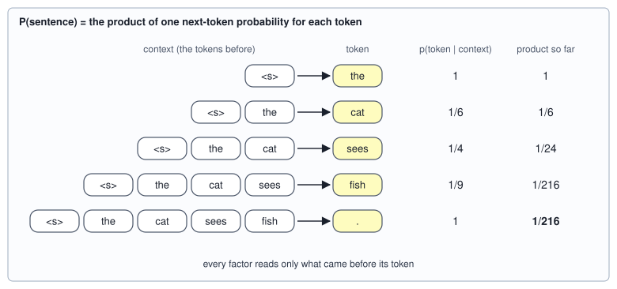
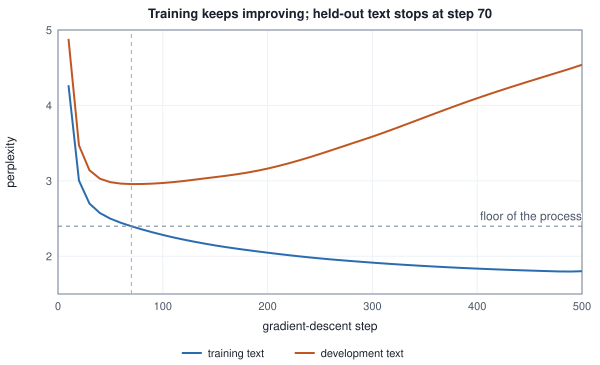
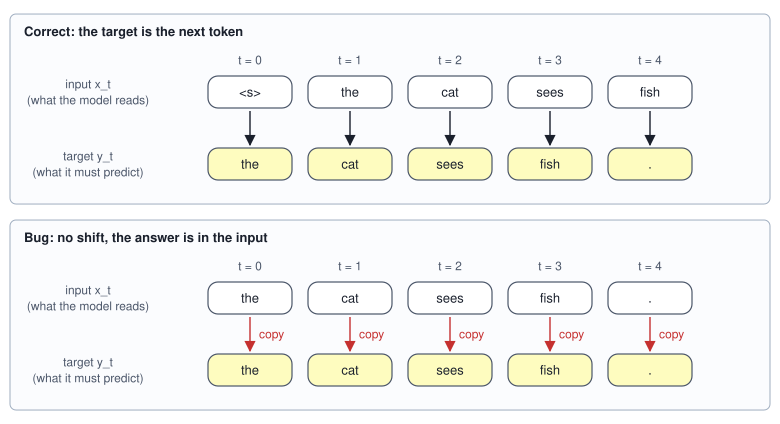

<!-- SPDX-License-Identifier: CC-BY-4.0 -->
<!-- Copyright (c) 2026 Martin Schröder <info@swedishembedded.com> -->

# Language Modeling

*How can predicting the next token teach a model about language?*

In 1951 Claude Shannon showed people a stretch of English, hid the next letter and asked them to guess it, again and again until they were right. How many guesses it took, averaged over a text, told him how much of the text was already given by what came before it, and so how much information each letter really carried. He was measuring a language model: a person's expectation of what comes next, made explicit as a ranking. This chapter is that game played by a machine, and the surprise of it is how far the game goes. A model trained to do nothing else than guess the next token, over and over, on enough text, is the kind of model that later chapters build into something that can talk.

Before a machine can play, two things have to be made exact. A guess has to be a number a loss can score, which is a probability for every token that might come next. And a score for one token has to become a score for a whole text, so that models can be compared and trained on it. The second is an identity of probability that Volume I stated in passing, and the first is the softmax of Volume III. Bring both back, with the other things this chapter will lean on. The answers are at the end of the chapter.

1. (Volume I, [Chapter 10](../v01-mathematics/10-probability.md), conditional probability.) A bag holds 2 red and 3 blue balls and two are drawn one after the other without putting the first back. What is the probability that both are red, written as a product of a probability and a conditional probability?
2. (Volume III, [Chapter 3](../v03-neural-networks/03-softmax.md), softmax and cross-entropy.) Three logits are $(2, 0, 0)$ and the correct class is the first. What probability does the softmax give it, what is the loss, and what is the gradient of the loss with respect to the logits?
3. (Volume I, [Chapter 13](../v01-mathematics/13-information-theory.md), perplexity.) A model's mean cross-entropy on a text is $\ln 3 \approx 1.0986$ nats per token. What is its perplexity, and what does that number mean in words?
4. (Volume V, [Chapter 2](02-tokenization.md), tokens.) A sentence of 19 characters is cut into 5 tokens. How many predictions does a model that guesses one token at a time make for it, and how many if it guessed one character at a time?
5. (Volume V, [Chapter 3](03-embeddings.md), the embedding table.) A table has 19 rows and 6 columns. How many numbers does the lookup of a window of four token ids read, and what does the lookup multiply?

## A language small enough to print

Real text hides the mechanism behind its size, so this chapter works on a language that fits on a page and whose every probability is known. Its sentences have a subject noun, an optional phrase that mentions a second noun, a verb, an optional adjective and an object, and the verb must agree in number with the *subject*. The phrase is the interesting part: in `the cats near the dog see fish .` the noun next to the verb is singular and the verb is plural, and a reader who looks only at the neighbour gets the agreement wrong. Whether a model has learned the rule is a question about how far back it looks.

<!-- worked: language_modeling.corpus -->
Generator: the book's SplitMix64, seed 0x25972b7430409969 (`seed_of` of the name `language_modeling.train`). Dev: seed 0xb7a060fdad01fb9a (`language_modeling.dev`), test: seed 0x651edc95cfcce1df (`language_modeling.test`).

The 18 tokens a model predicts have ids 0 to 17 in this order: 0 `the`, 1 `cat`, 2 `dog`, 3 `fox`, 4 `cats`, 5 `dogs`, 6 `foxes`, 7 `near`, 8 `sees`, 9 `chases`, 10 `see`, 11 `chase`, 12 `big`, 13 `small`, 14 `ball`, 15 `bone`, 16 `fish`, 17 `.`. Id 18, `<s>`, only ever pads the start of a sentence and is never predicted.
A sentence is `the`, a subject noun, optionally `near the` and a second noun, a verb, optionally `big` or `small`, an object noun and `.`. Draw order for each sentence: `integer(6)` picks the subject (cat, dog, fox, cats, dogs, foxes); `integer(2)` is 1 when the phrase `near the <noun>` is present, and then `integer(6)` picks its noun; `integer(2)` picks the verb among the two that agree in number with the *subject* (`sees`/`chases` for the first three nouns, `see`/`chase` for the others); `integer(3)` picks no adjective, `big` or `small`; `integer(3)` picks the object (ball, bone, fish). The training, development and test sets are 40, 20 and 30 sentences from three generators.

The training corpus (292 tokens to predict, one `.` ending each sentence):

     1. the dog near the dog sees ball .
     2. the cats chase fish .
     3. the dogs near the fox chase small fish .
     4. the dogs near the foxes see ball .
     5. the fox chases big fish .
     6. the foxes see big ball .
     7. the foxes near the cat chase bone .
     8. the cats near the dog chase big ball .
     9. the fox chases ball .
    10. the dogs chase fish .
    11. the cat sees small ball .
    12. the cat sees small fish .
    13. the fox sees fish .
    14. the cat near the fox sees ball .
    15. the foxes near the fox see small fish .
    16. the fox near the dogs sees ball .
    17. the dog chases big fish .
    18. the foxes chase ball .
    19. the cat near the dog sees small fish .
    20. the dog near the dog sees small ball .
    21. the foxes see big bone .
    22. the foxes near the cat chase ball .
    23. the cat near the cat chases small fish .
    24. the cat near the fox sees big fish .
    25. the foxes near the fox chase small bone .
    26. the fox chases big bone .
    27. the foxes chase small fish .
    28. the dog sees small ball .
    29. the dogs near the dog chase big ball .
    30. the cats near the dog see big bone .
    31. the fox near the dog chases small bone .
    32. the fox near the foxes chases big ball .
    33. the cats see small ball .
    34. the cats see big ball .
    35. the foxes near the foxes chase fish .
    36. the dog near the dogs sees big ball .
    37. the cats see small bone .
    38. the dog near the fox sees ball .
    39. the cat near the fox sees big fish .
    40. the cat sees fish .

There are 756 sentences in the language. Enumerating them gives the process's own numbers: entropy 6.2712 nats per sentence, 7.1667 tokens per sentence on average, so no model can have a mean loss below 6.2712 / 7.1667 = 0.8750 nats per token on text from this process in the long run (perplexity 2.3990). The training set has 7.300 tokens per sentence, the development set 7.150, the test set 6.833.
<!-- /worked -->

Two things in that block are not decoration. The generator draws are listed in order, so that you can regenerate the corpus in your own language; and the process behind the text is small enough to enumerate. It has 756 sentences, each with a probability that is a product of the fractions of the recipe, and from them come its entropy and its mean length. Their ratio is a floor: on text from this process, no model can have a mean loss per token below it, however clever it is. A model's perplexity can be read against the floor the way a score is read against the best possible score.

Every model in the chapter reads at most the four tokens before the one it predicts. At the start of a sentence there are fewer than four, and the gap is filled with a start marker `<s>`, a token with id 18 that is read and never predicted. The vocabulary has $V = 19$ tokens including it (Chapter 3 counted its own `<s>` the same way), and a model predicts the other $V - 1 = 18$. The end of a sentence is a token too: the full stop is predicted like any other token, and a model that has learned when a sentence ends has learned something a model without it could not say.

## A sentence is a product of guesses

How probable is the sentence `the cat sees fish .`? The language is so small that this has an answer from the recipe alone: the subject is `cat` with probability $1/6$, the optional phrase is absent with probability $1/2$, the verb is `sees` with probability $1/2$, there is no adjective with probability $1/3$ and the object is `fish` with probability $1/3$. The product is $1/216$. A language model will not be given a recipe. It will be given a way to guess the next token, and the question is how a whole sentence's probability can be built from guesses of that kind.

The product rule of Volume I gives it at once. For two events, $P(A \cap B) = P(A)\,P(B \mid A)$, and applying it repeatedly peels one event off at a time, each conditioned on everything peeled before. Write a sentence as the tokens $x_1, \dots, x_T$ after the start marker $x_0$, and let $x_{<t}$ stand for all the tokens before position $t$. Then

$$
P(x_1, \dots, x_T \mid x_0) = \prod_{t=1}^{T} p(x_t \mid x_0, x_1, \dots, x_{t-1}) = \prod_{t=1}^{T} p(x_t \mid x_{<t}).
$$

This is the **autoregressive factorization** of the probability of a sequence: the product, over positions, of the probability of each token given all the tokens before it. "Autoregressive" is regression on itself: each token is predicted from the earlier tokens of the same sequence. The identity is exact, it is not an assumption about language, and it holds for any distribution over sequences. What it buys is a change of the thing to be modeled. A distribution over all sentences is a table with a row for every possible sentence, astronomically many; the factorization needs only the answer to one question, *what comes next, given what came before*, a distribution over $V - 1$ tokens, asked once for each position. Here it is on the sentence above.

<!-- worked: language_modeling.chain_rule -->
Probabilities are exact fractions. The probability of a prefix is the sum of the probabilities of the 756 sentences that begin with it; the conditional is the probability of the longer prefix divided by that of the shorter.

| position | token | given | p(token \| given) | product so far |
|---:|---:|---|---:|---:|
| 1 | `the` | (nothing) | 1 | 1 |
| 2 | `cat` | `the` | 1/6 | 1/6 |
| 3 | `sees` | `the cat` | 1/4 | 1/24 |
| 4 | `fish` | `the cat sees` | 1/9 | 1/216 |
| 5 | `.` | `the cat sees fish` | 1 | 1/216 |

The four tokens `the cat sees fish` have probability 1/216, and adding `.` costs a factor 1. From the generating recipe directly, subject cat (1/6), no phrase (1/2), verb sees (1/2), no adjective (1/3), object fish (1/3): 1/216. The same number: True. Sum of -ln p over the five factors: 5.3753 = ln 216.
<!-- /worked -->



The two routes agree, as they must, and the way they agree is worth a look. The recipe multiplies five numbers that describe *choices*; the chain rule multiplies five numbers that describe *tokens*, and they are different numbers: the factor for `sees` is $1/4$ and not the recipe's $1/2$, because after `the cat` the language may also continue with `near`, so the verb is only one of two ways to go on, and `fish` costs $1/9$ because the adjective and the object are both still open. The chain rule does not need to know how the text was made. It needs only the conditional distribution at each step, which is what a model can estimate from text.

Taking logarithms turns the product into a sum, which is the form a computer wants, since a product of many probabilities underflows long before a sum of their logarithms is troubled (Volume I, Chapter 1):

$$
-\ln P(x_1, \dots, x_T \mid x_0) = \sum_{t=1}^{T} -\ln p(x_t \mid x_{<t}).
$$

The sum is the five numbers of the last column of the block above taken as surprises: $\ln 6 + \ln 4 + \ln 9 = \ln 216 = 5.3753$ nats, and each term is the loss of Volume III's softmax cross-entropy for one position. That is the whole connection between scoring a sentence and training a classifier, and the rest of the chapter is built on it. First, though, a model that uses it.

## Counting what followed what

The simplest way to estimate a distribution over what comes next is to count. Take the training text and write down, for every position, the tokens that came before it and the token that followed. If a context was seen often enough, the proportion of times each token followed it is a fair estimate of the probability of each token following it again. This is the **n-gram model**: it replaces $p(x_t \mid x_{<t})$ by $p(x_t \mid x_{t-n+1}, \dots, x_{t-1})$, the probability given only the last $n - 1$ tokens, which forgets everything earlier, and estimates the replacement by counting. A model of order $n = 1$ is the unigram model, which ignores the context and uses the frequency of each token; $n = 2$ is the bigram model and $n = 3$ the trigram model.

Write $h$ for a context of $n - 1$ tokens and $y$ for a token, and let $c(h, y)$ be the number of positions in the training text where $y$ followed $h$ and $c(h) = \sum_y c(h, y)$ the number of times the context occurred. The estimate is

$$
\hat p(y \mid h) = \frac{c(h, y)}{c(h)}.
$$

That this is the best a model with one free probability for each (context, token) pair can do on the training text follows from the likelihood of Volume II. The training text's likelihood under such a model is $\prod_h \prod_y p(y \mid h)^{c(h, y)}$, and for each context separately one maximizes $\sum_y c(h, y) \ln p(y \mid h)$ with $\sum_y p(y \mid h) = 1$. Setting the derivative to zero with a multiplier $\mu$ gives $c(h, y) / p(y \mid h) = \mu$ for every $y$, so $p(y \mid h)$ is proportional to $c(h, y)$ and the constant is $c(h)$. The maximum-likelihood estimate of a categorical distribution is the relative frequency, the same answer as the coin's heads over flips.

The block below counts on the training corpus. The unigram counts are the frequencies of the tokens; the second table follows a single word through contexts of one to four tokens, so that the way the context narrows the options is visible.

<!-- worked: language_modeling.ngram_counts -->
Counts over the 292 predicted positions of the training corpus. The unigram count of a token is how often it is the target; its estimate is that count divided by 292.

| token | count | estimate |
|---|---:|---:|
| `the` | 62 | 0.2123 |
| `cat` | 11 | 0.0377 |
| `dog` | 13 | 0.0445 |
| `fox` | 14 | 0.0479 |
| `cats` | 6 | 0.0205 |
| `dogs` | 6 | 0.0205 |
| `foxes` | 12 | 0.0411 |
| `near` | 22 | 0.0753 |
| `sees` | 14 | 0.0479 |
| `chases` | 7 | 0.0240 |
| `see` | 8 | 0.0274 |
| `chase` | 11 | 0.0377 |
| `big` | 13 | 0.0445 |
| `small` | 13 | 0.0445 |
| `ball` | 18 | 0.0616 |
| `bone` | 7 | 0.0240 |
| `fish` | 15 | 0.0514 |
| `.` | 40 | 0.1370 |

The estimates for what follows contexts that end in `cat`, with one, two, three and four tokens of context (`<s>` pads the start; every `cat` here is preceded by `the`):

| context | c(context) | `near` | `sees` | `chases` | `see` | `chase` |
|---|---:|---:|---:|---:|---:|---:|
| `cat` | 11 | 5 (0.455) | 3 (0.273) | 1 (0.091) | 0 (0.000) | 2 (0.182) |
| `the cat` | 11 | 5 (0.455) | 3 (0.273) | 1 (0.091) | 0 (0.000) | 2 (0.182) |
| `near the cat` | 3 | 0 (0.000) | 0 (0.000) | 1 (0.333) | 0 (0.000) | 2 (0.667) |
| `foxes near the cat` | 2 | 0 (0.000) | 0 (0.000) | 0 (0.000) | 0 (0.000) | 2 (1.000) |

Each cell is the count c(context, token) with the estimate c(context, token) / c(context) in parentheses; the other tokens never follow these contexts in the training corpus.
<!-- /worked -->

Read the second table from the top. After `cat` alone, a verb in the plural form (`chase`, two times in eleven) is possible, because in the corpus `cat` is sometimes the second noun of a phrase, and the verb after it then agrees with the subject before the phrase. Only the longest contexts know. After `near the cat` the verb is plural in two out of three, and after `foxes near the cat` it is plural all two times in two: the four tokens contain the subject, and the estimate has become certain, from two observations.

Counts also have a failure that shows at once on held-out text. Here is the first sentence of the test set that each bigram estimate can score and some trigram estimate cannot.

<!-- worked: language_modeling.heldout_sentence -->
The held-out sentence is the first sentence of the test set that every bigram estimate can score but some trigram estimate cannot: `the cat sees small bone .` (6 predicted tokens). Maximum-likelihood estimates, count of the token after the context divided by count of the context:

| position | token | unigram | bigram | trigram |
|---|---:|---:|---:|---:|
| 1 | `the` | 62/292 = 0.2123 | 40/40 = 1.0000 | 40/40 = 1.0000 |
| 2 | `cat` | 11/292 = 0.0377 | 11/62 = 0.1774 | 8/40 = 0.2000 |
| 3 | `sees` | 14/292 = 0.0479 | 3/11 = 0.2727 | 3/11 = 0.2727 |
| 4 | `small` | 13/292 = 0.0445 | 5/14 = 0.3571 | 2/3 = 0.6667 |
| 5 | `bone` | 7/292 = 0.0240 | 3/13 = 0.2308 | 0/5 = 0.0000 |
| 6 | `.` | 40/292 = 0.1370 | 7/7 = 1.0000 | 3/3 = 1.0000 |

Probability of the sentence (product of the column): unigram 5.6068e-08, bigram 3.9879e-03, trigram 0.0000e+00. Perplexity (probability to the power -1/6): unigram 16.1639, bigram 2.5112, trigram inf.
<!-- /worked -->

The unigram model scores the sentence as the product of the token frequencies and does badly: its perplexity, the probability of the sentence to the power $-1/T$ (the geometric mean of the probabilities, inverted), is 16.16, close to the 18 of a uniform guess, since it knows no more than how common each word is. The bigram model reads the sentence in a sensible way and its perplexity is 2.51. The trigram model breaks. The context `sees small` occurred five times in the training corpus and was never followed by `bone`, so the estimate is $0/5$, the product of the six factors is exactly 0 and the perplexity is infinite. Nothing in the sentence is wrong. `the cat sees small bone .` is a sentence of the language; the training text happened to have `small ball` and `small fish` after `sees`. A model that gives it probability zero says that the sentence cannot happen, and a loss that contains $-\ln 0$ cannot be trained or compared.

## When a count is zero

The repair is to give some probability to things not yet seen, and the question is how much and taken from where. Two answers have the property that matters: each produces a proper distribution (non-negative numbers summing to 1 over the $V - 1$ tokens that can come next), and neither can give a token probability exactly zero. Collectively such repairs are called smoothing, a name that fits: they smooth the spiky table of counts, where seen things have all the mass and unseen things none.

**Add-$\alpha$ smoothing.** Pretend every token followed every context an extra $\alpha$ times:

$$
\hat p_\alpha(y \mid h) = \frac{c(h, y) + \alpha}{c(h) + \alpha\,(V - 1)}.
$$

The denominator is the sum of the numerators over the $V - 1$ possible $y$, so the probabilities sum to 1. With $\alpha = 1$ this is Laplace's rule of succession (the pseudo-count of Volume II, Chapter 7), and with a smaller $\alpha$ the pretended counts weigh less. A context never seen has $c(h) = 0$ and gets the uniform $1/(V - 1)$, which is a safe guess and a poor one.

**Interpolation with back-off.** A context of four tokens is rarely seen, but its last two tokens, or its last one, usually were. Instead of pretending, borrow from the shorter contexts. For a context $h$ of $n - 1$ tokens write $h_j$ for its last $j$ tokens ($h_0$ is the empty context, whose count is the length of the training text), and let $J(h)$ be the set of $j$ for which $c(h_j) > 0$. Mix the relative frequencies of the contexts that were seen, weighting longer ones more:

$$
p_{\mathrm{ip}}(y \mid h) = \frac{\varepsilon_{\mathrm{unif}}}{V - 1} + (1 - \varepsilon_{\mathrm{unif}}) \sum_{j \in J(h)} \lambda_j \frac{c(h_j, y)}{c(h_j)}, \qquad
\lambda_j = \frac{r_{\mathrm{ip}}^{\,j}}{\sum_{i \in J(h)} r_{\mathrm{ip}}^{\,i}}.
$$

The weights $\lambda_j$ sum to 1 over $J(h)$ and each relative frequency sums to 1 over $y$, so the whole sums to 1; the term $\varepsilon_{\mathrm{unif}}/(V - 1)$ is a small share of the uniform distribution that keeps even a token never seen in any context off zero. A context that was not seen is dropped from the sum, and its weight goes to the others by the normalization: that is the back-off. The ratio $r_{\mathrm{ip}}$ decides how much more a context one token longer is trusted, and here $\varepsilon_{\mathrm{unif}} = 0.01$. The chapter's models in pseudocode:

```text
function training_pairs(sentence: list<int>, window_len: int, bos: int) -> list<(tuple, int)>:
    # the sentence is x_1 ... x_T; each position is a pair (the window_len tokens before it, the token)
    padded = concat([bos for i in 0 .. window_len], sentence)
    pairs = []
    for t in 0 .. len(sentence):
        append (tuple(padded[t : t + window_len]), padded[t + window_len]) to pairs
    return pairs

function p_interp(h: tuple, y: int, c_joint: map<(tuple, int), int>, c_ctx: map<tuple, int>,
                  r_ip: real, eps_unif: real, v_pred: int) -> real:
    # c_ctx holds the contexts seen at least once; c_joint[(hj, y)] counts y after hj; v_pred = V - 1
    num = 0.0
    den = 0.0
    for j in 0 ..= len(h):
        hj = h[len(h) - j : len(h)]                        # the last j tokens of h (empty for j = 0)
        if hj in c_ctx:
            w = r_ip ^ j
            num = num + w * get(c_joint, (hj, y), 0) / c_ctx[hj]
            den = den + w
    return eps_unif / v_pred + (1.0 - eps_unif) * num / den
```

For the order-3 model, `h` has two tokens. The counts `c_joint` and `c_ctx` are kept for every context length from 0 to 4 as the training pairs are read, and add-$\alpha$ is the one-line formula above. The values of $\alpha$ and $r_{\mathrm{ip}}$ are not guessed; they are chosen on a separate **development set** (the validation set of Volume II) of 20 sentences from a separate generator, by trying a short grid and keeping the value with the lowest perplexity there, so that the test set is touched only once, at the end. The grid and the development perplexities of the models of order 2, 3 and 5:

<!-- worked: language_modeling.smoothing -->
Perplexity on the 20-sentence development set (143 predicted tokens) of the models of order 2, 3 and 5 trained on the printed corpus. The star marks the setting with the lowest development perplexity for that order. The uniform weight of the interpolated models is 0.01, The model predicts V - 1 = 18 tokens (`<s>` is never predicted).

| estimate | order 2 | order 3 | order 5 |
|---|---:|---:|---:|
| maximum likelihood | inf | inf | inf |
| add-alpha, alpha = 1.0 | 4.566 | 6.377 | 7.949 |
| add-alpha, alpha = 0.3 | 3.502 | 4.779 | 6.437 |
| add-alpha, alpha = 0.1 | 3.195 | 4.225 * | 5.929 * |
| add-alpha, alpha = 0.03 | 3.184 * | 4.251 | 6.136 |
| add-alpha, alpha = 0.01 | 3.296 | 4.612 | 6.826 |
| interpolated, r_ip = 1 | 4.798 | 4.093 | 3.777 * |
| interpolated, r_ip = 2 | 4.019 | 3.610 | 3.837 |
| interpolated, r_ip = 4 | 3.605 | 3.586 * | 4.629 |
| interpolated, r_ip = 8 | 3.419 * | 3.766 | 5.568 |
<!-- /worked -->

Two things in the table are worth stopping at. The maximum-likelihood row is infinite for every order, even the bigram: the development set already contains a bigram that the 40 training sentences never showed, so a pure count cannot be evaluated on new text at all. And the two repairs prefer different settings at different orders. Add-$\alpha$ wants a small $\alpha$ at order 2 and a larger one at order 5, where most contexts are unseen and, plausibly, the uniform fallback is the right amount of caution, while interpolation wants a large ratio (trust the longest context) at order 2 and a ratio of 1 (trust all lengths alike) at order 5. The order-2 interpolation's best ratio, 8, is the last value of the grid, so a larger one might do better; nothing else in the chapter depends on it.

<!-- worked: language_modeling.heldout_repair -->
The same sentence, `the cat sees small bone .`, under the trigram model repaired two ways, with alpha = 0.1 and r_ip = 4 (both chosen on the development set, table above):

| position | token | c/c trigram | MLE | add-alpha, alpha = 0.1 | interpolated, r_ip = 4 |
|---|---:|---:|---:|---:|---:|
| 1 | `the` | 40/40 | 1.0000 | 0.9593 | 0.9534 |
| 2 | `cat` | 8/40 | 0.2000 | 0.1938 | 0.1866 |
| 3 | `sees` | 3/11 | 0.2727 | 0.2422 | 0.2600 |
| 4 | `small` | 2/3 | 0.6667 | 0.4375 | 0.5729 |
| 5 | `bone` | 0/5 | 0.0000 | 0.0147 | 0.0452 |
| 6 | `.` | 3/3 | 1.0000 | 0.6458 | 0.9499 |

Probability of the sentence: MLE 0.0000e+00, add-alpha 1.8708e-04, interpolated 1.1378e-03. Perplexity: MLE inf, add-alpha 4.1815, interpolated 3.0950.
<!-- /worked -->

Add-$\alpha$ gives the unseen `bone` 0.0147 and pays for it elsewhere: the full stop after `small bone`, which ended all three sentences that contained that context, falls from 1.0000 to 0.6458, because $\alpha (V - 1) = 1.8$ pretended counts are spread over 18 tokens next to a context seen only three times. Interpolation gives `bone` 0.0452 and keeps the full stop at 0.9499, because it moves mass toward the shorter contexts, and they agree with the long one that a sentence ends there. On this one sentence interpolation wins, a perplexity of 3.09 against 4.18. Over a whole text the comparison is closer, as the next section shows.

## More context, fewer counts

The language has a rule that only a long context can express: the verb agrees with the subject across the phrase, four tokens back. A bigram model cannot know it. An order-5 model, with a context of four tokens, can. So more context ought to help, and the counts of the training corpus are about to say otherwise. How many different contexts could the model be asked about? With $V = 19$ tokens that can sit in a context of $n - 1$ places, there are $19^{n-1}$ of them, each followed by one of the 18 predicted tokens: 342 bigrams, 6,498 trigrams, 123,462 four-grams and 2,345,778 five-grams. A corpus of 292 positions cannot visit them all. The question is how many it needs to.

<!-- worked: language_modeling.sparsity -->
An n-gram is a context of n - 1 tokens and the token after it (`<s>` may fill the context at the start). Possible: V^(n-1) = 19^(n-1) contexts times the V - 1 = 18 tokens that can follow. 'In the language' counts the distinct n-grams of the 756 sentences, 'in training' those of the 40 printed sentences. The last two columns are shares of the 205 test positions whose n-gram, or whose context alone, never occurs in training.

| n | possible | in the language | in training | test n-grams unseen | test contexts unseen |
|---|---:|---:|---:|---:|---:|
| 1 | 18 | 18 | 18 | 0.0% | 0.0% |
| 2 | 342 | 67 | 56 | 4.9% | 0.0% |
| 3 | 6,498 | 211 | 102 | 17.1% | 4.9% |
| 4 | 123,462 | 451 | 141 | 28.8% | 14.6% |
| 5 | 2,345,778 | 679 | 153 | 36.1% | 21.5% |
<!-- /worked -->

The language itself is sparse inside this space: it uses 679 of the 2.3 million five-grams, because its grammar permits so few. Even so, the 40 training sentences contain 153 of those 679, fewer than a quarter, and more than a third of the positions of a fresh text (36.1%) end in a five-gram the corpus never showed; a fifth of them (21.5%) have a four-token context it never showed at all. The possible grows by a factor of 19 with each token of context, the number of distinct n-grams actually seen by a factor that falls from 1.8 to 1.1, and the share of new text that falls outside what was seen goes from 0% to 36%. That is the **curse of sparsity** of counting models, a cousin of the curse of dimensionality of Volume II, Chapter 7: the more context a count conditions on, the less data each count has.

The perplexities show what it does to the models. Every unsmoothed estimate from order 2 on is infinite on the test set, so the figure plots the two repairs, each with the setting chosen on the development set.

<!-- worked: language_modeling.perplexity_by_order -->
Test perplexity (30 sentences, 205 predicted tokens) of the n-gram models trained on the printed corpus; alpha and the ratio are the development-set choices of the previous table.

| order n | maximum likelihood | add-alpha | interpolated |
|---|---:|---:|---:|
| 1 | 15.055 | 14.966 (alpha = 1.0) | 15.037 (ratio 1) |
| 2 | inf | 3.401 (alpha = 0.03) | 3.647 (ratio 8) |
| 3 | inf | 4.554 (alpha = 0.1) | 3.833 (ratio 4) |
| 4 | inf | 5.374 (alpha = 0.1) | 3.834 (ratio 2) |
| 5 | inf | 5.956 (alpha = 0.1) | 3.984 (ratio 1) |

For comparison, the process that generated the text, scored with its own exact probabilities, has perplexity 2.460 on this test set (the long-run floor is 2.399); a model that ignores the context entirely and guesses uniformly among the 18 tokens has perplexity 18.
<!-- /worked -->


Add-$\alpha$ gets steadily worse with every token of context, from 3.40 at order 2 to 5.96 at order 5: the contexts grow rarer, more estimates fall back on the uniform guess, and extra information the long context could give is lost. Interpolation stays between 3.65 and 3.98, because a missing long context hands its weight to a shorter one, but it does not improve either. Neither repair reaches the 3.19 of the network, drawn as a horizontal line, nor the floor of the process below it (2.40 in the long run, 2.46 on this test set). Smoothing does not conjure data. Chen and Goodman (1999) compared the standard methods on large corpora, and the careful ones do better than these two, by discounting the counts with more care; they all share the limit, that a context that has not been seen is a context about which the model has nothing to say.

What is wanted is a model in which seeing `foxes near the cat chase` teaches something about `dogs near the cat chase`, so that a context need not recur to be informative. A table of counts cannot do that, since each of its entries is separate. A network can, and the rest of the chapter builds one. Before it, the objective needs to be written down, because the counts have so far been fitted by a formula and the network will be fitted by a loss.

## The loss of a language model is the length-normalized log-likelihood

A counting model is fitted by one rule, the relative frequency. A network has no such rule, only a loss to descend. Which loss? The factorization already says: a model $p_\theta(x_t \mid x_{<t})$ assigns the training text a probability, and the best parameters are those under which the text is least surprising. That is maximum likelihood, and by the log of the factorization it is a sum over positions of the cross-entropy of Volume III. **Next-token prediction** is this objective: train a model to give high probability to each token of a text given the tokens before it, with the loss the mean cross-entropy over all positions,

$$
\mathcal{L}(\theta) = \frac{1}{N} \sum_{\text{positions}} -\ln p_\theta(x_t \mid x_{<t}) = \frac{\mathrm{NLL}(\theta)}{N},
$$

where $N$ is the number of positions in the training text (292 for the printed corpus) and $\mathrm{NLL}$ is the negative log-likelihood of the whole text under the factorization. The two forms are the same by the log of the chain rule, so the average of the per-position cross-entropies of a classifier *is* the negative log-likelihood of the sequence divided by its length. Exponentiating, $\exp \mathcal{L}$ is the perplexity of Volume I: the geometric mean of the inverse probabilities, "as uncertain as a choice among that many equally likely tokens". Nothing is labelled by a person. Every position has a correct answer, the token that is in fact next, and the text supplies it, which is why the objective can be applied to as much text as there is.

The identity can be checked on one sentence and on a text.

<!-- worked: language_modeling.nll_identity -->
The trigram model interpolated with ratio 4 (trained on the printed corpus), on the first test sentence `the dog chases big bone .`. Its probability of each token and the cross-entropy of that position, -ln p:

| position | token | p(token \| context) | -ln p |
|---|---:|---:|---:|
| 1 | `the` | 0.9534 | 0.0477 |
| 2 | `dog` | 0.1553 | 1.8622 |
| 3 | `chases` | 0.1467 | 1.9191 |
| 4 | `big` | 0.4876 | 0.7184 |
| 5 | `bone` | 0.2338 | 1.4534 |
| 6 | `.` | 0.9499 | 0.0514 |

Mean over the 6 positions: 1.008690. Product of the 6 probabilities: 2.352828e-03, so -ln P(sentence) / 6 = 1.008690. Perplexity exp(mean) = 2.7420 = P(sentence)^(-1/6) = 2.7420.

On the whole test set the perplexity is exp(total -ln p / total tokens) = 3.8333. The mean of the 30 sentence perplexities is 4.0638, a different number because every sentence counts once whatever its length.
<!-- /worked -->

Three numbers on one line: the mean of the six per-position losses, minus the log of the sentence's probability divided by six, and the log of its perplexity. They are the same number, 1.0087, computed three ways. The last paragraph of the block is a trap in waiting. The perplexity of a text is the exponential of the *token-weighted* mean loss, $\exp$(total $-\ln p$ / total tokens), 3.83 here; the mean of the sentences' own perplexities is 4.06, which weighs a two-token sentence as heavily as a nine-token one and is not the perplexity of anything. A reported perplexity is always a statement about a fixed set of positions and a fixed tokenization: perplexity per token of a model with 150,000 tokens and per token of one with 50,000 are not comparable, because the sentence the first reads in 10 tokens the second may read in 14.

The floor of the corpus gives the loss a scale. For text from this process the mean loss per token cannot go below $6.2712 / 7.1667 = 0.8750$ nats, because the cross-entropy of any model against the process is at least the process's entropy (the non-negativity of the KL divergence of Volume I, Chapter 13), and a perplexity of $\exp 0.8750 = 2.40$ is the best a model can do. Everything between 2.40 and the 18 of a uniform guess is what there is to learn, and a loss below the floor means that the model has been told the answer. The point returns near the end of the chapter, where a bug does exactly that.

## Teacher forcing: one sentence, many examples

The objective sums over positions, and each term needs the model's distribution at that position given the true tokens before it. To train, one does not have the model generate and wait for it; one supplies the real prefix. **Teacher forcing** is training a sequence model on each position with the true previous tokens as its context, whatever the model would have predicted for them. The model is a student asked the next question of a worked example, and always handed the correct earlier lines.

Two consequences follow, and both are used everywhere after this chapter. The first is the number of examples: a sentence of $T$ tokens gives $T$ training pairs, one per token, and since each pair's context comes from the data and not from the model's other outputs, they are independent computations that a machine can do at once.

<!-- worked: language_modeling.teacher_forcing -->
The sentence `the cat sees fish .` with `<s>` in front is the sequence s_0 ... s_5. The inputs are x_t = s_t and the targets y_t = s_(t+1) for t = 0 ... 4. The last column is the window of the four tokens up to and including x_t that the network of this chapter reads, padded on the left with `<s>`:

| t | input x_t | target y_t | window read |
|---:|---|---|---|
| 0 | `<s>` | `the` | `<s> <s> <s> <s>` |
| 1 | `the` | `cat` | `<s> <s> <s> the` |
| 2 | `cat` | `sees` | `<s> <s> the cat` |
| 3 | `sees` | `fish` | `<s> the cat sees` |
| 4 | `fish` | `.` | `the cat sees fish` |

One pass over this sentence yields 5 training pairs, one for each of its tokens. The printed corpus of 40 sentences yields 292.
<!-- /worked -->

The second is the loss. With true prefixes the sum of per-position terms is exactly the negative log-likelihood of the text, with no approximation, which is what makes the objective maximum likelihood.

Teacher forcing has a cost that does not show in training. When the model *generates* text there is no teacher: its context is made of its own earlier samples. Training never presented it with a context that contains one of its own mistakes, and a sample is sure to contain some. This mismatch between the contexts of training and the contexts of generation is called **exposure bias**: the model is exposed during training only to the distribution of the data, not to the distribution of its own outputs. How much damage it does in large models is a matter of debate and this chapter does not settle it. What the toy can do is count the difference it makes in the contexts, in the section on generation below.

## A network that reads a window

To share what is learned about `cat` with what is learned about `dog`, the model must compute its probabilities from the tokens instead of looking them up. The simplest such model, in the shape Bengio, Ducharme, Vincent and Jauvin gave it in 2003, uses the pieces of earlier chapters: look up each of the last four tokens in an embedding table, put the four rows side by side, pass them through one hidden layer and score the 18 possible next tokens with a softmax. Written out, with $D = 6$, $H = 12$ and $\mathbf{W}_{\mathrm{emb}}$ of shape $[19, 6]$, for a position whose context is the tokens $u_1, u_2, u_3, u_4$:

$$
\mathbf{x} = \big(\mathbf{W}_{\mathrm{emb}}[u_1, :],\ \mathbf{W}_{\mathrm{emb}}[u_2, :],\ \mathbf{W}_{\mathrm{emb}}[u_3, :],\ \mathbf{W}_{\mathrm{emb}}[u_4, :]\big),\quad
\mathbf{a} = \tanh(\mathbf{W}_1 \mathbf{x} + \mathbf{b}_1),\quad
\mathbf{p} = \mathrm{softmax}(\mathbf{W}_2 \mathbf{a} + \mathbf{b}_2),
$$

with $\mathbf{x}$ of length 24, $\mathbf{W}_1$ of shape $[12, 24]$ and $\mathbf{W}_2$ of shape $[18, 12]$. The loss is the mean of $-\ln p_y$ over the training pairs, the gradient into the logits is $(\mathbf{p} - \mathbf{e}_y)/N$ as in Volume III, and the backward pass is that of a two-layer network (Chapter 4 of that volume) with one addition from this volume: the gradient of $\mathbf{x}$ is cut into its four pieces, and each is added into the row of the table that was looked up (Chapter 3's scatter-add), so that a token that appears in two of the four slots receives both.

```text
function window_forward(window: tuple, E: array<real>[19, D], W1: array<real>[H, 4 * D], b1: array<real>[H],
                        W2: array<real>[18, H], b2: array<real>[18]) -> array<real>[18]:
    require len(window) == 4 and every window[p] in 0 .. 18
    x = zeros(real, [4 * D])
    for p in 0 .. 4:
        for j in 0 .. D:
            x[p * D + j] = E[window[p], j]                 # the four rows side by side
    a = [tanh(dot(W1[i, :], x) + b1[i]) for i in 0 .. H]
    z = [dot(W2[v, :], a) + b2[v] for v in 0 .. 18]
    return softmax(z)
```

The network has 648 parameters and the training set has 292 positions, which is a recipe for overfitting, and the chapter treats it as one: the development set decides when to stop (early stopping, Volume III, Chapter 11). Training is full-batch gradient descent, so every position is used in every step and the run is deterministic given the seed.

<!-- worked: language_modeling.mlp_training -->
Generator: the book's SplitMix64, seed 0x571098f696968b8f (`seed_of` of the name `language_modeling.mlp`).
Model: the last 4 tokens (ids 0 to 18, `<s>` padding the start) are looked up in an embedding table of V = 19 rows and D = 6 columns and concatenated into a vector of 24 numbers; a layer of H = 12 tanh units (the correctly rounded library `tanh`) with weights W1 of shape [12, 24] and bias b1; and an output layer W2 of shape [18, 12] with bias b2 whose softmax is the distribution over the V - 1 = 18 predicted tokens. Loss: the mean of -ln p(target) over all training pairs. Start: E entries `0.5 * rng.normal()` row by row (the 19 x 6 entries first), then W1 entries `rng.normal() / sqrt(24)` row by row, then W2 entries `rng.normal() / sqrt(12)` row by row; both biases start at 0. That is 648 parameters. Training: full-batch gradient descent, learning rate 1.0, 500 steps on the 292 training pairs of the printed corpus, dev perplexity recorded every 10 steps; the parameters of the recorded step with the lowest dev perplexity are kept (early stopping).

| step | train perplexity | dev perplexity |  |
|---:|---:|---:|---|
| 0 | 16.438 | 17.175 |  |
| 10 | 4.268 | 4.883 |  |
| 20 | 3.004 | 3.470 |  |
| 50 | 2.498 | 2.983 |  |
| 70 | 2.398 | 2.957 | <- lowest dev |
| 100 | 2.283 | 2.972 |  |
| 200 | 2.048 | 3.163 |  |
| 300 | 1.916 | 3.586 |  |
| 500 | 1.802 | 4.539 |  |

The kept network (step 70) has test perplexity 3.188.
<!-- /worked -->



The picture is the generalization gap of Volume II in a language model. Training perplexity falls from 16.4 at step 0, to 2.40 at step 70 and to 1.80 at step 500, below the process's floor of 2.40: the network has begun to remember the 40 sentences rather than learn the rule that produced them. The development perplexity, which is a fair estimate because no gradient has touched those sentences, bottoms out at step 70 and then rises, to 4.54 by step 500. The kept network is the one at the bottom. How does it compare with the counting models?

<!-- worked: language_modeling.comparison -->
Test perplexity on the 30 test sentences (205 predicted tokens) of every model trained on the 40 printed sentences. 'Stored' is the number of distinct (context, token) entries a counting model keeps, or the number of parameters of the network.

| model | stored | test perplexity |
|---|---:|---:|
| uniform guess over 18 tokens | 0 | 18 |
| unigram, add-alpha | 18 | 14.966 |
| order 2, add-alpha (alpha = 0.03) | 56 | 3.401 |
| order 2, interpolated (ratio 8) | 56 | 3.647 |
| order 3, add-alpha (alpha = 0.1) | 102 | 4.554 |
| order 3, interpolated (ratio 4) | 102 | 3.833 |
| order 5, add-alpha (alpha = 0.1) | 153 | 5.956 |
| order 5, interpolated (ratio 1) | 153 | 3.984 |
| network, window of 4, 40 sentences (step 70) | 648 | 3.188 |
| the process itself | - | 2.460 |
<!-- /worked -->

On 40 sentences the network is better than the counting models, 3.19 against 3.40 for the best of them, but not by much, and with more stored numbers than any of them. The advantage that the sharing of parameters ought to bring needs data to be seen, and the experiment that shows it changes only the size of the training set. Each row below draws the first $n$ sentences of the training generator, chooses the counting models' settings and the network's stopping step again, and scores the same test set.

<!-- worked: language_modeling.data_size -->
The training set is the first n sentences of the printed generator's stream (the 40 printed sentences are the first 40 of the 320; draws are made in the order already given, so a larger set extends a smaller one). Everything else is as before: the settings of the counting models are chosen again on the development set for each size (order 2 uses add-alpha, orders 3 and 5 interpolation), the network starts from the same seed, trains for 500 steps at learning rate 1.0 and is stopped at its lowest development perplexity. Test perplexity, same test set:

| sentences | training pairs | order 2 | order 3 | order 5 | network |
|---|---:|---:|---:|---:|---:|
| 20 | 140 | 4.293 | 5.257 | 5.269 | 3.753 (step 50) |
| 40 | 292 | 3.401 | 3.833 | 3.984 | 3.188 (step 70) |
| 80 | 573 | 2.942 | 3.379 | 3.360 | 2.698 (step 180) |
| 160 | 1,156 | 2.911 | 3.374 | 3.244 | 2.587 (step 280) |
| 320 | 2,316 | 2.834 | 3.043 | 3.031 | 2.533 (step 480) |

The process floor is 2.399 in the long run.
<!-- /worked -->

Both families improve with data and the network is ahead at every size. The gap does not close the way a bigger smoothing constant would close it: at 320 sentences the best counting model is at 2.83 (order 2) and the network at 2.53, with the process at 2.46 on this test set. At 80 training sentences the network, at 2.70, is already better than every counting model is at 320, which is a factor of four in data, and at 160 it is within 0.13 of the process. The preceding table also shows when the network needs the data: its stopping step goes from 50 to 480 as the set grows, since a larger set takes longer to memorize and the early-stopping point moves with it.

## Position $t$ sees only tokens before it

Every model so far has been causal by construction, in the sense that matters for this chapter: the probability it gives to a token depends only on the tokens before it. A window of the previous four tokens cannot contain the next one. A **causal language model** is a model of this kind: one whose output at position $t$ is computed from the tokens at positions up to $t$ and gives the distribution of the token at position $t + 1$; its probability for a whole sequence is then the product of the factorization, a genuine distribution that can be both scored and sampled from. The constraint is not a convenience. A model that could read the token it is asked to predict has no need to model anything, and its "probabilities" multiplied together are not the probability of a sequence, since they would not sum to 1 over sequences.

For a model that reads a whole sequence at once, as every model of the later chapters does, the constraint has to be enforced, and the enforcement has a concrete form in the data: shift the targets by one. Write the padded sentence as $x_0, x_1, \dots, x_T$ with $x_0$ the start marker. The input at row $t$ is $x_t$ and the target at row $t$ is $x_{t+1}$, for $t = 0, \dots, T - 1$: the target array is the input array moved one place to the left.



The picture's second panel is the bug of leaving out the shift: use the same sequence for both. Nothing complains. The shapes match, the loss is finite and decreases, and the model is learning the identity. To see the symptom, train the network of the last section with windows that run one position too far, so that the last token of a window is the answer.

<!-- worked: language_modeling.shift_bug -->
The network of the chapter (same start, same 1.0 learning rate, full batch, trained on the printed corpus) with the windows shifted one position too far: the window for target s_(t+1) is s_(t-2) ... s_(t+1), so its last token is the answer. Perplexity of the training pairs, of the development pairs built the same wrong way, and of the development text with correct windows (the evaluation the model is for):

| step | train, shifted | dev, shifted | dev, correct windows |
|---|---:|---:|---:|
| 0 | 20.053 | 19.912 | 17.2 |
| 25 | 1.674 | 1.806 | 158.3 |
| 50 | 1.221 | 1.284 | 532.3 |
| 100 | 1.065 | 1.103 | 1870.5 |
| 200 | 1.023 | 1.051 | 5579.7 |

The process floor is 2.399. A perplexity of 1.05 on text with 2.40 of irreducible uncertainty is not a good model but a leak.

Replace the token `sees` (index 2) of `the cat sees fish .` by `see` and count the positions (the rows t of the teacher-forcing table, 0 to 4) whose output distribution changes:

| model | positions whose output changes |
|---|---|
| correct window | 3, 4 |
| shifted window | 2, 3, 4 |
<!-- /worked -->

The model trains well. Its training perplexity is 1.02 at step 200, below the floor of 2.40, and the development perplexity computed the same wrong way is 1.05, below the floor too, so the held-out number the pipeline itself reports confirms the bug rather than catching it. When the same weights are evaluated with the correct windows, the perplexity is 5,579.7, 310 times that of a uniform guess: the network had learned to copy the last token of its window and has nothing else. Two checks catch it. A loss below the floor of the data (or below anything a counting model reaches on the same text) is not a good model but a leak. And the perturbation test of the last table: replace one input token and see which outputs change. In a causal model the outputs before the change cannot move. Replacing `sees` at index 2 of the sentence changes the outputs at rows 3 and 4 of the correct window, which are the rows that read it; in the shifted version it changes row 2 too, the row whose answer *is* `sees`.

The test generalizes, and in brain it caught a real shift (the last section tells it). It also gives a clean way to state causality for any architecture: the Jacobian of the output at row $t$ with respect to the input at row $s$ is zero for every $s > t$. A recurrent network (the next chapter) satisfies it by the order in which it reads, and the masked attention of Chapter 7 will satisfy it with a mask, but the data shift is the same for all of them.

## What the network learned

The perplexities say that the network is better, not what it knows. For this language there is a direct question: after the subject and the phrase, does the model pick a verb that agrees with the subject? The table gives the probability of the two singular verbs as a share of the probability of all four verbs, in four contexts, for the models of the sampling section below and for the process, which is exactly 1 or 0.

<!-- worked: language_modeling.contrast -->
The probability of the singular verbs `sees` and `chases`, as a share of the probability of all four verbs, after four contexts, for the models of the sampling block (the process column is exact, from the enumeration of the 756 sentences):

| context | process | order 2 interpolated, r_ip = 8 | order 5 interpolated, r_ip = 1 | network, 40 sentences | network, 160 sentences |
|---|---:|---:|---:|---:|---:|
| `the cat` | 1.000 | 0.662 | 0.782 | 0.469 | 0.948 |
| `the dogs` | 0.000 | 0.661 | 0.452 | 0.380 | 0.038 |
| `the cat near the dogs` | 1.000 | 0.661 | 0.812 | 0.435 | 0.953 |
| `the dogs near the cat` | 0.000 | 0.662 | 0.508 | 0.469 | 0.022 |
<!-- /worked -->

The counting models do not know the rule. The order-2 model gives about two thirds to the singular verbs in all four contexts, so its answer does not depend on the number of the subject. The order-5 model, which could in principle know, is half right: 0.78 and 0.81 after singular subjects, where 1 is right, and 0.45 and 0.51 after plural ones, where 0 is right, because the 40-sentence corpus holds only a handful of contexts with the whole four-token window. The network trained on the 40 printed sentences is not better, at 0.38 to 0.47. The network trained on 160 sentences has the rule: 0.95 after `the cat`, 0.04 after `the dogs`, and, the part that needs the whole window, 0.95 after `the cat near the dogs` and 0.02 after `the dogs near the cat`, where the nearest noun votes the other way. It has learned to look back across three tokens and to ignore the noun that is closest.

What changed inside it, at least in the table of Chapter 3? The embedding rows of the nouns came to carry number.

<!-- worked: language_modeling.noun_geometry -->
Mean cosine similarity of the rows of the embedding table (the cosine of Volume I, Chapter 3) for the six nouns cat, dog, fox and cats, dogs, foxes, over the pairs of each kind, for the early-stopped networks trained on 40 and on 160 sentences:

| pairs of | 40 sentences | 160 sentences |
|---|---:|---:|
| two singular nouns (3 pairs) | 0.057 | 0.643 |
| two plural nouns (3 pairs) | 0.022 | 0.853 |
| a singular and a plural noun (9 pairs) | -0.210 | -0.670 |
<!-- /worked -->

With 40 sentences the nouns are scattered (similarities near zero, a little negative across number); with 160 the singular nouns have grouped together and the plural ones too, and the two groups lie on opposite sides (-0.67). The distributional hypothesis of the last chapter is at work, and the mechanism is now visible in a way the earlier chapter could only hint at: what the first layer needs of a noun is its number, so training pushes `cat`, `dog` and `fox` toward one direction and the plurals toward the other, and a rule about `cat` is thereby also a rule about `fox`.

## Sampling from a model, and the contexts it meets

A language model is also a generator. Start from the start marker, draw the first token from the model's distribution, append it to the context, draw the next and continue until the full stop. Each draw uses one uniform number: lay the 18 probabilities end to end on the interval $[0, 1)$ in the order of the ids and take the token whose segment contains the number. This is where the chain rule runs forward instead of being multiplied: the sampled sentence has exactly the probability that the factorization gives it.

<!-- worked: language_modeling.sampling -->
Each model draws 200 sentences. Generator: the book's SplitMix64, one generator per model, with the seeds 0x5554ffa586ea3a43 (`language_modeling.sample.ngram2`, order 2 interpolated, r_ip = 8), 0x4d55b5e713320a5a (`language_modeling.sample.ngram5`, order 5 interpolated, r_ip = 1), 0xc5cc966ee5aad1df (`language_modeling.sample.net40`, network, 40 sentences), 0x04f1e10f7331346a (`language_modeling.sample.net160`, network, 160 sentences). A sentence starts from four `<s>` tokens; for each token one `uniform()` is drawn and the token is the first id (0 to 17) whose cumulative probability exceeds it; the sentence ends at `.` or after 12 tokens. The models are those of the previous tables (counts from the printed corpus, interpolation settings chosen on the development set), and the networks of the training blocks, stopped at their lowest development perplexity.

The first three sentences of each model:

- order 2 interpolated, r_ip = 8: the dog sees big fish . | the fox . | the dog near the dogs near the foxes the dog sees the
- order 5 interpolated, r_ip = 1: the dog chases ball sees big fish . | near the dog dog near the cat foxes . | the foxes chases big dog the cat near the fox .
- network, 40 sentences: the foxes see ball . | the fox fox small bone . | the dog chases ball .
- network, 160 sentences: the dog near the dog sees small fish . | the dogs chase fish . | the cats cat big bone .

'Accepted' is the share of sentences that the grammar accepts: the right shape and a verb that agrees with the subject. The next two columns split the sentences into those without and with the phrase `near the ...`. 'Unseen contexts' is the share of the positions whose last four tokens never occurred in the model's training text, among the sampled positions and among the positions of the real test text.

| model | accepted | without phrase | with phrase | unseen, samples | unseen, test text |
|---|---:|---:|---:|---:|---:|
| order 2 interpolated, r_ip = 8 | 31.0% | 55/144 | 7/56 | 37.0% | 21.5% |
| order 5 interpolated, r_ip = 1 | 26.0% | 47/123 | 5/77 | 36.4% | 21.5% |
| network, 40 sentences | 48.0% | 50/101 | 46/99 | 27.8% | 21.5% |
| network, 160 sentences | 90.0% | 97/106 | 83/94 | 11.1% | 11.7% |
<!-- /worked -->

The samples show the models in a way the perplexities do not. The order-2 model writes `the fox .` and `the dog near the dogs near the foxes the dog sees the`: every neighbouring pair is fine and nothing else is, and the grammar accepts 31.0% of its sentences. The order-5 model is no better (26.0%), and the part that its longer context was for, the sentences with the phrase, goes wrong in 72 of 77 (5/77 accepted). The network trained on 40 sentences accepts 48.0%, and has not learned the phrase either (46 of 99). The network trained on 160 sentences accepts 90.0%: 83 of 94 sentences with the phrase have a verb that agrees with the subject, not the nearest noun. It still makes mistakes (`the cats cat big bone .`), and it makes them on the structure and not on the rule it learned.

The last two columns are the exposure bias of the teacher forcing section, measured. A weak model's own samples visit contexts that its training set never contained far more often than real text does: 37.0% and 36.4% of the positions of the counting models' samples have a four-token context absent from the 40 training sentences, against 21.5% for the held-out text, and 27.8% for the network trained on the same sentences. The better a model gets, the more the gap closes: the 160-sentence network's samples visit unseen contexts at 11.1% against 11.7% for real text. This is a measurement of the contexts and not of the harm, which depends on what the model does in a context it has not seen; for a table of counts that is a fall-back to a shorter context, and for a network it is whatever the smooth function does there. Whether the harm compounds over long generations, as the usual statement of the problem says, this toy, with sentences of at most nine tokens, cannot show.

## What the objective costs

The counting models were cheap: five additions to a table for each training position, once. The network pays for what it shares, and it is worth counting, as every cost in this book is, in arithmetic.

<!-- worked: language_modeling.work -->
Multiply-adds of the forward pass of one position: the first layer 12 x 24 = 288 and the output layer 18 x 12 = 216, in all 504, which is 1008 FLOPs (two per multiply-add; the 4 embedding lookups, the 12 tanh and the 18 exponentials of the softmax are not counted); the output layer is 216 of the 504. The backward pass of a layer costs two products of the forward's size (one for the weights, one for the input), so a training position costs 3 x 1008 = 3,024 FLOPs = 6 x 504. A training run is that times the positions of the set times the steps; the counting models need 5 additions to a table for each position, once.

| sentences | training pairs | positions seen in 500 steps | training FLOPs, 500 steps | kept step | FLOPs to the kept step | counting additions |
|---|---:|---:|---:|---:|---:|---:|
| 20 | 140 | 70,000 | 211,680,000 | 50 | 21,168,000 | 700 |
| 40 | 292 | 146,000 | 441,504,000 | 70 | 61,810,560 | 1,460 |
| 80 | 573 | 286,500 | 866,376,000 | 180 | 311,895,360 | 2,865 |
| 160 | 1,156 | 578,000 | 1,747,872,000 | 280 | 978,808,320 | 5,780 |
| 320 | 2,316 | 1,158,000 | 3,501,792,000 | 480 | 3,361,720,320 | 11,580 |

With a vocabulary of 151,936 tokens and a model width of 1,024 (the Qwen3 0.6B shape of Chapter 3) the output layer alone is 151,936 x 1,024 = 155,582,464 multiply-adds, 311,164,928 FLOPs forward, for every position. A model with P weights in dense layers trained on D positions needs about 6 P D FLOPs: P = 10^9 and D = 10^12 give 6.0e+21.
<!-- /worked -->

The count is the one that later chapters will scale. A training position costs $6P$ FLOPs for $P$ weights in dense layers, two for each multiply-add of the forward pass and four for the two products of the backward pass, and a run costs that times the positions it sees. The embedding lookups are gathers that multiply nothing (Chapter 3). The output layer is the part to watch: it scores *every* token at *every* position, so its work grows with the vocabulary, 216 of the 504 multiply-adds of this toy and 155,582,464 per position at the vocabulary of a real model. The early-stopped run of 70 steps used a seventh of the 500 that the table counts, and a run that is stopped by a validation score pays for the evaluations too: development perplexity here is evaluated every 10 steps, each time a forward pass over the 143 development positions, a small fraction of a training step but not zero.

The number worth keeping from the table is the ratio. The kept network at 40 sentences cost about $6 \times 10^7$ FLOPs and the counting models about 1,500 additions, for a perplexity better by 0.2. At 160 sentences the kept network cost about $10^9$ FLOPs against about 6,000 additions, and its perplexity of 2.59 is 0.32 below the best counting model's 2.91. The extra arithmetic buys sharing across contexts, and it buys it only when there is enough data for the sharing to be learned.

## Where brain computes the next-token loss

brain does not train on toy sentences, but each piece of this chapter has a concrete home. The shift by one is in the data loader. In `crates/data/src/loader.rs` a training row is drawn as `x[b*block + t] = data[start + t]` and `y[b*block + t] = data[start + 1 + t]`: the input at row $t$ and the next token as its target, exactly the first panel of the shift figure turned into code. The loader needs $\text{block} + 1$ tokens, one more than the row, for the shifted target, and its source says so in a comment: a dataset shorter than one block used to underflow a bare subtraction there,, and now panics with a message that says what is wrong.

Targets that must not be learned are masked rather than removed. The loader marks them `IGNORE`, and the cross-entropy kernel `crates/kernels/wgsl/ce_value_masked.wgsl` writes exactly 0 for such a row and the log-sum-exp of the logits minus the target's logit for every other, with the host dividing the sum by the number of rows that were not ignored (`set_batch` in `crates/gpt2/src/model.rs` counts them). It is the length-normalized loss of this chapter with the normalization taken over supervised positions, not over the length of the row: dividing by the row length would make the loss, and the gradient, depend on how much of a row was padding. Which positions are supervised is decided where a conversation is turned into tokens. Commit `6cc28242a` gave a chat sample a `train` flag on every message and made the loader refuse a message with no explicit flag (the test `from_jsonl_rejects_a_message_with_no_train_field`), because "an unstated supervision boundary is either a silent no-op sample or a silent prompt-leak into the loss", and the doc comment of `ChatSample::encode_with` in `crates/data/src/chat.rs` records the consequence for the stopping token: a trained assistant turn trains its end-of-turn token too, "that token is how the model learns to stop", the chapter's full stop.

Evaluation counts the same way. `gpt_val_perplexity` in `crates/eval/src/lib.rs` (commit `8c26af5e0`, June 2026) averages the loss of validation batches and exponentiates it, and `score_dataset` in `crates/model/src/score.rs` returns the mean cross-entropy over every supervised position of a prepared split using the objective's own evaluation, so that a score and a monitoring curve are the same quantity. For a model that is scored on text, `score_chat` in `crates/qwen3/src/eval.rs` is the chapter's formula in a loop: for each position $i$ of a conversation it takes the model's row of logits at $i$, the target `ids[i + 1]`, and counts the position only where `mask[i + 1]` is set, adding `row_logprob`. That function, in `crates/model/src/logprobs.rs`, is $\ln \mathrm{softmax}(\text{row})[\text{index}]$ by the stable reduction (subtract the maximum, then the log of the sum), introduced in commit `78c381b52` when two hand-written copies of the same three lines in evaluation code were replaced with one. Its siblings return the log-probability of every target of a sequence, `0.0` at an `IGNORE` position (`token_logprobs`), and the $k$ most likely tokens of a row (`row_top_logprobs`, added in commit `bf55f3991` so that engines can be compared along one token stream, teacher-forced).

Two commits are stories about the two bugs this chapter has described, in the version a real codebase has them.

The first is the leak. A chat or instruction dataset is one token stream with a separator between examples, and a training row was an arbitrary window of it, which could run across example boundaries. With examples of 42 tokens and rows of 1,024, about 24 examples shared a row and each attended to all the others, so a model could lower its loss by copying a neighbour's answer, and so could the held-out loss. Commit `a9f38b586` records the symptom as two numbers that cannot both be true, a held-out loss of 0.0353 (near-perfect prediction of unseen phrasings) alongside 25% of those questions answered correctly when the model generated; the commit message is where those figures come from, and the repository has not reproduced them in the code, so read them as the report of one run. The mechanism is in the code. `TokenDataset::new_examples` in `crates/data/src/loader.rs` makes a row one example, left-aligned, padded, with `IGNORE` targets past its end, and the test `an_example_row_never_reaches_into_the_next_example` draws rows and checks that each is one whole example followed only by padding that supervises nothing. It is the toy's lesson with the answer in a different place: the shifted window put the answer in the input, and the packed row put a sibling's copy of it in the context. The detection was the same too, a loss that was too good for the quality of the generations next to it.

The second is a shift. Commit `8d62d1d8f` fixed a trainer for an image generator whose output is a sequence of discrete codes. It read the hidden states from the row *before* the begin-of-image tag and spliced the first code over the tag's own row, so it trained an alignment different from the one used when drawing, a one-position shift. What makes the story relevant here is how it was found: the existing gradient test was self-consistent and could not see it, because a gradient check compares the code with itself, whichever alignment it computes. The test that could was the perturbation test of this chapter, asserting that the tag token itself is an input of the position that predicts the first code (`the_first_code_is_predicted_from_the_begin_of_image_tag` in `crates/januspro/tests/it/gen_train.rs`); it was red before the fix and green after. A gradient check proves that the code computes the derivative of the loss it has, never that the loss is the right one.

## Check your understanding

1. A run on English text reaches a training loss of 0.03 nats per token after 200 steps. What do you suspect first, which two checks do you run, and which of them would not be fooled if the validation set was built by the same code?
2. "The chain rule assumes that language is generated left to right, which is false: people plan ahead." Find the error. What would be different about a model that factored the probability right to left?
3. The perplexity of a model on a 1,000-sentence test set is computed as the mean of the 1,000 per-sentence perplexities. Say what that number is, how it differs from the perplexity of the set, and in which direction in the chapter's example.
4. With $V - 1 = 18$, $\alpha = 1$ and a context seen three times, always followed by the same token, what probability does add-$\alpha$ give that token, and what would an interpolated model with the same context do differently?
5. The 40-sentence network's samples visit unseen contexts at 27.8% against 21.5% for real text. Say what this does and does not show about exposure bias.
6. A loader draws windows of 128 inputs and 128 targets from a stream of 1,000 tokens. How many distinct start positions are valid, and what goes wrong at the first invalid one if the loader forgets the extra token?
7. A batch of 4 rows of 8 positions has 10 positions with `IGNORE` targets. The loss is the sum of the per-position losses divided by 32. Compared with the loss over the supervised positions, by what factor is it wrong, and what does that do to the gradient?
8. Shuffling the 292 training pairs of the printed corpus before a full-batch step changes nothing. Why? What does shuffling the order of the tokens *inside* each sentence change?

## Summary

The probability of a sequence is the product of the probability of each token given the tokens before it, the autoregressive factorization, an identity that needs no assumption about language and reduces a model of whole sentences to a model of one next token. Counting gives the first such model: an n-gram model estimates the conditional by the relative frequency of what followed the last $n - 1$ tokens. Counts fail at the edges, where a context was not seen: smoothing and interpolation repair the zero at a price, and the curse of sparsity says that every extra token of context multiplies the number of contexts by the vocabulary while the data stays the same, so on 40 sentences more context made the counting models worse. Next-token prediction trains a model by the mean cross-entropy over all positions, which is the negative log-likelihood of the text divided by its length, and its exponential is the perplexity; teacher forcing, which gives each position the true prefix, makes a sentence of $T$ tokens $T$ independent examples and the sum exact. A causal language model reads only the past, which in the data means shifting the targets one place to the left; leaving out the shift, or letting an example see its neighbour, gives a loss that is too good, below the floor of the data, and the perturbation test and the floor are what catch it. A network that reads a window of embeddings shares parameters across contexts and beats the counts at every size of data tried, learning the long-range agreement rule from 160 sentences but not from 40, and it pays for the sharing in FLOPs.

The window of four tokens is the limit of this model. The rule it learned reaches back three tokens and no further, and a rule that reached back ten would need a window of ten and a first layer ten times as wide. What the model needs is memory of a fixed size that is updated as each token is read, so that the cost does not grow with the distance. The next chapter builds it, a recurrent network, and finds out why such a memory fades.

## References

- C. E. Shannon, "A mathematical theory of communication", 1948.
- C. E. Shannon, "Prediction and entropy of printed English", 1951.
- Y. Bengio, R. Ducharme, P. Vincent and C. Jauvin, "A neural probabilistic language model", 2003.
- S. F. Chen and J. Goodman, "An empirical study of smoothing techniques for language modeling", 1999.
- D. Jurafsky and J. H. Martin, "Speech and Language Processing" (textbook, several editions).

## Exercises

1. **[Calculate]** For the sentence `the cat near the dogs sees fish .`, write the autoregressive factorization with the probability of each factor under the process of `language_modeling.corpus` (the probability of a token given the tokens before it, from the recipe), multiply the factors and give $-\ln P$. Check the product against the recipe's choices.
2. **[Calculate]** The text is `the cat sees fish . the cat sees ball . the dog sees fish .` with `<s>` before each sentence. Count the bigrams, give the maximum-likelihood probability of `the dog sees ball .`, and give the add-1 probability of `fish` after `dog`, with the seven tokens the, cat, dog, sees, fish, ball, `.` as the tokens that can be predicted.
3. **[Calculate]** A model gives the four tokens of a sentence the probabilities $1/2$, $1/4$, $1/8$ and $1/2$. Give the probability of the sentence, the mean loss in nats and in bits, and the perplexity.
4. **[Calculate]** Interpolation with $r_{\mathrm{ip}} = 2$, $\varepsilon_{\mathrm{unif}} = 0.1$ and $V - 1 = 10$. For a context $h = (a, b)$ with $c(a\,b) = 4$, $c(a\,b, y) = 2$, $c(b) = 10$, $c(b, y) = 3$ and a unigram frequency of $y$ of $0.05$, compute $p_{\mathrm{ip}}(y \mid h)$. Then compute it again when the context $(a, b)$ was never seen.
5. **[Calculate]** A language has $V = 19$ tokens that can sit in a context and 18 that can follow. How many different 6-grams are possible, and how many times more than the 756 sentences of the chapter's language?
6. **[Calculate]** A window network reads the last 8 tokens, with embeddings of width 16, a hidden layer of 64 tanh units and a vocabulary of 1,000 predicted tokens. Count the multiply-adds of one forward position, the FLOPs of one training position, the share of the output layer, and the training FLOPs of 10,000 positions.
7. **[Implement]** Implement the toy language with the book's generator, the counting models of orders 1 to 5, add-$\alpha$ and interpolation with back-off, and the choice of settings on the development set. Reproduce `language_modeling.corpus`, `ngram_counts`, `heldout_sentence`, `heldout_repair`, `smoothing`, `perplexity_by_order` and `sparsity`, with the seeds each prints; the counts are exact and the perplexities should agree to the digits shown.
8. **[Implement]** Implement the window network of the chapter with full-batch gradient descent, the early stopping on the development set and sampling by the cumulative rule. Reproduce `language_modeling.mlp_training` and `comparison` (the learning curve to about four digits, since the run is a smooth descent, and the step at which the development perplexity is lowest) and `sampling` (seeded draws; the first sentences must agree exactly).
9. **[Implement]** Reproduce `language_modeling.shift_bug`: build the training pairs with the window shifted one position too far, train the same network from the same start, and print the three perplexities at the steps of the table; then add the perturbation test and reproduce its last table.
10. **[Investigate]** Rerun the data-size experiment with a window of 2 tokens and with a window of 6. Which window makes the network learn the agreement rule across the phrase, which sizes of training set does it need, and what does the 6-window cost in FLOPs?
11. **[Investigate]** Replace early stopping with weight decay on the 40-sentence network. Does the best development perplexity you can reach come closer to the 160-sentence network's? Report what you tried and what each setting does to the gap between training and development perplexity.
12. **[Investigate]** Draw 10,000 sentences from the 160-sentence network and measure how the share the grammar accepts depends on sentence length and on the presence of the phrase. Does the error rate grow with the number of tokens generated, as exposure bias suggests, or does it depend on the structure of the sentence?

## Key terms

- **autoregressive factorization**: writing the probability of a sequence as the product, over its positions, of the probability of each token given all the tokens before it, an identity that holds for every distribution over sequences. <!-- concept: autoregressive-factorization -->
- **n-gram model**: a language model that estimates the probability of the next token from the last $n - 1$ tokens only, by counting how often each token followed that context in a training text. <!-- concept: n-gram-model -->
- **next-token prediction**: the training task of giving high probability to each token of a text given the tokens before it, with the mean cross-entropy over all positions as the loss, so that the text supplies its own labels. <!-- concept: next-token-prediction -->
- **teacher forcing**: training a sequence model at every position with the true earlier tokens as its context, instead of its own earlier predictions, so that a sequence of $T$ tokens gives $T$ independent training examples in one pass. <!-- concept: teacher-forcing -->
- **causal language model**: a model whose output at each position depends only on the tokens up to that position and gives the distribution of the next one, so that its probabilities multiply into a valid probability of a sequence; in the data it means that the targets are the inputs shifted by one place. <!-- concept: causal-language-model -->

## Answers

**Recall questions.**

1. $P(\text{red}_1)\,P(\text{red}_2 \mid \text{red}_1) = \tfrac25 \cdot \tfrac14 = \tfrac1{10}$: after one red ball is drawn, 1 of the 4 balls left is red.
2. $p_1 = e^2 / (e^2 + 2) = 7.3891 / 9.3891 = 0.7870$, the loss is $-\ln 0.7870 = 0.2395$ nats, and the gradient with respect to the logits is $\mathbf{p} - \mathbf{e}_y = (0.7870 - 1,\ 0.1065,\ 0.1065) = (-0.2130, 0.1065, 0.1065)$.
3. $\exp(\ln 3) = 3$: the model is, on average, as uncertain as a choice among three equally likely tokens.
4. Five predictions for five tokens, nineteen if it guessed characters; the model that predicts tokens makes fewer, longer-range steps, and each is harder (Chapter 2's trade-off).
5. It reads $4 \times 6 = 24$ numbers and multiplies nothing: it is a gather of four rows.

**Check your understanding.**

1. A leak: a loss below the floor of the data, or below what a simple counting model reaches, is not a better model. Run the perturbation test (change one input token and see whether an output before it changes) and compare with the process's floor or an n-gram baseline. The validation set shares the pipeline, so it shares the bug and would confirm the loss; only the perturbation test, which does not rely on the data's numbers, is not fooled.
2. The factorization is an identity, not a claim about how text is produced: it holds for any order of the tokens, and the left-to-right order is a choice that makes sampling a sentence one token after another. A right-to-left model assigns the same probability to a sentence with different conditionals (each token given those that follow it); the product is the same, and the conditionals are different functions that are no easier or harder in principle.
3. It is the arithmetic mean of the per-sentence $\exp$(mean loss), which counts each sentence once whatever its length. The perplexity of the set is $\exp$ of the token-weighted mean loss. In the chapter's example the first (4.06) is larger than the second (3.83).
4. $(3 + 1)/(3 + 1 \times 18) = 4/21 = 0.190$, against 1.000 for the relative frequency: with $\alpha = 1$ and a vocabulary of 18 the pretended counts outweigh the observations. Interpolation keeps most of the weight on the seen context and borrows from the shorter ones, which here agree, so the probability stays near 0.95, as in the held-out table where the full stop after `small bone` is 0.9499.
5. It shows that a weak model reaches contexts in generation that the training text did not contain more often than real text does. It does not show that this harms the output, or that it compounds: that depends on how the model behaves in an unseen context, and the 160-sentence network shows no gap at all.
6. The last window starts at index $1000 - 129 = 871$ (a window of 128 inputs and one more token for the last target takes 129 tokens), so the valid starts are $0, \dots, 871$: 872 of them. Starting at 872 reads index 1000, one past the end, the underflow or out-of-range read of the loader's comment.
7. The sum is over 22 supervised positions, so dividing by 32 gives $22/32 = 0.6875$ of the correct mean: the loss and the gradient are 31% too small, which acts as a smaller learning rate in plain gradient descent and varies from batch to batch with the amount of padding.
8. The loss is a mean over pairs and the pairs are independent given the data, so the order of the sum does not matter. Shuffling the tokens inside a sentence changes the data: the windows and targets are different pairs, the noun-verb structure is destroyed and the model learns the statistics of a different text.

**Exercises (answers to the calculations).**

1. The factors are $p(\mathrm{the}) = 1$, $p(\mathrm{cat} \mid \mathrm{the}) = 1/6$, $p(\mathrm{near} \mid \mathrm{the\ cat}) = 1/2$, $p(\mathrm{the} \mid \mathrm{the\ cat\ near}) = 1$, $p(\mathrm{dogs} \mid \mathrm{the\ cat\ near\ the}) = 1/6$, $p(\mathrm{sees} \mid \mathrm{the\ cat\ near\ the\ dogs}) = 1/2$ (the verb agrees with `cat`, and there are two such verbs), $p(\mathrm{fish} \mid \dots \mathrm{sees}) = 1/9$ (no adjective $1/3$ times the object $1/3$) and $p(\mathrm{.}) = 1$. The product is $\tfrac16 \cdot \tfrac12 \cdot \tfrac16 \cdot \tfrac12 \cdot \tfrac19 = 1/1296$, the recipe's subject $1/6$, phrase $1/2$, attractor $1/6$, verb $1/2$, no adjective $1/3$ and object $1/3$; $-\ln P = \ln 1296 = 7.1670$ nats.
2. The bigram counts: `<s> the` 3, `the cat` 2, `the dog` 1, `cat sees` 2, `dog sees` 1, `sees fish` 2, `sees ball` 1, `fish .` 2, `ball .` 1. The probability of `the dog sees ball .` is $1 \cdot \tfrac13 \cdot 1 \cdot \tfrac13 \cdot 1 = 1/9$. The add-1 probability of `fish` after `dog` is $(0 + 1)/(1 + 7) = 1/8$ (the bigram `dog fish` was not seen; the context `dog` was seen once).
3. $P = \tfrac12 \cdot \tfrac14 \cdot \tfrac18 \cdot \tfrac12 = 1/128$. The mean loss is $\ln 128 / 4 = 1.2130$ nats, or $7/4 = 1.75$ bits; the perplexity is $128^{1/4} = 2^{7/4} = 3.364$.
4. All three contexts seen: $J = \{0, 1, 2\}$ with weights proportional to $1, 2, 4$, so $\lambda = (1/7, 2/7, 4/7)$. The relative frequencies are $0.05$, $3/10 = 0.3$ and $2/4 = 0.5$, so the sum is $(0.05 + 0.6 + 2.0)/7 = 0.37857$ and $p_{\mathrm{ip}} = 0.1/10 + 0.9 \times 0.37857 = 0.35071$. If $(a, b)$ was never seen, $J = \{0, 1\}$ with weights $(1/3, 2/3)$: $(0.05 + 0.6)/3 = 0.21667$ and $p_{\mathrm{ip}} = 0.01 + 0.9 \times 0.21667 = 0.205$.
5. $19^5 \times 18 = 2{,}476{,}099 \times 18 = 44{,}569{,}782$ six-grams, which is about 58,955 times as many as the 756 sentences of the language (44,569,782 / 756 = 58,954.7).
6. First layer: $64 \times (8 \times 16) = 8{,}192$; output layer: $1{,}000 \times 64 = 64{,}000$; total 72,192 multiply-adds per forward position. A training position costs $6 \times 72{,}192 = 433{,}152$ FLOPs. The output layer is $64{,}000 / 72{,}192 = 88.7\%$ of it. Ten thousand positions cost $4{,}331{,}520{,}000$ FLOPs.

**Implement and investigate.** The [Implement] exercises are checked against the worked blocks they name, each of which prints its seeds; the counts, the probabilities and the draws of the corpus and of the samples must agree exactly, and the network's perplexities to the digits printed, since a run of full-batch gradient descent from a fixed start is smooth. The [Investigate] exercises have no single answer, and the blocks give the values to compare with.
