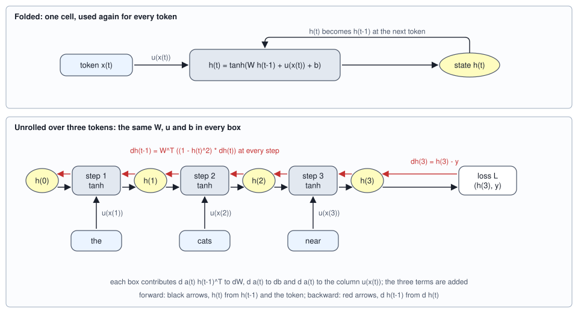

<!-- SPDX-License-Identifier: CC-BY-4.0 -->
<!-- Copyright (c) 2026 Martin Schröder <info@swedishembedded.com> -->

# Recurrent Networks

*How can a network carry memory from one step of a sequence to the next, and why does that memory fade?*

Read this sentence up to its last word and stop: `the dogs near the cat near the fox near the cat`. A verb must come next, and a speaker knows which kind at once: `see` or `chase`, plural, because the subject is `dogs` and the three nouns after it are bystanders. Now give the same stretch to the window network of the last chapter, which reads the four tokens before the word it must predict. What it receives is `fox near the cat`. Every noun in view is singular, and `dogs` is ten tokens back, out of sight. Whatever function of those four tokens the network computes, it can only guess, and in a language where the subject and the nouns of the phrases are drawn independently the guess is right half the time, a number this chapter will compute exactly.

The last chapter ended on that limit and on what would remove it: a memory of fixed size, updated as each token is read, so that the cost of remembering does not grow with the distance. This chapter builds that memory in the form it took for two decades before attention, and then asks what the form costs. The answer has two parts, both about the same product of matrices. One says why the memory fades, and with it the gradient that would teach the network to keep it. The other says what to change so that it fades more slowly, and the change turns out to be a single idea, a sigmoid that multiplies.

Some things from earlier volumes come back first. Answer them from memory; the answers are at the end of the chapter.

1. (Volume II, [Chapter 3](../v02-learning/03-logistic-regression.md), the sigmoid.) What is $\sigma(0)$, and what is the largest value the slope $\sigma(z)(1 - \sigma(z))$ can take?
2. (Volume III, [Chapter 2](../v03-neural-networks/02-mlp.md), the tanh unit of a hidden layer.) A hidden unit's output is $h = \tanh(a) = 0.9$. What is the slope of $\tanh$ at that point, and what does the gradient passing through the unit become?
3. (Volume III, [Chapter 4](../v03-neural-networks/04-backpropagation.md), the backward pass.) A layer computes $\mathbf{z} = \mathbf{W}\mathbf{h}$. Given $d\mathbf{z}$, what are $d\mathbf{h}$ and $d\mathbf{W}$? If one weight matrix is used at two places in a graph, how is its gradient formed?
4. (Volume III, [Chapter 12](../v03-neural-networks/12-training-dynamics.md), vanishing and exploding gradients.) Each of 24 layers multiplies the norm of a gradient by 0.5 on average. What fraction of the gradient reaches the first layer, and which product of norms guarantees that a gradient vanishes?
5. (Volume III, [Chapter 8](../v03-neural-networks/08-schedules-and-clipping.md), gradient clipping.) A gradient has global norm 20 and the threshold is 5. By what number is every entry multiplied?

## A subject that no window can reach

The chapter works on the language of the last chapter with one change: the optional phrase `near the <noun>` may now be repeated. A sequence is `the`, a subject, and $k$ phrases, and the model must say which verb comes next. The verb agrees with the subject, not with the last noun, and the nouns inside the phrases are chosen independently of the subject. Let $d$ be the distance of the subject from the verb, the number of positions one must step back from the verb to land on it. With $k$ phrases, $d = 1 + 3k$.

<!-- worked: recurrent_networks.task -->
The ids are those of the previous chapter's language, `0 the`, `1 cat`, `2 dog`, `3 fox`, `4 cats`, `5 dogs`, `6 foxes`, `7 near`, `8 sees`, `9 chases`, `10 see`, `11 chase`. A sequence is `the`, a subject (ids 1 to 6), then k times the three tokens `near the` and a noun, and the model must name the verb that comes next: one of `sees`, `chases` (singular subject, ids 1 to 3) or `see`, `chase` (plural subject, ids 4 to 6), the two verbs of the right number equally likely. The nouns of the phrases are drawn from all six nouns and have nothing to do with the subject.

Generator: the book's SplitMix64, seed 0x6b82114d8b9e3ee9 (`seed_of` of the name `recurrent_networks.train`). Test: seed 0x81830aa64f51bda4 (`recurrent_networks.test`). Draw order per sequence: `integer(6)` the subject, then k times `integer(6)` the nouns of the phrases, then `integer(2)` the verb among the two of the subject's number. The training set has 20 sequences for each k in [0, 1, 2, 4, 8, 12, 16] in that order (140 in all), the test set 40 for each k in [0, 1, 2, 4, 8, 12, 16, 24, 32] (360 in all). The four sequences below are drawn from the generator `recurrent_networks.example` (seed 0x6349b6c2f6e3ba54), one for each k from 0 to 3.

| phrases k | distance d = 1 + 3k | tokens read | input | verb drawn |
|---:|---:|---:|---|---|
| 0 | 1 | 2 | `the cat` | `sees` |
| 1 | 4 | 5 | `the cat near the fox` | `chases` |
| 2 | 7 | 8 | `the fox near the fox near the cat` | `chases` |
| 3 | 10 | 11 | `the cat near the cats near the cat near the fox` | `sees` |

The best accuracy a model can reach that sees only the last four tokens before the verb, found by listing all 6^(k+1) equally likely combinations of subject and phrase nouns, grouping them by the window's contents and taking the more frequent number in each group:

| k | d | combinations 6^(k+1) | subject inside the window of 4 | best accuracy of a window model | as a decimal |
|---:|---:|---:|---|---:|---:|
| 0 | 1 | 6 | yes | 1/1 | 1.0000 |
| 1 | 4 | 36 | yes | 1/1 | 1.0000 |
| 2 | 7 | 216 | no | 1/2 | 0.5000 |
| 3 | 10 | 1,296 | no | 1/2 | 0.5000 |
| 4 | 13 | 7,776 | no | 1/2 | 0.5000 |
| 5 | 16 | 46,656 | no | 1/2 | 0.5000 |
<!-- /worked -->

The second table is the whole argument against a window. When the subject is inside the window ($d \le 4$, so $k \le 1$), a lookup table keyed by the four tokens is right every time. From $k = 2$ on, the window holds the last noun of a phrase, the words `near the` and one more noun, and none of them depends on the subject, so each window content is followed by singular and plural subjects in equal numbers and the best rule is a coin flip. The enumeration confirms it for $k$ up to 5, and the argument holds for every larger $k$ because the last four tokens never include the subject again. A wider window moves the cliff to the right and does not remove it. The cost of a window of width $w$ is a first layer $w$ times as wide, and the language has no upper limit on $d$.

What the task needs is a state of fixed size that the network rewrites at every token. At the subject it must write down the subject's number, at every phrase it must leave that number alone, and at the verb it must read it out. Whether a network can learn to do that is a question about gradients, and the rest of the chapter is the answer.

## A state that is rewritten at every token

Call the state after $t$ tokens $\mathbf{h}_t$, a vector of $H$ numbers, and start it at $\mathbf{h}_0 = \mathbf{0}$. Reading token $x_t$ updates it by the rule of one hidden layer of Volume III with a second input, the previous state:

$$
\mathbf{a}_t = \mathbf{W}\,\mathbf{h}_{t-1} + \mathbf{u}_{x_t} + \mathbf{b}, \qquad \mathbf{h}_t = \tanh(\mathbf{a}_t).
$$

Here $\mathbf{W}$ has shape $[H, H]$ and carries the state forward, $\mathbf{U}$ has shape $[H, V]$ and $\mathbf{u}_j$ is its column $j$, and $\mathbf{b}$ has $H$ entries. The column $\mathbf{u}_{x_t}$ is what the matrix-vector product $\mathbf{U}\mathbf{e}_{x_t}$ with the one-hot vector of the token would give, so the input matrix is Chapter 3's embedding table written with tokens as columns and the lookup is the same lookup. A network that applies this rule to a sequence, with one state passed from step to step, is a **recurrent neural network** (Elman's 1990 network, which predicted the next element of a sequence from a state fed back, is the same design) (the word recurrent means "running back": the output of a step is fed back in at the next). After the last token the state is read out by whatever head the task needs. For the verb task it is one more layer, $\mathrm{softmax}(\mathbf{W}_{\mathrm{out}}\mathbf{h}_T + \mathbf{b}_{\mathrm{out}})$ over the four verbs.

Two facts follow from the rule, and everything later rests on them. The number of parameters, $H(H + V) + H$, does not depend on the length of the sequence: the network that reads two tokens and the one that reads two thousand are the same network. And the state has $H$ numbers however long the sequence is, so what the network knows of the past is whatever fits into them. A window of $w$ tokens keeps $w$ tokens exactly and forgets the rest completely. A recurrent state keeps a summary of all of them and makes no promise about which part.

Here is the rule worked by hand, so that nothing in it is hidden. The model has two units. Its input matrix has a column for each of the 12 tokens, drawn from the book's generator, and the sequence is `the cats near`.

<!-- worked: recurrent_networks.unroll -->
Generator: the book's SplitMix64, seed 0xb117607e7c98dc1a (`seed_of` of the name `recurrent_networks.tiny`). Draws, in this order: the 12 columns of U one after the other, 2 values each (each `0.8 * normal()`), then W row by row, 4 values (each `0.8 * normal()`). The bias b is (0, 0) and the start state h(0) is (0, 0). The input at step t is the one-hot vector of the token, so `U x(t)` is the column of the token.

| token id | token | U column |
|---:|---|---|
| 0 | `the` | (-1.0651, -0.7778) |
| 1 | `cat` | (-0.0858, -0.3591) |
| 2 | `dog` | (0.1246, 0.3516) |
| 3 | `fox` | (0.3189, -1.2100) |
| 4 | `cats` | (-1.2085, 0.1764) |
| 5 | `dogs` | (0.6840, 0.6174) |
| 6 | `foxes` | (-0.4408, 0.0816) |
| 7 | `near` | (-0.1814, -1.8327) |
| 8 | `sees` | (0.4013, -0.9831) |
| 9 | `chases` | (0.0076, 0.0503) |
| 10 | `see` | (-1.0418, 0.8120) |
| 11 | `chase` | (-0.6898, 0.2826) |

| row | W |
|---:|---|
| 0 | (-0.1213, 1.1254) |
| 1 | (1.1474, 0.2323) |

The sequence is `the cats near` (ids 0, 4, 7). Tolerance: values are rounded to 4 decimals.

| t | token | W h(t-1) | U x(t) | a(t) = W h(t-1) + U x(t) + b | h(t) = tanh(a(t)) |
|---:|---|---|---|---|---|
| 1 | `the` | (0.0000, 0.0000) | (-1.0651, -0.7778) | (-1.0651, -0.7778) | (-0.7876, -0.6515) |
| 2 | `cats` | (-0.6376, -1.0550) | (-1.2085, 0.1764) | (-1.8462, -0.8786) | (-0.9514, -0.7057) |
| 3 | `near` | (-0.6788, -1.2555) | (-0.1814, -1.8327) | (-0.8602, -3.0882) | (-0.6964, -0.9959) |

Every row used the same W, the same U and the same b.
<!-- /worked -->

Look at the third row. The state before it, $\mathbf{h}_2 = (-0.9514, -0.7057)$, has been pushed through $\mathbf{W}$ to $(-0.6788, -1.2555)$, and the column of `near` adds $(-0.1814, -1.8327)$. The second unit's pre-activation is $-3.0882$ and $\tanh$ of that is $-0.9959$, nearly the end of the range. Keep that number in mind: a unit near $\pm 1$ has a slope near 0.



The figure shows the same computation twice. Folded, it is one cell with a loop. Unrolled over a known number of tokens, it is an ordinary feed-forward network of $T$ layers, each layer a copy of the same one, each also receiving a fresh input. That second reading is the useful one, because everything Volume III taught about networks with layers applies to it, with one change that matters: the layers share their weights, so the weights are used $T$ times.

## Backpropagation through the unrolled graph

To train the network we need the gradient of a loss $L$ that is computed from the last state, with respect to $\mathbf{W}$, $\mathbf{U}$ and $\mathbf{b}$. The unrolled graph is a chain, so the backward pass of Chapter 4 of Volume III runs along it from the last layer to the first. Suppose the gradient $d\mathbf{h}_t$ of the loss with respect to $\mathbf{h}_t$ is known (for the last state it comes from the head). The step $\mathbf{h}_t = \tanh(\mathbf{a}_t)$ passes it through the slope of $\tanh$, and the step $\mathbf{a}_t = \mathbf{W}\mathbf{h}_{t-1} + \mathbf{u}_{x_t} + \mathbf{b}$ sends it three ways:

$$
d\mathbf{a}_t = (1 - \mathbf{h}_t \odot \mathbf{h}_t) \odot d\mathbf{h}_t, \qquad d\mathbf{h}_{t-1} = \mathbf{W}^\top d\mathbf{a}_t,
$$

$$
d\mathbf{W} \mathrel{+}= d\mathbf{a}_t\,\mathbf{h}_{t-1}^\top, \qquad d\mathbf{u}_{x_t} \mathrel{+}= d\mathbf{a}_t, \qquad d\mathbf{b} \mathrel{+}= d\mathbf{a}_t .
$$

The first line is the backward pass of a layer. The second line is where the sharing shows. The matrix $\mathbf{W}$ was used at every step, so its gradient is the sum over steps of what each step contributes, which is the rule of Chapter 4 for a value that feeds several places, and the column of $\mathbf{U}$ for a token receives the $d\mathbf{a}_t$ of every step at which that token was read. Computing the gradient this way, from the last step to the first, is **backpropagation through time**: ordinary backpropagation on the graph unrolled over time (Werbos wrote it up in 1990, after it had been in use for several years). Nothing about it is new; what is new is how long the chain is.

```text
function rnn_forward(tokens: list<int>, U: array<real>[H, V], W: array<real>[H, H], b: array<real>[H])
        -> list<array<real>[H]>:
    require all([0 <= tokens[t] and tokens[t] < V for t in 0 .. len(tokens)])
    hs = [zeros(real, [H])]                                  # hs[0] = h_0 = 0
    for t in 0 .. len(tokens):
        h = hs[t]
        a = [dot(W[i, :], h) + U[i, tokens[t]] + b[i] for i in 0 .. H]
        append [tanh(a[i]) for i in 0 .. H] to hs            # hs[t + 1] = h_{t+1}
    return hs                                                # len(tokens) + 1 states, all saved for the backward pass
```

```text
function rnn_backward(tokens: list<int>, hs: list<array<real>[H]>, W: array<real>[H, H], V: int,
                      dh_last: array<real>[H]) -> (array<real>[H, V], array<real>[H, H], array<real>[H]):
    require len(hs) == len(tokens) + 1
    dU = zeros(real, [H, V])
    dW = zeros(real, [H, H])
    db = zeros(real, [H])
    dh = copy(dh_last)
    for t in len(tokens) down to 1:                          # step t read tokens[t - 1] and made hs[t]
        da = [(1.0 - hs[t][i] * hs[t][i]) * dh[i] for i in 0 .. H]
        for i in 0 .. H:
            db[i] = db[i] + da[i]
            dU[i, tokens[t - 1]] = dU[i, tokens[t - 1]] + da[i]
            for j in 0 .. H:
                dW[i, j] = dW[i, j] + da[i] * hs[t - 1][j]
        dh = [sum([W[i, j] * da[i] for i in 0 .. H]) for j in 0 .. H]    # W^T da
    return (dU, dW, db)
```

The forward pass must save every state, $T + 1$ vectors of $H$ numbers, because each step of the backward pass reads two of them (the slope of $\tanh$ needs $\mathbf{h}_t$ and the product for $d\mathbf{W}$ needs $\mathbf{h}_{t-1}$). That is the saved-activation cost of Volume III and it grows with $T$. The matrix work of the backward pass is twice that of the forward pass for the same reason as in a layer, one product for $d\mathbf{h}_{t-1}$ and one for $d\mathbf{W}$.

The three-token example continues. The loss is $L = \tfrac12\lVert\mathbf{h}_3 - \mathbf{y}\rVert^2$ for a target $\mathbf{y} = (0.5, -0.5)$, which gives the backward pass something to start from without a classifier, and every number below is printed so that the hand computation can be followed.

<!-- worked: recurrent_networks.bptt_by_hand -->
Loss L = 1/2 * ||h(3) - y||^2 with y = (0.5, -0.5); with the model above L = 0.838579. The gradient into the last state is dh(3) = h(3) - y = (-1.1964, -0.4959). Each row below is one step of the backward pass, from the last step to the first.

| t | dh(t) | 1 - h(t)^2 | da(t) = (1 - h(t)^2) * dh(t) | dh(t-1) = W^T da(t) |
|---:|---|---|---|---|
| 3 | (-1.1964, -0.4959) | (0.5151, 0.0083) | (-0.6162, -0.0041) | (0.0700, -0.6944) |
| 2 | (0.0700, -0.6944) | (0.0949, 0.5020) | (0.0066, -0.3486) | (-0.4007, -0.0735) |
| 1 | (-0.4007, -0.0735) | (0.3797, 0.5756) | (-0.1522, -0.0423) | (-0.0301, -0.1811) |

The gradient of the shared matrix W is the sum of one outer product per step:

| t | term | rows of the 2 x 2 matrix |
|---:|---|---|
| 3 | da(3) h(2)^T | (0.5863, 0.4349); (0.0039, 0.0029) |
| 2 | da(2) h(1)^T | (-0.0052, -0.0043); (0.2745, 0.2271) |
| 1 | da(1) h(0)^T | (0.0000, 0.0000); (0.0000, 0.0000) |
| sum | dW | (0.5810, 0.4306); (0.2784, 0.2300) |

The bias gradient is the sum of the three da vectors, db = (-0.7617, -0.3950). The columns of U that were used get the da of their step: `the` (-0.1522, -0.0423); `cats` (0.0066, -0.3486); `near` (-0.6162, -0.0041); the other nine columns get 0.

Check: all 30 entries of W, of the used and unused columns of U and of b, against central differences of L with step 1e-6; the largest absolute difference is below 1e-8: True.
<!-- /worked -->

Two things in the table are worth reading closely. The gradient into the last state, $(-1.1964, -0.4959)$, is sizeable in both components, but after the slope of $\tanh$ the second component of $d\mathbf{a}_3$ is $-0.0041$: the unit that sat at $-0.9959$ passes on less than one percent of its gradient. A saturated unit does not only stop responding to its input in the forward direction, it stops listening in the backward one. And the first step contributes nothing to $d\mathbf{W}$, since $\mathbf{h}_0 = \mathbf{0}$ makes its outer product zero, while it does reach the columns of $\mathbf{U}$ and the bias.

A backward pass of this size is easy to get wrong in ways the loss does not show, so it is checked the way Volume III taught, against central differences, for the three cells of this chapter at once. The LSTM and GRU appear later in the chapter, and the check is printed here because the same function backs the table of the next section.

<!-- worked: recurrent_networks.gradient_check_cells -->
Each cell has H = 3 units. Its parameters are drawn by the initialization recipe of the text from the generator `recurrent_networks.check.<cell>`, with W gain 1.5, forget-gate bias 0.5 (the update-gate bias of the GRU -0.5) and U entries `0.7 * normal()`, and the readout bias set to (0.1, -0.2, 0.05, 0). The loss is the mean cross-entropy of two sequences, one of k = 2 phrases (8 tokens) and one of k = 1 (5 tokens), in that order, from the generator `recurrent_networks.check.data` (seed 0xa5de94c53f641062). Every entry of every parameter is compared with a central difference of step 1e-6.

| cell | parameters compared | largest absolute difference below 1e-7 |
|---|---:|---:|
| vanilla | 64 | yes |
| LSTM | 208 | yes |
| GRU | 160 | yes |
<!-- /worked -->

## Why the past fades

The backward pass of the previous section is a recurrence in $d\mathbf{h}$: each step multiplies the gradient by the same kind of matrix. Write it as a Jacobian. From $\mathbf{h}_t = \tanh(\mathbf{W}\mathbf{h}_{t-1} + \dots)$,

$$
\mathbf{J}_t = \frac{\partial\mathbf{h}_t}{\partial\mathbf{h}_{t-1}} = \mathrm{diag}(1 - \mathbf{h}_t \odot \mathbf{h}_t)\,\mathbf{W},
$$

the diagonal matrix of slopes times the weights, which is the layer Jacobian $\mathbf{S}_\ell\mathbf{W}_\ell$ of Chapter 12 of Volume III. The gradient that arrives $k$ steps before the end is, as there, a product,

$$
d\mathbf{h}_{T-k} = \mathbf{J}_{T-k+1}^\top \cdots \mathbf{J}_{T-1}^\top\,\mathbf{J}_T^\top\, d\mathbf{h}_T ,
$$

and the same bound holds. The slopes are at most 1, so $\lVert\mathbf{J}_t\rVert_2 \le \lVert\mathbf{W}\rVert_2$ and

$$
\Big\lVert \frac{\partial\mathbf{h}_T}{\partial\mathbf{h}_{T-k}} \Big\rVert_2 \;\le\; \lVert\mathbf{W}\rVert_2^{\,k}.
$$

If the largest singular value of $\mathbf{W}$ is below 1 the gradient from $k$ steps back is smaller than the gradient at the end by a factor that falls geometrically with $k$, whatever the sequence is. The deep network of Volume III had a different matrix at every layer; the recurrent network has the same matrix at every step, so its product is a power, and a power is governed by the eigenvalues of $\mathbf{W}$: if the largest has modulus below 1 then $\mathbf{W}^k \to \mathbf{0}$, and the bound shows that the same holds for the product of the Jacobians whenever $\lVert\mathbf{W}\rVert_2 < 1$. The bound is an upper bound, so it can prove vanishing and cannot prove the opposite: a norm above 1 allows growth and does not force it. That gradients through long chains of this kind decay, and that learning long dependencies by gradient descent therefore gets harder with their length, was shown by Bengio, Simard and Frasconi in 1994; Pascanu, Mikolov and Bengio (2013) analysed the exploding side and proposed clipping the norm of the gradient against it.

There is a second reading of the same product, which is why this is a statement about memory and not only about learning. Change the state at step $T - k$ by a small vector $\boldsymbol{\delta}$. The state at step $T$ changes by $\mathbf{J}_T \cdots \mathbf{J}_{T-k+1}\boldsymbol{\delta}$ to first order, the same product transposed. Whatever the network wrote into its state $k$ steps ago is visible in the present only through that product, so a network whose product is tiny has forgotten, and the gradient that would teach it to remember is the same tiny number.

The models below, and those of the training section, are all started by one recipe. The input matrix $\mathbf{U}$ is drawn one column at a time, 12 columns of $G H$ entries each (the cell has $G$ blocks of $H$ rows: 1 for the vanilla cell, 4 for the LSTM, 3 for the GRU), each entry `0.5 * normal()`; the recurrent matrix $\mathbf{W}$ follows, row by row, each entry `gain * normal() / sqrt(H)` with a gain that is 1 unless stated; then a readout of 4 rows of $H$ entries `normal() / sqrt(H)`, which the tables that need no readout leave unused. All biases are 0, except the bias of the LSTM's forget gate, which starts at 1 unless stated, and the bias of the GRU's update gate, which starts at $-1$. The reason for those two is given in the sections on the gated cells.

The table measures the product. Seven models read the same 40 tokens, and for each the entry for $k$ is the spectral norm of the Jacobian of $\mathbf{h}_{40}$ with respect to the state $k$ steps earlier, found by the backward pass above started from each unit vector, with the book's `power_iteration` for the norm. Three of them are the vanilla cell with small, medium and large $\mathbf{W}$; the others are the gated cells of the next sections, which are put here so that one table can show all of them.

<!-- worked: recurrent_networks.jacobian_product -->
All models have H = 16 units and read the same 40 tokens, ids drawn by `integer(12)` from the generator `recurrent_networks.sens_tokens` (seed 0x0ba60b3c85e8320c). Each model's parameters come from the generator `recurrent_networks.sens.<label>` (labels as in the first column; seeds are `seed_of` of that name) in the order U, W, readout (the readout is not used here), with U entries `0.5 * normal()`, W entries `gain * normal() / sqrt(16)` where the gain is 0.25, 1 and 3 for the three vanilla models and 1 for the gated ones, and the biases of the initialization recipe of the text: LSTM forget bias 0, 1 or 3, GRU update-gate bias -1, all others 0. The entry for k is the spectral norm of the Jacobian of the last state h(40) with respect to the state k steps earlier (for the LSTM the state is (h, c), a 16 by 32 Jacobian), found by running the backward pass of BPTT from each of the 16 unit vectors in h(40) and stacking the 16 gradients that arrive k steps back. The spectral norm is `power_iteration` with 60 iterations from `normal()` draws of the generator `recurrent_networks.spectral` (seed 0x9b8b88813560a59f), restarted for each entry; the second column is the same estimate for the matrix W of a vanilla cell (a gated cell has no single recurrent matrix and shows a dash). Values are rounded to 3 significant digits and are stable to about that.

| model | ||W||_2 | k = 1 | k = 2 | k = 4 | k = 8 | k = 16 | k = 24 | k = 32 |
|---|---:|---:|---:|---:|---:|---:|---:|---:|
| vanilla, small W | 0.435 | 3.70e-01 | 9.03e-02 | 3.95e-03 | 5.61e-06 | 2.97e-11 | 1.72e-16 | 7.15e-22 |
| vanilla, medium W | 1.731 | 1.38e+00 | 1.08e+00 | 8.41e-01 | 3.43e-01 | 2.51e-02 | 7.83e-04 | 5.26e-05 |
| vanilla, large W | 5.910 | 4.16e+00 | 4.83e+00 | 6.36e+00 | 6.38e+00 | 5.60e+01 | 1.58e+02 | 1.29e+03 |
| LSTM, forget bias 0 | - | 5.10e-01 | 3.85e-01 | 2.63e-01 | 6.13e-02 | 2.15e-03 | 4.40e-05 | 1.13e-06 |
| LSTM, forget bias 1 | - | 6.00e-01 | 4.72e-01 | 4.37e-01 | 2.87e-01 | 1.04e-01 | 5.82e-02 | 2.13e-02 |
| LSTM, forget bias 3 | - | 5.14e-01 | 4.38e-01 | 4.05e-01 | 2.56e-01 | 1.26e-01 | 1.08e-01 | 1.28e-01 |
| GRU, update bias -1 | - | 9.06e-01 | 8.02e-01 | 5.10e-01 | 2.70e-01 | 3.65e-02 | 5.57e-03 | 5.89e-04 |

The bound ||W||_2^k for the small vanilla model is 4.35e-01, 1.89e-01, 3.57e-02, 1.28e-03, 1.63e-06, 2.08e-09, 2.65e-12 at k = 1, 2, 4, 8, 16, 24, 32. The large vanilla model peaks at k = 32 with 1.29e+03; a global-norm clip with threshold 5 would multiply a gradient of that norm by 0.0039.
<!-- /worked -->


Read the first three rows against the bound. The small cell has $\lVert\mathbf{W}\rVert_2 = 0.435$, and the gradient is below the bound $0.435^k$ at every $k$ listed, falling to $1.7\times10^{-16}$ at $k = 24$, about the unit round-off of double precision, and to $7\times10^{-22}$ at $k = 32$: added to a gradient of size 1 it changes no digit of it. The medium cell, at $\lVert\mathbf{W}\rVert_2 = 1.731$, is the interesting case, because the bound says nothing ($1.731^{8} = 80$) and the measurement decays anyway, to $0.343$ at $k = 8$ and $2.5\times10^{-2}$ at $k = 16$: slopes below 1 and a $\mathbf{W}$ that does not stretch in the direction the gradient happens to point both help it shrink. The large cell, with norm $5.91$, is the third case. Its gradient is $4.16$ at one step and $1290$ at 32, growing by a factor of about 310. That is an exploding gradient in the sense of Chapter 12 of Volume III, and it shows the limit of the bound the other way: $5.91^{8} = 1.5\times10^{6}$ against a measured $6.4$, because a unit that grows saturates and a saturated unit has slope near 0. What explodes in a $\tanh$ network is bounded, and it still reaches thousands.

The remedy for the second case is the one of Chapter 8: clip the global norm. It controls the step and does nothing for the signal. If the gradient from 32 steps back is 1290 times the gradient at the end, a clip at 5 multiplies everything by $0.0039$, and the part of the gradient that taught the network about the recent past shrinks with the rest. A vanilla cell has one knob for this, the scale of $\mathbf{W}$, and the table shows both sides of it: turned down the memory is gone within a few steps, turned up the gradient explodes and the units saturate. The section "Where memory can be kept" changes the cell instead, so that the product has a path through it that neither shrinks nor grows by the choice of one matrix.

## Cutting the chain

A language model does not read one sentence. It reads a stream of millions of tokens, and a backward pass over the whole stream would need every state in memory. The practical answer is **truncated backpropagation through time**: cut the stream into segments of $\tau$ steps, carry the state forward from one segment to the next without a break, and run the backward pass only within the segment, so that nothing flows back across a cut. The memory for saved states is $\tau$ vectors instead of $T$, and one update costs the work of $\tau$ steps. The price is paid in what can be learned, and the next table shows it exactly. An LSTM reads the task's sequence with the subject `cats` and $k$ phrases, and the entry is the norm of the gradient that arrives at the state right after the subject, with the full backward pass and with one truncated to the last 4 steps.

<!-- worked: recurrent_networks.truncation -->
A single LSTM with H = 12 units (parameters from the generator `recurrent_networks.trunc`, seed 0x4d65929a4e779b74, forget bias 1) reads the task's sequence with the subject `cats` and k phrases, the phrase nouns being `1 + integer(6)` draws, in order of the rows, from the generator `recurrent_networks.trunc_nouns` (seed 0xd7cca9bfb87a1f8a); the loss is the cross-entropy of the verb `see` (class 2). The entry is the norm of the gradient (h and c together) that arrives at the state right after the subject has been read, from full backpropagation through time and from backpropagation truncated to the last 4 steps.

| k | d | tokens T | steps from the subject to the loss | norm of the gradient at the subject, full | norm, truncated to 4 steps | states stored, full | states stored, truncated |
|---:|---:|---:|---:|---:|---:|---:|---:|
| 0 | 1 | 2 | 0 | 9.29e-01 | 9.29e-01 | 2 | 2 |
| 1 | 4 | 5 | 3 | 2.01e-01 | 2.01e-01 | 5 | 4 |
| 2 | 7 | 8 | 6 | 1.22e-01 | 0 (never computed) | 8 | 4 |
| 3 | 10 | 11 | 9 | 6.30e-02 | 0 (never computed) | 11 | 4 |
| 4 | 13 | 14 | 12 | 5.51e-02 | 0 (never computed) | 14 | 4 |
| 8 | 25 | 26 | 24 | 1.42e-02 | 0 (never computed) | 26 | 4 |
<!-- /worked -->

The truncated gradient is not small; it is zero, because the backward pass never computed it. The subject is reached when the subject is within the 4 steps, $k \le 1$, and not otherwise, which is the same reach as the window of 4 tokens in the first table. The state still carries the subject forward in the truncated run, so a network could in principle keep the number by luck; what cannot happen is that the loss at the verb teaches it to. Truncation moves the cliff of the window from the model to the training, and that is why it works for what it was made for, short and medium-range structure in a long stream, and why a dependency longer than $\tau$ is learned only if some shorter signal happens to push the network the right way.

## Where memory can be kept

The Jacobian product multiplies the gradient at every step by a matrix and a slope. To keep the gradient alive, give it a path that is neither. The cell of this section does that with the one operation a network has for deciding how much of something to let through, a sigmoid whose output multiplies the signal. A sigmoid maps any number to $(0, 1)$, so used as a multiplier it is a dial between "nothing passes" and "everything passes", and a vector of sigmoids, one for each unit, is a dial per unit. Multiplying a signal elementwise by such a vector, computed from the current input and state, is **gating**, and the vector is a gate. The recurrent cell so far had no dials: its state was overwritten at every step by whatever the new $\tanh$ produced.

Take the cell state $\mathbf{c}_t$, a second vector of $H$ numbers that the cell keeps beside the state it shows, and update it by

$$
\mathbf{c}_t = \mathbf{f}_t \odot \mathbf{c}_{t-1} + \mathbf{i}_t \odot \tilde{\mathbf{c}}_t,
$$

with a **forget gate** $\mathbf{f}_t \in (0,1)^H$ that says how much of the old content stays, a candidate $\tilde{\mathbf{c}}_t$ (a $\tanh$ of something new) that says what could be written, and an **input gate** $\mathbf{i}_t \in (0,1)^H$ that says how much of it is. The cell state is not rewritten; it is kept and added to. Two units of one step show what that means.

<!-- worked: recurrent_networks.lstm_step -->
One LSTM step with two units. The previous state is h(t-1) = (0.5, -0.5), c(t-1) = (1, -2), and the four pre-activations, which in a real cell are the four blocks of W h(t-1) + U x(t) + b, are given directly:

|  | input gate i | forget gate f | candidate g | output gate o |
|---|---|---|---|---|
| pre-activation a | (0.0, 2.0) | (2.2, -2.2) | (1.0, -1.0) | (1.0, 0.0) |
| gate (sigmoid, sigmoid, tanh, sigmoid) | (0.5000, 0.8808) | (0.9002, 0.0998) | (0.7616, -0.7616) | (0.7311, 0.5000) |

| quantity | unit 0, unit 1 |
|---|---|
| old cell c(t-1) | (1.0, -2.0) |
| kept, f * c(t-1) | (0.9002, -0.1995) |
| written, i * g | (0.3808, -0.6708) |
| new cell c(t) = kept + written | (1.2810, -0.8703) |
| tanh(c(t)) | (0.8568, -0.7015) |
| new state h(t) = o * tanh(c(t)) | (0.6263, -0.3508) |
<!-- /worked -->

Unit 0 has a forget gate of $0.9002$ and keeps nine tenths of its old content, $1$, adding $0.3808$. Unit 1 has a forget gate of $0.0998$, so of its old $-2$ only $-0.1995$ survives, and it writes $-0.6708$ over the rest. The same cell does both, because the gates are computed from the input and the state and are different for every unit.

This changes the backward pass as follows. The old cell state $\mathbf{c}_{t-1}$ feeds $\mathbf{c}_t$ directly through the product with $\mathbf{f}_t$, and also indirectly, since the gates depend on the state $\mathbf{h}_{t-1}$, which is made from $\mathbf{c}_{t-1}$. The direct path has the Jacobian $\mathrm{diag}(\mathbf{f}_t)$ and nothing else: no weight matrix and no slope of $\tanh$. Along that path the gradient of the cell state $k$ steps back is multiplied by the product of the forget gates in between, $\mathbf{f}_T \odot \cdots \odot \mathbf{f}_{T-k+1}$, and that product is as large as the network chooses to make it. For equal gates it is $f^k$:

<!-- worked: recurrent_networks.forget_products -->
The factor by which the gradient of the cell state is multiplied after k steps if the forget gate stays at f (the product of k equal gates, f^k):

| forget gate f | k = 1 | k = 4 | k = 8 | k = 16 | k = 32 | k = 64 |
|---|---:|---:|---:|---:|---:|---:|
| 0.50 | 5.00e-01 | 6.25e-02 | 3.91e-03 | 1.53e-05 | 2.33e-10 | 5.42e-20 |
| sigmoid(1) = 0.7311 | 7.31e-01 | 2.86e-01 | 8.16e-02 | 6.66e-03 | 4.43e-05 | 1.96e-09 |
| sigmoid(3) = 0.9526 | 9.53e-01 | 8.23e-01 | 6.78e-01 | 4.60e-01 | 2.11e-01 | 4.46e-02 |
| 0.99 | 9.90e-01 | 9.61e-01 | 9.23e-01 | 8.51e-01 | 7.25e-01 | 5.26e-01 |
<!-- /worked -->

A gate of $0.99$ keeps $53\%$ of the gradient across 64 steps; a gate of $0.5$ keeps $5\times10^{-20}$ of it. The difference between the cells is that the vanilla cell has no such factor to set, while here the network can train it, one unit at a time, to be near 1 for a unit that must hold a value and near 0 for one that must be cleared. A new network starts with whatever gates its initial weights give, so the initial gate matters, and the habit is to start the bias of the forget gate at 1, so that at the start a gate with no other input is $\sigma(1) = 0.73$ and the cell remembers a little instead of nothing. The rows of the Jacobian table at three forget biases show how much that choice does: with a bias of 0 the gradient from 32 steps back is $1.1\times10^{-6}$, with 1 it is $2.1\times10^{-2}$ and with 3 it is $0.128$, a quarter of its size at one step. The product table is a guide to the rate and no more: the direct path is one of several, and the gates are not constant at $\sigma(b_f)$.

The rest of the cell is there to make the cell state usable. The state that leaves the cell and feeds the next layer and the next step is not $\mathbf{c}_t$ but $\mathbf{h}_t = \mathbf{o}_t \odot \tanh(\mathbf{c}_t)$, filtered by an **output gate** $\mathbf{o}_t$, so that the cell can hold a value without showing it. All four gates and the candidate are read off one pre-activation of $4H$ numbers, the same shape of computation as the vanilla cell with four times the rows. This is the **LSTM**, long short-term memory: long because the cell state can hold a value for many steps, short-term because that is still memory in the state of a running network and not in the weights. Hochreiter and Schmidhuber introduced it in 1997 with a cell state that was copied unchanged and input and output gates; the forget gate was added a few years later by Gers, Schmidhuber and Cummins (2000), and is the form used here.

$$
\begin{aligned}
\mathbf{a}_t &= \mathbf{W}\mathbf{h}_{t-1} + \mathbf{u}_{x_t} + \mathbf{b} \quad \text{(split into four blocks } \mathbf{a}^i_t, \mathbf{a}^f_t, \mathbf{a}^g_t, \mathbf{a}^o_t\text{)},\\
\mathbf{i}_t &= \sigma(\mathbf{a}^i_t), \qquad \mathbf{f}_t = \sigma(\mathbf{a}^f_t),\\
\tilde{\mathbf{c}}_t &= \tanh(\mathbf{a}^g_t), \qquad \mathbf{o}_t = \sigma(\mathbf{a}^o_t),\\
\mathbf{c}_t &= \mathbf{f}_t \odot \mathbf{c}_{t-1} + \mathbf{i}_t \odot \tilde{\mathbf{c}}_t,\\
\mathbf{h}_t &= \mathbf{o}_t \odot \tanh(\mathbf{c}_t).
\end{aligned}
$$


```text
function lstm_step(x: int, h: array<real>[H], c: array<real>[H], U: array<real>[4 * H, V],
                   W: array<real>[4 * H, H], b: array<real>[4 * H])
        -> (array<real>[H], array<real>[H]):
    require 0 <= x and x < V
    a = [dot(W[r, :], h) + U[r, x] + b[r] for r in 0 .. 4 * H]
    h_new = zeros(real, [H])
    c_new = zeros(real, [H])
    for j in 0 .. H:                                         # block order i, f, g, o
        c_new[j] = sigmoid(a[H + j]) * c[j] + sigmoid(a[j]) * tanh(a[2 * H + j])
        h_new[j] = sigmoid(a[3 * H + j]) * tanh(c_new[j])
    return (h_new, c_new)
```

The backward pass is the chain rule through these lines, and its shape is what matters. Given the gradients $d\mathbf{h}_t$ and $d\mathbf{c}_t$ arriving from the future, the cell state collects a second term from the output, $d\mathbf{c}^{\mathrm{tot}}_t = d\mathbf{c}_t + d\mathbf{h}_t \odot \mathbf{o}_t \odot (1 - \tanh^2\mathbf{c}_t)$, and then

$$
\begin{aligned}
d\mathbf{a}^i_t &= d\mathbf{c}^{\mathrm{tot}}_t \odot \tilde{\mathbf{c}}_t \odot \mathbf{i}_t \odot (1 - \mathbf{i}_t),\\
d\mathbf{a}^f_t &= d\mathbf{c}^{\mathrm{tot}}_t \odot \mathbf{c}_{t-1} \odot \mathbf{f}_t \odot (1 - \mathbf{f}_t),\\
d\mathbf{a}^g_t &= d\mathbf{c}^{\mathrm{tot}}_t \odot \mathbf{i}_t \odot (1 - \tilde{\mathbf{c}}_t^{\,2}),\\
d\mathbf{a}^o_t &= d\mathbf{h}_t \odot \tanh(\mathbf{c}_t) \odot \mathbf{o}_t \odot (1 - \mathbf{o}_t),\\
d\mathbf{c}_{t-1} &= d\mathbf{c}^{\mathrm{tot}}_t \odot \mathbf{f}_t,\\
d\mathbf{h}_{t-1} &= \mathbf{W}^\top d\mathbf{a}_t,
\end{aligned}
$$

with the slope of the sigmoid $\sigma(1 - \sigma)$ of Volume II in each gate. The line $d\mathbf{c}_{t-1} = d\mathbf{c}^{\mathrm{tot}}_t \odot \mathbf{f}_t$ is the highway: a gradient on the cell state is passed one step back by a multiplication with the forget gate and by nothing else. Parameter gradients are sums over steps exactly as before.

## A cell with one state and two gates

The LSTM has two states, three gates and four blocks of weights. The **GRU**, the gated recurrent unit of Cho and his colleagues (2014), keeps the idea and drops a state. It has one state $\mathbf{h}_t$, an update gate $\mathbf{z}_t$ that decides how far the state moves toward a new candidate, and a reset gate $\mathbf{r}_t$ that decides how much of the old state the candidate may look at:

$$
\begin{aligned}
\mathbf{z}_t &= \sigma(\mathbf{a}^z_t), \qquad \mathbf{r}_t = \sigma(\mathbf{a}^r_t),\\
\mathbf{n}_t &= \tanh\!\big(\mathbf{W}_n(\mathbf{r}_t \odot \mathbf{h}_{t-1}) + \mathbf{u}^n_{x_t} + \mathbf{b}_n\big),\\
\mathbf{h}_t &= (1 - \mathbf{z}_t) \odot \mathbf{h}_{t-1} + \mathbf{z}_t \odot \mathbf{n}_t,
\end{aligned}
$$

where $\mathbf{a}^z_t$ and $\mathbf{a}^r_t$ are the first two of three blocks of $\mathbf{W}\mathbf{h}_{t-1} + \mathbf{u}_{x_t} + \mathbf{b}$. With this sign, $\mathbf{z}_t = \mathbf{0}$ copies the state unchanged, and the path from $\mathbf{h}_{t-1}$ to $\mathbf{h}_t$ has the Jacobian $\mathrm{diag}(1 - \mathbf{z}_t)$ as one of its terms, the same kind of highway as the forget gate, with the old content and the new competing through one gate instead of two (some authors write the gate the other way round). With $\mathbf{z}_t = \mathbf{1}$ and $\mathbf{r}_t = \mathbf{1}$ the cell is the vanilla cell exactly. To start it remembering, the update-gate bias begins at $-1$, which is the mirror of the LSTM's forget bias of 1. There is one difference to the LSTM that is not about gradients: the GRU's only state is also its output, so it cannot hold a value without showing it.

The GRU has three blocks of weights where the LSTM has four, so three quarters of the parameters and of the matrix work. Here is the count, from the formulas the previous section's cells follow.

<!-- worked: recurrent_networks.cell_costs -->
Parameters of one cell are G H (H + D) + G H with G = 1, 4, 3 for the vanilla cell, the LSTM and the GRU, H the number of units and D the width of the input (the readout of 4 H + 4 parameters is not counted). FLOPs of one step are 2 H (H + D) + 3 H (vanilla), 8 H (H + D) + 17 H (LSTM) and 6 H (H + D) + 14 H (GRU): a matrix-vector product of m by n counts 2 m n, and every addition, multiplication and activation of a unit counts 1.

| setting | cell | parameters | FLOPs per step | FLOPs relative to the vanilla cell |
|---|---|---:|---:|---:|
| the trained cells (H = 12, one-hot input of width 12 as a dense vector) | vanilla | 300 | 612 | 1.00 |
|  | LSTM | 1,200 | 2,508 | 4.10 |
|  | GRU | 900 | 1,896 | 3.10 |
| a large layer (H = 1024, input width 1024) | vanilla | 2,098,176 | 4,197,376 | 1.00 |
|  | LSTM | 8,392,704 | 16,794,624 | 4.00 |
|  | GRU | 6,294,528 | 12,597,248 | 3.00 |

The parameter formula agrees with the number of entries of U, W and b that the initialization recipe builds for the three cells at H = 12, D = 12: True. With a one-hot input, the product U x(t) is a lookup of a column and costs no multiplication; the trained cells then spend 324, 1,356 and 1,032 FLOPs per step.
<!-- /worked -->

The LSTM costs about four vanilla cells per step and the GRU about three. These are cheap steps; their weakness, taken up at the end of the chapter, is how many of them have to be taken in a row.

## Training the three cells on the long task

All of the above is about the first update. What happens over a training run is the experiment of this section: the three cells, with the same size and the same recipe, on the task of the first section. Each cell is trained three times from three different starting points, since a single run says nothing about how often a recipe works.

<!-- worked: recurrent_networks.training -->
Every cell has H = 12 units and reads the one-hot ids of the task; parameters are drawn by the initialization recipe of the text (order U, W, readout; U entries `0.5 * normal()`, W gain 1, LSTM forget-gate bias 1, GRU update-gate bias -1) from the generator named `recurrent_networks.<cell>.<run>.init` with cell `rnn`, `lstm` or `gru` and run 0, 1 or 2; the seed of each is in the table. Training is Adam (learning rate 0.01, beta1 0.9, beta2 0.999, epsilon 1e-08, with the bias correction of Volume III) on minibatches of 14 of the 140 training sequences (10 batches per epoch, 80 epochs, 800 updates), the batches of an epoch being a new shuffle of the sequence indices drawn by `shuffle` from the generator `recurrent_networks.<cell>.<run>.order`, and the gradient of every update is clipped to a global norm of 5. The loss is the mean cross-entropy over the four verbs; the table gives its mean over the batches of the epoch. A test sequence counts as correct when the probability of the two verbs of the subject's number exceeds one half. The columns on the right pool the test sequences by distance: d <= 4 is k in [0, 1] (the window reaches the subject), d > 4 seen in training is k in [2, 4, 8, 12, 16], and beyond training is k in [24, 32]. Losses are rounded to 3 decimals and counts are exact for an implementation that adds in the same order; a different order moves the digits and, rarely, a count by one.

| cell | run | seed of the initial parameters | loss, epoch 1 | loss, epoch 10 | loss, epoch 20 | loss, epoch 40 | loss, epoch 80 | test, d <= 4 | test, d > 4 seen in training | test, d beyond training |
|---|---:|---|---:|---:|---:|---:|---:|---:|---:|---:|
| vanilla | 0 | 0xb36960ea49e001ac | 1.558 | 0.818 | 0.611 | 0.450 | 0.315 | 80/80 | 200/200 | 80/80 |
| vanilla | 1 | 0x424ed0bab675e157 | 1.514 | 1.219 | 1.101 | 0.632 | 0.642 | 79/80 | 199/200 | 80/80 |
| vanilla | 2 | 0x42611871fc7f793b | 1.471 | 1.182 | 1.076 | 0.769 | 0.631 | 71/80 | 124/200 | 41/80 |
| LSTM | 0 | 0x99a3f129a9e17de9 | 1.393 | 0.930 | 0.659 | 0.598 | 0.475 | 80/80 | 200/200 | 80/80 |
| LSTM | 1 | 0x446d30fdf220827b | 1.379 | 0.681 | 0.588 | 0.576 | 0.324 | 80/80 | 200/200 | 80/80 |
| LSTM | 2 | 0x2240bb3bd2a0d306 | 1.385 | 1.169 | 0.643 | 0.504 | 0.252 | 80/80 | 200/200 | 80/80 |
| GRU | 0 | 0x31fffc5352468972 | 1.395 | 1.164 | 0.694 | 0.557 | 0.339 | 80/80 | 200/200 | 80/80 |
| GRU | 1 | 0x3f0009f602254250 | 1.421 | 1.174 | 0.704 | 0.595 | 0.353 | 80/80 | 200/200 | 80/80 |
| GRU | 2 | 0x1075bcb8fa20048c | 1.396 | 1.192 | 0.635 | 0.363 | 0.326 | 80/80 | 177/200 | 64/80 |
<!-- /worked -->

<!-- worked: recurrent_networks.accuracy_by_distance -->
Accuracy on the 40 test sequences of each k, averaged over the three runs of a cell (so a multiple of 1/120); the window column is the ceiling of the previous table (0.5 from k = 2, where the last four tokens do not contain the subject).

| k | d | in training | window of 4 (ceiling) | vanilla | LSTM | GRU |
|---:|---:|---|---:|---:|---:|---:|
| 0 | 1 | trained | 1.000 | 1.000 | 1.000 | 1.000 |
| 1 | 4 | trained | 1.000 | 0.917 | 1.000 | 1.000 |
| 2 | 7 | trained | 0.500 | 0.967 | 1.000 | 1.000 |
| 4 | 13 | trained | 0.500 | 0.917 | 1.000 | 0.992 |
| 8 | 25 | trained | 0.500 | 0.833 | 1.000 | 0.933 |
| 12 | 37 | trained | 0.500 | 0.833 | 1.000 | 0.942 |
| 16 | 49 | trained | 0.500 | 0.808 | 1.000 | 0.942 |
| 24 | 73 | beyond | 0.500 | 0.833 | 1.000 | 0.917 |
| 32 | 97 | beyond | 0.500 | 0.842 | 1.000 | 0.950 |
<!-- /worked -->


The first fact is the one the window could not reach: the best vanilla run, and all three LSTM runs, name the right number at every distance up to 97, including the two distances never trained on. A state of 12 numbers, rewritten 98 times, carried one bit across 32 phrases of noise. The second fact is that it did not always happen. All three LSTM runs are perfect at every distance. Two of the three GRU runs are, and the third is perfect for $d \le 4$ and wrong on 39 of the 280 test sequences beyond it. One vanilla run is perfect, one is two sequences short of it, and one never learned the rule: at the short distances, where a window would already succeed, it is right 71 times in 80. The mean curve in the figure averages a success with a failure, and the lower mean for the vanilla cell is that average and not a decline with distance.

Look at that third vanilla run once more, because its training loss is the thing that misleads. At its last epoch the loss is $0.631$, below $\ln 2 = 0.693$, which is what a model that knows the number and guesses between the two verbs of that number would have. A model that is below it on the training set and wrong on the test set has not learned the number; it has memorised the 140 training sequences, coin flips included, which is the overfitting of Volume II. The three runs of the LSTM end at lower losses than $\ln 2$ as well, and their test accuracy tells the difference. A loss does not say that a rule has been learned; a held-out number does.

What does this say about the vanishing gradient? Less than a textbook would, and the evidence should be read as it is. The Jacobian table shows the signal from a distant state shrinking with distance in randomly initialised vanilla cells, and the training table shows a vanilla cell that learned it anyway. Both are true. A tiny gradient is not a zero one, and the optimizer of Volume III, Adam, divides each parameter's step by a running average of its own gradient size, so a faint and consistent signal can still move a parameter by a normal step. Plausibly what the vanishing gradient costs is therefore not the possibility of learning but the odds: a faint signal competes with every other gradient on the same parameters, and in some runs it loses. Three runs per cell cannot rank the cells and cannot test that reading; they support a tendency, perfect for the LSTM in three of three, for the GRU in two and for the vanilla cell in one, and Exercise 11 asks for more runs. They also show what the window could not do, and the gap is large: the best a model that reads four tokens can do beyond $d = 4$ is $0.5$, and the lowest mean of any recurrent cell beyond it is $0.81$.

## Work and depth

Every cell of this chapter pays for its memory by waiting. Step $t$ needs the state of step $t - 1$, which needs the state of step $t - 2$, and so on back to the start, so a sequence of $T$ tokens is a chain of $T$ dependent steps in the forward pass and another $T$ in the backward pass, and no amount of hardware shortens a chain. The window network of the last chapter had no such chain: each of its positions computed its output from the tokens, and all positions could run at once.

Part of the work does not wait. The input product $\mathbf{U}\mathbf{e}_{x_t}$ depends only on the token, so for all $T$ positions it can be done in one pass before the recurrence begins. What must wait is the recurrent product $\mathbf{W}\mathbf{h}_{t-1}$. The table counts both for one LSTM layer of 1024 units reading an input of width 1024, and compares it with a feed-forward layer of the same shape applied to the same $T$ positions.

<!-- worked: recurrent_networks.sequential_cost -->
One LSTM layer with H = 1024 units and input width D = 1024, batch of one sequence, f32 weights. FLOPs per step 16,794,624 (8 H (H + D) + 17 H); weights 33,554,432 bytes (4 H (H + D) numbers of 4 bytes). Of the matrix FLOPs of a step, 8,388,608 are the input product U x(t), which does not depend on the state and can be done for all steps at once, and 8,388,608 the recurrent product W h(t-1), which cannot start before step t - 1 has finished.

Run as a recurrence, reading the weights again at every step (they do not fit in a fast cache at this size):

| T | FLOPs, forward | sequential steps | weight bytes read | FLOPs per byte | FLOPs of U x(t), all t, in one pass | FLOPs of W h(t-1), sequential |
|---|---:|---:|---:|---:|---:|---:|
| 16 | 268,713,984 | 16 | 536,870,912 | 0.501 | 134,217,728 | 134,217,728 |
| 256 | 4,299,423,744 | 256 | 8,589,934,592 | 0.501 | 2,147,483,648 | 2,147,483,648 |
| 4,096 | 68,790,779,904 | 4,096 | 137,438,953,472 | 0.501 | 34,359,738,368 | 34,359,738,368 |

The same T positions through a feed-forward layer of the same shape (one product of T rows with the weights, no dependence between rows):

| T | FLOPs, forward | sequential steps | weight bytes read | FLOPs per byte |
|---|---:|---:|---:|---:|
| 16 | 268,713,984 | 1 | 33,554,432 | 8.0 |
| 256 | 4,299,423,744 | 1 | 33,554,432 | 128.1 |
| 4,096 | 68,790,779,904 | 1 | 33,554,432 | 2050.1 |
<!-- /worked -->

The FLOP counts of the two layers are the same. What differs is the depth and the data moved. The recurrence has $T$ sequential steps and rereads the 33,554,432 bytes of weights at every one, for about half a FLOP for each byte read, far to the left of the ridge of any device's roofline (Chapter 3 of Volume IV): at a batch of one sequence the step is limited by the bandwidth of memory and not by the speed of arithmetic. A batch of $B$ sequences raises the intensity $B$ times at the same depth, which is why recurrent models are trained on many sequences at once and still cannot be sped up along the time axis. The feed-forward layer reads its weights once and does the whole sequence in one product, with an intensity that grows with $T$.

This is the second cost of the recurrent cell, after the fading, and it is the one that ended its use for language. A model that needs a long sequence trains for as long as the sequence is, one step after another, however many processors it has, and an attempt to let every position look at every other position directly in one parallel step is what the chapters after this one build. The next chapter takes the recurrent network as given and puts two of them together to read one sequence and write another, and finds in that arrangement the first sign of the idea.

## Where recurrence lives in brain

brain's language models are transformers, and the decoders it trains and serves (`crates/gpt2`, `crates/qwen3`) have no recurrent cell. A search of the crates for recurrent code, made while writing this chapter, finds recurrence in several places, and three of them show the ideas of this chapter at work; none is a classic recurrent language model.

The first is an LSTM, in the speech recogniser `crates/nemotronasr`. Its transducer predicts the next token of the transcript with a two-layer LSTM (`lstm_predict` and `predictor_grads` in `crates/nemotronasr/src/reference.rs`), and the fused cell is a pair of kernels, `crates/kernels/wgsl/lstm_gates.wgsl` and `crates/kernels/wgsl/lstm_gates_bwd.wgsl`. Their header comments are the equations of this chapter with the gate order $i, f, g, o$: $c = f\,c_{\mathrm{prev}} + i\,g$ and $h = o \tanh c$ forward, and in the backward the line $d\mathbf{c}_{t-1} = d\mathbf{c}^{\mathrm{tot}} \odot \mathbf{f}$. The kernel takes the pre-activation as input, the sum of two matrix products and two bias vectors (the single $\mathbf{b}$ of this chapter is their sum), which ordinary matmuls compute, and does the elementwise rest, one thread for each unit. Commit `93967f3ea` (July 2026) added the kernels together with a test, `lstm_gates_forward_and_backward_match_finite_diff`, that compares both directions with central differences at $\epsilon = 10^{-3}$ in single precision under a tolerance of $3\times10^{-3} + 6\times10^{-2}\lvert\text{numeric}\rvert$. The backpropagation through time of the whole prediction network came in commit `583698347` the same month, as `predictor_sequence_backward`, which today wraps `predictor_grads`, the function that returns every weight's gradient and that training calls. It stores the inputs, states and cell states of every step and layer in the forward pass and runs the backward equations of the LSTM section in reverse over the steps, and the test `predictor_bptt_matches_finite_diff` builds a tiny two-layer network of 4 units over 3 tokens and compares five entries of the embedding gradient, which has to travel the whole recurrence to be right. It is a thin check, five entries of one tensor, and it is the kind that a missing term in the cell-state path would not escape; it does not by itself prove every weight gradient. The recurrent state also is what makes streaming possible there: `DecodeState` in `crates/nemotronasr/src/encoder.rs` carries the LSTM state from one chunk of audio to the next, and the streaming module's header names it as part of the state a stream must keep. brain contains no GRU.

The second is a recurrence that is not an LSTM but behaves like one in a different form. The hybrid Qwen3.5 decoder of `crates/qwen35` alternates two token mixers: with a `full_attention_interval` of 4, the value in both of the crate's configurations, layer $i$ is full attention when $(i + 1)$ mod 4 is 0 and a Gated DeltaNet layer otherwise (`layer_types` in `crates/qwen35/src/config.rs`). A Gated DeltaNet layer keeps a matrix state for each head, and its one-token update, `gdn_recurrent_step` in `crates/model/src/gdn.rs`, is in five lines: decay the state by $\exp(g)$, read what the state already predicts for the key, $\mathbf{k}^\top\mathbf{S}$, write the difference between the value and that prediction scaled by a sigmoid gate $\beta$, as a rank-one update $\mathbf{k}\otimes\boldsymbol{\delta}$, and read out with the query. The decay $\exp(g)$ with $g = -\exp(A_{\log})\,\mathrm{softplus}(a + \text{bias})$ (`crates/kernels/wgsl/gdn_decay_gate.wgsl`) is in $(0, 1]$ and is computed from the current token's projections, not from the previous state: it is a forget gate in the sense of this chapter, with one difference that is the whole point. Because the gates do not read the state, the update is linear in the state, and that makes the recurrence something that can be evaluated in chunks of positions at a time, in parallel inside a chunk and sequentially only across chunks (`gdn_chunk_fwd`), which is the escape from the sequential-depth cost of the last section; commit `48185ddd8` (August 2026) added the chunked form and commit `68d04bafd` the decode step, validated against the chunked form run at a chunk size of 1. The size of the memory is the property that links this to the chapter: the state of a sequence in a Gated DeltaNet layer has `linear_num_value_heads * linear_key_head_dim * linear_value_head_dim` numbers (the `state_len` of `RecurrentSlotShape`), whatever the length of the text, where the key-value cache of an attention layer grows with every token.

That fixed-size state shares the weakness of every recurrent state in this chapter, and knowledge #72 records an instance. An int8 quantization gate on the hybrid decoder that looked only at depth passed, while the same quantization measured along the sequence did not: the persistent recurrent state of decode writes each step's quantization error into itself, and every later step reads it, so the divergence from the reference compounds over positions, which a test that varies only the number of layers cannot see. The header of `crates/qwen35/tests/it/gguf_i8_vs_fp32_real.rs` repeats the finding, and the numbers in it belong to one model and one day. The mechanism is the second reading of the product of Jacobians given earlier in this chapter, applied to an error instead of a memory: whatever is written into the state is visible later, and the layer that fades it more slowly carries errors as faithfully as it carries what you wanted to keep.

The third place is a probe and not a recurrent model: `crates/bench/src/mad_selective_copy.rs` asks a small GPT to reproduce a few marked tokens from a stream of noise after a delay, the same question as the task of this chapter, answered by attention instead of a recurrent state.

## Check your understanding

1. A colleague says that a recurrent network has unbounded memory, because its state depends on every earlier token. Find the error in one sentence, and say what it means for how many facts a state of 12 numbers can hold.
2. A vanilla cell has $\lVert\mathbf{W}\rVert_2 = 0.9$. Does the bound of this chapter prove that its gradient vanishes, and by what factor is a gradient from 20 steps back at most smaller? Repeat for $\lVert\mathbf{W}\rVert_2 = 1.1$ and say what the bound then tells you.
3. A student implements backpropagation through time and updates $\mathbf{W}$ with $d\mathbf{a}_T\,\mathbf{h}_{T-1}^\top$, the contribution of the last step. The loss goes down on short sequences and nothing is learned on the task of this chapter. Why, and what is the fix?
4. An LSTM has its forget gate at exactly 1 and its input gate at exactly 0 for a unit, at every step. What does the unit's cell state do, and why would a network not stay in that state?
5. Why does truncating the backward pass to $\tau = 4$ steps give the same reach as the window of four tokens on the task of this chapter, and why is it not the same model?
6. The training loss of a vanilla cell falls below $\ln 2$ on the toy task and its held-out accuracy stays at 0.7. What happened?
7. For which values of the update gate and the reset gate does a GRU cell reduce to the vanilla cell, and for which does it copy its state?
8. A recurrent layer is run on sequences twice as long. What happens to the FLOPs and to the number of sequential steps of its forward pass, and which of the two does a larger device not help with?

## Summary

A recurrent network gives a model a memory of fixed size: a state of $H$ numbers rewritten at every token by the same rule, $\mathbf{h}_t = \tanh(\mathbf{W}\mathbf{h}_{t-1} + \mathbf{u}_{x_t} + \mathbf{b})$, so that the parameters do not grow with the length of the sequence and the distance a dependency may span is not set by a window. Unrolled over time it is a deep network with shared weights, and backpropagation through time is the backward pass of Volume III on that graph, with the gradients of the shared weights summed over steps. Its memory fades for the reason the deep network's gradient vanished, with the matrix repeated: the gradient from $k$ steps back is a product of $k$ Jacobians $\mathrm{diag}(1 - \mathbf{h}^2)\mathbf{W}$, bounded by $\lVert\mathbf{W}\rVert_2^k$, shrinking geometrically when that norm is below 1 and able to grow when it is above, and the same product governs how much of the past is visible in the present. Truncation bounds the memory of a long backward pass and pays by never teaching a dependency longer than the truncation. Gating changes the cell so that the product has a path with no matrix and no slope: the LSTM's cell state is kept by a forget gate and added to by an input gate, and the gradient along it is a product of gates the network sets for itself; the GRU is the same idea with one state and two gates. On the toy task the gated cells hold one bit across 97 tokens where no window of four can do better than chance, though a few runs of three do not suffice to rank the cells. The price is the chain: $T$ steps in a row in the forward pass and $T$ in the backward pass, with the weights reread at each step. The next chapter puts two recurrent networks together to translate one sequence into another, and shows the fixed-size state at its breaking point.

## References

- J. L. Elman, "Finding structure in time", 1990.
- P. J. Werbos, "Backpropagation through time: what it does and how to do it", 1990.
- Y. Bengio, P. Simard and P. Frasconi, "Learning long-term dependencies with gradient descent is difficult", 1994.
- S. Hochreiter and J. Schmidhuber, "Long short-term memory", 1997.
- F. A. Gers, J. Schmidhuber and F. Cummins, "Learning to forget: continual prediction with LSTM", 2000.
- R. Pascanu, T. Mikolov and Y. Bengio, "On the difficulty of training recurrent neural networks", 2013.
- K. Cho et al., "Learning phrase representations using RNN encoder-decoder for statistical machine translation", 2014.

## Exercises

1. **[Calculate]** A scalar cell has $h_t = \tanh(w\,h_{t-1} + u)$ with $w = 0.5$, $u = 1$, $h_0 = 0$, and the loss is $L = h_2$. Compute $h_1$, $h_2$, and by backpropagation through time $dL/dw$ and $dL/du$. Say which step contributes nothing to $dL/dw$ and why.
2. **[Calculate]** The recurrent matrix of a $\tanh$ cell has $\lVert\mathbf{W}\rVert_2 = 0.8$. Give the bound on the norm of $\partial\mathbf{h}_T/\partial\mathbf{h}_{T-20}$. Repeat for $1.1$. What does the second bound let you conclude?
3. **[Calculate]** A forget gate is held at a constant value $f = \sigma(b_f)$. Find the bias $b_f$ for which the gradient along the direct path is halved after 64 steps, and the gradient after 16 steps with that bias.
4. **[Calculate]** An LSTM has $H = 512$ units and an input of width $D = 256$. Give its number of parameters (without a readout) and the FLOPs of one step by the counting rule of the cost table, and the same for a GRU and a vanilla cell of the same size.
5. **[Calculate]** A stream of $T = 1000$ tokens is trained with truncated backpropagation through time, $\tau = 20$. How many states are stored for one update instead of 1000, how many updates are needed to cover the stream once, and what is the longest dependency the loss can teach?
6. **[Calculate]** The gradient from 32 steps back is 1290 times the gradient at the last step (the large cell of the Jacobian table). With a clipping threshold of 5 and a gradient at the last step of norm 1, by what coefficient does the global-norm clip scale the gradient, and what does the part of the gradient from the last step become?
7. **[Implement]** Implement the vanilla cell, its backward pass through time and the check against central differences, and reproduce `recurrent_networks.unroll` and `recurrent_networks.bptt_by_hand`: the states and the backward table to the four decimals shown, and the check below 1e-8.
8. **[Implement]** Add the LSTM and GRU cells with their backward passes and reproduce `recurrent_networks.gradient_check_cells` with the generator names given there, then `recurrent_networks.lstm_step` and `recurrent_networks.forget_products`.
9. **[Implement]** Reproduce `recurrent_networks.jacobian_product`: the seven models, the unit-vector backward passes and the spectral norm by the book's `power_iteration`, to the three significant digits shown (the large vanilla row is the delicate one; report the digits you obtain at $k = 32$).
10. **[Implement]** Reproduce one training run of `recurrent_networks.training` (the LSTM, run 0, then a vanilla run) with the generators and the Adam, clipping and minibatch rules printed there. The loss at the checkpoint epochs should agree to about the third decimal if you add in the same order; the test counts may differ by one. Then reproduce `recurrent_networks.truncation`.
11. **[Investigate]** Train ten runs of each cell on the task and report how many reach full accuracy at every distance, with the number of updates at which each first falls below a training loss of $0.8$. Does the vanilla cell's failure rate depend on the longest training distance? Repeat with a longest training distance of $k = 4$.
12. **[Investigate]** Repeat the vanilla runs with plain gradient descent in place of Adam, with the learning rate tuned for each, and record the global gradient norm. Does the failure rate rise, and does it support the reading of the training section that Adam's rescaling hides the fading signal?

## Key terms

- **recurrent neural network**: a network that reads a sequence one element at a time, keeping a state of fixed size that is rewritten at every step from its previous value and the current element by the same weights, so that its parameters do not grow with the length of the sequence. <!-- concept: recurrent-neural-network -->
- **backpropagation through time**: the backward pass on a recurrent network unrolled over the steps of a sequence, in which the gradient of the state is passed back one step at a time and the gradients of the shared weights are summed over the steps. <!-- concept: backpropagation-through-time -->
- **lstm**: long short-term memory, a recurrent cell with a cell state that is kept by a forget gate and added to by an input gate and shown through an output gate, so that the gradient has a path along the cell state with no weight matrix and no slope of the activation. <!-- concept: lstm -->
- **gru**: gated recurrent unit, a recurrent cell with one state, an update gate that sets how far the state moves toward a new candidate and a reset gate that sets how much of the old state the candidate may read, so that the old state reaches the new one through a gate and not through a matrix. <!-- concept: gru -->
- **gating**: multiplying a signal elementwise by a vector of sigmoid outputs, each between 0 and 1 and computed from the current input and state, so that the network decides for each unit and each step how much of the signal passes. <!-- concept: gating -->

## Answers

**Recall questions.**

1. $\sigma(0) = 1/2$. The slope $\sigma(z)(1 - \sigma(z))$ is largest at $z = 0$, where it is $1/4$.
2. The slope of $\tanh$ is $1 - h^2 = 1 - 0.81 = 0.19$, so a gradient passing through the unit is multiplied by $0.19$: a unit near the end of its range passes on little.
3. $d\mathbf{h} = \mathbf{W}^\top d\mathbf{z}$ and $d\mathbf{W} = d\mathbf{z}\,\mathbf{h}^\top$. A matrix used at two places receives the sum of the gradients from the two uses.
4. $0.5^{24} = 5.96\times10^{-8}$, about $6\times10^{-8}$ of it. A product of the norms $\lVert\mathbf{S}_i\rVert_2\lVert\mathbf{W}_i\rVert_2$ over the layers, all below 1, bounds the gradient and so guarantees vanishing.
5. $5/20 = 0.25$ multiplies every entry.

**Check your understanding.**

1. The state has only $H$ numbers, so it can summarise the past but not store all of it: the influence of a token on the present shrinks with the steps in between, and what survives must fit in $H$ numbers. With $H = 12$ it cannot hold more than 12 real numbers of information, and in practice holds fewer, because a number that has to survive many steps is held with little precision.
2. For $0.9$ the bound proves vanishing: $0.9^{20} = 0.0122$, so a gradient from 20 steps back is at most about 1.2% of the one at the end. For $1.1$ the bound is $1.1^{20} = 6.73$, which allows growth but does not prove it, since slopes below 1 and directions in which $\mathbf{W}$ does not stretch can shrink the product (the medium cell of the table has a norm of $1.73$ and decays).
3. $d\mathbf{W}$ is a sum over steps and the last step alone carries only the recent past. The subject on the task is read many steps before the end, so the step that read it never contributes to the update, and no information about it reaches $\mathbf{W}$ or $\mathbf{U}$. The fix is to add the term $d\mathbf{a}_t\,\mathbf{h}_{t-1}^\top$ of every step, the backward pass of the section.
4. With $f = 1$ and $i = 0$ the cell state is $\mathbf{c}_t = \mathbf{c}_{t-1}$ at every step, so the unit holds its value forever and the gradient along it is exactly 1, which is perfect memory and no learning: nothing new can be written, and the unit reads out whatever it started with. A network does not stay there because training moves the gates according to when a value is useful.
5. The gradient of the loss at the verb reaches back $\tau$ steps, and the subject is $3k$ steps back, so it is reached when $3k \le 4$, that is, $k \le 1$, the same cases as the window that sees $d \le 4$. It is not the same model: the state of the truncated network carries the whole past forward, so it can use a subject it was never taught to keep, whereas the window never sees it.
6. The model memorised the training sequences, coin flips of the verb choice included, which gets the training loss below the $\ln 2$ that a model which has learned the rule would have, without learning the rule: the held-out accuracy says so. The remedy is the usual one for overfitting, more data or earlier stopping.
7. With $\mathbf{z}_t = \mathbf{1}$ and $\mathbf{r}_t = \mathbf{1}$ the update is $\mathbf{h}_t = \mathbf{n}_t = \tanh(\mathbf{W}_n\mathbf{h}_{t-1} + \dots)$, the vanilla cell. With $\mathbf{z}_t = \mathbf{0}$ it copies: $\mathbf{h}_t = \mathbf{h}_{t-1}$.
8. The FLOPs double and the number of sequential steps doubles. A larger device does more of the FLOPs at once, but not more of the steps, which are a chain: the sequential steps are what it does not help with.

**Exercises.**

1. $h_1 = \tanh(1) = 0.7616$, $a_2 = 0.5 \cdot 0.7616 + 1 = 1.3808$, $h_2 = \tanh(1.3808) = 0.8811$. Backward: $d h_2 = 1$, $da_2 = 1 - h_2^2 = 0.2236$, $dh_1 = w\,da_2 = 0.1118$, $da_1 = (1 - h_1^2)\,dh_1 = 0.4200 \cdot 0.1118 = 0.0470$. Then $dL/dw = da_2\,h_1 + da_1\,h_0 = 0.2236 \cdot 0.7616 + 0 = 0.1703$ and $dL/du = da_2 + da_1 = 0.2706$. Step 1 contributes nothing to $dL/dw$ because $h_0 = 0$.
2. $0.8^{20} = 0.0115$. $1.1^{20} = 6.73$. The second bound allows the gradient to grow by up to 6.7 times and concludes nothing: it is not a proof of explosion.
3. $f^{64} = 1/2$ gives $f = 2^{-1/64} = 0.98923$ and $b_f = \ln(f/(1 - f)) = 4.520$. After 16 steps the gradient is $f^{16} = 0.5^{1/4} = 0.8409$.
4. LSTM: $4 \cdot 512 \cdot 768 + 4 \cdot 512 = 1{,}574{,}912$ parameters and $8 \cdot 512 \cdot 768 + 17 \cdot 512 = 3{,}154{,}432$ FLOPs. GRU: $3 \cdot 512 \cdot 768 + 3 \cdot 512 = 1{,}181{,}184$ parameters and $6 \cdot 512 \cdot 768 + 14 \cdot 512 = 2{,}366{,}464$ FLOPs. Vanilla: $512 \cdot 768 + 512 = 393{,}728$ parameters and $2 \cdot 512 \cdot 768 + 3 \cdot 512 = 787{,}968$ FLOPs.
5. 20 states instead of 1000. $1000 / 20 = 50$ updates. The loss can teach a dependency of at most 20 steps.
6. $5 / 1290 = 0.0039$. The part from the last step, of norm 1, becomes $0.0039$: the clip bounds the step and takes the near-term signal down with the far-term one.
7. The vanilla states and table should match the 4-decimal values of the blocks; the check should report a largest difference below 1e-8.
8. The checks should report agreement below 1e-7 for all three cells; the LSTM step and the products are closed-form.
9. The norms are of the printed values to three digits; the large vanilla row at $k = 32$ is $1290$ (to three digits $1.29\times10^3$) and is stable to a perturbation of $10^{-13}$ in a weight.
10. Loss values at the epochs 1, 10, 20, 40 and 80 as printed (LSTM run 0: 1.393, 0.930, 0.659, 0.598, 0.475); the truncation table gradients to three digits.
11. An investigation: report the counts and the update counts; the chapter's three runs found 3 of 3 for the LSTM, 2 of 3 for the GRU and 1 of 3 (with one near miss) for the vanilla cell, and ten runs should narrow those fractions.
12. An investigation: with a tuned plain-gradient step the vanilla runs should fail more often at long distances, if the reading of the training section holds; if they do not, the reading is wrong and the failure comes from somewhere else.
