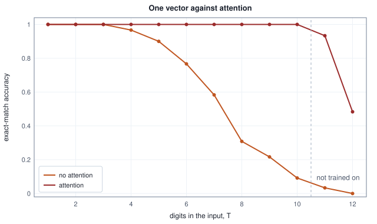
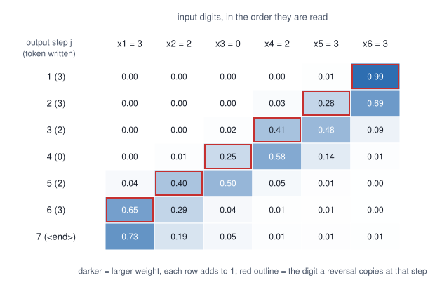

<!-- SPDX-License-Identifier: CC-BY-4.0 -->
<!-- Copyright (c) 2026 Martin Schröder <info@swedishembedded.com> -->

# Encoder-Decoder Models and the Birth of Attention

*How can a model read one sequence and write another, and why did a fixed-size summary fail?*

Say the digits `2 3 1` backwards. You did it without effort: `1 3 2`. Now try it on `2 1 0 3 3 1 2 3 2 2`, hearing it once and writing nothing down. Most people lose the middle, and the ones who do not are doing something specific: they run an eye along the digits from the right, one at a time, instead of keeping the whole string in their head. The task did not get harder in what it asks. It got harder in what it asks the memory to hold between reading and writing.

Every model so far in this volume either reads a sequence or writes one. The recurrent network of the last chapter reads tokens into a state of fixed size, and the language model of the chapter before it writes the next token from the tokens already written. Translation, summarisation, speech recognition and the digit reversal above do both, with two different sequences: the thing to write depends on a sequence the writer has not produced, and the two sequences do not have the same length. The obvious design joins the two parts, and trained on digit reversal it breaks in exactly the way the digits above suggest. The break shows what to change, and the change, a decoder that looks back at the input instead of trusting a summary of it, is the first form of the idea the rest of the volume builds on.

A decoder that looks back at an encoder needs these earlier ideas in hand.

1. (Volume V, [Chapter 5](05-recurrent-networks.md), the recurrent network.) A recurrent network reads a sequence of 10 tokens with a state of 16 numbers. How many numbers does it carry from one step to the next, and does that number depend on the length of the sequence?
2. (Volume V, [Chapter 4](04-language-modeling.md), teacher forcing.) A model is trained to predict the tokens $y_1, \dots, y_n$ of a sentence one at a time. What token does it receive as input when predicting $y_j$ during training, and what does it receive when it generates text?
3. (Volume V, [Chapter 3](03-embeddings.md), the embedding table.) A table has 6 rows and 8 columns. What does the lookup of id 3 return, and how many multiplications does it take?
4. (Volume III, [Chapter 3](../v03-neural-networks/03-softmax.md), the softmax.) The scores $(1, 0, 0)$ go through a softmax. What are the three outputs, and what do they add up to?
5. (Volume I, [Chapter 3](../v01-mathematics/03-vectors.md), the dot product.) What is the dot product of $(1, 2)$ and $(3, -1)$, and for which pair of vectors of the same length (norm) is a dot product largest?

## Writing digits backwards

The task is the one of the opening. An input is a string of $T$ digits, each one of 0, 1, 2, 3 chosen uniformly; the output is the same digits in the opposite order, followed by a marker `<end>` that says the output is complete. The model must therefore produce $T + 1$ tokens from $T$, and $T$ varies from one example to the next.

<!-- worked: seq2seq.task -->
The ids are `0 0`, `1 1`, `2 2`, `3 3`, `4 <s>` (the start marker fed to the decoder first) and `5 <end>`, so V = 6. An input is T digits with T between 1 and 10 in training (and 1 to 12 in the test), each digit uniform on 0 .. 3; the output is the digits in the opposite order followed by `<end>`.

Generator: the book's SplitMix64, seed 0x87b9e70660e4b168 (`seed_of` of the name `seq2seq.example`). Draw order: for each of the four examples, T times `integer(4)`.

| input digits T | input | output | output tokens T + 1 | possible inputs 4^T |
|---:|---|---|---:|---:|
| 1 | `2` | `2 <end>` | 2 | 4 |
| 4 | `2 3 1 3` | `3 1 3 2 <end>` | 5 | 256 |
| 7 | `2 3 3 2 2 2 0` | `0 2 2 2 3 3 2 <end>` | 8 | 16,384 |
| 10 | `1 1 1 3 1 1 2 0 0 3` | `3 0 0 2 1 1 3 1 1 1 <end>` | 11 | 1,048,576 |

A decoder that has no access to the input can only guess each digit uniformly: its cross-entropy is ln 4 nats on each digit. Suppose it were even told T, so that the `<end>` costs it nothing. Its loss per output token would then be, for a few lengths:

| T | ln 4 per digit | ln 4 summed over the T digits | mean over the T + 1 tokens |
|---:|---:|---:|---:|
| 1 | 1.3863 | 1.3863 | 0.6931 |
| 4 | 1.3863 | 5.5452 | 1.1090 |
| 7 | 1.3863 | 9.7041 | 1.2130 |
| 10 | 1.3863 | 13.8629 | 1.2603 |
<!-- /worked -->

Three things about the task make it a good one. Its answer can be checked by eye, so there is no doubt about what a correct model does. The input has $4^T$ possible values and every digit matters, so no shortcut on a few digits can succeed. And the digit read first is written last, which is the hardest order for a memory that is rewritten at every step: the digit that has been overwritten the most times is the one needed last. In a copy task every digit waits the same $T$ steps between being read and being written; in reversal the first digit waits $2T - 1$ and the last only one.

The second table is what a decoder is worth when it has no access to the input at all. Each digit is then a fair guess among four, costing $\ln 4$ nats, and even if the decoder were told $T$ and so paid nothing for the `<end>`, its loss per output token would be the last column. Any loss below that column is evidence that information about the input reached the output, and a model that has learned the task reaches 0.

## Two recurrent networks and one vector

The recurrent network of the last chapter can be taken in two ways. Read as a reader, it consumes a sequence and leaves a state that summarises it. Read as a writer, driven by the language-modeling rule of Chapter 4, it takes the token just written, updates its state and gives a distribution over the next token. Put the reader in front of the writer and let the reader's final state become the writer's first one, and the writer's output depends on the input sequence through that one state.

The reader is the **encoder**, a recurrent network that reads the input $x_1, \dots, x_T$ and produces states $\mathbf{h}_1, \dots, \mathbf{h}_T$. The writer is the **decoder**, a second recurrent network that writes the output $y_1, \dots, y_{T+1}$ one token at a time. A pair of the two, trained together, is an **encoder-decoder** model. The state that joins them is the **context vector** $\mathbf{c} = \mathbf{h}_T$: a vector of $H$ numbers that is everything the decoder will ever know about the input.

Both networks use one of the gated cells of the last chapter, the GRU, with its three blocks of weights ordered $z, r, n$. A token $x$ enters it as a row of the embedding table $\mathbf{W}_{\mathrm{emb}}$ of Chapter 3, a vector of $D$ numbers, and the input product of Chapter 5 is now a matrix-vector product, since the column of $\mathbf{U}$ picked by a one-hot vector was the special case of a table lookup. Written once, with the weight blocks $\mathbf{U}_z, \mathbf{U}_r, \mathbf{U}_n$ on the input and $\mathbf{W}_z, \mathbf{W}_r, \mathbf{W}_n$ on the state:

$$
\begin{aligned}
\mathbf{z} &= \sigma(\mathbf{W}_z\mathbf{h} + \mathbf{U}_z\mathbf{x} + \mathbf{b}_z), \qquad
\mathbf{r} = \sigma(\mathbf{W}_r\mathbf{h} + \mathbf{U}_r\mathbf{x} + \mathbf{b}_r),\\
\mathbf{n} &= \tanh(\mathbf{W}_n(\mathbf{r} \odot \mathbf{h}) + \mathbf{U}_n\mathbf{x} + \mathbf{b}_n),\\
\mathrm{gru}(\mathbf{h}, \mathbf{x}) &= (1 - \mathbf{z}) \odot \mathbf{h} + \mathbf{z} \odot \mathbf{n}.
\end{aligned}
$$

The encoder starts at $\mathbf{h}_0 = \mathbf{0}$ and runs $\mathbf{h}_i = \mathrm{gru}_{\mathrm{enc}}(\mathbf{h}_{i-1}, \mathbf{W}_{\mathrm{emb}}[x_i])$. The decoder starts from the context, $\mathbf{s}_0 = \mathbf{c}$, and at output step $j$ reads the embedding of the token before the one it must write, $\mathbf{s}_j = \mathrm{gru}_{\mathrm{dec}}(\mathbf{s}_{j-1}, \mathbf{W}_{\mathrm{emb}}[y_{j-1}])$, where $y_0$ is the start marker `<s>` of Chapter 4. Its state becomes a distribution over the six ids by the output layer of Chapter 5,

$$
p_j = \mathrm{softmax}(\mathbf{W}_{\mathrm{out}}\mathbf{s}_j + \mathbf{b}_{\mathrm{out}}),
$$

and the loss is the cross-entropy of Volume III averaged over the output tokens. One embedding table serves both networks, since the input and output alphabets are the same.


The figure shows the whole design, and the bottleneck is in it: between the two panels there is one arrow, carrying $H$ numbers, whatever $T$ is.

Here the teacher forcing of Chapter 4 does its work. During training the decoder's input at step $j$ is the correct token $y_{j-1}$ from the target, shifted right by one with `<s>` in front, whatever the decoder wrote on its previous step, which lets every output position be trained at once from the same loss. When the model writes for real there is no target. At each step it takes the most probable token of $p_j$ (greedy decoding; Chapter 11 turns to the alternatives) and feeds it back, and stops after the `<end>` or after a fixed budget. In the experiments below, a generated output is run for exactly $T + 1$ steps and counts as right only if all of it matches.

```text
function sequence_loss(src: list<int>) -> real:           # teacher forced
    T = len(src)
    h = zeros(real, [H])
    for i in 0 .. T:
        h = gru_step(enc, h, W_emb[src[i], :])
    s = h                                   # the context vector c = h_T
    target = concat(reverse(src), [END])    # T + 1 tokens
    prev = START
    loss = 0.0
    for j in 0 .. T + 1:
        s = gru_step(dec, s, W_emb[prev, :])
        p = softmax([dot(W_out[k, :], s) + b_out[k] for k in 0 .. V])
        loss = loss - log(p[target[j]])
        prev = target[j]                    # generation: prev = argmax(p)
    return loss / (T + 1)
```

Here `START` and `END` are the ids of `<s>` and `<end>`. A batch's loss is the sum of these token losses over its sequences divided by the number of output tokens in the batch, so every token weighs the same.

## Learning through both networks

Training such a pair is the training of the last chapter twice over. The loss sits on the decoder's outputs, and backpropagation through time runs the decoder's steps in reverse: each step receives the gradient $d\mathbf{s}_j$ from the output layer and from the next step, and gives its input embedding a gradient and the previous state $d\mathbf{s}_{j-1}$. After step 1 the gradient $d\mathbf{s}_0$ is also $d\mathbf{h}_T$, since $\mathbf{s}_0 = \mathbf{h}_T$, and it flows into the encoder, which is run in reverse from its last step to its first exactly as a recurrent network was in Chapter 5. The embedding table collects gradients from both networks, summed, the rule for a value used in several places. A single backward pass trains the encoder with no loss of its own: it learns whatever makes the decoder's loss fall.

Count how far the signal has to travel. The loss of output step $j$ reaches $\mathbf{h}_T$ after $j$ decoder steps, and the digit read first was fed into the encoder $T - 1$ steps before $\mathbf{h}_T$. The digit read first is written last, at output step $j = T$, so the gradient that would teach the encoder to keep it passes through $T + (T - 1) = 2T - 1$ recurrent steps, 19 of them at $T = 10$. Chapter 5 computed what a product of that many Jacobians does to a gradient; what training achieves with paths of that length is measured next.

## One vector against a growing input

Both models of this chapter are trained the same way, by the minibatch Adam of Volume III with the global-norm clipping of Chapter 8 of that volume, on freshly drawn inputs of 1 to 10 digits, and tested on 60 fresh inputs of each length from 1 to 12, so that the last two lengths were never seen in training. The protocol is printed once, with the first model.

Training starts from a fixed recipe for the parameters, and a reader who wants the training tables must follow it exactly. Every matrix is drawn row by row (the first row, entry by entry, then the second), each entry being a scale times one `normal()` of the generator of Volume I, [Chapter 17](../v01-mathematics/17-randomness.md), and all the matrices of a model come from one generator in this order, with $D_x$ the width of the decoder's input ($D_x = D$ without attention and $D + H$ with it, the embedding first and then the context) and $A$ the width of the attention layer introduced later:

| order | tensor | shape | scale |
|---:|---|---|---|
| 1 | embedding table $\mathbf{W}_{\mathrm{emb}}$ | $[V, D]$ | $0.5$ |
| 2 | encoder $\mathbf{U}$, the blocks $z, r, n$ stacked | $[3H, D]$ | $1/\sqrt{D}$ |
| 3 | encoder $\mathbf{W}$, the blocks $z, r, n$ stacked | $[3H, H]$ | $1/\sqrt{H}$ |
| 4 | decoder $\mathbf{U}$ | $[3H, D_x]$ | $1/\sqrt{D_x}$ |
| 5 | decoder $\mathbf{W}$ | $[3H, H]$ | $1/\sqrt{H}$ |
| 6 | output $\mathbf{W}_{\mathrm{out}}$ | $[V, H]$ | $1/\sqrt{H}$ |
| 7 | $\mathbf{W}_a$, with attention only | $[A, H]$ | $1/\sqrt{H}$ |
| 8 | $\mathbf{U}_a$, with attention only | $[A, H]$ | $1/\sqrt{H}$ |
| 9 | $\mathbf{v}$, with attention only | $A$ values | $1/\sqrt{A}$ |

Row $i$ of a stacked matrix is output unit $i$ of its block: rows $0$ to $H-1$ belong to $z$, rows $H$ to $2H-1$ to $r$ and rows $2H$ to $3H-1$ to $n$, so $\mathbf{U}$ is read as $[$output unit, input$]$. Every bias is $0$ at the start (the update gate's included), and the decoder starts from $\mathbf{s}_0 = \mathbf{h}_T$. The generators are named `seq2seq.<model>.<run>.init` for training, with `<model>` equal to `plain` for the model without attention and `attention` for the one with it, and `seq2seq.check.plain` and `seq2seq.check.attention` for the gradient check. The tables below label the first model "no attention" and print the seed of its generator.

The training conventions are these. Each update draws a batch of 16 sequences, one after the other, from the generator `seq2seq.train.<run>`: the length $1 + \mathrm{integer}(10)$ and then that many digits; both models of a run see the same batches. The loss of a batch is the sum of the token losses of all its sequences divided by the number of output tokens in the batch (the sum of the $T + 1$ of each sequence), and the gradient is that loss's gradient, summed over the sequences in batch order. The gradient of all parameters together is clipped to a global norm of 5 (all entries squared and added, square root, every entry multiplied by $\min(1, 5 / \text{norm})$) before Adam sees it. Adam has first and second moments that start at zero, a step counter $t$ that starts at 1 for the first update, the bias corrections $1 - \beta_1^t$ and $1 - \beta_2^t$, and no weight decay; every entry of the parameters then loses the learning rate times the corrected first moment divided by (the square root of the corrected second moment plus the printed epsilon). Greedy decoding takes the first index when two logits tie.

<!-- worked: seq2seq.training_plain -->
The model is the one of the text, H = 16 state numbers, embedding width 8, V = 6, the parameters drawn by the initialisation recipe of the text from the generator named `seq2seq.plain.<run>.init` with run 0 or 1 (`plain` is the model without attention; seeds in the table). Training is Adam (learning rate 0.01, beta1 0.9, beta2 0.999, epsilon 1e-08, with the bias correction of Volume III) on minibatches of 16 freshly drawn input sequences, 1500 updates (24,000 sequences), every gradient clipped to a global norm of 5. Batch element after batch element, the length is `1 + integer(10)` and then that many `integer(4)` digits, from the generator `seq2seq.train.<run>`, so that the two models of a run (this one and the one of the attention section) see the same sequences. The loss is the mean cross-entropy per output token over the batch; a checkpoint reports the mean over the 100 batches that end at it. The test set has 60 inputs for each length 1 to 12, drawn from `seq2seq.test` (seed 0x5689c1a770af5a30), length by length; an input counts as exact when the greedy output, run for T + 1 steps on its own previous outputs, equals the reversed input followed by `<end>`. Losses are rounded to 3 decimals. They and the counts are reproduced digit for digit only by an implementation that adds in the same order; a trained network is a chaotic function of its arithmetic, so a reimplementation should expect the same picture and not the same counts.

| model | run | seed of the initial parameters | loss, step 100 | loss, step 300 | loss, step 600 | loss, step 1000 | loss, step 1500 | exact, T 1 to 4 | exact, T 5 to 10 | exact, T 11 to 12 |
|---|---:|---|---:|---:|---:|---:|---:|---:|---:|---:|
| no attention | 0 | 0x08827ad5638f9ffe | 1.251 | 0.586 | 0.397 | 0.318 | 0.211 | 239/240 | 149/360 | 0/120 |
| no attention | 1 | 0x1f1a233e1b9c9ac6 | 1.235 | 0.604 | 0.363 | 0.238 | 0.157 | 237/240 | 195/360 | 4/120 |
<!-- /worked -->

The loss falls steadily, and it falls far below what a decoder that ignores the input could reach, so information about the input is getting through. The loss is also still falling at the last checkpoint in both runs, at 0.211 and 0.157 per token, whereas a model that had learned the task would have none left to remove. The test accuracy says what the remainder is.

<!-- worked: seq2seq.plain_accuracy -->
Accuracy of the model without attention over the 120 test inputs of each length (the 60 of the two runs together, so a multiple of 1/120). Exact: the whole output is right. Token: the fraction of the T + 1 output tokens that are right, each compared with the same position of the target.

| T | in training | exact | token |
|---:|---|---:|---:|
| 1 | trained | 1.000 | 1.000 |
| 2 | trained | 1.000 | 1.000 |
| 3 | trained | 1.000 | 1.000 |
| 4 | trained | 0.967 | 0.988 |
| 5 | trained | 0.900 | 0.965 |
| 6 | trained | 0.767 | 0.925 |
| 7 | trained | 0.583 | 0.873 |
| 8 | trained | 0.308 | 0.791 |
| 9 | trained | 0.217 | 0.727 |
| 10 | trained | 0.092 | 0.636 |
| 11 | beyond | 0.033 | 0.594 |
| 12 | beyond | 0.000 | 0.530 |
<!-- /worked -->

Up to three digits the model is perfect. Beyond that the whole-output accuracy falls steadily, to 0.308 at $T = 8$, 0.092 at $T = 10$, a length it was trained on, and 0 at 12. The token accuracy falls much more slowly, from 0.988 at $T = 4$ to 0.636 at $T = 10$, which says that a failed output is mostly right and wrong in a few places, not wrong throughout. Which places?

<!-- worked: seq2seq.lost_digits -->
Inputs of T = 8 digits (the 60 test inputs of that length, for each of the two runs). For input digit number i (counting from 1 in the order of reading) the table gives the fraction of inputs for which the model writes that digit correctly at the place where it belongs, output position T + 1 - i, each output being generated on the model's own previous outputs. Digit 1 is read first and written last.

| input digit i | written at output position | fraction written correctly |
|---|---:|---:|
| 1 | 8 | 0.692 |
| 2 | 7 | 0.675 |
| 3 | 6 | 0.558 |
| 4 | 5 | 0.650 |
| 5 | 4 | 0.792 |
| 6 | 3 | 0.875 |
| 7 | 2 | 0.925 |
| 8 | 1 | 0.983 |
<!-- /worked -->

Read the second column against the first. The digit read last, at the bottom of the table, is written first and is right 0.983 of the time. The digits read early are lost, and the loss is not even: the digits read in positions 2 to 4 are the worst, between 0.558 and 0.675, and the very first digit is a little better than its neighbours at 0.692. A single input shows what such a loss looks like.

<!-- worked: seq2seq.plain_outputs -->
Run 0 of the model without attention on three inputs of the generator `seq2seq.example.shown` (seed 0x248289037ab68664; draws, `integer(4)` for each digit, of the lengths [4, 8, 10] in that order), greedy output on its own previous outputs.

| T | input | target | output |
|---:|---|---|---|
| 4 | `3 3 2 3` | `3 2 3 3 <end>` | `3 2 3 3 <end>` |
| 8 | `0 1 1 1 2 1 1 2` | `2 1 1 2 1 1 1 0 <end>` | `2 1 1 2 1 1 1 0 <end>` |
| 10 | `2 1 0 3 3 1 2 3 2 2` | `2 2 3 2 1 3 3 0 1 2 <end>` | `2 2 3 1 2 3 0 3 1 2 <end>` |
<!-- /worked -->

At $T = 10$ the output has the same digits as the target, with two pairs of neighbours exchanged: `1 2` where the target has `2 1`, and `3 0` where it has `0 3`. The state remembers which digits were read better than in what order. The pattern fits the picture of the last chapter, in which a state that is rewritten at every step keeps a coarse summary of what it was given, and that is all this experiment shows. It does not show that one vector must fail: a state of 16 numbers has room for 20 bits of $T = 10$ digits many times over, and a network with a larger $H$, or more training, might hold more; Exercise 11 asks for the dependence on $H$. What the table shows is the shape of this failure: the longer the input, the more must be squeezed through one vector, and the further a training signal has to travel to teach the squeeze.

Others met the same wall on a larger stage. Sutskever, Vinyals and Le (2014) translated sentences with an LSTM encoder-decoder of this design, and reported that it helped to feed the source sentence in reverse order, which shortens many of the paths between a source word and the target words that depend on it. The task of this chapter is the opposite arrangement on purpose, since the digit read first is written last. Cho, van Merrienboer, Bahdanau and Bengio (2014) measured the translation quality of such models against the length of the sentence and found that it fell as sentences grew, and Bahdanau, Cho and Bengio (2015) named the single vector as the likely cause. The fall in the table above is a fall of the same kind, in a task small enough to check by eye.

## Letting the decoder look back

The cure follows from the diagnosis. The decoder fails for lack of access to the digits read early, and the encoder had them: its states $\mathbf{h}_1, \dots, \mathbf{h}_T$ exist, one for each input position, and the design of the last section throws away all but the last. Keep them, and let the decoder consult them. At every output step it has a question, which digit is next, and the answer is somewhere among the $T$ states. What it needs is a way to build, for each step, a context vector of its own, $\mathbf{c}_j$, out of the states that matter for that step.

The simplest such vector is a weighted average of the states,

$$
\mathbf{c}_j = \sum_{i=1}^{T} \alpha_{ji}\,\mathbf{h}_i, \qquad \alpha_{ji} \ge 0, \quad \sum_{i=1}^{T} \alpha_{ji} = 1,
$$

where $\alpha_{ji}$ is how much output step $j$ looks at input position $i$. Each of the two conditions has a reason. Non-negative weights that add to 1 keep $\mathbf{c}_j$ at the scale of one state however long the input is, which an unweighted sum of $T$ states would not. And they make the picking soft. Choosing the one best state, the argmax, would have a gradient of zero nearly everywhere, since a small change in a score does not change which one wins, and nothing could be learned about where to look. A weighted average is differentiable in the weights, so the gradient says how to move them.

The weights must depend on the step: at output step $j$ the right state is not the same as at step $j + 1$. They are produced from a **score** $e_{ji}$ for each pair of an output step and an input position, a number that says how useful $\mathbf{h}_i$ is for the step now. What the decoder knows about the step is its previous state $\mathbf{s}_{j-1}$, which holds what it has written and what it was about to do; what the encoder offers is $\mathbf{h}_i$. A score must compare the two. The softmax of Volume III turns a vector of scores into weights that are positive and add to 1:

$$
\alpha_{ji} = \frac{\exp(e_{ji})}{\sum_{i'=1}^{T}\exp(e_{ji'})}.
$$

It runs over the input positions $i$, for each step $j$ separately. What remains is the score. Bahdanau, Cho and Bengio (2015) let a small network compute it: a layer with $A$ tanh units reads both vectors and a vector $\mathbf{v}$ of $A$ numbers sums its outputs,

$$
e_{ji} = \mathbf{v}^\top \tanh\!\big(\mathbf{W}_a\mathbf{s}_{j-1} + \mathbf{U}_a\mathbf{h}_i\big).
$$

This is the one-hidden-layer network of Volume III, with a hidden layer whose pre-activation is $\mathbf{W}_a\mathbf{s} + \mathbf{U}_a\mathbf{h}$, a layer fed by the two vectors side by side, and a single output. Because the contributions of the decoder and of the encoder are added before the nonlinearity, the attention is called **additive attention**. It is attention because the decoder attends to some positions more than others; it is additive in how it scores. The matrices $\mathbf{W}_a$ and $\mathbf{U}_a$ have shape $[A, H]$ and are learned with the rest of the model. Since $\mathbf{U}_a\mathbf{h}_i$ does not depend on the decoder, it is formed once per input, $\mathbf{k}_i = \mathbf{U}_a\mathbf{h}_i$, and reused at every output step; call it the key of position $i$.

A small case shows every step. Three encoder states of two numbers, a decoder state of two numbers, an attention layer with $A = 2$:

<!-- worked: seq2seq.attention_step -->
Generator: the book's SplitMix64, seed 0xfe86740daeb38479 (`seed_of` of the name `seq2seq.step`). Draws, in this order, each `0.8 * normal()`: Wa (4 values, row by row), Ua (4), v (2), the decoder state s (2), then the three encoder states h_1, h_2, h_3 (2 values each). Two numbers per state (H = 2) and two in the attention layer (A = 2). Tolerance: values are rounded to 4 decimals.

Wa has rows (-0.3719, 1.1586), (0.2726, -0.2707), Ua has rows (1.1743, 0.0222), (-0.2207, -0.3846), v = (-0.6869, -0.9464), s = (-1.3284, 1.2105), so Wa s = (1.8965, -0.6899).

| i | encoder state h_i | keys_i = Ua h_i | Wa s + keys_i | tanh of that | score e_i = v . tanh |
|---:|---|---|---|---|---|
| 1 | (0.2412, 1.1460) | (0.3086, -0.4940) | (2.2051, -1.1838) | (0.9760, -0.8287) | 0.1138 |
| 2 | (-0.8580, -1.0018) | (-1.0298, 0.5747) | (0.8667, -0.1152) | (0.6997, -0.1147) | -0.3721 |
| 3 | (0.2406, 0.1024) | (0.2848, -0.0925) | (2.1813, -0.7823) | (0.9748, -0.6540) | -0.0506 |

The softmax of the scores (0.1138, -0.3721, -0.0506) gives the weights a = (0.4059, 0.2497, 0.3444), which add to 1.0000, and the context is c = sum of a_i h_i = (-0.0335, 0.2503).
<!-- /worked -->

The scores differ by less than half a unit, so no position is ignored: the weights are 0.41, 0.25 and 0.34, and the context is a blend of the three states. Larger gaps make the weights sharper: the softmax turns a gap of 5 between two scores into a weight ratio of $e^5 \approx 148$.

The decoder uses its context by feeding it in, along with the embedding of the previous token, to the GRU:

$$
\mathbf{s}_j = \mathrm{gru}_{\mathrm{dec}}\big(\mathbf{s}_{j-1}, [\mathbf{W}_{\mathrm{emb}}[y_{j-1}];\, \mathbf{c}_j]\big),
$$

where the square brackets place the two vectors one after the other, so that the decoder's input is $D + H$ numbers wide. Everything else is as before, including $\mathbf{s}_0 = \mathbf{h}_T$ and the output layer on $\mathbf{s}_j$. The single context vector of the first design is no longer the decoder's only link to the input: $\mathbf{h}_T$ still starts the decoder, but from the first step on every step has a context $\mathbf{c}_j$ of its own.

```text
function attend(s: array<real>[H], states: array<real>[T, H],
                keys: array<real>[T, A], Wa: array<real>[A, H],
                v: array<real>[A]) -> (array<real>[H], array<real>[T]):
    q = [dot(Wa[r, :], s) for r in 0 .. A]        # the decoder's part, once per step
    e = [dot(v, map(tanh, q + keys[i, :])) for i in 0 .. T]
    alpha = softmax(e)
    c = [sum([alpha[i] * states[i, j] for i in 0 .. T]) for j in 0 .. H]
    return (c, alpha)
```

In the loop of `sequence_loss`, the line that updates the state becomes two:

```text
        (c, alpha) = attend(s, states, keys, Wa, v)
        s = gru_step(dec, s, concat(W_emb[prev, :], c))
```

where `states[i, :]` are the encoder states kept from the first loop and `keys[i, :]` is `Ua` applied to each, computed once before the decoder loop.

### The backward pass through the weighted average

A new layer needs its backward pass, and the pieces are all familiar. Suppose the backward pass of the decoder step has produced the gradient $d\mathbf{c}_j$ of the loss with respect to the context (it is the last $H$ entries of the gradient on the GRU's input). The context is $\sum_i \alpha_{ji}\mathbf{h}_i$, a sum of products. Two things follow, the gradient of each state and the gradient of each weight:

$$
d\mathbf{h}_i \mathrel{+}= \alpha_{ji}\,d\mathbf{c}_j, \qquad d\alpha_{ji} = d\mathbf{c}_j \cdot \mathbf{h}_i .
$$

The weights came out of a softmax, whose backward pass was derived in Volume III: with $\bar d = \sum_{i'} \alpha_{ji'}\,d\alpha_{ji'}$,

$$
de_{ji} = \alpha_{ji}\,(d\alpha_{ji} - \bar d).
$$

Then the score's own network. Let $\mathbf{u}_{ji} = \tanh(\mathbf{W}_a\mathbf{s}_{j-1} + \mathbf{k}_i)$ be its hidden activations. The output $e_{ji} = \mathbf{v}^\top\mathbf{u}_{ji}$ sends $de_{ji}\,\mathbf{u}_{ji}$ to $\mathbf{v}$ and $de_{ji}\,\mathbf{v}$ to the activations, which pass through the slope of the tanh,

$$
d\mathbf{a}_{ji} = (1 - \mathbf{u}_{ji}\odot\mathbf{u}_{ji}) \odot \mathbf{v}\,de_{ji},
$$

and $d\mathbf{a}_{ji}$ goes to two places, because the pre-activation is a sum: to the key, $d\mathbf{k}_i \mathrel{+}= d\mathbf{a}_{ji}$, which gives $d\mathbf{U}_a \mathrel{+}= d\mathbf{a}_{ji}\mathbf{h}_i^\top$ and $d\mathbf{h}_i \mathrel{+}= \mathbf{U}_a^\top d\mathbf{a}_{ji}$; and to the query, $d\mathbf{q}_j = \sum_i d\mathbf{a}_{ji}$, which gives $d\mathbf{W}_a \mathrel{+}= d\mathbf{q}_j\mathbf{s}_{j-1}^\top$ and $d\mathbf{s}_{j-1} \mathrel{+}= \mathbf{W}_a^\top d\mathbf{q}_j$. The parameter gradients are summed over steps and positions, as for any shared weight. Each encoder state $\mathbf{h}_i$ now receives gradient from every output step, directly, and the loss of output step $j$ reaches the encoder state of the digit it needs in one step, not in $2T - 1$.

That claim, and the pages of formulas behind it, must be checked against something other than themselves. The check of Volume III does it: perturb each parameter by a small $\pm\epsilon$, recompute the loss, and compare $(L(\theta + \epsilon) - L(\theta - \epsilon))/2\epsilon$ with the gradient the backward pass gives.

<!-- worked: seq2seq.gradient_check -->
Input [2, 0, 3] (T = 3, so the output has 4 tokens), H = 3, embedding width 2, A = 3. Parameters drawn by the initialisation recipe of the text from the generator named `seq2seq.check.plain` for the model without attention and `seq2seq.check.attention` for the one with it (seeds below), after which the three biases get `0.1 * normal()` entries drawn from the same generator, in the order encoder bias, decoder bias, output bias. Central differences with step 1e-05 on every entry of every parameter, against the gradient of the backward pass. Tolerance: the table prints the largest absolute difference and the largest relative difference |a - n| / max(|a|, |n|) over the entries whose gradient is above 1e-4.

| model | seed | parameters checked | largest absolute difference | largest relative difference |
|---|---|---:|---:|---:|
| no attention (`seq2seq.check.plain`) | 0x0b22f029db37a8ed | 144 | 3.4e-11 | 8.8e-08 |
| attention (`seq2seq.check.attention`) | 0x218c018931ab2bd7 | 192 | 3.0e-11 | 8.3e-08 |
<!-- /worked -->

Both backward passes, with and without attention, agree with central differences to the precision the check can offer (relative differences near $10^{-7}$), on every parameter of the tiny model, the embedding table, both GRUs, the output layer and the attention parameters. The two models differ in size.

<!-- worked: seq2seq.parameters -->
H = 16 state numbers, embedding width 8, attention width A = 16, V = 6 ids. A GRU with input width D has 3 H (D + H + 1) parameters (the matrices on the input and on the state, and the bias); the encoder reads the embedding (D = embedding width), the decoder reads the embedding, plus the context of H numbers when it has attention. The table counts the entries of the parameter lists the training builds, and the formula agrees with that count.

| model | all parameters | embedding table | encoder GRU | decoder GRU | output layer | attention (Wa, Ua, v) |
|---|---:|---:|---:|---:|---:|---:|
| no attention | 2,550 | 48 | 1,200 | 1,200 | 102 | 0 |
| attention | 3,846 | 48 | 1,200 | 1,968 | 102 | 528 |
<!-- /worked -->

The attention model has 3,846 parameters against 2,550. A reader might suspect that the extra parameters, and not the attention, buy what follows. The gap is 1,296 numbers, and a model without attention that doubles $H$ to 32 has 8,118 parameters (Exercise 4), more than twice as many as the attention model of $H = 16$; Exercise 11 asks whether that closes the gap.

## Accuracy that holds with length

The attention model is trained by the same protocol, on the same sequences, run for run.

<!-- worked: seq2seq.training_attention -->
The model of the text with attention (A = 16), parameters drawn by the same initialisation recipe from the generator `seq2seq.attention.<run>.init` with run 0 or 1, trained by the protocol of the previous training block (same optimizer, batches, clipping, test set and counting; the sequences of run r are those of run r there). Same tolerance.

| model | run | seed of the initial parameters | loss, step 100 | loss, step 300 | loss, step 600 | loss, step 1000 | loss, step 1500 | exact, T 1 to 4 | exact, T 5 to 10 | exact, T 11 to 12 |
|---|---:|---|---:|---:|---:|---:|---:|---:|---:|---:|
| attention | 0 | 0xc4b209d4984dd115 | 1.110 | 0.227 | 0.015 | 0.004 | 0.004 | 240/240 | 360/360 | 80/120 |
| attention | 1 | 0x22e0c2ee06e76407 | 1.070 | 0.353 | 0.099 | 0.016 | 0.009 | 240/240 | 360/360 | 90/120 |
<!-- /worked -->

Its loss falls below the other model's by step 600 (0.015 and 0.099, against 0.397 and 0.363) and ends at 0.004 and 0.009, close to zero. Both runs are right on every one of the 600 test inputs of 1 to 10 digits (240 + 360 each). The comparison at every length:

<!-- worked: seq2seq.accuracy_by_length -->
Accuracy over the 120 test inputs of each length (the 60 of the two runs together, so a multiple of 1/120). Exact: the whole output is right. Token: the fraction of the T + 1 output tokens that are right, each compared with the same position of the target.

| T | in training | exact, no attention | exact, attention | token, no attention | token, attention |
|---:|---|---:|---:|---:|---:|
| 1 | trained | 1.000 | 1.000 | 1.000 | 1.000 |
| 2 | trained | 1.000 | 1.000 | 1.000 | 1.000 |
| 3 | trained | 1.000 | 1.000 | 1.000 | 1.000 |
| 4 | trained | 0.967 | 1.000 | 0.988 | 1.000 |
| 5 | trained | 0.900 | 1.000 | 0.965 | 1.000 |
| 6 | trained | 0.767 | 1.000 | 0.925 | 1.000 |
| 7 | trained | 0.583 | 1.000 | 0.873 | 1.000 |
| 8 | trained | 0.308 | 1.000 | 0.791 | 1.000 |
| 9 | trained | 0.217 | 1.000 | 0.727 | 1.000 |
| 10 | trained | 0.092 | 1.000 | 0.636 | 1.000 |
| 11 | beyond | 0.033 | 0.933 | 0.594 | 0.972 |
| 12 | beyond | 0.000 | 0.483 | 0.530 | 0.771 |
<!-- /worked -->



Where the model with one vector loses almost every input of ten digits, the model with attention loses none from $T = 1$ to $T = 10$: exact accuracy 1.000 at each. The same states, the same GRUs and the same data do the job, with the one difference that the decoder may read all of the encoder's states instead of only the last one.

The curve of the attention model does bend beyond the training lengths: 0.933 at $T = 11$ and 0.483 at $T = 12$. Attention removes the squeeze of the input through one vector. It does not remove the decoder's need to keep its own place: after writing three digits it must know that the next is the fourth, since nothing in the input says "position 4" except what the encoder's recurrence happens to encode. A plausible reading of the drop is that what it learned for lengths up to 10 is a habit that does not extend past them. Chapter 8 returns to how a model is told where each position is.

### What the weights look like

The weights $\alpha_{ji}$ of one output sequence form a matrix of $T + 1$ rows and $T$ columns, the **alignment**: the row of step $j$ is where the decoder looked while writing token $j$. For the attention model of run 0 on one input of six digits:

<!-- worked: seq2seq.alignment -->
The attention model of run 0 on the input `3 2 0 2 3 3` (T = 6, drawn by `integer(4)` from the generator `seq2seq.example.align`, seed 0x3dacce6ae3bc8d98). Row j holds the weights a_ji of output step j over the encoder positions, the token written at that step is in the second column; each row adds to 1. Tolerance: 2 decimals of a trained network (see the training block on what a reimplementation reproduces).

| output step j | token written | x1=3 | x2=2 | x3=0 | x4=2 | x5=3 | x6=3 | largest weight on |
|---:|---|---:|---:|---:|---:|---:|---:|---|
| 1 | `3` | 0.00 | 0.00 | 0.00 | 0.00 | 0.01 | 0.99 | x6 |
| 2 | `3` | 0.00 | 0.00 | 0.00 | 0.03 | 0.28 | 0.69 | x6 |
| 3 | `2` | 0.00 | 0.00 | 0.02 | 0.41 | 0.48 | 0.09 | x5 |
| 4 | `0` | 0.00 | 0.01 | 0.25 | 0.58 | 0.14 | 0.01 | x4 |
| 5 | `2` | 0.04 | 0.40 | 0.50 | 0.05 | 0.01 | 0.00 | x3 |
| 6 | `3` | 0.65 | 0.29 | 0.04 | 0.01 | 0.01 | 0.00 | x1 |
| 7 | `<end>` | 0.73 | 0.19 | 0.05 | 0.01 | 0.01 | 0.01 | x1 |
<!-- /worked -->



A reversal would look at the last digit first, then the one before it, and so on: the cells outlined in red, running up the anti-diagonal. The learned weights follow that line, and are not an exact copy of it. Step 1 puts 0.99 on $x_6$. At steps 2 to 5 the heaviest weight is one position to the right of the outlined cell (0.69 on $x_6$ at step 2, 0.48 on $x_5$ at step 3, 0.58 on $x_4$ at step 4, 0.50 on $x_3$ at step 5), with the rest of the mass on the outlined cell and its neighbours. At step 6 the largest weight is on $x_1$, and at the `<end>` step the model looks at $x_1$ again, 0.73, where it has nothing to copy.

All outputs are right, even where the largest weight is on the neighbour. The reason is that $\mathbf{h}_i$ is not the digit $x_i$: it is the encoder's state after reading $x_1, \dots, x_i$, which carries the recent digits, $x_i$ included, so that a weight on $\mathbf{h}_{i+1}$ also delivers $x_i$. An alignment is a matrix of weights on states, which are summaries; it shows where the decoder looked and not directly which digit it used. That makes it a useful picture and an imprecise explanation, a point to remember when attention maps are shown as evidence of what a model "understands". Bahdanau and his colleagues showed such matrices for translation, with an encoder that read the sentence in both directions so that each state summarised its surroundings on both sides, and found weights concentrated near the diagonal for languages with similar word order and elsewhere where the order differs.

## What looking back costs

The bottleneck is gone and something has been paid for it, which the FLOP counts of Volume IV let us price. Take the counting rule of Chapter 5: a matrix-vector product of $m$ by $n$ is $2mn$, and every addition, multiplication and activation is one FLOP. For one decoder step over $T$ encoder states:

- the query $\mathbf{W}_a\mathbf{s}$ costs $2AH$;
- each position adds the query to its key ($A$), takes the tanh ($A$) and takes the dot product with $\mathbf{v}$ ($2A$), which is $4A$, in all $4AT$;
- the softmax costs about $3T$, an exponential, an addition and a division per position;
- the weighted average costs $2TH$.

Before the decoder starts, the keys cost $2AH$ per input position. The attention of a whole output of $T + 1$ steps therefore costs the sum of those over the steps, and contains a product $T \times (T + 1)$ of input positions and output steps, which is quadratic in the length, where a recurrent step costs the same whatever $T$ is.

<!-- worked: seq2seq.attention_cost -->
Counting rule as in the previous chapter: a matrix-vector product of m by n is 2 m n, every addition, multiplication and activation is 1; a GRU step with input width D is 6 H (H + D) + 14 H FLOPs. The attention of one decoder step over T encoder states costs 2 A H + 4 A T + 3 T + 2 T H FLOPs, after the keys Ua h_i of the T states (2 A H each) have been formed once per input; the closed form agrees with a tally made by walking the loops (checked for T = 1, 7 and 64). H = 16, embedding width 8, A = 16, V = 6; reading T digits and writing T + 1 tokens (output layer included, loss not):

| T | FLOPs without attention | FLOPs of the attention | FLOPs with attention | ratio | attention share |
|---|---:|---:|---:|---:|---:|
| 4 | 23,742 | 6,588 | 38,010 | 1.60 | 0.173 |
| 8 | 44,758 | 15,832 | 74,414 | 1.66 | 0.213 |
| 16 | 86,790 | 43,824 | 156,726 | 1.81 | 0.280 |
| 32 | 170,854 | 137,824 | 359,366 | 2.10 | 0.384 |
| 64 | 338,982 | 477,888 | 916,710 | 2.70 | 0.521 |
| 128 | 675,238 | 1,766,272 | 2,639,654 | 3.91 | 0.669 |

For a layer of the size that language models use, H = A = 1024 and a decoder input of width 2 H (the embedding and the context), a GRU step costs 18,888,704 FLOPs and the attention step has a constant part, the query, of 2,097,152 FLOPs, and each encoder position adds 6,147, so the attention step (2,097,152 + 6,147 T) first costs at least as much as the recurrent step itself at T = 2732.

Bytes of float32 numbers that a model must hold to answer one input of T digits:

| T | context vector alone (bytes) | encoder states and keys kept for attention (bytes) | weights of all output steps (bytes) |
|---|---:|---:|---:|
| 8 | 64 | 1,024 | 288 |
| 64 | 64 | 8,192 | 16,640 |
| 512 | 64 | 65,536 | 1,050,624 |
<!-- /worked -->

At the sizes of this chapter the attention is a small part of the arithmetic for short inputs (a share of 0.173 at $T = 4$) and the larger part by $T = 64$ (0.521), where the whole forward pass costs 2.70 times that of the model without attention. At the width of a real model a GRU step is so much larger that the attention becomes the larger term only at $T = 2732$. The quadratic term is the first appearance of a cost that governs the rest of this volume: the number of scores is the product of two lengths. The bytes table shows the memory side. The context vector holds 64 bytes at any $T$, which is what made the first design cheap; attention needs to keep every encoder state and key, growing as $T$, and the weights of all output steps, growing as $T(T + 1)$, 1,050,624 bytes at $T = 512$ even for one sequence and one score layer.

Two things stay as they were. The decoder still takes $T + 1$ steps in a row, each one needing the state of the previous step, so the depth of Chapter 5 is not touched. And the work of attention is not a chain: the $T$ scores of one step do not depend on each other and can all be computed at once, which a recurrent step cannot do. That asymmetry, a cheap parallel look at everything beside an expensive sequential chain, is the reason that the next chapter asks what a model would be if it kept only the look.

## Attention between two sequences

The decoder of this chapter does three different things with the encoder's states, and it helps to give them names. It forms a question from its own state, $\mathbf{W}_a\mathbf{s}_{j-1}$. It matches the question against something about each encoder position, the key $\mathbf{k}_i = \mathbf{U}_a\mathbf{h}_i$. And it takes from each position something to hand on, the state $\mathbf{h}_i$ itself, in the proportion the match gave. In the vocabulary Chapter 7 will introduce, these are the query, the key and the value. Nothing forces the key and the value to be the same vector: a model may compute a separate projection of each encoder state for each.

Attention in which the questions come from one sequence (here the decoder's states) and the keys and values from another (the encoder's states) is called **cross-attention**, as the sequences are crossed. It is the general form of what Bahdanau's model did. The additive score is one way to compare a question with a key; Luong, Pham and Manning (2015) compared several, among them the dot product of the two vectors, $e_{ji} = \mathbf{s}_{j-1}\cdot\mathbf{h}_i$, which needs the two to have the same width and costs $2H$ FLOPs for a pair against $4A$ here, with no tanh and no layer of parameters. Scaled and used in every layer, it is the score of the next chapter.

The dot product makes the comparison a geometric one, and the reason it is a fair similarity is the one the recall question touched: of two vectors of the same length, the dot product is largest when they point the same way. The additive form is free to learn comparisons that are not a similarity of this kind. The price is a layer's worth of parameters and two nonlinear operations per pair. How the dot product is scaled, how it turns into the weighted average of values for a whole sequence at once and what happens when the questions come from the same sequence as the keys, is the subject of the next chapter.

## The same idea in brain's encoder-decoder transformer

The encoder-decoder model in brain is `crates/toyseq2seq`, and it is built from attention instead of recurrence. It is a transformer in the sense of the chapters to come: an encoder whose layers let every source position look at every other, and a decoder whose layers let every target position look at the earlier target positions and then, through cross-attention, at the whole encoder output. The header of `crates/toyseq2seq/src/model.rs` states the layout. The encoder keeps its final residual stream as "the encoder memory", which plays the part of the states $\mathbf{h}_1, \dots, \mathbf{h}_T$ of this chapter; each decoder layer applies the queries of its own state to a projection of that memory, `cross.q` for the queries and a fused `cross.kv` for the keys and values (the parameter list in `Seq2SeqConfig::param_list` gives them $d \times d$ and $d \times 2d$ weights), and the scores are laid out per sequence, per head, per target position and per source position, with the softmax over the source positions. That is the matrix of the alignment section, for every head.

The crate's convergence test, `crates/toyseq2seq/tests/it/convergence.rs`, trains the model on a simpler relative of the reversal task, copying. The encoder reads a random string of 5 symbols from an alphabet of 6; the decoder is teacher-forced with a start marker followed by the string shifted right and must predict the string. Copying tests cross-attention because the decoder's causal self-attention cannot see a source symbol before it predicts it, so the only way to bring the loss near 0 is to learn a cross-attention that reads position $i$ of the source at step $i$. A decoder that did not could reach, at best, the marginal entropy of one symbol, $\ln 6 \approx 1.792$, the same floor as the $\ln 4$ of the task table, here for six symbols. The test trains for 400 steps and asserts that the final loss is below 0.5.

The first version of the crate arrived in commit `86083315b` (June 2026), with that convergence test and a gradient check in `crates/gradcheck/src/lib.rs`, `check_seq2seq`, which builds a tiny model whose source has 5 positions and whose target has 6, so that the two lengths differ, and compares every analytic gradient with finite differences, the check of this chapter's gradient section applied to attention. The cross-attention backward is where the two sequences meet: the gradient of the keys and values goes into the encoder memory and the gradient of the queries goes into the decoder, and the memory receives a contribution from every decoder layer, which the backward pass accumulates (the `d_enc_mem0` and `d_enc_mem1` buffers of the backward builder). Commit `a126e9b22` (August 2026) renamed the crate from `seq2seq` to `toyseq2seq`; its message calls the renamed crates brain's own architectures, with no upstream model to compare against. Commit `58ef706cf` (October 2026) taught it the engine's memory-saving modes, replaying a layer from its saved residual instead of storing its activations, and streaming layers through a device window. Its message notes the one detail that belongs to this chapter: the decoder's replay cross-attends to the encoder memory, so that memory must be there when a decoder layer is recomputed. The tests it added, `recompute.rs` and `layer_streamed.rs` in the crate's `tests/it`, run those modes on the encoder-decoder.

<!-- worked: seq2seq.crate_scale -->
The configuration of the convergence test: vocabulary 7 (6 symbols and the start marker), source and target length 5, 2 encoder blocks and 2 decoder blocks, width d = 32, 4 heads, feed-forward width 128, batch 32. Each weight matrix has the shape of its entry in the crate's parameter list (a matrix of [rows, columns] and its bias). Every normalisation layer is a gain and a bias of d numbers each (2 d), every linear layer has a bias except the output head, which has none, and the position tables are learned tables of one row per position.

| part | parameters |
|---|---:|
| token table, encoder positions, decoder positions | 544 |
| 2 encoder blocks of 12,704 | 25,408 |
| 2 decoder blocks of 16,992, of which cross-attention 4,224 each | 33,984 |
| final norm and output head | 288 |
| all parameters | 60,224 |

The cross-attention of one decoder block scores every target position against every source position, for every head and every sequence of the batch: 32 x 4 x 5 x 5 = 3,200 scores per block (6,400 for the 2 blocks), and the number of weights per sequence is the 5 by 5 alignment matrix of the chapter, one for each of the 4 heads.
<!-- /worked -->

The count is the chapter's cost argument in a real model: the decoder blocks are larger than the encoder blocks by exactly the cross-attention parameters and one more normalization, and the scores of cross-attention, 3,200 per block at this tiny size, grow as the product of the two lengths and the number of heads.

## Check your understanding

1. A student trains the encoder-decoder of this chapter with $\mathbf{s}_0 = \mathbf{0}$ in place of $\mathbf{s}_0 = \mathbf{h}_T$ and no attention. What loss per digit should the model reach on long inputs, and why?
2. The model without attention is perfect at $T = 3$ and loses most inputs at $T = 10$, which it was trained on. A colleague says it has not seen enough long examples. Which part of the chapter's evidence argues against that, and which part of the evidence cannot tell?
3. Give the weights $\alpha$ for three input positions when all three scores are equal, and when one score is larger than the others by 10. What does the context vector $\mathbf{c}_j$ become in each?
4. A model replaces the softmax in attention by taking the position with the largest score ($\alpha_{ji} = 1$ at the arg max, 0 elsewhere). Forward results look similar. Why will training fail to improve the scores?
5. In the alignment of this chapter the weight on $\mathbf{h}_{i+1}$ is larger than on the outlined $\mathbf{h}_i$ and the output is still right. Find the error in the statement "the model looks at the wrong digit".
6. The attention of an input of $T = 100$ digits has 101 output steps. How many scores does it compute, and how many of them could be computed at the same time?
7. Why does the model with attention fail on $T = 12$ when it did not on $T = 10$, although it has the whole input available at every step?

## Summary

Reading one sequence and writing another is done by two recurrent networks joined by a vector. The encoder reads the input into states, the last of which is the context vector, and the decoder, started from it, writes the output one token at a time, trained by teacher forcing on the target shifted right and run on its own outputs when it generates. On a task whose answer is checkable by eye, the digits written backwards with an end marker, the pair is perfect on short inputs and fails as they grow: from 0.967 exact accuracy at four digits to 0.092 at ten, in a way that loses digits read early and keeps most of the rest, because everything must pass through one vector and the signal that teaches the encoder to keep a digit has to travel through $2T - 1$ steps. The cure is to keep every encoder state and give the decoder a context of its own at each step, a weighted average of the states with weights from a softmax over scores; Bahdanau's additive attention computes the scores with a small network on the decoder state and the encoder state. The backward pass is a sum, a softmax and a tanh layer, and it was checked against finite differences. With it the same pair, on the same data, is exact at every length it was trained on, and its weights, plotted as a matrix, are a soft version of the reversal's anti-diagonal. The price is a score for every pair of positions, quadratic in the length, while the recurrent chain stays. Attention in which the decoder asks and the encoder answers is cross-attention, the form that brain's encoder-decoder transformer has in every decoder layer. The next chapter keeps the look and drops the chain: it lets every position of one sequence look at every other.

## References

- I. Sutskever, O. Vinyals and Q. V. Le, "Sequence to sequence learning with neural networks", 2014.
- K. Cho, B. van Merrienboer, C. Gulcehre, D. Bahdanau, F. Bougares, H. Schwenk and Y. Bengio, "Learning phrase representations using RNN encoder-decoder for statistical machine translation", 2014.
- K. Cho, B. van Merrienboer, D. Bahdanau and Y. Bengio, "On the properties of neural machine translation: encoder-decoder approaches", 2014.
- D. Bahdanau, K. Cho and Y. Bengio, "Neural machine translation by jointly learning to align and translate", 2015.
- M.-T. Luong, H. Pham and C. D. Manning, "Effective approaches to attention-based neural machine translation", 2015.

## Exercises

1. **[Calculate]** For $T = 12$, how many recurrent steps does the gradient of the loss at output step $j = 12$ pass through to reach the first encoder state $\mathbf{h}_1$ when there is no attention, and how many with attention? Repeat for $j = 1$.
2. **[Calculate]** Three encoder states $\mathbf{h}_1 = (1, 0)$, $\mathbf{h}_2 = (0, 1)$, $\mathbf{h}_3 = (1, 1)$ have scores $e = (2, 0, -1)$. Give the weights to three decimals and the context vector.
3. **[Calculate]** The weights of a step are $\alpha = (0.5, 0.3, 0.2)$ and the loss gradient with respect to them is $d\alpha = (1, 0, -1)$. Compute $de$ by the softmax backward rule and check that its entries add to 0.
4. **[Calculate]** Give the number of parameters of the attention model with $H = 32$, embedding width $D = 8$, $A = 32$ and $V = 6$ by the counting formula of the parameters table, and of the model without attention.
5. **[Calculate]** Evaluate $2AH + 4AT + 3T + 2TH$ for $H = A = 16$ and $T = 100$, and the cost of a GRU step with $H = 16$ and input width $D + H = 24$ ($6H(H + 24) + 14H$, with $D = 8$). At which $T$ does the attention of one step cost as much as the GRU step?
6. **[Calculate]** One attention layer scores every output step against every input position for each of 8 heads. For $T_{\mathrm{in}} = T_{\mathrm{out}} = 4096$ in float32, how many bytes do the weights of one layer take, and of 24 layers?
7. **[Implement]** Implement the additive attention of one step and reproduce `seq2seq.attention_step`: the generator, the draw order, the keys and the weights to four decimals.
8. **[Implement]** Implement the two encoder-decoder models with their backward passes and reproduce `seq2seq.gradient_check` (the generator names and the bias draws are given there): both largest relative differences should be below $10^{-6}$.
9. **[Implement]** Train the model without attention for run 0 with the generators and the Adam, clipping and minibatch rules of `seq2seq.training_plain`, and reproduce the shape of the loss column and of `seq2seq.plain_accuracy`; the counts may differ by a few percent unless you add in the same order.
10. **[Implement]** Add attention to your implementation and reproduce `seq2seq.training_attention` and the alignment of `seq2seq.alignment` (run 0): the row maxima follow the shifted anti-diagonal and each row adds to 1.
11. **[Investigate]** Train the model without attention with $H = 16, 32, 64$ and plot exact accuracy against $T$ for each. Does the curve move to the right in proportion to $H$? Does a model with $H = 32$ and no attention beat the attention model of $H = 16$ at any length?
12. **[Investigate]** Replace reversal by copying, with the same everything else, and train the model without attention. Is the curve better or worse, and how does it agree with the reason Sutskever and his colleagues gave for reversing their source sentences?
13. **[Investigate]** Train the attention model on lengths 1 to 16 and test on 1 to 20. Does the point at which exact accuracy leaves 1 move with the training length, and by how much?

## Key terms

- **encoder-decoder**: a model made of two networks trained together, an encoder that reads an input sequence into states and a decoder that writes an output sequence from them, so that the output may have a different length from the input. <!-- concept: encoder-decoder -->
- **context vector**: the vector that carries what an encoder has read to the decoder; in the first design a single vector, the encoder's last state, and in attention a vector of its own at every output step, a weighted average of the encoder states. <!-- concept: context-vector -->
- **additive attention**: attention whose score for a decoder state and an encoder state is computed by a small network that adds a projection of each before a tanh and takes a weighted sum of the result, so that the decoder can build a different weighted average of the encoder states at every step. <!-- concept: additive-attention -->
- **cross-attention**: attention in which the questions come from one sequence, such as the decoder's states, and the things looked up come from another, such as the encoder's states; the general form of which additive attention is the first example. <!-- concept: cross-attention -->

## Answers

**Recall questions.**

1. It carries 16 numbers, and that number does not depend on the length of the sequence: the state has $H$ numbers whether the sequence has 10 tokens or 10,000.
2. In training the model receives the correct token $y_{j-1}$ from the data; when generating it receives the token it produced itself at the previous step.
3. The lookup returns row 3, 8 numbers, and takes no multiplications: it is a copy.
4. $e/(e + 2) = 0.576$ for the first and $1/(e + 2) = 0.212$ for each of the other two; they add up to 1.
5. $1 \cdot 3 + 2 \cdot (-1) = 1$. For vectors of the same length the dot product is largest when they point in the same direction.

**Check your understanding.**

1. It should reach a loss of $\ln 4$ nats per digit, the floor of the task table: with no path from the input to the decoder, each digit is a guess among four. The model with $\mathbf{s}_0 = \mathbf{h}_T$ is the model of the chapter; setting $\mathbf{s}_0 = \mathbf{0}$ cuts the only connection.
2. The accuracy falls at lengths that were in training and are the ones a uniform draw of lengths 1 to 10 sees as often as any other, so the model saw about 2,400 examples of each length, and the loss was still falling slowly. That argues against a lack of long examples, but it cannot say whether the curve would reach 1 with much more training or a larger $H$.
3. Equal scores give $(1/3, 1/3, 1/3)$ and the context is the plain mean of the three states. With one score larger by 10, its weight is $e^{10}/(e^{10} + 2) = 0.9999$ and the other two share the remaining $9\times10^{-5}$, so $\mathbf{c}_j$ is nearly that one state.
4. The weights are 1 at one position and 0 elsewhere and change only when another score overtakes it; nearly everywhere the derivative of the weights with respect to the scores is 0, so no gradient reaches the scores and the layer that computes them does not learn where to look.
5. The state $\mathbf{h}_{i+1}$ is the encoder's summary after reading $x_{i+1}$, and it carries the recent digits including $x_i$; a weight on it delivers $x_i$ as well. The weights are over states, not over digits.
6. $101 \times 100 = 10{,}100$ scores. The 100 scores of one output step can all be computed at once; the steps themselves are a chain, since the query of step $j$ uses the state of step $j - 1$, so at most 100 scores are computed at the same time.
7. It has the whole input at every step, but the decoder has to know which input it is at, and the habit it learned to do that was trained on at most 10 digits. A longer input makes it run out of the places it learned.

**Exercises.**

1. Without attention: $j + T - 1 = 12 + 11 = 23$ steps for $j = 12$ and $1 + 11 = 12$ for $j = 1$. With attention the loss of output step $j$ reaches any encoder state $\mathbf{h}_i$ through the score and the average in one step, whatever $j$ and $i$ are (there are further paths through the decoder's state, which also pass back through the attention at the earlier steps).
2. $\exp(2, 0, -1) = (7.389, 1, 0.368)$, sum $8.757$, so $\alpha = (0.844, 0.114, 0.042)$ and $\mathbf{c} = 0.844\,(1, 0) + 0.114\,(0, 1) + 0.042\,(1, 1) = (0.886, 0.156)$.
3. $\bar d = 0.5 \cdot 1 + 0.3 \cdot 0 + 0.2 \cdot (-1) = 0.3$, so $de = (0.5 \cdot 0.7,\ 0.3 \cdot (-0.3),\ 0.2 \cdot (-1.3)) = (0.35, -0.09, -0.26)$, which add to 0.
4. Without attention: $48 + 3 \cdot 32 \cdot (8 + 32 + 1) + 3 \cdot 32 \cdot (8 + 32 + 1) + 6 \cdot 32 + 6 = 48 + 3{,}936 + 3{,}936 + 198 = 8{,}118$. With attention the decoder GRU has input width $8 + 32 = 40$, $3 \cdot 32 \cdot (40 + 32 + 1) = 7{,}008$, and the attention adds $2 \cdot 32 \cdot 32 + 32 = 2{,}080$: $48 + 3{,}936 + 7{,}008 + 198 + 2{,}080 = 13{,}270$.
5. Attention: $2 \cdot 256 + 4 \cdot 16 \cdot 100 + 300 + 3{,}200 = 512 + 6{,}400 + 300 + 3{,}200 = 10{,}412$. The GRU step: $6 \cdot 16 \cdot 40 + 224 = 4{,}064$. They are equal where $512 + 99T = 4{,}064$, at $T = 35.9$, so from $T = 36$ the attention of a step costs more.
6. $4096 \cdot 4096 \cdot 4 \cdot 8 = 536{,}870{,}912$ bytes (512 MiB) for one layer, and $24 \times$ that, $12{,}884{,}901{,}888$ bytes (12 GiB), if all were kept.
7. With the draws of the block (Wa, Ua, v, s, then the three states, each `0.8 * normal()`), the weights are $(0.4059, 0.2497, 0.3444)$ and the context is $(-0.0335, 0.2503)$.
8. Both relative differences are of the order of $10^{-7}$ (8.8e-08 and 8.3e-08 in the chapter's run).
9. The loss falls from about 1.25 at step 100 to about 0.2 at step 1500 and accuracy falls from 1.0 at $T \le 3$ to about 0.1 near $T = 10$; counts differ with the order of additions.
10. The loss at step 1500 is of the order of 0.005 and exact accuracy is 1 for every length up to 10; in the alignment, each row adds to 1 and the largest weights move one place left per step, a position to the right of the reversal's cell for most rows.
11. An investigation. Expect the curve to move right with $H$ and not to vanish.
12. An investigation. For copying, the digit read first is written first, so the path from loss to the digit is shortest for it; the expectation is that copying is easier for the model without attention than reversal, which is the argument for reversing the source.
13. An investigation. The expectation is that the exact accuracy leaves 1 a little beyond the longest training length, since the attention model's failures at 11 and 12 came right after training lengths ended.
