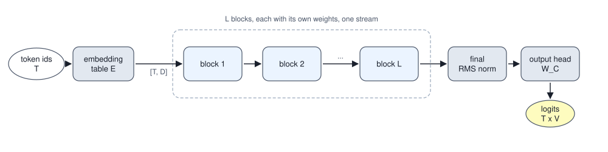

<!-- SPDX-License-Identifier: CC-BY-4.0 -->
<!-- Copyright (c) 2026 Martin Schröder <info@swedishembedded.com> -->

# The Transformer Block

*How do attention, a feed-forward network, residuals and normalization fit together into one repeating unit?*

In the lookup experiment of Chapter 7 the trained attention layer put a weight of 1.00 on the pair whose key matched the query and 0.00 on everything else, the query token itself included. Its output at the last position was a copy of one value vector. Nothing of the token that had asked the question was left in it, and for a model with that one job nothing needed to be. Put a second layer on top and the position changes. Whatever the second layer needs to know about the question, the first layer must have carried through the values it read, because a layer that returns only its own computation hands its successor a summary and nothing else, and the third layer a summary of a summary.

Volume III met this problem in networks too deep to train, and the cure was one line: let a layer return its input plus a correction. This chapter turns that line into the repeating unit of every transformer. The first question is what a stack of attention layers should pass along, and the answer, a running sum that every sublayer reads and adds to, leaves three more to settle. What does a sublayer read from a sum that keeps growing? Attention moves information between positions and does no work on any one position, so what does? And what does one such unit cost, in parameters and in arithmetic, so that a stack of dozens can be planned?

Some things from earlier chapters come back first. Answer them from memory; the answers are at the end of the chapter.

1. (Volume V, [Chapter 7](07-self-attention.md), multi-head attention.) A multi-head attention layer has width $D = 512$ and $H = 8$ heads. What is the shape of its output for an input of shape $[T, 512]$, how many parameters do its four matrices hold, and what must be added to its scores to make it causal?
2. (Volume III, [Chapter 12](../v03-neural-networks/12-training-dynamics.md), residual connections.) A layer returns $\mathbf{y} = \mathbf{x} + f(\mathbf{x})$. What is the Jacobian of $\mathbf{y}$ with respect to $\mathbf{x}$, and what does the gradient $d\mathbf{x}$ consist of, given $d\mathbf{y}$?
3. (Volume III, [Chapter 10](../v03-neural-networks/10-normalization.md), RMS normalization.) Normalize the row $(3, 4)$ with RMS normalization, gain 1 and no epsilon. What does layer normalization do to a row that RMS normalization does not?
4. (Volume III, [Chapter 2](../v03-neural-networks/02-mlp.md), GELU and SiLU.) What are $\mathrm{silu}(0)$ and $\mathrm{silu}(2)$, and what does each of the GELU and the SiLU multiply the input $x$ by?
5. (Volume I, [Chapter 10](../v01-mathematics/10-probability.md), variance.) A vector has mean square 1 and receives an independent contribution of mean square 0.5. What is the mean square of the sum, and what is the root mean square?
6. (Volume III, [Chapter 12](../v03-neural-networks/12-training-dynamics.md), vanishing and exploding gradients.) A gradient passes back through 20 layers and is multiplied by 0.8 in each. By how much is it multiplied in all, and by how much if each factor is 1.2?

## One block on three tokens

Three tokens, each a vector of four numbers, and one block of weights. The numbers are random stand-ins for a trained model, printed so that every later table can be recomputed. The block has the two parts that a transformer repeats, each called a sublayer: an attention layer, and a layer that works on each position alone. Between and around them sit a normalization and an addition.

<!-- worked: transformer_block.tiny_inputs -->
Generator: the book's SplitMix64, seed 0x85cbf50e92110958 (`seed_of` of the name `transformer_block.tiny`). Draws, in this order: the 12 entries of X (3 tokens of 4 numbers), each `round(normal(), 1)`; then W_Q, W_K, W_V, W_O (4 by 4 each), W_gate and W_up (4 by 6 each) and W_down (6 by 4), each row by row and each `round(0.5 * normal(), 1)` (`round` to one decimal, ties away from zero). Both gains are 1 and the epsilon of the normalization is 1e-6. The block has H = 2 heads of width 2, a causal mask and no position information, and a feed-forward network of hidden width 6. The numbers are random stand-ins for a trained model.

|  | x (4 numbers) |
|---|---|
| token 1 | (0.2, 0.6, -0.1, -0.2) |
| token 2 | (0.5, 0.8, 0.4, -0.2) |
| token 3 | (-1.7, 2.4, -0.7, 0.2) |

|  | W_Q | W_K | W_V | W_O |
|---|---|---|---|---|
| row 1 | (-0.3, -0.8, -0.6, 0.5) | (-0.6, -0.7, 0.6, 0.6) | (0.6, -0.4, 0.3, 0.6) | (0.5, -0.9, 0.3, 0.0) |
| row 2 | (-1.2, 0.0, 0.5, 0.3) | (0.0, 0.0, 0.1, 0.3) | (-0.1, 0.2, -0.6, 0.3) | (-0.6, 0.0, -0.5, -0.5) |
| row 3 | (-0.1, 0.7, -0.2, -0.5) | (0.6, 0.1, 0.0, 0.8) | (0.0, 0.8, 0.0, 0.0) | (-0.8, -0.1, 1.0, 0.0) |
| row 4 | (-0.1, -0.4, 1.0, 0.2) | (0.3, -0.2, -0.2, 0.0) | (-0.2, -0.5, 0.1, 0.4) | (-0.6, -0.2, -0.7, -0.3) |

|  | W_gate (4 by 6) | W_up (4 by 6) |
|---|---|---|
| row 1 | (0.4, -0.3, 0.4, 0.5, -0.6, 0.9) | (0.3, -0.3, -0.1, 0.1, -0.2, -0.2) |
| row 2 | (0.5, -0.3, -1.0, -0.6, -0.3, -0.2) | (0.4, 0.4, -0.4, -0.1, -0.4, 0.7) |
| row 3 | (-0.6, 0.2, 0.4, -0.5, 0.4, -0.5) | (0.4, 0.3, 0.1, -0.4, -0.5, 1.2) |
| row 4 | (0.4, -0.4, -0.2, 0.1, 0.5, 0.6) | (0.4, 0.4, 1.3, -1.0, -0.1, 0.0) |

|  | W_down (6 by 4) |
|---|---|
| row 1 | (-0.1, 0.5, -0.4, -0.5) |
| row 2 | (0.2, -0.5, 0.1, 0.0) |
| row 3 | (0.2, 0.6, 0.6, 0.1) |
| row 4 | (-0.5, 0.4, 0.2, -0.2) |
| row 5 | (0.5, 0.5, 0.1, -0.3) |
| row 6 | (0.0, 0.5, 0.1, 0.5) |
<!-- /worked -->

This unit is the **transformer block**, and it does six things to its input $\mathbf{X}$, a matrix of three rows, in this order. It normalizes each row (RMS normalization, with the gain $\boldsymbol{\gamma}_1$ and the epsilon above). It feeds the normalized rows to the causal multi-head attention of Chapter 7. It adds the result to $\mathbf{X}$. It normalizes the sum again with a second gain $\boldsymbol{\gamma}_2$. It passes each normalized row through a small network that treats each position on its own, which the next sections define. And it adds that result to the sum. In symbols, with $\mathrm{norm}_i$ the RMS normalization with gain $\boldsymbol{\gamma}_i$,

$$
\begin{aligned}
\mathbf{X}_1 &= \mathbf{X} + \mathrm{attn}\bigl(\mathrm{norm}_1(\mathbf{X})\bigr),\\
\mathbf{X}_2 &= \mathbf{X}_1 + \mathrm{ffn}\bigl(\mathrm{norm}_2(\mathbf{X}_1)\bigr).
\end{aligned}
$$

The first half, on the example:

<!-- worked: transformer_block.tiny_attention_half -->
Numbers to 3 decimals; the rms of a row is the square root of the mean of its squares, and the normalization uses the exact values. The first sublayer: normalize, attend, add the result to the stream.

| stage |  | 1 | 2 | 3 | 4 | rms |
|---|---|---:|---:|---:|---:|---:|
| x (the stream, in) | token 1 | 0.200 | 0.600 | -0.100 | -0.200 | 0.335 |
|  | token 2 | 0.500 | 0.800 | 0.400 | -0.200 | 0.522 |
|  | token 3 | -1.700 | 2.400 | -0.700 | 0.200 | 1.515 |
| n1 = norm(x) | token 1 | 0.596 | 1.789 | -0.298 | -0.596 | 1.000 |
|  | token 2 | 0.958 | 1.533 | 0.766 | -0.383 | 1.000 |
|  | token 3 | -1.122 | 1.584 | -0.462 | 0.132 | 1.000 |

The attention weights of the two heads (each row adds to 1, the causal mask hides the keys after the query):

|  |  | key 1 | key 2 | key 3 |
|---|---|---:|---:|---:|
| head 1 | query 1 | 1.000 | 0.000 | 0.000 |
| head 1 | query 2 | 0.675 | 0.325 | 0.000 |
| head 1 | query 3 | 0.507 | 0.279 | 0.214 |
| head 2 | query 1 | 1.000 | 0.000 | 0.000 |
| head 2 | query 2 | 0.426 | 0.574 | 0.000 |
| head 2 | query 3 | 0.392 | 0.528 | 0.081 |

The result a is added to the stream:

| stage |  | 1 | 2 | 3 | 4 | rms |
|---|---|---:|---:|---:|---:|---:|
| a = attention(n1) | token 1 | 0.411 | -0.304 | -1.413 | -0.286 | 0.765 |
|  | token 2 | 0.129 | -0.405 | -1.411 | -0.414 | 0.765 |
|  | token 3 | 0.073 | -0.155 | -1.478 | -0.395 | 0.770 |
| x1 = x + a | token 1 | 0.611 | 0.296 | -1.513 | -0.486 | 0.864 |
|  | token 2 | 0.629 | 0.395 | -1.011 | -0.614 | 0.698 |
|  | token 3 | -1.627 | 2.245 | -2.178 | -0.195 | 1.765 |
<!-- /worked -->

Look at what each line of the first table says. The rows of $\mathbf{X}$ have root mean squares of 0.335, 0.522 and 1.515, three very different scales, and after the normalization every row has a root mean square of exactly 1.000: attention sees the direction of each token and not how loud it was. Attention then returns the three rows $\mathbf{a}$, each of root mean square about 0.77, and the block does not replace $\mathbf{X}$ by them. It adds them, so the third token's row, which came in with root mean square 1.515, leaves the first half at 1.765, carrying everything it carried before plus what attention found. The same is true of the weights: query 3 of head 1 puts 0.507 on the first token and 0.214 on itself, and whatever it took from the first token is a contribution to its row, not a substitute for it.

The second half is the same pattern with a different sublayer in the middle.

<!-- worked: transformer_block.tiny_ffn_half -->
The second sublayer: normalize the stream again, pass each row through the gated feed-forward network, add the result.

| stage |  | 1 | 2 | 3 | 4 | rms |
|---|---|---:|---:|---:|---:|---:|
| x1 (the stream, in) | token 1 | 0.611 | 0.296 | -1.513 | -0.486 | 0.864 |
|  | token 2 | 0.629 | 0.395 | -1.011 | -0.614 | 0.698 |
|  | token 3 | -1.627 | 2.245 | -2.178 | -0.195 | 1.765 |
| n2 = norm(x1) | token 1 | 0.707 | 0.342 | -1.751 | -0.563 | 1.000 |
|  | token 2 | 0.901 | 0.566 | -1.447 | -0.879 | 1.000 |
|  | token 3 | -0.922 | 1.272 | -1.233 | -0.111 | 1.000 |

Inside the network, the six hidden units of each token:

|  |  | unit 1 | unit 2 | unit 3 | unit 4 | unit 5 | unit 6 |
|---|---|---:|---:|---:|---:|---:|---:|
| token 1 | gate pre-activation | 1.280 | -0.440 | -0.647 | 0.968 | -1.509 | 1.106 |
|  | up | -0.576 | -0.826 | -1.114 | 1.299 | 0.653 | -2.003 |
|  | silu(gate) * up | -0.577 | 0.142 | 0.248 | 0.911 | -0.179 | -1.665 |
| token 2 | gate pre-activation | 1.160 | -0.378 | -0.609 | 0.746 | -1.729 | 0.893 |
|  | up | -0.434 | -0.830 | -1.605 | 1.492 | 0.405 | -1.520 |
|  | silu(gate) * up | -0.383 | 0.127 | 0.344 | 0.755 | -0.106 | -0.964 |
| token 3 | gate pre-activation | 0.963 | -0.307 | -2.111 | -0.618 | -0.377 | -0.533 |
|  | up | -0.305 | 0.371 | -0.684 | 0.385 | 0.303 | -0.406 |
|  | silu(gate) * up | -0.213 | -0.048 | 0.156 | -0.083 | -0.047 | 0.080 |

The result f is added to the stream:

| stage |  | 1 | 2 | 3 | 4 | rms |
|---|---|---:|---:|---:|---:|---:|
| f = ffn(n2) | token 1 | -0.409 | -0.768 | 0.392 | -0.648 | 0.577 |
|  | token 2 | -0.298 | -0.281 | 0.417 | -0.375 | 0.347 |
|  | token 3 | 0.061 | -0.005 | 0.161 | 0.193 | 0.129 |
| x2 = x1 + f (the stream, out) | token 1 | 0.202 | -0.472 | -1.122 | -1.134 | 0.838 |
|  | token 2 | 0.331 | 0.114 | -0.594 | -0.989 | 0.603 |
|  | token 3 | -1.566 | 2.240 | -2.017 | -0.003 | 1.698 |
<!-- /worked -->

The result of the second sublayer is small next to the stream for the third token (root mean square 0.129 against 1.765) and larger for the first (0.577 against 0.864). That is a property of this arrangement and not of these weights. The sublayer reads a row of root mean square 1 whatever the stream's scale was, so the size of what it writes depends only on its weights, and a row that arrives large is changed by a relatively small amount. The stream holds the scale, and the sublayers work at a fixed scale beside it.


The figure draws the same computation as a path with two side roads. The vertical line on the left is what this chapter calls the **residual stream**: the matrix $[T, D]$ that enters a block, is added to by each of its sublayers and leaves it. Nothing ever overwrites it. A sublayer reads the stream (through a normalization), computes something, and writes by addition, so the stream after a block is the input plus two contributions, and after $L$ blocks it is the embedding plus $2L$ contributions: a sum, in which each sublayer sees what all earlier ones wrote. The word "residual" is Volume III's: each layer computes the part that is missing.

The placement of the norm in this block, inside the side road and before the sublayer, is a decision with a name. In a **pre-norm** block each sublayer normalizes its own copy of the stream, and the stream itself is added to without being normalized, as above. The alternative, normalizing after the addition, is the post-norm block of the original transformer. Why the choice matters needs two things first: what the addition does to gradients, which the next section derives, and the second sublayer, which two sections later define.

## Why the stream is a sum

A stack of $2L$ sublayers that each add to the stream is one function, and its derivative is where the design pays. Write a sublayer as $\mathbf{x} \mapsto \mathbf{x} + g_l(\mathbf{x})$, where $g_l$ includes the normalization in front of it. The Jacobian of one such layer is $\mathbf{I} + \mathbf{J}_l$ with $\mathbf{J}_l$ the Jacobian of $g_l$, and the gradient passes through the stack as the product

$$
(\mathbf{I} + \mathbf{J}_{2L})\cdots(\mathbf{I} + \mathbf{J}_2)(\mathbf{I} + \mathbf{J}_1)
= \mathbf{I} + \sum_l \mathbf{J}_l + \sum_{l' > l}\mathbf{J}_{l'}\mathbf{J}_l + \cdots,
$$

a sum of $2^{2L}$ paths of which one has no sublayer in it. That path contributes the identity, with a coefficient of exactly 1, so whatever the sublayers do, whatever their weights are, the gradient at the top of the stack arrives at the bottom with at least itself in it. Volume III proved the same for a stack of plain layers and measured that a residual stack of 24 layers passed $1.08$ of its gradient where the same weights without the skip passed $3\times10^{-8}$. Here it is the mechanism of a transformer, and the cleanliness of that identity path, whether anything stands on it, decides which norm placement is acceptable. That is what the next section examines.

The same sum has a forward consequence, and it is the one that costs something. Each sublayer adds a contribution to the stream, and independent contributions add their mean squares. A stream of mean square 1 that receives $2L$ contributions of mean square $\omega$ each ends at $1 + 2L\omega$, which grows with depth unless $\omega$ is small. This is the problem the branch scale of Volume III's initialization chapter solved with $\omega = 1/(2L)$, and it comes back below with numbers.

## Where the norm goes

There are two places to put a normalization relative to a sum. The pre-norm block of the last section puts it on the branch: $\mathbf{x} \mapsto \mathbf{x} + g(\mathrm{norm}(\mathbf{x}))$. The block of the original transformer, written with RMS normalization in place of its layer normalization, puts it on the sum: $\mathbf{x} \mapsto \mathrm{norm}(\mathbf{x} + g(\mathbf{x}))$, the **post-norm** block, in which the stream is renormalized after every addition. A third wiring, the same norms as the pre-norm block but with no skip, $\mathbf{x} \mapsto g(\mathrm{norm}(\mathbf{x}))$, keeps the placement and drops the sum; it is what a stack looks like when a layer returns only its own computation.

Differentiate each with respect to $\mathbf{x}$. The pre-norm layer has $\mathbf{I} + \mathbf{J}_g\mathbf{J}_{\mathrm{norm}}$, and the product of $2L$ of them keeps the term $\mathbf{I}$, the path that goes through additions only. For the post-norm layer the Jacobian is $\mathbf{J}_{\mathrm{norm}}(\mathbf{I} + \mathbf{J}_g)$, and every path, the skip path included, goes through a norm. For an RMS norm with gain 1 the Jacobian at a row $\mathbf{s}$ of root mean square $\rho$ is $\frac{1}{\rho}\bigl(\mathbf{I} - \hat{\mathbf{s}}\hat{\mathbf{s}}^\top/D\bigr)$ with $\hat{\mathbf{s}} = \mathbf{s}/\rho$, which divides by the scale of the sum and removes the component of the gradient along the row itself. When the sublayers have added something to the stream, $\rho > 1$ and each norm on the skip path multiplies the gradient by less than one. In a stack of $2L$ post-norm sublayers the path with no sublayer in it has the factor $\prod 1/\rho_l$, geometric in the depth, where in the pre-norm stack it is exactly 1.

Both claims can be measured on a freshly initialized stack. The experiment backpropagates a random gradient from the top of a stack of 32 blocks and records its norm at every block input, once with the Jacobians of the sublayers included and once with only the norms and additions kept, so that the identity path is isolated.

<!-- worked: transformer_block.depth_scale -->
The root mean square of all entries of the stream after k blocks (the mean over the stacks), for the input of rms 1.03. 8 random stacks of 32 blocks, T = 8 positions of width D = 16, H = 2 heads of width 8, SwiGLU hidden width 40, causal mask, RMS norm with epsilon 1e-6 and both gains 1. Stack s draws from `transformer_block.depth.<s>` for s = 0 .. 7 (the seed is `seed_of` of that name; for s = 0 it is 0xdb1a07e3a5790d6a), in this order: the input X (8 by 16, each `normal()`), the gradient arriving at the top of the stack (same shape, each `normal()`), then the 32 blocks, each drawn as W_Q, W_K, W_V, W_O (D by D), W_gate, W_up (D by hidden width) and W_down (hidden width by D), row by row, every entry `normal() / sqrt(fan_in)` (the fan-in is the number of rows of the matrix). The variant with scaled output matrices multiplies W_O and W_down by 1 / sqrt(2 * 32) = 0.1250; it uses the same draws.

| wiring | k = 1 | k = 2 | k = 4 | k = 8 | k = 16 | k = 32 |
|---|---:|---:|---:|---:|---:|---:|
| pre-norm, skip | 1.40 | 1.77 | 2.24 | 3.10 | 4.33 | 5.87 |
| pre-norm, skip, output matrices times 1/sqrt(2 L) | 1.03 | 1.05 | 1.05 | 1.08 | 1.13 | 1.23 |
| post-norm, skip | 1.00 | 1.00 | 1.00 | 1.00 | 1.00 | 1.00 |
| norm before each sublayer, no skip | 0.63 | 0.53 | 0.63 | 0.57 | 0.57 | 0.52 |
| sqrt(1 + k), for comparison | 1.41 | 1.73 | 2.24 | 3.00 | 4.12 | 5.74 |
<!-- /worked -->

<!-- worked: transformer_block.depth_gradient -->
The Frobenius norm of the gradient that reaches the input of the block k below the top, divided by the norm of the gradient put in at the top (the geometric mean over the 8 stacks of the previous table). 'Skip paths only' backpropagates through the norms and the additions and leaves out the Jacobians of attention and of the feed-forward network: what travels along the identity path alone.

| wiring | k = 1 | k = 2 | k = 4 | k = 8 | k = 16 | k = 32 |
|---|---:|---:|---:|---:|---:|---:|
| pre-norm, skip | 1.03e0 | 1.04e0 | 1.09e0 | 1.18e0 | 1.46e0 | 1.00e1 |
| pre-norm, skip, output matrices times 1/sqrt(2 L) | 1.01e0 | 1.01e0 | 1.03e0 | 1.06e0 | 1.11e0 | 1.31e0 |
| post-norm, skip | 8.27e-1 | 7.63e-1 | 7.89e-1 | 1.29e0 | 2.68e0 | 6.87e0 |
| post-norm, skip, skip paths only | 5.61e-1 | 3.40e-1 | 1.31e-1 | 1.89e-2 | 4.37e-4 | 9.38e-7 |
| norm before each sublayer, no skip | 7.88e-1 | 6.66e-1 | 1.93e0 | 5.61e0 | 2.45e1 | 7.51e2 |
| pre-norm, skip paths only (exactly the identity) | 1.00e0 | 1.00e0 | 1.00e0 | 1.00e0 | 1.00e0 | 1.00e0 |
<!-- /worked -->


The dashed lines are the derivation. With the skip paths alone the pre-norm stack passes the gradient unchanged, exactly 1 at every depth, and the post-norm stack passes $9.38\times10^{-7}$ of it through 32 blocks, which is a factor of about 0.65 per block: each of its two norms divides by the root mean square of a sum that is larger than the stream it extends. The solid lines show what a freshly initialized stack does with all paths included, and they do not show the post-norm stack failing: at initialization the gradient of both stacks stays within a factor of ten of the top. The sublayer Jacobians contribute enough through their own paths to make up the loss, which is a property of random weights and not a promise: it holds at the start, and a trained stack has no reason to keep it. The stack without a skip shows the exploding gradient of Volume III, 751 times the top gradient after 32 blocks, a growth of about 1.23 per block that nothing bounds. What the identity path buys is a coefficient of 1 by construction and not by the luck of a random draw.

The forward table is the other cost. A pre-norm stream grows: its root mean square follows $\sqrt{1 + k}$ closely (5.87 after 32 blocks against 5.74), because each block adds a contribution of mean square about 1 to a stream whose mean square was 1 at the start. The post-norm stream is pinned at 1.00, since every block ends in a norm. The stack without a skip hovers near 0.55, below 1, because attention averages and an average has a smaller mean square than its inputs. The row in the middle shows the cure for the growth. Scaling the two output matrices of every block, $\mathbf{W}_O$ and $\mathbf{W}_{\mathrm{down}}$, by $1/\sqrt{2L}$ cuts the mean square of each contribution by $2L = 64$, so the stream ends at about $1 + 64 \cdot 0.5/64 = 1.5$ in mean square, a root mean square of 1.22, and the measured value is 1.23. The gradient at the bottom is then 1.31 times the top, against 10.0 for the unscaled stack. This is the rule of Volume III, a branch that starts small, now stated for two branches per block, and `crates/gpt2/src/init.rs` implements it: the residual projections of every block start at a standard deviation of $0.02/\sqrt{2L}$ (the last section returns to it).

A pre-norm stack ends with a stream whose scale has grown with depth and which no norm has seen since the last sublayer wrote to it. The output head should not depend on that scale, so a pre-norm decoder puts one more normalization between the last block and the head, the **final norm** (the figure of the stacking section shows it). A post-norm block ends in a norm already and needs none.

The original transformer of Vaswani and colleagues (2017) was post-norm. Xiong and colleagues (2020) analysed the two placements at initialization and found, for post-norm stacks, large gradients near the output that made a warmup of the learning rate necessary, and showed that moving the norm to the branch allowed training without one. The GPT-2 model of Radford and colleagues (2019) used the pre-norm placement, a final norm and the scaled residual initialization above; nearly every large decoder since does. The experiment at the end of the chapter trains both and measures the difference on a small task.

## What attention cannot do

Take the output of attention, row $i$: $\mathbf{o}_i = \sum_j p_{ij}\mathbf{v}_j$, with the weights $p_{ij}$ computed from the queries and keys. What is done to the values is linear: each is a fixed linear function of one token's row, and the result is a weighted average of them. The only nonlinearity of the layer, the softmax, decides how much of each value to take; no activation function acts on what a token contains. The layer brings in a blend of other tokens' linear images. It communicates and does not compute: nothing in it applies a threshold to one feature of a token or combines two features of the same token in a new way.

The second sublayer exists to do that. A **feed-forward network** (**FFN**), as the layer is called in the block, applies the same small network to each position on its own: the multilayer perceptron of Volume III, with one hidden layer, applied to every row of the stream. Positions do not talk to each other in it, which can be checked at once: change the input row of one position and the feed-forward results at every other position are unchanged. The division of labour is then the one the block shows, attention moves information between positions and the feed-forward network computes with it at each position.

The plain network has two matrices and an activation. For a row $\mathbf{x}$ of width $D$ it is

$$
\mathrm{ffn}(\mathbf{x}) = \mathrm{gelu}(\mathbf{x}\mathbf{W}_1)\,\mathbf{W}_2,
\qquad \mathbf{W}_1 : [D, F],\quad \mathbf{W}_2 : [F, D],
$$

with a hidden width $F$ that the original transformer set to $4D$ (2,048 for $D = 512$) and that most models of the following years kept; `GptConfig::with_ff_default` in `crates/gpt2/src/model.rs` states the same default as "nanogpt's `4 * d_model`". Nothing derives the 4. The width is a choice that the cost counts below price: the network holds $2DF = 8D^2$ numbers without biases, twice the $4D^2$ of the attention layer's four matrices, so two thirds of a block's parameters sit in it. The Gaussian form of GELU is the one of Volume III's chapter 2; production kernels often use its tanh approximation, and `crates/kernels/wgsl/gelu.wgsl` does, which is why a model must say which GELU it was trained with.

## Two projections, one product

In 2017 a layer of this kind meant a ReLU, and in 2020 it meant something that multiplies. The idea is older than the transformer. Dauphin and colleagues (2017) used, for language modelling with convolutions, a **gated linear unit** (**GLU**): two linear maps of the same input, one passed through a sigmoid and multiplied into the other,

$$
\mathrm{glu}(\mathbf{x}) = (\mathbf{x}\mathbf{W}_{\mathrm{up}}) \odot \sigma(\mathbf{x}\mathbf{W}_{\mathrm{gate}}).
$$

The second map is the gate: a number between 0 and 1 for each hidden unit that says how much of the first map's value to let through. Shazeer (2020) replaced the sigmoid by other activations and put the result inside the transformer's feed-forward layer, with the names GEGLU (the gate is a GELU) and SwiGLU (the gate is a SiLU, the swish of that paper) and a third matrix to bring the product back to width $D$. The **SwiGLU** network, the one that `crates/qwen3` implements, is

$$
\mathrm{ffn}(\mathbf{x}) = \bigl(\mathrm{silu}(\mathbf{x}\mathbf{W}_{\mathrm{gate}}) \odot (\mathbf{x}\mathbf{W}_{\mathrm{up}})\bigr)\mathbf{W}_{\mathrm{down}},
$$

with $\mathbf{W}_{\mathrm{gate}}, \mathbf{W}_{\mathrm{up}} : [D, F]$ and $\mathbf{W}_{\mathrm{down}} : [F, D]$. The block of the first section used it, and its hidden units can be read in the second table above: for token 1 the gate pre-activation of unit 1 is 1.280 and the up projection $-0.576$, and the unit's output is $\mathrm{silu}(1.280)\cdot(-0.576) = -0.577$.

Why a product, and which activation? The three gate functions side by side:

<!-- worked: transformer_block.gate_functions -->
The three gate functions at the pre-activation g, each followed by the multiplication with the up projection u in the unit: GLU gives sigmoid(g) u, GEGLU gives gelu(g) u and SwiGLU gives silu(g) u. sigmoid is the logistic function, gelu the exact Gaussian form (library erf), silu(g) = g sigmoid(g).

| g | sigmoid(g) | gelu(g) | silu(g) |
|---|---:|---:|---:|
| -4.0 | 0.0180 | -0.0001 | -0.0719 |
| -2.0 | 0.1192 | -0.0455 | -0.2384 |
| -1.0 | 0.2689 | -0.1587 | -0.2689 |
| -0.5 | 0.3775 | -0.1543 | -0.1888 |
| 0.0 | 0.5000 | 0.0000 | 0.0000 |
| 0.5 | 0.6225 | 0.3457 | 0.3112 |
| 1.0 | 0.7311 | 0.8413 | 0.7311 |
| 2.0 | 0.8808 | 1.9545 | 1.7616 |
| 4.0 | 0.9820 | 3.9999 | 3.9281 |
<!-- /worked -->

The sigmoid gate lies in $(0, 1)$, so the unit can only attenuate the up projection. GELU and SiLU lie below zero for negative $g$ (down to $-0.17$ and $-0.28$) and grow like $g$ for large positive $g$, so the gate can also pass a unit more than once and flip its sign. What all three share is that the unit's output is a product of two linear functions of the input: the gate's argument and the up projection. A plain unit $\mathrm{gelu}(\mathbf{w}\cdot\mathbf{x})$ depends on its input only through one projection, so it is constant along every direction orthogonal to $\mathbf{w}$. A gated unit depends on two projections and combines them multiplicatively, and near $g = 0$ the SiLU is $g/2$ plus a quadratic term, so the unit is close to a product of two linear forms. One unit of a network with two inputs, with the gate reading only $x_1$ and the up projection reading only $x_2$, computes a product directly:

<!-- worked: transformer_block.product_unit -->
One hidden unit of a SwiGLU network with two inputs: W_gate = (0.1, 0), W_up = (0, 1), W_down = 2 / 0.1 = 20, so that the output is 20 silu(0.1 x1) x2. The product x1 x2 is what the unit approximates.

| (x1, x2) | x1 x2 | unit output | difference |
|---|---:|---:|---:|
| (1.0, 1.0) | 1.0000 | 1.0500 | 0.0500 |
| (1.0, -1.0) | -1.0000 | -1.0500 | -0.0500 |
| (-2.0, 1.5) | -3.0000 | -2.7010 | 0.2990 |
| (0.5, 3.0) | 1.5000 | 1.5375 | 0.0375 |
| (-1.0, -1.0) | 1.0000 | 0.9500 | -0.0500 |
| (3.0, 0.0) | 0.0000 | 0.0000 | 0.0000 |
<!-- /worked -->

The error is the quadratic term of the SiLU, small for a gate argument near 0 and growing as it leaves it ($-2.701$ against $-3$ at $x_1 = -2$), and the unit is an approximate multiplier with two weights and a readout. This is a statement about what one unit can represent and not a measurement of what training finds. Shazeer reported that the gated variants lowered the perplexity of a language model at equal compute; the book measures none of that here, and takes the architecture as given.

## Why two thirds

A third matrix costs parameters. A GELU network of hidden width $F$ has $2DF$ parameters, a SwiGLU network of the same hidden width has $3DF$, one and a half times as many, and a comparison at equal hidden width would compare unequal models. The comparison that holds the parameters equal sets $3DF = 2D\cdot 4D$ and solves for the hidden width $F$ of the gated network:

$$
3DF = 8D^2 \quad\Longrightarrow\quad F = \tfrac{8}{3}D \approx 2.67\,D,
$$

two thirds of the $4D$ of the plain network. Shazeer reduced the hidden width of the gated layers by this factor for the same reason. Real models round the width to a multiple of a power of two that the hardware likes, and the table shows how little that costs:

<!-- worked: transformer_block.ffn_widths -->
Parameters of the feed-forward network without biases: the GELU network has two matrices D by 4 D, 2 * D * 4 D = 8 D^2 numbers; the SwiGLU network has three matrices D by F, 3 D F numbers, equal to 8 D^2 at F = 8 D / 3. The rounded width is the exact one rounded up to a multiple of 256.

| D | GELU hidden width 4 D | GELU parameters 8 D^2 | exact F = 8 D / 3 | F rounded up | SwiGLU parameters 3 D F | SwiGLU / GELU |
|---|---:|---:|---:|---:|---:|---:|
| 768 | 3,072 | 4,718,592 | 2048.00 | 2,048 | 4,718,592 | 1.0000 |
| 1024 | 4,096 | 8,388,608 | 2730.67 | 2,816 | 8,650,752 | 1.0312 |
| 2048 | 8,192 | 33,554,432 | 5461.33 | 5,632 | 34,603,008 | 1.0312 |
| 4096 | 16,384 | 134,217,728 | 10922.67 | 11,008 | 135,266,304 | 1.0078 |
<!-- /worked -->

At $D = 768$ the exact width is an integer, 2,048, and the parameters are identical. At $D = 4096$ the exact width is 10,922.67, the rounded one 11,008, and the gated network is 0.78 percent larger than the plain one it replaces. (The floating-point cost differs too: the three products of the gated network cost $6DF$ FLOPs per token, the two of the plain one $4DF$, and at the equal-parameter widths the two are equal for the same reason.)

A last property of the product deserves a table of its own, because it is how the most common mistake in importing a model is made. The two projections have the same shape. Exchange $\mathbf{W}_{\mathrm{gate}}$ and $\mathbf{W}_{\mathrm{up}}$ and every product is still defined, every shape agrees, nothing fails, and the network computes $\mathrm{silu}(\text{up}) \odot \text{gate}$, a different function. On the block of the first section:

<!-- worked: transformer_block.gate_up_exchanged -->
The block of the first section with W_gate and W_up exchanged. Both shapes are 4 by 6, so every product is defined and nothing fails. rms of f is the root mean square of the feed-forward result of that token; 'rms of the change' is the root mean square of the difference of the two f; the last column is that difference of the output x2 as a fraction of the rms of the original x2.

| token | rms of f, original | rms of f, exchanged | rms of the change in f | change in x2, fraction of its rms |
|---|---:|---:|---:|---:|
| token 1 | 0.577 | 0.409 | 0.485 | 0.579 |
| token 2 | 0.347 | 0.334 | 0.259 | 0.429 |
| token 3 | 0.129 | 0.223 | 0.138 | 0.081 |
<!-- /worked -->

The feed-forward result changes by an amount comparable to itself, and the output of the block changes by 58 percent of its own size at the first token. A loader that confuses the two cannot be caught by a shape check or by a loss that merely goes down; only a comparison with a reference or a test that would fail under the exchange finds it, and the history section tells how one was written.

## The whole block, forward and backward

All pieces are in hand. The pre-norm SwiGLU block as pseudocode, with the explicit residual adds:

```text
function block_forward(X: array<real>[T, D],
                       Wq: array<real>[D, D], Wk: array<real>[D, D],
                       Wv: array<real>[D, D], Wo: array<real>[D, D],
                       g1: array<real>[D], g2: array<real>[D],
                       Wgate: array<real>[D, F], Wup: array<real>[D, F],
                       Wdown: array<real>[F, D], H: int, eps: real)
        -> array<real>[T, D]:
    (n1, xhat1, r1) = rms_norm(X, g1, eps)          # normalize a copy of the stream
    a = multi_head(n1, Wq, Wk, Wv, Wo, H, true)     # Chapter 7, causal
    X1 = X + a                                      # first write to the stream
    (n2, xhat2, r2) = rms_norm(X1, g2, eps)
    Zg = matmul(n2, Wgate)                          # [T, F]
    Zu = matmul(n2, Wup)                            # [T, F]
    Hd = map(silu, Zg) * Zu                         # gate times up, elementwise
    f = matmul(Hd, Wdown)                           # back to width D
    return X1 + f                                   # second write
```

The backward pass undoes it from the bottom, and each line of it is a rule already derived. Let $d\mathbf{X}_2$ be the gradient arriving at the output. The last addition sends it unchanged to both of its inputs, the stream and the feed-forward result; the products and the activation give the gradients of the three matrices by the matrix-product rule of Volume III, with the SiLU slope $\mathrm{silu\_slope}(z) = s(z)\bigl(1 + z(1 - s(z))\bigr)$ for $s = \mathrm{sigmoid}$ on the gate side and $\mathrm{silu}(z)$ on the up side; the normalization gives its input gradient $r\gamma_j\,dy_j - r^3 x_j\,\mathrm{mean}_k(dy_k\gamma_k x_k)$ per row and $d\gamma_j = \sum_{\mathrm{rows}} dy_j\hat x_j$; and at the first addition the gradient of the stream is the sum of what arrives from above and what comes back through the branch.

```text
function block_backward(dX2: array<real>[T, D], saved, ...)
        -> (array<real>[T, D], grads):
    # second sublayer: X2 = X1 + f
    dHd = matmul(dX2, transpose(Wdown))             # dX2 also goes to X1 below
    dWdown = matmul(transpose(Hd), dX2)
    dZg = dHd * Zu * map(silu_slope, Zg)
    dZu = dHd * map(silu, Zg)
    dn2 = matmul(dZg, transpose(Wgate)) + matmul(dZu, transpose(Wup))
    dWgate = matmul(transpose(n2), dZg)
    dWup = matmul(transpose(n2), dZu)
    (dX1branch, dg2) = rms_norm_backward(dn2, X1, g2, eps)
    dX1 = dX2 + dX1branch                           # identity path plus the branch
    # first sublayer: X1 = X + a
    (dn1, dWq, dWk, dWv, dWo) = multi_head_backward(dX1, n1, ...)   # Chapter 7
    (dXbranch, dg1) = rms_norm_backward(dn1, X, g1, eps)
    dX = dX1 + dXbranch                             # identity path plus the branch
    return (dX, grads)
```

A derivation of this length has places for mistakes to hide, and the check of Volume III finds them. The block, with a classifier on top and a softmax cross-entropy at each position, against central differences on every parameter and on the input:

<!-- worked: transformer_block.gradient_check -->
Generator: the book's SplitMix64, seeds 0xd1c1a673d9969d56 (`seed_of` of the name `transformer_block.check.swiglu`) and 0xbce6226f791222ce (`transformer_block.check.gelu`, for the GELU network). T = 5 positions, D = 6, H = 2 heads of width 3, hidden width 8, 4 classes, causal mask. Draws, in this order: X (5 by 6, each `normal()`), W_Q, W_K, W_V, W_O (6 by 6, each row by row with `0.5 * normal()`), the two gains (6 numbers each, `1 + 0.1 * normal()`), the feed-forward matrices (SwiGLU: W_gate and W_up, 6 by 8, then W_down, 8 by 6; GELU: W_1, 6 by 8, then W_2, 8 by 6; `0.5 * normal()`), W_C (6 by 4, `0.5 * normal()`), then the 5 target classes `integer(4)`. The model is one pre-norm block (RMS norm, epsilon 1e-6), then the classifier logits = x2 W_C at every position, and the loss is the mean over positions of the softmax cross-entropy. Central differences with step 1e-05 on every entry of every parameter and of the input X. Each cell is the power of ten that the largest difference stays below (the criterion is 1e-6); the relative difference |a - n| / max(|a|, |n|) is taken over the entries whose gradient is above 1e-4.

| tensor (pre-norm SwiGLU block) | entries checked | largest absolute difference below | largest relative difference below |
|---|---:|---:|---:|
| W_Q | 36 | 1e-9 | 1e-8 |
| W_K | 36 | 1e-9 | 1e-7 |
| W_V | 36 | 1e-9 | 1e-8 |
| W_O | 36 | 1e-9 | 1e-7 |
| gain 1 | 6 | 1e-9 | 1e-9 |
| gain 2 | 6 | 1e-9 | 1e-7 |
| W_gate | 48 | 1e-10 | 1e-8 |
| W_up | 48 | 1e-10 | 1e-7 |
| W_down | 48 | 1e-10 | 1e-8 |
| W_C | 24 | 1e-10 | 1e-8 |
| X | 30 | 1e-10 | 1e-9 |

The same check on every wiring and both feed-forward networks, all tensors together:

| wiring | feed-forward network | entries checked | largest absolute difference below | largest relative difference below |
|---|---|---:|---:|---:|
| pre | swiglu | 354 | 1e-9 | 1e-7 |
| post | swiglu | 354 | 1e-9 | 1e-7 |
| plain | swiglu | 354 | 1e-8 | 1e-7 |
| pre | gelu | 306 | 1e-9 | 1e-7 |
<!-- /worked -->

Every tensor passes at a relative difference between $10^{-9}$ and $10^{-7}$, for the pre-norm block and for the two other wirings, and for the GELU network in place of the SwiGLU one. The sizes are all different on purpose, $T = 5$, $D = 6$, $H = 2$, $F = 8$ and 4 classes, so that an index used where another belongs would not cancel by coincidence. A check that cannot fail proves nothing, so here are three plausible mistakes, one in each place the block adds something of its own:

<!-- worked: transformer_block.wrong_backward_passes -->
The check of the previous block (same parameters, same step, pre-norm SwiGLU block) run on the correct backward pass and on three wrong ones. Entries: the largest relative difference |a - n| / max(|a|, |n|) over the entries of the tensor whose gradient is above 1e-4; a difference of 1e-6 or more is written to one decimal, a smaller one as the power of ten it stays below (a tensor that the wrong step does not touch keeps its correct gradient).

| backward pass | W_Q | W_K | W_V | W_O | gain 1 | gain 2 | W_gate | W_up | W_down | X |
|---|---:|---:|---:|---:|---:|---:|---:|---:|---:|---:|
| the block's backward pass | 1e-8 | 1e-7 | 1e-8 | 1e-7 | 1e-9 | 1e-7 | 1e-8 | 1e-7 | 1e-8 | 1e-9 |
| second residual add passes no gradient to the stream | about 1.1 | about 1.4 | about 1.7 | about 1.8 | about 1.8 | 1e-7 | 1e-8 | 1e-7 | 1e-8 | about 1.9 |
| each norm differentiated with its scale held constant | about 1.0 | about 1.9 | about 1.8 | about 1.6 | about 1.4 | 1e-7 | 1e-8 | 1e-7 | 1e-8 | about 1.9 |
| gate and up exchanged in the SwiGLU backward | about 1.7 | about 2.0 | about 1.8 | about 1.5 | about 1.3 | about 1.5 | about 1.9 | about 1.9 | 1e-8 | about 1.8 |
<!-- /worked -->

The second row drops the identity path of the second residual: the gradient arriving at $\mathbf{X}_2$ goes into the feed-forward branch and not also to $\mathbf{X}_1$. The tensors above that point (the feed-forward matrices, the second gain) are right, the ones below it (attention, the first gain, the input) are wrong by an amount of the size of the gradient. The third differentiates each norm with the factor $r$ held constant: the gains' own gradients are right when their incoming gradient is, and everything that passes through a norm backward is wrong. The fourth uses the roles of the gate and the up projection exchanged: $\mathbf{W}_{\mathrm{down}}$, which sits above the product, is right; the two matrices that make it and everything below are wrong. The pattern of which tensors fail points at the place; it costs nothing to read and is worth reading before reaching for a debugger.

## What a block costs

A stack of $L$ blocks has $L$ times the parameters and $L$ times the work of one, so everything that can be planned is in the count of one block. With no biases (modern blocks have none), the attention layer has four $D \times D$ matrices, $4D^2$; the plain network $2DF$ and the gated one $3DF$; the two norms $2D$ gains. For the forward pass on $T$ tokens, the counting rule of the previous chapters (a product of an $m \times k$ and a $k \times n$ matrix costs $2mkn$) gives $8TD^2$ for the four projections, $4T^2D$ for the score and average products, $5HT^2$ for the softmax and scale, $4TDF$ for the plain network or $6TDF$ for the gated one, and a small remainder for the norms, the two adds and the activation. Four configurations, with the widths stated and no claim that a particular model has them:

<!-- worked: transformer_block.block_parameters_table -->
Parameters of one block, no biases: attention 4 D^2 (the four D by D matrices), feed-forward network 2 D F (GELU) or 3 D F (SwiGLU), normalization gains 2 D.

| configuration | D | heads H | hidden width F | attention | feed-forward | norm gains | block total | attention % | feed-forward % |
|---|---:|---:|---:|---:|---:|---:|---:|---:|---:|
| A: GELU, 4 D | 768 | 12 | 3,072 | 2,359,296 | 4,718,592 | 1,536 | 7,079,424 | 33.3 | 66.7 |
| B: SwiGLU | 1024 | 16 | 3,072 | 4,194,304 | 9,437,184 | 2,048 | 13,633,536 | 30.8 | 69.2 |
| C: SwiGLU | 4096 | 32 | 11,008 | 67,108,864 | 135,266,304 | 8,192 | 202,383,360 | 33.2 | 66.8 |
| D: as C, long | 4096 | 32 | 11,008 | 67,108,864 | 135,266,304 | 8,192 | 202,383,360 | 33.2 | 66.8 |
<!-- /worked -->

<!-- worked: transformer_block.block_flops_table -->
Forward FLOPs of one block on one sequence of T tokens (the counting rule of the previous chapters: a product of an m by k and a k by n matrix is 2 m k n; scale and softmax 5 FLOPs per score; an RMS norm of one row 4 D + 3; a residual add D; the activation 5 (GELU) or 4 (SiLU and the product) FLOPs per hidden entry).

| configuration | projections 8 T D^2 | scores, average, softmax | feed-forward products | norms, adds, activation | block total | attention % | FFN % |
|---|---:|---:|---:|---:|---:|---:|---:|
| A: GELU, 4 D, T = 1,024 | 4,831,838,208 | 3,284,140,032 | 9,663,676,416 | 23,599,104 | 17,803,253,760 | 45.6 | 54.3 |
| B: SwiGLU, T = 2,048 | 17,179,869,184 | 17,515,413,504 | 38,654,705,664 | 46,149,632 | 73,396,137,984 | 47.3 | 52.7 |
| C: SwiGLU, T = 4,096 | 549,755,813,888 | 277,562,261,504 | 1,108,101,562,368 | 348,151,808 | 1,935,767,789,568 | 42.7 | 57.2 |
| D: as C, long, T = 32,768 | 4,398,046,511,104 | 17,763,984,736,256 | 8,864,812,498,944 | 2,785,214,464 | 31,029,628,960,768 | 71.4 | 28.6 |
<!-- /worked -->


The parameters split the same way in every configuration, about one third in attention and two thirds in the feed-forward network, because $4D^2$ against $8D^2$ is a ratio and not a coincidence of sizes. The arithmetic does not: at $T = 1{,}024$ to $4{,}096$ the feed-forward network does 53 to 57 percent of the work and attention the rest, and at $T = 32{,}768$ the score and average products alone are 57 percent of the block. A long context is paid for in the part of the block that has no parameters, as Chapter 7 found for the layer alone. The elementwise passes, the norms and the additions, are a fraction of a percent of the FLOPs, and that is not a reason to ignore them, since they have almost no arithmetic per byte moved and run at the speed of memory. The table of bytes below counts what folding them into one pass saves.

## A stack of blocks is a decoder

A decoder-only language model is a short sentence: look up the embedding of each token (Chapter 3), run the stream through $L$ blocks, normalize once more, and turn each position's stream into one logit per vocabulary entry.



The head is a matrix of shape $[D, V]$ that is either its own or the transpose of the embedding table (the tied embeddings of Chapter 3). The count of the parameters of a complete small decoder follows from the block's:

<!-- worked: transformer_block.decoder_parameters -->
A decoder with D = 768, 12 blocks, a vocabulary of 50,257 tokens and 1,024 learned positions, built from the block of the first sections with biases and LayerNorm (the layout of `crates/gpt2`).

| part of a block, D = 768 | parameters | times 12 blocks |
|---|---:|---:|
| two LayerNorms (gain and shift) | 3,072 | 36,864 |
| attention q, k, v (weights and biases) | 1,771,776 | 21,261,312 |
| attention output (weights and bias) | 590,592 | 7,087,104 |
| feed-forward fc (weights and bias) | 2,362,368 | 28,348,416 |
| feed-forward proj (weights and bias) | 2,360,064 | 28,320,768 |
| one block | 7,087,872 | 85,054,464 |

| part of the decoder | parameters |
|---|---:|
| token embedding, 50,257 by 768 | 38,597,376 |
| learned positions, 1,024 by 768 | 786,432 |
| 12 blocks | 85,054,464 |
| final LayerNorm | 1,536 |
| total with the head tied to the embedding | 124,439,808 |
| separate output matrix, 50,257 by 768 | 38,597,376 |
| total with a separate head | 163,037,184 |
<!-- /worked -->

The 12 blocks hold 85,054,464 of the 124,439,808 parameters; the embedding, whose 38,597,376 numbers do no arithmetic beyond a table lookup and a head product, holds 31 percent. Untying the head adds another 38,597,376. This is the layout of `crates/gpt2`, whose `param_list` carries exactly these tensors (`ln1`, `attn.qkv`, `attn.out`, `ln2`, `mlp.fc`, `mlp.proj` per block, then `ln`, `lm_head`); the crate keeps its head untied, which the table counts as the last row. Chapter 10 trains such a decoder from raw text. What remains of this chapter is to check that the block, and not only its pieces, does what it is for.

The task is the two-hop version of the lookup of Chapter 7. The sequence is four pairs $a \to f(a)$ of a random function on $\{0, 1, 2, 3\}$ in shuffled order and a query $x$, and the answer is $f(f(x))$. The query position must first find $f(x)$ in the pair that starts with $x$, and then find $f(f(x))$ in the pair that starts with $f(x)$. The second lookup needs the result of the first, so it must happen in a layer above the first, and the result must travel between them, which is exactly what the stream is for.

<!-- worked: transformer_block.two_hop_task -->
Ids 0 .. 15 are the pair tokens `A<a>B<b>` (id 4 a + b: the pair a -> b with a and b in 0 .. 3) and ids 16 .. 19 are the query tokens `Q<x>` (id 16 + x), so the vocabulary has V = 20 ids. An example is a random function f from {0, 1, 2, 3} to {0, 1, 2, 3} written as four pairs, and a query. Draws, in this order: `shuffle([0, 1, 2, 3], rng)`, the order in which the four pairs appear; `integer(4)` four times, the values f(0), f(1), f(2), f(3); `integer(4)`, the asked x. The input is the four pair tokens in that order followed by the query token (T = 5); the target is f(f(x)). Three examples from `transformer_block.train.examples` (0xd1c2728ce57325f4):

| input (T = 5 tokens) | target f(f(x)) |
|---|---|
| `A3B0` `A0B3` `A2B0` `A1B2` `Q2` | `3` |
| `A2B3` `A0B1` `A1B3` `A3B2` `Q2` | `2` |
| `A2B2` `A1B1` `A0B3` `A3B1` `Q3` | `1` |

A model that guesses has loss ln 4 = 1.3863 nats and accuracy 0.25. A model that finds f(x) and sees which values occur among the pairs, but cannot compose the two lookups, can reach at most 0.53125 (enumerated over all 256 functions and 4 queries). The decoder is the one of the last section: an embedding table E [20, 16], L blocks of width 16 with 2 heads, SwiGLU hidden width 24 and a causal mask, no position information, a final gain-only RMS norm (pre-norm and no-skip wirings; the post-norm block ends in a norm already), and a head W_C [16, 4] on the last position. Parameters: 4,816 for L = 2, 13,648 for L = 6 (the gains and the output matrices differ by wiring only in their values).
<!-- /worked -->

The wirings of the chapter are trained at two depths: the pre-norm block, the post-norm block and the stack without a skip with 2 blocks, and at 6 blocks also the pre-norm block with output matrices scaled by $1/\sqrt{2L}$ at initialization, and both pre-norm and post-norm at a smaller learning rate.

<!-- worked: transformer_block.two_hop_training -->
Training: Adam (beta1 0.9, beta2 0.999, epsilon 1e-08, with the bias correction of Volume III, the learning rate in the table), minibatches of 16 fresh examples from the generator `transformer_block.train.data` (0xf3a320d545b6b68b), the same examples for every model, 400 updates, no clipping, no warmup. The parameters are drawn from `transformer_block.train.init.<wiring>.<L>` (seeds in the table; wiring names pre, pre_scaled, post, plain; the two rates of one wiring start from the same parameters). A loss column is the mean of the 20 batch losses that end at that step. Accuracy is the fraction of the 400 test examples of `transformer_block.train.test` (0x343230a562bae7aa) whose largest logit (first on a tie) is the target. The last column counts, among the run and its four copies, those with an accuracy above 0.9, a qualitative outcome that does not depend on the last digits. A number that comes from a chaotic run is printed with only the digits that are the same in the run and in four copies of it whose first weight is changed by +1e-12, -1e-12, +3e-12 and -3e-12: in full if all agree on it, as 'about x' with the leading digits on which all agree, or as 'unstable' when not even one digit survives; the other digits cannot be reproduced in another implementation.

| L | wiring | rate | seed of the initial parameters | loss, step 50 | loss, step 100 | loss, step 200 | loss, step 400 | test accuracy | runs above 0.9 |
|---|---|---:|---:|---:|---:|---:|---:|---:|---:|
| 2 | pre-norm, skip | 0.01 | 0x56d93c643d851f35 | 1.0216 | 0.7923 | 0.5868 | unstable | unstable | 5 of 5 |
| 2 | post-norm, skip | 0.01 | 0xd8fec24ed2642e4c | 0.9907 | 0.9390 | 0.5266 | unstable | unstable | 4 of 5 |
| 2 | norm before each sublayer, no skip | 0.01 | 0x2073594250140143 | 1.3727 | 1.3658 | about 1 | about 1 | unstable | 0 of 5 |
| 6 | pre-norm, skip | 0.01 | 0x3d9cbd919f8e279b | 1.1634 | 0.9755 | 0.8195 | unstable | unstable | 0 of 5 |
| 6 | pre-norm, skip, output matrices times 1/sqrt(2 L) | 0.01 | 0xfbee8906d52afd1d | 1.0258 | 0.8147 | 0.5134 | unstable | unstable | 5 of 5 |
| 6 | post-norm, skip | 0.01 | 0x9005ddf3207fa9f9 | 1.3526 | 1.2963 | about 1.4 | about 1.4 | unstable | 0 of 5 |
| 6 | norm before each sublayer, no skip | 0.01 | 0x44d86cc35b370172 | 1.3916 | 1.3949 | about 1.39 | about 1.4 | 0.230 | 0 of 5 |
| 6 | pre-norm, skip | 0.003 | 0x3d9cbd919f8e279b | 1.1725 | 0.8985 | 0.6700 | about 0.242 | 0.948 | 5 of 5 |
| 6 | post-norm, skip | 0.003 | 0x9005ddf3207fa9f9 | 1.2805 | 1.0724 | 0.8630 | about 0.64 | about 0.8 | 0 of 5 |
<!-- /worked -->

At two blocks the skip decides the outcome and the norm placement does not. Both the pre-norm and the post-norm stack train (all five runs of the first, four of five of the second end above 0.9 accuracy), while the stack without a skip sits at the loss of a guess, about 1, and reaches no run above 0.9. It has the same two lookups to make and no stream to carry the first result to the second except through its own weights.

At six blocks the wirings separate. The post-norm stack at rate 0.01 never leaves the loss of a guess (about 1.4 at steps 200 and 400, no run above 0.9), and neither does the stack without a skip (0.230 test accuracy, no run above 0.9). The pre-norm stack with the weights as drawn is learning, from 1.1634 at step 50 to 0.8195 at step 200, and slowly: none of its five runs passes 0.9 within 400 steps. Starting its branches small changes that. With the output matrices scaled by $1/\sqrt{2L}$ the loss is 0.5134 at step 200 and all five runs end above 0.9, which is the stream table of the third section at work: a stream that starts near 1.2 instead of 5.9 is a stream the first updates do not wreck. The rate row makes the placement visible. At rate 0.003 the pre-norm stack trains in all five runs (test accuracy 0.948), and the post-norm stack, which at 0.01 did not move, now learns (loss about 0.64 at step 400) and still reaches 0.9 in none of its five runs. The pre-norm stack tolerates the larger rate and the post-norm stack does not, which is what the analysis of Xiong and colleagues predicts about warmup, here with a rate in place of a warmup. The derivation explains why the identity path is the place to look; this experiment does not isolate it as the cause, and one task, one size and one seed per row prove nothing about large models. Several entries are written 'unstable' or 'about': after 400 steps with rate 0.01 the digits of these runs are not reproducible in another implementation, which is why the last column counts runs and does not average them.

## The block in brain

In brain the pieces of this chapter are builders, each model assembles its own block, and the wiring a model uses is declared in its module header and then tested against a reference. The two text decoders that make the clearest pair state their layout in their module documentation. `crates/gpt2/src/model.rs` says "pre-norm, matches nanogpt" and gives the block as two lines, `x += Wo.MHA(LN1(x))` and `x += proj.GELU(fc.LN2(x))`, followed by a final `LN_f` before the head; `layer_forward` in the same file is those lines as dispatches, with `ADD2` for each residual write and a `layernorm_fwd` at a fixed epsilon of 1e-5 before each sublayer. `crates/qwen3/src/model.rs` documents the other pair: RMSNorm in place of LayerNorm, grouped-query attention with a norm on each head's queries and keys, and `x += Wdown.(SiLU(Wgate.h) * (Wup.h))` for the feed-forward network, and ends with `logits = tok.weight^T . RMSNorm(x)` for the tied head. Every norm is before its sublayer, every sublayer ends in an `ADD2` into the stream, and neither block normalizes the stream itself, which is the pre-norm layout of this chapter.

The shared builders live in `crates/model/src/block.rs`. `rmsnorm_fwd` and `rmsnorm_bwd` are the norm of the chapter, with the epsilon as an argument; `swiglu_fwd` dispatches the kernel `silu_mul.wgsl`, whose body is `out[i] = SiLU(a[i]) * b[i]` for the gate `a` and the up projection `b`, and `swiglu_bwd` its two gradient kernels; `gqa_attn_sublayer_fwd` is the first half of the block in one function, from the norm to the residual add (`xmid = x + ctx @ wo`). The vision transformer's block, in `crates/model/src/vit.rs`, is the same design with the knobs exposed: `x += ls1 * proj(attn(...LN1(x)))` and `x += ls2 * fc2(mlp_act(fc1(LN2(x))))`, where `ls1` and `ls2` are optional per-channel scales on each branch (the LayerScale that some vision models use, which is the branch scale of this chapter learned instead of fixed) and the feed-forward activation is a slot that any elementwise kernel can fill. Its block-level gradient check is `crates/model/tests/vit_block_gradcheck.rs`, and the whole decoders are checked by central differences in `check_gpt` and `check_qwen` of `crates/gradcheck/src/lib.rs`, on tiny configurations (width 16, feed-forward width 32, a vocabulary of 23).

Not every block in the tree is pre-norm. The blocks of `crates/huginn/src/model.rs` are written in its header as `x = norm_2(attn(norm_1(x)) + x)` and `x = norm_4(mlp(norm_3(x)) + x)`: a norm before each sublayer and a second on the sum, four in all, the "sandwich" that its checkpoint defines. The stream is renormalized after every addition, so its skip path carries a norm, like the post-norm block of this chapter's derivation. The code does what the checkpoint says; the chapter's analysis says what such a choice costs in training, not that it cannot work.

Three episodes from the history show the block going wrong in the places the chapter marked.

**An epsilon that nothing read.** The normalization kernels `rmsnorm.wgsl`, `rms_inv.wgsl`, `rmsnorm_dx.wgsl` and `rmsnorm_dx_rows.wgsl` once added a literal `1e-6`, and the shared helpers `rmsnorm_fwd` and `rmsnorm_bwd` took no epsilon at all, so every model that went through them normalized at 1e-6 whatever its configuration declared. Commit `89d7e151e` (September 2026) made the epsilon a field of every kernel's parameters, and commit `6a0a4b6ff` (September 2026) made the helpers take it and passed each model's configured value, except for four models (its message names `qwen3`, `glmdsa`, `kronos` and `mimi`) that it left at 1e-6, the value they ran at, to move to their declared epsilon in commits of their own; knowledge #173 tabulates which of the models that had been running at 1e-6 declare 1e-5, and records the lesson. Today the norm call sites of `crates/qwen3` and `crates/glmdsa` read `cfg.rms_eps`. The reason nothing caught it is arithmetic, and the table shows it:

<!-- worked: transformer_block.epsilon_effect -->
The vector (1, -2, 3, 0.5) times a scale, normalized with gain 1 at epsilon 1e-6 and at epsilon 1e-5. First entry of the result, and the ratio of the two.

| scale | rms of the input | first entry, eps 1e-6 | first entry, eps 1e-5 | ratio |
|---|---:|---:|---:|---:|
| 1e0 | 1.89e0 | 0.5298 | 0.5298 | 1.0000 |
| 1e-2 | 1.89e-2 | 0.5291 | 0.5225 | 1.0125 |
| 1e-3 | 1.89e-3 | 0.4682 | 0.2715 | 1.7241 |
| 1e-4 | 1.89e-4 | 0.0983 | 0.0316 | 3.1129 |
<!-- /worked -->

On a row of root mean square 1.89 the two epsilons give the same answer to four digits, so any test with inputs of order one passes whichever is compiled in; the variant-agreement gates of the time used such inputs. On a row of root mean square $1.89\times10^{-3}$ the results differ by a factor of 1.72. The test written with the fix, `every_variant_normalizes_at_the_callers_epsilon` in `crates/model/tests/it/rmsnorm_variant_agreement.rs`, uses inputs of order $10^{-3}$ and an epsilon of $10^{-2}$, where a kernel that still added $10^{-6}$ is wrong by a large factor; its comment says two orders of magnitude, and the ratio of the two inverse scales at its inputs is about 82. The lesson of the episode is general: a test of a constant must use inputs on which the constant matters.

**Passes that moved the same tensor twice.** In a training layer the residual add and the norm after it, and the SwiGLU backward's two elementwise gradients, each read the same tensors in separate kernels. Commit `d62a15239` (October 2026) added a kernel, `add_rmsnorm_fwd`, that writes the sum and the normalized sum in one pass over each row, and its backward twin that forms the input gradient and adds the residual-path gradient in the same pass; commit `ae4ceb8c0` (October 2026) did the same for the SwiGLU backward, reading the gate, the up projection and the incoming gradient once and writing both gradients; commit `41c67fbfe` (October 2026) used the forward fusion in the decode path. The work is bytes, and the count is the justification:

<!-- worked: transformer_block.fusion_bytes -->
A tensor of 4,096 rows of D = 4,096 numbers, 16,777,216 entries of 4 bytes (float32). Bytes moved to and from memory, counting every read and every write of a full tensor once and leaving out the gain vector; the fused add + norm re-reads the sum it has just written from cache.

| separate passes | bytes | one pass | bytes | bytes saved % |
|---|---:|---|---:|---:|
| residual add, then RMS norm: add (2 reads, 1 write), norm (1 read, 1 write) | 335,544,320 | add + norm, fused (2 reads, 2 writes) | 268,435,456 | 20.0 |
| SwiGLU backward: d_gate (3 reads, 1 write), d_up (2 reads, 1 write) | 469,762,048 | SwiGLU backward, one pass (3 reads, 2 writes) | 335,544,320 | 28.6 |
<!-- /worked -->

Both kernels do little arithmetic per byte (a few to a dozen FLOPs per element against 16 to 28 bytes), so they sit far below the ridge of the roofline of Volume IV and a pass that moves fewer bytes is the speedup. The kernels' contracts are in `crates/kernels-cuda/cu/rmsnorm_fused.cu` and `crates/kernels-cuda/cu/swiglu_bwd_fused.cu`, each tested against a double-precision transcription (`crates/gpu-core/tests/rmsnorm_fused_native.rs` and `swiglu_bwd_native.rs`); the portable path stays, and `swiglu_bwd` in `block.rs` picks the fused kernel only where a CUDA device offers it. The commit messages are honest about what they measured: the byte saving is derived from the traffic of the two paths, and the gain is stated as not yet timed on an idle card. The table is the derivation, and what has not been measured is not claimed here either.

**A swapped pair of projections, and the test that sees it.** Commit `5886ec4a0` (September 2026) fused the gate and up projections of the Qwen-style serving engine into one matrix product: the two $[F, D]$ matrices are concatenated into one $[2F, D]$ weight, "gate's rows, then up's" as the constant's comment in `crates/qwen3/src/serve.rs` says, and the wide result is split back by two `concat_split` calls at offsets 0 and $F$. The commit's test, `fused_qkv_and_gateup_are_bit_identical_to_split`, compares the fused path against the original unfused weights on the activations of a real prefill with no tolerance. A neighbouring commit shows why an exact reference matters here: in `6c23ca253` (September 2026), a migration of a mixture-of-experts model's prefill to a grouped matrix product, its message reports checking the new test by mutation, swapping the gate and up expert banks in the call, and that the swapped version moved the relative error of every layer from about $10^{-8}$ to between $3.6\times10^{-4}$ and $7.3\times10^{-4}$. A test with an absolute tolerance on the tiny configuration's outputs of order $10^{-9}$ would have passed the swap, which is why the test compares relative errors, and the exchange table above is the reason it matters: nothing else fails.

## Check your understanding

1. In the first-section example, the third token's stream had a root mean square of 1.515 at the input, and the feed-forward result for that token had a root mean square of only 0.129. A colleague proposes that the block is therefore not "using" the feed-forward network for large tokens. What is the right reading, and what property of the pre-norm block explains the size of the result?
2. A post-norm stack and a pre-norm stack are initialized with the same weights and both give a gradient of the same order at the bottom. A colleague concludes that the placement does not matter. Which row of the gradient table argues against the conclusion, and what does it measure?
3. A pre-norm stack of 64 blocks has a stream whose root mean square grows from 1 to about 8 at initialization. Name two changes that keep it near 1, and say which of the two keeps the identity path of the stream exactly as it was.
4. The SwiGLU network has $3DF$ parameters and the GELU network $2D\cdot 4D$. For $D = 1024$, what hidden width $F$ makes them equal, and why does a model not use exactly that number?
5. A loader reads a checkpoint in which the gate and up matrices are stored in the order up, gate. The model loads without error, the loss of a short fine-tune goes down, and the generations are poor. Explain why no shape check finds this, and name one test that would.
6. The gradient check of a block passes at a relative difference of $10^{-8}$ on every tensor. The same block's backward pass is then changed so that the residual add of the second sublayer passes gradient to the branch only. Which tensors will the check flag, and which will it leave passing?
7. An elementwise kernel does 8 FLOPs per element and moves 12 bytes per element, on a device whose ridge is 20 FLOP per byte. Is it limited by arithmetic or by bandwidth, and what happens to its time if two such kernels that read each other's outputs are fused into one that moves 16 bytes in all?

## Summary

A transformer block is two sublayers on a residual stream. Each reads a normalized copy of the stream, computes, and adds its result to the stream: attention to move information between positions, and a feed-forward network to compute with it at each position. The stream after $L$ blocks is the embedding plus $2L$ contributions, and the gradient through it has a path made of additions alone, whose coefficient is exactly 1. Where the norm sits decides whether that path is clean: before the sublayer (pre-norm) the stream is never normalized and the identity path carries a factor 1 at every depth, while after the addition (post-norm) every path carries a norm and the skip path of a 32-block stack passes $9.4\times10^{-7}$ of the gradient. The price of a clean path is a stream that grows with depth, as $\sqrt{1+k}$ in the measurement, which a final norm hides from the head and which output matrices scaled by $1/\sqrt{2L}$ keep near 1. The feed-forward network has $8D^2$ parameters in its plain form, twice the attention layer's $4D^2$; the gated form $(\mathrm{silu}(\mathbf{x}\mathbf{W}_{\mathrm{gate}}) \odot \mathbf{x}\mathbf{W}_{\mathrm{up}})\mathbf{W}_{\mathrm{down}}$ computes a product of two linear functions and keeps the parameters equal at $F = 8D/3$. A whole block's forward and backward pass is a page of pseudocode and passes the gradient check at $10^{-7}$ and below, and the three wrong passes it was tested against fail in the tensors the mistake touches. The parameter split of a block is one third attention and two thirds feed-forward network at every size, while the split of the arithmetic depends on the sequence length. In brain the pieces are shared builders, the layout of each model is declared in its module and verified against references, and three episodes (an epsilon compiled in, passes that moved a tensor twice, a pair of projections that only an exact comparison could tell apart) show where such code goes wrong. The next chapter stacks blocks into a decoder and trains it on raw text, which makes the data, the batching and the loss the subject.

## References

- A. Vaswani, N. Shazeer, N. Parmar, J. Uszkoreit, L. Jones, A. N. Gomez, L. Kaiser and I. Polosukhin, "Attention is all you need", 2017.
- K. He, X. Zhang, S. Ren and J. Sun, "Deep residual learning for image recognition", 2016.
- R. Xiong, Y. Yang, D. He, K. Zheng, S. Zheng, C. Xing, H. Zhang, Y. Lan, L. Wang and T.-Y. Liu, "On layer normalization in the transformer architecture", 2020.
- Y. N. Dauphin, A. Fan, M. Auli and D. Grangier, "Language modeling with gated convolutional networks", 2017.
- N. Shazeer, "GLU variants improve transformer", 2020.
- B. Zhang and R. Sennrich, "Root mean square layer normalization", 2019.
- A. Radford, J. Wu, R. Child, D. Luan, D. Amodei and I. Sutskever, "Language models are unsupervised multitask learners", 2019.

## Exercises

1. **[Calculate]** A row has four entries $(1, -2, 3, 0.5)$. Compute its RMS normalization with gain 1 and $\epsilon = 10^{-6}$ to four decimals, then the same row after multiplying it by 1000. What does this say about what a pre-norm sublayer sees of the stream's scale?
2. **[Calculate]** A stream of mean square 1 receives 64 independent contributions, each of mean square 0.5. What is the mean square and the root mean square afterwards? If every contribution is multiplied by $1/\sqrt{64}$ first, what are they?
3. **[Calculate]** Compute the parameters of a SwiGLU network with $D = 2560$ and $F = 6912$ and compare them with a GELU network of hidden width $4D$. What is $8D/3$ for this $D$, and what multiple of 256 is $F$ nearest to?
4. **[Calculate]** For a block with $D = 1024$, $H = 16$, $F = 3072$ (SwiGLU) and $T = 2048$, compute the four projection FLOPs, the score and average FLOPs, the softmax FLOPs and the feed-forward FLOPs, and check the total against the table. At what $T$ are the projection and the score-and-average FLOPs equal?
5. **[Calculate]** Let $\mathrm{silu}(z) = z\,\mathrm{sigmoid}(z)$. Compute the gate slope $\mathrm{sigmoid}(z)(1 + z(1 - \mathrm{sigmoid}(z)))$ at $z = 0$ and $z = 2$, and use the backward rule of the SwiGLU network to give $d z_{\mathrm{gate}}$ for $dh = 1$, $z_{\mathrm{gate}} = 2$, $z_{\mathrm{up}} = 0.5$.
6. **[Calculate]** A post-norm layer maps a row of root mean square 1.25 through an RMS norm. By what factor does the norm scale the component of the gradient along the row, and by what factor the components orthogonal to it? What is the product of the orthogonal factor over 64 such norms?
7. **[Implement]** Implement the pre-norm SwiGLU block of this chapter (RMS norm, causal multi-head attention, SwiGLU, two residual adds) and reproduce `transformer_block.tiny_attention_half` and `transformer_block.tiny_ffn_half`: the generator, the draw order, the stream after each addition to three decimals.
8. **[Implement]** Implement the backward pass of the block and reproduce `transformer_block.gradient_check` (relative differences below $10^{-6}$ on every tensor, in each wiring), then add the three wrong backward passes and reproduce `transformer_block.wrong_backward_passes`, in which the wrong tensors differ from the right ones by amounts that agree to one decimal.
9. **[Implement]** Build the stack of 32 blocks of `transformer_block.depth_scale` and `transformer_block.depth_gradient` and reproduce the stream's root mean square after $k = 1, 2, 4, 8, 16, 32$ blocks and the gradient ratio of the pre-norm and no-skip rows, with the generator names given there.
10. **[Implement]** Train the decoder of `transformer_block.two_hop_training` with $L = 6$ for the pre-norm and post-norm wirings at the rate 0.01 (generators, draw order and Adam settings as stated) and reproduce the loss at steps 50, 100, 200 and 400 and the test accuracy of the two runs.
11. **[Investigate]** Add a linear warmup of the learning rate over the first 100 steps to the post-norm run of the experiment of the last section at $L = 6$, rate 0.01. Does it train? Report the loss at step 400, and compare with the run at rate 0.003 without a warmup.
12. **[Investigate]** Replace the SwiGLU network by the GELU network of hidden width $F = 36$ in the two-hop experiment at $L = 2$ (the parameters are about equal: $2 \cdot 16 \cdot 36$ against $3 \cdot 16 \cdot 24$). Does the model with the plain network train as fast as the gated one in 400 steps? The chapter did not run it.

## Key terms

- **residual stream**: the matrix of shape $[T, D]$ that enters a transformer block, is added to by each sublayer and leaves it, so that after $L$ blocks it is the embedding plus the $2L$ contributions that the sublayers wrote. <!-- concept: residual-stream -->
- **pre-norm**: the block layout in which each sublayer reads a normalized copy of the stream and its result is added to the stream unnormalized, $\mathbf{x} + g(\mathrm{norm}(\mathbf{x}))$, so that the path through the additions alone carries no norm. <!-- concept: pre-norm -->
- **feed-forward network**: the sublayer that applies one small network, two or three matrices and an activation, to each position on its own, so that it computes with what attention has gathered and moves nothing between positions. <!-- concept: feed-forward-network -->
- **gated linear unit**: a hidden layer whose output is the product of two linear functions of the input, one of them passed through a nonlinearity that acts as a gate, so that each hidden unit can be switched or scaled by a second projection. <!-- concept: gated-linear-unit -->
- **SwiGLU**: the gated feed-forward network $(\mathrm{silu}(\mathbf{x}\mathbf{W}_{\mathrm{gate}}) \odot \mathbf{x}\mathbf{W}_{\mathrm{up}})\mathbf{W}_{\mathrm{down}}$, whose hidden width of $8D/3$ gives it as many parameters as a plain network of width $4D$. <!-- concept: swiglu -->
- **transformer block**: the repeating unit of a transformer, one attention sublayer and one feed-forward sublayer, each with its normalization and its addition to the residual stream. <!-- concept: transformer-block -->

## Answers

**Recall questions.**

1. The output has shape $[T, 512]$. The four matrices are $512 \times 512$, so $4 \cdot 262{,}144 = 1{,}048{,}576$ parameters, for any number of heads. A causal layer adds $-\infty$ above the diagonal of the scores before the softmax.
2. The Jacobian is $\mathbf{I} + \mathbf{J}_f$. The gradient is $d\mathbf{x} = d\mathbf{y} + \mathbf{J}_f^\top d\mathbf{y}$: the gradient from above copied unchanged, plus what comes back through $f$.
3. $\sqrt{(9 + 16)/2} = \sqrt{12.5} = 3.536$, so the row becomes $(0.849, 1.131)$. Layer normalization also subtracts the mean of the row before dividing by the spread.
4. $\mathrm{silu}(0) = 0$ and $\mathrm{silu}(2) = 2\cdot 0.8808 = 1.762$. The GELU multiplies $x$ by the standard Gaussian cumulative distribution at $x$, the SiLU by the logistic function of $x$.
5. The mean squares of independent contributions add: $1.5$, and the root mean square is $1.225$.
6. $0.8^{20} = 0.0115$ vanishes; $1.2^{20} = 38.3$ explodes.

**Check your understanding.**

1. The network is used for every token: its result is just small relative to a large stream row. In a pre-norm block the sublayer reads a row normalized to a root mean square of 1, so the size of what it writes depends on its weights and not on the scale of the row it reads, and a row that arrived large is changed by a relatively small amount.
2. The "skip paths only" row for the post-norm stack, $9.4\times10^{-7}$ at 32 blocks, against exactly 1 for the pre-norm stack. It measures the gradient that reaches the bottom along the paths that go through norms and additions alone. At initialization the sublayers' own paths make up the loss, which is not guaranteed once the weights train.
3. Scale the output matrices of every block by $1/\sqrt{2L}$ at initialization, which cuts the mean square of every contribution by $2L$; or move to the post-norm placement, which normalizes the stream after every addition and pins its scale at 1. The first keeps the identity path exactly as it was and only starts the branches small; the second puts a norm on every path, the identity path included.
4. $3 \cdot 1024 \cdot F = 8 \cdot 1024^2$ gives $F = 8192/3 = 2730.67$, not a whole number. A model rounds the width up to a multiple of a power of two that suits its kernels, 2,816 $= 11 \cdot 256$ in the table, which has 3.1 percent more parameters than the plain network.
5. Both matrices have the same shape, so every product is defined and the output has the right shape; the network then computes $\mathrm{silu}(\text{up})\odot\text{gate}$, which is another smooth function, and a fine-tune can reduce the loss from there. A comparison of the logits or hidden states with a reference implementation on a fixed input finds it; so does a test that mutates the order of the two matrices and checks that it fails, with a tolerance relative to the output's size.
6. It flags the attention matrices, the first gain and the input, which lie below the second residual in the backward order; the feed-forward matrices and the second gain, which lie above it, still pass.
7. Its intensity is $8/12 = 0.67$ FLOP per byte, far below the ridge of 20, so it is limited by bandwidth. Fusing the two into one pass that moves 16 bytes instead of 24 reduces its bytes by one third, and its time falls by about as much, since time is bytes over bandwidth while the arithmetic stays the same.

**Exercises.**

1. The mean square is $(1 + 4 + 9 + 0.25)/4 = 3.5625$, the root mean square is $1.8875$ and the output is $(0.5298, -1.0596, 1.5894, 0.2649)$. After multiplying by 1000 the output is the same to the printed digits (the epsilon is $10^{-6}$ against a mean square of 3.56 million): a pre-norm sublayer is blind to the scale of the stream's rows, and sees only their direction.
2. $1 + 64\cdot 0.5 = 33$, root mean square $5.745$. With the factor $1/\sqrt{64}$ each contribution has mean square $0.5/64$, so the total is $1 + 64 \cdot 0.5/64 = 1.5$, root mean square $1.225$.
3. $3 \cdot 2560 \cdot 6912 = 53{,}084{,}160$ against $8 \cdot 2560^2 = 52{,}428{,}800$, a ratio of 1.0125. $8D/3 = 6826.67$, and the nearest multiple of 256 is $6912 = 27\cdot 256$.
4. Projections $8\cdot 2048\cdot 1024^2 = 17{,}179{,}869{,}184$; score and average $4\cdot 2048^2\cdot 1024 = 17{,}179{,}869{,}184$; softmax $5\cdot 16\cdot 2048^2 = 335{,}544{,}320$; feed-forward $6\cdot 2048\cdot 1024\cdot 3072 = 38{,}654{,}705{,}664$; their sum with the norms, adds and activation (46,149,632) is 73,396,137,984, as in the table. The projection and score FLOPs are equal where $8TD^2 = 4T^2D$, at $T = 2D = 2048$, which is this $T$.
5. At $z = 0$ the slope is $0.5\cdot(1 + 0) = 0.5$; at $z = 2$, $\mathrm{sigmoid}(2) = 0.8808$ and the slope is $0.8808\,(1 + 2\cdot 0.1192) = 1.0908$. Then $dz_{\mathrm{gate}} = dh \cdot z_{\mathrm{up}}\cdot\text{slope}(2) = 0.5 \cdot 1.0908 = 0.5454$.
6. The Jacobian of the norm is $\frac{1}{\rho}(\mathbf{I} - \hat{\mathbf{s}}\hat{\mathbf{s}}^\top/D)$ with $\rho = 1.25$, which multiplies the component along $\hat{\mathbf{s}}$ by $0$ (the projection removes it, since $\hat{\mathbf{s}}^\top\hat{\mathbf{s}} = D$) and every orthogonal component by $1/1.25 = 0.8$. Over 64 norms the orthogonal factor is $0.8^{64} = 6.3\times10^{-7}$.
7. The tiny block's attention half and feed-forward half: the stream after the first addition has rows of root mean square 0.864, 0.698, 1.765 and after the second 0.838, 0.603, 1.698, with the numbers of the tables.
8. Relative differences at or below $10^{-7}$ on every tensor for the correct passes; the wrong ones differ by about 1.0 to 2.0 in the tensors named in the table.
9. Stream root mean square of the pre-norm row: 1.40, 1.77, 2.24, 3.10, 4.33, 5.87; gradient ratios of the pre-norm row and of the no-skip row as in the table.
10. See the table: the pre-norm model's loss falls, the post-norm model's stays near the entropy of a guess; the numbers are in the table to the printed digits.
11. An investigation. The chapter did not run it; the table's rate-0.003 run is the comparison.
12. An investigation. The chapter did not run it. The expectation to test is that the plain network trains at least as fast at this size, since the two-hop task needs two lookups and not a product.
