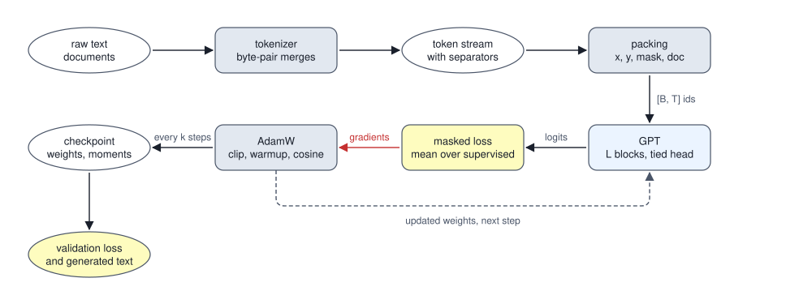
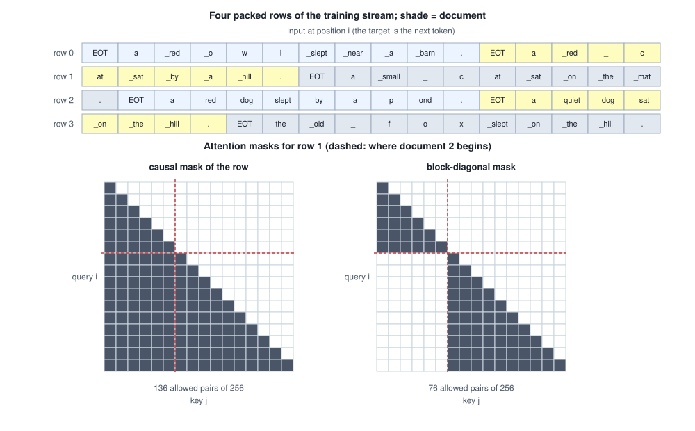

<!-- SPDX-License-Identifier: CC-BY-4.0 -->
<!-- Copyright (c) 2026 Martin Schröder <info@swedishembedded.com> -->

# Training a GPT from Scratch

*What does the full pipeline from raw text to a trained generative model look like?*

Before a training run has taken its first step it prints a number that can be worked out on paper. A model that knows nothing about its text spreads its probability evenly over the $V$ tokens of its vocabulary, so every target costs it $\ln V$ nats. The model trained below has $V = 73$, and its validation loss measured before the first update is 4.3098 nats per target token against $\ln 73 = 4.2905$. A first loss of 9.9 would say that the weights started far too large. A first loss of 0.2 would say that the model could see the answers. Either way the run is already wrong, and a wrong run keeps training: the loss still goes down, because a leak or a mislaid mask is easier to fit than the task. A pipeline is dangerous for exactly this reason. Its stages are each simple, and none of them reports its own mistakes.

The stages are seven. Raw text is cut into tokens (Chapter 2). The tokens of many documents become one stream, and the stream is cut into rows of fixed length with a target for every position. A decoder-only transformer (Chapter 9) turns a row into logits, and a loss scores the logits at the positions that count. An optimizer (Volume III) turns the gradient of that loss into a step. A checkpoint keeps the result, and an evaluation measures it and samples from it. All seven are built below at once, on a model small enough to train in pure Python, and then the same pipeline is priced at the size of GPT-2.



Training a GPT draws on earlier chapters, recalled before the loop is written.

1. (Chapter 2, byte-pair encoding.) Two words are in the corpus, `aab` three times and `ab` twice. Which adjacent pair is merged first, and how is `aab` written afterwards?
2. (Chapter 4, the causal language model.) A document has five tokens, $x_1, \dots, x_5$, after a start marker $x_0$. Which tokens are the inputs and which the targets, and what loss does a model that guesses uniformly over 73 tokens get?
3. (Chapter 9, the transformer block.) What does each of the two sublayers of a pre-norm block read, and how does it hand its result on?
4. (Volume III, Chapter 7, AdamW.) For one weight $\theta$ with bias-corrected moments $\hat m$ and $\hat v$, learning rate $\eta$, decay $\lambda$ and constant $\epsilon$, write the update. Where does the decay act?
5. (Volume III, Chapter 8, schedules and clipping.) With a peak rate of 0.01, a warmup of 20 steps and a 0-based step index, what is the rate at the first step? A gradient has norm 2.5 and the clip threshold is 1.0: by what factor is the gradient multiplied?

## A corpus whose entropy is known

A pipeline needs text, and real text hides the number that would tell us how well the pipeline works: how low can the loss go? The corpus here is therefore generated, small enough to print and structured enough that the answer can be computed. A document is a sentence of seven words, each drawn uniformly from a list. The lists are short, the sentences are grammatical, and the number of different sentences, which is 2,880, is known exactly.

<!-- worked: training_gpt.corpus_and_tokens -->
Slots (each drawn uniformly, in this order): determiner ['the', 'a'], adjective ['small', 'red', 'old', 'quiet'], noun ['cat', 'dog', 'fox', 'hen', 'owl'], verb ['sat', 'ran', 'slept'], preposition ['on', 'near', 'by'], determiner ['the', 'a'], place ['mat', 'barn', 'pond', 'hill']; the document is the seven words joined by single spaces followed by a full stop. Draws: one `integer(n)` per slot, `n` the size of the slot's list, in the order above, for each document in turn. 150 training documents from `training_gpt.corpus.train` (seed 0x45939e73c7a4252c); 40 validation documents from `training_gpt.corpus.val` (seed 0x0b91c292a38f34dd). A sentence has 2,880 possible spellings, so its entropy is ln of that, 7.9655 nats, and 3 of the 40 validation documents also occur among the training documents.

The tokenizer is the byte-pair encoder of Chapter 2 with its pre-tokenizer (every word but the first of a document carries the space before it, and the full stop carries none), learned with 48 merges on the training documents only. The vocabulary has id 0 for the document separator `EOT`, then the 24 bytes that occur in the training text in increasing order, then the 48 merges: V = 1 + 24 + 48 = 73. Merges in the order learned (a space is written `_`): `he`, `the`, `_s`, `_o`, `at`, `_r`, `ar`, `_b`, `_a`, `ll`, `_the`, `_n`, `an`, `ear`, `_ran`, `_near`, `_on`, `_sat`, `ep`, `lep`, `_slep`, `_slept`, `_by`, `_h`, `_q`, `et`, `ill`, `iet`, `uiet`, `_hill`, `_quiet`, `ed`, `_red`, `arn`, `_barn`, `_d`, `_m`, `og`, `_dog`, `_mat`, `all`, `mall`, `_small`, `ld`, `_old`, `_p`, `nd`, `ond`.

| document | text | tokens | token count (with its separator) |
|---:|---|---|---|
| 0 | `a red owl slept near a barn.` | `a` `_red` `_o` `w` `l` `_slept` `_near` `_a` `_barn` `.` | 11 |
| 1 | `a red cat sat by a hill.` | `a` `_red` `_` `c` `at` `_sat` `_by` `_a` `_hill` `.` | 11 |
| 2 | `a small cat sat on the mat.` | `a` `_small` `_` `c` `at` `_sat` `_on` `_the` `_mat` `.` | 11 |

The 150 training documents have 1,636 tokens with their separators (mean 10.91 per document, longest 13); the validation documents 441. The entropy of the generator is 0.7308 nats per target token on the training stream and 0.7241 on the validation stream, perplexities 2.0767 and 2.0630.
<!-- /worked -->

The count of sentences gives the entropy of the source. Each of the seven slots is a uniform draw, so the entropy of a sentence is $\ln 2880 = 7.9655$ nats, whatever the tokenizer does to the letters: a tokenizer is a deterministic, invertible map from a sentence to a list of ids, and an invertible map neither adds nor removes information. Dividing by the number of target tokens gives the loss that a model which knew the generator exactly would pay per token, and the table prints it: a model cannot beat it in expectation, and the validation loss of any trained model is read against it. That is a luxury real corpora do not give. The loss on a real text has no known floor, and the first hard question of a run on real text, whether more training would help, can then only be answered by trying.

Two decisions in the tokenizer carry more weight than their size suggests. The merges are learned on the training documents alone: the vocabulary is part of the model, and a vocabulary shaped by the validation text would be a small leak of the kind Volume II warned about. The ids are compact: id 0 is the separator, then come only the bytes that occur, then the merges. A byte-level tokenizer keeps all 256 bytes as base ids, and GPT-2's 50,257 ids are exactly that, $256 + 50{,}000 + 1$: the 256 bytes, 50,000 merges and one separator. Most of those 256 rows of the embedding table are never read at the scale of this chapter, so the compact ids spare 232 rows that nothing would train.

The separator needs its own explanation, because it is the one token that is not text. The documents of the stream follow each other, and the model must be able to tell that a new one has begun: the first word after a full stop is not a continuation of the sentence before it but a draw from the opening distribution. The stream therefore writes the separator before every document. It is the token the model is started from when it generates, and the token on which generation stops: a model that has learned what a document looks like also learns when one ends.

## From a stream to rows

The tokens of all training documents, each document opened by the separator, form one long list of $n$ ids. A GPT is trained on rectangles, and the cut is made in the simplest way. Row $r$ of $T$ positions takes the inputs $\mathrm{ids}[rT \dots rT + T - 1]$ and the targets $\mathrm{ids}[rT + 1 \dots rT + T]$, which are the same ids moved one place to the left. Every token except the first is the target of exactly one position, and a stream of $n$ ids gives $\lceil (n - 1)/T \rceil$ rows. This is **sequence packing**: documents are laid end to end and the stream is cut into fixed rows wherever the cut falls, in the middle of a sentence as readily as between two.

<!-- worked: training_gpt.packed_rows -->
The training stream has 1,636 tokens: every document is its separator `EOT` followed by its tokens. Rows have T = 16 positions. Row r takes the inputs `ids[16 r .. 16 r + 15]` and the targets `ids[16 r + 1 .. 16 r + 16]`, so each token except the first is a target exactly once and the stream gives ceil((1636 - 1) / 16) = 103 rows; the last row is padded with the separator and a loss mask of 0 (the loss mask holds a 0 or a 1 for every position: 1 where the model is scored on the target, 0 where it is not, as in the column m below). The first four rows touch these documents:

| row r | first input at | targets are tokens | documents touched |
|---:|---:|---:|---|
| 0 | 0 | 1 .. 16 | 0, 1 |
| 1 | 16 | 17 .. 32 | 1, 2 |
| 2 | 32 | 33 .. 48 | 2, 3, 4 |
| 3 | 48 | 49 .. 64 | 4, 5 |

Row 1 position by position (`doc` is the index of the document the position belongs to; a position belongs to the document whose separator or tokens it holds):

| position i | input x | target y | mask m | doc |
|---:|---|---|---:|---:|
| 0 | `at` | `_sat` | 1 | 1 |
| 1 | `_sat` | `_by` | 1 | 1 |
| 2 | `_by` | `_a` | 1 | 1 |
| 3 | `_a` | `_hill` | 1 | 1 |
| 4 | `_hill` | `.` | 1 | 1 |
| 5 | `.` | `EOT` | 1 | 1 |
| 6 | `EOT` | `a` | 1 | 2 |
| 7 | `a` | `_small` | 1 | 2 |
| 8 | `_small` | `_` | 1 | 2 |
| 9 | `_` | `c` | 1 | 2 |
| 10 | `c` | `at` | 1 | 2 |
| 11 | `at` | `_sat` | 1 | 2 |
| 12 | `_sat` | `_on` | 1 | 2 |
| 13 | `_on` | `_the` | 1 | 2 |
| 14 | `_the` | `_mat` | 1 | 2 |
| 15 | `_mat` | `.` | 1 | 2 |

The documents of row 1 are 1 and 2: the row ends the first document, with the target `EOT` at position 5, and opens the second.
<!-- /worked -->

The last row of the stream rarely fills. It is padded with the separator as input, and the padding positions are given a loss mask of 0 (defined with the block above): not every position of a row is one the model is to be scored on, an idea that returns in full with the loss. The function that makes the rows is short enough to write down, and every line of it is a decision.

```text
function pack(ids: list<int>, doc: list<int>, T: int, sep: int)
        -> list<(list<int>, list<int>, list<int>, list<int>)>:
    require T >= 1, "a row needs at least one position"
    require len(ids) >= 2, "one target needs two tokens"
    require len(doc) == len(ids), "one document id per token"
    n = len(ids)
    rows = []
    for r in 0 .. (n - 1 + T - 1) // T:
        a = r * T
        k = min(T, n - 1 - a)                  # the targets this row really has
        x = []
        y = []
        m = []
        d = []
        for i in 0 .. T:
            if i < k:
                append ids[a + i] to x         # input at position i
                append ids[a + i + 1] to y     # its target: the next token
                append 1 to m                  # supervised
                append doc[a + i] to d
            else:
                append sep to x                # padding: any id of the vocabulary
                append sep to y
                append 0 to m                  # never scored
                append -1 to d                 # belongs to no document
        append (x, y, m, d) to rows
    return rows
```

Why pack at all? The alternative is the layout of a padded batch: one document to a row, the rest of the row padding. The next table counts what each layout runs.

<!-- worked: training_gpt.packing_waste -->
Training documents of the corpus, rows of T = 16 positions. A position is computed whether or not its target is supervised, so the share of positions with mask 0 is arithmetic that is run and thrown away. (The one-document-per-row layout also supervises a closing separator after each document, which the packed stream has only between documents.)

| layout | rows | positions computed | supervised positions | wasted positions, percent |
|---|---:|---:|---:|---:|
| one document per row, padded | 150 | 2,400 | 1,636 | 31.8 |
| packed rows | 103 | 1,648 | 1,635 | 0.8 |
<!-- /worked -->

A position costs the same arithmetic whether or not its target is supervised, so the share of masked positions is arithmetic that is run and thrown away. With documents of 10.9 tokens in rows of 16 the padded layout throws away almost a third of the work, and the packed layout less than one percent, which is the padding of the last row. The shorter the documents are against the row, the larger the first number gets, and a dataset of short questions in rows of a thousand positions would waste most of every row. That is why a training loop that cares about throughput packs.

The loader in brain cuts the stream differently from the tiny run. `TokenDataset::get_batch` in `crates/data/src/loader.rs` picks a start offset uniformly from the stream for each row of the batch and copies $T$ inputs and the $T$ targets that follow one place later; the book's tiny run instead cuts fixed rows once and shuffles them in epochs. Both need one more token than the row is long, and a bug of the first kind shows the counting rule at work. The sampler computed `data.len() - block_size - 1` on unsigned integers, so a split of no more than $T$ tokens underflowed to an index near the largest 64-bit number and the run died deep inside a batch draw with an out-of-bounds message that mentioned neither datasets nor sizes. A real fine-tune of a small dataset found it, and commit `d82f39ccb` (August 2026) moved the check to where the data enters the training loop: `load_dataset` in `crates/model/src/train.rs` now refuses a split of $T$ tokens or fewer, by name, with the token count and the block size in the message, and a test pins it. The sampler itself got a plain message in commit `c8353e1cf` (August 2026). The lesson is the arithmetic of the shift: $n$ tokens give $n - 1$ targets, and a row of $T$ targets needs $T + 1$ tokens.

Packing has a price, which needs a trained model to show: the second half of a packed row may read its first. Whether it should is taken up once a first model has trained.

## The model, from ids to logits

The model is the decoder of Chapter 9 with its two ends attached. At the start each token id looks up its row of the embedding table $\mathbf{W}_{\mathrm{emb}}$ (Chapter 3), and a table of learned absolute positions $\mathbf{W}_{\mathrm{pos}}$ (Chapter 8) adds the vector of the position the token occupies. The stream $\mathbf{X}_0$ of shape $[T, D]$ then passes through $L$ pre-norm blocks, and a final normalization hands it to the head. At the end the head is the embedding table used a second time, transposed: the logit of token $j$ at position $i$ is the dot product of the normalized stream with row $j$ of $\mathbf{W}_{\mathrm{emb}}$.

$$
\mathbf{X}_0 = \mathbf{W}_{\mathrm{emb}}[\mathrm{ids}] + \mathbf{W}_{\mathrm{pos}}[0 \dots T-1],
\qquad
\mathbf{X}_l = \mathrm{block}_l(\mathbf{X}_{l-1}),
\qquad
\mathbf{Z} = \mathrm{norm}(\mathbf{X}_L)\,\mathbf{W}_{\mathrm{emb}}^{\top}
$$

with $\mathbf{Z}$ of shape $[T, V]$, a row of logits for every position, and the loss the softmax cross-entropy of each row against the token one place later. A model built this way, in the line of the generative pre-training of Radford and colleagues (2018), is a **GPT architecture**. The name covers more than one choice of block, and the choices that made GPT-2 what it was are worth stating, because they are the ones the Rust code in `crates/gpt2` makes:

- LayerNorm, with a gain and a shift, in front of each sublayer and once more after the last block (Radford and colleagues, 2019, who moved the normalization to the input of each sublayer and added the last one);
- a feed-forward network with the GELU activation and a hidden width of $4D$, the plain network of Chapter 9, with a bias on every linear map;
- learned absolute positions, one row for each of the $T = 1{,}024$ positions;
- a head tied to the embedding table, and a vocabulary of 50,257 ids;
- weights drawn from a normal distribution with a standard deviation of 0.02, with the output matrices of the two residual branches scaled down by a factor that depends on depth.

The tiny model keeps the layout and takes the block of Chapter 9, which is RMS norm (epsilon $10^{-6}$ in every norm of this chapter) and SwiGLU without biases: that is the block this volume built, and the pipeline does not care which block sits in the stack. The GELU of Volume III is the exact function; GPT-2 used a tanh form that differs from it a little. The kernel of `crates/kernels/wgsl/gelu.wgsl` computes the tanh form, and so does the model of `crates/gpt2`.

<!-- worked: training_gpt.gelu_forms -->
The exact GELU, x times the Gaussian cumulative distribution (library `erf`), and the tanh form 0.5 x (1 + tanh(sqrt(2/pi) (x + 0.044715 x^3))) that GPT-2 used (library `tanh`).

| x | exact | tanh form | tanh form - exact |
|---|---:|---:|---:|
| -3.0 | -0.004050 | -0.003637 | 0.000412 |
| -1.0 | -0.158655 | -0.158808 | -0.000153 |
| -0.5 | -0.154269 | -0.154286 | -0.000017 |
| 0.5 | 0.345731 | 0.345714 | -0.000017 |
| 1.0 | 0.841345 | 0.841192 | -0.000153 |
| 3.0 | 2.995950 | 2.996363 | 0.000412 |

Over x = -6.00, -5.99, ..., 6.00 the largest difference is 0.000473, at x = 2.70.
<!-- /worked -->

The two differ by less than $5 \times 10^{-4}$ everywhere, far below what training can resolve, but a checkpoint trained with one and run with the other is not exactly the model that was trained, and the distinction goes into the list of things a loader has to know.

A parameter count settles what the architecture holds, and the table below does it twice: once for GPT-2 small with every term written out, and once for the tiny model that the rest of the chapter trains.

<!-- worked: training_gpt.gpt_parameters -->
GPT-2 small as published (Radford and colleagues, 2019): vocabulary V = 50,257, T = 1,024, D = 768, L = 12 blocks, 12 heads, F = 4 D = 3,072, LayerNorm with a gain and a shift, a GELU feed-forward network, biases on every linear map.

| part | formula | parameters |
|---|---|---:|
| token embedding | V D | 38,597,376 |
| position table | T D | 786,432 |
| two LayerNorms (each block) | 4 D | 3,072 |
| attention q, k, v (each block) | 3 D^2 + 3 D | 1,771,776 |
| attention output (each block) | D^2 + D | 590,592 |
| feed-forward fc (each block) | D F + F | 2,362,368 |
| feed-forward proj (each block) | F D + D | 2,360,064 |
| one block |  | 7,087,872 |
| 12 blocks | 12 x | 85,054,464 |
| final LayerNorm | 2 D | 1,536 |
| total, head tied to the token embedding |  | 124,439,808 |
| separate head | V D | 38,597,376 |
| total, separate head |  | 163,037,184 |

The tiny model of this chapter: V = 73, T = 16, D = 16, L = 2, 2 heads, SwiGLU of hidden width F = 24, RMS norms (epsilon 1e-6) with a gain and no shift, no biases, the head tied to W_emb.

| tensor | shape | parameters |
|---|---|---:|
| W_emb (token embedding, also the head) | 73 x 16 | 1,168 |
| W_pos (positions) | 16 x 16 | 256 |
| W_Q | 16 x 16 | 256 |
| W_K | 16 x 16 | 256 |
| W_V | 16 x 16 | 256 |
| W_O | 16 x 16 | 256 |
| W_gate | 16 x 24 | 384 |
| W_up | 16 x 24 | 384 |
| W_down | 24 x 16 | 384 |
| two RMS gains | 2 x 16 | 32 |
| one block |  | 2,208 |
| 2 blocks | 2 x | 4,416 |
| final RMS gain | 1 x 16 | 16 |
| total, head tied to W_emb |  | 5,856 |

A separate head would add V D = 1,168 parameters.
<!-- /worked -->

In GPT-2 small the embedding table is 38,597,376 of 124,439,808 parameters, 31 percent. Press and Wolf (2017) proposed that the two tables be one, and GPT-2 did so. Tying the table to the head is therefore not a detail: a separate head would add another 38,597,376 and make the model 163,037,184 parameters. It has a second effect on the backward pass. The table receives gradient twice, once from the head, as the product of the logit gradient with the normalized stream, and once from each lookup, where the gradient of the stream is added into the rows of the tokens that were read. The gradient check of the tiny model, below, covers both: its row `W_emb` differentiates the loss through the lookups and the head at once, and would disagree with the analytic gradient if either were dropped.

The GPT of brain, `crates/gpt2`, ties, as GPT-2 does. The module header of `crates/gpt2/src/model.rs` states it: `tok.weight` is the embedding table and the head, and there is no `lm_head.weight`. The backward writes the head's gradient into the table's gradient first and lets the embedding scatter add onto it, the order that Chapter 3 described for Qwen3's tied table, and `check_gpt_tied` in `crates/gradcheck` differences the table entry by entry, since a single direction can make a missing share look small. A second consequence shows in `crates/gpt2/src/shard.rs`: the model can be cut into pipeline stages across cards, with the embedding on the first stage and the head on the last, so the tied table is held by two stages and is reported as a replicated parameter whose gradient the pipeline sums across them. The count of parameters is the published one: the engine's parameter list for the 12-layer, width-768 shape adds up to 124,439,808, and a model with a second table would be the 163,037,184 of the table.

## Weights that start out saying nothing

The loss measured before the first step is a measurement of the initialization, and the rule of GPT-2 makes it equal $\ln V$ to within a small excess. Every matrix is drawn as $0.02$ times a standard normal number, the gains of the norms start at 1 and the biases at 0, and the two matrices that write into the residual stream, the output of attention and the last matrix of the feed-forward network, are scaled by $1/\sqrt{2L}$ more. `crates/gpt2/src/init.rs` is that rule, and its header lists it. For a reader who wants to reproduce the tiny model, the draws are these, from the generator of the book (Volume I, Chapter 17) with the seed of the name `training_gpt.init`: the entries of the embedding table (V rows of D numbers), then of the position table (T rows of D), then for each block in turn $\mathbf{W}_Q$, $\mathbf{W}_K$, $\mathbf{W}_V$, $\mathbf{W}_O$ ($D$ by $D$), $\mathbf{W}_{\mathrm{gate}}$, $\mathbf{W}_{\mathrm{up}}$ ($D$ by $F$) and $\mathbf{W}_{\mathrm{down}}$ ($F$ by $D$), each row by row, every entry the standard deviation times one `normal()`; the two output matrices $\mathbf{W}_O$ and $\mathbf{W}_{\mathrm{down}}$ are multiplied by the extra factor after the draw.

The size 0.02 is a statement about logits. The last norm gives a vector of root mean square 1, a squared length of $D$, so a logit is a sum of $D$ products of that vector with an entry of the table, and has a standard deviation of $0.02\sqrt{D}$ at initialization. A small standard deviation means near-uniform probabilities, and near-uniform probabilities cost $\ln V$.

<!-- worked: training_gpt.init_scales -->
The tiny model (5,856 parameters, V = 73) with every matrix drawn as `std * normal()` from `training_gpt.init_scale` (seed 0xcff7dcb63eb1f695; the draw order is that of the initialization section), no training. Loss: mean cross-entropy over the supervised positions of the first 8 training rows. The final RMS norm gives a vector of root mean square 1 (squared length D), so a logit is a sum of D products with an entry of W_emb and has standard deviation std sqrt(D); 'measured' is the root mean square of all logits.

| std | std sqrt(D) | measured logit rms | initial loss |
|---|---:|---:|---:|
| 0.02 | 0.080 | 0.081 | 4.2858 |
| 0.10 | 0.400 | 0.404 | 4.3294 |
| 0.50 | 2.000 | 1.960 | 6.2045 |
| 1.00 | 4.000 | 3.939 | 9.9386 |

A model that guesses uniformly has loss ln V = 4.2905.

Residual scaling: each of the L blocks writes twice to the stream (attention, feed-forward), so 2 L writes; the output matrices are multiplied by 1/sqrt(2 L) and the stream receives 2 L contributions of variance proportional to the square.

| blocks L | writes 2 L | factor 1/sqrt(2 L) | std of an output matrix, 0.02 times the factor | (2 L) times factor squared |
|---|---:|---:|---:|---:|
| 2 | 4 | 0.5000 | 0.01000 | 1.0 |
| 12 | 24 | 0.2041 | 0.00408 | 1.0 |
| 24 | 48 | 0.1443 | 0.00289 | 1.0 |
| 48 | 96 | 0.1021 | 0.00204 | 1.0 |
<!-- /worked -->

At 0.02 the measured logit root mean square is 0.081, the product $0.02\sqrt{16} = 0.08$ predicts it, and the loss is within 0.005 of $\ln 73$. At 0.5 the logits are 2.0 wide, the loss has risen by about half their variance, as a quick expansion of the log-sum-exp predicts, and at 1.0 the first updates would spend their steps taking logits back from a confident wrong answer. For GPT-2 small the same rule gives a logit width of $0.02\sqrt{768} = 0.55$ and a loss about 0.15 above $\ln 50{,}257 \approx 10.82$. The factor on the output matrices is the cure that Chapter 9 measured for a stream that grows with depth: with $2L$ writes to the stream, each of variance proportional to the square of its factor, the factor $1/\sqrt{2L}$ keeps the total at the variance of one write, whatever the depth, which the last column of the table checks. `init.rs` writes $0.02/\sqrt{2L}$ for the output matrices with $L$ the number of blocks; the GPT-2 paper says the scale is $1/\sqrt{N}$ for $N$ residual layers, and the two agree when each block counts as two.

The tiny model uses the same rules. Its first validation loss, at step 0 of the run below, is the 4.3098 nats of the opening.

## Gradients that can be believed

Before a run is trusted, the backward pass is checked against a central difference. The backward pass of the GPT is the one of Chapter 9 for the blocks, plus what the full model adds: the head through the transposed table, the scatter into the embedding rows, the position table, and a loss that skips some positions. The attention of the blocks takes a mask as an argument, so the same check covers the causal mask of the row and the block-diagonal mask defined further on, in which a position may read only the earlier positions of its own document.

<!-- worked: training_gpt.gradient_check -->
A GPT with V = 7, T = 6, D = 8, 2 heads, F = 12, L = 2, every matrix `0.3 * normal()` from `training_gpt.check.init` (0x82422da2b75132df), in the draw order of the initialization section, with W_O and W_down of each block then multiplied by 1/sqrt(2 L) = 0.5000 as in the main run (so their entries have standard deviation 0.15); all gains 1 and every RMS norm at epsilon 1e-6. Two rows from `training_gpt.check` (0x2cd020f2059241c3): x (6 draws of `integer(7)`) then y (6 draws), for row 0 then row 1; row 0 has documents 0 0 0 1 1 1 and mask 1 everywhere; row 1 has documents 0 0 1 1 and two padding positions (document -1, mask 0). The loss is the mean cross-entropy over the 10 supervised positions. Central differences with step 1e-05 on every entry of every parameter. A cell says 'below 1e-6' when the largest difference meets the criterion of 1e-6 (the digits of a smaller difference are finite-difference noise); the absolute difference is |a - n|, the relative difference |a - n| / max(|a|, |n|) is taken over entries whose gradient is above 1e-3.

| parameters | entries | causal: absolute | causal: relative | block-diagonal: absolute | block-diagonal: relative |
|---|---:|---:|---:|---:|---:|
| W_emb (token embedding and head) | 56 | below 1e-6 | below 1e-6 | below 1e-6 | below 1e-6 |
| W_pos (positions) | 48 | below 1e-6 | below 1e-6 | below 1e-6 | below 1e-6 |
| W_Q | 128 | below 1e-6 | below 1e-6 | below 1e-6 | below 1e-6 |
| W_K | 128 | below 1e-6 | below 1e-6 | below 1e-6 | below 1e-6 |
| W_V | 128 | below 1e-6 | below 1e-6 | below 1e-6 | below 1e-6 |
| W_O | 128 | below 1e-6 | below 1e-6 | below 1e-6 | below 1e-6 |
| W_gate | 192 | below 1e-6 | below 1e-6 | below 1e-6 | below 1e-6 |
| W_up | 192 | below 1e-6 | below 1e-6 | below 1e-6 | below 1e-6 |
| W_down | 192 | below 1e-6 | below 1e-6 | below 1e-6 | below 1e-6 |
| block gains | 32 | below 1e-6 | below 1e-6 | below 1e-6 | below 1e-6 |
| final gain | 8 | below 1e-6 | below 1e-6 | below 1e-6 | below 1e-6 |

The forward pass of this module's block with the causal mask against the block of Chapter 9 on a random 6 by 8 input: the largest absolute difference is 0.0.
<!-- /worked -->

Every parameter group meets the criterion of $10^{-6}$ on both differences under both masks (the digits of a smaller difference are noise and are not printed), and the block of this module with the causal mask agrees with Chapter 9's block exactly, which is the claim of the pipeline that nothing was rewritten between the chapters: the block was imported, and only the mask was made an argument. The check includes the padded row, whose masked positions must contribute nothing, and the two documents of one row.

## A loss over the positions that count

The loss of a batch is a mean, and a mean has a denominator. For one position the loss is the cross-entropy $\ell_t = -\log \mathrm{softmax}(\mathbf{z}_t)[y_t]$ of Volume III. With a mask $s_t \in \{0, 1\}$ per position, which says whether the target there is to be learned, the loss of a batch is

$$
\mathcal{L} = \frac{\sum_{t} s_t\,\ell_t}{\sum_{t} s_t},
$$

where both sums run over every position of every row of the batch. This is **loss masking**: the positions with $s_t = 0$ are computed, since the rest of the row needs them, and then ignored, both in the value and in the gradient, because the gradient of the logits at such a position is multiplied by zero. Two kinds of position need it. The padding of the last row has no target at all; counted as targets, padding teaches the model that a separator follows a separator, and an unseen event costs a large loss, which is the third row of the table below. And in data made of a prompt and an answer, the prompt tokens are the context of the task and not its output: a question is not something the model should be rewarded for writing.

The denominator is the count of supervised positions of the batch, not the number of positions and not a count per row.

<!-- worked: training_gpt.loss_denominator -->
The model after 300 steps on the last 4 validation rows: B T = 64 positions of which 56 are supervised (the last row carries 8 positions of padding). Three denominators for the same per-position cross-entropies.

| quantity | value | formula |
|---|---:|---|
| mean over the supervised positions (the loss) | 0.7940 | sum / supervised |
| sum over supervised positions divided by all positions | 0.6947 | sum / (B T) |
| every position counted, padding targets included | 1.3437 | (sum + padding) / (B T) |
<!-- /worked -->

Divided by all positions the loss comes out 12.5 percent lower than the mean over the supervised ones, which is the same 8 padding positions in 64, and a batch with more padding would show a still lower loss for the same model. For a stochastic gradient the same error is a weight: a supervised token in a batch of mostly padding would count for less than the same token elsewhere. When $K$ batches are accumulated into one optimizer step, the same care applies to the denominator: commit `c2a048cbf` (October 2026) gave the records of one step a shared denominator, the mean count of supervised positions per record of the step, so that a short record no longer weighs as much as a long one and the reported training loss is the per-token mean a held-out evaluation measures. The code is `micro_steps` in `crates/model/src/train.rs`, which sets the denominator before each forward and backward pass.

A mask is also a place for a bug that costs nothing visible, and a small experiment shows it. Lines `S=S` of a three-letter string repeated after an equals sign, a task that can only be solved by attending three tokens back, are learned by the same model three times, with three masks.

<!-- worked: training_gpt.copy_task -->
Lines `S=S` and a line feed, S three letters from `abcd` (draws: three `integer(4)` per line, in order, from `training_gpt.copy.train`, 0xff41f36ac831a367); ids a .. d = 0 .. 3, `=` = 4, line feed = 5. A row is the 7 inputs `S = S` and the 7 targets that follow, so the targets are s2 s3 = a1 a2 a3 line-feed. Model: V = 6, T = 7, D = 16, one block, 2 heads, SwiGLU width 24, from `training_gpt.copy.init` (0xbb7ff1496ab2d823), the same start for every row below, drawn as in the main run: standard deviation 0.02 for every matrix, W_O and W_down times 1/sqrt(2 L) = 0.7071, the table W_emb [6, 16] also the head, a position table of 7 rows, all gains 1, RMS norms at epsilon 1e-6. 8 fresh lines per step (a batch of 8 rows, loss and gradient averaged over the counted targets of the batch), 600 steps of AdamW (beta1 0.9, beta2 0.95, epsilon 1e-08, weight decay 0.1 on every matrix except the gains, peak 0.01, floor 0.001, warmup 10, half a cosine over the 600 steps, clip 1.0 by the factor min(1, 1.0 / (norm + 1e-6)): the settings of the main run with these steps). The three masks differ only in which of the 7 targets count (1 = counted): 'every target' 1 1 1 1 1 1 1; 'the answer targets' (the four after the input `=`, a1 a2 a3 and the line feed) 0 0 0 1 1 1 1; 'off by one' (the mask of the answer tokens, which are tokens 4 to 7 of the line, laid on the input positions 4 to 6 instead of on the target positions 3 to 6) 0 0 0 0 1 1 1. 'Reported loss' is the training loss of the last 20 steps under the run's own mask. The other columns are measured on 200 held-out lines of `training_gpt.copy.test` (0x238112bced1121ab), teacher forced, whatever the mask: the cross-entropy at the four answer targets (a1, a2, a3, line feed) and the fraction of lines whose four answer targets all have the largest logit. Guessing a letter costs ln 4 = 1.386. A number that comes from a chaotic run is printed with only the digits that are the same in the run and in four copies of it whose first weight is changed by +1e-12, -1e-12, +3e-12 and -3e-12: in full if all agree on it, as 'about x' with the leading digits on which all agree, or as 'unstable' when not even one digit survives; the other digits cannot be reproduced in another implementation.

| mask | step | reported loss | a1 | a2 | a3 | line feed | answers all right |
|---|---:|---:|---:|---:|---:|---:|---:|
| the answer targets | 150 | 0.0769 | 0.011 | 0.029 | 0.018 | below 0.01 | 1.000 |
|  | 300 | below 0.01 | below 0.01 | below 0.01 | 0.330 | below 0.01 | 0.975 |
|  | 600 | below 0.01 | below 0.01 | below 0.01 | below 0.01 | below 0.01 | 1.000 |
| every target | 150 | 0.9951 | 1.397 | 1.383 | 1.388 | below 0.01 | 0.025 |
|  | 300 | 0.5980 | 0.317 | 0.491 | 0.414 | below 0.01 | 0.420 |
|  | 600 | about 0.401 | below 0.01 | below 0.01 | below 0.01 | below 0.01 | 1.000 |
| answer targets, off by one | 150 | 0.6882 | 8.483 | 0.900 | 0.736 | below 0.01 | below 0.01 |
|  | 300 | below 0.01 | about 13 | below 0.01 | below 0.01 | below 0.01 | below 0.01 |
|  | 600 | below 0.01 | about 18.4 | below 0.01 | below 0.01 | below 0.01 | below 0.01 |
<!-- /worked -->

Read the three groups in turn. With the answer targets alone, the run has learned the copy at step 150, the answers are all right on every held-out line, and the reported loss falls toward 0: the number is the loss on the answer, and it can reach 0 because the answer is determined. The step-300 row shows a transient in the third letter, gone again at step 600. With every target counted, nothing is learned at step 150: the three answer letters cost 1.397, 1.383 and 1.388, within 0.011 of $\ln 4 = 1.386$, a guess. The task is the same, but the answer positions now carry 4/7 of the weight and two of the seven targets are random letters, whose gradient says nothing about the copy; the run takes about four times the steps. Its reported loss never gets below a floor that is easy to compute: the two random targets each cost $\ln 4$ and the other five nothing, so the floor is $2\ln 4/7 = 0.3961$, and 'about 0.401' at step 600 is a learned copy, not a failure.

The third group is the bug. The mask of the answer tokens was built from the position of the tokens in the line and laid on the input positions, so it starts one place late and leaves out the target of the input `=`, the first answer letter. Nothing looks wrong with the run: its reported loss falls below 0.01 by step 300, as low as the run with the right mask, and the second and third letters are learned to below 0.01 as well. The first letter's held-out loss is 8.483 at step 150, about 13 at step 300 and about 18.4 at step 600, which is worse than a guess and grows, and the fraction of held-out lines with all four answers right is below 0.01 at every step. The position was never scored, so its output is whatever the other positions' training did to the shared weights, and as the weights grow it puts ever less probability on the right letter. The one number the run reports cannot show it, because it is a mean over the positions that are scored.

Two habits catch such a bug. One is to print, for one row, the targets that are supervised, decoded to text, before the run; the answer letters and the line feed should be the whole list. The other is a test that cannot pass unless the mask is right. In brain, `crates/gpt2/tests/it/convergence.rs` trains the real engine on tasks of exactly this kind, a cycle that needs no mask, a copy and a reversal that do, and a pair of models of different widths on the copy, and asserts that the loss falls below what a model without the attention circuit could reach. The copy test requires the loss to fall far below the guessing floor, which is possible only if the mask keeps exactly the answer tokens: the same argument as the table above. The loader's own convention is the one the bug breaks: the token-level mask of `crates/data/src/loader.rs` is indexed by the target (`mask[start + 1 + t]` for the target at position $t$), so the answer tokens, not the input before them, decide which positions count.

Two further conventions of the engine are visible in the kernels. A masked target is the value `IGNORE`, which the loader writes as $-1$ in an `i32` and the model reads as `0xFFFFFFFF`; the kernel `ce_value_masked.wgsl` writes a zero loss for such a position, and `Gpt::set_batch` in `crates/gpt2/src/model.rs` counts the supervised positions on upload and divides both the loss and the gradient (in `ce_grad_stats.wgsl`) by that count, with a floor of 1 so that a batch with nothing supervised divides by one and gives a gradient of zero rather than a division by zero.

## One step: gradient, clip, AdamW, rate

A step turns a batch into new weights, and every part of it was built earlier. The batch gives a loss and its gradient. The gradient of every tensor is measured together, as one vector, by its global norm (Volume III, Chapter 8), and multiplied by the clip coefficient $c = \min(1, \tau/(\lVert\mathbf{g}\rVert + 10^{-6}))$ so that no single batch moves the weights by more than a bounded amount. The rate $\eta_t$ comes from a warmup followed by half a cosine. Then AdamW (Volume III, Chapter 7) updates each tensor from the clipped gradient. Two choices belong to this model and not to the optimizer: which tensors are decayed, and how batches are drawn. The tiny run decays every matrix, the embedding table and the position table included, and leaves the gains alone, a common recipe for language models; it draws a shuffled epoch of the rows, then another, and drops the rows of an epoch that do not fill a batch.

```text
function batch_order(n_rows: int, B: int, steps: int, rng: Generator) -> list<list<int>>:
    require 1 <= B and B <= n_rows, "a batch needs at least one row, and no more than there are"
    batches = []
    while len(batches) < steps:
        idx = []
        for r in 0 .. n_rows:
            append r to idx
        shuffle(idx, rng)                          # one shuffle per epoch
        for k in 0 .. n_rows // B:                 # the incomplete last group is dropped
            batch = []
            for j in 0 .. B:
                append idx[k * B + j] to batch
            append batch to batches
    result = []
    for s in 0 .. steps:
        append batches[s] to result
    return result

function fit(rows: list<(list<int>, list<int>, list<int>, list<int>)>,
             theta: inout list<array<real>>, decay: list<bool>,
             steps: int, B: int, warmup: int, eta_max: real, eta_min: real,
             tau: real, lam: real, rng: Generator) -> none:
    require warmup < steps, "the decay needs at least one step"
    order = batch_order(len(rows), B, steps, rng)
    m = []                                         # Adam's two moments, one array per tensor
    v = []
    for i in 0 .. len(theta):
        append zeros(real, theta[i].shape) to m
        append zeros(real, theta[i].shape) to v
    for t in 0 .. steps:                           # t is the 0-based step index
        batch = order[t]
        (loss, g) = masked_loss_and_gradients(theta, rows, batch)   # mean over supervised positions
        norm = global_norm_clip(g, tau)            # Vol. III ch. 8: g times the clip coefficient
        eta = schedule_rate(t, eta_max, eta_min, warmup, 0, steps)  # Vol. III ch. 8
        for i in 0 .. len(theta):
            adam_step(theta[i], g[i], m[i], v[i], t + 1, eta, 0.9, 0.95, 1e-8,
                      lam if decay[i] else 0.0, true)               # Vol. III ch. 7: decoupled decay
        if (t + 1) mod 10 == 0:
            print t + 1, loss, norm, validation_loss(theta)
```

`masked_loss_and_gradients(theta, rows, batch)` is the forward and backward pass of the model on the rows of the batch, with the mask $s_t$ of each row: it returns the loss of the batch, the masked mean of the section above with the denominator $\sum s_t$ over the whole batch, and the gradient of that loss with respect to each tensor of `theta`, as a list of arrays in the order of `theta`. `validation_loss(theta)` is the same mean over every supervised position of the validation rows, forward pass only, with no change to `theta`. `adam_step` is given each tensor as one flat array. The loop does not hide anything: one number to look at (the global norm of the gradient, before the clip, is printed beside the loss), and one that is a decision (the clip threshold, which engages when the norm goes above it).

The step of the tiny run uses the settings below, a plausible choice for a short run and not a tuned one: warmup 20 steps to a peak of 0.01, half a cosine down to 0.001 at step 300, $\beta_2 = 0.95$ (a shorter memory of the squared gradient than Adam's usual 0.999, a choice common in the training of language models), a decay of 0.1 and a clip at 1.0.

<!-- worked: training_gpt.training_curve -->
Model: V = 73, T = 16, D = 16, L = 2, 2 heads, SwiGLU width 24, initialized from `training_gpt.init` (0xb993e33922562af0) with std 0.02 (output matrices times 1/sqrt(2 L)). Batches: 8 rows per step in shuffled epochs of the 103 training rows (one `shuffle` of 0 .. 102 per epoch from `training_gpt.batches`, 0xc8b8daee7a19c9a9; consecutive groups of 8; an incomplete last group is dropped), the same batches for every run below. 300 steps of AdamW (beta1 0.9, beta2 0.95, epsilon 1e-08, weight decay 0.1 on every matrix except the gains), the learning rate warming up linearly over 20 steps to 0.01 and following half a cosine to 0.001 at step 300 (`schedules.cosine`, 0-based: step s uses the rate at index s - 1), the global gradient norm clipped to 1.0 by the factor min(1, 1.0 / (norm + 1e-6)); the 'gradient norm' column is that norm for the step that ends at the row, before the clip (the square root of the sum of the squares of every entry of every gradient, the gains and the position table included), and the 'learning rate' column is the rate of that step's update. Every RMS norm has epsilon 1e-6 and the gradient is that of the mean over the supervised positions of the 8 rows of the step. Validation: every one of the 28 validation rows, after every 10 steps. A training loss is the mean of the batch losses of the 10 steps that end at the step. A number that comes from a chaotic run is printed with only the digits that are the same in the run and in four copies of it whose first weight is changed by +1e-12, -1e-12, +3e-12 and -3e-12: in full if all agree on it, as 'about x' with the leading digits on which all agree, or as 'unstable' when not even one digit survives; the other digits cannot be reproduced in another implementation.

| step | learning rate | gradient norm | training loss | validation loss | validation perplexity |
|---|---:|---:|---:|---:|---:|
| 0 | - | - | - | 4.3098 | 74.426 |
| 10 | 0.00500 | 0.6901 | 4.2028 | 3.9793 | 53.478 |
| 20 | 0.01000 | 0.8319 | 3.6787 | 3.2304 | 25.289 |
| 50 | 0.00976 | 0.5260 | 1.4581 | 1.2400 | 3.456 |
| 100 | 0.00835 | 0.6272 | 0.7923 | 0.7710 | 2.162 |
| 150 | 0.00605 | 0.3951 | 0.7397 | 0.7401 | 2.096 |
| 200 | 0.00359 | 0.5417 | 0.6993 | 0.7542 | 2.126 |
| 250 | 0.00172 | 0.8284 | 0.6830 | 0.7703 | 2.160 |
| 300 | 0.00100 | 0.6978 | 0.6562 | 0.7821 | 2.186 |

The clip engaged in 2 of the 300 steps. Validation perplexity is exp of the validation loss. A model that guesses uniformly has loss ln V = 4.2905; the entropy of the generator is 0.7241 nats per target token on the validation stream (perplexity 2.063). The lowest validation loss of the steps evaluated is 0.7401, at step 150.
<!-- /worked -->

The engine's version of this loop is `fit` in `crates/model/src/train.rs`, which every model reaches, and its defaults are the same family: `FitOpts::default()` has a peak rate of $3\times10^{-4}$ falling to $3\times10^{-5}$, a warmup of 100 steps, a decay of 0.1, a clip of 1.0, a batch of 32 rows of 64 positions, AdamW with $\beta = (0.9, 0.999)$ and an evaluation every 250 steps. The rate is `LrSchedule::at`, the pseudocode of Volume III, Chapter 8, with the step counted in updates that were applied: a step that the gate skips for a non-finite loss does not consume warmup. The command-line path for a GPT is `brain gpt2 train --data <data_dir>`, the served action in `crates/gpt2/src/caps.rs`, which sets the decay horizon to the number of steps. The kernel `adamw.wgsl` applies the decay to every tensor it updates, with the gains included, a difference from the recipe above that is a convention and not an error.

The clip is where a bug hid for a while. `adamw_step` is called with a factor of $1/K$ to average $K$ accumulated micro-batches, and the optimizers of the engine disagreed about what the factor meant: the device clip kernels multiplied the gradient by it but measured the norm on the raw sum, so the clip was $K$ times too lax, and the host optimizers divided where the device multiplied. Nothing failed, because Adam's update is nearly unchanged by a constant factor on the gradient: the test that compared the host and the device optimizer passed with both in error, and a scale off by $K^2$ was invisible at the default $\epsilon = 10^{-8}$. Commit `fab825f32` (September 2026) made one convention, the clip of the widely used reference implementation applied to the averaged gradient, in `optim::grad_multiplier`, and its test sets $\epsilon$ large enough that the scale shows. Knowledge #181 records the general lesson: test an optimizer at a value of $\epsilon$ where the magnitude of the gradient matters, since at the default an Adam update ignores a scaling bug.

## Reading the first run

The table above is the whole run, and it has a shape that every language-model run has. Before any update the validation loss is 4.3098, a perplexity of 74.426 against the 73 of a uniform guess: the initialization did what the section on weights asked, and the pipeline's first claim holds. Then nothing happens for a few steps, because the warmup holds the rate down (0.005 at step 10), and then the loss falls fast: 1.2400 at step 50 and 0.7710 at step 100. Both losses reach the neighbourhood of the generator's entropy of 0.7241 nats within 150 steps, which is 12.5 epochs at 8 rows a step (an epoch is one shuffle of the 103 rows cut into 12 groups of 8, so 96 rows are used and the 7 left over are dropped: 12 steps to an epoch), and the run of 300 steps is 25 epochs long. The validation perplexity at its best, 2.096 at step 150, is within 2 percent of the generator's 2.063.

After that the two curves part, and the figure shows where.


The training loss goes below the entropy of the generator, to 0.6562 at step 300, which is a loss that no model can reach in expectation on text it has not seen, since the entropy of a source is a floor for every predictor. A model gets under it on its own training text by remembering the text: 150 sentences of the 2,880 possible ones are in the training set, and a model with 5,856 parameters has room to store some of them. The validation loss pays for it, rising from 0.7401 at step 150 to 0.7821 at step 300. This is the overfitting of Volume II in a language model, and the remedies of that volume apply: more data, a stronger decay, an early stop. brain's loop has the last as a first-class option. `FitOpts::patience` stops a run when the held-out loss has not improved for that many evaluations and keeps the parameters of the best evaluation, and the message the loop prints when it stops says that the training loss went on falling while the model was learning the training rows and not the task; `cooldown_steps` then brings the rate down to its floor, since a schedule planned over a budget that the run did not use has not annealed. The checkpoint worth keeping from the tiny run is the one at step 150, and what stays with the checkpoint is its validation loss, not its text.

The text is the other thing to look at, and it shows why.

<!-- worked: training_gpt.generations -->
Greedy generation from the separator: at each step the token with the largest logit (the first on a tie) of the last position, the context cropped to the last 16 tokens, stopping at the first separator or after 24 tokens. Parameters saved at the listed step of the run of the previous table; the text is printed when the run and its four nudged copies agree on it.

| step | validation loss | text generated |
|---:|---:|---|
| 0 | 4.3098 | `mallietietietietietietietietietietietietietietietietietietietietietietiet` |
| 10 | 3.9793 | `........................` |
| 25 | 2.7370 | `the<23 spaces>` |
| 50 | 1.2400 | `the red hen sat on a hill.` |
| 100 | 0.7710 | `the quiet dog slept near a barn.` |
| 200 | 0.7542 | `the quiet dog ran near a pond.` |
| 300 | 0.7821 | `the old dog sat on a pond.` |
<!-- /worked -->

By step 50 the greedy continuation is a grammatical sentence of the corpus, `the red hen sat on a hill.`, at a validation loss of 1.2400, still 0.5 nats above the lowest value the run reaches. At steps 200 and 300, after the validation loss has turned up, the text is as good as at 100: `the old dog sat on a pond.` is as grammatical as anything. The sample is a poor monitor of what the loss measures. It is the single most likely token at each step, which a model finds easy to get right long before its probabilities are well calibrated, and it says nothing about the other 2,879 sentences. The engine's sampler, `generate` in `crates/gpt2/src/sample.rs`, is the same loop: the context cropped to the last `block_size` tokens, one forward pass for the logits of the last position, and a choice. It takes the largest logit when the temperature is zero or less, and otherwise divides the logits by the temperature, keeps the `top_k` largest and draws from the softmax by inverting its cumulative distribution. Greedy decoding is enough to judge a run; the other ways of choosing are the subject of Chapter 11, and not recomputing the whole context for every new token that of Chapter 12.

## Whether attention may read the previous document

A row cut from the packed stream holds the end of one document and the start of the next, and the causal mask of Chapter 7 does not know. Position $i$ may read every position $j \le i$, and in the second half of the row some of those positions belong to a document that has nothing to do with the one being read. The alternative is a mask that knows where the documents are. With $\mathrm{doc}(i)$ the document of position $i$, the **block-diagonal mask** adds $-\infty$ to the score of a pair $(i, j)$ unless both $j \le i$ and $\mathrm{doc}(i) = \mathrm{doc}(j)$, so that a position reads only the earlier positions of its own document. The figure draws the two masks for one row of the training stream.



The table counts what each position of that row may read.

<!-- worked: training_gpt.block_mask_counts -->
Row 1 of the training rows. For each query position i: how many keys it may read under the causal mask of the row (i + 1) and under the block-diagonal mask (the positions j <= i of the same document).

| i | input | doc | keys visible, causal | keys visible, block-diagonal |
|---:|---|---:|---:|---:|
| 0 | `at` | 1 | 1 | 1 |
| 1 | `_sat` | 1 | 2 | 2 |
| 2 | `_by` | 1 | 3 | 3 |
| 3 | `_a` | 1 | 4 | 4 |
| 4 | `_hill` | 1 | 5 | 5 |
| 5 | `.` | 1 | 6 | 6 |
| 6 | `EOT` | 2 | 7 | 1 |
| 7 | `a` | 2 | 8 | 2 |
| 8 | `_small` | 2 | 9 | 3 |
| 9 | `_` | 2 | 10 | 4 |
| 10 | `c` | 2 | 11 | 5 |
| 11 | `at` | 2 | 12 | 6 |
| 12 | `_sat` | 2 | 13 | 7 |
| 13 | `_on` | 2 | 14 | 8 |
| 14 | `_the` | 2 | 15 | 9 |
| 15 | `_mat` | 2 | 16 | 10 |

Allowed (query, key) pairs: 136 causal, 76 block-diagonal, of 256 in the full square.
<!-- /worked -->

Under the causal mask the ninth position of the row reads 9 positions, and under the block-diagonal mask 3: its own document's opening separator, its first word and itself. The row allows 136 pairs against 76. The number of pairs allowed is not the work saved: a kernel that computes the full $T \times T$ square of scores and then adds the mask, as the training kernel of `crates/gpt2` does, spends the same arithmetic on both, and only a kernel that skips the masked blocks, the subject of Chapter 13, turns the zeros into saved FLOPs. What changes is what the model can learn from.

Which is better is a question for an experiment, and the corpus is built to make it clean. The documents are independent draws, so nothing in an earlier document carries information about a later one, and a model that reads across the boundary has nothing to gain and noise to lose. Two models are trained from the same parameters on the same batches for 300 steps, one with each mask. Each is then evaluated three ways: on the packed validation rows under its own kind of mask and under the other kind, and with every validation document alone in a row, which is how a model is used when it generates one document from its separator.
<!-- worked: training_gpt.mask_choice -->
Validation loss (mean cross-entropy per target token) of the two models described above after 300 steps, evaluated three ways: on the packed validation rows with the causal mask of the row, on the same rows with the block-diagonal mask, and with each validation document alone in a row (positions from 0). A number that comes from a chaotic run is printed with only the digits that are the same in the run and in four copies of it whose first weight is changed by +1e-12, -1e-12, +3e-12 and -3e-12: in full if all agree on it, as 'about x' with the leading digits on which all agree, or as 'unstable' when not even one digit survives; the other digits cannot be reproduced in another implementation.

| trained with | evaluated on packed rows, causal | packed rows, block-diagonal | each document alone |
|---|---:|---:|---:|
| attention crosses documents (causal mask of the row) | 0.7821 | 0.7865 | 0.7905 |
| block-diagonal mask (one document at a time) | 0.7953 | 0.7624 | 0.7704 |

For the model trained with the causal mask, the attention weight that a position puts on positions of an earlier document (mean over the validation rows), per layer and head, over all positions and over the positions that hold a document's opening separator; the last row is the same mean if every visible position had the same weight. For a position i of a validation row (padding positions excluded) the mass is the sum, over the keys j <= i that belong to another document, of the attention weight of that head and layer; a cell is the mean of that mass over all the real positions of all the validation rows (first column) or over those whose input token is the separator (second column), each position counting once. The uniform row uses the same positions with the mass (number of other-document keys) / (i + 1).

|  | mass on other documents, all positions | mass on other documents, opening positions |
|---|---:|---:|
| layer 0, head 0 | 0.365 | 0.826 |
| layer 0, head 1 | 0.336 | 0.794 |
| layer 1, head 0 | 0.297 | 0.734 |
| layer 1, head 1 | 0.374 | 0.810 |
| uniform weights, for comparison | 0.332 | 0.801 |
<!-- /worked -->

Read the first table by rows. Each model scores best under the mask it was trained with: 0.7821 against 0.7865 and 0.7905 for the first, 0.7624 against 0.7953 and 0.7704 for the second. The mismatch is not symmetric. The model trained with the block-diagonal mask loses 0.0329 when it is let read across the boundary, because it never had a previous document in its context; the model trained across documents loses only 0.0044 when the previous document is hidden, because it had learned nearly to disregard it. The second model also ends lower on its own terms, 0.7624 against 0.7821 on the packed rows, and 0.7704 against 0.7905 with each document alone, which is the situation of generation. That is a gap of 0.02 from one training run per mask, and without a second initialization there is no telling how much of it another seed would move. The direction is the one that the independence of the documents predicts, and the size is a single observation.

The second table asks what the first model does with the freedom it was given. If it had learned to disregard the previous document, the weight it puts on it would be near 0; if it ignored the boundary altogether it would be near what a uniform average over the visible positions puts there, 0.332 over all positions and 0.801 at the positions that open a document, where everything visible is an earlier document. It sits at the second: 0.365, 0.336, 0.297 and 0.374 over all positions, and 0.73 to 0.83 at the opening ones. At this size the model attends to the other documents about as much as a uniform average would, so it neither uses them nor shuts them out, and the earlier document is noise in an average that the weights have not learned to remove.

A further consequence follows for learned absolute positions. A document that begins at position 9 of a row has its first token at position 9, while at generation time a document starts at position 0, and the model learns the first kind of document without ever being asked to produce the second. The remedies are to restart the position index at every document, so that a document sees the same positions wherever the row cut falls, or to use relative positions (Chapter 8), where only distances between positions matter and the mismatch does not arise. The experiment applies neither; the exercises ask for the first.

What does brain do? Its training kernel masks by position alone: `attn_scores.wgsl` blocks a pair when the key lies after the query, and nothing else enters the rule, so `crates/gpt2/src/model.rs` dispatches an attention that masks only the future. The datasets it prepares separate documents by the separator alone: `write_tinystories` in `crates/data/src/prepare.rs` writes the end-of-text id before every document, and a window of the stream drawn by `get_batch` can read from one story into the next. For documents long enough that a window is the unit of training, which is where the loader still windows, a window is mostly one document and the engine accepts the reading across the boundary. For short examples whose loss is measured on answers it is not small, and commit `a9f38b586` (September 2026) is the story of what it cost. A chat or tool-call dataset is one token stream with a separator between examples, and a training row had been an arbitrary window of it. With rows of 1,024 positions and examples of 42 tokens, about 24 examples share a row and read each other. The commit reports that on its data nearly half of the supervised validation examples had their own answer written out earlier in the same window, so that the model could lower its loss, in training and in validation, by copying a neighbour instead of learning the mapping; and at serving time there is one question and no neighbour. It describes the symptom as two numbers that cannot both be true: a held-out loss of 0.0353 nats per supervised token, an average probability of about 0.97 on every answer token, and 25 percent of the same questions answered correctly when the model generated them. The fix is not a new mask. `TokenDataset::new_examples` in `crates/data/src/loader.rs` makes a row one example, left-aligned and padded with the separator, with `IGNORE` for every target past the end, and `load_dataset` in `crates/model/src/train.rs` selects it whenever the dataset carries a token mask. Causal attention inside such a row can only reach the example's own earlier tokens, so nothing in the kernel had to change, and the test `an_example_row_never_reaches_into_the_next_example` pins the property. An example longer than the row is refused instead of cut, and the fine-tuning command sizes the row to the longest example when no block size is given, because a one-example row of 1,024 positions would be mostly padding, the first table of this chapter at another scale. The commit also corrects an earlier observation, that a control run's validation loss came out lower than the real run's: the cause was the packing.

## What a checkpoint must hold

A checkpoint serves two readers. A person who wants the model, to measure it or to sample from it, needs the weights and the configuration that gives them their shapes. The run itself, if it is stopped and started again, needs everything that its next step reads: the weights, the two moments of Adam, the count of applied steps, the position in the stream of batches and the state of the random generator. A file that holds the first and is read as the second is a bug that does not announce itself, and the next experiment makes it measurable. The tiny run is stopped after step 20 and carried on to step 40 four ways, each from a different part of its saved state. The batches are the same in every case, and each result is compared with the run that was never stopped.

<!-- worked: training_gpt.checkpoint_resume -->
The run of the main experiment (same parameters, same batch order, steps 1 .. 40) is stopped after step 20 and continued from what a checkpoint holds. The step counter is the number of applied optimizer steps: it fixes the learning rate (warmup 20, then the cosine to step 300) and Adam's bias correction; the batches continue at step 21 in every case. 'Largest difference' is the largest absolute difference of any parameter from the reference after step 40, as the power of ten it stays below (0: identical); the validation loss is the mean over all validation rows.

| resumed from | largest parameter difference below | validation loss after step 40 |
|---|---:|---:|
| never stopped (reference) | 0 | 1.6497 |
| weights, moments and step counter | 0 | 1.6497 |
| weights and step counter, moments set to zero | 1e0 | 1.6719 |
| weights and moments, step counter restarted at 0 | 1e-1 | 2.1535 |
| weights only: moments zero and step counter restarted | 1e0 | 2.1363 |
<!-- /worked -->

The full state gives the reference exactly: no parameter differs, and the validation loss is the same to four decimals. Take away the moments and the run diverges from the reference by less than 1 in every parameter and ends 0.0222 higher on the validation loss, because the moments start again from zero while the bias correction, which depends on the counter, behaves as though twenty steps had filled them. Take away the step counter and the damage is larger, since the counter is also the position on the learning-rate schedule: at counter 0 the rate returns to $0.01/20 = 0.0005$ and the warmup is run a second time, and the validation loss is 2.1535 against 1.6497. The weights alone, with a new Adam and a new schedule, end at 2.1363, about where losing the counter alone ends, so the counter is the larger part of the damage; and none of the three ends where the reference does.

The engine keeps both kinds of file apart, and its history shows how it came to. The first GPT crate saved the weights at every evaluation (commit `160cc4266`, June 2026, whose message says a long run is "resumable" and that a crash loses at most one interval): the write is atomic, a temporary file renamed over the target, so a crash in the middle of a save leaves the previous checkpoint and never half of a new one. What a re-run did with that file at the output path was to read its weights and start everything else again, and a function named like a resume did exactly that until commit `1750f06cd` (November 2026) renamed it `build_or_warm_start`, made it return a `StartKind` that says what carries over and what does not, and printed that on every start. The exact resume is a different file. `save_train_state` in `crates/model/src/train.rs` writes, for every trainable tensor, the weight and the two moments, and in its header the step, the count of applied updates, the state of the random generator (as a string, since it is a full 64-bit number and a reader that goes through floating point would round it), a fingerprint of the schedule and the data cursor; it is written atomically too, and a state saved under other options or other data is refused on load. Commit `5b3ecc51d` (September 2026) added it for a fine-tuning run, and its message states the property the experiment above measures: a run stopped and continued from its state ends at the weights an uninterrupted run produces, bit for bit.

The evaluation of the training run is a measurement of its own, and the engine has one for each of the two things a GPT can be asked. `val_perplexity` in `crates/gpt2/src/eval.rs` (added in commit `8c26af5e0`, June 2026, then in `crates/eval`) is the mean cross-entropy over a number of random windows of the validation split, exponentiated: the perplexity of Chapter 4, which every architecture in the engine can be compared by on the same data. `exact_match` is the other: it decodes the right-hand side of a held-out `LHS=RHS` line greedily from its prompt and compares the string, because for a task with one right answer the question is whether the answer came out, and a perplexity that is good on average can hide a model that never gets the hard ones right. `brain gpt2 eval` prints both.

## What a training step costs

The tiny run took a few hundred steps, and the same pipeline at the size of GPT-2 takes millions. A bill for that has to be written before the run, in the units that do not depend on the machine: FLOPs of arithmetic and bytes moved, the two quantities of Volume IV. Counting them comes first. **Training throughput** is the rate at which a run consumes tokens, stated as the arithmetic each token needs and the fraction of the device's roofline that the run reaches; seconds enter only as an observation of one setup, never as a property of the model.

### Six times the parameters

Start with the smallest piece, one linear map $\mathbf{Y} = \mathbf{X}\mathbf{W}$ with $\mathbf{W}$ of shape $[a, b]$ on $n$ rows. Training needs three products with it: the forward product, the gradient of the weights $\mathbf{X}^{\top}d\mathbf{Y}$, and the gradient of the input $d\mathbf{Y}\mathbf{W}^{\top}$ that the layer below needs. Each has $nab$ multiply-adds, that is $2nab$ FLOPs, and the table counts them by running the loops.

<!-- worked: training_gpt.linear_flops -->
One linear map with W of shape [4, 3] (12 parameters) on n = 5 rows, a multiply-add counted as two FLOPs, the multiply-adds counted by running the loops of each product.

| product | multiply-adds | FLOPs |
|---|---:|---:|
| forward Y = X W | 60 | 120 |
| weight gradient dW = X^T dY | 60 | 120 |
| input gradient dX = dY W^T | 60 | 120 |
| all three | 180 | 360 |

So the three products cost 360 = 6 n a b = 6 x 5 x 12 FLOPs: six times the number of rows times the number of parameters of the map. For the W_gate of the tiny model ([16, 24], 384 parameters) on the 128 tokens of one step (8 rows of 16) that is 6 x 128 x 384 = 294,912 FLOPs.
<!-- /worked -->

The three together cost $6nab$: six FLOPs for every parameter of the map for every row that passes through it. The forward is a third of that, $2nab$, and the backward is two thirds, $4nab$, because the backward pass computes two products where the forward computed one. Summed over the matrices of a model with $N_{\mathrm{p}}$ parameters that take part in matrix products, a training step costs about $6N_{\mathrm{p}}$ FLOPs per token, the approximation that Kaplan and colleagues (2020) use to relate a model's size, its tokens and its compute.

The approximation leaves out one thing that grows with the row: the two products of attention, the scores $\mathbf{Q}\mathbf{K}^\top$ and the weighted sum of values, have no parameters, and cost $2T^2D$ FLOPs each for a row of $T$ positions, so $4TD$ per token and layer in the forward, and $12LTD$ per token for $L$ layers in training. The next table counts every matrix product of the tiny model forward, one by one, and checks the total against $2N_{\mathrm{p}} + 4LTD$ per token.

<!-- worked: training_gpt.tiny_flops -->
Forward FLOPs of the matrix products of the tiny model on one row of T = 16 tokens (V = 73, D = 16, F = 24, L = 2, 2 heads), a multiply-add counted as two FLOPs, the whole T by T square of scores counted. Norms, the softmax, the SwiGLU gate, the embedding lookup and the residual adds are not matrix products and are left out.

| product | shapes | forward FLOPs per row |
|---|---|---:|
| W_Q, W_K, W_V | 3 x [16,16] x [16,16] | 24,576 |
| scores Q K^T | 2 x [16,8] x [8,16] | 8,192 |
| weights times V | 2 x [16,16] x [16,8] | 8,192 |
| W_O | [16,16] x [16,16] | 8,192 |
| W_gate, W_up | 2 x [16,16] x [16,24] | 24,576 |
| W_down | [16,24] x [24,16] | 12,288 |
| one block |  | 86,016 |
| 2 blocks |  | 172,032 |
| head logits = xn W_emb^T | [16,16] x [16,73] | 37,376 |

Total 209,408 FLOPs per row, 13,088 per token. The parameters that take part in a matrix product are N = L (4 D^2 + 3 D F) + V D = 5,520 (the position table and the gains do not); then 2 N = 11,040 and the attention products add 4 L T D = 2,048, and 11,040 + 2,048 = 13,088. Training costs three times the forward: 39,264 FLOPs per token, of which 6 N = 33,120 and the attention term 12 L T D = 6,144, 15.6 percent of the total.
<!-- /worked -->

The two counts agree exactly, as they must: the count by shapes and the formula are two derivations of the same sum. brain prices its own steps in the same spirit: `brain perf flops --model gpt --train` costs the recorded forward and backward dispatch lists of the engine's tiny configuration, and lists a kernel that has no cost formula as uncovered instead of counting it as free. Norms, the softmax, the activation and the residual adds are not counted; they do a few operations per element on tensors of the size of the stream, and what they cost is bytes, not FLOPs, the subject of Chapter 9's last sections. The head enters $N_{\mathrm{p}}$ once, as a matrix product with the embedding table, and the position table and the gains do not enter it.

At GPT-2 small the same count gives the budget of a run. The next table writes the count for the published sizes, then multiplies by an illustrative token budget, not one GPT-2 itself used, and converts the total to device-days on the model device of Volume IV at three levels of utilization. The **model FLOPs utilization** is the training FLOPs per second that the run achieves, counted as above, divided by the peak of the device; it is a fraction of the roofline of Volume IV, and it says how much of what the device could do goes into the model and not into waiting, copying and launching.

<!-- worked: training_gpt.gpt2_budget -->
GPT-2 small (V = 50,257, T = 1,024, D = 768, L = 12, 12 heads, F = 3,072, a GELU network of two matrices, the head counted as a matrix product with the embedding table). The token budget is a stated example and not the budget of any published run.

| quantity | value |
|---|---:|
| parameters in matrix products, N = L (4 D^2 + 2 D F) + V D | 123,532,032 |
| forward FLOPs per token, 2 N + 4 L T D | 284,812,800 |
| of which the attention products, 4 L T D | 37,748,736 |
| training FLOPs per token, three times the forward | 854,438,400 |
| 6 N alone | 741,192,192 |
| training FLOPs per token over 6 N | 1.1528 |
| training FLOPs of one step of 8 rows of 1024 = 8,192 tokens | 7.000e12 |
| training FLOPs of a budget of 10,000,000,000 tokens | 8.544e18 |

The model device of Volume IV has a peak of 4.00e13 FLOP per second and a memory bandwidth of 8.00e11 bytes per second. Model FLOPs utilization is the training FLOPs per second the run achieves divided by that peak, with the FLOPs counted as above (a recomputed forward is not counted). The time is what the arithmetic needs at that utilization on that device, a consequence of the counts and not a measurement.

| utilization | achieved FLOP per second | device-days for the budget |
|---|---:|---:|
| 0.1 | 4.00e12 | 24.72 |
| 0.3 | 1.20e13 | 8.24 |
| 0.5 | 2.00e13 | 4.94 |
<!-- /worked -->

The count over $6N_{\mathrm{p}}$ is 1.15, so the attention products add 15 percent at $T = 1{,}024$ and would add more at a longer row, the relation of Chapter 7 between the row and its cost. The device-days are a consequence of the counts and a stated utilization, and a reader's hardware has a different peak and a different utilization; what carries over is the total of $8.5 \times 10^{18}$ FLOPs, which is the same on any machine. Kaplan and colleagues count non-embedding parameters and add attention separately; the table above counts the head because it is a matrix product whose cost is real.

### Why the batch has to be large

Does the device reach its peak? Volume IV's answer is the intensity of the operation against the ridge of the roofline. The weights are read in the forward products and again for the input gradients, and a gradient of the same size is written, so a step moves about $12P$ bytes of weights in fp32 for $P$ parameters, and does $6Pn$ FLOPs for $n$ tokens: the intensity of the matrix products is $n/2$ FLOP per byte and depends on the tokens of the step, not on the model. The optimizer is the opposite case. It reads the weight, the gradient and the two moments, and writes the weight and the moments, 28 bytes per parameter per step, whatever $n$ is.

<!-- worked: training_gpt.intensity_vs_tokens -->
Weights are read once for the forward products and once for the input gradients and a gradient is written once, 3 passes of 4 bytes per parameter (fp32): 12 bytes per parameter, for 6 FLOPs per parameter per token. With n tokens in the step the intensity of the matrix products is 6 n P / 12 P = n / 2 FLOP per byte (activation traffic left out). The ridge of the model device is 50 FLOP per byte. The optimizer reads the weight, the gradient and the two moments and writes the weight and the moments: 7 numbers of 4 bytes, 28 bytes per parameter per step whatever n is; the last column is its bytes divided by the bandwidth over the matrix FLOPs divided by the peak, 28 x ridge / (6 n).

| tokens per step n | intensity of the matrix products, FLOP per byte | attainable fraction of peak | optimizer time over matrix-product time |
|---|---:|---:|---:|
| 64 | 32.0 | 0.640 | 3.6458 |
| 512 | 256.0 | 1.000 | 0.4557 |
| 8,192 | 4096.0 | 1.000 | 0.0285 |
| 65,536 | 32768.0 | 1.000 | 0.0036 |
<!-- /worked -->

Below about 100 tokens per step the matrix products are bandwidth bound on the model device, because their intensity is under its ridge of 50; above that they are compute bound. The optimizer's time against the matrix products' time falls as $1/n$: it is 3.6 times the matrix time at 64 tokens, which no one runs, and under 3 percent at 8,192, which is one step of 8 rows of GPT-2's context. This is the arithmetic reason that training uses large batches and gradient accumulation, and a reason beyond the statistics of the gradient: a bigger batch amortizes bytes that every step must move.

### What the step must remember

The backward pass needs what the forward pass computed, and the memory for it is the second bill. The weights, their gradients and Adam's two moments are four copies of the parameters, 16 bytes per parameter in fp32. The activations are counted from the layer that the engine builds: `struct Layer` in `crates/gpt2/src/model.rs` keeps the output of the first norm, the packed queries, keys and values, the attention scores and the attention weights, the attention output, the stream after attention, the output of the second norm, and the feed-forward network's pre-activation and activation, besides the residual that enters the block.

<!-- worked: training_gpt.training_memory -->
Floats kept per token for the backward pass by the layer of `crates/gpt2` (the buffers of its `Layer` and the residual snapshots), GPT-2 small, T = 1024: the score and weight tensors are H T numbers per token each.

| tensor | floats per token per block | floats per token, all blocks |
|---|---:|---:|
| residual entering the block | 768 | 9,216 |
| LayerNorm 1 output | 768 | 9,216 |
| q, k, v | 2,304 | 27,648 |
| attention scores | 12,288 | 147,456 |
| attention weights | 12,288 | 147,456 |
| attention output before W_O | 768 | 9,216 |
| residual after attention | 768 | 9,216 |
| LayerNorm 2 output | 768 | 9,216 |
| feed-forward pre-activation | 3,072 | 36,864 |
| GELU output | 3,072 | 36,864 |
| one block | 36,864 | 442,368 |
| last residual | 768 | 768 |
| final LayerNorm output | 768 | 768 |
| logits | 50,257 | 50,257 |
| softmax statistics and per-position loss | 3 | 3 |
| all, kept for the backward pass |  | 494,164 |

With recomputation only the 13 residual snapshots are kept and one block's buffers are rebuilt before its backward: 9,984 + 36,096 + 51,028 = 97,108 floats per token, against 494,164, at the price of one more forward: 8 N instead of 6 N FLOPs per token (a factor 1.333, plus the attention term). Memory in gigabytes of 10^9 bytes, fp32 everywhere.

|  | head tied to the embedding (124,439,808 parameters) | separate head (163,037,184 parameters) |
|---|---:|---:|
| parameters | 0.498 | 0.652 |
| gradients | 0.498 | 0.652 |
| Adam moments m and v | 0.996 | 1.304 |
| weights, gradients and optimizer state | 1.991 | 2.609 |
| activations kept, 8,192 tokens | 16.193 | 16.193 |
| activations with recomputation, 8,192 tokens | 3.182 | 3.182 |
<!-- /worked -->

The two attention tensors are $HT$ numbers per token each, and at $T = 1{,}024$ with 12 heads they are 24,576 of the 36,864 floats a block keeps per token: two thirds of the activation memory of a block is the attention matrix, stored twice, once before the softmax and once after. This is the cost that the exact attention of Chapter 13 removes. The logits are the other large term: a row of $V = 50{,}257$ floats per token, larger than a whole block's share, and with their gradient they set a floor under the memory of a step that no change to the blocks can lower.

The 16 gigabytes of activations for 8,192 tokens in the table are eight times the 2.0 gigabytes of weights, gradients and optimizer state, and the way out has a price that can be counted. With recomputation, which commit `59881370e` (October 2026) gave `crates/gpt2`, a step keeps only the residual that enters each block and rebuilds one block's buffers just before that block's backward pass. The table's last row shows the saving, from 494,164 floats per token to 97,108. The price is one more forward pass: a step costs $8N_{\mathrm{p}}$ FLOPs per token plus the attention term, a third more arithmetic, to buy back four fifths of the activation memory. The commit says the loss and the gradients are bit-equal to the version that keeps every layer, which is the property that makes the trade safe, and the test `check_recompute` in `crates/model/src/saved.rs` is where it is checked.

### Looking at where the work goes

A count of FLOPs says what a step must do and not what it did. brain has a running account of the second: commit `634dbb4b3` (October 2026) made every step of the shared loop report its four phases (drawing the batch, the forward, the backward, the optimizer) and its token accounting, which separates `useful_tokens`, the records' own tokens, from `computed_tokens`, what the forward actually ran. The difference is the padded work, and the loop reports it as `padded_tokens`; with the packed rows of this chapter the two agree, and with one example per row, as chat data uses, they differ by the padding that the packing section counted.

A step profiled against its counts finds mistakes that no test would. In July 2026 the shared optimizer computed each tensor's sum of squares for the global norm with a single thread.

<!-- perf-number: historical measurement, commit dba351816 -->
The commit that fixed it (`dba351816`, July 2026) reports that, in the training of a six-layer model of width 768 on one P40 card, the grad-norm kernel took 87.2 percent of all GPU time of a step, at 0.023 percent of the card's memory bandwidth, and 0.3 percent after the tree reduction replaced it; this is one dated observation on one machine, quoted for what it shows. The norm needs every gradient once: $4P$ bytes read for $P$ parameters and a few FLOPs per byte, so it is bandwidth bound by design, and the right measure of a kernel like it is the fraction of the bandwidth of the device that it reaches, which was 0.023 percent. The old kernel's source is still in the tree as the fallback path (`gradnorm_sq.wgsl`, which returns for every thread but the first), and the optimizer picks the cooperative kernels (`gradnorm_part.wgsl`) wherever the device allows barriers in a workgroup.

## Check your understanding

1. A colleague's run on 73 tokens starts at 4.31, falls to 0.03 within 30 steps and keeps falling, and the generated text is gibberish. The loader builds the targets as a copy of the inputs, `y = x`, because the shift was forgotten. Why does the loss fall so fast, what does the model learn, and what would a validation loss on honestly shifted rows have shown?
2. A stream of 1,000 token ids is packed into rows of 64. How many rows are there, how many positions are computed, and how many of them are supervised? What is the share of positions wasted, and where is it?
3. Four rows of 8 positions have 8, 8, 8 and 2 supervised positions, and the cross-entropy at every supervised position is 2.0. What are the loss as the mean over supervised positions, the loss divided by all 32 positions, and the loss as the mean of the four row means? Compare the weight of one token of the last row with the weight of one token of the first row under the first and the third.
4. In the run of this chapter the training loss keeps falling after step 150 while the validation loss rises. Is the model getting worse? Which checkpoint would you keep, and what would it show about the greedy text of that checkpoint compared with the final one?
5. With learned absolute positions and a block-diagonal mask, a document that begins at position 9 of a row has its first token at position 9, while at generation time a document begins at position 0. Say what mismatch this builds in and give two ways to remove it.
6. GPT-2 small is trained on rows of 2,048 positions instead of 1,024 with the same number of tokens per step. By what factor does the attention term of the FLOPs per token change, and what happens to the activations kept per token in `crates/gpt2`'s layer? Use the counts of this chapter.
7. A run is "resumed" by loading the weights of its last checkpoint, and twenty steps later its validation loss stands about 0.5 above that of the run that was never stopped, a gap that closes only slowly. The person who restarted it says the resume worked. What was restarted, what would an exact resume have needed to carry over, and which line of an experiment of this chapter shows the size of the effect?
8. A model of 124 million parameters is trained with a global-norm clip of 1.0 and accumulates 4 micro-batches per step. One implementation divides the summed gradient by 4 and then clips; another clips the sum and then divides by 4. When do the two update the weights differently, and why would a comparison at the default $\epsilon$ of Adam not show it?

## Summary

A language model is trained by a pipeline of seven stages, and a stage fails without saying so. Text becomes tokens with a tokenizer learned on the training documents alone; the tokens of all documents, each opened by a separator, become one stream, which is packed into rows of $T$ inputs with targets one place later, so that $n$ tokens give $\lceil (n-1)/T \rceil$ rows and a padded last row; a GPT turns a row into one row of logits per position, with a head tied to the embedding table, as in GPT-2 and in brain's `crates/gpt2`; and the loss is a mean over the positions whose mask is 1, divided by their count. Whether attention may cross from one document to the next in a packed row is a choice, made with a mask, with a cost in positions and a price in the model's habits that the tiny run measures. The weights start small so that the first loss is $\ln V$, and the output matrices of the residual branches start smaller by $1/\sqrt{2L}$. A step is a gradient, a clip on the global norm, AdamW and a rate that warms up and decays, and the tiny run repeats it for a few hundred steps while the validation loss, measured on text the model never saw, shows where learning stops and memorizing begins.

The same pipeline has a bill that can be written before it runs. A training step costs six FLOPs per parameter per token, a third of them forward, plus an attention term that grows with the row; the optimizer's bytes do not depend on the batch, so the batch must be large for the matrix products to be compute bound; and the activations are kept for the backward pass at a price per token that recomputation cuts by four fifths for a third more arithmetic. What a checkpoint holds decides whether a stopped run can continue as itself: the weights are the model, and the moments, the step counter and the generator are the run. The limits of the experiments are as plain. The model is tiny and its corpus is invented, so the loss curve is a shape and not a result; one run per mask cannot separate a difference of 0.02 from the effect of another seed; and greedy generation was the only way to read the text, which says what the model prefers and nothing about what it could say. The next chapter takes the same logits and asks how to choose among the tokens they favour.

## References

- A. Radford, K. Narasimhan, T. Salimans and I. Sutskever, "Improving language understanding by generative pre-training", 2018.
- A. Radford, J. Wu, R. Child, D. Luan, D. Amodei and I. Sutskever, "Language models are unsupervised multitask learners", 2019.
- J. Kaplan, S. McCandlish, T. Henighan, T. B. Brown, B. Chess, R. Child, S. Gray, A. Radford, J. Wu and D. Amodei, "Scaling laws for neural language models", 2020.
- O. Press and L. Wolf, "Using the output embedding to improve language models", 2017.

## Exercises

1. **[Calculate]** A stream of 10,001 token ids is packed into rows of 128 positions. How many rows are there, how many positions are computed, and how many of them are padding?
2. **[Calculate]** GPT-2 small has $V = 50{,}257$ and $D = 768$. What does a uniform guess cost per token? With every matrix drawn at standard deviation 0.02 and the last norm giving a vector of root mean square 1, what is the standard deviation of a logit, and by about how much does the first loss exceed the uniform guess?
3. **[Calculate]** For a GPT-2-style model with $D = 1024$, $L = 24$, hidden width $F = 4D$, $V = 50{,}257$ and a GELU network, compute $N_{\mathrm{p}}$, the training FLOPs per token at $T = 1{,}024$ from $6N_{\mathrm{p}} + 12LTD$, and the attention term's share of it.
4. **[Calculate]** On the model device of Volume IV (peak $4\times10^{13}$ FLOP per second, bandwidth $8\times10^{11}$ bytes per second), the optimizer of a run moves 28 bytes per parameter per step. At how many tokens per step does its time fall to 1 percent of the matrix products' time? Use the formula of the section on the batch.
5. **[Calculate]** For GPT-2 small with $T = 2{,}048$, compute the floats kept per token per block (8 $D$ + 2 $F$ + 2 $H T$), the floats per token for the whole model with and without recomputation, and the factor by which recomputation reduces them.
6. **[Calculate]** A run of the tiny model uses 8 rows of 16 positions per step. How many training FLOPs does one step cost, from the counts of the section on six times the parameters, and how many do the 300 steps cost? Compare the second number with the $8.5 \times 10^{18}$ FLOPs of the GPT-2 budget.
7. **[Implement]** Generate the corpus of `training_gpt.corpus_and_tokens` from the slots and the draw order given there, train the byte-pair merges of Chapter 2 on the training documents (pre-tokenizer included), build the compact vocabulary, and reproduce the tokens of the three printed documents and the stream length of the training split. Then pack the stream by the pseudocode of this chapter and reproduce `training_gpt.packed_rows` and `training_gpt.packing_waste`.
8. **[Implement]** Implement the forward and backward passes of the GPT (embedding plus positions, the block of Chapter 9 with a mask argument, the final norm, the tied head and the masked loss) and reproduce `training_gpt.gradient_check`: the largest absolute and relative difference of every parameter group below the criterion of 1e-6, under both masks. Then reproduce `training_gpt.init_scales`.
9. **[Implement]** Train the tiny GPT for 300 steps with the settings of `training_gpt.training_curve` (initial parameters, batch order, schedule, clip, decay) and reproduce its table to the printed digits, then the greedy texts of `training_gpt.generations`.
10. **[Implement]** Reproduce `training_gpt.copy_task` for the three masks, and `training_gpt.checkpoint_resume`: the same run stopped after step 20 and resumed from four different parts of its state.
11. **[Investigate]** Reset the position index at the start of every document in the packed rows, so that every document's first token is at position 0, and train with the block-diagonal mask. Does the validation loss after 300 steps change from the 0.7624 of the book's block-diagonal run, and does the greedy text of the run change? No reference result is given.
12. **[Investigate]** Replace the tied head by a separate output matrix of the same initial scale (1,168 more parameters) and train again. Does the validation loss at step 150 or at step 300 change, and does the model overfit sooner? No reference result is given.

## Key terms

- **GPT architecture**: a decoder-only transformer language model: token embeddings plus positions, a stack of pre-norm blocks, a final normalization and a head (tied to the embedding table in GPT-2) that gives one row of logits per position, trained to predict the next token. <!-- concept: gpt-architecture -->
- **sequence packing**: laying the tokens of many documents end to end in one stream and cutting it into rows of a fixed length, with the targets one place later and a padded, masked last row, so that almost every position of every row does useful work. <!-- concept: sequence-packing -->
- **loss masking**: giving every position a mask of 1 or 0, so that padding and prompt tokens are computed but contribute nothing to the loss or the gradient, and dividing by the count of positions with mask 1 and not by the size of the batch. <!-- concept: loss-masking -->
- **training throughput**: the rate at which a training run consumes tokens, stated as the FLOPs and bytes each token costs and the fraction of the device's roofline that the run reaches, not as seconds. <!-- concept: training-throughput -->

## Answers

**Recall questions.**

1. The pair $(a, b)$ occurs 3 times in `aab` and 2 times in `ab`, 5 in all, against 3 for $(a, a)$. It is merged first, and `aab` becomes `a` `ab`.
2. The inputs are $x_0, \dots, x_4$ (the start marker and the first four tokens) and the targets are $x_1, \dots, x_5$, each input predicting the next token. A uniform guess over 73 tokens costs $\ln 73 = 4.2905$ nats per target.
3. Each sublayer reads a normalized copy of the stream, computes something from it, and adds its result to the stream without normalizing the sum: attention moves information between positions, and the feed-forward network works on each position alone.
4. $\theta \leftarrow \theta - \eta\lambda\theta - \eta\,\hat{m}/(\sqrt{\hat{v}} + \epsilon)$. The decay acts on the weight itself, outside the moments, and not on the gradient.
5. $0.01 \cdot 1/20 = 0.0005$. The clip coefficient is $\min(1, 1.0/(2.5 + 10^{-6})) \approx 0.4$, so the gradient is multiplied by 0.4 and has norm 1.0 afterwards.

**Check your understanding.**

1. With $y = x$ the target at position $t$ is the input at position $t$, and the causal mask lets a position read itself, so the model only has to carry the input token through the stream and out of the head. That is an identity map, which fits in a few steps, and nothing about the next token is learned. On rows shifted correctly the validation loss would be no better than a guess, and probably worse, since the model is confident that the next token is the current one. The fix is the shift: targets are the inputs one place to the left.
2. $\lceil 999/64 \rceil = 16$ rows, $16 \cdot 64 = 1{,}024$ positions computed, 999 supervised, 25 wasted: 2.4 percent, all of it padding in the last row, which has $999 - 15 \cdot 64 = 39$ targets.
3. The mean over supervised positions is $2.0$, the loss divided by 32 is $2.0 \cdot 26/32 = 1.625$, and the mean of the row means is $2.0$ as well. Under the first, every supervised token has weight $1/26$. Under the mean of row means, a token of the first three rows has weight $1/(4 \cdot 8) = 1/32$ and a token of the last row has $1/(4 \cdot 2) = 1/8$, four times as much: short rows are overweighted.
4. The model is worse on text it has not seen and better on text it has: it is memorizing the 150 training sentences, and the training loss, 0.6562, is below the entropy of the generator, which no model can reach on fresh text. Keep the step-150 checkpoint, whose validation loss is 0.7401. Its greedy text is no better and no worse than the final one's: the texts at steps 100, 200 and 300 are all grammatical sentences of the corpus, so the text cannot tell the checkpoints apart.
5. The model sees documents begin at every position of a row, and at position 0 only when the cut happens to fall there, while at generation time every document begins at position 0 with its separator; what it learned about the start of a document is attached to other positions. Two remedies: restart the position index at every document, so that a document has the same positions wherever the row is cut, and use relative positions such as the rotary embedding of Chapter 8, where only distances count.
6. The attention term $12LTD$ per token doubles, from 113,246,208 to 226,492,416, and the total of the training FLOPs per token rises from 854,438,400 to 967,684,608, a factor of 1.13. In the layer of `crates/gpt2` the two attention tensors are $2HT$ floats per token, so the floats kept per block grow from 36,864 to 61,440 and those of the whole model from 494,164 to 789,076, a factor of 1.60.
7. Only the weights were taken over: Adam's moments restarted from zero, the step counter restarted (so the rate re-warmed), and the data order and the generator started again. That is a warm start, and brain announces it as one. An exact resume carries the weights, the moments, the step counter, the generator state and the position in the stream of batches. The last row of the table of the section on checkpoints shows the effect after 20 steps: validation loss 2.1363 when the weights alone are carried over, against 1.6497 for the run that was never stopped, 0.4866 higher. Losing the moments alone costs much less (1.6719, 0.0222 higher) and losing the step counter alone costs about as much as losing everything (2.1535), which says which part of the state carries the damage.
8. They differ on every step on which the clip engages. Clipping the average with a threshold of 1.0 engages when the average has norm above 1.0; clipping the sum engages when the sum has norm above 1.0, that is, when the average is above 0.25, so it clips more readily, and on those steps the two use different clip coefficients. Adam's update is nearly unchanged by a constant factor on the gradient, so at the default $\epsilon = 10^{-8}$ a comparison of the two shows almost nothing unless the clip engages on some steps and not on others; the comparison has to be made with an $\epsilon$ large enough for the magnitude of the gradient to matter, which is the lesson of knowledge #181.

**Exercises.**

1. $\lceil 10{,}000/128 \rceil = 79$ rows, $79 \cdot 128 = 10{,}112$ positions, of which 10,000 are targets and 112 are padding.
2. $\ln 50{,}257 = 10.825$. The standard deviation of a logit is $0.02\sqrt{768} = 0.554$, and the loss exceeds the uniform guess by about $0.554^2/2 = 0.154$.
3. $N_{\mathrm{p}} = 24(4 \cdot 1024^2 + 2 \cdot 1024 \cdot 4096) + 50{,}257 \cdot 1024 = 301{,}989{,}888 + 51{,}463{,}168 = 353{,}453{,}056$. $6N_{\mathrm{p}} = 2{,}120{,}718{,}336$ and $12LTD = 12 \cdot 24 \cdot 1024 \cdot 1024 = 301{,}989{,}888$, together 2,422,708,224 FLOPs per token, of which the attention term is 12.5 percent.
4. The ratio is $28 \cdot \text{ridge}/(6n)$ with ridge $= 4\times10^{13}/(8\times10^{11}) = 50$, so $1400/(6n) = 0.01$ gives $n = 23{,}333$ tokens.
5. Per block $8 \cdot 768 + 2 \cdot 3072 + 2 \cdot 12 \cdot 2048 = 6144 + 6144 + 49{,}152 = 61{,}440$ floats per token. The whole model keeps $12 \cdot 61{,}440 + 768 + 768 + 50{,}257 + 3 = 789{,}076$. With recomputation $13 \cdot 768 + (61{,}440 - 768) + 768 + 50{,}257 + 3 = 121{,}684$. The factor is $789{,}076/121{,}684 = 6.48$.
6. A step has $8 \cdot 16 = 128$ tokens at 39,264 FLOPs each, 5,025,792 FLOPs; 300 steps cost 1,507,737,600, about $1.5\times10^9$, which is $1.8\times10^{-10}$ of the $8.5\times10^{18}$ of the GPT-2 budget.
7. The slots and their draw order give 150 training and 40 validation documents; the 48 merges, learned on the training documents, begin `he`, `the`, `_s`, and the vocabulary has 1 + 24 + 48 = 73 ids. The three printed documents have 11 tokens each with their separator (the first word of a document has no leading space, so document 0 starts with `a` and then `_red`), the training stream has 1,636 tokens and the validation stream 441. Packing the training stream into rows of 16 gives $\lceil 1635/16 \rceil = 103$ rows, and row 1 is the table printed there (inputs `at _sat _by ...`). The packing tables then count 150 padded rows against 103 packed ones, 31.8 and 0.8 percent of the positions wasted.
8. Differences below the criterion of $10^{-6}$, absolute and relative, on every parameter group under both masks, and the initial losses 4.2858, 4.3294, 6.2045 and 9.9386 at standard deviations 0.02, 0.1, 0.5 and 1.0.
9. The validation loss at step 0 is 4.3098 and the training and validation losses of the table follow: 0.7401 at step 150 and 0.7821 at step 300 on validation, 0.6562 at step 300 on training; the greedy texts are those of the generations table.
10. Copy task, held-out fraction of lines with all four answers right at steps 150, 300 and 600: with the answer targets counted 1.000, 0.975 (the third letter has a transient loss of 0.330) and 1.000, with the reported loss 0.0769 at step 150 and below 0.01 after; with every target counted 0.025, 0.420 and 1.000, the reported loss 0.9951, 0.5980 and about 0.401 (the floor is $2\ln 4/7 = 0.3961$), the three answer letters at 1.397, 1.383 and 1.388 at step 150; with the off-by-one mask the reported loss is 0.6882 at step 150 and below 0.01 at 300 and 600, the first letter's held-out loss is 8.483, about 13 and about 18.4, and the fraction right is below 0.01 at every step. Checkpoint experiment: reference validation loss 1.6497 after step 40; 1.6497 and zero parameter difference when everything is carried over; 1.6719 (moments zeroed), 2.1535 (step counter restarted) and 2.1363 (weights only) for the three partial states.
11. An investigation without a reference result. The expectation to test is that a model that never sees a document at a position other than its own improves a little on the documents-alone column.
12. An investigation without a reference result. A separate head gives the model 1,168 more parameters and a second table that is trained only through the head; check whether the gap between the training and validation losses opens earlier.
