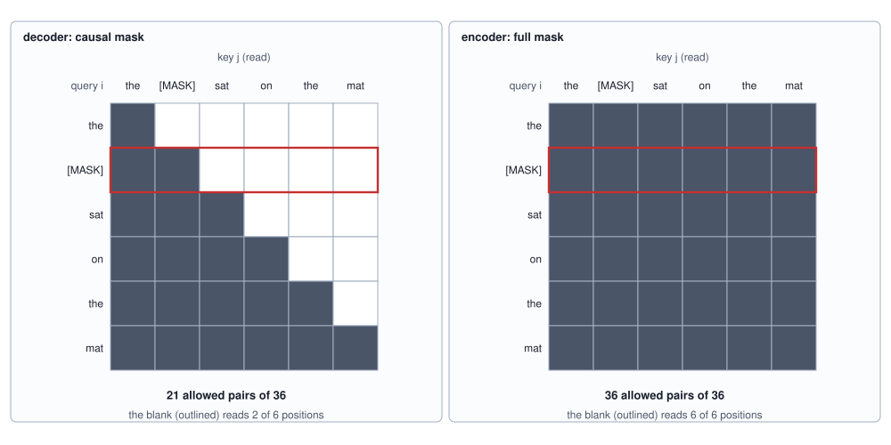

<!-- SPDX-License-Identifier: CC-BY-4.0 -->
<!-- Copyright (c) 2026 Martin Schröder <info@swedishembedded.com> -->

# Bidirectional Encoders and Embedding Models

*How do models that read a whole text at once learn representations for search and classification?*

Cover one word of a sentence and ask what it was. "The ___ purred near the mat." A reader says *cat* without effort, and the evidence sits on both sides of the blank: the word before it says only that a noun is due, the word after it narrows the noun to one animal. The GPT of [Chapter 10](10-training-gpt.md) cannot do this, and the reason is the mask we gave it. At the position of the blank its attention has read two tokens, the start marker and `the`, and the causal mask of [Chapter 7](07-self-attention.md) forbids it to look to the right. Asked for the noun, it can only report what the beginning of the sentence predicts, which in the language of this chapter is a shrug between six animals: $\ln 6 = 1.79$ nats, however many parameters it has. The word that settles the question is in its input, one position away, behind a mask.

For writing, that mask is a requirement and not a defect. A model that will be sampled from left to right has to be trained so that position $i$ never uses what it will later be asked to produce. Much of what language models are used for is not writing, though. A search engine holds the whole document and the whole query. A spam filter holds the whole message, and a classifier of support tickets the whole ticket. Nothing is left to the right to predict, and a representation of the text that reads only leftwards throws half of the evidence away. Take the mask off, and three things follow from that one move. The next-token task stops working, because with every position visible the answer to "what comes next" is sitting in the input, and a new task has to be found. The output of the network is a vector for every token, and search wants one vector for the whole text. And the comparison that search is built on, the cosine of two such vectors, has to mean something, which no objective so far has asked of it.

An encoder reuses much of the decoder stack, so these earlier ideas come first.

1. ([Chapter 7](07-self-attention.md), the causal mask.) For a text of four tokens, which pairs (query $i$, key $j$) does the causal mask allow, and how many of the 16 are they?
2. ([Chapter 10](10-training-gpt.md), loss masking.) A row has 12 positions and 5 of them are supervised. How is the loss of the row written from the 12 per-position cross-entropies, and what is the sum divided by?
3. ([Chapter 2](02-tokenization.md), WordPiece.) A vocabulary holds `purr`, `bark` and `##ed` but not `purred`. How does greedy longest-match cut `purred`, and what does the prefix `##` say?
4. (Volume I, [Chapter 3](../v01-mathematics/03-vectors.md), cosine similarity.) What is the cosine of $(3, 4)$ and $(4, 3)$, and what is the cosine of $(3, 4)$ and $(30, 40)$?
5. (Volume III, [Chapter 3](../v03-neural-networks/03-softmax.md), softmax cross-entropy.) The logits are $(2, 0, 0)$ and the correct class is the first. What are the loss and the gradient of the loss with respect to the first logit?
6. ([Chapter 11](11-decoding.md), temperature.) What does dividing the logits $(2, 0)$ by a temperature $\tau = 0.5$ do to their softmax, and what happens as $\tau$ goes to 0?

## One blank, two masks

The only difference between the decoder of the last chapters and the model of this one is a matrix of zeros and minus infinities. Take the sentence `the [MASK] sat on the mat`, six tokens with the blank already marked, and write for every query position the list of positions it may read.

<!-- worked: encoders.blank_example -->
Tokens `the [MASK] sat on the mat` (positions 0 to 5); row i lists the positions the mask lets position i read.

| i | token | causal mask reads | full mask reads |
|---:|---|---|---|
| 0 | the | the | the [MASK] sat on the mat |
| 1 | [MASK] | the [MASK] | the [MASK] sat on the mat |
| 2 | sat | the [MASK] sat | the [MASK] sat on the mat |
| 3 | on | the [MASK] sat on | the [MASK] sat on the mat |
| 4 | the | the [MASK] sat on the | the [MASK] sat on the mat |
| 5 | mat | the [MASK] sat on the mat | the [MASK] sat on the mat |

Allowed pairs: 21 for the causal mask (n (n + 1) / 2 for n = 6) and 36 for the full mask (n^2). Now a model with random weights (0x68b47f55befd0447 for `encoders.mlm.init`, D = 16, one block of 2 heads, learned positions) reads the two ten-token inputs `[CLS] the [MASK] purr ##ed near the mat . [SEP]` and `[CLS] the [MASK] hoot ##ed near the pond . [SEP]`, which differ only to the right of the blank (the verb, the place). The Euclidean distance between the two final vectors at the blank (position 2):

| mask | distance between the two vectors at position 2 |
|---|---:|
| causal (j <= i) | 0 |
| full (every pair) | 0.0688 |
<!-- /worked -->



The right-hand grid is the model of this chapter. A **bidirectional encoder** is a stack of the transformer blocks of [Chapter 9](09-transformer-block.md) whose attention uses the full mask: every position reads every position, to the left and to the right, in every layer. Nothing else in the block changes. The residual stream, the normalization, the feed-forward network and the output projection are the ones already built. What disappears is a guarantee. In a decoder the vector at position $i$ is a function of tokens $0 \dots i$ alone, so a token appended at the end changes nothing before it, and that is what makes the key-value cache of [Chapter 12](12-kv-cache.md) possible: the keys and values of the past are final. In an encoder the vector at every position is a function of all of the tokens, in every layer after the first, so appending one token changes every row. There is no past to remember, no loop to run and no cache. The text goes in once and the vectors come out once, and that sets what an encoder costs to run.

The table ends with a measurement that shows the difference without any training. A model with random weights, one block of two heads and learned positions (the same weights under both masks), reads two ten-token inputs that agree up to and including the blank and differ to the right of it (the verb and the place). Under the causal mask the final vectors at the blank are identical, to the last bit: the mask makes it a theorem and the arithmetic merely obeys it. Under the full mask they are 0.0688 apart. The encoder has the information. Whether it learns to use it depends on a training task that makes use of it worthwhile, and the next-token task is not one.

The random weights of that measurement, and the starting weights of every model in this chapter, come from one function, `init_gpt`, which is the recipe of [Chapter 10](10-training-gpt.md) written as an algorithm so that a table can name its seed and nothing else. Every matrix entry is a draw of `normal()` times a standard deviation of 0.02, taken row by row, in the order: the embedding table $\mathbf{E}$ ($V$ by $D$, which is also the head), the position table $\mathbf{P}$ ($T$ by $D$), and then for each block in turn $\mathbf{W}_Q$, $\mathbf{W}_K$, $\mathbf{W}_V$, $\mathbf{W}_O$, $\mathbf{W}_{\mathrm{gate}}$, $\mathbf{W}_{\mathrm{up}}$, $\mathbf{W}_{\mathrm{down}}$. The two matrices that write into the residual stream, $\mathbf{W}_O$ and $\mathbf{W}_{\mathrm{down}}$, are drawn with the standard deviation $0.02/\sqrt{2L}$ instead. The gains of the norms (two in every block and the final one) are vectors of $D$ ones and cost no draw.

```text
function draw_matrix(R: int, C: int, std: real, rng: Generator) -> array<real>[R, C]
    M = zeros(real, [R, C])
    for i in 0 .. R:
        for j in 0 .. C:
            M[i, j] = std * rng.normal()           # row by row
    return M

function init_gpt(name: text, V: int, T: int, D: int, F: int, L: int)
        -> list<array<real>>
    rng = Generator(seed_of(name))
    out = 0.02 * (1.0 / sqrt(2.0 * L))             # for W_O and W_down
    w = []
    append draw_matrix(V, D, 0.02, rng) to w       # E, also the head
    append draw_matrix(T, D, 0.02, rng) to w       # P
    for l in 0 .. L:
        append draw_matrix(D, D, 0.02, rng) to w   # W_Q
        append draw_matrix(D, D, 0.02, rng) to w   # W_K
        append draw_matrix(D, D, 0.02, rng) to w   # W_V
        append draw_matrix(D, D, out, rng) to w    # W_O
        append draw_matrix(D, F, 0.02, rng) to w   # W_gate
        append draw_matrix(D, F, 0.02, rng) to w   # W_up
        append draw_matrix(F, D, out, rng) to w    # W_down
    return w
```

## Hiding the answer in order to learn it

Train an encoder to predict token $i + 1$ at position $i$, with the full mask, and the loss can fall to zero. The answer is the input one position to the right, an attention head that copies from the next position solves the task exactly, and the model has learned a copy, which no one needs. Chapter 10 met the same trap in a smaller form: a leak in the mask is easier to fit than the task. The remedy is to take the answer out of the input. Choose some positions, replace what the model reads there, and ask it to say what was originally at each chosen position. This is **masked language modeling**: the encoder is trained to recover the original tokens at a random subset of positions from a corrupted copy of the text, using both sides of every blank.

The procedure has four steps. Each position that is not a special token is selected independently with probability $p_{\mathrm{sel}}$. A selected position keeps a target, the original token $x_i$, and gets a loss weight $s_i = 1$; every other position has $s_i = 0$. The input at a selected position is corrupted by a rule that is described below. The loss is the cross-entropy of Volume III at the selected positions only, divided by their number, the loss mask of Chapter 10 with a different mask:

$$
\mathcal{L}_{\mathrm{MLM}} = -\frac{1}{\sum_i s_i}\sum_{i} s_i \,\ln \mathrm{softmax}(\mathbf{z}_i)_{x_i},
$$

where $\mathbf{z}_i$ is the row of logits at position $i$. There is no shift. The target at position $i$ is the token at position $i$, and the shift by one that Chapter 4 built into every causal loader is exactly what this task must not do.

How many positions are selected is a trade. BERT (Bidirectional Encoder Representations from Transformers), the encoder that made the recipe standard, selects 15 percent of the positions. Each pass through the network then supervises only $0.15\,n$ of the $n$ positions, where a causal model supervises $n - 1$, and masking more leaves less context to predict from. The masked-language-model batches of brain default to 0.30 (`MlmConfig::new` in `crates/data/src/mlm.rs`), and the runs of this chapter use 0.40, because they are small and every pass of a pure-Python model is expensive. The table below counts what the rates mean for the 8 positions that are not special in a sentence of the toy language used below.

What the selected position is changed into needs more care than "replace it with a blank". If the model only ever saw `[MASK]` at the positions it is scored on, its job would be to answer at `[MASK]` and nowhere else. The vectors of ordinary tokens would never be asked to carry anything, and at fine-tuning and at search time, when no `[MASK]` ever appears, every position would be a position the model was not trained on. BERT's rule is therefore a mixture. A selected position becomes `[MASK]` with probability 0.8, a token drawn uniformly from the vocabulary with probability 0.1, and stays as it is with probability 0.1, and in all three cases the loss is taken. A model that sees an ordinary token at a position it is scored on can no longer assume that the token is right, because at a selected position it is the true token with probability only $0.1 + 0.1/V$, which is 0.104 for a vocabulary of $V = 25$ (the 0.1 that are kept, and the 0.1 of random draws that happen to land on the true id). It has to build, at every position, a vector that carries the token and also what its context says the token should be, and that is the representation a classifier will read.

<!-- worked: encoders.corruption_example -->
0x1ac6c82c2ec792f3 for `encoders.corruption`. Draws: for each sentence `integer(6)` (the noun) then `integer(4)` (the place); then, positions in order with the specials `[CLS]` and `[SEP]` skipped, one `uniform()` for selection (selected when below the rate, here 0.4), and for a selected position a second `uniform()` r (r < 0.8: `[MASK]`; r < 0.9: the input becomes `integer(25)`, which may by chance be the true id; otherwise unchanged). The first sentence of the stream in which all three outcomes occur, the random token being a different one, is sentence 61:

| position | original | input to the model | what happened | target | loss weight |
|---:|---|---|---|---|---|
| 0 | [CLS] | [CLS] | not selected | - | 0 |
| 1 | the | the | keep | the | 1 |
| 2 | hen | hen | not selected | - | 0 |
| 3 | cluck | [MASK] | mask | cluck | 1 |
| 4 | ##ed | owl | random | ##ed | 1 |
| 5 | near | [MASK] | mask | near | 1 |
| 6 | the | the | not selected | - | 0 |
| 7 | barn | barn | not selected | - | 0 |
| 8 | . | [MASK] | mask | . | 1 |
| 9 | [SEP] | [SEP] | not selected | - | 0 |

Over 20,000 sentences from `encoders.corruption.count` at rate 0.4, the selected positions divide into 0.802 mask, 0.099 random, 0.099 keep (the expected 0.8, 0.1 and 0.1; a `random` draw that lands on the true id counts as `random`). Selected positions per sentence, of the 8 that are not special, for 20,000 sentences each, drawn as above (noun, place, then the corruption draws) from the stream named `encoders.corruption.rate.` followed by the rate written as the shortest decimal (0.15, 0.3, 0.4, not the 0.30 and 0.40 of the first column):

| rate | stream | seed | selected per sentence | share of the 8 positions |
|---|---|---:|---:|---:|
| 0.15 (BERT) | `encoders.corruption.rate.0.15` | 0x4a588c0db4141d81 | 1.202 | 0.150 |
| 0.30 (brain's default) | `encoders.corruption.rate.0.3` | 0xb18e4db521687594 | 2.384 | 0.298 |
| 0.40 (this chapter's runs) | `encoders.corruption.rate.0.4` | 0xb0a23cf2701f1247 | 3.213 | 0.402 |
<!-- /worked -->


The whole rule is a few lines, and each of them is a decision. It uses nothing but the draws of the book's generator.

```text
function mlm_corrupt(ids: list<int>, special: list<int>, mask_id: int, V: int,
                     p_sel: real, rng: Generator) -> (list<int>, list<int>)
    require 0.0 <= p_sel and p_sel <= 1.0, "a selection rate is a probability"
    require len(special) == V, "special[t] is 1 for a token that is never selected, else 0"
    x = copy(ids)
    s = zeros(int, [len(ids)])                 # the loss weight of every position
    for i in 0 .. len(ids):
        if special[ids[i]] == 1: continue      # a special token costs no draw
        if rng.uniform() >= p_sel: continue    # not selected
        s[i] = 1                               # the target is ids[i], whatever the input becomes
        r = rng.uniform()
        if r < 0.8: x[i] = mask_id
        else if r < 0.9: x[i] = rng.integer(V)  # any id, the true one included
    return x, s
```

One detail of the example is a consequence of the first chapters of this volume and not of BERT. Tokens are pieces. A verb such as `clucked` is the two WordPiece tokens `cluck` and `##ed`, and the rule selects pieces independently, so a selected `cluck` may sit beside a visible `##ed`. In this language the visible piece says only that a verb stem is missing, but in a language with long words the visible pieces of a word can give most of a hidden one away, and hiding the pieces of a word together (whole-word masking) is a common variant that removes that hint.

## A language in which the verb gives the noun away

To see what the objective buys, the encoder needs a language whose answers are known. Every sentence of this one is `the N Ved near the P .` with a noun $N$ and its own verb $V$, so that the verb names the animal, and a place $P$ that nothing predicts.

<!-- worked: encoders.vocabulary_a -->
Vocabulary (25 entries, ids in this order): `[PAD]`, `[CLS]`, `[SEP]`, `[MASK]`, `[UNK]`, `the`, `near`, `.`, `cat`, `dog`, `hen`, `owl`, `cow`, `fox`, `purr`, `bark`, `cluck`, `hoot`, `moo`, `yelp`, `##ed`, `mat`, `barn`, `pond`, `hill`. A sentence is `the N Ved near the P .` with N one of six nouns, V the verb of that noun (`cat purred`, `dog barked`, `hen clucked`, `owl hooted`, `cow mooed`, `fox yelped`) and P one of four places, written with the greedy longest-match WordPiece of Chapter 2 (a verb is its stem and `##ed`), and framed by `[CLS]` and `[SEP]`.

| noun, place (indices) | sentence | tokens | length |
|---|---|---|---|
| 0, 0 | `the cat purred near the mat .` | `[CLS]` `the` `cat` `purr` `##ed` `near` `the` `mat` `.` `[SEP]` | 10 |
| 4, 2 | `the cow mooed near the pond .` | `[CLS]` `the` `cow` `moo` `##ed` `near` `the` `pond` `.` `[SEP]` | 10 |

There are 6 x 4 = 24 sentences, so the entropy of the language is ln 24 = 3.1781 nats: ln 6 = 1.7918 for the noun (the verb follows from it) and ln 4 = 1.3863 for the place.
<!-- /worked -->

The language has an exact floor for every blank, and so does every model. If the noun is hidden and the rest of the sentence is visible, the verb stem at position 3 names it, and the cross-entropy a perfect model pays is 0. If the model reads only what comes before the noun, which is `[CLS] the`, it pays $\ln 6 = 1.79$. The place is independent of everything and costs $\ln 4 = 1.39$ whatever is visible. The verb stem, given the noun to its left, costs nothing under either mask. So the two models split on one slot only, and that slot is the one the sentence settles from the right.

Two models are trained on the same stream of sentences, from the same initial weights: the encoder with the full mask and the corruption above at the rate 0.4, and a causal model with the causal mask and the next-token loss, scored at every position. Each run is repeated from four copies of its starting point in which one weight, the first coordinate of the row of the embedding table that belongs to `[CLS]`, differs by $\pm 10^{-12}$ or $\pm 3 \times 10^{-12}$, and the table prints the digits on which all five agree, the stable-digits rule of this volume. After training, the encoder is scored with exactly one `[MASK]` in the sentence, each word position in turn, over all 24 sentences, and the causal model on the token at each position given the ones before it.

<!-- worked: encoders.slot_table -->
Both models: V = 25, T = 10, D = 16, 2 heads, one block of Chapter 9 (RMS norm, SwiGLU of width 24), learned positions, head tied to the embedding table, initial weights from `encoders.mlm.init` (0x68b47f55befd0447); sentences from `encoders.mlm.sentences` (0xa0a624278e5b2935), corruption draws from `encoders.mlm.mask` (0x1471ce03d481e35e). 400 steps of 16 sentences, AdamW (peak 0.03, floor 0.003, 20 warmup steps, cosine decay, weight decay 0.1, betas 0.9 and 0.95, epsilon 1e-08, global clip 1.0). The training stream: every step takes 16 sentences in turn from `encoders.mlm.sentences`, each as `integer(6)` (the noun) then `integer(4)` (the place), so both models see the same sentences. The encoder corrupts each sentence at once, in order, with the rule of the corruption section at rate 0.4 and draws from `encoders.mlm.mask` only (a sentence's draws follow the previous sentence's); it reads the corrupted sentence of 10 tokens under the full mask and is supervised at the selected positions, so the number of supervised positions of a step varies with the draws. The causal model reads the first 9 tokens of the sentence under the causal mask and is supervised at all 9 positions on the next token (16 x 9 = 144 per step); it draws nothing from the mask stream. The loss of a step is the sum of the cross-entropies at the supervised positions of all 16 sentences divided by the number of those positions, and its gradient is clipped by the coefficient min(1, clip / (norm + 1e-6)) before the AdamW update (decoupled weight decay on every matrix, none on the gains, bias-corrected moments, update number s = step + 1). The learning rate of the 0-based step t is peak (t + 1) / warmup for t below the warmup, then floor + (peak - floor) (1 + cos(pi u)) / 2 with u = (t - warmup) / (steps - warmup). The encoder is scored after training with exactly one `[MASK]` in the sentence, each of the 8 word positions in turn, over all 24 sentences; the causal model is scored on the token at each position from the tokens before it. Cross-entropy in nats; the floor is the entropy of the slot given what the model reads. A number that comes from a chaotic run is printed with only the digits that are the same in the run and in four copies of it whose first weight is changed by +1e-12, -1e-12, +3e-12 and -3e-12: in full if all agree on it, as 'about x' with the leading digits on which all agree, or as 'unstable' when not even one digit survives; the other digits cannot be reproduced in another implementation. In this chapter the weight that is changed is the first coordinate of the row of the embedding table that belongs to `[CLS]` (id 1 in both languages), the entry E[1][0], which every sentence reads.

| position | slot | encoder floor | encoder | causal floor | causal |
|---:|---|---:|---:|---:|---:|
| 1 | the | 0.000 | below 0.01 | 0.000 | below 0.01 |
| 2 | noun | 0.000 | 0.053 | 1.792 | 1.798 |
| 3 | verb stem | 0.000 | 0.049 | 0.000 | below 0.01 |
| 4 | `##ed` | 0.000 | below 0.01 | 0.000 | below 0.01 |
| 5 | near | 0.000 | below 0.01 | 0.000 | below 0.01 |
| 6 | the | 0.000 | below 0.01 | 0.000 | below 0.01 |
| 7 | place | 1.386 | 1.398 | 1.386 | 1.389 |
| 8 | full stop | 0.000 | below 0.01 | 0.000 | below 0.01 |
<!-- /worked -->

The table has the shape the floors predict. The causal model pays 1.798 nats at the noun, a little above $\ln 6 = 1.792$: it has learned that nothing on its left says which animal is coming. It pays almost nothing at the verb stem, because the noun is on its left, and 1.389 at the place, at the floor of 1.386. The encoder pays 0.053 at the noun. It has learned to look right, from the blank to the verb stem, and name the animal from it. Its cost at the place is 1.398, a little above the floor, and its 0.049 at the verb stem is the same skill used leftwards: the noun names its verb. The difference between the two noun columns, 1.745 nats, is the value of the right-hand side of the sentence, bought by one change of mask and a harder training task.

The same fact in probabilities: the two models are asked to fill the blank of `the [MASK] purred near the mat .` and of `the cat purred near the [MASK] .`.

<!-- worked: encoders.fill_table -->
Probabilities the two trained models give to each candidate, for the blank in `the [MASK] purred near the mat .` (the encoder reads the whole sentence with the blank in position 2; the causal model reads `[CLS] the` and predicts position 2), and for the blank in `the cat purred near the [MASK] .` (position 7):

| noun | encoder | causal |
|---|---:|---:|
| cat | 0.916 | 0.141 |
| dog | below 0.01 | 0.173 |
| hen | 0.063 | 0.170 |
| owl | below 0.01 | 0.169 |
| cow | below 0.01 | 0.173 |
| fox | below 0.01 | 0.171 |

| place | encoder | causal |
|---|---:|---:|
| mat | 0.267 | 0.244 |
| barn | 0.268 | 0.259 |
| pond | 0.207 | 0.237 |
| hill | 0.251 | 0.257 |
<!-- /worked -->

The encoder puts 0.916 on `cat`, and the causal model, which reads `[CLS] the`, spreads its mass over six animals within 0.03 of one sixth. For the place both models are close to a quarter each, which is right: the evidence is not in the sentence.

The same trained encoder also shows what the objective does not do. The table above hid one position at a time. If the noun and the verb stem are hidden at once, nothing in the sentence says which animal it is, and the model's answers for the two blanks cannot be consistent with each other unless they are made jointly.

<!-- worked: encoders.joint_blanks -->
The encoder of the table above with both the noun (position 2) and the verb stem (position 3) set to `[MASK]` at once, over the 24 sentences. Cross-entropy of each blank, and the floor ln 6 each: with both gone, nothing in the sentence says which animal it is.

| blank | floor | encoder |
|---|---:|---:|
| noun | 1.792 | 1.917 |
| verb stem | 1.792 | 1.916 |

If each blank is filled by a draw from the model's own distribution at that position, independently, the chance that the noun and the verb belong together is the sum over the six nouns of P(noun) P(its verb stem), averaged over the sentences: 0.197 (a coin between six animals would give 1/6 = 0.167).
<!-- /worked -->

Each blank costs about 1.9 nats, close to the floor of $\ln 6$ for a blank with nothing to go on, and the sum of the two, 3.83, is more than twice what a model of the joint distribution would pay for the pair, $\ln 6 = 1.79$, because the two blanks carry only that much information between them: once the noun is known the verb is not new. Masked language modeling gives every blank its own distribution and no way to sample the blanks together, and in that it is not a generative model of the text. The chance that independent draws from its two distributions agree is 0.197, barely above the 1/6 of a blind guess. This is why encoders are used to read and not to write, and also why the number to quote for one of them is a loss at one blank or an accuracy at the selected positions of a corrupted text and never a probability of a sentence. The measurement brain makes of its own encoder is of that kind, as the last section describes.

## One vector for a whole text

An encoder hands back a vector per token. A search index wants one per text, so the rows have to be combined. There are two standard ways, and each is a decision about which positions carry the meaning of the whole.

**Mean pooling** averages the rows of the final stream over the real tokens: $\mathbf{a} = \frac{1}{n}\sum_{i=0}^{n-1}\mathbf{h}_i$, where $\mathbf{h}_i$ is the final normalized vector at position $i$ (not the recurrent state of Chapter 5). **CLS pooling** takes the row of one designated token placed first in every text, $\mathbf{a} = \mathbf{h}_0$. That token has no meaning of its own; its only job is to be read, and attention in every layer lets it gather whatever the training asks it to. The result of either, the pooled vector $\mathbf{a}$, is a **sentence embedding**: a single vector that represents a whole text, so that two texts can be compared by the cosine of their vectors of Volume I. A text is the unit of comparison from here on, and it comes in different lengths. That is where a mistake enters that has no analogue in a decoder.

The encoder's texts are batched, and a batch is a rectangle, so shorter texts are padded to the length of the longest. Under the causal mask, pad tokens at the end are harmless: no real position reads to its right. Under the full mask a pad position is a key like any other, and every real position gives it some of its attention, as it would any other key. Padding a text changes the vectors of its real tokens.

<!-- worked: encoders.padding_example -->
Sentence `the cat sat near the barn` (with `[CLS]`, 7 tokens). Random weights from `encoders.padding.init` (0x4e765a41baeef228): `init_gpt` with T = 10, V = 25, D = 16, one block of 2 heads, the same weights in all three encodings (the alone encoding uses the first 7 rows of the position table). Padded: three `[PAD]` tokens (id 0) after the sentence. Largest absolute difference, over the 7 real positions and the 16 coordinates, between the final normalised stream of the padded encoding and that of the encoding alone:

| encoding | largest difference at real positions |
|---|---:|
| padded, pad positions readable | 0.0810 |
| padded, pad positions masked | below 1e-12 |

The mean-pooled vector of the sentence alone against the mean pooled over the 7 real positions of the padded stream and against the mean over all 10 positions of the padded stream (cosine similarity):

| encoding | cosine, mean over the 7 real positions | cosine, mean over all 10 positions |
|---|---:|---:|
| padded, pad positions readable | 0.9970 | 0.8759 |
| padded, pad positions masked | 1.0000 | 0.8858 |
<!-- /worked -->

With the pad positions readable, the vectors of the seven real tokens move by as much as 0.0810 in a coordinate, and the mean-pooled vector of the padded text is 0.9970 in cosine from the one of the text alone, if the mean is taken over its seven real positions, and 0.8759 if it is taken over all ten. The text has not changed, and its embedding depends on the three pad tokens that happened to be put after it. The remedy is a **key padding mask**: the pad positions are removed from the keys, so the mask of the encoder is the full mask over real tokens only. With it, the real positions agree with the encoding alone to below $10^{-12}$ and the pooled vector over the real positions is the same to four digits. Pooling must then average over the real tokens only, because the pad rows still hold defined numbers and 0.8858 shows what averaging them does. The encoders of brain take both routes, a mask in one and packed texts without padding in the others, and the last section explains why.

Pooling is not yet an embedding model. The vectors of an encoder that has only read text to fill blanks are good at one thing, saying what is missing, and nothing in that objective ever compares two texts. The first row of the training table below shows what comparing them is like: a model with random weights and mean pooling gives the cosine 0.5587 between a query and its paraphrases and 0.5588 between a query and anything else. All of the vectors point nearly the same way, and a cosine cannot tell texts apart when it is 0.56 for everything. The pooled vectors have to be trained for the comparison they will be used in.

## Pulling paraphrases together

The comparison is trained directly. The data are pairs of texts that mean the same, and the model should map the two texts of a pair to vectors with a high cosine and map unrelated texts apart. A second toy language supplies the pairs. A sentence is `[CLS] det animal verb prep det place`, and the words come in synonym groups, so that two sentences of one meaning can share no content word at all.

<!-- worked: encoders.vocabulary_b -->
A sentence is `[CLS] det animal verb prep det place`, T = 7 tokens, V = 25 (`[PAD]`, `[CLS]`, then the words below). The meaning of a sentence is its pair (animal group, place group), 4 x 4 = 16 meanings numbered m = 4 a + b; a word that is written `x = y` is one group (two synonyms). The determiners, the verb and the preposition carry no meaning. The ids follow the table read top to bottom and each row left to right, after `[PAD]` and `[CLS]`, the first synonym of a group before the second: `[PAD]` = 0, `[CLS]` = 1, `the` = 2, `a` = 3, `cat` = 4, `feline` = 5, `dog` = 6, `hound` = 7, `hen` = 8, `fowl` = 9, `fox` = 10, `vixen` = 11, `sat` = 12, `ran` = 13, `slept` = 14, `near` = 15, `by` = 16, `barn` = 17, `shed` = 18, `pond` = 19, `lake` = 20, `hill` = 21, `mound` = 22, `mat` = 23, `rug` = 24.

| kind | words |
|---|---|
| determiners | the, a |
| animals, by group | cat = feline; dog = hound; hen = fowl; fox = vixen |
| verbs | sat, ran, slept |
| prepositions | near, by |
| places, by group | barn = shed; pond = lake; hill = mound; mat = rug |

A sentence is built from a meaning m, the index wa (0 or 1) of the animal word in its group, the index wb of the place word in its group, and four noise indices into the lists above, always drawn in this order and range: the first determiner `integer(2)`, the verb `integer(3)`, the preposition `integer(2)`, the second determiner `integer(2)`. The tokens are `[CLS]`, determiner 1, animal word, verb, preposition, determiner 2, place word. The meanings of the training pairs are the 12 that are not held out, in increasing order of m.

Meaning 5 is (animal group 1, place group 1): `the dog sat near the pond` and `a hound slept by a lake` are two sentences of that meaning with no content word in common. Meanings [1, 6, 11, 12] (animal group, place group) = (0, 1), (1, 2), (2, 3), (3, 0) are held out: no training pair has them. The collection used for retrieval has 32 documents (two per meaning, always the first synonym of each group, wa = wb = 0) and 16 queries (one per meaning, always the second synonym, wa = wb = 1), from `encoders.nce.retrieval` (0x43a2f319be286f5c). Draws: the four noise indices of each document in turn (meaning 0 twice, meaning 1 twice, and so on up to meaning 15: 32 documents), and then the four noise indices of each query for the meanings 0 to 15 in order; nothing else is drawn. A document is relevant to the query of its meaning.
<!-- /worked -->

A pair is two sentences of one meaning with the other synonym in each of the two content slots, so that the model cannot align them by a shared word and has to learn that `cat` and `feline` belong together from pairs alone. The determiner, the verb and the preposition differ at random between the two: they are the noise a paraphrase may change.

For a batch of $B$ pairs the encoder gives the vectors of the first sentences, $\mathbf{a}_1, \dots, \mathbf{a}_B$, and of the second, $\mathbf{b}_1, \dots, \mathbf{b}_B$, and each is scaled to length 1: $\hat{\mathbf{a}}_i = \mathbf{a}_i / \lVert\mathbf{a}_i\rVert$, $\hat{\mathbf{b}}_j = \mathbf{b}_j / \lVert\mathbf{b}_j\rVert$. The dot product of two unit vectors is their cosine, $\mathrm{cs}_{ij} = \hat{\mathbf{a}}_i \cdot \hat{\mathbf{b}}_j$. Look at the matrix $\mathrm{cs}_{ij}$ with anchors down the side and partners across the top. The diagonal is where the pairs are. The task is: given anchor $i$, which of the $B$ candidates is its partner? That is a classification over $B$ classes with label $i$, and we know how to train a classifier: the softmax of the scores, and the cross-entropy against the label. The scores are the cosines divided by a positive constant $\tau$, the temperature of [Chapter 11](11-decoding.md), which sets how sharp the softmax is:

$$
\mathrm{nce}_i = -\ln \frac{e^{\mathrm{cs}_{ii}/\tau}}{\sum_{j=1}^{B} e^{\mathrm{cs}_{ij}/\tau}} = -\frac{\mathrm{cs}_{ii}}{\tau} + \ln \sum_{j} e^{\mathrm{cs}_{ij}/\tau}.
$$

This is the **contrastive loss**, in the form called InfoNCE (information noise-contrastive estimation; Oord, Li and Vinyals, 2018): a softmax cross-entropy over the similarities of one anchor to its partner and to the partners of the other pairs of the batch, which are its negatives. In the second form the term $-\mathrm{cs}_{ii}/\tau$ pulls the score of the true partner up, and the log-sum-exp pushes the scores of all candidates down, the true one included, by the share each has of the softmax. The derivative with respect to a score is the one of every softmax cross-entropy, $\partial\,\mathrm{nce}_i/\partial\,\mathrm{cs}_{ij} = (p_{ij} - \delta_{ij})/\tau$ with $p_{ij}$ the softmax of row $i$: it raises the cosine of the right partner by the probability it fails to get, and lowers the cosines of the wrong ones in proportion to the probability they get. The batch is the source of the negatives: no extra sentence is encoded for them, and a batch of $B$ pairs gives every anchor $B - 1$ of them. A version that is symmetric in the two sentences averages $\mathrm{nce}_i$ with the same loss taken down the columns, and the runs below use that one.

<!-- worked: encoders.infonce_example -->
A batch of B = 3 pairs; the matrix of cosines cs_ij between the anchor of pair i (row) and the positive of pair j (column) is

|  | j = 0 | j = 1 | j = 2 |
|---|---:|---:|---:|
| i = 0 | 0.9 | 0.3 | -0.1 |
| i = 1 | 0.2 | 0.8 | 0.4 |
| i = 2 | 0.0 | 0.5 | 0.6 |

The loss of row i is the cross-entropy of the softmax of (cs_i0, cs_i1, cs_i2) / tau against the label i (the library cross-entropy and the explicit -log(e^{cs_ii/tau} / sum_j e^{cs_ij/tau}) agree to 1e-12 in every cell):

| tau | row 0 | row 1 | row 2 | mean (one direction) |
|---|---:|---:|---:|---:|
| 1 | 0.6506 | 0.7971 | 0.8976 | 0.7818 |
| 0.5 | 0.3622 | 0.5599 | 0.7514 | 0.5578 |
| 0.1 | 0.0025 | 0.0206 | 0.3151 | 0.1127 |
| 0.05 | 0.0000 | 0.0003 | 0.1269 | 0.0424 |

With every similarity equal the loss is ln 3 = 1.0986. At tau = 0.1 the softmax of row 1 is (0.0024, 0.9796, 0.0179), so the gradient of the row's loss with respect to cs_11 is (p_11 - 1) / tau = -0.204 and with respect to the wrong cosine cs_12 it is p_12 / tau = 0.179.
<!-- /worked -->

The table shows what the temperature does to a fixed set of similarities. With every similarity equal the loss is $\ln B$, the loss of a model that cannot tell the candidates apart. At $\tau = 1$ the diagonal beats the others by at most a few tenths and the loss stays high, since the softmax of cosines that lie between $-1$ and 1 is nearly flat. At $\tau = 0.1$ the same cosines give a loss near zero for the rows that are right, and the gradient concentrates on the row whose partner is only just ahead. For cosines in $[-1, 1]$ the loss of one direction cannot go below $\ln(1 + (B - 1)e^{-2/\tau})$, which for $B = 8$ is

<!-- worked: encoders.tau_floor_text -->
The smallest possible loss of one direction of a batch of 8 at temperature tau: the positive at cosine 1 and the 7 others at cosine -1, which is ln(1 + 7 e^{-2/tau}).

| tau | smallest loss |
|---:|---:|
| 1 | 0.666468 |
| 0.1 | 0.000000 |
| 0.02 | 0.000000 |
<!-- /worked -->

so at $\tau = 1$ the loss has a floor of 0.6665 that no encoder can pass, while at $\tau = 0.1$ the floor is $1.4 \times 10^{-8}$, zero to the digits printed, and the loss can be driven to zero without the cosines reaching their limits.

The negatives are only negative if they differ in meaning. If two pairs of a batch share a meaning, the anchor of one sees two equally good partners and the loss tells the model to separate two things it should unite. That is the false-negative problem of contrastive training, and the toy language makes it exact.

<!-- worked: encoders.false_negatives -->
Drawing the 8 pairs of a batch with replacement from the 16 meanings gives a batch with two pairs of one meaning with probability 1 - (16 x 15 x ... x 9) / 16^8 = 0.8792. The anchors of such a pair see two equally good positives, so each of their two rows can do no better than a coin between two columns: row cross-entropy at least ln 2 = 0.6931 on 2 of 8 rows, which raises the mean of one direction by at least 2 ln 2 / 8 = 0.1733 however good the encoder is. The runs below draw the 8 meanings without replacement (one `shuffle` of the training meanings, the first 8 taken), so the floor does not occur.
<!-- /worked -->

The loss reaches the encoder through three steps, and the only new one is the normalization. With $\hat{\mathbf{a}} = \mathbf{a}/\lVert\mathbf{a}\rVert$, a change of $\mathbf{a}$ along $\hat{\mathbf{a}}$ changes nothing, since the cosine does not see length, and a change perpendicular to it turns $\hat{\mathbf{a}}$ by the ratio of the change to $\lVert\mathbf{a}\rVert$. The gradient with respect to $\mathbf{a}$ is therefore that with respect to $\hat{\mathbf{a}}$ with its component along $\hat{\mathbf{a}}$ removed, divided by $\lVert\mathbf{a}\rVert$: $(\mathrm{d}\hat{\mathbf{a}} - (\mathrm{d}\hat{\mathbf{a}}\cdot\hat{\mathbf{a}})\hat{\mathbf{a}}) / \lVert\mathbf{a}\rVert$. Then the pooling is undone (each of the $n$ rows of a mean-pooled text receives $1/n$ of the gradient, CLS pooling hands all of it to row 0), and the block backward pass of Chapter 9 does the rest. The whole step in the book's pseudocode:

```text
function infonce(Ahat: array<real>[B, D], Bhat: array<real>[B, D], tau: real) -> real
    require tau > 0.0, "a temperature is positive"
    require B >= 2, "a batch of one has no negatives"
    S = matmul(Ahat, transpose(Bhat)) / tau      # S[i, j] = cos(anchor i, partner j) / tau
    total = 0.0
    for i in 0 .. B:
        total = total + (lse(S[i, :]) - S[i, i])           # the row: anchor i against the partners
        total = total + (lse(S[:, i]) - S[i, i])           # the column: partner i against the anchors
    return total / (2 * B)
```

The rows of `Ahat` and `Bhat` must already have length 1; the function does not normalize, so that the backward pass of the normalization is a separate, checkable step.

The run is small: the encoder of the last section's kind (one block, learned positions), mean pooling, $\tau = 0.1$, batches of 8 pairs drawn without replacement from 12 of the 16 meanings, 100 steps. Four meanings, (0, 1), (1, 2), (2, 3) and (3, 0) as (animal group, place group), are held out entirely, so that no pair of those meanings is ever seen. After each checkpoint the encoder is scored on the 32-document, 16-query collection that the next section explains, and the table gives the mean cosine of a query with its two relevant documents against its mean cosine with the 30 others.

<!-- worked: encoders.contrastive_training -->
Language B, one block (V = 25, T = 7, D = 16, 2 heads, SwiGLU width 24) with mean pooling and tau = 0.1, initial weights from `encoders.nce.init` (0x09c0f53f8ced3279), pairs from `encoders.nce.stream` (0x6058d1508ef16e2b), 100 steps of 8 pairs, AdamW (peak 0.01, floor 0.001, 10 warmup steps, cosine decay, decay 0.1, betas 0.9 and 0.95, epsilon 1e-08, clip 1.0; the update rule, the learning-rate curve and the clip coefficient are those of the training stream of language A). Each step: one `shuffle` of the 12 training meanings from `encoders.nce.stream` (the permutation of the indices 0 to 11, then the first 8 taken), and for those 8 meanings in that order one pair: wa = `integer(2)`, wb = `integer(2)`, the four noise indices of the first sentence (anchor), the four noise indices of the second (positive); the first sentence has the animal word wa and the place word wb, the second 1 - wa and 1 - wb. Every sentence is encoded with the full mask and pooled, the vectors are scaled to length 1, and the loss is the symmetric InfoNCE of the batch. After the step, on the collection of the retrieval set: the loss (mean of the ten steps ending there), the mean cosine of a query with its two relevant documents, with the 30 others, and recall at 2 over all 16 queries and over the 4 held-out meanings. A number that comes from a chaotic run is printed with only the digits that are the same in the run and in four copies of it whose first weight is changed by +1e-12, -1e-12, +3e-12 and -3e-12: in full if all agree on it, as 'about x' with the leading digits on which all agree, or as 'unstable' when not even one digit survives; the other digits cannot be reproduced in another implementation. In this chapter the weight that is changed is the first coordinate of the row of the embedding table that belongs to `[CLS]` (id 1 in both languages), the entry E[1][0], which every sentence reads.

| step | batch loss | cosine, relevant | cosine, others | recall at 2 | recall at 2, held-out |
|---:|---:|---:|---:|---:|---:|
| 0 | ln 8 = 2.0794 (chance) | 0.5587 | 0.5588 | 0.0312 | 0.0000 |
| 10 | 1.8468 | 0.8075 | 0.2148 | 0.4688 | 0.1250 |
| 20 | 0.7488 | 0.9053 | 0.1312 | 0.8125 | 0.7500 |
| 40 | 0.0317 | 0.9802 | -0.0095 | 1.0000 | 1.0000 |
| 100 | 0.0022 | 0.9928 | -0.0650 | 1.0000 | 1.0000 |
<!-- /worked -->

A model that cannot tell the candidates apart pays $\ln 8 = 2.0794$ for a batch of 8, and the encoder at step 0 has random weights and is at that level. By step 20 the paraphrases have separated from the rest, with relevant cosines of 0.9053 against 0.1312, and by step 40 the cosine of a query with the documents of another meaning is slightly negative on average (-0.0095) and the loss is 0.0317: the other meanings have been pushed to right angles, and by step 100 slightly past them (-0.0650). The held-out meanings follow the trained ones: at step 40 the recall of the four meanings that no training pair showed is the same as the rest. The model has not memorized sentences. Its vectors encode the animal group and the place group, and a new combination of the two is a new point in a space that has both.


<!-- worked: encoders.pca_summary -->
Four meanings (animal group, place group) = (0,0), (1,1), (2,2), (3,3), named by the first synonym: cat in the barn, dog in the pond, hen in the hill, fox in the mat. Eight sentences each: the four combinations of synonyms, two draws of the noise each, from `encoders.pca` (0x1a5e32f7ca1243d7). Each sentence is encoded with the full mask and mean-pooled (the run of the training table, un-nudged, and the same weights before training); the pooled vectors are the raw means of 16 numbers, not scaled to length 1. Draws: for each of the four meanings in order, for (wa, wb) = (0,0), (0,1), (1,0), (1,1) in order, two repetitions each of the four noise indices (so wa and wb are not drawn). The 32 vectors are centred and projected on the first two principal directions (power iteration of Chapter 3 on the covariance with divisor 32, 500 iterations from the vector with entries (1 + 0.1 j) / 4 for j = 0 to 15, the second direction after deflating the first). The variance kept is the sum of the two eigenvalues over the mean squared length of the centred vectors. The spread of a meaning is the root-mean-square distance, in the plane, of its 8 points from their mean, and the table gives the mean of the four spreads; the last column is the smallest distance between two meanings' centres (the means of their 8 points).

| encoder | variance in 2 directions | rms spread within a meaning, mean of the four | smallest gap between meanings |
|---|---:|---:|---:|
| before training | 57.5% | 0.612 | 0.105 |
| after training | 87.5% | 0.038 | 0.514 |
<!-- /worked -->

The picture and the table say the same thing in two ways. Before training, the points of one meaning lie 0.612 from their own centre (the root-mean-square distance in the coordinates of the plane, averaged over the four meanings) and the nearest two centres are 0.105 apart, so the meanings are not separated at all, and two directions keep 57.5 percent of the variance. After it, the spread within a meaning is 0.038 and the nearest centres are 0.514 apart, and 87.5 percent of the variance lies in the plane: the vectors have collapsed onto a few directions that the task needs.

### What the temperature and the pooling change

The temperature is the setting that most changes the run, and the table repeats the training at three values with everything else equal.

<!-- worked: encoders.temperature_table -->
Mean pooling, three temperatures, everything else as in the training run above. The gap is the mean cosine of a query with its relevant documents minus its mean cosine with the others. Digits follow the stable-digits rule stated with the training table above (each run repeated from four nudged starting points).

| tau | loss, step 10 | loss, step 100 | gap, step 10 | gap, step 100 | recall at 2, step 10 | recall at 2, step 100 |
|---:|---:|---:|---:|---:|---:|---:|
| 1 | 1.8776 | 1.3191 | 0.6431 | 1.0485 | 0.6250 | 1.0000 |
| 0.1 | 1.8468 | 0.0022 | 0.5927 | 1.0578 | 0.4688 | 1.0000 |
| 0.02 | 3.5884 | 0.0000 | 0.3337 | 0.8406 | 0.9375 | 1.0000 |
<!-- /worked -->

At $\tau = 1$ the loss at step 100 is still 1.3191, well above the floor of 0.6665 computed above, and the cosine gap, 1.0485, is no worse than at $\tau = 0.1$: the cosines are good, the loss is simply not able to show it. At $\tau = 0.1$ the loss reaches 0.0022 with a gap of 1.0578. At $\tau = 0.02$ the model learns fastest at first, recall 0.9375 at step 10 against 0.4688, with a loss of 3.5884 that is higher than chance because a very sharp softmax punishes a wrong guess hard, and it ends with the smallest gap, 0.8406: when the loss is already zero with a small margin the gradient is zero too, and the cosines stop moving. A lower temperature is therefore not simply better. It chooses how much of the cosine range the model is made to use.

Pooling changes the speed at which a one-block model learns.

<!-- worked: encoders.pooling_table -->
The same run with the pooled vector taken as the mean of the seven rows of the final stream or as row 0 (`[CLS]`), tau = 0.1, everything else equal. Loss is the mean of the ten steps ending at the step; recall at 2 is over all 16 queries. Digits follow the stable-digits rule stated with the training table above (each run repeated from four nudged starting points).

| step | loss, mean pooling | recall at 2, mean | loss, CLS pooling | recall at 2, CLS |
|---:|---:|---:|---:|---:|
| 20 | 0.7488 | 0.8125 | 1.0756 | 0.4062 |
| 40 | 0.0317 | 1.0000 | 0.5261 | 0.6875 |
| 100 | 0.0022 | 1.0000 | 0.1401 | 1.0000 |
<!-- /worked -->

Mean pooling reads all seven rows, and the content words are among them, so the gradient reaches them directly. CLS pooling has to learn first to move the content words' information into row 0 through attention, which takes steps; at step 40 its recall at 2 is 0.6875 against 1.0000. Both reach 1.0000 at step 100. That is a statement about one block and 100 steps, and how large the gap stays in a deep encoder trained for long is not something this table can say; both conventions are in use. The choice is a property of the checkpoint and not a free setting: an embedding model trained with CLS pooling and pooled with a mean is a different model.

## Looking for a text by its vector

**Retrieval** is finding, among a collection of stored texts, the ones that answer a query, by comparing the vector of the query with the vectors of the texts: embed everything once, embed the query, rank the collection by cosine. Karpukhin and colleagues (2020) trained two encoders this way, one for questions and one for passages, with the other passages of the batch among the negatives, for open-domain question answering. The alternative is lexical: compare the words, here as a cosine of word counts.

The quality of a ranking is measured at a cutoff. The recall of Volume II is the share of the relevant items that were found; **recall at $k$** is that share among the $k$ highest-ranked, averaged over the queries. A query with two relevant documents and one of them in the top 4 has recall at 4 of 0.5.

```text
function recall_at_k(sims: array<real>[Q, N], relevant: array<int>[Q, N], k: int) -> real
    require 1 <= k and k <= N, "the cutoff lies inside the collection"
    total = 0.0
    for q in 0 .. Q:
        require sum(relevant[q, :]) > 0, "a query with no relevant document has no recall"
        order = argsort(sims[q, :], descending)       # ties keep the lower document index
        found = 0
        for r in 0 .. k:
            found = found + relevant[q, order[r]]
        total = total + found / sum(relevant[q, :])
    return total / Q
```

The collection of the toy language has 32 documents, two for each of the 16 meanings, all written with the first synonym of each group, and 16 queries, one for each meaning, written with the second. The documents and the query of a meaning share no content word.

<!-- worked: encoders.retrieval_table -->
32 documents, 16 queries, 2 relevant documents each (the collection of the vocabulary section). Recall at k is the share of the query's 2 relevant documents that are among its k highest cosines, averaged over the queries; ties keep the lower document index. The last column is recall at 2 on the 4 queries whose meaning no training pair had. The bag of words counts the 23 words other than `[PAD]` and `[CLS]` in each sentence. Digits follow the stable-digits rule stated with the training table above (each run repeated from four nudged starting points).

| ranker | recall at 2 | recall at 4 | recall at 8 | recall at 2, held-out |
|---|---:|---:|---:|---:|
| random order (expected) | 0.0625 | 0.1250 | 0.2500 | 0.0625 |
| bag of words, cosine of word counts | 0.0938 | 0.0938 | 0.1875 | 0.0000 |
| encoder, random weights, mean pooling | 0.0312 | 0.0312 | 0.2500 | 0.0000 |
| contrastive, mean pooling, tau = 0.1 | 1.0000 | 1.0000 | 1.0000 | 1.0000 |
| contrastive, cls pooling, tau = 0.1 | 1.0000 | 1.0000 | 1.0000 | 1.0000 |
<!-- /worked -->

A random order has recall $k/32$ at $k$, and the table gives it exactly. The bag of words does no better than a random order here, 0.0938 at $k = 2$: the words that a query and its documents share are the determiners, the verb and the preposition, and those say nothing about the meaning. An encoder with random weights is no better (0.0312). The contrastive encoder retrieves every relevant document in the top two, for every query, including the four whose meaning it never saw, with either pooling.

That is a clean result on a clean toy, and it is worth saying what it does not show. A recall of 1 at 2 for 16 queries says that the toy task is easy for an encoder that has learned the synonyms, and says nothing about a collection of millions of passages in which the relevant one is one of many that look alike. The queries here are fresh sentences, but they use the words of the training pairs, and a real query meets words that were never in a pair. The number is also not comparable with another collection's: recall at $k$ depends on how many documents are relevant and on how many there are. What carries over is the method. Build the pairs so that they cannot be solved by a shared word, hold some meanings out, compare with a lexical baseline and with a random order, and report the exact conditions.

## A head on a frozen vector

Classification is the other thing the vectors are for, and it needs one more layer. A **head** is a small network on top of the encoder's output: for classes, a linear map from the pooled vector to one logit per class, trained with the softmax cross-entropy of Volume III. The encoder below it can be left as it is (frozen) or trained along with it (fine-tuned). The cheapest test of an embedding is the first: freeze the encoder, fit only the head, and count how many labelled examples it needs.

<!-- worked: encoders.probe_table -->
A linear head on frozen vectors. Task: the animal group (4 classes) of a sentence. The head is a softmax regression (a 16 by 4 matrix and 4 biases, zeros at the start) on the mean-pooled vector scaled to length 1, fitted by 300 full-batch gradient steps of rate 2 on the mean cross-entropy of the first n labelled sentences, and scored on 200 test sentences. Sentences: per sentence `integer(16)` for the meaning, `integer(2)` for wa, `integer(2)` for wb, then the four noise indices (determiner `integer(2)`, verb `integer(3)`, preposition `integer(2)`, determiner `integer(2)`), from `encoders.probe.train` (0x98c97830f39d98b4) and `encoders.probe.test` (0xa57763aef473845f). Accuracy on the test sentences; chance is 0.25. The trained encoder is the contrastive run above (mean pooling, tau = 0.1).

| labelled sentences | encoder with random weights | contrastive encoder |
|---:|---:|---:|
| 8 | 0.385 | 0.865 |
| 16 | 0.540 | 1.000 |
| 64 | 0.760 | 1.000 |
<!-- /worked -->

With 8 labelled sentences a linear head on the contrastive vectors classifies the animal group of 200 new sentences with accuracy 0.865, against 0.385 on the vectors of a random-weight encoder (chance is 0.25), and with 16 it is perfect where the random encoder reaches 0.540. The random encoder does improve with labels (0.760 with 64), since its vectors still carry the words. What the contrastive training bought is a space in which the labels of a task that is about meaning are a few directions, so that a few examples find them. That is what it means to use a pre-trained encoder as a feature extractor.

## What one pass over a text costs

An encoder reads a text once. A decoder that produces the same $T$ tokens reads them $T$ times, one token per pass, each pass reading all of the weights, and Chapter 12 counted what that does: a decode step has a few FLOPs per byte of weights it must read, and is limited by the bytes. An encoder pass has $T$ rows to multiply by every weight matrix at once, so the same bytes of weights serve $T$ times the arithmetic. The table counts it for the largest encoder brain implements of the ModernBERT family, in FLOPs and in weight bytes, with the arithmetic of a pass over $T$ tokens: $2T$ times the matrix parameters for the matrices, and $4D$ per allowed query-key pair and per layer for the attention scores and the weighted sum.

<!-- worked: encoders.cost_of_a_pass -->
ModernBERT-large as `ModernBertConfig::modernbert_large` states it: V = 50368, D = 1024, 28 layers, 16 heads, GeGLU width 2624, full attention in layers 0, 3, 6, ... (10 of 28), a window of 64 positions to each side in the others. Parameters counted from the tensor manifest: 394,781,696; in the 28 layers' matrices (4 D^2 + 3 D F each): 343,146,496; the rest of the count is the 50368 x 1024 token table and the 57 norm vectors of 1024 weights (one after the embedding, 27 in front of the attentions, since layer 0 has none, 28 in front of the feed-forward networks, and the final one: 1 + 27 + 28 + 1); a layer holds Wqkv (3 D^2), the projection (D^2), Wi (2 F D, the two halves of the gated input) and Wo (F D). fp32 weights 1.579 GB (6.32 GB with a gradient and two AdamW moments). A pass over T tokens costs 2 T (matrix parameters) FLOPs in the matrices and 4 D (pairs) FLOPs per layer in attention, pairs = T^2 in a full layer and the pairs with |i - j| <= 64 in a local one (at T = 8192 that is 1,052,608 of 67,108,864). FLOPs per weight byte: all FLOPs of the pass over the bytes of the weights, read once; the last column divides by T to give what T separate one-token passes would reach.

| T | matrix FLOPs | attention FLOPs, alternating | attention FLOPs, all layers full | FLOP per weight byte, one pass | FLOP per weight byte, token by token |
|---:|---:|---:|---:|---:|---:|
| 32 | 2.196e10 | 1.174e8 | 1.174e8 | 14.0 | 0.44 |
| 512 | 3.514e11 | 1.530e10 | 3.006e10 | 232.2 | 0.45 |
| 2,048 | 1.406e12 | 1.910e11 | 4.810e11 | 1011.0 | 0.49 |
| 8,192 | 5.622e12 | 2.826e12 | 7.697e12 | 5350.1 | 0.65 |
<!-- /worked -->

At $T = 512$ one pass does 232 FLOPs for every byte of weights it reads, where the same 512 tokens taken one at a time do 0.45. This is why an encoder is cheap to run on a batch of texts and why the throughput of an embedding service is set by arithmetic and not by memory. Attention is the part that grows with the square of $T$. In the two attention columns the FLOPs of a model with local layers are 2.826e12 at $T = 8192$ against 7.697e12 if every layer were full, a third of the pass against more than half of it, and the matrix FLOPs are the same either way. The 18 local layers of the 28 look 64 positions to each side, $1{,}052{,}608$ of the $67{,}108{,}864$ pairs, and that is where the saving comes from. Brain's local layers do that work and no more. A banded score kernel (`crates/kernels/wgsl/attn_scores_band.wgsl`) writes one slot for each key a query can see, at the offset of the key from the left edge of its band, so the score slab of a layer is $2w + 1 = 129$ numbers per query and head and not $T$; the same row softmax as the full layers then runs over those 129 slots, a banded weighted sum (`attn_apply_band.wgsl`) reads only the values in the band, and the backward pass has a band kernel for each of the four gradients. The slots of a query within $w$ of either end of the span would point outside it, and hold a score of $-3 \times 10^{38}$ that the softmax turns into a zero. At $T = 8192$ the slab is $8192 \times 129 = 1{,}056{,}768$ entries per head against $67{,}108{,}864$ for the full square, and exceeds the $1{,}052{,}608$ allowed pairs only by the $w(w+1) = 4{,}160$ clipped slots at the two ends. The cost therefore grows linearly in $T$ for a local layer, and the table counts the work that the kernels do. The test that holds the band to the dense computation (`crates/model/tests/it/chunked_bidir_band.rs`) compares output and gradient with the dense masked form, which materializes the whole square and masks outside the band, on the CPU backend and on the default device, at spans of 53 and 30 positions around a window of 3 and with the clipped rows at both ends, and requires agreement to $2 \times 10^{-5}$. A span no longer than the band has nothing to save and takes the dense masked form, whose slab is then the smaller one.

The encoder of T5 (the Text-to-Text Transfer Transformer) is a larger model with different details, and the same arithmetic holds.

<!-- worked: encoders.t5_cost -->
T5-XXL v1.1 encoder as `T5Config::xxl` states it: V = 32128, D = 4096, 24 blocks, 64 heads of width 64 (attention width 4096), gated feed-forward width 10240, one table of 32 buckets x 64 heads for the relative-position bias. Parameters 4,762,310,656 (4.762 billion); fp32 weights 19.05 GB. One pass over T = 512 tokens: matrix FLOPs 4.742e12, attention FLOPs 1.031e11 (full attention in every block), 2.1 percent of the total.
<!-- /worked -->

The count of 4,762,310,656 parameters, from the shapes of the configuration, is the 4.762 billion that `crates/t5encoder/src/lib.rs` quotes for the encoder of the text-to-image pipelines. Attention is 2.1 percent of the work at 512 tokens and the matrices are the rest.

Retrieval adds a second cost, and it is a different kind. Embedding the documents is done once, at index time, and the weights stay resident. A query costs one embedding pass and one scan of the stored vectors.

<!-- worked: encoders.scan_cost -->
Retrieval with the encoder above as the embedding model (D = 1024), counting FLOPs and the bytes that must be read at least once: for an embedding pass the weights, for a scan the stored vectors.

| step | FLOPs | bytes read | FLOP per byte |
|---|---:|---:|---:|
| embed a query of 32 tokens | 2.208e10 | 1.579e9 | 14.0 |
| score it against 1,000,000 stored vectors of 1024 fp32 numbers | 2.048e9 | 4.096e9 | 0.50 |
| embed one document of 256 tokens (once, at index time) | 1.805e11 | 1.579e9 | 114.3 |
| embed 1,000,000 such documents | 1.805e17 | weights stay resident | - |
<!-- /worked -->

Scoring one query against a million stored vectors is 2.048e9 FLOPs and 4.096e9 bytes, half a FLOP per byte: it is limited by the bytes of the index, which is why indexes are stored in narrower formats (the quantization chapter of Volume IV), and why a collection too large to scan is searched by approximate methods that look at a fraction of it. The 32-token query costs about 11 times the arithmetic of the scan and one reading of the weights, and the index of a million 256-token documents costs 1.805e17 FLOPs once.

## Three encoders in brain

The encoders of brain serve three jobs, and each illustrates a different part of what came before.

**An encoder trained with the masking recipe.** The one that learns from raw text is the bidirectional LFM2.5 encoder (`crates/lfm2`, a hybrid of short convolutions and attention with a masked-language-model head tied to the embedding table). Its training batches come from `crates/data/src/mlm.rs`, which is the recipe of this chapter: unshifted targets, selection at a default rate of 0.30, then 80 percent `[MASK]`, 10 percent a random token and 10 percent kept, special tokens never selected, and windows packed to a fixed length, because in a bidirectional model an unmasked pad leaks into every real position. Commit `c808c1c5b` (July 2026) added it, and the unit tests state the properties: the targets are the original tokens (`corruption_is_deterministic_and_unshifted`), the rates of selection, mask and keep match the configuration within stated tolerances (`corruption_rates_match_config`), and the specials are never selected. The random replacement is `rng.next_u64() % vocab`, any id, including the true one and a special, which is the rule of this chapter's pseudocode. The loop of `crates/lfm2/src/train.rs` takes a cosine schedule with warmup from `model::LrSchedule` and scores the model with `evaluate` in `crates/lfm2/src/train.rs`, which commit `028caff6b` (July 2026) added in `crates/eval/src/mlm.rs` as the encoder-side counterpart of the perplexity function of the decoder: the exponential of the mean masked cross-entropy over randomly corrupted validation windows, with the corruption seeded so that two checkpoints are compared on the same blanks, and the accuracy of the argmax at the selected positions. Because the windows are corrupted with the training rule (including the 10 percent that are random or kept), that number is not the exact table of this chapter, where one blank at a time is `[MASK]`, and a comparison between the two is a comparison of two metrics.

**ModernBERT.** The trunk of `crates/modernbert` is the architecture of a recent open encoder, and each of its choices is a change to a block of this volume. The attention alternates: layer $l$ of the large configuration (28 layers, width 1024, 16 heads of 64) attends over the whole span if $l \bmod 3 = 0$ and otherwise over a window of 64 positions on each side (`local_attention` of the released configuration is the full width, 128, and the crate halves it once, in `ModernBertConfig::from_hf_json`). Positions are rotary (Chapter 8) with a base of 160,000 in the full layers and 10,000 in the local ones, since a local layer never sees a distance beyond its window. The feed-forward network is the gated one of Chapter 9, with the activation on the first half of one fused matrix, and there are no biases anywhere. The norm is a weight-only LayerNorm placed before each sublayer, and layer 0 has none in front of its attention because the embedding has just been normalized. The crate counts its tensors from one manifest, and a unit test pins the total at 394,781,696 for the large configuration, the same number that the worked block above gets from the shapes alone.

The design also answers the padding problem of the earlier section: the crate has no padding. `ModernBert::set_batch` takes one flat token stream and a list of spans, `(row0, len)`, and attention and the rotary embedding are applied to each span separately. A text of 12 tokens and a text of 9 sit one after the other, and no pad row is computed, so no pad key can be read. The reason is the one of the padding section: a padded bidirectional encoder is subtly wrong, because an unmasked pad leaks into every real position unless something remembers to mask it every time, and packing removes the rows instead of relying on that memory. The encoder of `crates/decide` is a BERT-shaped one (post-LayerNorm, learned absolute positions and token-type embeddings, biases, a plain GELU network, full attention in every layer) and takes the same side of the choice for the same reason, and the three together are the table of what changed:

| | BERT-shaped (`crates/decide`) | ModernBERT (`crates/modernbert`) | T5 encoder (`crates/t5encoder`) |
|---|---|---|---|
| normalization | LayerNorm after each sublayer | LayerNorm before each sublayer, no bias | RMS norm before each sublayer, no bias, no mean subtraction |
| positions | learned absolute table, plus token types | rotary, two bases | learned relative-position bias on the scores |
| feed-forward | GELU network, biased | gated GELU, no bias | gated GELU, no bias |
| attention | full in every layer | full every third layer, a 64-position window on each side otherwise | full in every layer, scores not scaled by $1/\sqrt{d_h}$ |
| padding | packed spans | packed spans | a key padding mask, optional |

The test that matters is the parity test against the reference implementation: `crates/modernbert/tests/it/parity.rs` runs a tiny random-weight model on a packed batch of two texts (lengths 12 and 9, both longer than twice the window, so that the window cuts something) and requires the final hidden states to agree within an absolute $10^{-4}$. The fixtures are generated by a script and not committed. The commit that added the forward pass, `e299a52b6` (September 2026), tells why a parity test with random weights needed care. The feed-forward layer applies the activation to one half of a fused matrix and multiplies by the other, and exchanging the halves gives a model that is plausible and wrong. At the initialization that models of this family use, with weights of a standard deviation of 0.02, the commit's script comment records that the swap moved the final hidden state by only about $4 \times 10^{-8}$, because the GELU near zero is nearly linear and the product is then nearly symmetric in its two arguments; at a standard deviation of 0.1 it moved by about $3 \times 10^{-3}$, past the test's tolerance, and the fixture was generated at that scale. The block below computes the reason directly.

<!-- worked: encoders.geglu_swap -->
0x48c47e19184d793b for `encoders.geglu`. Draws: 20,000 pairs, each `normal()` for a then `normal()` for b; the pair used at scale s is (s a, s b). GELU is the exact Gaussian-cumulative form (library `erf`).

| s | mean |gelu(a) b| | mean |gelu(a) b - gelu(b) a| | ratio |
|---:|---:|---:|---:|
| 0.01 | 3.183e-5 | 4.084e-7 | 1.283e-2 |
| 0.1 | 3.185e-3 | 4.058e-4 | 1.274e-1 |
| 1 | 3.194e-1 | 2.641e-1 | 8.270e-1 |
| 3 | 2.875e0 | 2.830e0 | 9.844e-1 |
<!-- /worked -->

The relative difference between $\mathrm{gelu}(a)\,b$ and $\mathrm{gelu}(b)\,a$ is proportional to the scale $s$ of the inputs while the scale is small, 0.0128 at $s = 0.01$ and 0.1274 at $s = 0.1$, and tends to one for large inputs. The two products have the same leading term, $ab/2$, and differ only at the next order, so at the scale of an untrained network a test cannot tell them apart. The same care belongs in any parity test: draw the random weights at a scale where the bug being tested for changes the answer.

The head that the crate trains on top of the trunk shows the other half of the chapter. `crates/modernbert/src/laya.rs` reads one vector per answer option, at the row of a `[MASK]` marker placed before each option in the packed sequence, and a second head from the `[CLS]` row. The marker rows and the `[CLS]` row play the part of the pooled vector, chosen by position in the text and not by averaging. The convergence test (`crates/modernbert/tests/it/train_convergence.rs`) trains a tiny randomly initialized model from chance (0.25 on four options) and requires at least 0.875 on its eight training sentences after 200 steps. The trunk has to be trained too: all of the markers are the same token, the trunk has no learned position table, and attention at random initialization is nearly uniform, so the four markers arrive at the head as nearly the same vector. That is the permutation argument of Chapter 8 once more, with position entering only through rotation inside attention. The test's documentation reports the frozen-trunk run, with the four option logits agreeing to about $10^{-5}$; the assertions of the test are about the trained case.

**The T5 encoder.** `crates/t5encoder` is used in a way that has no pooling at all. The T5-XXL encoder (and the multilingual umT5-XXL) turns a text prompt into a sequence of vectors that an image or video generator attends to, so the whole matrix of $T$ rows is the product. An encoder does not have to produce one vector per text; what it must do is give every position a vector that has read the whole text.

Each of the differences in the table is a place where a port can be silently wrong, and the crate documents four. The norm is RMS without a bias and without mean subtraction, with $\epsilon = 10^{-6}$. The scores are not divided by $\sqrt{d_h}$ (T5 folds the factor into its initialization), so the kernel that hardcodes the division cannot be used. The position information is a learned table of $32 \times H$ numbers read through a bucketing of the offset $j - i$ and added to the scores. The feed-forward network is the gated GELU. The bucketing is integer arithmetic done once on the host (`crates/t5encoder/src/hostbias.rs`), and the table below is the rule.

<!-- worked: encoders.t5_buckets -->
T5's encoder: 32 buckets, maximum distance 128, so half = 16 buckets for each direction and offsets below max_exact = 8 are their own bucket. The offset is key - query: `behind` is a key before the query (offset -d), `ahead` a key after it. For a distance d = |key - query|: if d < 8 the bucket is d; otherwise it is b = 8 + int(ln(d / 8) / ln(128 / 8) x (16 - 8)) (`int` truncates toward zero; ln is the natural logarithm computed in double precision), at most 15; and a key ahead (key - query > 0) adds half = 16 to the bucket. Distance 0 is bucket 0.

| distance d | bucket, key d behind | bucket, key d ahead |
|---:|---:|---:|
| 0 | 0 | - |
| 1 | 1 | 17 |
| 2 | 2 | 18 |
| 7 | 7 | 23 |
| 8 | 8 | 24 |
| 9 | 8 | 24 |
| 12 | 9 | 25 |
| 16 | 10 | 26 |
| 24 | 11 | 27 |
| 32 | 12 | 28 |
| 48 | 13 | 29 |
| 64 | 14 | 30 |
| 96 | 15 | 31 |
| 127 | 15 | 31 |
| 128 | 15 | 31 |
| 200 | 15 | 31 |
| 1000 | 15 | 31 |

The eight buckets that share the logarithmic range, as distances behind the query (those ahead are 16 higher):

| bucket | distances | count |
|---:|---|---:|
| 8 | 8 to 11 | 4 |
| 9 | 12 to 15 | 4 |
| 10 | 16 to 22 | 7 |
| 11 | 23 to 31 | 9 |
| 12 | 32 to 45 | 14 |
| 13 | 46 to 63 | 18 |
| 14 | 64 to 90 | 27 |
| 15 | 91 and beyond | all larger |

For all offsets from -4000 to 4000, evaluating the logarithmic branch in float32 (every operation rounded to a 32-bit float, as the engine's note says it does) or in double gives the same bucket: 0 offsets differ. On a window of T = 128 positions the table holds bucket numbers 0 to 31 except [16] (bucket 16 would be 'ahead by distance 0', which does not exist); query 0 sees key 127 in bucket 31 and query 127 sees key 0 in bucket 15.
<!-- /worked -->

Half of the 32 buckets look backwards and half forwards; the nearest 8 distances each have a bucket of their own, and the other 8 buckets cover distances up to 128 on a logarithmic scale, 4 distances in the first of them and every distance from 91 on in the last. The rule in the source evaluates the logarithm in 32-bit floats because the reference does, and the block shows that the choice cannot matter on offsets up to 4000: no offset gets a different bucket in double precision. The unit test of the crate checks the structure of the table on a window of 128: the diagonal is bucket 0, a key 3 ahead is in bucket 19, a key 3 behind in bucket 3, every bucket except 16 occurs, and the far corners saturate at 31 and 15, which the block above reproduces from the formula alone.

Training is supported for the first variant (`crates/t5encoder/src/train.rs`, with a gradient check in `crates/gradcheck`), and one point of it is a clean instance of the backward pass of a shared parameter. T5 v1.1 has one bias table, shared by all 24 blocks, so the gradient of the table is the sum of the 24 blocks' contributions. The kernel that computes one block's contribution assigns and does not accumulate, so a naive dispatch into one buffer would keep only the last block's term and train the table on a 24th of its gradient. The trainer writes each block's term into a scratch buffer and folds it into an accumulator that is cleared once per step. The same file records that the trainer re-records the forward graph instead of sharing the inference one, that the two must be kept in lockstep, and that a test asserts that they agree bit for bit on the encoder output and on the position bias.

The second variant, umT5, is a lesson about the padding of this chapter. Commit `c5d5e7da4` (August 2026) added it as a second configuration of the same crate with three differences: a vocabulary of 256,384 against 32,128 (the whole difference of the two parameter counts is the embedding table), one bias table per block, and a key padding mask. The released pipelines of the two models call the encoder differently, one with a mask and one without, and neither is a no-op: the crate's documentation reports that the masked and unmasked runs differ on the real tokens' rows by a maximum absolute difference of 4.5 and 1.5 for the two variants (measured on the reference dumps). `T5Config::masked` is therefore part of the model's configuration, and an unmasked configuration records no mask step at all. A test at toy sizes asserts that a masked run on a padded input equals the unpadded run on the real rows (`crates/t5encoder/tests/it/smoke.rs`), the table row `padded, pad positions masked` of this chapter's padding block as a regression test.

How the crate is tested is a lesson of its own. At T5-XXL the number of heads and the width of a head are both 64, and their product is the model width, 4096, so a port that swaps heads for head width, or the model width for the attention width, is invisible to a test on the real weights. The rule that came out of this, recorded as knowledge #4, is to test at dimensions that break every such coincidence, and `crates/t5encoder/tests/it/tiny_ref.rs` does, with 2 heads of width 64 and a model width of 64: the number of heads differs from the head width, and the attention width, 128, differs from the model width. The stage-by-stage gates there and in the two large parity tests print the maximum absolute error beside the cosine for every tensor (and the relative error in the two large tests), but assert the cosine only, at 0.9999. The reason not to rely on that alone is knowledge #2: a cosine does not see a scale, and a result 1.05 times too large has cosine 1. Each is a failure that passes a test and does not pass an inspection, and the question about the 1.05 factor below is the second lesson in miniature. Finally, `crates/t5encoder/src/caps.rs` exposes one `encode` action (a string in, the matrix of vectors out) through the serving interface of the workspace, with batching that groups requests by variant and length into one forward pass (commit `d67887b5d`, August 2026).

## Check your understanding

1. A student trains an encoder with the full mask to predict token $i + 1$ at position $i$ and sees the loss reach 0.00 within 50 steps. What has the model learned, and what would a test on a held-out sentence show?
2. A masked-language-model loss is divided by the number of positions $T$ of the row instead of by $\sum_i s_i$. What changes in the value of the loss, and what in the gradient?
3. Two copies of one sentence are put in two batches, one padded to 10 positions and one to 12, with the pad positions readable, and mean-pooled over all positions. Will their embeddings agree? Name two ways to make them agree.
4. What is the InfoNCE loss and gradient for a batch of one pair?
5. "A lower temperature is always better, since the loss goes to zero." Find the error, using the temperature table.
6. A retrieval model scores recall at 10 of 1.00 on 50 test queries against 1,000 documents and works badly in production. Give three properties of the evaluation that could explain it.
7. A port of an encoder produces outputs that are exactly 1.05 times the reference at every stage. A gate asserts a cosine of at least 0.9999. What happens, and what gate would have seen it?
8. Why can an encoder not reuse the keys and values of the earlier tokens of a text when one token is appended to the end?

## Summary

A bidirectional encoder is a transformer with the causal mask removed, so that every position reads every other position in every layer. That gives it the right-hand side of every blank, which a decoder cannot have, and takes away generation and the key-value cache. Training it needs a task in which the answer is not in the input, and masked language modeling provides one: select positions, corrupt them with a mixture of `[MASK]`, random tokens and no change so that every position has to carry its own identity, and score the selected positions only. On a language whose floors are known, an encoder pays 0.053 nats at a noun that a causal model of the same size and the same data pays 1.798 for, and pays the same at a place that nothing predicts. Its blanks are independent of each other, so it reads and does not write.

A vector for a whole text comes from pooling, the mean over the real tokens or the row of a designated first token, and a padded batch needs a key padding mask or packing or the pooled vector depends on the pad length. The cosines of an encoder that has only filled blanks do not mean similarity. The contrastive loss makes them mean it: a softmax cross-entropy over the cosines of an anchor to its partner and to the other partners of the batch, at a temperature that decides how much of the cosine range the model is made to use, and a floor of $\ln(1 + (B - 1)e^{-2/\tau})$. Trained on synonym pairs, the toy encoder retrieves every relevant document, held-out meanings included, where a bag of words does no better than chance, and a linear head on its frozen vectors needs a few labels where a random encoder's needs many. One pass over a text is one reading of the weights for $T$ rows, 232 FLOPs per byte of weights at 512 tokens where a token at a time reaches 0.45, and a scan of the index is 0.5 FLOPs per byte and limited by the vectors.

The encoders of brain carry the architecture's choices into code that is tested against a reference, and the places where those tests could have missed an error are the places where a toy's scale or dimension hid it. The next chapter returns to the decoder. It collects the whole of this volume into a project: train a small GPT from raw text and generate from it with a cache that must agree with generation without one.

## References

- J. Devlin, M.-W. Chang, K. Lee and K. Toutanova, "BERT: Pre-training of deep bidirectional transformers for language understanding", 2019.
- C. Raffel and colleagues, "Exploring the limits of transfer learning with a unified text-to-text transformer", 2020.
- N. Reimers and I. Gurevych, "Sentence-BERT: Sentence embeddings using Siamese BERT-networks", 2019.
- A. van den Oord, Y. Li and O. Vinyals, "Representation learning with contrastive predictive coding", 2018.
- B. Warner and colleagues, "Smarter, better, faster, longer: a modern bidirectional encoder for fast, memory efficient, and long context finetuning and inference", 2024.
- V. Karpukhin and colleagues, "Dense passage retrieval for open-domain question answering", 2020.

## Exercises

1. **[Calculate]** A sentence has 8 positions that are not special. What is the probability that none is selected at $p_{\mathrm{sel}} = 0.15$, at 0.30 and at 0.40? A batch of 16 such sentences is drawn: what is the expected number of supervised positions at each rate, and what is it for a causal model that supervises 9 positions of each?
2. **[Calculate]** Under the 80/10/10 rule with a vocabulary of $V$ tokens, what is the probability that the input at a selected position is the true token? Evaluate it for $V = 25$ and for $V = 50{,}368$. If the rule were 100 percent `[MASK]`, which of the model's inputs would it never be trained on?
3. **[Calculate]** For the cosine matrix $\begin{pmatrix}0.9 & 0.3\\0.2 & 0.8\end{pmatrix}$ compute the two row losses of InfoNCE at $\tau = 1$ and at $\tau = 0.1$, and the gradient of the first row's loss with respect to $\mathrm{cs}_{00}$ and to $\mathrm{cs}_{01}$ at $\tau = 0.1$.
4. **[Calculate]** A local layer attends to the positions with $|i - j| \le w$. Show that for $T \ge 2w + 1$ the number of allowed pairs is $T(2w + 1) - w(w + 1)$, evaluate it for $T = 1000$, $w = 64$, and check it against the 1,052,608 pairs of the cost table for $T = 8192$.
5. **[Calculate]** A query has 3 relevant documents, which the ranking puts at ranks 1, 4 and 9 of 30. Give recall at 1, 4, 5 and 10.
6. **[Calculate]** From the shapes of T5-XXL (24 blocks, width 4096, attention width 4096, gated feed-forward width 10240) count the matrix parameters of the blocks and the FLOPs $2T\,P$ of the matrices of one pass at $T = 512$.
7. **[Implement]** Implement `mlm_corrupt` of this chapter and reproduce `encoders.corruption_example`: the generator and its draw order, the sentence of the stream at which all three outcomes first occur with a random token that differs from the original, and its table; then the counts over 20,000 sentences to the digits printed.
8. **[Implement]** Implement the symmetric InfoNCE loss with the gradient with respect to the unit vectors and through the normalization, check it against central differences, and reproduce `encoders.infonce_example` and `encoders.tau_floor_text`.
9. **[Implement]** Implement T5's bucket function and reproduce `encoders.t5_buckets`: the table of distances and buckets, the eight logarithmic ranges, the window of 128 positions and the offsets for which a float32 evaluation of the logarithm and a double-precision one disagree.
10. **[Implement]** Implement the two models and the corruption of language A and reproduce `encoders.slot_table` and `encoders.fill_table`: the corpus, the tokenization, the training run with the stated optimizer, and the per-slot cross-entropies to the digits that the nudged runs share.
11. **[Investigate]** In `encoders.slot_table` the corruption rate is 0.40. Train at 0.15 and 0.30 for the same number of steps and for the number of steps that gives the same number of supervised positions. At which step does the noun's cross-entropy fall below 0.1 in each case? What does the result say about the choice of a rate for a short run and for a long one?
12. **[Investigate]** Repeat the contrastive training of `encoders.contrastive_training` with batches drawn with replacement from the 12 meanings. How often does a batch contain a repeated meaning, what is the loss floor it adds, and how do the recall at 2 and the cosine gap at step 40 move?

## Key terms

- **bidirectional encoder**: a stack of transformer blocks whose attention uses the full mask, so that the vector at every position is computed from every token of the text, to the left and to the right, in every layer; it gives a vector per token in one pass and cannot generate left to right. <!-- concept: bidirectional-encoder -->
- **masked language modeling**: the training task of an encoder in which a random subset of positions is selected, the input there is replaced (by a mask token, a random token or nothing, in the proportions 80, 10 and 10 percent), and the model is trained to recover the original tokens at the selected positions only, from both sides. <!-- concept: masked-language-modeling -->
- **sentence embedding**: one vector that represents a whole text, obtained by pooling the per-token vectors of an encoder (the mean over the real tokens, or the row of a designated first token) so that two texts can be compared by the cosine of their vectors. <!-- concept: sentence-embedding -->
- **contrastive loss**: a loss that trains vectors by comparison: for each anchor it is the softmax cross-entropy, at a temperature, over the cosines of the anchor to its partner and to the partners of the other pairs of the batch (the in-batch negatives), which raises the cosine of the pair and lowers the others. <!-- concept: contrastive-loss -->
- **retrieval**: finding the stored texts that answer a query by embedding the query, comparing its vector with the stored vectors and ranking the collection by cosine, judged by the share of the relevant texts found among the top $k$ (recall at $k$). <!-- concept: retrieval -->

## Answers

**Recall questions.**

1. Position $i$ may read $j \le i$: 1, 2, 3 and 4 positions for the four queries, 10 of the 16 pairs, and the other 6 (the upper triangle) are set to $-\infty$ before the softmax.
2. $\mathcal{L} = \frac{1}{5}\sum_{t=0}^{11} s_t\,\mathrm{ce}_t$ with $s_t \in \{0, 1\}$ and five ones. It is divided by $\sum_t s_t = 5$, the number of supervised positions, and not by 12.
3. `purr`, `##ed`. The greedy match tries `purred`, `purre` and `purr`, takes the longest entry that exists, and continues from the fifth character with the prefix, finding `##ed`. The prefix `##` marks a piece that continues a word rather than begins one.
4. The dot product of $(3, 4)$ and $(4, 3)$ is 24 and both lengths are 5, so the cosine is $24/25 = 0.96$. The cosine of $(3, 4)$ and $(30, 40)$ is 1: the cosine ignores length.
5. $p_1 = e^2/(e^2 + 2) = 0.7870$, so the loss is $-\ln 0.7870 = 0.2395$ and the gradient with respect to the first logit is $p_1 - 1 = -0.2130$.
6. Dividing by 0.5 gives $(4, 0)$, whose softmax is $(0.9820, 0.0180)$ against $(0.8808, 0.1192)$ at $\tau = 1$: the distribution is sharper. As $\tau \to 0$ it becomes one-hot on the largest logit; as $\tau \to \infty$ it becomes uniform.

**Check your understanding.**

1. It has learned to copy: an attention head that reads position $i + 1$ and returns its token solves the task exactly, so the loss falls to zero without any knowledge of the language. On a held-out sentence the loss is just as low, which is the sign: a model that has learned grammar has a loss above the entropy of the text, and a loss of zero means that the answer was in the input. The inputs and targets of an encoder have to differ in what the model is allowed to see.
2. The value falls by the factor $\sum_i s_i / T$ (for a rate of 0.4 on 8 of 10 positions, about 0.32), and the gradient shrinks by the same factor. With an optimizer that normalizes by the gradient's scale, as Adam does, the change is mostly absorbed in the step size; what it also does is make the loss depend on the length of the row and on how many specials it holds, so that two runs with different packings are no longer comparable.
3. They will not agree: with readable pad keys every real position attends to 3 and 5 pad tokens respectively, and the pooled mean over all positions includes 3 and 5 pad rows (the padding table shows cosines of 0.9970 and 0.8759 against the unpadded text for one pad length). Two remedies: the key padding mask with a mean taken over real tokens only, or packing the texts into one stream with their spans, as `crates/modernbert` does. Either gives the embedding of the text alone, whatever the padding.
4. With $B = 1$ the softmax of the row has one entry, equal to 1, so the loss is $-\ln 1 = 0$ and the gradient $(p - 1)/\tau$ is 0 too: there is no negative to separate the pair from, and the model learns nothing, even if it maps everything to one point.
5. At $\tau = 0.02$ the loss at step 10 was 3.5884, above the chance level of 2.0794, and at step 100 the loss was 0.0000 with the smallest cosine gap, 0.8406 against 1.0578 at $\tau = 0.1$. A loss that is zero gives a zero gradient, so a model at a low temperature stops moving as soon as the diagonal wins by a small margin and uses less of the cosine range. The loss reaching zero measures how sharp the softmax is, and not how good the embedding is.
6. For instance: 50 queries are too few to tell a recall of 1.00 from 0.95, since one failed query moves it by 0.02; a collection of 1,000 documents holds few look-alikes of a relevant one, and the same model faces a thousand times as many in a collection of a million; test queries that are rewrites of training pairs, with the same words, measure memory and not generalization; relevant documents that are near-duplicates of each other make the ranking easy. The metric also says nothing about the order inside the top 10.
7. The gate passes: the cosine of $1.05\,\mathbf{x}$ and $\mathbf{x}$ is exactly 1. A gate on the relative L2 error would read 0.05, or one on the maximum absolute error would read 5 percent of the largest entry of the reference (knowledge #2).
8. In the first layer the keys and values of an earlier token depend on that token alone, but from the second layer on they depend on the layer before, whose output at that position depends on every token of the text including the new one. So every row of every layer after the first changes when a token is appended, and nothing earlier is reusable.

**Exercises.**

1. $0.85^8 = 0.2725$, $0.70^8 = 0.0576$, $0.60^8 = 0.0168$. Expected supervised positions of 16 sentences: $16 \cdot 8 \cdot p_{\mathrm{sel}} = 19.2$, 38.4 and 51.2; a causal model supervises $16 \cdot 9 = 144$.
2. $0.1 + 0.1/V$: 0.104 for $V = 25$ and $0.1000020$ for $V = 50{,}368$. With every selected position `[MASK]` the model would never be trained on a position whose input is an ordinary token, which is every input at fine-tuning and at search time.
3. At $\tau = 1$ both rows give $\ln(1 + e^{-0.6}) = 0.4375$; at $\tau = 0.1$ both give $\ln(1 + e^{-6}) = 0.0025$. The softmax of row 0 at $\tau = 0.1$ is $(e^{9}, e^{3})/(e^9 + e^3)$, so $p_{00} = 0.99752$, $p_{01} = 0.00248$, the gradient with respect to $\mathrm{cs}_{00}$ is $(p_{00} - 1)/\tau = -0.0248$ and with respect to $\mathrm{cs}_{01}$ it is $p_{01}/\tau = 0.0248$.
4. For $T \ge 2w + 1$ the positions $i$ with $w \le i \le T - 1 - w$ read $2w + 1$ keys; the first $w$ and last $w$ positions read $w + 1 + i$ and $w + T - i$ keys, which together lose $2\sum_{k=1}^{w} k = w(w + 1)$ pairs against $T(2w + 1)$. At $T = 1000$, $w = 64$: $129{,}000 - 4{,}160 = 124{,}840$ pairs (0.1248 of $10^6$). At $T = 8192$ it is $1{,}056{,}768 - 4{,}160 = 1{,}052{,}608$, the number of the cost table.
5. The relevant documents are at ranks 1, 4 and 9: recall at 1 is $1/3$, at 4 it is $2/3$, at 5 it is $2/3$, and at 10 it is $1$.
6. The matrices of a block have $4 \cdot 4096 \cdot 4096 + 3 \cdot 4096 \cdot 10240 = 67{,}108{,}864 + 125{,}829{,}120 = 192{,}937{,}984$ parameters, and the 24 blocks $4{,}630{,}511{,}616$. A pass over $T = 512$ tokens does $2 \cdot 512 \cdot 4{,}630{,}511{,}616 = 4.742 \times 10^{12}$ FLOPs in the matrices.
7. The sentence is the 61st of the stream, `the hen clucked near the barn .`: position 1 is kept, positions 3, 5 and 8 become `[MASK]` and position 4 becomes the random token `owl`. The counts over 20,000 sentences are the shares of the printed table, 0.802 `[MASK]`, 0.099 random and 0.099 kept at the rate 0.4.
8. The gradient through the normalization is $(\mathrm{d}\hat{\mathbf{a}} - (\mathrm{d}\hat{\mathbf{a}}\cdot\hat{\mathbf{a}})\hat{\mathbf{a}})/\lVert\mathbf{a}\rVert$, and a central-difference check should agree with it to about $10^{-8}$ relative. The mean row losses of the printed batch are 0.7818, 0.5578, 0.1127 and 0.0424 at $\tau = 1$, 0.5, 0.1 and 0.05, and the floors of a batch of 8 are 0.666468 at $\tau = 1$ and 0.000000 (to six digits) at 0.1 and 0.02.
9. The table of buckets and the eight ranges follow from the rule; no offset in $[-4000, 4000]$ differs between a float32 and a double evaluation, and the window of 128 positions holds buckets 0 to 31 except 16.
10. The noun slot should read 0.053 for the encoder and 1.798 for the causal model, the place slot 1.398 and 1.389, and every other slot below 0.01 except the encoder's verb stem at 0.049; the probability of `cat` in the first blank is 0.916 for the encoder. The floors $\ln 6$ and $\ln 4$ are exact.
11. An investigation. Expect the plateau before the noun's cross-entropy leaves $\ln 6$ to be longer at a lower rate in steps and about equal in supervised positions, so that a short run favours a high rate (each pass supervises more), and a long run is limited by how much of the context is hidden at once.
12. An investigation. With replacement the probability that a batch of 8 drawn from 12 meanings holds a repeated meaning is $1 - (12 \cdot 11 \cdots 5)/12^8 = 1 - 19{,}958{,}400/429{,}981{,}696 = 0.9536$, and each repeated pair adds at least $2\ln 2/8 = 0.1733$ to the loss of one direction. Expect a loss that cannot reach the values of the text's table, and a cosine gap and a recall at 2 at step 40 that lag the run of the text.
