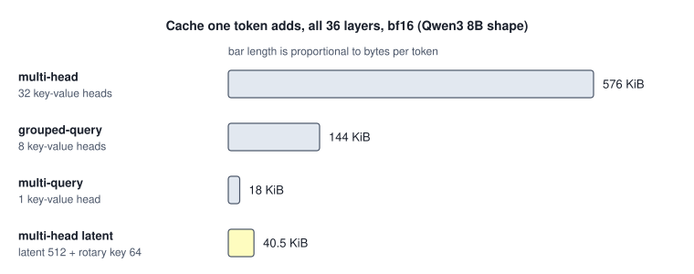

<!-- SPDX-License-Identifier: CC-BY-4.0 -->
<!-- Copyright (c) 2026 Martin Schröder <info@swedishembedded.com> -->

# Attention Variants: Sharing and Compressing Keys

*How do we shrink the KV cache without losing what attention needs?*

Hold one number against the 15.26 GiB that the weights of Qwen3 8B occupy in bf16: 18 GiB. It is the key-value cache of one sequence of 131,072 tokens in the same model, with the 8 key-value heads that Chapter 1 gave it. A server that reads a long document therefore holds more of the document than of the model, and every further sequence it serves at the same time brings its own 18 GiB. The model of the first chapter already saved three quarters of what it might have cost, because with a key-value head for every one of its 32 query heads the same sequence would need 72 GiB. The table counts the three choices at that shape; the rows differ only in how many key-value heads a layer stores.

<!-- worked: attention_variants.cache_sizes -->
The decoder shape of Qwen3 8B (Chapter 1): 36 layers, 32 query heads of width 128, model width 4,096, bf16 (2 bytes). The rows differ only in key-value heads. Numbers per layer: 2 x key-value heads x head width. Bytes per token = layers x numbers x 2. The GiB column is a context of 131,072 tokens.

| variant | what a layer stores | numbers per token and layer | bytes per token | GiB at 131,072 tokens | fraction of the multi-head cache |
|---|---|---:|---:|---:|---:|
| multi-head (MHA) | 32 key-value heads | 8,192 | 589,824 | 72.0000 | 1.0000 |
| grouped-query (GQA) | 8 key-value heads | 2,048 | 147,456 | 18.0000 | 0.2500 |
| multi-query (MQA) | 1 key-value head | 256 | 18,432 | 2.2500 | 0.0312 |

For scale: the 8,190,735,360 parameters of this shape are 16,381,470,720 bytes in bf16, 15.26 GiB.
<!-- /worked -->

Grouped-query attention is a dial with a stop. Turn it to its end, one key-value head, and the cache is 2.25 GiB at this context, but every query head then reads the same keys and values, and it is not obvious what that costs. The question of this chapter is whether the cache can be made smaller than the groups make it without turning that dial to its stop: by storing something other than the keys and values themselves, or by storing fewer positions of them. Both ideas are in use in the decoders brain serves, and both have a price that can be counted before anything is trained.

Five ideas from earlier chapters will be used before they are explained again. The answers are at the end.

1. (Volume VI, [Chapter 1](01-modern-decoder.md), grouped-query attention.) How many numbers does one token add to the cache of one layer with 32 query heads and 8 key-value heads of width 128, and how many query heads read each key-value head?
2. (Volume V, [Chapter 12](../v05-sequences/12-kv-cache.md), the decode phase.) For one cached key, how many FLOPs does a layer spend on it and how many bytes does it read, at those shapes in bf16? What ratio is that?
3. (Volume I, [Chapter 6](../v01-mathematics/06-decompositions.md), low-rank approximation.) A matrix of 4,096 rows and 4,096 columns has rank at most 512. How many numbers hold it as the product of two factors, and what fraction of the 4,096 x 4,096 entries is that?
4. (Volume V, [Chapter 8](../v05-sequences/08-positions.md), rotary embeddings.) To which of the query, the key and the value is the rotation applied, and what does the score of a pair of positions depend on afterwards?
5. (Volume III, [Chapter 3](../v03-neural-networks/03-softmax.md), the softmax.) What happens to the output of a softmax when the same constant is added to every score, and what do the outputs always sum to?

## One key-value head for every query head

The end of the dial is $h_{\mathrm{kv}} = 1$: every query head of a layer reads one key and one value per position. Shazeer (2019) proposed it for exactly the reason of this chapter, as a way to make incremental decoding cheap, and before the groups of Chapter 1 existed. Call it **multi-query attention**: grouped-query attention with a single key-value head, so that the group is all $H$ query heads and the attention of head $h$ is $\mathrm{softmax}(\mathbf{Q}_h \mathbf{K}^\top / \sqrt{d_h} + \mathbf{M})\,\mathbf{V}$ with the same $\mathbf{K}$ and $\mathbf{V}$ for every $h$. The first table has its numbers: 256 numbers per token and layer, 18,432 bytes per token for the 36 layers, 3.12 percent of the multi-head cache and an eighth of the cache of the 8 key-value heads. Each cached byte is used by all 32 query heads, so a cached key costs $4 H d_h = 16{,}384$ FLOPs for 512 bytes: 32 FLOPs per byte, against 1 for multi-head and 4 for the groups of 4.

The cost is of a particular kind. Query heads still differ, so heads can still look at different positions: the weights $p_{hj}$ differ from head to head. What they read at the positions they pick is the same: the output of head $h$ is $\sum_j p_{hj}\mathbf{v}_j$, a weighted average of one set of $d_h$-dimensional vectors, where in multi-head attention each head averages vectors of its own that can carry different features of the same token. With 32 heads reading the same 128 numbers per position there is simply less to choose between, and how much that matters for the quality of a trained model is a question for experiments, which Chapter 1 left to the measurements of the papers it cited. What can be counted is the other side. The matrices $\mathbf{W}_K$ and $\mathbf{W}_V$ of a layer shrink to $2 \cdot 4{,}096 \cdot 128 = 1{,}048{,}576$ numbers, a thirty-second of the multi-head pair.

Multi-query attention gets its saving by throwing information away early: 32 distinct keys per token become one. The alternative is to ask what the 32 distinct keys of a token are made of.

## Keys and values as a function of a small latent

The key of head $h$ at position $j$ is a linear function of the hidden state $\mathbf{x}_j$ of the token: $\mathbf{k}^{h}_j = \mathbf{W}_K^{h}\mathbf{x}_j$. This chapter writes the maps of the new layer as matrices acting on column vectors, $\mathbf{W}$ of shape $[\text{out}, \text{in}]$, as the paper that introduced it does; Chapter 7 of Volume V multiplied row vectors from the left by matrices of shape $[\text{in}, \text{out}]$, and the two conventions differ by a transpose. All heads together are a matrix of shape $[H d_h, D]$, which at the 8B shape is 4,096 by 4,096. Volume I showed what to do when a matrix is suspected of holding less information than its shape allows: write it as a product of a tall and a wide matrix through a width $d_c$ that is small, $\mathbf{W} = \mathbf{A}\mathbf{B}$ with $\mathbf{B}$ of shape $[d_c, D]$. The matrix then has rank at most $d_c$ and takes $d_c (H d_h + D)$ numbers, which for $d_c = 512$ is 4,194,304, a quarter of 16,777,216.

Read the factorization as a computation instead of a compression of weights. The wide factor maps the hidden state to $d_c$ numbers, and the tall one expands them to the keys of every head. Give the pair the names of its role: a **latent** $\mathbf{c}_j$ of $d_c$ numbers per token and layer, a down-projection $\mathbf{W}_{\mathrm{DKV}}$ of shape $[d_c, D]$ and, for every head, an up-projection of the key and one of the value:

$$
\mathbf{c}_j = \mathbf{W}_{\mathrm{DKV}}\,\mathbf{x}_j, \qquad
\mathbf{k}^{h}_j = \mathbf{W}_{\mathrm{UK}}^{h}\,\mathbf{c}_j, \qquad
\mathbf{v}^{h}_j = \mathbf{W}_{\mathrm{UV}}^{h}\,\mathbf{c}_j,
$$

with $\mathbf{W}_{\mathrm{UK}}^{h}$ of shape $[d_h, d_c]$ and $\mathbf{W}_{\mathrm{UV}}^{h}$ of shape $[d_v, d_c]$. Keys and values share one latent, so a token's $H d_h + H d_v$ numbers are functions of $d_c$ numbers, and a cache that holds $\mathbf{c}_j$ holds everything that the keys and values of all heads can be. Queries are formed from $\mathbf{x}_i$ as before, $\mathbf{q}^{h}_i = \mathbf{W}_Q^{h}\mathbf{x}_i$, and the score is $s^h_{ij} = \mathbf{q}^{h\top}_i \mathbf{k}^{h}_j / \sqrt{d_h}$ with the causal mask. DeepSeek-AI (2024) introduced this as multi-head latent attention; this book's term is **multi-latent attention**, and its cache is the number $d_c$ per token and layer in place of $2 h_{\mathrm{kv}} d_h$. (Their layer compresses the queries through a second latent as well, which saves memory in training and does not touch the cache; the layer here keeps the queries direct. brain's GLM decoder, met below, has both.) The paper reports $d_c = 4 d_h$, which is 512 at the head width of Qwen3 8B, and the table below adds the layer to the three of the opening at that shape.

Two things are already visible. The cache has become independent of the number of heads: 32 heads or 128 would store the same $d_c$ numbers. And the price is in the rank. Multi-head attention at this shape computes 8,192 key and value numbers from the 4,096 numbers of $\mathbf{x}_j$, so its keys and values were never more than 4,096 numbers' worth of information; the latent allows 512. A layer that is trained in this form learns key and value matrices that live in that smaller space from the start, and the paper's claim is that the quality holds up; this chapter counts what the layer costs, and does not retest the claim.

What looks like a bargain has a catch that the first count exposes. If a decode step rebuilds $\mathbf{k}^{h}_j$ and $\mathbf{v}^{h}_j$ from $\mathbf{c}_j$ for every cached $j$, each key costs $2 d_c H (d_h + d_v)$ FLOPs for the up-projections alone, 8,388,608 at this shape and 512 times the 16,384 that scoring and averaging it takes. The cache would be small and the step enormous. The whole point of the layer rests on not rebuilding.

## Moving the up-projections onto the query and the output

The score of a query with a cached key is a product of three things: the query, the up-projection and the latent. Matrix products can be bracketed either way:

$$
\mathbf{q}^{h\top}\bigl(\mathbf{W}_{\mathrm{UK}}^{h}\mathbf{c}_j\bigr)
= \bigl(\mathbf{W}_{\mathrm{UK}}^{h\top}\mathbf{q}^{h}\bigr)^{\top}\mathbf{c}_j
= \tilde{\mathbf{q}}^{h\top}\mathbf{c}_j,
\qquad \tilde{\mathbf{q}}^{h} = \mathbf{W}_{\mathrm{UK}}^{h\top}\mathbf{q}^{h} \in \mathbb{R}^{d_c}.
$$

The left bracketing forms a key for every cached $j$. The right one forms $\tilde{\mathbf{q}}^{h}$ once for the new token, $2 d_h d_c$ FLOPs per head, and then scores it against the latents as they are: $2 d_c$ FLOPs per cached key and head, with no key ever formed. The up-projection has been **absorbed** into the query. The values go the same way, because averaging is linear and so commutes with the up-projection:

$$
\mathbf{o}^{h} = \sum_j p^{h}_j\,\mathbf{W}_{\mathrm{UV}}^{h}\mathbf{c}_j
= \mathbf{W}_{\mathrm{UV}}^{h}\Bigl(\sum_j p^{h}_j\,\mathbf{c}_j\Bigr).
$$

The weighted sum is taken over the latents, $d_c$ numbers per key, and the up-projection is applied to the one result. It can also be folded into the output matrix. If $\mathbf{W}_O^{h}$ is the block of $d_v$ columns of $\mathbf{W}_O$ that head $h$ feeds, the product $\mathbf{W}_{\mathrm{OV}}^{h} = \mathbf{W}_O^{h}\mathbf{W}_{\mathrm{UV}}^{h}$ of shape $[D, d_c]$ can be formed once, when the model is loaded, and the layer's output is $\sum_h \mathbf{W}_{\mathrm{OV}}^{h}\sum_j p^{h}_j\mathbf{c}_j$.

A tiny layer shows that the two ways agree, with every tensor printed. It has 8 tokens, width 7, 3 heads, key width 4, value width 6, latent width 5 and one rotary key of width 2 that the next section explains. The two runs are the explicit one that rebuilds every key and value, and the absorbed one that starts from the cache of latents alone; the table gives the scores of one head for the last token and the output row of both, with the bound on the difference over all heads.

<!-- worked: attention_variants.absorption -->
Generator: the book's SplitMix64, seed 0x30676d6bfce3f978 (`seed_of` of the name `attention_variants.mla`). Shapes: T = 8 tokens, D = 7, H = 3 heads, content key width d_h = 4, value width d_v = 6, latent d_c = 5, rotary key d_R = 2. Each entry of every tensor is `round(0.5 * normal(), 1)` (ties away from zero), drawn row by row in this order: X [8, 7]; W_DKV [5, 7]; W_UK for heads 0, 1, 2 (each [4, 5]); W_UV for heads 0, 1, 2 (each [6, 5]); W_Q for heads 0, 1, 2 (each [4, 7]); W_QR for heads 0, 1, 2 (each [2, 7]); W_KR [2, 7]; W_O [7, 18]. The latent of token j is c_j = W_DKV x_j; the rotary parts are rotated by `positions.rotate` with one pair of rate 1.0 radian per position, the pair being the two channels; scores are divided by sqrt(d_h + d_R) = sqrt(6); the mask is causal; the head outputs are concatenated in head order. The explicit run reconstructs every key and value from the latents. The absorbed run starts from the cache alone (the 8 latents and the 8 rotary keys), forms q~ = W_UK^T q for each head, scores it against the latents, averages the latents with the weights, and finishes in either of two ways: multiplying the weighted latent of each head by W_OV = (the head's 7 by 6 block of W_O) times W_UV and adding the head contributions in head order; or applying W_UV to the weighted latent of each head, concatenating, and multiplying by W_O.

Scores of head 0 for the last token (position 7) against positions 0 to 7:

| position j | explicit: q . k + q_R . k_R, scaled | absorbed: q~ . c + q_R . k_R, scaled |
|---|---:|---:|
| 0 | -0.55486 | -0.55486 |
| 1 | 0.67820 | 0.67820 |
| 2 | 0.16535 | 0.16535 |
| 3 | 0.02900 | 0.02900 |
| 4 | 0.10495 | 0.10495 |
| 5 | -0.17294 | -0.17294 |
| 6 | 0.49416 | 0.49416 |
| 7 | -0.25167 | -0.25167 |

Output row of the last token (7 numbers):

| run | output row |
|---|---|
| explicit | (0.2483, 0.8174, 1.3775, -0.4155, 0.6403, -0.5424, 1.0515) |
| absorbed, W_UV folded into W_O | (0.2483, 0.8174, 1.3775, -0.4155, 0.6403, -0.5424, 1.0515) |
| absorbed, W_UV applied to the averaged latent | (0.2483, 0.8174, 1.3775, -0.4155, 0.6403, -0.5424, 1.0515) |

Largest absolute difference over the 24 scores of all three heads: below 1e-12. Largest absolute difference over the 7 output numbers: below 1e-12. Numbers cached after 8 tokens: 256 for the explicit layer (per token 3 x 4 content keys, 2 rotary key and 3 x 6 values) against 56 for the latent one (per token 5 + 2).
<!-- /worked -->

The scores agree to every printed digit and the outputs agree below $10^{-12}$, the round-off of two orders of summation in double precision. The two runs differ in what they need to remember: the explicit layer stores 256 numbers after 8 tokens and the absorbed one 56. In this layer the latent is 5 numbers against the 30 that the three heads' keys and values hold, and the saving per token is the ratio $(d_c + d_R)/(H d_h + d_R + H d_v)$.

A consequence of the absorbed form is worth stating plainly, since it is what makes the arithmetic of the next sections come out. In the absorbed form every head scores the same cached vector $\mathbf{c}_j$ and averages it. There is one cached "key" and one cached "value" for the whole layer and $H$ queries, each in a latent space of width $d_c$: it is multi-query attention with a key-value head $d_c$ wide, in which every query head carries its own matrix to enter the latent space (the $\mathbf{W}_{\mathrm{UK}}^{h\top}$) and its own matrix to leave it.

## The rotation that stands in the way

Position has not entered yet, and with it the identity breaks. Rotary embeddings (Volume V, Chapter 8) rotate the query and the key by their positions, $\mathbf{R}_i \mathbf{q}_i$ and $\mathbf{R}_j \mathbf{k}_j$, and because $\mathbf{R}_i^{\top}\mathbf{R}_j = \mathbf{R}_{j-i}$ the score depends only on the offset. Apply it to the up-projected key and the score is

$$
(\mathbf{R}_i\mathbf{q}_i)^{\top}\,\mathbf{R}_j\,\mathbf{W}_{\mathrm{UK}}\mathbf{c}_j
= \mathbf{q}_i^{\top}\,\mathbf{R}_{-\delta}\,\mathbf{W}_{\mathrm{UK}}\,\mathbf{c}_j,
\qquad \delta = i - j.
$$

The matrix between the query and the latent is now $\mathbf{R}_{-\delta}\mathbf{W}_{\mathrm{UK}}$, and it depends on the offset $\delta$. Absorbing it into the query gives $\tilde{\mathbf{q}}_{\delta} = \mathbf{W}_{\mathrm{UK}}^{\top}\mathbf{R}_{\delta}\,\mathbf{q}$, a different vector for every cached position. Forming it for each position costs the product of the up-projection again, and the saving of absorption is gone. The tiny layer shows it with the same tensors, head 0, the rotation now applied to the whole content key of width 4: the true score, the score absorbed by offset, and the score of a query absorbed once.

<!-- worked: attention_variants.rope_breaks_absorption -->
Generator: the book's SplitMix64, seed 0x30676d6bfce3f978 (`seed_of` of the name `attention_variants.mla`). The same tensors as before (the block above); head 0 only, query at position 7, the rotation now applied to the whole content key and query of width 4 (two pairs, rates 1.0 and 0.5 radian per position, adjacent channels; the book's `rotary` with base 4, because 4^(-2m/4) is 1.0 for m = 0 and 0.5 for m = 1) instead of to a separate rotary slice. The true score rotates the query by its position and the up-projected key W_UK c_j by its own. 'By offset' absorbs the query as q~_delta = W_UK^T R(delta) q, with delta = i - j; 'fixed' absorbs it once, as W_UK^T R(i) q, and scores that against the unrotated latent.

| offset delta = i - j | j | true score | by offset: q~_delta . c_j | fixed: q~ . c_j |
|---|---:|---:|---:|---:|
| 0 | 7 | -0.48276 | -0.48276 | -0.04145 |
| 1 | 6 | 0.65475 | 0.65475 | -0.43697 |
| 2 | 5 | 0.08583 | 0.08583 | -0.10760 |
| 3 | 4 | -0.33277 | -0.33277 | 0.23073 |

Largest absolute difference from the true score: by offset below 1e-12; fixed 1.092. The absorbed query of each offset (5 numbers; no two are equal):

| offset delta | q~_delta = W_UK^T R(delta) q |
|---:|---|
| 0 | (0.2290, -0.7180, -0.1340, -0.4990, 0.0610) |
| 1 | (0.3475, -0.4446, -0.0437, -0.3372, 0.1437) |
| 2 | (0.3856, 0.0094, 0.0585, -0.1437, 0.0550) |
| 3 | (0.2668, 0.3081, 0.1307, -0.0429, -0.1114) |
<!-- /worked -->

Absorbing by offset is exact and needs the four different vectors of the second table, one per cached position. Absorbing once, with the query rotated by its own position and the latent not rotated at all, is a different function, and the error is of the size of the scores themselves.

The repair is to give position its own channels. Split what a query is compared with into two parts. A **content** part passes through the up-projection and is never rotated, so it can be absorbed. A small **rotary** part of width $d_R$ carries the position: each head has a rotary query $\mathbf{q}^{R,h}_i = \mathrm{RoPE}_i(\mathbf{W}_{\mathrm{QR}}^{h}\mathbf{x}_i)$, and every token has a single rotary key $\mathbf{k}^{R}_j = \mathrm{RoPE}_j(\mathbf{W}_{\mathrm{KR}}\mathbf{x}_j)$ that all heads share. This is the **decoupled rotary key**. The score becomes

$$
s^{h}_{ij} = \frac{\mathbf{q}^{h\top}_i\,\mathbf{W}_{\mathrm{UK}}^{h}\,\mathbf{c}_j \;+\; \mathbf{q}^{R,h\top}_i\,\mathbf{k}^{R}_j}{\sqrt{d_h + d_R}}
= \frac{\tilde{\mathbf{q}}^{h\top}_i\,\mathbf{c}_j \;+\; \mathbf{q}^{R,h\top}_i\,\mathbf{k}^{R}_j}{\sqrt{d_h + d_R}} .
$$

The first term has no rotation and absorbs as before; the second is rotary attention with $H$ queries and one key of width $d_R$, which depends on the offset exactly as Chapter 8 showed. Everything the cache needs is $\mathbf{c}_j$ and $\mathbf{k}^{R}_j$: $d_c + d_R$ numbers per token and layer. The DeepSeek-V2 paper takes $d_R = d_h / 2$, 64 here. Position information reaches the score only through those $d_R$ channels, so the model learns to carry what depends on where in them and what depends on content in the rest. The tiny layer of the previous section used exactly this form, which is why its table printed scores of the form $\mathbf{q}\cdot\mathbf{k} + \mathbf{q}_R\cdot\mathbf{k}_R$.

The next figure shows the two computations of one layer side by side, the explicit one that every training step runs and the absorbed one that decoding can run. Yellow marks what the cache holds.

![Two panels. Left, rebuilding every key and value: the hidden state of a token goes through a down-projection to a latent that is cached, and through a rotary key projection and rotation to a rotary key that is cached; the latent goes through the up-projections of keys and values; the keys, values and rotary key feed the attention, followed by the output matrix. Right, the absorbed decode path: the query goes through the transposed key up-projection into the latent space, is scored against the cached latents and rotary keys, the softmax weights average the cached latents, and the value up-projection and output matrix, or their product, give the output. No key or value is rebuilt.](img/mla-data-flow.svg)

Now the four layers can be counted at one shape, with the parameters of the key and value path added: the product of two factors per head has fewer numbers than the groups of Chapter 1, even though it has more heads' worth of structure.

<!-- worked: attention_variants.cache_sizes_latent -->
The same shape with multi-head latent attention added, with the settings reported for DeepSeek-V2: a latent of $d_c = 4 d_h = 512$ numbers and a rotary key of $d_R = d_h / 2 = 64$. This chapter counts this layer and does not train it. Numbers per layer: $d_c + d_R$ for the latent variant, 2 x key-value heads x head width for the others. The last column counts the parameters of the matrices that produce keys and values: $2 D h_{kv} d_h$, and for the latent variant $d_c D + d_R D + 2 H d_h d_c$ (the down-projection, the rotary key and the two up-projections of all heads).

| variant | what a layer stores | numbers per token and layer | bytes per token | GiB at 131,072 tokens | fraction of the multi-head cache | key-value path parameters per layer |
|---|---|---:|---:|---:|---:|---:|
| multi-head (MHA) | 32 key-value heads | 8,192 | 589,824 | 72.0000 | 1.0000 | 33,554,432 |
| grouped-query (GQA) | 8 key-value heads | 2,048 | 147,456 | 18.0000 | 0.2500 | 8,388,608 |
| multi-query (MQA) | 1 key-value head | 256 | 18,432 | 2.2500 | 0.0312 | 1,048,576 |
| multi-head latent (MLA) | latent of 512 and a rotary key of 64 | 576 | 41,472 | 5.0625 | 0.0703 | 6,553,600 |
<!-- /worked -->



The latent layer stores 41,472 bytes per token, 7.03 percent of the multi-head cache and 28.1 percent of the grouped one: at 131,072 tokens 5.06 GiB where the groups need 18. It stores 2.25 times what multi-query attention does, and the factor $4.5 d_h$ against $2 d_h$ is the same 2.25 that DeepSeek-AI quote when they compare their cache with that of grouped-query attention with 2.25 groups. Its key and value matrices have 6,553,600 numbers per layer, 78 percent of the groups' 8,388,608 and 19.5 percent of the multi-head pair. The factorization is not only a cache trick; it is also a smaller parameterization of the same shapes.

As an algorithm, one decode step of the absorbed layer, in the book's pseudocode. The pseudocode stores each matrix transposed, as Chapter 7 of Volume V did, and multiplies row vectors from the left, so `Wuk[h]` is the transpose of $\mathbf{W}_{\mathrm{UK}}^{h}$, of shape $[d_c, d_h]$, and the absorbed query is the product of the query row with the transpose of that:

```text
function mla_decode(x: array<real>[1, D], pos: int,
                    Cc: array<real>[T, d_c], Kr: array<real>[T, d_R],
                    Wdkv: array<real>[D, d_c], Wkr: array<real>[D, d_R],
                    Wq: array<real>[H, D, d_h], Wqr: array<real>[H, D, d_R],
                    Wuk: array<real>[H, d_c, d_h], Wuv: array<real>[H, d_c, d_v],
                    Wo: array<real>[H * d_v, D], base: real) -> array<real>[1, D]
    # Cc and Kr hold the pos earlier tokens and receive the new one: the whole cache
    require pos < T
    Cc[pos:pos + 1, :] = matmul(x, Wdkv)                    # the latent of the new token
    kr_row = matmul(x, Wkr)
    Kr[pos, :] = rotary(kr_row[0, :], pos, base, true)      # its one rotary key
    out = zeros(real, [1, H * d_v])
    for h in 0 .. H:
        q = matmul(x, Wq[h])                                # [1, d_h]
        qr_row = matmul(x, Wqr[h])
        qr = rotary(qr_row[0, :], pos, base, true)          # [d_R]
        qt = matmul(q, transpose(Wuk[h]))                   # [1, d_c]: the absorbed query
        S = [(dot(qt[0, :], Cc[j, :]) + dot(qr, Kr[j, :])) / sqrt(d_h + d_R) for j in 0 .. pos + 1]
        p = softmax(S)
        ctx = zeros(real, [1, d_c])
        for j in 0 .. pos + 1:
            ctx[0, :] = ctx[0, :] + p[j] * Cc[j, :]         # average the latents, never the values
        o = matmul(ctx, Wuv[h])                             # [1, d_v]
        out[0, h * d_v:(h + 1) * d_v] = o[0, :]
    return matmul(out, Wo)
```

Only `Cc` and `Kr` persist between steps; no key or value of the layer is ever formed. The tiny layer's absorbed run computes exactly this, with the last token's output in place of a whole sequence.

## What the latent costs in arithmetic, and when it pays

The cache is small; the question that remains is what a step costs. The count is by cached key, since that is the part that grows with the context: FLOPs of the attention products per key and layer, the bytes read for it, and their ratio, the arithmetic intensity of Volume IV. The table has the three variants of the opening, the latent layer computed both ways, and a sixth row that comes back in the section on brain.

<!-- worked: attention_variants.decode_cost -->
The decoder shape of the previous table ($H = 32$ query heads, $d_h = d_v = 128$, $d_c = 512$, $d_R = 64$, 36 layers, bf16). Per cached key and layer: multi-head, grouped and multi-query attention score and average with $2 H d_h + 2 H d_h = 4 H d_h$ FLOPs whatever $h_{kv}$ is; rebuilding keys and values from the latent adds $2 d_c H (d_h + d_v)$ for the up-projections, then $2 H (d_h + d_R)$ for the scores and $2 H d_v$ to average; the absorbed form scores against the latent ($2 H (d_c + d_R)$) and averages the latent ($2 H d_c$); the last row stores the up-projected keys, the rotary key and the values ($H d_h + d_R + H d_v$ numbers), as brain's GLM decoder does. Bytes per key = numbers x 2. The last two columns are one decoded token on a context of 32,768 keys across all 36 layers: billions of FLOPs, and GiB of cache read. The matrix products with the weights, the same for every row up to the per-token terms of the next paragraph, are not counted here.

| attention | numbers per key and layer | FLOPs per key and layer | bytes per key and layer | FLOPs per byte | billions of FLOPs for 32,768 keys | GiB read |
|---|---:|---:|---:|---:|---:|---:|
| multi-head | 8,192 | 16,384 | 16,384 | 1.00 | 19.33 | 18.000 |
| grouped-query (8 key-value heads) | 2,048 | 16,384 | 4,096 | 4.00 | 19.33 | 4.500 |
| multi-query | 256 | 16,384 | 512 | 32.00 | 19.33 | 0.562 |
| latent, keys and values rebuilt from the latent at every step | 576 | 8,409,088 | 1,152 | 7,299.56 | 9,919.76 | 1.266 |
| latent, absorbed | 576 | 69,632 | 1,152 | 60.44 | 82.14 | 1.266 |
| latent weights, expanded keys and values cached | 8,256 | 20,480 | 16,512 | 1.24 | 24.16 | 18.141 |

Per decoded token and layer, outside the sum over keys, the absorbed form also computes $\tilde{\mathbf{q}}^h = \mathbf{W}_{\mathrm{UK}}^{h\top} \mathbf{q}^h$ for every head ($2 H d_h d_c$ = 4,194,304 FLOPs) and then either applies $\mathbf{W}_{\mathrm{UV}}^h$ to each weighted latent ($2 H d_v d_c$ = 4,194,304 FLOPs) before the ordinary output matrix ($2 H d_v D$ = 33,554,432 FLOPs), or folds it into $\mathbf{W}_{\mathrm{OV}}^h$ and multiplies the weighted latents by that ($2 H d_c D$ = 134,217,728 FLOPs). Either is a fixed cost per token, whatever the number of keys.
<!-- /worked -->

Three things stand out. Rebuilding keys and values from the latent at every step is 8,409,088 FLOPs per key and layer against 69,632 for the absorbed form, 121 times as many, and an intensity of 7,299.56 FLOPs per byte, far above any ridge: the step would be limited by arithmetic, 9,919.76 billion FLOPs per decoded token over the 36 layers at 32,768 keys against the 19.33 billion of multi-head attention. The arithmetic of the up-projections swallows the saving, which is why the layer exists only together with absorption.

Second, the absorbed layer does more arithmetic per key than the layers it competes with: 69,632 FLOPs against the 16,384 of multi-head, grouped and multi-query attention alike, a factor of 4.25. The latent is 4.5 times wider than a head and each of 32 query heads scores and averages all of it. Where the other variants reduce the number of bytes by sharing and keep the FLOPs at $4Hd_h$, this one reduces the bytes by compression and pays in FLOPs. The intensity is 60.44 FLOPs per byte, against 4 for the groups and 32 for multi-query attention.

Third, whether that is a good trade depends on the device, and the roofline of Volume IV, Chapter 3 gives the test. A decode step is limited by bytes when its intensity is under the device's ridge; if both layers stay under it the one that reads fewer bytes is faster, and the latent layer reads 1,152 bytes per key against 4,096, a factor of 3.56. The latent layer is faster than the grouped one so long as the time its FLOPs need, $69{,}632 / P$ for a peak of $P$ FLOPs per second, stays below the time the grouped layer's bytes need, $4{,}096 / B$ for a bandwidth of $B$ bytes per second. That is $P/B > 69{,}632 / 4{,}096 = 17$: the ridge of the device must exceed 17 FLOPs per byte. The two devices of that chapter's example had ridges of 10 and 50. On the second the latent layer is the better one for attention; on the first it is not, and the grouped layer, which is nowhere near the first device's ridge, reads its 4,096 bytes and is done. For one cached key this is a property of the layer shape and the device and has nothing to do with the model's quality.

What the sums leave out are the fixed costs per token and layer: forming $\tilde{\mathbf{q}}^{h}$ for every head ($2 H d_h d_c$ = 4,194,304 FLOPs), and then either applying $\mathbf{W}_{\mathrm{UV}}^{h}$ to the weighted latents (another 4,194,304) before the ordinary output matrix (33,554,432) or folding it into $\mathbf{W}_{\mathrm{OV}}^{h}$ ($2 H d_c D$ = 134,217,728 in one product). Folding is simpler, and 3.6 times as many FLOPs as applying the up-projection to the average; per token, not per key, so at 32,768 keys either is a rounding error against the 2.28 billion FLOPs per layer of the attention itself. A layer with short contexts would choose the other way.

## Looking only at the recent past

Sharing and compressing keep every position and make each one cheaper. The other way to shrink a cache is to keep fewer positions. In **sliding-window attention** a query at position $i$ reads the keys $j$ with $0 \le i - j < n_{\mathrm{win}}$, itself and the $n_{\mathrm{win}} - 1$ before it: the causal mask of Chapter 7 of Volume V with a second boundary on the other side. The left figure of the pair below is the causal mask of 12 positions; the right one is the same positions with a window of 4 and, as the last section will explain, two kept sinks.


A layer then needs the last $n_{\mathrm{win}}$ rows of keys and values and nothing else; the cache of the layer is bounded by $n_{\mathrm{win}}$ whatever the length of the text, and the attention of a decoded token costs $4 H d_h n_{\mathrm{win}}$ FLOPs and reads $2 h_{\mathrm{kv}} d_h n_{\mathrm{win}}\, b$ bytes, independent of the context. At the shape of brain's Ripple model ($H = 80$, $d_h = 128$) and a window of 1,024 keys, one layer's attention is $4 \cdot 80 \cdot 128 \cdot 1{,}024 = 41{,}943{,}040$ FLOPs per token, where a layer that reads all of a context of 131,072 keys spends 128 times as many. The idea is older than the models of this volume: Child and colleagues (2019) studied local patterns among the sparse patterns of their transformer, and Beltagy, Peters and Cohan (2020) built Longformer on windows of this kind.

### What a stack of windows can still see

A window does not bound what the model can use, because the layers are stacked. The output of a layer at position $i$ depends on the layer below at positions $i - n_{\mathrm{win}} + 1, \dots, i$, each of which depends on its own window below it. The table finds the input positions that can change the output at position 15, by applying the mask once per layer.

<!-- worked: attention_variants.receptive_field -->
T = 16 positions (0 to 15), window $n_{win} = 4$: position $i$ sees $j$ when $0 \le i - j < 4$. The set of input positions that can change the output at position 15 after $L$ layers is found by applying the mask to the set $L$ times (the positions reached by layer $l$ are all the positions that a reached position sees).

| layers L | input positions that reach position 15 | count | L (n_win - 1) + 1 |
|---|---:|---:|---:|
| 1 | 12 to 15 | 4 | 4 |
| 2 | 9 to 15 | 7 | 7 |
| 3 | 6 to 15 | 10 | 10 |
| 4 | 3 to 15 | 13 | 13 |
| 5 | 0 to 15 | 16 | 16 |
<!-- /worked -->

Each layer adds $n_{\mathrm{win}} - 1$ positions of reach, so a pure stack of $L$ sliding layers reaches back $L(n_{\mathrm{win}} - 1)$ positions, which is the "$L \times n_{\mathrm{win}}$" that the windows make possible: 80 layers of 1,024 keys reach 81,841 positions. Reach is not use: the information has to be carried through the residual stream and every layer between, and a fact from far back is mixed with what happened since. A cheaper way to give a model a long memory is to interleave: most layers read a window and every few of them read everything. That is what brain's Ripple decoder does, with four windowed layers and then one global layer, and the table counts what it buys at its shape: 80 layers, 16 of them global, 1,024 numbers of key and 1,024 of value per token and layer, in bf16.

<!-- worked: attention_variants.hybrid_cache -->
The layer pattern of brain's Ripple decoder (`crates/ricursive`): 80 layers, every 5th one global (layers 4, 9, ..., 79), the rest sliding with a window of 1,024 keys; each layer has $h_{kv} d_h = 1,024$ key numbers and as many value numbers per token, in bf16. Global layers: 16, so 65,536 bytes per token. Sliding layers: 64, each holding at most 1,024 tokens, so a fixed 268,435,456 bytes (256 MiB) per sequence once it is longer than the window (the slack rows of a prefill chunk are not counted). All 80 layers global would cost 327,680 bytes per token.

| tokens in the sequence | all layers global, GiB | 4 sliding to 1 global, GiB | ratio |
|---|---:|---:|---:|
| 8,192 | 2.500 | 0.750 | 3.33 |
| 131,072 | 40.000 | 8.250 | 4.85 |
| 1,048,576 | 320.000 | 64.250 | 4.98 |
<!-- /worked -->

The global layers, a fifth of the layers, cost 65,536 bytes per token; the windowed ones cost a fixed 256 MiB per sequence, once it is longer than the window. At 8,192 tokens the hybrid is 3.33 times smaller than 80 global layers, at 131,072 tokens 4.85 times, and at a million tokens 4.98: the ratio tends to 5, the inverse of the share of global layers, and the 256 MiB become negligible. The bound on the cache is the number of global layers, as it should be, since those are the layers that see everything.

### A ring buffer and the slack a chunk needs

A cache of the last $n_{\mathrm{win}}$ rows is a queue, and the way to hold a queue without moving data is a ring: position $p$ lives in row $p \bmod R$ of a buffer of $R$ rows, and a new position overwrites the oldest. For one decoded token $R = n_{\mathrm{win}}$ is enough, since the position being written, $p$, replaces $p - n_{\mathrm{win}}$, which the query at $p$ no longer reads. A prefill that runs a chunk of $c$ rows at once breaks this, because all $c$ rows are written before any of them attends. Row $p_0 + k$ of the chunk needs the positions back to $p_0 + k - n_{\mathrm{win}} + 1$, and the later rows of the chunk have already overwritten some of them. The table plays this with a window of 4 and a chunk of 3 rows that follows 8 written positions, for four ring sizes.

<!-- worked: attention_variants.ring_slack -->
A ring of $R$ rows holds position $p$ in row $p \bmod R$. Window $n_{win} = 4$; positions 0 to 7 are already written; a prefill chunk of 3 rows (positions 8, 9, 10) writes all three before any of them attends, and row $q$ then needs positions $q - 3$ to $q$. Positions each row needs and no longer finds in the ring:

| ring rows R | missing positions | every row served |
|---:|---|---|
| 4 | row 8: 5, 6; row 9: 6; row 10: none | no |
| 5 | row 8: 5; row 9: none; row 10: none | no |
| 6 | row 8: none; row 9: none; row 10: none | yes |
| 7 | row 8: none; row 9: none; row 10: none | yes |
<!-- /worked -->

The smallest ring that serves every row has $n_{\mathrm{win}} + c - 1 = 6$ rows: the oldest position the first chunk row reads, $p_0 - n_{\mathrm{win}} + 1$, must survive the write of the last, $p_0 + c - 1$, which lands on the row of position $p_0 + c - 1 - R$, so $p_0 + c - 1 - R < p_0 - n_{\mathrm{win}} + 1$ gives $R > n_{\mathrm{win}} + c - 2$. This is the "slack" of the chunk.

## Where the mass goes when the first tokens leave

Windows have a defect that Xiao and colleagues (2024) described for trained language models: when a stream of text outgrows a window and the cache starts to forget its first tokens, quality does not decline gently, it collapses. Those authors found that attention puts a large share of its weight on the first few tokens of the text whatever those tokens say, and that keeping the keys and values of a few initial tokens beside the window repairs the model without any training. They called such a token an **attention sink**. The reason it has to exist can be shown without a trained model, with one property of the softmax that Chapter 3 of Volume III proved.

The weights of a softmax sum to one, and adding the same constant to every score leaves them unchanged. A head cannot therefore express "none of these keys is relevant" by making its scores low: only differences count. The row below has four keys, all scored low, and three shifts of the whole row; its output is the weighted average of four value vectors.

<!-- worked: attention_variants.mass_needs_a_place -->
Generator: the book's SplitMix64, seed 0x66998be6ede4ed70 (`seed_of` of the name `attention_variants.mass`). Draws: the 4 value vectors of 3 numbers each, `round(normal(), 1)`, in order: (-0.8, -0.7, 0.8), (-0.2, 0.2, 2.0), (-0.5, 0.5, 1.0), (0.8, 0.8, 1.2). Scores of one query against four keys, all low: (-6.0, -6.2, -5.9, -6.1), shifted by a constant before the softmax.

| shift added to every score | attention weights | sum of weights | length of the output |
|---:|---|---:|---:|
| +0 | (0.261183, 0.213838, 0.288651, 0.236328) | 1.000000 | 1.2416 |
| -10 | (0.261183, 0.213838, 0.288651, 0.236328) | 1.000000 | 1.2416 |
| -100 | (0.261183, 0.213838, 0.288651, 0.236328) | 1.000000 | 1.2416 |

The unweighted mean of the four values has length 1.2779. A fifth key with score -1.0 and a value of zeros, five above the others, takes the weights (0.006568, 0.005378, 0.007259, 0.005943, 0.974851), and the output has length 0.0312.
<!-- /worked -->

The weights do not move, the output is the average of four unrelated values, and length 1.2416 is close to that of their plain mean, 1.2779. A head whose purpose, on some input, is to contribute nothing has one way out: put a key into the row that every query scores high, whose value is near zero, and let it absorb the mass. With a fifth key five points above the others the weights are 0.974851 on the new key and the output has length 0.0312, forty times shorter. That key is a sink. It is not a feature of language; it is where mass goes when the softmax insists on conserving it, and a model trained on long text finds that the first tokens, which every later token can see, are the cheapest place to build one.

What goes wrong with a window is what goes wrong when the sink is evicted: its mass has to be redistributed over the keys that remain, and those keys carry real values. The stream below makes the effect countable. It has 12 tokens; every query scores token 0, the sink, at 5, and the other keys by a small dot product; token 0 has a value of zeros. The reference output of each query attends to everything. Two cache policies are compared with it: the last 4 positions, and the last 4 plus position 0.

<!-- worked: attention_variants.sink_stream -->
Generator: the book's SplitMix64, seed 0x6dfb11aec45d198d (`seed_of` of the name `attention_variants.sink`). A stream of 12 tokens (positions 0 to 11); query $t$ is the pair $(a_t, 1)$ and key $j$ the pair $(b_j, -0.5)$, scored by their dot product with no scaling, except key 0, which is $(0, 5.0)$ so that every query scores it 5.0. The value of token 0 is zeros; tokens 1 to 11 have three numbers each. Draws, in this order, each `round(normal(), 1)`: $a_1, \dots, a_{11}$; $b_1, \dots, b_{11}$; then the values of tokens 1 to 11, three numbers each, token by token. Reference: query $t$ attends to every position 0 to $t$. 'Window' keeps only the last 4 positions (itself included), 'sink and window' keeps those and position 0. Errors are the Euclidean distance of the output from the reference output; 'weight dropped' is the reference attention weight of the positions that 'sink and window' leaves out. For scale, the mean length of the values of tokens 1 to 11 is 1.438.

| query t | reference weight on position 0 | reference output length | error, window | error, sink and window | weight dropped |
|---|---:|---:|---:|---:|---:|
| 1 | 0.9962 | 0.0049 | 0.0000 | 0.0000 | 0.00000 |
| 2 | 0.9897 | 0.0191 | 0.0000 | 0.0000 | 0.00000 |
| 3 | 0.9879 | 0.0115 | 0.0000 | 0.0000 | 0.00000 |
| 4 | 0.9661 | 0.0422 | 1.2030 | 0.0000 | 0.00000 |
| 5 | 0.9724 | 0.0297 | 1.2168 | 0.0039 | 0.00303 |
| 6 | 0.9753 | 0.0131 | 0.8350 | 0.0142 | 0.00853 |
| 7 | 0.9168 | 0.0752 | 0.7494 | 0.0573 | 0.02678 |
| 8 | 0.9558 | 0.0261 | 0.3881 | 0.0293 | 0.02705 |
| 9 | 0.9486 | 0.0361 | 0.2638 | 0.0353 | 0.03112 |
| 10 | 0.8758 | 0.1443 | 0.7111 | 0.1298 | 0.07886 |
| 11 | 0.9532 | 0.0264 | 1.1490 | 0.0159 | 0.03164 |

From query 4, the first at which position 0 is outside the window, the error of the window alone is at least 0.2638 and that of sink and window at most 0.1298.
<!-- /worked -->

Up to query 3 the window still contains position 0 and nothing is lost. At query 4 the window alone has dropped it: the reference gives it 0.9661 of the weight and an output of length 0.0422, and the window alone is off by 1.2030, 28 times the output it should produce, because the weight of the sink was spread over four ordinary values. The sink and the window together equal the reference at that query exactly and are off by an amount of the order of the weight they dropped times the length of a value: at query 10 they leave out 0.07886 of the weight and are wrong by 0.1298 (the mean length of a value is 1.438). Neither cache is perfect, but the one that keeps the sink is wrong by the mass it truncated, where the one without it is wrong by the whole mass of the sink. The cache has $n_{\mathrm{sink}} + n_{\mathrm{win}}$ rows, bounded, as the right grid of the figure shows.

The numbers are those of a toy in which the sink was put there by hand, to make a point countable. Whether and where a trained model builds its sinks is a fact about its weights and not about the arithmetic, and what Xiao and colleagues report is that it does so at the first tokens. The positions the kept keys are rotated by once they sit beside a window, and how far a window can be stretched beyond what the model was trained on, belong to the chapter on long context.

## Three decoders in brain

brain has all three of the layouts of this chapter in its decoders, not all in the form the chapter describes. Looking at them side by side is also a lesson about how much the shape of the attention is a fact about the checkpoint and not about its name.

### The decoder whose name says latent and whose weights say multi-head

`crates/deepseek2` is the decoder half of the document reader that Volume VII returns to, built from a checkpoint in the DeepSeek-V2 family. It is not a latent-attention decoder, and the crate says so in its first lines (commit `dd092ec89`, August 2026, "MHA-only DeepSeek-V2 decoder"). The checkpoint's tensors are the evidence: four square matrices of 1,280 by 1,280 per layer for the queries, keys, values and output, 10 heads and 10 key-value heads of width 128, and none of the down- and up-projections that a latent layer has. The loader that reads the file records the rest in `crates/gguf/src/deepseek_ocr.rs`: the rotary dimension the file declares is 0, which the loader treats as unset and replaces by the whole head width, because the checkpoint's own configuration sets the decoupled rotary width of latent attention to 0 for a model that is not one. It is a decoder with the configuration of a family and the attention of an older one. What the wrong guess would have cost is the point: the cache of this decoder is that of multi-head attention, 2,560 numbers per token and layer, 61,440 bytes per token in bf16 over its 12 layers, as the plan of the serving engine computes it (`kv_pool_bytes` in `crates/deepseek2/src/serve.rs`). The table below prices it beside the other decoders of this section.

The document server over this decoder keeps a pool of 128 Ki tokens (`POOL_TOKENS` in `crates/ocrserve/src/frontend.rs`), and its policy halves the pool when the cache is held in 32-bit numbers (`crates/ocrserve/src/policy.rs`), so that a bf16 pool of 131,072 tokens and an f32 pool of 65,536 take the same bytes: commit `4329f9332` records the move to the bf16 pool as the same K/V memory for twice the tokens. In the table the bf16 row is 7.5 GiB and the f32 row, for the same 131,072 tokens, 15 GiB, twice that.

### The latent layout of the GLM decoder, and the cache it keeps

The latent layer of this chapter is in `crates/glmdsa`, the decoder of a GLM-family model whose published shape the crate keeps as `GlmConfig::glm5_2`: 78 layers, 64 heads, a latent rank of 512 for keys and values (`kv_lora_rank`), a rotary key of 64 (`qk_rope_head_dim`), a content key of 192 (`qk_nope_head_dim`) and a value of 256 (`v_head_dim`), and a latent of 2,048 for the queries (`q_lora_rank`). Its parameters are the ones the chapter's equations ask for, under the crate's names: `attn.kv_a_c` is $\mathbf{W}_{\mathrm{DKV}}$, `attn.kv_a_rope` the matrix that produces the one shared rotary key, `attn.kv_b_nope` and `attn.kv_b_v` the up-projections $\mathbf{W}_{\mathrm{UK}}$ and $\mathbf{W}_{\mathrm{UV}}$ for all heads at once, and `attn.q_a`, `attn.q_b_nope`, `attn.q_b_rope` the compressed queries. The latent and the keys are normalized before they are used, which the chapter's equations leave out: the latent passes an RMS norm with a gain of its own (`attn.kv_a_norm`) before the up-projections, so the normalized latent is the thing a latent cache would hold and absorption is unaffected. The published checkpoint fuses these maps into three matrices (`q_b_proj`, `kv_b_proj`, `kv_a_proj_with_mqa`); brain splits each into separate tensors so that the content, rotary and value parts are contiguous buffers, and its importer permutes the rows (the header of `crates/glmdsa/src/config.rs`). The kernels are the ones of the decoupled score: `mla_scores` computes the content dot product and the rotary one over the single shared rotary key, scaled by the inverse square root of the sum of the two widths (commit `12d2ea47a`, July 2026, which also wrote their backward passes: the gradient of the shared rotary key sums over heads, as the sharing of Chapter 1 requires).

What the decode step stores is the interesting part, and it is not the latent. The incremental step (commit `54ebd7952`, July 2026) projects the new token to its latent, normalizes it, up-projects to every head's key and value once, and appends the results to a per-layer cache of three buffers: the up-projected content keys, the one rotary key and the up-projected values (the field comments of `kpass_cache`, `krot_cache` and `v_cache` in `crates/glmdsa/src/model.rs` call it a materialised per-head cache). Absorption does not appear in the crate: since the keys and values are stored expanded, nothing needs absorbing. The step is gated by `kv_step_matches_full_recompute`, which feeds a tiny model one token at a time and compares each hidden state and logits row with a full recompute of the prefix, to $3 \times 10^{-3}$. The table puts the three cases side by side, at the widths of the two crates' presets.

<!-- worked: attention_variants.brain_caches -->
Widths read from the presets of the crates (`DeepseekV2Config::deepseek_ocr`: 12 layers, 10 heads and 10 key-value heads of width 128; `GlmConfig::glm5_2`: 78 layers, 64 heads, qk_nope_head_dim 192, qk_rope_head_dim 64, v_head_dim 256, kv_lora_rank 512). Numbers per token and layer: 2 x heads x head width for multi-head attention; $H d_{nope} + d_{rope} + H d_v$ for the expanded cache of the GLM decoder, which stores the up-projected keys, the one shared rotary key and the values; $d_c + d_R$ for a latent cache. The last column is a pool of 131,072 tokens. At equal precision the expanded cache of the GLM shape is 49.89 times the latent one.

| decoder | what a layer stores | numbers per token and layer | precision | bytes per token | GiB at 131,072 tokens |
|---|---|---:|---|---:|---:|
| DeepSeek-OCR decoder, `deepseek2` | multi-head, 10 heads of 128 | 2,560 | bf16 | 61,440 | 7.500 |
| DeepSeek-OCR decoder, `deepseek2` | multi-head, 10 heads of 128 | 2,560 | f32 | 122,880 | 15.000 |
| GLM-5.2 shape, `glmdsa`, as it caches | expanded: 64 x 192 keys, 64 rotary, 64 x 256 values | 28,736 | f32 | 8,965,632 | 1094.438 |
| GLM-5.2 shape, latent and rotary key | 512 latent and 64 rotary | 576 | f32 | 179,712 | 21.938 |
| GLM-5.2 shape, latent and rotary key | 512 latent and 64 rotary | 576 | bf16 | 89,856 | 10.969 |
<!-- /worked -->

The expanded cache of the GLM shape is 49.89 times the latent one at equal precision: 28,736 numbers per token and layer where the layer of this chapter stores 576. brain's decoder uses the latent factorization, the decoupled rotary key and the shared rotary key of the chapter, and keeps a cache in the form of multi-head attention. What it has bought is the layout of the checkpoint and, in its training path, the smaller key and value matrices; the sixth row of the cost table above is its arithmetic, 20,480 FLOPs for 16,512 bytes per key, an intensity of 1.24 that is the multi-head layer's. The chapter's absorbed layer is, for that decoder, a count of what a cache could be.

### Ripple: four windows to one global layer, served from rings

`crates/ricursive` is the decoder of Ripple-65B, an 80-layer dense model with 80 query heads over 8 key-value heads of width 128 (groups of 10), in which four sliding-window layers with rotary positions and a window of 1,024 keys are followed by one global layer with no positional rotation at all; layers 4, 9, ..., 79 are the global ones. Each layer also carries a gate on the attention output, a learned mixing of the embedding into the input of each layer's value projection, per-head normalization of queries and keys and a clipped feed-forward network; those belong to the checkpoint and not to this chapter. The two kinds of layer are one kernel. The windowed score kernel masks a key when the offset is at least the window (`crates/kernels/wgsl/gqa_scores_win.wgsl`), and a window at least as long as the text is the causal mask, which is how `Layer::window` in `crates/ricursive/src/layer.rs` configures a global layer: a global layer is a sliding layer whose window never binds. The configuration reader refuses a file whose list of layer types and whose redundant hybrid pattern disagree, rather than choose one (`crates/ricursive/src/config.rs`). The first commit of the crate (`ae9370878`, November 2026) gates the forward pass of a tiny random model, whose window of 4 is shorter than its 12-token prompt so that the window binds, and two real layers (a windowed one and a global one) against the reference implementation.

The serving engine is where the arithmetic of the sections above becomes memory (commit `a69a2ad08`, November 2026). A sequence holds two kinds of cache. The global layers' keys and values live in blocks of a pool that the sequence's block table addresses, like every other decoder's. The windowed layers' live in a ring of `window + prefill_chunk` rows per sequence, kept in the sequence's fixed-size state row, so that nothing in the shared serving contract had to change. Position $p$ is at row $p \bmod$ the ring size, the rotation is applied at the absolute position, and the slack is the chunk of the previous section (`ring_rows` in `crates/ricursive/src/serve.rs`; the derivation above says $n_{\mathrm{win}} + c - 1$ is the least that serves every row, and the engine allocates one row more). The attention kernels are the unchanged paged ones: a windowed row passes a block table of one-row blocks that lists its ring rows in key order, so the window and its wrap-around are data and not a new kernel. The test of that commit decodes across the wraps of a window of 4 at five shapes of chunk and slice and compares every step with a full recompute of the prefix, to a scaled error of $10^{-5}$; it runs when the tiny reference fixture is present.

The engine's other two stories follow from the ring and are small lessons in what a bounded cache is. A prompt cache cannot share the ring as it shares global blocks, because the content of a ring depends on exactly which rows of it were written and where; an entry of the prefix cache is therefore the pair of the global blocks and a snapshot of the ring taken as the prefill ends, and a prompt that extends it copies the ring over its own (commit `a69a2ad08`); a later commit (`c66cae0ac`) files the same pair at the branch point where two prompts diverge, bounded by the snapshot slots the memory plan already charges. And a draft model for speculative decoding has a cache of the same two kinds. The draft that the engine can attach has windowed and global layers of its own, and commit `15b1fb5d7` makes it follow the layout of the target: its global layers share one pool of blocks sized as the target's, its windowed ones keep a ring for each live sequence, and its slot in the draft is keyed by the target's ring slot, so that when `release_table` frees a finished request's ring the same call gives the draft's blocks back to its pool (the call to `forget` in `crates/ricursive/src/serve.rs`). The plan charges exactly those bytes.

No sink is kept anywhere in these rings. The windowed layers of Ripple read the last 1,024 keys, which is the mask the checkpoint defines, and a parity-gated port has to compute that function and no other: a sink added to a model that was not trained with one changes its output. brain's sinks are elsewhere, and are designed instead of discovered. The latent sparse attention that Ripple's global layers can use always reads the first `sink` keys beside its window and the selected buckets (`LsaConfig` in `crates/model/src/lsa/config.rs`, four by default; commit `8fe442f59`), and its window-only baseline for training keeps the window and the sinks (`window_selection` in `crates/model/src/lsa/native.rs`). The anchor memory of commit `b166365f8` builds the toy of this chapter into the architecture: its softmax is taken over the bank's records plus one extra logit fixed at zero, whose value is zero, so that an empty bank reads zero and a query with nothing to read has somewhere to put its mass (`anchor_read_scores.wgsl`).

## Check your understanding

1. A colleague computes the cache of the latent layer at the 8B shape as $2 H d_h$ numbers per token and layer, 8,192, and concludes that it saves nothing. Find the error, and give the right count.
2. Someone applies the rotary rotation to the up-projected key, "absorbs $\mathbf{W}_{\mathrm{UK}}$ into the query once per token" and checks the layer against the explicit one on a single token. It agrees. Why does it still fail on a sequence?
3. "The latent layer caches 3.56 times fewer bytes than the grouped layer, so its decode step is 3.56 times faster." What is the condition under which it is faster at all, and what is the factor when it holds?
4. A model has 80 sliding layers of window 1,024 and no global layer. A user says it cannot use anything older than 1,024 tokens. Is that right?
5. A streaming server keeps the last 4,096 positions of a model that was never trained with a window. At the first eviction the output turns to noise. Give the cause, the change to the cache policy that needs no training, and what it costs in rows.
6. A prefill chunk of 4 rows follows a ring of exactly 4 rows, window 4. Which rows of the chunk read wrong keys?

## Summary

The cache of a decoder has three levers: how many heads' keys and values are stored, how many numbers represent them and how many positions are kept. Sharing heads (multi-query attention, the end of the groups of Chapter 1) gives 18,432 bytes per token at the 8B shape, 3.12 percent of the multi-head cache, for the price of one set of keys and values for every query head. Compressing them (multi-latent attention) stores a latent of $d_c$ numbers and a rotary key of $d_R$, 41,472 bytes per token, if the up-projections are absorbed into the query and the output so that no key is rebuilt, which costs 4.25 times the FLOPs per key of the other layers, 60.44 FLOPs per byte, and wins on a device whose ridge is above 17. Rotary embeddings cannot be put between the up-projection and the query without making the absorbed query depend on the offset, so the position travels in a small decoupled rotary key. Windowing keeps fewer positions: the cache is bounded by the window whatever the length, a stack of windows reaches $L(n_{\mathrm{win}} - 1) + 1$ positions, and a mix of windowed and global layers is bounded by the global ones. A window without a sink fails when the first tokens leave, because the softmax conserves its mass and the sink is where a head with nothing to read puts it.

The limits are those of a count. Every number here is bytes or FLOPs; whether a latent of 512 or a window of 1,024 loses anything is shown only by training, which this chapter did not do, and the sink of the toy was built by hand. brain keeps the latent form in its GLM decoder's parameters and an expanded cache in its decode, and uses windows and rings in Ripple. All of these choose which keys and values to keep by a fixed rule: the window by position, the latent by a learned projection. The next chapter turns to the other half of the block, the feed-forward network, and asks how a model can have many times the parameters it uses on a single token.

## References

- N. Shazeer, "Fast transformer decoding: one write-head is all you need", 2019.
- DeepSeek-AI, "DeepSeek-V2: A strong, economical, and efficient mixture-of-experts language model", 2024.
- I. Beltagy, M. E. Peters and A. Cohan, "Longformer: The long-document transformer", 2020.
- R. Child, S. Gray, A. Radford and I. Sutskever, "Generating long sequences with sparse transformers", 2019.
- G. Xiao, Y. Tian, B. Chen, S. Han and M. Lewis, "Efficient streaming language models with attention sinks", 2024.
- J. Ainslie, J. Lee-Thorp, M. de Jong, Y. Zemlyanskiy, F. Lebron and S. Sanghai, "GQA: Training generalized multi-query transformer models from multi-head checkpoints", 2023.

## Exercises

1. **[Calculate]** A decoder has 24 layers, 16 query heads of width 64 and stores its cache in bf16. Give the bytes of cache per token for multi-head attention, for grouped-query attention with 4 key-value heads, for multi-query attention and for multi-head latent attention with $d_c = 4 d_h$ and $d_R = d_h / 2$.
2. **[Calculate]** For the decoder of Exercise 1, give the FLOPs per cached key and layer of multi-head attention and of the absorbed latent layer, the bytes per cached key and layer of each, and their arithmetic intensities. For which ridge, in FLOPs per byte, is the absorbed layer faster than the grouped one with 4 key-value heads?
3. **[Calculate]** A key up-projection has $\mathbf{W}_{\mathrm{UK}} = \begin{pmatrix} 1 & 2 \\ 0 & 1 \\ 3 & 0 \end{pmatrix}$, the latent is $\mathbf{c} = (2, 1)^\top$ and the query is $\mathbf{q} = (1, -1, 2)^\top$. Compute the score $\mathbf{q}^\top \mathbf{W}_{\mathrm{UK}} \mathbf{c}$ by forming the key, and again by forming the absorbed query $\tilde{\mathbf{q}}$.
4. **[Calculate]** A pure stack of 12 sliding layers has a window of 256 keys. How many input positions can reach the output at the last position? If every fourth layer were global, which positions could?
5. **[Calculate]** A windowed layer of window 512 is prefilled in chunks of 128 rows. What is the least ring size that serves every row, and how many bytes does one sequence's ring cost on one layer when the layer stores 1,024 key numbers and 1,024 value numbers per token in bf16, at that size and at the size one row larger?
6. **[Calculate]** Four keys are scored 0 and a fifth, the sink, is scored $x$. For which $x$ does the sink take 99 percent of the weight?
7. **[Implement]** Reproduce `attention_variants.absorption`: the tiny latent layer from its seed, draw order and rounding, the explicit run and the two absorbed runs, and the bound on their difference.
8. **[Implement]** Reproduce `attention_variants.rope_breaks_absorption`: the true rotated score, the score absorbed by offset and the score absorbed once, and the four absorbed queries, for head 0 of the same tensors.
9. **[Implement]** Reproduce `attention_variants.receptive_field` and `attention_variants.ring_slack`: the reach of 1 to 5 stacked windows and the ring sizes of 4 to 7 for a chunk of 3, then find the least ring size by search at three other windows and chunks and compare it with the formula.
10. **[Implement]** Reproduce `attention_variants.sink_stream`: the 12-token stream from its seed and draw order, the reference, window and sink-and-window outputs at every query, and the errors.
11. **[Investigate]** Take a matrix of the shape $[H d_h + H d_v, D]$ that stacks the key and value maps of a layer of a model you trained in Volume V, and approximate it by its rank-$d_c$ truncation (Volume I, Chapter 6) for $d_c$ from 4 to the full rank. Plot the relative error of the keys and values it produces on real hidden states against $d_c$. What does a curve that falls fast say about when a latent of that width loses little, and what does one that does not say?
12. **[Investigate]** In the GPT of the Volume V project, measure the mean attention weight each layer gives to position 0 for queries at positions 16, 64 and 256 of a held-out text. Is there a sink, and does it appear in every layer? What would a window of 32 do to the first position's mass at query 64?

## Key terms

- **multi-query attention**: attention in which every query head of a layer reads one shared key and one shared value per position, so a layer caches $2 d_h$ numbers per token instead of $2 H d_h$, and the heads differ only through their queries. <!-- concept: multi-query-attention -->
- **multi-latent attention**: attention that computes the keys and values of all heads from one small latent vector per token, caches only the latent and a small rotary key, and absorbs the up-projections into the query and the output at decode time so that no key or value is rebuilt. <!-- concept: multi-latent-attention -->
- **sliding-window attention**: attention in which a query reads only the last $n_{\mathrm{win}}$ keys, itself included, so the cache of the layer is bounded by the window; a stack of such layers reaches $L(n_{\mathrm{win}} - 1) + 1$ positions. <!-- concept: sliding-window-attention -->
- **attention sink**: a key, usually at one of the first positions of the text, that most queries score high whatever their content and whose value is near zero, so that the softmax has somewhere to put its mass; a window that keeps the sink beside its recent keys keeps this behaviour. <!-- concept: attention-sink -->

## Answers

**Recall questions.**

1. $2 \times 8 \times 128 = 2{,}048$ numbers; each key-value head is read by $32 / 8 = 4$ query heads.
2. A cached key costs $4 H d_h = 4 \times 32 \times 128 = 16{,}384$ FLOPs (a score and a weighted average per query head) and reads $2 h_{\mathrm{kv}} d_h b = 2 \times 8 \times 128 \times 2 = 4{,}096$ bytes, a ratio of 4 FLOPs per byte, which is the group size.
3. $2 \times 4{,}096 \times 512 = 4{,}194{,}304$ numbers, a quarter of the $16{,}777{,}216$ entries.
4. To the query and the key, after their projections, never the value; the score then depends only on the offset $j - i$.
5. Nothing changes: the softmax is invariant to a shift of all scores. The outputs are positive and sum to 1.

**Check your understanding.**

1. $2 H d_h$ is the multi-head count; the latent layer caches the latent and the rotary key in its place, $d_c + d_R = 512 + 64 = 576$ numbers per token and layer, 7.03 percent of 8,192.
2. With one token the offset is 0 for every pair, so the rotation by the offset is the identity and the single absorbed query is exact. On a sequence the matrix between query and latent is $\mathbf{W}_{\mathrm{UK}}^\top \mathbf{R}_\delta$, which changes with $\delta$, and a single absorbed query is the wrong function: the table had an error of 1.092 for it. The test has to include cached tokens at more than one offset.
3. Not as such. It reads 3.56 times fewer bytes and does 4.25 times the FLOPs, so it is faster only when the time its FLOPs need is under the time of the grouped layer's bytes, a device ridge above $69{,}632/4{,}096 = 17$ FLOPs per byte. When that holds and both are limited by bytes, the factor is the ratio of bytes, 3.56; when the latent layer is limited by its FLOPs the factor is less.
4. No. Each layer reads the one below at 1,023 earlier positions as well, so the output at position $i$ depends on inputs back to $i - 80 \times 1{,}023 = i - 81{,}840$, 81,841 positions in all. That bound is a limit of what the wiring allows and not of what the model uses: the information must travel through every layer between.
5. The first tokens of the text were acting as a sink, which the softmax needs for heads with nothing to read; once evicted, the mass of those heads is spread over keys with real values. Keep a few of the first positions beside the window. The cost is $n_{\mathrm{sink}}$ more rows per layer, a handful beside 4,096.
6. Row $p_0$ of the chunk needs $p_0 - 3, p_0 - 2, p_0 - 1$ and itself; the chunk's writes at $p_0, \dots, p_0 + 3$ have overwritten the rows of $p_0 - 4, \dots, p_0 - 1$, so all three earlier keys of the first row are gone. The second row loses 2, the third loses 1 and the last row loses none. The ring needs $n_{\mathrm{win}} + c - 1 = 7$ rows.

**Exercises.**

1. Numbers per token and layer: multi-head $2 \times 16 \times 64 = 2{,}048$, grouped $2 \times 4 \times 64 = 512$, multi-query $2 \times 64 = 128$, latent $4 \times 64 + 32 = 288$. Over 24 layers in bf16: 98,304, 24,576, 6,144 and 13,824 bytes per token.
2. Multi-head: $4 H d_h = 4 \times 16 \times 64 = 4{,}096$ FLOPs and $2{,}048 \times 2 = 4{,}096$ bytes per key and layer, intensity 1. Absorbed latent: $2 H (2 d_c + d_R) = 2 \times 16 \times (512 + 32) = 17{,}408$ FLOPs and $288 \times 2 = 576$ bytes, intensity 30.22. The grouped layer: 4,096 FLOPs, 1,024 bytes. The absorbed layer is faster when $17{,}408 / P < 1{,}024 / B$, that is $P / B > 17{,}408 / 1{,}024 = 17$ FLOPs per byte.
3. Forming the key: $\mathbf{k} = (1 \cdot 2 + 2 \cdot 1,\; 0 \cdot 2 + 1 \cdot 1,\; 3 \cdot 2 + 0) = (4, 1, 6)$ and $\mathbf{q}^\top\mathbf{k} = 4 - 1 + 12 = 15$. Absorbed: $\tilde{\mathbf{q}} = \mathbf{W}_{\mathrm{UK}}^\top \mathbf{q} = (1 \cdot 1 + 0 + 3 \cdot 2,\; 2 \cdot 1 + 1 \cdot (-1) + 0) = (7, 1)$ and $\tilde{\mathbf{q}}^\top\mathbf{c} = 14 + 1 = 15$.
4. $12 \times 255 + 1 = 3{,}061$ positions. With every fourth layer global, a global layer reads every earlier position, so the last position depends on all of them (and, through layers below the first global layer, on the whole prefix as well).
5. $n_{\mathrm{win}} + c - 1 = 512 + 128 - 1 = 639$ rows. One sequence's ring on one layer at 639 rows: $2 \times 639 \times 1{,}024 \times 2 = 2{,}617{,}344$ bytes; at 640 rows, the size one larger, $2 \times 640 \times 1{,}024 \times 2 = 2{,}621{,}440$ bytes.
6. $e^x / (e^x + 4) = 0.99$ gives $e^x = 396$, $x = \ln 396 \approx 5.98$.
7. The scores of head 0 agree in all printed digits and the output rows of the three runs agree; the bound is below $10^{-12}$ over the 24 scores and the 7 output numbers. The explicit layer caches 256 numbers after 8 tokens and the absorbed one 56.
8. True and by-offset scores agree below $10^{-12}$ at the four offsets, for instance $-0.48276$ at offset 0 and $0.65475$ at offset 1; the single absorbed query differs by 1.092 at most. The four absorbed queries are different.
9. The reach is 4, 7, 10, 13 and 16 positions for 1 to 5 layers, $L(n_{\mathrm{win}} - 1) + 1$. The rings of 4 and 5 rows fail and those of 6 and 7 serve every row; the least size is $n_{\mathrm{win}} + c - 1$ at any window and chunk.
10. The reference weight on position 0 and the errors are in the table; the window alone is off by 1.2030 at query 4, where sink and window agree with the reference exactly, and the largest error of sink and window from query 4 on is 0.1298 at query 10.
11. A curve that falls fast means the stacked key and value maps have most of their energy in few directions, so a latent of that width reproduces them well; one that does not means the layer would have to be trained with the constraint from the start and would lose in quality if the constraint were imposed afterwards. No answer is fixed: it depends on the trained model.
12. The measurement is the mean of the softmax weight at key position 0 over queries and heads, by layer. A window of 32 would remove position 0 from the row of every query past position 31 and send its mass, if the layer has a sink there, to the remaining keys; the comparison with the table of this chapter is the point.
