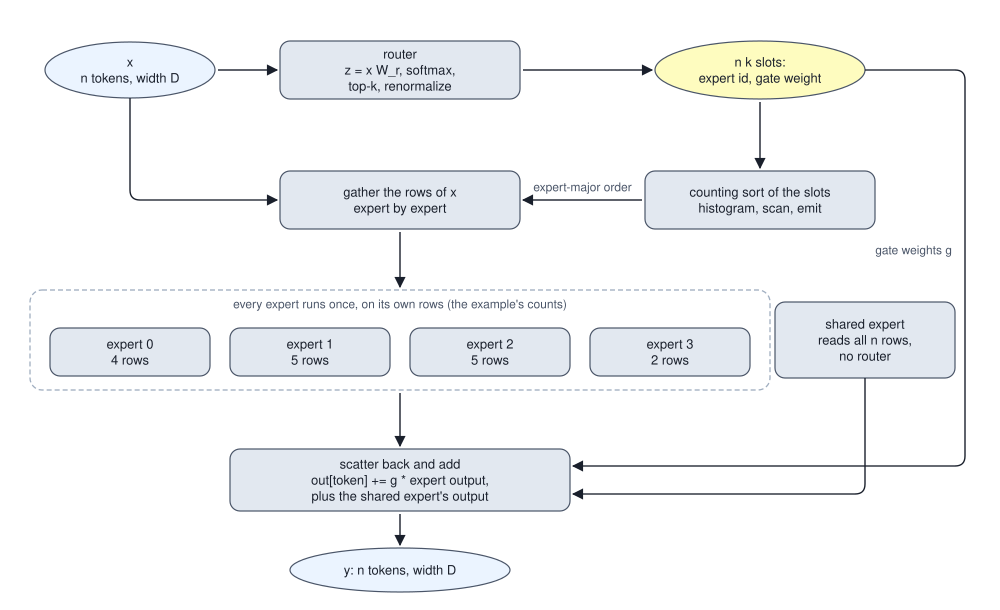
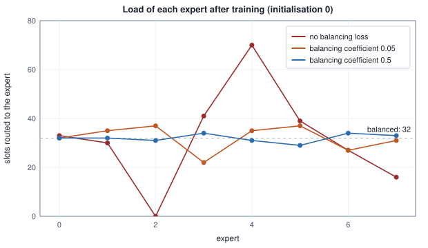

<!-- SPDX-License-Identifier: CC-BY-4.0 -->
<!-- Copyright (c) 2026 Martin Schröder <info@swedishembedded.com> -->

# Mixture of Experts

*How can a model have a trillion parameters yet use only a few billion per token?*

An open-weight mixture-of-experts model such as Qwen3.5-35B-A3B carries two numbers in its name, 35B and A3B, and both are counts of the same network's parameters. Count them from the layer shapes (the shapes that brain's `crates/qwen35moe` loads) and the first is 34,660,610,688. The second is the number of parameters whose products one token actually takes part in:

<!-- worked: mixture_of_experts.qwen_counts -->
Parameters of Qwen3.5-35B-A3B by group, and how many of them take part in the products of one token. The expert has D = 2,048 and F = 512, so 3,145,728 parameters; there are 256 per layer and 8 are used. The two token-mixer counts are inputs: a linear-attention layer is 8,192 x 2,048 + 4,096 x 2,048 + 2 x 32 x 2,048 + 8,192 x 4 + 2 x 32 + 128 + 2,048 x 4,096 parameters, a full-attention layer 8,192 x 2,048 + 2 x 512 x 2,048 + 2 x 256 + 2,048 x 4,096.

| group | parameters | used per token |
|---|---:|---:|
| token mixers (30 linear-attention layers of 33,718,464, 10 full-attention layers of 27,263,488) | 1,284,188,800 | 1,284,188,800 |
| norm gains (2 per layer and the final one) | 165,888 | 165,888 |
| input embedding table (248,320 x 2,048) | 508,559,360 | 0 |
| output matrix (2,048 x 248,320) | 508,559,360 | 508,559,360 |
| routers (40 x 256 x 2,048 and 40 shared-expert gate vectors of 2,048) | 21,053,440 | 21,053,440 |
| shared experts (40 x 3,145,728) | 125,829,120 | 125,829,120 |
| routed experts (40 x 256 x 3,145,728; a token uses 8 of the 256) | 32,212,254,720 | 1,006,632,960 |
| total | 34,660,610,688 | 2,946,429,568 |

Total over used: 11.76. In billions: 34.66 and 2.95.
<!-- /worked -->

The model holds 11.76 times more numbers than a token touches, and nearly all the difference sits in one group of the table: the routed experts, 32.2 billion parameters of which a token meets 1.0 billion. That group raises four questions: what it is, how a token finds the part of it that is meant for it, what goes wrong when the finding is left to chance, and what the arrangement does to the bytes a device must hold and the bytes it must read.

The new layer is built from six earlier ideas; each comes back as a one-line question.

1. (Volume V, [Chapter 9](../v05-sequences/09-transformer-block.md), the gated feed-forward network.) How many parameters and how many FLOPs per token does a SwiGLU network of model width $D = 2{,}048$ and hidden width $F = 512$ have?
2. (Volume III, [Chapter 3](../v03-neural-networks/03-softmax.md), the softmax.) What are the two outputs of a softmax whose logits are $(0, \ln 3)$?
3. (Volume II, [Chapter 3](../v02-learning/03-logistic-regression.md), the sigmoid.) What are $\sigma(0)$ and $\sigma(\ln 3)$, and which softmax output equals $\sigma(z)$?
4. (Volume I, [Chapter 16](../v01-mathematics/16-algorithms.md), the prefix sum.) What is the exclusive scan of the counts $[3, 0, 2, 4]$?
5. (Volume IV, [Chapter 3](../v04-computation/03-roofline.md), arithmetic intensity.) A weight matrix in bf16 multiplies the vector of one token. How many FLOPs does it do per byte of weights read, and is that product bound by bandwidth or by arithmetic?
6. (Volume V, [Chapter 12](../v05-sequences/12-kv-cache.md), the decode phase.) What does each decode step read, and how many tokens does it produce for a sequence?

## Many feed-forward networks, and a token visits a few

The table above counts parameters, and it makes visible a fact that every dense model hides: the parameters of a layer and the FLOPs it spends on a token are the same number up to a factor of 2. A dense feed-forward network of the kind in Chapter 9 of Volume V has $3DF$ parameters, and a token's pass through it is three matrix-vector products, $6DF$ FLOPs, two for each parameter. To get more capacity in such a layer you widen it, and every token pays for every added parameter.

A mixture of experts breaks that tie. Keep not one feed-forward network in the layer but $E$ of them, side by side and all of the same shape, and let each token use only $k$ of them. Each of these networks is an **expert**. (The word promises nothing about knowledge: an expert is an ordinary SwiGLU network that no one assigned a topic, and what, if anything, it comes to be good at is decided by training.) The layer then has $E$ times the parameters of one network, while a token's pass costs $k$ times the FLOPs of one:

<!-- worked: mixture_of_experts.layer_counts -->
Model width D = 2,048; an expert is a SwiGLU network with three matrices, 3 D F parameters and 6 D F FLOPs per token (2 FLOPs per parameter that takes part in a product). The router of a mixture is a D by E matrix, 2 D E FLOPs per token. 'Parameters per used parameter' is the total parameters divided by the parameters a token uses (FLOPs divided by 2).

| layer | parameters | FLOPs per token | parameters per used parameter |
|---|---:|---:|---:|
| dense, hidden width 512 | 3,145,728 | 6,291,456 | 1.00 |
| dense, hidden width 4,096 (8 experts' width) | 25,165,824 | 50,331,648 | 1.00 |
| dense, hidden width 131,072 (256 experts' width) | 805,306,368 | 1,610,612,736 | 1.00 |
| mixture, 256 experts, 8 per token | 805,830,656 | 51,380,224 | 31.37 |
| mixture, 256 experts, 8 per token, 1 shared | 808,976,384 | 57,671,680 | 28.05 |
<!-- /worked -->

Read the last two rows against the third. A dense layer of the hidden width that gives 805,306,368 parameters costs 1,610,612,736 FLOPs per token. The mixture layer with the same number of parameters, 256 experts of width 512, costs 51,380,224, which is the 8 experts' worth of arithmetic (50,331,648) and the router, a matrix of $D \times E$ weights whose product with the token costs $2DE = 1{,}048{,}576$ FLOPs. The router is 2 percent of the cost, and it is what makes the choice possible. A **shared expert**, explained below, is one more expert that every token uses; it brings the layer to 808,976,384 parameters and 57,671,680 FLOPs, 28.05 parameters for every one a token uses. (The model of the opening has one more vector in each layer, the 2,048 numbers of the gate of its shared expert, which this table leaves out.)


The figure draws the same count as a picture, with both axes on logarithmic scales so that a width growing by factors of two takes equal steps. A dense layer has to climb the diagonal, so more parameters mean proportionally more arithmetic. A mixture of $k$ experts used per token stands almost vertically at one value of arithmetic, and each added expert raises it only by the thin amount the router grows by. That vertical line is the whole proposal: capacity bought without compute. It is also a proposal with a cost somewhere else, since all the parameters must live in memory and, at decode, many of them must be read; the saving is of FLOPs, not of bytes held.

What makes it usable is the choice. If a token used experts at random no expert could become suited to any kind of token, and if every token chose the same $k$ experts the others would be dead weight. The layer needs a function from the token to the experts that suit it, and, since it must be trained, one that can be improved by gradient descent.

## A router that picks by score

That function is a **router**: a linear map from the token's hidden vector to one number per expert, followed by a choice. For a token $\mathbf{x}$ of width $D$ (a row, as in Chapter 9 of Volume V), the router has a matrix $\mathbf{W}_{\mathrm{r}}$ of shape $[D, E]$ and produces one logit for each expert, $\mathbf{z} = \mathbf{x}\mathbf{W}_{\mathrm{r}}$. A softmax of the logits turns them into scores $p_e$ that are positive and sum to 1, and the token goes to the $k$ experts with the largest scores. That selection is **top-k gating**. The experts' outputs are combined with weights that come from the same scores. The smallest example that shows every step has $E = 4$, $k = 2$, a width of 3, and experts so small (a hidden width of 1) that each number can be printed:

<!-- worked: mixture_of_experts.router_scores -->
Token x = (1.0, -1.0, 0.5), model width D = 3, E = 4 experts, k = 2. The router has one weight vector per expert (the columns of $\mathbf{W}_{\mathrm{r}}$, written as rows here); the logit of expert $e$ is the dot product $x \cdot r_e$. 'exp(z - max)' is the numerator of the stable softmax of Volume III, Chapter 3.

| e | router vector $r_e$ | logit z | exp(z - max) | softmax p | chosen |
|---|---:|---:|---:|---:|---:|
| 0 | (0.8, 0.1, -0.2) | 0.6000 | 0.4274 | 0.2427 | rank 2 |
| 1 | (-0.4, 0.9, 0.3) | -1.1500 | 0.0743 | 0.0422 | - |
| 2 | (0.5, -0.6, 0.7) | 1.4500 | 1.0000 | 0.5679 | rank 1 |
| 3 | (0.2, 0.2, 0.2) | 0.1000 | 0.2592 | 0.1472 | - |

The two chosen experts are 2 and 0, with probabilities 0.5679 and 0.2427, which sum to 0.8106. Dividing each by that sum gives the combine weights (0.7006, 0.2994). The softmax of the two chosen logits alone is (0.7006, 0.2994); the two agree to below 1e-12 in absolute value, as the algebra below shows they must.
<!-- /worked -->

Experts 2 and 0 are chosen, with probabilities 0.5679 and 0.2427. The other two scores are thrown away, so the chosen probabilities no longer sum to 1, and a layer that combined them as they are would change the scale of its output with whatever mass the router happened to leave on the experts it did not choose. The standard remedy is to divide the chosen scores by their sum, which is a renormalization: with $\mathcal{E}_i$ the set of experts chosen by token $i$ and $e_r$ its $r$-th choice, the combine weight of the $r$-th choice is

$$
g_{ir} = \frac{p_{i e_r}}{\sum_{e \in \mathcal{E}_i} p_{ie}}, \qquad p_{ie} = \frac{\mathrm{e}^{z_{ie}}}{\sum_{j} \mathrm{e}^{z_{ij}}} .
$$

The denominator of the softmax is the same for every expert, so it cancels in the ratio: $g_{ir} = \mathrm{e}^{z_{ie_r}} / \sum_{e\in\mathcal{E}_i}\mathrm{e}^{z_{ie}}$. The renormalized weights are the softmax of the chosen logits alone, which the last sentence of the table's text confirms numerically. Two things follow. The weights depend on the unchosen experts not at all, so the only influence the unchosen logits have on the layer's output is through who is chosen. And the gradient of the layer's output with respect to an unchosen logit is zero, a fact the balancing loss below must work around.

Now the experts. Each chosen expert is run on the token and the results are added with the weights, $\mathbf{y} = \sum_{r=0}^{k-1} g_{ir}\,\mathrm{ffn}_{e_r}(\mathbf{x})$ with $\mathrm{ffn}_e(\mathbf{x}) = (\mathrm{silu}(\mathbf{x}\mathbf{W}^{e}_{\mathrm{gate}}) \odot \mathbf{x}\mathbf{W}^{e}_{\mathrm{up}})\mathbf{W}^{e}_{\mathrm{down}}$:

<!-- worked: mixture_of_experts.combine_by_hand -->
The experts of the example have hidden width 1: expert $e$ has a gate column, an up column and a down row of 3 numbers each (gate columns (1,0,1), (0,1,0), (0.5,-0.5,0.5), (1,1,1); up columns (0.5,0,1), (1,0,1), (1,1,1), (0,1,0); down rows (1,0,-1), (0,1,0), (-1,0.5,1), (0.5,0.5,0.5), for experts 0 to 3). With one hidden unit, $a = x \cdot$ gate column, $u = x \cdot$ up column, $h = \mathrm{silu}(a)\,u$ and the expert's output is $h$ times the down row. The chosen experts are those of the router table above, summed in rank order.

| e | a | u | silu(a) | h | expert output | weight | weight x output |
|---|---:|---:|---:|---:|---:|---:|---:|
| 2 | 1.2500 | 0.5000 | 0.9716 | 0.4858 | (-0.486, 0.243, 0.486) | 0.7006 | (-0.340, 0.170, 0.340) |
| 0 | 1.5000 | 1.0000 | 1.2264 | 1.2264 | (1.226, 0.000, -1.226) | 0.2994 | (0.367, 0.000, -0.367) |

Routed sum $y = \sum_e g_e\,\mathrm{ffn}_e(x)$ = (0.027, 0.170, -0.027).

The shared expert (gate column (0.2,0.4,-0.2), up column (1,0,1), down row (0.5,-0.5,0.5)) has a = -0.3000, u = 1.5000, h = -0.1915 and output (-0.096, 0.096, -0.096). Added unweighted: (-0.069, 0.266, -0.123). Added with the sigmoid gate of Qwen3.5 (gate vector (0.3,0.3,0.6), logit 0.3000, sigmoid 0.5744): (-0.028, 0.225, -0.082).
<!-- /worked -->

The routed sum is the vector $(0.027, 0.170, -0.027)$. Gradient descent reaches the router through the weights $g_{ir}$ alone: the choice itself is a discrete step with no derivative, and the weight is the one differentiable thing the router contributes, so an expert is rewarded or punished for what it did when chosen, and the router learns to put weight where it helps. Whether it learns to *choose* the experts that help is a second-order effect of those weights moving, and it is the reason the layer can drift.

## Scoring with a sigmoid, and a bias that steers without weighing

A softmax makes the experts compete: raising one score lowers the others, and the scores always sum to 1. A router may score each expert on its own instead, with a sigmoid, $s_e = \sigma(z_e)$, and the scores then do not sum to anything in particular. The choice is still the $k$ largest scores and the weights are still normalized by the sum of the chosen ones, but the weights are no longer a softmax of anything: where the softmax's weights for two experts depend on the difference of their logits, the sigmoid's depend on each logit separately.

The sigmoid router brings one more freedom. Selection may use a second quantity, a bias $b_e$ per expert, in the choice $s_e + b_e$, while the combine weight uses $s_e$ alone. Same logits as before:

<!-- worked: mixture_of_experts.sigmoid_router -->
The same logits as the softmax router. A sigmoid router scores each expert on its own, $s_e = \sigma(z_e)$, so the scores need not sum to 1. Selection uses $s_e + b_e$ with the bias vector $b$ = (-0.30, 0, 0, 0.45) below; the combine weight uses $s_e$ alone, divided by the sum of the chosen scores.

| e | logit z | score s = sigmoid(z) | bias b | selection score s + b | chosen with bias |
|---|---:|---:|---:|---:|---:|
| 0 | 0.6000 | 0.6457 | -0.30 | 0.3457 | - |
| 1 | -1.1500 | 0.2405 | 0.00 | 0.2405 | - |
| 2 | 1.4500 | 0.8100 | 0.00 | 0.8100 | rank 2 |
| 3 | 0.1000 | 0.5250 | 0.45 | 0.9750 | rank 1 |

Without the bias the sigmoid router chooses experts 2 and 0 with weights (0.5564, 0.4436); the softmax router chose 2 and 0 with weights (0.7006, 0.2994). With the bias it chooses 3 and 2 with weights (0.3932, 0.6068): the bias moved expert 0 out and expert 3 in, and neither weight contains it.
<!-- /worked -->

The sigmoid router, with no bias, chooses the same two experts as the softmax router and weights them (0.5564, 0.4436) where the softmax weighted them (0.7006, 0.2994): the sigmoid scores 0.8100 and 0.6457 are closer together than the softmax probabilities of the same logits. The softmax's ratio of two scores is the exponential of their logit difference, 2.34 for these two, and the sigmoid's ratio, 1.25, depends on each logit on its own. With the bias, expert 0 drops out and expert 3, with a bias of 0.45, takes first place, and the weights (0.3932, 0.6068) contain no trace of the bias.

That separation is the point of the construction, as Wang and colleagues (2024) used it. A bias that only steers can be moved at will, after every batch, up for an expert that received too few tokens and down for one that received too many, without ever entering the layer's output or its gradient: the load can be balanced without adding a term to the loss, an **auxiliary-loss-free** way to balance, and an added term has costs of its own, counted below. The router of GLM-5.2 in `crates/glmdsa` has exactly this form, and its bias is an input that brain loads and never trains.

## From a token to a batch: sorting slots by expert

One token is easy and a batch is the problem. The layer's output is a sum over experts, and the obvious way to compute it, for each expert, for each token, multiply by the gate (zero for the unchosen) and add, evaluates every expert on every token and throws most of the results away. That is the *dense masked* form, and it computes the right answer at $E/k$ times the FLOPs. The sparse form evaluates each expert only on the tokens that chose it, which needs the tokens grouped by expert, and the grouping must be done by the machine without knowing the loads in advance.

Number the choices. A batch of $n$ tokens makes $nk$ **slots**, slot $s = k\,i + r$ being the $r$-th choice of token $i$. The input of the grouping is one number per slot, the expert it names. The grouping itself is a counting sort, and it is the one of Volume I, Chapter 16 and Volume IV, Chapter 7: a histogram of the experts, an exclusive scan of the counts to find where each expert's block begins, and an emission that writes each slot into its expert's block, in order, so that within an expert the slots stay in ascending order and every run produces the same permutation. The example below does it for a layer of 4 experts and 8 tokens:

<!-- worked: mixture_of_experts.dispatch_trace -->
Generator: the book's SplitMix64, seed 0xb13db7aa1edab310 (`seed_of` of the name `mixture_of_experts.dispatch`). A layer of E = 4 experts, k = 2, model width D = 4, expert hidden width F = 3, and a batch of n = 8 tokens. Draws, in order: the router $\mathbf{W}_{\mathrm{r}}$ (4 x 4, row-major), then for e = 0 to 3 the matrices $\mathbf{W}_{\mathrm{gate}}$ (4 x 3), $\mathbf{W}_{\mathrm{up}}$ (4 x 3) and $\mathbf{W}_{\mathrm{down}}$ (3 x 4), each row-major, each entry 0.5 `normal()`, then the batch (8 x 4, row-major, `normal()`). Routing is the softmax router: top-2 of the softmax, renormalized.

| token | x | chosen experts | combine weights |
|---|---:|---:|---:|
| 0 | (-1.38, 0.98, 0.09, -0.05) | 1, 2 | (0.761, 0.239) |
| 1 | (0.51, 0.87, -0.03, 1.45) | 2, 1 | (0.559, 0.441) |
| 2 | (-2.51, 1.00, 0.72, -1.11) | 1, 0 | (0.793, 0.207) |
| 3 | (-0.54, 0.32, -0.02, 0.98) | 1, 2 | (0.621, 0.379) |
| 4 | (0.65, -0.84, 0.73, 0.28) | 3, 2 | (0.582, 0.418) |
| 5 | (-0.70, -0.28, -0.62, -1.00) | 0, 3 | (0.751, 0.249) |
| 6 | (0.27, 0.24, -1.25, 0.18) | 2, 0 | (0.518, 0.482) |
| 7 | (-2.72, -0.60, -0.63, -2.44) | 0, 1 | (0.875, 0.125) |

Slot $s = k\,i + r$ is the $r$-th choice of token $i$ (rank 0 is the largest score). The expert of each slot, in slot order, is the input of the counting sort:

| slot | token | expert |
|---|---:|---:|
| 0 | 0 | 1 |
| 1 | 0 | 2 |
| 2 | 1 | 2 |
| 3 | 1 | 1 |
| 4 | 2 | 1 |
| 5 | 2 | 0 |
| 6 | 3 | 1 |
| 7 | 3 | 2 |
| 8 | 4 | 3 |
| 9 | 4 | 2 |
| 10 | 5 | 0 |
| 11 | 5 | 3 |
| 12 | 6 | 2 |
| 13 | 6 | 0 |
| 14 | 7 | 0 |
| 15 | 7 | 1 |

Histogram of the experts, its exclusive scan, and the permutation that lists the slots expert by expert (ascending slot number within an expert, so the order is the same on every run):

| expert | count | offset | slots in expert-major order | tokens |
|---|---:|---:|---:|---:|
| 0 | 4 | 0 | 5, 10, 13, 14 | 2, 5, 6, 7 |
| 1 | 5 | 4 | 0, 3, 4, 6, 15 | 0, 1, 2, 3, 7 |
| 2 | 5 | 9 | 1, 2, 7, 9, 12 | 0, 1, 3, 4, 6 |
| 3 | 2 | 14 | 8, 11 | 4, 5 |

Each expert runs once on its own tokens (16 expert evaluations in all). Evaluating every expert on every token and multiplying by a gate that is zero for the unchosen ones takes 32. The two layer outputs are bit for bit equal: yes (both add the experts' contributions to a token in the order e = 0, 1, 2, 3).
<!-- /worked -->

The permutation lists the slots expert by expert, and the experts' blocks start at 0, 4, 9 and 14: the scan of the counts $(4, 5, 5, 2)$. Everything after that is ordinary. Gather the rows of $\mathbf{X}$ named by an expert's block into a dense sub-batch, run the expert's three matrix products on that sub-batch (a matrix-matrix product, with the dense efficiency of Chapter 6 of Volume IV, because the rows are now contiguous), and add each result row, scaled by its gate weight, into the output row of its token. In the book's pseudocode:

```text
function moe_layer(X: array<real>[n, D], Wr: array<real>[D, E],
                   Wgate: array<real>[E, D, F], Wup: array<real>[E, D, F],
                   Wdown: array<real>[E, F, D], k: int) -> array<real>[n, D]:
    require 1 <= k and k <= E, "k experts of E"
    Z = matmul(X, Wr)                                   # router logits [n, E]
    chosen = zeros(int, [n, k])
    gate = zeros(real, [n, k])
    for i in 0 .. n:
        p = softmax(Z[i, :])
        order = argsort(p, descending)                  # ties keep the lower index first
        total = 0.0
        for r in 0 .. k:
            chosen[i, r] = order[r]
            total = total + p[order[r]]
        for r in 0 .. k:
            gate[i, r] = p[order[r]] / total
    count = zeros(int, [E])                             # histogram of the n k slots
    for s in 0 .. n * k:
        count[chosen[s // k, s mod k]] = count[chosen[s // k, s mod k]] + 1
    start = zeros(int, [E])                             # exclusive scan of the counts
    for e in 1 .. E:
        start[e] = start[e - 1] + count[e - 1]
    fill = copy(start)
    perm = zeros(int, [n * k])                          # stable emission, slot order
    for s in 0 .. n * k:
        e = chosen[s // k, s mod k]
        perm[fill[e]] = s
        fill[e] = fill[e] + 1
    Y = zeros(real, [n, D])
    for e in 0 .. E:                                    # each expert on its own rows
        if count[e] == 0:
            continue
        slots = perm[start[e] : start[e] + count[e]]
        tokens = [s // k for s in slots]
        Xe = rows(X, tokens)
        O = matmul(map(silu, matmul(Xe, Wgate[e, :, :])) * matmul(Xe, Wup[e, :, :]),
                   Wdown[e, :, :])
        for j in 0 .. count[e]:
            s = slots[j]
            Y[s // k, :] = Y[s // k, :] + gate[s // k, s mod k] * O[j, :]
    return Y
```

Check the dispatch against the form it replaces. The last paragraph of the worked table says the two layer outputs are equal bit for bit, and the reason is an order: the dense form adds the contribution of every expert $e = 0, 1, 2, 3$ to a token, and the unchosen ones add exactly zero (a gate of zero times a finite number is zero, and $y + 0 = y$ in IEEE arithmetic), so the only additions that change anything are the chosen experts', in ascending expert order; the loop above visits the experts in that same order. A dispatch that added in another order, as a parallel scatter does, would agree to rounding and not bit for bit, which is why `crates/kernels/wgsl/moe_group_combine.wgsl` is written the other way round: one invocation per output element, gathering its token's $k$ contributions and summing them itself in ascending order, because a single launch over every expert cannot let several invocations add into one output row without atomics.



The figure shows where the work and the irregularity are. Everything above the dashed group has a size fixed by $n$ and $k$ alone; the sizes inside the group, the rows each expert receives, depend on the data. That dependence is the central engineering fact of the layer, because it means that how long the layer takes, and whether it fits in a buffer, are decided by the router's behavior on this batch. What the router tends to do on its own is the next question.

## A router left alone drifts

A router starts with random weights, and a random router sends tokens somewhere. Whether it sends them *evenly* depends on how much the tokens differ. Take 1,024 tokens, 8 experts, $k = 2$, and a router drawn at random. Make each token $\mathbf{x}_i = s\boldsymbol{\mu} + \boldsymbol{\varepsilon}_i$, a part $\boldsymbol{\mu}$ shared by every token plus the token's own noise, and turn the dial $s$ that sets how large the shared part is. No particular value of $s$ is claimed for a trained model; the dial turns the question of how much tokens share into a parameter, and shows what each value does to a router that has not learned anything:

<!-- worked: mixture_of_experts.collapse -->
Generator: the book's SplitMix64, seed 0xc58e6adf723ecddd (`seed_of` of the name `mixture_of_experts.collapse`). E = 8, k = 2, D = 16, n = 1024 tokens. Draws, in order: the router $\mathbf{W}_{\mathrm{r}}$ (16 x 8, row-major, `normal()`), the shared direction $\mu$ (16 values), then the noise $\varepsilon_i$ of the 1024 tokens (1024 x 16, row-major). Token $i$ is $x_i = s\mu + \varepsilon_i$, and the same draws are used for every $s$. The selection is the top 2 of $x_i \mathbf{W}_{\mathrm{r}}$ (the softmax does not change the order). A balanced router sends 256 slots to every expert; 'starved' counts the experts with fewer than 64.

| s | e0 | e1 | e2 | e3 | e4 | e5 | e6 | e7 | largest / ideal | slots to the 2 busiest | starved |
|---|---:|---:|---:|---:|---:|---:|---:|---:|---:|---:|---:|
| 0.0 | 230 | 237 | 286 | 326 | 203 | 263 | 237 | 266 | 1.27 | 29.9% | 0 |
| 0.5 | 86 | 302 | 302 | 439 | 384 | 165 | 321 | 49 | 1.71 | 40.2% | 1 |
| 1.0 | 21 | 317 | 269 | 494 | 537 | 73 | 336 | 1 | 2.10 | 50.3% | 2 |
| 2.0 | 2 | 295 | 165 | 561 | 735 | 7 | 283 | 0 | 2.87 | 63.3% | 3 |
<!-- /worked -->

With no shared part, the loads are uneven only by chance: the largest expert gets 1.27 times its fair share, and no expert is starved. With the shared part as large as the noise ($s = 1$) two experts receive almost nothing and the two busiest take 50.3 percent of the slots; at $s = 2$ three experts are starved and the two busiest take 63.3 percent. The mechanism is the one-line algebra of a dot product: the logit of expert $e$ is $\mathbf{x}\cdot\mathbf{r}_e = s\,\boldsymbol{\mu}\cdot\mathbf{r}_e + \boldsymbol{\varepsilon}\cdot\mathbf{r}_e$, and the first term is the same for every token, so whichever experts it favors are favored for everyone until the second term, which is different for each token, is large enough to overturn it. Multiplying the router matrix by a constant does not help, since it scales both terms alike and leaves the ranking as it was.

Training makes it worse, not better, because the loop is closed: an expert that receives more tokens gets more gradient, learns faster, produces better outputs for the tokens it sees, is rewarded with a larger gate weight, and the router moves toward it. An expert that receives none gets no gradient at all and nothing ever pulls it back. The training experiment below shows it happening, in its sharpest form: experts that end with no slot at all.

Two costs follow from an uneven load, and they differ. A starved expert wastes its parameters: they are held in memory and read by no one, and the layer is smaller than it was paid for. A hot expert wastes time: in the dispatch above, the layer cannot finish until the biggest group does, and on several devices each holding some experts the device with the hot expert is the one everyone waits for. For the second, early systems (Lepikhin et al. 2021) fixed the shape of the computation ahead of time with a **capacity**: each expert accepts at most $c_{\mathrm{cap}} = \lceil \mathrm{cf}\cdot n k / E \rceil$ slots, where the **capacity factor** $\mathrm{cf} \ge 1$ is the headroom over a perfectly even load, and a slot beyond the capacity is dropped (the token goes on without that expert, through the residual connection of its block). The same loads, with three capacities:

<!-- worked: mixture_of_experts.capacity -->
The loads of the previous table with a capacity of ceil(factor x n k / E) slots per expert; with n = 1024, k = 2, E = 8 the capacity is, by factor, 1.00: 256, 1.25: 320, 2.00: 512. A slot beyond an expert's capacity is dropped (its token goes on without that expert). Entries are the number of slots dropped out of 2048.

| s | factor 1.00 | factor 1.25 | factor 2.00 |
|---|---:|---:|---:|
| 0.0 | 117 | 6 | 0 |
| 0.5 | 468 | 184 | 0 |
| 1.0 | 673 | 407 | 25 |
| 2.0 | 850 | 656 | 272 |
<!-- /worked -->

A factor of 1 drops 117 of 2,048 slots even with no shared part, 5.7 percent, because a random router is never exactly even, and 850 slots, 41.5 percent, when the router has drifted ($s = 2$). A factor of 2 drops none for $s = 0$ and $s = 0.5$, 25 slots at $s = 1$ and 272 at $s = 2$, and it pays for that by sizing every expert's buffer at twice the even load. Dropping changes the function the layer computes (the dropped token gets a smaller sum, and the renormalization made before the drop no longer sums to 1), so it is a trade of quality for a fixed shape, and brain makes the other choice. A capacity exists to bound the memory of a training step; at inference no buffer has to be sized for the worst batch in advance, so none of the dispatch paths in `crates/model/src/moe.rs` takes a capacity, and the trainer of `crates/toymoe` runs with capacity dropping disabled as well. The drift is therefore a matter of speed and wasted parameters there, and never of a different answer.

## A loss that asks for equal loads

Dropping tokens treats a symptom. The cause is a router that does not spread its choices, so the remedy is to give the router a reason to spread. That is **load balancing**, and the usual way is an extra term in the loss, added to the training loss and minimized with it.

The term must measure how uneven the loads are. The load of expert $e$ is a count of slots, and its share is $f_e = n_e/(nk)$, a number between 0 and 1 with $\sum_e f_e = 1$. Taking $\sum_e f_e^2$ would be a natural measure (it is smallest, $1/E$, when every share is $1/E$), but a count is piecewise constant in the router's logits: a small change in a logit changes no count, and the derivative is zero almost everywhere. Something smooth must carry the gradient, and the router offers it: the probability that the softmax gave to each expert, averaged over the batch, $\bar p_e = \frac{1}{n}\sum_i p_{ie}$, which also sums to 1. The loss uses both, the count as a weight and the probability as the variable:

$$
\mathcal{L}_{\mathrm{bal}} = \alpha_{\mathrm{bal}}\, E \sum_{e=0}^{E-1} f_e\,\bar p_e .
$$

This is the form of the Switch Transformer paper (Fedus, Zoph and Shazeer 2022), which wrote it for $k = 1$; here $f_e$ divides by $nk$ so that it sums to 1 for any $k$. Three pairs of load shares and mean probabilities show how it behaves:

<!-- worked: mixture_of_experts.balance_values -->
E = 4, k = 2, $\alpha_{\mathrm{bal}} = 1$: the loss $E\sum_e f_e\bar p_e$ on three pairs of load shares $f$ and mean probabilities $\bar p$.

| case | f | $\bar p$ | loss |
|---|---:|---:|---:|
| balanced: every expert gets a quarter of the slots and of the probability | (0.25, 0.25, 0.25, 0.25) | (0.25, 0.25, 0.25, 0.25) | 1.000 |
| two experts take every slot, probabilities follow | (0.50, 0.50, 0.00, 0.00) | (0.45, 0.45, 0.05, 0.05) | 1.800 |
| the same loads, probabilities moved off the busy experts | (0.50, 0.50, 0.00, 0.00) | (0.05, 0.05, 0.45, 0.45) | 0.200 |
<!-- /worked -->

When every expert gets a quarter of the slots and of the probability the loss is exactly $\alpha_{\mathrm{bal}}$: $E \cdot E \cdot \frac1E \cdot \frac1E = 1$, and the factor $E$ is there to make that minimum independent of the number of experts. When the probabilities follow the loads, $\bar p = f$, the loss is $E\sum_e f_e^2$, and the Cauchy-Schwarz inequality $(\sum_e f_e)^2 \le E \sum_e f_e^2$ says that it is at least 1, with equality only for equal shares: a load of $(0.5, 0.5, 0, 0)$ costs 1.8. The third row is not a floor, though: if the probabilities are moved *off* the busy experts the loss is 0.2, well below 1. That is the mechanism by which the loss does its work, not a flaw in it. Its gradient treats $f$ as a constant, and with respect to one probability it is

$$
\frac{\partial \mathcal{L}_{\mathrm{bal}}}{\partial p_{ie}} = \frac{\alpha_{\mathrm{bal}}\, E\, f_e}{n},
$$

a penalty on each token's probability for an expert, proportional to how loaded that expert is. Through the softmax of Chapter 3 in Volume III, $\partial\mathcal{L}/\partial z_{ij} = p_{ij}\bigl(\partial\mathcal{L}/\partial p_{ij} - \sum_e p_{ie}\,\partial\mathcal{L}/\partial p_{ie}\bigr)$, which for this loss is

$$
\frac{\partial \mathcal{L}_{\mathrm{bal}}}{\partial z_{ij}} = \frac{\alpha_{\mathrm{bal}}\,E}{n}\; p_{ij}\Bigl(f_j - \sum_e p_{ie} f_e\Bigr).
$$

Read the bracket: the load of expert $j$ minus the load the token itself expects, its probability-weighted average. A step against the gradient lowers the logit of an expert whose load is above that average and raises it for one below, for every token, in proportion to the token's own probability. Probabilities shift off the busy experts, the top-$k$ selection follows them, the counts $f$ change at the next batch, and the loss has moved the load. The loop of the previous section, which fed the rich, now has a force against it.

This is also why the loss is built from the full softmax and not from the renormalized weights. The weights, as derived above, do not depend on the unchosen logits, so a loss made of them would never move an expert that is not chosen; the starved expert would stay starved. The probabilities $\bar p_e$ come from the full softmax, and a starved expert still has one, so the loss is the only gradient path that reaches it. A one-line check from the formula: an expert with $f_j = 0$ has a negative bracket whenever any other expert is loaded, so its logit is raised.

A gradient this central is worth checking, and it is cheap: a seeded batch of 6 tokens, held loads, and central differences of the loss (balancing term and the z-loss below) with respect to every logit:

<!-- worked: mixture_of_experts.balance_gradient -->
Generator: the book's SplitMix64, seed 0x3de106539b2613e7 (`seed_of` of the name `mixture_of_experts.aux`). n = 6 tokens, E = 4, k = 2; the logits are the 6 x 4 draws of `normal()`, row-major. $\alpha_{\mathrm{bal}} = 0.5$ and the z-loss coefficient is 0.1. The shares $f_e$ are counted once and held fixed in the loss. Token 0's row of the gradient with respect to the logits, from the formula derived in the text and from central differences with step 1e-6.

| e | f | $\bar p$ | logit of token 0 | formula | central difference |
|---|---:|---:|---:|---:|---:|
| 0 | 0.2500 | 0.2971 | 0.0795 | 0.006246 | 0.006246 |
| 1 | 0.0000 | 0.1389 | -1.7126 | -0.001621 | -0.001621 |
| 2 | 0.3333 | 0.2915 | 1.1378 | 0.033342 | 0.033342 |
| 3 | 0.4167 | 0.2726 | 0.2353 | 0.019744 | 0.019744 |

Loss 0.743111 (balancing term 0.570001). Over all 24 entries the largest difference between formula and central difference is below 1e-6 (criterion: below 1e-6).
<!-- /worked -->

The formula agrees with the central differences on all 24 logits to better than the criterion. The table also reads as the formula says. Token 0's gradient for expert 3, which holds 0.4167 of the slots, is positive (0.019744, so a descent step lowers its logit), and for expert 1, which holds none, it is negative (-0.001621, so a descent step raises it).

The z-loss that the table also includes is a second, smaller term that the engine's router carries: $\mathcal{L}_z = c_z \cdot \frac{1}{n}\sum_i \bigl(\log\sum_j \mathrm{e}^{z_{ij}}\bigr)^2$, the squared log-sum-exp of the logits. It does not balance anything. It keeps the logits small so that the softmax does not saturate, and its gradient is $c_z \cdot 2\,\mathrm{lse}_i\, p_{ij}/n$ per logit. Both terms are summed into one router gradient in `crates/kernels/wgsl/router_bwd.wgsl`, whose header gives the same two formulas.

## Training eight experts with and without it

The claim to test is the one the earlier section made: without the term a router starves experts, and with it the loads even out, at no great cost. A mixture small enough that every run can be printed in full is a single layer, without attention: tokens of 6 numbers from 6 clusters, each token's target a linear map specific to its cluster, 8 experts of hidden width 4, $k = 2$, trained with Adam (Volume III, Chapter 7) on the squared error.

The data are the 128 tokens of a seeded set (generator `mixture_of_experts.train_data`, drawing the 6 cluster centers, then the 6 maps, then for each token a cluster by `integer(6)` and 6 values of `normal()` noise of scale 0.3 around the center; the target is the token times its cluster's map, summed left to right). The model starts from `normal()` draws of scale 0.3 for every weight, in the order of the router, then for each expert its gate, up and down matrices, and learns with Adam at step size 0.02 ($\beta_1 = 0.9$, $\beta_2 = 0.999$, $\epsilon = 10^{-8}$, no weight decay) for 300 full-batch steps; the gradient flows to the router through the gate weights and, for the balancing term, as derived above, with $f$ taken from the current batch. The table gives, for three strengths of the balancing loss and three initializations, the slots each expert receives when the trained router is run over the 128 training tokens, and the final training loss. Every cell is printed in full: each run was repeated from four starting points that differ by $10^{-12}$ in the first router weight, and all five agreed on every digit.

<!-- worked: mixture_of_experts.balance_training -->
Generator: the book's SplitMix64, seed 0x5c2b293e47ebeb66 (`seed_of` of the name `mixture_of_experts.train_data`). The data: 6 cluster centers, each 6 draws of `normal()` (scale 1); then 6 maps of 6 x 6 entries, each `normal() / sqrt(6)`, row by row; then for each of the 128 tokens the cluster `integer(6)` and 6 values of `0.3 * normal()` added to the center. The initial weights are `0.3 * normal()`. Slots per expert after 300 steps, on the 128 training tokens, for three strengths of the balancing loss and three initializations (each initialization is the generator `mixture_of_experts.train_init.<seed>`, with seed 0: 0xb816802ecb2d0aa2, 1: 0x9c56f19d7e7a1ad1, 2: 0x525c7b0e4177616a). A balanced router has 32 slots per expert. The last column is the training loss, half the squared error summed over the 6 outputs and averaged over tokens, as computed in the forward pass of step 300 (with the weights before that step's update, not the final weights); the slots are counted with the final router. A number that comes from a chaotic run is printed with only the digits that are the same in the run and in four copies of it whose first weight is changed by +1e-12, -1e-12, +3e-12 and -3e-12: in full if all agree on it, as 'about x' with the leading digits on which all agree, or as 'unstable' when not even one digit survives; the other digits cannot be reproduced in another implementation.

| $\alpha_{\mathrm{bal}}$ | seed | e0 | e1 | e2 | e3 | e4 | e5 | e6 | e7 | loss |
|---|---:|---:|---:|---:|---:|---:|---:|---:|---:|---:|
| 0.00 | 0 | 33 | 30 | 0 | 41 | 70 | 39 | 27 | 16 | 0.0221 |
| 0.00 | 1 | 36 | 38 | 46 | 0 | 0 | 40 | 74 | 22 | 0.0598 |
| 0.00 | 2 | 37 | 27 | 0 | 16 | 51 | 34 | 46 | 45 | 0.0231 |
| 0.05 | 0 | 32 | 35 | 37 | 22 | 35 | 37 | 27 | 31 | 0.0211 |
| 0.05 | 1 | 22 | 34 | 52 | 38 | 31 | 25 | 28 | 26 | 0.0406 |
| 0.05 | 2 | 33 | 35 | 31 | 20 | 33 | 39 | 40 | 25 | 0.0198 |
| 0.50 | 0 | 32 | 32 | 31 | 34 | 31 | 29 | 34 | 33 | 0.0201 |
| 0.50 | 1 | 32 | 33 | 32 | 32 | 32 | 28 | 35 | 32 | 0.0302 |
| 0.50 | 2 | 26 | 35 | 33 | 33 | 31 | 34 | 31 | 33 | 0.0297 |
<!-- /worked -->

The first group (no balancing loss) leaves experts with no slot at all in all three runs: expert 2 in seeds 0 and 2, experts 3 and 4 in seed 1, and the busiest expert holds 70, 74 and 51 slots against a fair share of 32. With a coefficient of 0.05 the smallest loads are 22, 22 and 20 and the largest 37, 52 and 40, no expert is dead, and with 0.5 the loads are within 26 to 35 of one another, close to the fair 32. The loss column is not hurt by the term at the weaker strength: with 0.05 it is lower than without in all three seeds (0.0211 against 0.0221, 0.0406 against 0.0598, 0.0198 against 0.0231). At 0.5 it is lower in two of the three; that is three seeds on a problem of 128 tokens, a demonstration that the term does its work and costs nothing here, and not a measurement of its price in a language model.



The figure plots the loads of the first initialization for all three. The picture is the argument in miniature: the red line is the rich-get-richer loop, and each blue and orange line is the same model with a force opposing it.

An added loss has a cost that the table did not measure: its coefficient is a choice that trades the pressure for balance against the pressure for the task, and a large coefficient makes the router spread tokens for the sake of spreading them. This is the reason for the auxiliary-loss-free alternative of the sigmoid router above, in which the bias moves the load and the loss is the task's alone (Wang et al. 2024).

## Experts every token needs

Some of what a model must compute is needed by every token: the common patterns that all texts share. If that function lives in a routed expert, one of two things happens. The router learns to send every token to that expert, which then has a load of $n$ where the fair share is $nk/E$, $E/k$ times the mean (32 times, at $k = 8$ of 256); or each of the experts learns its own copy of the common function and the layer pays for $E$ copies of what one would do. Neither is a good use of the layer.

The remedy, due to Dai and colleagues (2024), is a **shared expert**: an expert outside the routing, applied to every token, whose output is added to the routed sum. The router then has no reason to build a hot expert, and the routed experts are left to be useful where tokens differ. Its cost is exact and constant: one more expert's FLOPs per token (the last row of the first table) and one more expert's parameters to hold. It also has one practical advantage under expert parallelism, below: since every token uses it, it can be replicated on every device and needs no exchange at all.

There are two forms in brain, and the by-hand example above computed both. `crates/glmdsa` adds the shared expert unweighted, $\mathbf{y} = \sum_e g_e\,\mathrm{ffn}_e(\mathbf{x}) + \mathrm{ffn}_{\mathrm{shared}}(\mathbf{x})$, and `crates/qwen35moe` scales it by a learned scalar per token, $\sigma(\mathbf{x}\cdot\mathbf{w}_{\mathrm{sg}})$, a sigmoid gate of 2,048 numbers per layer: for the token of the example the unweighted sum is $(-0.069, 0.266, -0.123)$ and the gated one, with a gate of 0.5744, is $(-0.028, 0.225, -0.082)$. The gate lets the model decide token by token how much of the shared function to use, at the price of a vector of parameters.

The argument for a shared expert given here is about load and parameters. What it buys in loss would take a training experiment like the one in the previous section, with the compute held equal.

## Experts on different devices

A model with 60 GiB of experts does not fit on one small device, and the experts are the natural thing to split across several: put $E/n_{\mathrm{dev}}$ experts on each of $n_{\mathrm{dev}}$ devices and give each device its own share of the batch. This is **expert parallelism**. Each device can only run its own experts, so a token on one device whose chosen expert lives on another must be sent there, computed, and the result sent back. The exchange, in which every device sends a different piece to every other, is an **all-to-all**. The counting-sort dispatch happens twice, once across devices to bring tokens to their experts and once on each device to group them. A small case shows the counts:

<!-- worked: mixture_of_experts.all_to_all_tiny -->
The routing of the dispatch example split over 2 devices: tokens 0 to 3 live on device 0 and tokens 4 to 7 on device 1; experts 0 and 1 live on device 0 and experts 2 and 3 on device 1. Entry (a, b) counts the slots of tokens on device a whose expert is on device b.

| tokens on | experts on device 0 | experts on device 1 |
|---|---:|---:|
| device 0 | 5 | 3 |
| device 1 | 4 | 4 |

7 of the 16 slots cross between devices. At a model width of 2,048 in bf16 a slot is 4,096 bytes, so the exchange sends 28,672 bytes to the experts and receives the same number of bytes of results back.
<!-- /worked -->

Seven of the sixteen slots cross a device boundary, and a slot is one hidden vector, $D$ numbers: at the model's width of 2,048 in bf16 (2 bytes) that is 4,096 bytes a slot, and 28,672 bytes each way. Uniform routing sends a fraction $1 - 1/n_{\mathrm{dev}}$ of a device's slots elsewhere, so a device with $n$ tokens exchanges $n k (1 - 1/n_{\mathrm{dev}}) \cdot 2D$ bytes each way per layer, and this is a quantity that grows with the batch while a device's expert weights, $(E/n_{\mathrm{dev}})\cdot 3DF$ numbers, do not:

<!-- worked: mixture_of_experts.all_to_all -->
The expert layer of Qwen3.5-35B-A3B (E = 256, k = 8, D = 2,048, F = 512) on $n_{\mathrm{dev}}$ devices, each holding E / $n_{\mathrm{dev}}$ experts and a batch of n = 4,096 tokens, uniform routing, bf16 (2 bytes). A token's k slots go to the devices of their experts; a slot stays home with probability $1 / n_{\mathrm{dev}}$. 'MiB sent' is per device, per layer, one direction (the results return the same number of bytes). 'Both ways / weights' divides twice that by the expert weights a device holds. The last column is the n at which that ratio is 1: $n^\ast = 3EF / (2k(n_{\mathrm{dev}}-1))$.

| devices | experts per device | share of slots leaving | MiB sent | MiB of expert weights | both ways / weights | $n^\ast$ |
|---|---:|---:|---:|---:|---:|---:|
| 2 | 128 | 0.5000 | 64.0 | 768.0 | 0.167 | 24,576 |
| 4 | 64 | 0.7500 | 96.0 | 384.0 | 0.500 | 8,192 |
| 8 | 32 | 0.8750 | 112.0 | 192.0 | 1.167 | 3,511 |
| 16 | 16 | 0.9375 | 120.0 | 96.0 | 2.500 | 1,638 |
| 32 | 8 | 0.9688 | 124.0 | 48.0 | 5.167 | 793 |

With 8 devices one pass over all 40 layers moves 8.75 GiB, counting both directions, through each device's network port.
<!-- /worked -->

The exchange per layer is of the same order as the weights the device holds, and it crosses over: setting twice the one-way bytes equal to the weight bytes gives $n^\ast = 3EF/(2k(n_{\mathrm{dev}} - 1))$, which falls as devices are added. Beyond that many tokens per device, moving the tokens costs more bytes than moving the experts would have. The all-to-all also inherits the imbalance of the router: every device waits for the one that receives the most slots, so a hot expert is not only a hot GEMM but a hot link, which is a second reason to want balance and a reason that this layer is where load balancing matters most. The `crates/qwen35moe` crate of brain splits a model across devices by layers instead (`crates/qwen35moe/src/shard.rs`), which keeps every layer's experts together and needs no all-to-all, and Volume XIII returns to all the parallelisms with their exchanges counted.

## What a decode step reads

A mixture of experts is advertised by its active parameters, and for the arithmetic that is right. For a decode step, which Chapter 12 of Volume V showed to be bound by the bytes it reads, the right number is different, because a step reads weights, and which weights it reads depends on how many sequences it serves.

One sequence's token needs the router, the shared expert and its $k$ chosen experts: 5.49 GiB over the whole model, against the 64.56 GiB that must be resident (the bytes of the totals in the opening, at 2 bytes each). Each token costs the bytes of its active parameters, and the memory needed is the total's: the cost the FLOPs count hid. Now serve $n$ sequences in one step. Each reads its own experts, but two sequences that choose the same expert share one read of its weights, so the step reads each distinct chosen expert once. With uniform routing the expected number of distinct experts is $E\,(1 - (1 - k/E)^n)$:

<!-- worked: mixture_of_experts.decode_bytes -->
One expert layer of Qwen3.5-35B-A3B at decode (E = 256, k = 8, one shared expert, D = 2,048, F = 512, bf16), n sequences each producing one token, uniform routing. Bytes read: the router, the shared expert and the expected number of distinct routed experts, $256\,(1 - (1 - 8/256)^n)$, each once. FLOPs: every token uses 8 routed experts, the shared expert and the router. The dense layer has the same active width (9 experts' worth, 28,311,552 parameters), reads all of it and does $2$ FLOPs per parameter per token, so its intensity is exactly n FLOPs per byte.

| n | distinct routed experts | MiB read | mixture FLOPs per byte | dense FLOPs per byte | ratio |
|---|---:|---:|---:|---:|---:|
| 1 | 8.0 | 55.0 | 1.00 | 1.00 | 1.000 |
| 2 | 15.8 | 101.5 | 1.08 | 2.00 | 0.542 |
| 4 | 30.5 | 190.2 | 1.16 | 4.00 | 0.289 |
| 8 | 57.4 | 351.5 | 1.25 | 8.00 | 0.156 |
| 16 | 102.0 | 618.8 | 1.42 | 16.00 | 0.089 |
| 32 | 163.3 | 986.9 | 1.78 | 32.00 | 0.056 |
| 64 | 222.4 | 1341.7 | 2.62 | 64.00 | 0.041 |
| 128 | 251.6 | 1516.6 | 4.64 | 128.00 | 0.036 |
| 256 | 255.9 | 1542.5 | 9.13 | 256.00 | 0.036 |
| 512 | 256.0 | 1543.0 | 18.25 | 512.00 | 0.036 |
| 1,024 | 256.0 | 1543.0 | 36.50 | 1024.00 | 0.036 |
| 4,096 | 256.0 | 1543.0 | 146.00 | 4096.00 | 0.036 |

Tokens per step needed to reach a given arithmetic intensity (FLOPs per byte of weights read):

| target intensity | n, dense | n, mixture |
|---|---:|---:|
| 16 | 16 | 449 |
| 64 | 64 | 1796 |
| 256 | 256 | 7182 |

Whole model, n = 1: a token's products read 5,892,859,136 bytes of weights (5.49 GiB) while 69,321,221,376 bytes (64.56 GiB) must be resident.
<!-- /worked -->

At $n = 1$ the mixture and a dense layer of the same active width read nearly the same bytes and do the same FLOPs per byte (the intensity of Chapter 3 of Volume IV, 1.00 FLOPs per byte for bf16 weights and one token: the matrix-vector product of the opening questions). A dense layer's intensity then grows as $n$, since it reads its weights once and uses them $n$ times. The mixture's does not: its step reads more experts as $n$ grows, and it stops growing when all 256 are read (at about $n = 256$ here, 255.9 expected) and from there its intensity is approximately $n\,(k+1)/(E+1)$ FLOPs per byte (9 of the 257 expert-sized pieces that are read are used by each token; the router's small matrix adds a little to both counts, so the table's own ratio is 0.036), about 28 times lower than the dense layer's. The second table puts it as a batch size: to reach an intensity of 64 FLOPs per byte, taken as an example of a ridge point (a real device's is read from its own roofline, Chapter 3 of Volume IV), a dense layer needs 64 sequences in the step and the mixture needs 1,796.

This is the roofline reading of the idea. At small batches a mixture of experts is as cheap to run as a dense model of its *active* size, and it is the best case: the bytes read per token are the active parameters and nothing more. At large batches it is bound by its bytes more than the dense model is, and to use the arithmetic of a large device it must be fed a batch $E/k$ times larger, which is a reason that serving a sparse model well is about batching. The capacity it buys is paid for in resident memory at every batch size.

## The mixture layer in brain's three crates

The history of brain begins with a mixture of experts, and a commit shows it. The repository's first commit holds only a README; the second, commit `1fa53524c` (23 June 2026, message "moe-rs: add shaders"), adds a Rust, GPU-kernel implementation of a small sparse mixture-of-experts transformer, with its router kernels (`router_gate.wgsl`, `router_gate_train.wgsl`), the combine step (`scale_add.wgsl`), the expert-load kernel (`expert_counts.wgsl`) and a router backward that already includes both the balancing term and the z-loss. A day later commit `d9bfa70d4` split that project into the workspace of crates the engine still has, with the model in a crate named moe, today `crates/toymoe`. Its README at `1fa53524c` records the dense masked choice for dispatch: the engine evaluates all experts and masks each by the renormalized gate, "numerically identical to sparse top-k dispatch without capacity dropping", for $E = 4$ and $k = 2$ only twice the expert FLOPs.

### A model born with a router

`crates/toymoe` is that model, with $E = 4$, $k = 2$, width 64 and expert width 128 in two layers. Its router is `router_gate_train.wgsl`: softmax, top-$k$ by repeated search, renormalization (the engine calls the two options `norm` and `scale`, and the toy passes 1 and 1.0), and the experts are evaluated densely, all four on every token, each multiplied by its gate column, exactly the dense masked form described above (`crates/toymoe/src/train.rs`, `layer_forward`). The balancing term is not in the scalar the trainer reports, which is the cross-entropy alone. It appears only in the router's gradient, where `crates/kernels/wgsl/expert_counts.wgsl` computes $f_e = n_e/(nk)$ by counting the rows whose gate for the expert is positive, and `router_bwd.wgsl` adds $\alpha_{\mathrm{bal}}\,E f_e/n$ to the gradient of each probability, as the derivation did. The defaults are 0.01 for the balancing coefficient and $10^{-4}$ for the z-loss. The finite-difference gate of this trainer is `check_moe` and `check_moe_balance` in `crates/gradcheck`, and they differentiate the loss that the backward differentiates, not the scalar that `forward()` reports. A difference of the reported cross-entropy cannot see a term that is not in it, so the checker evaluates the router's two terms on the host, from the router logits and the selections the trainer exposes (`read_router_state`), with nonzero coefficients, and adds them to the reported loss: the balancing term as $\alpha_{\mathrm{bal}}\,E \sum_e f_e \bar p_e$ with the fractions $f_e$ held fixed, as the backward holds them, and the z-loss as its coefficient times the mean squared log-sum-exp. Two configurations are needed, because of the selection. With $k = E$ no top-$k$ boundary falls inside a step, which is what a check of the whole model wants, but every expert then takes the same $1/E$ of the slots and $\sum_e f_e \bar p_e$ is the constant $1/E$, so the balancing term has no gradient and only the z-loss is live. The balancing term is checked with $E = 4$ and $k = 2$, the router weights scaled up so that the gap between the second and third logit stays clear of the step, every entry of every layer's router weight differenced one at a time, and a guard that stops the check by name if a perturbation ever moves the selection. A second test leaves the term out of the host loss and requires the same check to fail, which is what makes its agreement evidence.

### Dispatch in four tiers

`crates/qwen35moe` is the real shape: 256 routed experts of width 512, $k = 8$, a softmax router that renormalizes, and a shared expert of width 512 scaled by $\sigma(\mathbf{x}\cdot\mathbf{w}_{\mathrm{sg}})$, in each of 40 layers (`Qwen35Config::qwen35_35b_a3b` in `crates/qwen35moe/src/config.rs`); the counts of the opening come from that configuration's parameter list. Its MoE sublayer, `moe_sublayer` in `crates/qwen35moe/src/model.rs`, picks a dispatch by what it is asked to do, and each tier is the answer to a cost the dense masked form would pay:

- **Training** runs each expert on the rows routed to it only (`MoeActs::compact` and `experts_fwd_train` in `crates/model/src/moe.rs`): the gate is read back once per layer, each expert's rows are gathered, computed and scattered back gate-scaled, and the activations saved for the backward pass are $nk$ rows a layer instead of $nE$. The backward uses `moe_layer_bwd`, whose phases (the experts' gate gradients, then the router, then the experts' weight gradients) must run in that order, because the router's gradient needs the whole row of gate gradients that the experts write first, and the router's own input gradient must be the first write into the token's gradient before the experts add theirs.
- **Decode of one token** reads back only the $k$ chosen expert ids, 8 words instead of 256, and runs the five steps of an expert (`expert_fwd`) for each of the 8: in the commit that introduced it, `07c1be259`, the dense loop of 256 experts and 5 steps each was 1,291 dispatches per MoE layer against 52 after, a count and not a time (256 times 5 is 1,280 of the first, 8 times 5 is 40 of the second).
- **Prefill and batches in floating point** use `expert_fwd_grouped`, commit `fceae9f6c` (5 September 2026), with no host readback: the router writes the $k$ chosen ids, a kernel counts the rows and the GEMM tiles of every expert, two scans turn the counts into offsets, a kernel emits the permutation and its inverse, one gather brings the rows into expert order, one grouped matrix product per projection serves all experts in a single launch, and a combine kernel sums each token's $k$ contributions. The launch has to be sized before the counts are known, and the commit's message records the argument that makes it possible: every row picks exactly $k$ experts, so there are $nk$ slots, and since $\lceil c/b \rceil \le c/b + 1$ for any count $c$ and tile height $b$, the tile grid never exceeds $E + \lceil nk/b\rceil$ (here 256 + 256 = 512 for $n = 4{,}096$, $k = 8$, $b = 128$), so the grid is sized for that worst case and each workgroup finds its tile in the scanned table.
- **8-bit weights** (and the 4-bit floating-point format of released checkpoints) route on the device in a kernel, `moe_router_topk.wgsl`, that writes for each token its $k$ expert ids and weights and, as slot $k$, the shared expert, whose weight is its sigmoid; so the shared expert rides through the same expert matrix products as a ninth slot. The grouped variant of the counting sort of the dispatch section is three kernels, `moe_route_count`, `moe_route_scan` and `moe_route_emit`, with their cost analyzed in Chapter 7 of Volume IV, and commit `4084aa37d` (2 October 2026) added them with the claim, checked by a test against a host counting sort, that they are stable, atomic-free and need no readback.

One more fact about this crate is what it does *not* train: its backward pass hands the router the coefficients 0.0 and 0.0, so a fine-tune of this model carries no balancing term. The model's experts are trained, the routing is learned through the gate weights, and balance is left to what the pretrained router already had.

### A sigmoid router with a bias it does not train

`crates/glmdsa` builds GLM-5.2 (`GlmConfig::glm5_2()` in `crates/glmdsa/src/config.rs`): 78 layers, the first 3 of them dense and the rest mixtures of 256 routed experts of width 2,048 with $k = 8$, one shared expert added unweighted, and a router of the form of the sigmoid section: scores $\sigma(z_e)$, selection by score plus a per-expert bias, a weight that is the unbiased score normalized by the chosen sum and multiplied by a `routed_scaling_factor` of 2.5. The kernel `router_gate_sigmoid.wgsl` also takes `n_group` and `topk_group`, a group-limited selection (the experts split into groups, the best groups kept by the sum of their two best scores, and the top-$k$ taken inside them); the published configuration sets both to 1, which turns the restriction off. The bias is a parameter, `moe.router.bias`, imported from the checkpoint's `e_score_correction_bias`; it is marked frozen when the model trains (`Glm::build`), and its default is 0.0 (`crates/glmdsa/src/init.rs`). The checkpoint's trainer moved this bias by a load-balancing rule and not by gradient descent, so brain holds it as the trainer left it: the bias steers selection exactly as the sigmoid section described, and it moves only when a new checkpoint is imported.

### Three bounds that were one literal

The router kernels carry a story that is a bug in three installments. In commit `1fa53524c` the backward kernel, `router_bwd.wgsl`, had a header line "E <= 64" and two local arrays of 64 floats indexed by the expert number: a shader language that does not check a bound writes past the end of such an array and goes on. The forward router kernels had arrays of the same size. Commit `e3019d191` (7 August 2026) records the first fix. A limit constant had been raised from 64 to 128 for a model with 128 experts, but the arrays inside the shader were separate literals that the change never touched, so every expert index from 64 up wrote past the end of a 64-element array; routing was silently corrupted for the upper half of the experts, "with no existing test catching it", the message says, because the tests used 8 experts. The commit raised the arrays to 128, which left a cap in place, and the 256 experts of Qwen3.5-35B-A3B exceeded it: commit `7fbbfce60` (9 August) removed the arrays from the backward kernel, `595d1ad72` (9 August) from the forward ones, and `3037848de` (2 September) from the sigmoid router. What remains in the kernels is an array bounded by $k$ and never by $E$ (`router_gate.wgsl` keeps `sel_idx`, at most 32 entries, and holds the softmax numerators in its own output buffer), and the lesson, in the words of the message of `595d1ad72`, is that an oracle built from the same composition as the code (sparse against dense, both through the same router) is blind to exactly this class of error. The regression tests, `crates/model/tests/it/router_gate_expert_cap.rs` and its siblings for the backward and the sigmoid router, compare the kernels with an independent host top-k at expert counts past the old limits.

## Check your understanding

1. A router sends 1,024 tokens, $k = 2$, to 8 experts and the loads are $(2, 295, 165, 561, 735, 7, 283, 0)$. Which experts are starved, and what is the largest load divided by the even load?
2. A student argues that the balancing loss can be made from the renormalized weights $g_{ir}$ instead of the full softmax, since those are what the layer uses. What goes wrong for an expert that no token chooses?
3. In the third row of the table of the balancing loss the loss is 0.2, below its value for equal loads. Explain why this is not a state the layer can stay in, and what changes in the next batch.
4. A mixture has $E = 64$ experts and $k = 4$, each of 3 million parameters. State the parameters and the FLOPs per token of the experts, and the ratio to a dense layer that uses the same FLOPs.
5. Find the error: "The mixture reads fewer bytes per decode step than a dense model of its active size, whatever the batch, since only $k$ experts are used per token."
6. Why does the all-to-all of expert parallelism count slots and not tokens, and what does a token that chooses two experts on the same device cost?
7. The renormalized gate equals the softmax of the chosen logits. What, then, is the gradient of the layer's output with respect to the logit of an expert that was not chosen?

## Summary

A mixture of experts replaces the feed-forward network of a block with $E$ of them and a router that sends each token to $k$. Parameters grow with $E$ and FLOPs with $k$: Qwen3.5-35B-A3B holds 34.66 billion parameters and uses 2.95 billion of them per token. The router is a matrix, a softmax or a sigmoid, and a top-$k$ selection; the chosen scores are renormalized, which makes the weights a softmax of the chosen logits and the unchosen logits invisible to the output. A batch is computed by grouping its $nk$ slots by expert with a counting sort (histogram, scan, emission), running each expert on its rows and adding the weighted results back in a fixed order.

Left alone a router drifts: tokens share a component, the experts that component favors take the load and the others starve, which wastes their parameters and makes the biggest group set the pace. The balancing loss $\alpha_{\mathrm{bal}}E\sum_e f_e\bar p_e$ acts on the full softmax through the mean probabilities, with the loads as constant weights, and the tiny trained mixture ends with dead experts without it and every expert used with it. A bias that steers selection without entering the weights balances without a loss; a shared expert takes the function every token needs out of the routing. Across devices the experts are exchanged by an all-to-all whose bytes grow with the batch, and in a decode step the weights read grow with the number of distinct experts chosen, so a sparse model has the intensity of a dense one only at a batch $E/k$ times larger.

The layer between two mixtures is still attention, whose cost grows with the context: Chapter 3 shrank its cache, and Chapter 5 asks whether the cost can be made linear in the context, and what is lost.

## References

- Noam Shazeer, Azalia Mirhoseini, Krzysztof Maziarz, Andy Davis, Quoc Le, Geoffrey Hinton and Jeff Dean, "Outrageously large neural networks: the sparsely-gated mixture-of-experts layer", 2017 (the layer of experts and a router with a top-$k$ choice and a softmax over the chosen scores, and the first auxiliary balancing terms).
- Dmitry Lepikhin, HyoukJoong Lee, Yuanzhong Xu, Dehao Chen, Orhan Firat, Yanping Huang, Maxim Krikun, Noam Shazeer and Zhifeng Chen, "GShard: scaling giant models with conditional computation and automatic sharding", 2021 (top-2 routing, the expert capacity and expert parallelism over many devices).
- William Fedus, Barret Zoph and Noam Shazeer, "Switch Transformers: scaling to trillion parameter models with simple and efficient sparsity", 2022 (one expert per token, the capacity factor, and the balancing loss $\alpha N\sum f_i P_i$).
- Damai Dai and colleagues, "DeepSeekMoE: towards ultimate expert specialization in mixture-of-experts language models", 2024 (many small experts and shared experts).
- Lean Wang and colleagues, "Auxiliary-loss-free load balancing strategy for mixture-of-experts", 2024 (a selection bias moved by the observed load, with no term added to the loss).

## Exercises

1. **[Calculate]** A layer has $D = 1{,}024$, experts of hidden width $F = 256$, $E = 64$ and $k = 6$. Give the parameters of the experts and of the router, the FLOPs per token, and the dense hidden width with the same FLOPs.
2. **[Calculate]** The router logits of a token are $(1.0, 0.0, -1.0, 0.5)$ and $k = 2$. Give the softmax scores, the chosen experts, and the renormalized weights, and show that the weights equal the softmax of the two chosen logits.
3. **[Calculate]** Six tokens choose, in order, the experts $(0,1), (0,2), (0,1), (1,0), (0,2), (2,0)$ of a layer with $E = 3$. Compute the histogram, the exclusive scan and the stable permutation of the 12 slots (slot $2i + r$).
4. **[Calculate]** For $n = 4{,}096$ tokens, $E = 64$, $k = 4$, how many slots does an expert receive at an even load, and how many are dropped at a capacity factor of 1.25 if one expert receives 700?
5. **[Calculate]** Differentiate $\mathcal{L}_{\mathrm{bal}}$ with respect to the logit $z_{ij}$ for $n = 1$, $E = 2$, $k = 1$ and a held load $f = (1, 0)$. What is the sign of each partial derivative and what does a descent step do to the two logits?
6. **[Calculate]** With $E = 128$, $k = 8$, $D = 4{,}096$, bf16 and $n_{\mathrm{dev}} = 16$, how many bytes does one device send in one direction per layer for a batch of $n = 2{,}048$ tokens under uniform routing?
7. **[Implement]** Implement the routine `moe_layer` above in your language and reproduce the table of the worked example `mixture_of_experts.dispatch_trace`: the draws and their order, the routing, the histogram, the scan and the permutation, and the check that the dispatched output equals the dense masked one bit for bit.
8. **[Implement]** Reproduce `mixture_of_experts.balance_gradient`: the loss with the loads held fixed, its gradient from the formula, and a central-difference check of every entry against the criterion of the table.
9. **[Implement]** Reproduce one row of `mixture_of_experts.collapse`: the draw order, the top-2 selection and the loads, and add a fifth value of $s$ of your choice.
10. **[Implement]** Reproduce one run of `mixture_of_experts.balance_training` (the first initialization, no balancing loss), with the data, the initial weights, the backward pass of the gate weights and Adam, and report the final loads and the number of experts with no slot; the digits of your loads and loss should match the table.
11. **[Investigate]** Replace the balancing loss of the training example by the bias method: after every step, raise the selection bias of an expert whose load is below the even load by 0.01 and lower it by 0.01 if above, with the bias used for selection only. Compare the loads with the table.
12. **[Investigate]** Take the layer of `mixture_of_experts.decode_bytes` without its shared expert, and a variant with twice as many experts of half the width ($E = 512$, $F = 256$, $k = 16$, the same parameters and the same active parameters). Find the MiB read at $n = 1$ and the smallest $n$ that reaches 64 FLOPs per byte for each, and explain the difference.

## Key terms

- **expert**: one of several feed-forward networks of the same shape inside a layer, each used only by the tokens that are routed to it; the word does not say what it knows. <!-- concept: expert -->
- **router**: the small linear map, followed by a softmax or a sigmoid, that scores every expert for a token so that a selection can be made. <!-- concept: router -->
- **top-k gating**: choosing the $k$ experts with the largest router scores for a token and combining their outputs with weights that come from those scores, normalized to sum to 1. <!-- concept: top-k-gating -->
- **load balancing**: any way of making the experts receive about equal numbers of tokens, by an added loss on the router's probabilities or by a selection bias moved with the observed load. <!-- concept: load-balancing -->
- **shared expert**: an expert outside the routing that every token uses, whose output is added to the routed sum, so that what all tokens need is not copied across the routed experts. <!-- concept: shared-expert -->
- **expert parallelism**: placing different experts of a layer on different devices, so that tokens are exchanged between devices by an all-to-all to reach their experts and returned with the results. <!-- concept: expert-parallelism -->

## Answers

**Recall questions.**

1. $3DF = 3 \cdot 2{,}048 \cdot 512 = 3{,}145{,}728$ parameters, and $6DF = 6{,}291{,}456$ FLOPs per token.
2. $\mathrm{softmax}(0, \ln 3) = (1/4, 3/4)$, since $\mathrm{e}^0 = 1$ and $\mathrm{e}^{\ln 3} = 3$.
3. $\sigma(0) = 1/2$ and $\sigma(\ln 3) = 3/4$; $\sigma(z) = \mathrm{e}^z/(1 + \mathrm{e}^z)$ is the second output of $\mathrm{softmax}(0, z)$.
4. $[0, 3, 3, 5]$ (the total, 9, is the number of items).
5. 1 FLOP per byte: each weight takes 2 bytes and is used for one multiply and one add, 2 FLOPs. That is far below the ridge point of any device, so the product is bound by bandwidth.
6. It reads all the weights of the model (and the cached keys and values of the sequence) to produce one token for each sequence in the step.

**Check your understanding.**

1. The experts with fewer than a quarter of the even load of 256, that is below 64, are 0 (2 slots), 5 (7) and 7 (0): three starved experts. The largest, 735, over 256 is 2.87.
2. The renormalized weights are a softmax of the chosen logits only, so they do not depend on an unchosen logit: a loss built from them has zero gradient for an expert no token chooses, and that expert stays starved. The full softmax gives every expert a probability and so a gradient.
3. The loss treats $f$ as constant and acts on the probabilities, and 0.2 is what it would be if the probabilities were moved off the busy experts while the loads stayed; it is a value of the function, not a state the layer can hold. As the probabilities move, the top-$k$ selection follows them and in the next batch the loads $f$ move too, which changes the weights in the loss. The value 1 is a floor only when $\bar p = f$.
4. Parameters $64 \cdot 3\text{M} = 192$M; FLOPs per token $2 \cdot 4 \cdot 3\text{M} = 24$M (plus the router, $2 \cdot 64 D$). A dense layer with the same FLOPs has $4 \cdot 3\text{M} = 12$M parameters, 16 times fewer ($E/k$).
5. It reads the same bytes only at a batch of 1. At a larger batch the step reads every distinct expert once, up to all $E$, while a dense layer of the active size reads its weights once; the mixture reads up to $E/k$ times more bytes for the same arithmetic per token.
6. A slot is one hidden vector sent for one expert, and the count above sends one vector per slot. A token that chooses two experts on the same remote device costs two vectors in this count; an implementation that merges them sends one, at the price of a more complicated exchange. Each vector is $2D$ bytes in bf16, in each direction.
7. Zero: the weights do not depend on it. The only influence of an unchosen logit on the layer is through the selection, which is discrete.

**Exercises.**

1. Expert parameters $3 \cdot 1{,}024 \cdot 256 = 786{,}432$ each, times 64 is 50,331,648; router $1{,}024 \cdot 64 = 65{,}536$. FLOPs per token $2(6 \cdot 786{,}432 + 65{,}536) = 9{,}568{,}256$ for the 6 experts and the router; the dense hidden width with the same expert FLOPs is $6 \cdot 256 = 1{,}536$.
2. $\mathrm{e}^{1}, \mathrm{e}^0, \mathrm{e}^{-1}, \mathrm{e}^{0.5}$ are 2.7183, 1, 0.3679, 1.6487, sum 5.7349, scores (0.4740, 0.1744, 0.0641, 0.2875). The chosen experts are 0 and 3. Their sum is 0.7615, weights (0.6224, 0.3776); the softmax of the logits (1.0, 0.5) is $\mathrm{e}^{1}/(\mathrm{e}^1 + \mathrm{e}^{0.5}) = 2.7183/4.3670 = 0.6224$.
3. The experts of the slots in order are 0, 1, 0, 2, 0, 1, 1, 0, 0, 2, 2, 0. Counts (6, 3, 3), starts (0, 6, 9), permutation $(0, 2, 4, 7, 8, 11, 1, 5, 6, 3, 9, 10)$.
4. The even load is $4{,}096 \cdot 4/64 = 256$; the capacity is $\lceil 1.25 \cdot 256 \rceil = 320$; $700 - 320 = 380$ slots are dropped.
5. $\partial\mathcal{L}/\partial z_{0} = (\alpha E/n)\,p_0(f_0 - \sum_e p_e f_e) = 2\alpha p_0(1 - p_0)$ and $\partial\mathcal{L}/\partial z_1 = 2\alpha p_1(0 - p_0) = -2\alpha p_0 p_1$. The first is positive and the second negative, so descent lowers the logit of the loaded expert 0 and raises that of expert 1.
6. $2{,}048 \cdot 8 \cdot (15/16) \cdot 4{,}096 \cdot 2 = 125{,}829{,}120$ bytes, 120 MiB.
7. Your table should show the dispatched output equal to the dense masked one bit for bit, with the permutation and counts of the worked block.
8. Report the largest absolute difference against the 1e-6 criterion.
9. Your loads at $s = 0, 0.5, 1, 2$ should be those of the table; a larger $s$ should give a larger largest-over-even ratio and more starved experts.
10. The first initialization without balancing: loads (33, 30, 0, 41, 70, 39, 27, 16), one expert with no slot, loss 0.0221.
11. The result is yours to report; no measurement of the bias method is given above, and the expectation from its description is that the loads move toward 32 each without a term in the loss.
12. At $n = 1$ the original reads 49.0 MiB and the variant 50.0 MiB; 64 FLOPs per byte takes $n = 2{,}008$ for the original and $n = 1{,}969$ for the variant (uniform routing, bf16, $D = 2{,}048$). The router of the variant is twice as large and is read in full at every step, which is the 1 MiB at $n = 1$; the narrower experts are picked from a larger set, so a batch touches slightly more of the layer's weights per useful FLOP in this model of uniform routing, and the batches needed differ by about 2 percent, a small effect against the factor $E/k$ that both share.
