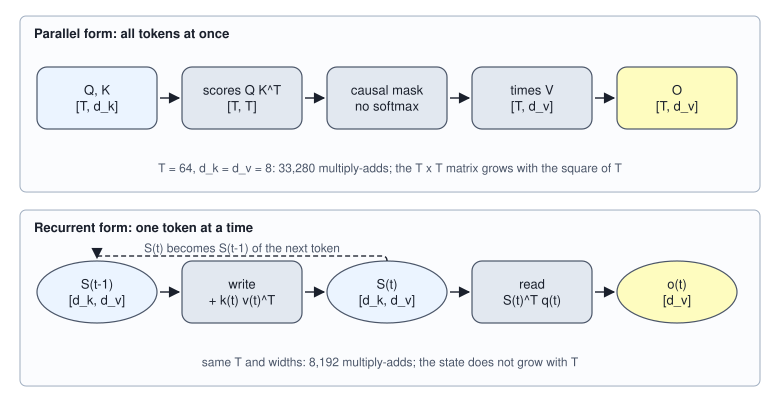
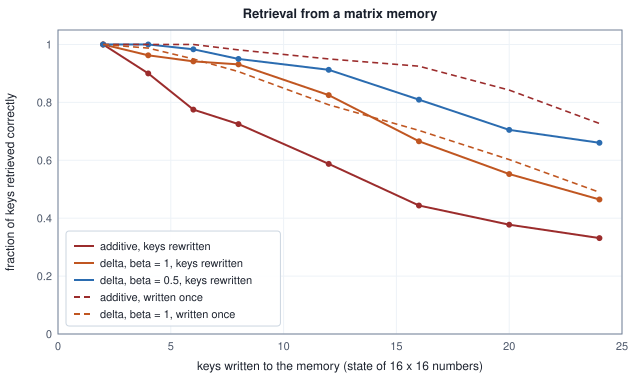

<!-- SPDX-License-Identifier: CC-BY-4.0 -->
<!-- Copyright (c) 2026 Martin Schröder <info@swedishembedded.com> -->

# Linear Attention, Recurrence and Hybrid Models

*Can attention be computed in time linear in the sequence length, and what is lost?*

One layer of the 27B decoder that `crates/qwen35` builds holds a key-value cache of 1 GiB for a sequence of 262,144 tokens. The layer next to it holds 3.1 MiB for the same sequence, and would hold the same 3.1 MiB at five tokens or at five million. Both kinds of layer are in the stack, three of the second kind and then one of the first, sixteen times over, and the table counts what each keeps.

<!-- worked: linear_attention.state_vs_cache -->
Shape of `crates/qwen35` `qwen38_27b`: model width 5,120; full attention has 4 key-value heads of width 256, so a token adds 2 x 1,024 numbers of 2 bytes (bf16) = 4,096 bytes to a full-attention layer's cache. A Gated DeltaNet layer has 48 value heads with a state of 128 x 128 numbers = 786,432 numbers, plus a convolution history of 10,240 channels x 3 numbers = 30,720, all kept in fp32 (4 bytes): 3,268,608 bytes whatever the length.

| tokens in the sequence | full-attention layer: cache bytes | Gated DeltaNet layer: state bytes | cache over state |
|---|---:|---:|---:|
| 1,024 | 4,194,304 | 3,268,608 | 1.28 |
| 8,192 | 33,554,432 | 3,268,608 | 10.27 |
| 65,536 | 268,435,456 | 3,268,608 | 82.13 |
| 262,144 | 1,073,741,824 | 3,268,608 | 328.50 |

The two are equal at 798 tokens (3,268,608 / 4,096); 262,144 is the model's `max_position_embeddings`.
<!-- /worked -->

The last column is worth reading twice. Above 798 tokens the second layer is the smaller one, and by 262,144 it is 328.5 times smaller. Below 798 tokens it is the larger, so the saving is not free at short lengths and pays only at long ones. What is that second layer, and what does it hold in its 3,268,608 bytes in place of a cache? It holds a matrix per head, which is rewritten at every token and never grows, and the rest of the chapter derives it from the attention of Volume V by removing one operation. We will meet what the removal costs, a repair of the first thing that goes wrong, a second repair for the second, an arrangement of the arithmetic that makes the layer fast to train and to prefill, and finally the counts for a stack that mixes both kinds of layer.

Six ideas from earlier chapters are needed. The answers are at the end.

1. (Volume V, [Chapter 7](../v05-sequences/07-self-attention.md), scaled dot-product attention and the causal mask.) What does row $i$ of causal attention output, written with the scores $\mathbf{q}_i\cdot\mathbf{k}_j$, and why must the layer look at every earlier key before it can write the row?
2. (Volume V, [Chapter 5](../v05-sequences/05-recurrent-networks.md), recurrent networks.) A recurrent cell carries a state $\mathbf{h}_t$ from token to token. How many sequential steps does the forward pass over $T$ tokens take, and why can a larger device not shorten that?
3. (Volume V, [Chapter 5](../v05-sequences/05-recurrent-networks.md), gating.) A forget gate of 0.9 multiplies a stored value at every step. How much of a value written 10 steps ago remains?
4. (Volume IV, [Chapter 7](../v04-computation/07-reductions.md), the parallel scan.) How many rounds does the doubling scan use for $n = 8$ items, and what property of the combining operation makes a scan valid?
5. (Volume II, [Chapter 2](../v02-learning/02-linear-regression.md), gradient descent.) For one example $(\mathbf{x}, y)$ and the loss $\tfrac12(y - \mathbf{w}\cdot\mathbf{x})^2$, what is one gradient step of rate $\eta$?
6. (Volume V, [Chapter 12](../v05-sequences/12-kv-cache.md), the KV cache.) A layer has 4 key-value heads of width 256 and stores bf16. How many bytes does a token add to the cache of one layer, and of a stack of 64 such layers?

## Attention without the softmax

Row $i$ of causal attention is a weighted average of the values of the tokens up to $i$, with weights $\mathrm{softmax}_j(\mathbf{q}_i\cdot\mathbf{k}_j/\sqrt{d_k})$ over $j \le i$. The softmax is what forces the layer to keep the whole past: the weight of key $j$ depends on every other score in the row through the denominator, so a new token's query has to be compared with every stored key, and each of those keys has to stay.

Take it out. Let each token contribute its value with the weight $\mathbf{q}_i\cdot\mathbf{k}_j$ itself, with no exponential and no normalization:

$$
\mathbf{o}_i = \sum_{j \le i} (\mathbf{q}_i \cdot \mathbf{k}_j)\,\mathbf{v}_j .
$$

This is **linear attention**: attention whose scores are used as they are, without a softmax, so that the output is a linear function of the keys and values. (Katharopoulos and colleagues, 2020, replaced the exponential by a feature map applied to queries and keys and divided by a normalizer; the version here, with no feature map, is the one the layer of this chapter uses, and the normalization question returns below.) Nothing in the formula looks different, but one regrouping changes the cost. The number $\mathbf{q}_i\cdot\mathbf{k}_j$ multiplies the vector $\mathbf{v}_j$, and a number times a vector can be written as the vector times a row times the vector $\mathbf{q}_i$:

$$
\mathbf{o}_i = \sum_{j \le i} \mathbf{v}_j\,(\mathbf{k}_j^\top\mathbf{q}_i) = \Bigl(\sum_{j \le i} \mathbf{v}_j\mathbf{k}_j^\top\Bigr)\mathbf{q}_i = \mathbf{S}_i^\top\,\mathbf{q}_i,
\qquad
\mathbf{S}_i = \sum_{j \le i} \mathbf{k}_j\mathbf{v}_j^\top .
$$

Here $\mathbf{k}_j\mathbf{v}_j^\top$ is the outer product of a key of $d_k$ numbers and a value of $d_v$, a matrix of shape $[d_k, d_v]$, and $\mathbf{S}_i$ is a sum of such matrices over the tokens so far. This chapter writes vectors as columns, as Chapter 3 did. The sum up to $i$ differs from the sum up to $i - 1$ by one term, so

$$
\mathbf{S}_i = \mathbf{S}_{i-1} + \mathbf{k}_i\mathbf{v}_i^\top, \qquad \mathbf{S}_{-1} = \mathbf{0}, \qquad \mathbf{o}_i = \mathbf{S}_i^\top\mathbf{q}_i .
$$

That is a recurrent network in the sense of Chapter 5 of Volume V, whose state is a matrix: the transition adds an outer product and there is no nonlinearity, and the output is a read of the state with the query. The two forms compute the same numbers. The parallel form builds the matrix $\mathbf{Q}\mathbf{K}^\top$, zeroes the part above the diagonal, and multiplies by $\mathbf{V}$; the recurrent form carries $\mathbf{S}$. Four tokens with whole-number inputs show that they agree, exactly.

<!-- worked: linear_attention.two_forms_by_hand -->
Four tokens, $d_k = d_v = 2$, whole-number inputs (so every number below is exact). The state rows are the rows of the $2 \times 2$ matrix $\mathbf{S}_t = \sum_{s \le t}\mathbf{k}_s\mathbf{v}_s^\top$; the recurrent output is $\mathbf{S}_t^\top\mathbf{q}_t$ and the parallel one is row $t$ of $(\mathbf{M}\odot\mathbf{Q}\mathbf{K}^\top)\mathbf{V}$.

| t | q | k | v | state S_t (rows) | o_t recurrent | o_t parallel |
|---|---|---|---|---|---|---|
| 0 | (1, 0) | (1, 0) | (1, 2) | [(1, 2), (0, 0)] | (1, 2) | (1, 2) |
| 1 | (0, 1) | (0, 1) | (3, 1) | [(1, 2), (3, 1)] | (3, 1) | (3, 1) |
| 2 | (1, 1) | (1, 1) | (0, 2) | [(1, 4), (3, 3)] | (4, 7) | (4, 7) |
| 3 | (1, -1) | (0, 1) | (2, 0) | [(1, 4), (5, 3)] | (-4, 1) | (-4, 1) |

The two forms agree exactly in all 8 numbers: yes.
<!-- /worked -->

The recurrent form is the one whose cost per token does not grow: updating $\mathbf{S}$ and reading it are $2d_kd_v$ multiply-adds, whatever the position. A larger case counts both, with the loops that perform them. Every sum below is a plain left-to-right addition in double precision, and no printed digit depends on that order.

<!-- worked: linear_attention.two_forms_random -->
Generator: the book's SplitMix64, seed 0x868810fbe9d3d0c0 (`seed_of` of the name `linear_attention.two_forms`). T = 64, d_k = d_v = 8. Draws, in order, for t = 0 to 63: q_t (8 values of `normal()`), k_t (8), v_t (8); no normalisation of any vector. Multiply-adds are counted by the loops that perform them.

| form | multiply-adds (formula) | multiply-adds counted |
|---|---|---:|
| parallel: scores, then weighted sum of values | T(T+1)/2 (d_k + d_v) | 33,280 |
| recurrent: state update, then read | 2 T d_k d_v | 8,192 |

Largest difference between the two outputs over all 512 numbers: below 1e-12 (the bound the program asserts).
<!-- /worked -->



The counts say which form to use where. The parallel form costs $T(T+1)(d_k + d_v)/2$ multiply-adds and the recurrent form $2Td_kd_v$, which for $d_k = d_v = d$ are equal at $T = 2d - 1$ and favor the parallel form below it (15 at $d = 8$, 255 at $d = 128$). Decoding one token at a time is the recurrent form's natural home: it needs the state and the new token, and nothing else. The parallel form is what a trainer wants, since it handles all positions at once as matrix products, but at lengths far above $2d$ it pays the square. This chapter returns to the middle path, which has the depth of the recurrence and the matrix products of the parallel form, after the memory has been repaired.

## What an additive memory cannot hold

The softmax did two jobs besides forcing the cache, and both are visible once it is gone. The first is scale. Softmax weights sum to 1, so each output is an average of values and cannot grow; a linear sum of $t$ terms has no such bound. The table draws unit-length queries and keys and random values, averages the output length over ten runs, and compares with softmax attention on the same vectors.

<!-- worked: linear_attention.norm_growth -->
Seeds `linear_attention.growth.run0` to `linear_attention.growth.run9` (the seed of each is `seed_of` of its name). d_k = d_v = 16, T = 256. Draws per run, in order, for each t: q_t, then k_t (each 16 values of `normal()`, then divided by its own length), then v_t (16 values of `normal()`). Linear attention: o_t = S_t^T q_t with S_t the sum of k_s v_s^T. Softmax attention: scores sqrt(d_k) q.k (what the usual q.k / sqrt(d_k) gives for vectors of length sqrt(d_k)), then the softmax-weighted sum of the values. Mean over 10 runs of the length of o_t.

| t | length of o_t, linear | linear / sqrt(t) | length of o_t, softmax |
|---|---:|---:|---:|
| 1 | 0.822 | 0.822 | 3.541 |
| 4 | 1.582 | 0.791 | 2.409 |
| 16 | 4.454 | 1.114 | 1.648 |
| 64 | 8.361 | 1.045 | 0.698 |
| 256 | 15.453 | 0.966 | 0.372 |
<!-- /worked -->

The linear output grows with $t$, and the third column shows that the growth is the square root of $t$, which is what a sum of $t$ roughly independent terms does. The softmax output goes the other way: an average of more and more values shrinks toward the mean of the values, 0.372 at $t = 256$. The layer of this chapter answers the scale problem where it can be answered locally, with a normalization of the output, which a later section shows.

The second job is selection. The exponential makes the largest score dominate, so softmax attention can find one token among thousands. A sum cannot. To see what it does instead, read the state as a memory. Write the pair $(\mathbf{k}_j, \mathbf{v}_j)$ into $\mathbf{S}$ by adding $\mathbf{k}_j\mathbf{v}_j^\top$, and read it with a key $\mathbf{k}$ by computing $\mathbf{S}^\top\mathbf{k}$. Reading with a stored key gives

$$
\mathbf{S}^\top\mathbf{k}_j = \sum_i \mathbf{v}_i\,(\mathbf{k}_i\cdot\mathbf{k}_j) = \|\mathbf{k}_j\|^2\,\mathbf{v}_j + \sum_{i \ne j} (\mathbf{k}_i\cdot\mathbf{k}_j)\,\mathbf{v}_i .
$$

The first term is the value that was stored, and the second is **crosstalk**: every other stored value leaks into the answer in proportion to how much its key points the same way as the one being read. If the stored keys are orthogonal, the crosstalk is zero and the memory is exact. How many orthogonal keys can there be? At most $d_k$, the width of a key, and that bound is a statement about rank (Chapter 4 of Volume I): $\mathbf{S}$ is a sum of $t$ outer products, so its rank is at most $\min(t, d_k)$, and a matrix of rank $d_k$ can return at most $d_k$ independent answers. The whole past is squeezed into $d_k \times d_v$ numbers, and what the memory can distinguish is limited by $d_k$, whatever the length.

The second failing is that the memory cannot change its mind. Write a pair, and later write another value under the same key: the state then answers with the sum of both. Two keys, $\mathbf{k}_a = (1, 0)$ and $\mathbf{k}_b = (0.6, 0.8)$ at an angle that makes them neither orthogonal nor parallel, show the leak and the failure to overwrite together; the delta-rule rows of the table are for the next section.

<!-- worked: linear_attention.overwrite_by_hand -->
Keys $\mathbf{k}_a = (1, 0)$ and $\mathbf{k}_b = (0.6, 0.8)$ (unit length, $\mathbf{k}_a\cdot\mathbf{k}_b = 0.6$); values $\mathbf{v}_1 = (1, 0)$, $\mathbf{v}_2 = (0, 1)$, $\mathbf{v}_3 = (0.5, 0.5)$. Three writes in the order shown, into a state that starts at zero; the last two columns are what reading the state with each key returns after that write.

| memory | after | state (rows) | read with k_a | read with k_b |
|---|---|---|---|---|
| additive | write k_a -> v1 | [(1.000, 0.000), (0.000, 0.000)] | (1.000, 0.000) | (0.600, 0.000) |
| additive | write k_b -> v2 | [(1.000, 0.600), (0.000, 0.800)] | (1.000, 0.600) | (0.600, 1.000) |
| additive | rewrite k_a -> v3 | [(1.500, 1.100), (0.000, 0.800)] | (1.500, 1.100) | (0.900, 1.300) |
| delta, beta = 1 | write k_a -> v1 | [(1.000, 0.000), (0.000, 0.000)] | (1.000, 0.000) | (0.600, 0.000) |
| delta, beta = 1 | write k_b -> v2 | [(0.640, 0.600), (-0.480, 0.800)] | (0.640, 0.600) | (0.000, 1.000) |
| delta, beta = 1 | rewrite k_a -> v3 | [(0.500, 0.500), (-0.480, 0.800)] | (0.500, 0.500) | (-0.084, 0.940) |
<!-- /worked -->

The additive rows after the third write: reading with $\mathbf{k}_a$ returns $(1.5, 1.1)$. That is $\mathbf{v}_1 + \mathbf{v}_3 = (1.5, 0.5)$ plus $0.6\,\mathbf{v}_2 = (0, 0.6)$, the old value, the new value and the crosstalk of the other key. The new value did not replace the old one, it joined it.

## Writing the difference: the delta rule

What the memory should do on a write is to correct itself: look at what it currently returns for the key, and write only the part that is missing. It already has a name for what it returns, $\hat{\mathbf{v}} = \mathbf{S}^\top\mathbf{k}$. The error is $\mathbf{v} - \hat{\mathbf{v}}$. This is a regression problem with the memory as the model, so Volume II's tool applies. For one pair, the loss of the memory is

$$
\ell(\mathbf{S}) = \tfrac12\,\|\mathbf{v} - \mathbf{S}^\top\mathbf{k}\|^2 ,
\qquad
\frac{\partial\ell}{\partial S_{ac}} = -\,k_a\,(v_c - \hat v_c),
$$

since $S_{ac}$ enters only the component $c$ of $\mathbf{S}^\top\mathbf{k}$, through $k_a S_{ac}$. A gradient step of rate $\beta$ on $\mathbf{S}$, in matrix form, is the **delta rule**: update the memory by the outer product of the key and the prediction error,

$$
\mathbf{S} \leftarrow \mathbf{S} + \beta\,\mathbf{k}\,(\mathbf{v} - \mathbf{S}^\top\mathbf{k})^\top .
$$

The rule is old (Widrow and Hoff, 1960, for a single layer of weights, as the least-mean-squares update), and Schlag, Irie and Schmidhuber (2021) noticed that linear attention is a memory of fast weights, a state written by purely additive outer-product updates, and that the delta rule is the better writer of the two. Two things follow at once. With $\|\mathbf{k}\| = 1$ and $\beta = 1$, the memory returns exactly the value written: $\mathbf{S}'^\top\mathbf{k} = \hat{\mathbf{v}} + (\mathbf{v} - \hat{\mathbf{v}})\,\mathbf{k}\cdot\mathbf{k} = \mathbf{v}$. And the update has an equivalent form,

$$
\mathbf{S} \leftarrow (\mathbf{I} - \beta\,\mathbf{k}\mathbf{k}^\top)\,\mathbf{S} + \beta\,\mathbf{k}\mathbf{v}^\top ,
$$

in which the first term erases from the memory the component along $\mathbf{k}$ (for $\beta = 1$, $((\mathbf{I} - \mathbf{k}\mathbf{k}^\top)\mathbf{S})^\top\mathbf{k} = \mathbf{S}^\top(\mathbf{I} - \mathbf{k}\mathbf{k}^\top)\mathbf{k} = \mathbf{0}$) and the second writes the new value there. An erase and a write, in one rank-one correction of the matrix. The scalar $\beta \in (0, 1)$ is the strength of the write: 1 replaces, 0 leaves the memory alone, and in between the write goes part of the way.

The delta rows of the earlier table show what this does. After the second write, reading with $\mathbf{k}_b$ returns $(0, 1) = \mathbf{v}_2$ exactly, where the additive memory returned $(0.6, 1.0)$. After the rewrite, reading with $\mathbf{k}_a$ returns $(0.5, 0.5) = \mathbf{v}_3$, the value that was written, and the old $\mathbf{v}_1$ is gone from that key. The price is in the last cell: reading with $\mathbf{k}_b$ returns $(-0.084, 0.94)$ where it returned $(0, 1)$, because the erase along $\mathbf{k}_a$ also takes away a part of $\mathbf{k}_b$, which points 0.6 of the way along it. The delta rule corrects the key it is writing and disturbs the keys that overlap it.

How much does the correction buy in a memory of fixed size? The next table counts it. A memory of $d_k = d_v = 16$ is written with $m$ random unit keys, in two workloads: each key written three times with fresh values, where the latest value must come back, and each key written once. A probe reads with a key and counts as correct if the result is closest, by cosine similarity, to that key's own target among all $m$ targets.

<!-- worked: linear_attention.memory_accuracy -->
d_k = d_v = 16; keys and values are random unit vectors (`normal()` draws, divided by their length). A trial draws the m keys, then, for the 'rewritten' workload, 3 rounds each of which shuffles the indices 0 to m-1 (`shuffle`) and writes a fresh value to every key in that order (the value is drawn just before its write); for the 'written once' workload, m values in key order, one write each. Generators: `linear_attention.memory.rewrite.m<m>.trial<r>` and `linear_attention.memory.once.m<m>.trial<r>` with m and the trial number r = 0 to 19 filled in. A probe reads the state with a key and counts as correct when its result has the highest cosine similarity, among the m target values, with the key's own target (the last value written to the key). Each entry is the fraction of correct probes over 20 trials.

| m keys | rewritten: additive | rewritten: delta 1 | rewritten: delta 0.5 | once: additive | once: delta 1 | once: delta 0.5 |
|---|---:|---:|---:|---:|---:|---:|
| 2 | 1.000 | 1.000 | 1.000 | 1.000 | 1.000 | 1.000 |
| 4 | 0.900 | 0.963 | 1.000 | 1.000 | 0.988 | 1.000 |
| 6 | 0.775 | 0.942 | 0.983 | 1.000 | 0.950 | 0.992 |
| 8 | 0.725 | 0.931 | 0.950 | 0.981 | 0.906 | 0.988 |
| 12 | 0.588 | 0.825 | 0.912 | 0.950 | 0.792 | 0.933 |
| 16 | 0.444 | 0.666 | 0.809 | 0.925 | 0.703 | 0.878 |
| 20 | 0.378 | 0.552 | 0.705 | 0.843 | 0.603 | 0.790 |
| 24 | 0.331 | 0.465 | 0.660 | 0.727 | 0.490 | 0.683 |
<!-- /worked -->



The solid lines are the case the delta rule was made for. When keys are rewritten, the additive memory pays for every stale value it cannot remove: at 16 keys it retrieves 0.444 of them, the delta rule at $\beta = 1$ 0.666 and at $\beta = 0.5$ 0.809, and at 24 keys the three are 0.331, 0.465 and 0.660. The half-strength write is the better one at every $m \ge 6$, and the reason is the crosstalk above: a full correction at one key shifts every overlapping key by the same step, and smaller steps spread the error. The dashed lines are the case it was not made for. Written once, nothing needs correcting, and the additive memory is better than the delta rule at every $m$ above 4, since it never erases anything (0.727 against 0.490 at 24 keys, and 0.683 for the half-strength write). The honest reading of the table is that the delta rule buys the power to update and to forget one association without touching the rest, and pays with some of the memory's capacity for the associations that are never updated. The $\beta$ of the real layer is not a constant: a projection of the token chooses it for every token and head, so that the layer can write fully when a value matters and skip the write when it does not. The table shows a mechanism with random keys, not a ranking of trained layers.

## Forgetting on purpose, and the whole layer

A memory with a fixed number of slots needs a way to let go that does not depend on a correction at the same key. Chapter 5 of Volume V met it as the forget gate. The version used here is a scalar per head and token: before anything else happens at token $t$, the state is multiplied by a **decay gate** $\alpha_t \in (0, 1]$,

$$
\mathbf{S}_t = (\mathbf{I} - \beta_t\mathbf{k}_t\mathbf{k}_t^\top)\,\alpha_t\mathbf{S}_{t-1} + \beta_t\mathbf{k}_t\mathbf{v}_t^\top ,
\qquad
\mathbf{o}_t = \mathbf{S}_t^\top\mathbf{q}_t ,
$$

and the delta rule then reads the decayed state. This is the **gated delta network** (Yang, Kautz and Hatamizadeh, 2024), a delta-rule memory with a decay gate. Written as steps, as the layer computes them: scale the state by $\alpha_t$; read $\hat{\mathbf{v}} = \mathbf{S}^\top\mathbf{k}_t$; add $\mathbf{k}_t\,\beta_t(\mathbf{v}_t - \hat{\mathbf{v}})^\top$; read the output with $\mathbf{q}_t$. The earlier subscript convention for the state (the state after token $t$) is kept, and the formula above is the same update with the first two steps folded, in the shape $[d_k, d_v]$ of this chapter (the papers write the transposed state).

Both gates are functions of the current token and not of the state, and this is what makes the recurrence linear in $\mathbf{S}$, so that everything in the next sections is possible. In `crates/qwen35` the two numbers come from two small projections of the layer input, one of each per value head. The write strength is a sigmoid, $\beta_t = \sigma(b_t)$, and the decay is built from the second projection $a_t$ and two parameters of the head:

$$
g_t = -\,\mathrm{e}^{A_{\log}}\,\mathrm{softplus}(a_t + \mathrm{bias}), \qquad \alpha_t = \mathrm{e}^{g_t} ,
$$

as `crates/kernels/wgsl/gdn_decay_gate.wgsl` states. Since $\mathrm{softplus} > 0$ and $\mathrm{e}^{A_{\log}} > 0$, $g_t < 0$ and so $\alpha_t \in (0, 1)$. The half-life of what the state holds, in tokens, is $\ln 2/(-g)$ if the gate stays the same.

<!-- worked: linear_attention.decay_gate_table -->
The decay gate of one value head for one token: $\Delta = \mathrm{softplus}(a + \mathrm{bias})$ with `softplus` of the pseudocode, $g = -A\,\Delta$ with $A = \exp(A_{\log})$, and $\alpha = \exp(g)$. The half-life is $\ln 2 / (-g)$ tokens. The first row is the reference initialisation at its mean ($A$ uniform on $(0, 16)$, bias 1, $a = 0$).

| case | Delta | g | alpha | half-life in tokens |
|---|---:|---:|---:|---:|
| fresh init: A = 8, a + bias = 1 | 1.3133 | -10.5061 | 2.737e-05 | 0.066 |
| A = 1, a + bias = 1 | 1.3133 | -1.3133 | 0.2689 | 0.528 |
| A = 1, a + bias = -3 | 0.0486 | -0.0486 | 0.9526 | 14.3 |
| A = 0.1, a + bias = -1 | 0.3133 | -0.0313 | 0.9692 | 22.1 |
| A = 0.1, a + bias = -3 | 0.0486 | -0.0049 | 0.9952 | 143 |
| A = 0.01, a + bias = -3 | 0.0486 | -0.0005 | 0.9995 | 1.43e+03 |
<!-- /worked -->

The reference initialization (`crates/qwen35/src/init.rs`: the bias at 1 and $A$ drawn uniformly from $(0, 16)$) puts a fresh model in the first row: $\alpha \approx 2.7 \times 10^{-5}$, a half-life of 0.066 tokens, so an untrained layer forgets nearly everything between one token and the next. The header of `crates/qwen35/tests/it/chunked_prefill.rs` says the same of its tests and retunes the gate there, so that a test of state carried across rounds is not a test of a state that is already zero. Training moves the gates to the lower rows, a half-life of tens or thousands of tokens, set per head and per token.

The recurrence is the middle of a layer. Around it, the layer of the 27B model computes the following for each token, with shapes for the 5,120-wide model (16 key heads and 48 value heads, all of width 128):

1. Four projections of the input: one of width 10,240 that holds $\mathbf{q}$, $\mathbf{k}$ and $\mathbf{v}$ concatenated (2,048, 2,048 and 6,144), one of 6,144 that makes the output gate $\mathbf{z}$, and two of 48 for $b$ and $a$.
2. A short causal convolution over the 10,240 channels, then SiLU (the next section).
3. A split into $\mathbf{q}$, $\mathbf{k}$, $\mathbf{v}$; an L2 normalization of every $\mathbf{q}$ and $\mathbf{k}$ head, $\mathbf{x} / \sqrt{\|\mathbf{x}\|^2 + 10^{-6}}$, so that the keys have length about 1 and $\|\mathbf{k}\|^2 \beta \le 1$ keeps the erase factor $\mathbf{I} - \beta\mathbf{k}\mathbf{k}^\top$ from overshooting; each of the 16 key heads is repeated three times to meet the 48 value heads; $\mathbf{q}$ is scaled by $1/\sqrt{d_k}$.
4. The recurrence above, per value head, with a state of $128 \times 128$ numbers.
5. An RMS normalization of each head's output, with a learned gain, then a multiplication by $\mathrm{SiLU}(\mathbf{z})$ (an output gate), and a projection back to the model width.

The normalization of step 5 removes whatever scale the read of the state has, which is the answer to the growth of the earlier table, and step 3 keeps the update from overshooting. With $\beta \in (0, 1)$ and unit keys the eigenvalues of $\mathbf{I} - \beta\mathbf{k}\mathbf{k}^\top$ lie in $(0, 1]$, and so does $\alpha$: neither factor can make the state grow. A table shows the whole step on three tokens of a head with $d_k = d_v = 2$.

<!-- worked: linear_attention.gated_delta_by_hand -->
Three tokens, one head, $d_k = d_v = 2$, zero initial state. Raw inputs:

| t | q raw | k raw | v | g | beta |
|---|---|---|---|---|---|
| 0 | (2, 1) | (3, 4) | (1, 0) | -0.2 | 0.9 |
| 1 | (0, 3) | (0, 2) | (0, 1) | -0.1 | 0.5 |
| 2 | (1, -1) | (5, 12) | (1, 1) | -0.3 | 0.8 |

What the layer makes of them: $\alpha = \exp(g)$; $\mathbf{k}$ and $\mathbf{q}$ divided by $\sqrt{\lVert\cdot\rVert^2 + 10^{-6}}$ (the L2 normalisation), and $\mathbf{q}$ then scaled by $1/\sqrt{d_k}$.

| t | alpha | k normalised | q normalised and scaled |
|---|---|---|---|
| 0 | 0.8187 | (0.6000, 0.8000) | (0.6325, 0.3162) |
| 1 | 0.9048 | (0.0000, 1.0000) | (0.0000, 0.7071) |
| 2 | 0.7408 | (0.3846, 0.9231) | (0.5000, -0.5000) |

The recurrence per token: $\mathbf{S} \leftarrow \alpha\mathbf{S}$; $\hat{\mathbf{v}} = \mathbf{S}^\top\mathbf{k}$; $\mathbf{S} \leftarrow \mathbf{S} + \mathbf{k}\,\beta(\mathbf{v} - \hat{\mathbf{v}})^\top$; $\mathbf{o} = \mathbf{S}^\top\mathbf{q}$. State (rows) and output after each token:

| t | state S_t (rows) | o_t |
|---|---|---|
| 0 | [(0.5400, 0.0000), (0.7200, 0.0000)] | (0.5692, 0.0000) |
| 1 | [(0.4886, 0.0000), (0.3257, 0.5000)] | (0.2303, 0.3536) |
| 2 | [(0.5583, 0.2025), (0.7125, 0.8564)] | (-0.0771, -0.3269) |
<!-- /worked -->

## Splitting the sequence into chunks

The loop over tokens has the depth of the sequence, and each step reads and writes the whole state. Count the second fact. A step does $4d_kd_v$ multiply-adds (decay, read, write, readout), which is $8d_kd_v$ FLOPs, and if the state lives in memory between steps, moves it in and out once: $2 \cdot 4\,d_kd_v$ bytes in fp32. That is 1 FLOP per byte. The two machines of Chapter 3 of Volume IV had ridges at 10 and 50 FLOP per byte, so an intensity of 1 is far to the left of both: the token loop is bound by bandwidth at every state size, and it cannot use the matrix units of a device. The loop is cheap in FLOPs and expensive in the one thing a device is short of, which is time to reach memory.

The way out is to process $C$ tokens at a time, with matrix products inside the group and the recurrence only between groups. This is the **chunked recurrence**, and it is exact, not an approximation: for a chunk of $C$ tokens, the outputs and the final state follow from the state at the chunk's start by matrix products, which we now derive.

Index the tokens of one chunk $i = 0, \dots, C-1$ and call the state at its start $\mathbf{S}_{\mathrm{in}}$. Let $c_i = g_0 + \dots + g_i$ be the cumulative log-decay, so that $\gamma_i = \mathrm{e}^{c_i} = \alpha_0\cdots\alpha_i$ is the total decay up to token $i$ and $\gamma_i/\gamma_j = \mathrm{e}^{c_i - c_j}$ is the decay between $j$ and $i$. Call $\mathbf{d}_i = \beta_i(\mathbf{v}_i - (\alpha_i\mathbf{S}_{i-1})^\top\mathbf{k}_i)$ the correction that token $i$ writes. The recurrence says $\mathbf{S}_i = \alpha_i\mathbf{S}_{i-1} + \mathbf{k}_i\mathbf{d}_i^\top$, and unrolling it gives

$$
\mathbf{S}_i = \gamma_i\,\mathbf{S}_{\mathrm{in}} + \sum_{j \le i} \frac{\gamma_i}{\gamma_j}\,\mathbf{k}_j\mathbf{d}_j^\top .
$$

The corrections themselves depend on the state they are written into, which is the difficulty: $\mathbf{d}_i$ reads $\alpha_i\mathbf{S}_{i-1}$, and $\mathbf{S}_{i-1}$ contains the earlier corrections. Insert the unrolled form, with $(\mathbf{k}_j\mathbf{d}_j^\top)^\top\mathbf{k}_i = (\mathbf{k}_j\cdot\mathbf{k}_i)\mathbf{d}_j$:

$$
\mathbf{d}_i + \sum_{j < i} \underbrace{\beta_i\,\tfrac{\gamma_i}{\gamma_j}\,(\mathbf{k}_i\cdot\mathbf{k}_j)}_{N_{ij}}\;\mathbf{d}_j
= \beta_i\mathbf{v}_i - \beta_i\gamma_i\,\mathbf{S}_{\mathrm{in}}^\top\mathbf{k}_i .
$$

Stack the corrections as the rows of $\mathbf{D}$, of shape $[C, d_v]$. The matrix $\mathbf{N}$ of the weights $N_{ij}$ is **strictly lower triangular** (zero on and above the diagonal), because only earlier tokens enter, and the system is $(\mathbf{I} + \mathbf{N})\mathbf{D} = \mathbf{V}_\beta - \mathrm{diag}(\beta\gamma)\,\mathbf{K}\mathbf{S}_{\mathrm{in}}$, with $\mathbf{V}_\beta$ the values scaled row by row by $\beta_i$. It is linear in $\mathbf{S}_{\mathrm{in}}$, so solve it twice, once for each term on the right, with matrices that depend only on the chunk's own tokens:

$$
(\mathbf{I} + \mathbf{N})\,\mathbf{U} = \mathbf{V}_\beta, \qquad (\mathbf{I} + \mathbf{N})\,\mathbf{W} = \mathrm{diag}(\beta\gamma)\,\mathbf{K}, \qquad \mathbf{D} = \mathbf{U} - \mathbf{W}\,\mathbf{S}_{\mathrm{in}} .
$$

The two solves do not touch the state, so they can be done for every chunk of the sequence at once, before any state is known. Only the last line needs $\mathbf{S}_{\mathrm{in}}$, and it is one matrix product. The triangular matrix is solved by forward substitution: row $i$ of the answer is the right-hand side minus $\sum_{j<i} N_{ij}$ times the rows already found. (The inverse $(\mathbf{I} + \mathbf{N})^{-1}$ that this implies is the object the literature calls the UT transform, and it is the same device that stores a product of rank-one reflections compactly, the compact WY representation of numerical linear algebra; `crates/model` forms it explicitly and multiplies, because that turns the solve into a batched matrix product.) The outputs and the new state follow from the same unrolling:

$$
\mathbf{O} = \mathrm{diag}(\gamma)\,\mathbf{Q}\mathbf{S}_{\mathrm{in}} + \bigl[(\mathbf{Q}\mathbf{K}^\top) \odot \boldsymbol{\Lambda}\bigr]\mathbf{D}, \qquad
\mathbf{S}_{\mathrm{out}} = \gamma_{C-1}\,\mathbf{S}_{\mathrm{in}} + \tilde{\mathbf{K}}^\top\mathbf{D},
$$

with $\Lambda_{ij} = \mathrm{e}^{c_i - c_j}$ for $j \le i$ and 0 above the diagonal, and $\tilde{\mathbf{K}}$ the keys with row $j$ scaled by $\mathrm{e}^{c_{C-1} - c_j}$. The decays are formed as the exponential of a difference of cumulative sums and never as a quotient of two exponentials: $c_i$ can be so negative that $\mathrm{e}^{c_i}$ underflows, and the quotient would divide by zero where the difference stays finite (Chapter 15 of Volume I on underflow; the kernels of `crates/model` make the same choice and say so in their comments).

```text
function gated_delta_chunk(Q: array<real>[C, dk], K: array<real>[C, dk], V: array<real>[C, dv],
                           g: array<real>[C], beta: array<real>[C],
                           Sin: array<real>[dk, dv]) -> (array<real>[C, dv], array<real>[dk, dv]):
    require C >= 1, "a chunk has at least one token"
    c = zeros(real, [C])                          # cumulative log-decay
    run = 0.0
    for i in 0 .. C:
        run = run + g[i]
        c[i] = run
    N = zeros(real, [C, C])                       # strictly lower triangular
    for i in 0 .. C:
        for j in 0 .. i:
            N[i, j] = beta[i] * exp(c[i] - c[j]) * dot(K[i, :], K[j, :])
    U = zeros(real, [C, dv])                      # (I + N) U = beta v, row by row
    W = zeros(real, [C, dk])                      # (I + N) W = beta exp(c) k
    for i in 0 .. C:
        for a in 0 .. dv:
            U[i, a] = beta[i] * V[i, a]
        for a in 0 .. dk:
            W[i, a] = beta[i] * exp(c[i]) * K[i, a]
        for j in 0 .. i:                          # rows j < i are already final
            for a in 0 .. dv:
                U[i, a] = U[i, a] - N[i, j] * U[j, a]
            for a in 0 .. dk:
                W[i, a] = W[i, a] - N[i, j] * W[j, a]
    D = U - matmul(W, Sin)                        # the corrections, [C, dv]
    QS = matmul(Q, Sin)
    O = zeros(real, [C, dv])
    for i in 0 .. C:
        for a in 0 .. dv:
            O[i, a] = exp(c[i]) * QS[i, a]
        for j in 0 .. i + 1:                      # j = i included
            w = dot(Q[i, :], K[j, :]) * exp(c[i] - c[j])
            for a in 0 .. dv:
                O[i, a] = O[i, a] + w * D[j, a]
    Sout = zeros(real, [dk, dv])
    for a in 0 .. dk:
        for b in 0 .. dv:
            Sout[a, b] = exp(c[C - 1]) * Sin[a, b]
    for j in 0 .. C:
        f = exp(c[C - 1] - c[j])
        for a in 0 .. dk:
            for b in 0 .. dv:
                Sout[a, b] = Sout[a, b] + f * K[j, a] * D[j, b]
    return (O, Sout)
```

A whole sequence calls this routine once per chunk, passing the previous chunk's `Sout` as `Sin`, with the zero matrix for the first. The chunk size $C$ is a free choice that must divide the length; $C = 1$ has no triangle, $\mathbf{N}$ is empty, and the routine is the token recurrence with the order of its steps rearranged. How far can a chunk size be pushed before the answer changes? Not at all, in exact arithmetic, and the next table shows it in double precision: eight tokens, $d_k = 3$, $d_v = 4$, chunk sizes from 1 to 8, against the token-by-token recurrence of the previous section.

<!-- worked: linear_attention.chunk_equivalence -->
Generator: the book's SplitMix64, seed 0xc4d414b7a74db6f7 (`seed_of` of the name `linear_attention.chunk`). T = 8, d_k = 3, d_v = 4, one head, zero initial state. Draws, in order, for t = 0 to 7: raw q_t (3 values of `normal()`), raw k_t (3), v_t (4), then u = `uniform()` for the decay ($g_t = -0.5\,u$) and u = `uniform()` for the write strength ($\beta_t = 0.2 + 0.7\,u$); q and k are L2-normalised (with the $10^{-6}$) and q scaled by $1/\sqrt{d_k}$ as in the layer. The reference is the token-by-token recurrence (384 multiply-adds).

| chunk size C | chunks | largest absolute difference of the outputs | largest absolute difference of the final state | multiply-adds counted |
|---|---:|---:|---:|---:|
| 1 | 8 | below 1e-12 | below 1e-12 | 440 |
| 2 | 4 | below 1e-12 | below 1e-12 | 464 |
| 4 | 2 | below 1e-12 | below 1e-12 | 584 |
| 8 | 1 | below 1e-12 | below 1e-12 | 860 |

The counts are those of the loops of the program, and each equals the closed form of the chapter.
<!-- /worked -->

Outputs and final states agree to below $10^{-12}$ at every chunk size, which is the bound the program asserts, and the multiply-adds, counted by the loops of the routine, equal a closed form. Per chunk, per head,

$$
\tfrac{C(C-1)}{2}(2d_k + d_v + 1) \;+\; \tfrac{C(C+1)}{2}(d_k + d_v) \;+\; 3\,C\,d_k\,d_v \;+\; d_k\,d_v ,
$$

the four terms being the matrix $\mathbf{N}$ and the two triangular solves, the products of $\mathbf{Q}\mathbf{K}^\top$ and its weighting of $\mathbf{D}$, the three products with the state ($\mathbf{W}\mathbf{S}$, $\mathbf{Q}\mathbf{S}$ and the update) and the decay of the old state; the exponentials and the scalings of whole rows, which are of order $C(d_k + d_v)$ per chunk, are not counted. At the toy size the token loop needs 384 multiply-adds and the chunked routine 440, 464, 584 and 860 for $C = 1, 2, 4, 8$: at $d_k = d_v = 3$ the triangle is as large as the state. The sizes that matter are different.

<!-- worked: linear_attention.chunk_costs -->
One head, T = 4,096 tokens, d_k = d_v = 128. Multiply-adds per token from the closed form (equal to the counts of the program at small sizes). 'State round trips' is the number of times the state is read from memory and written back, counting one read and one write per step, with the state in fp32 (4 bytes), if it lives in memory between steps. 'Sequential depth' is the longest chain of steps that cannot overlap: for the chunked form, the C rows of the triangular solve (independent across chunks) plus the T/C steps of the state.

| chunk size C | multiply-adds per token | state round trips | state bytes moved (read + write) | sequential depth |
|---|---:|---:|---:|---:|
| 1 (token by token) | 65,536 | 4,096 | 536,870,912 | 4,096 |
| 16 | 55,239 | 256 | 33,554,432 | 272 |
| 32 | 59,855 | 128 | 16,777,216 | 160 |
| 64 | 69,855 | 64 | 8,388,608 | 128 |
| 128 | 90,239 | 32 | 4,194,304 | 160 |
| 256 | 131,199 | 16 | 2,097,152 | 272 |
<!-- /worked -->

Three things are in this table, and none of them is a saving in arithmetic. First, the multiply-adds per token change little: 65,536 for the token loop, 55,239 at $C = 16$, 69,855 at $C = 64$. The chunked form does the same work, in the main, with a small triangle on top. Its three state products per token against the loop's four come from the loop's explicit pass that multiplies the state by $\alpha$, which the chunked form turns into scalings of rows. Second, the state round trips fall from one per token to one per chunk, a factor $C$ in the bytes moved. The chunk's work against its state traffic is, from the leading terms, $2\cdot 3C\,d_kd_v$ FLOPs for $8\,d_kd_v$ bytes, an arithmetic intensity of $0.75\,C$ FLOPs per byte, 48 at $C = 64$ against the loop's 1. The same arithmetic is now far from the left of the roofline, and it is matrix products. Third, the sequential depth. The $C$ rows of the triangular solve are sequential but independent across chunks, so all the chunks' solves run side by side, and after them only $T/C$ steps are in a chain; the depth is $C + T/C$, which is smallest at $C = \sqrt{T}$ and is 128 for $T = 4{,}096$ at $C = 64$, against 4,096 for the loop. In the words of Chapter 5 of Volume V, the recurrence has been made shallow: it is still a recurrence, but depth is now measured in chunks.

A chunk size is therefore a scheduling variable as well as an algebraic one, and brain treats it as one. `gdn_chunk_size` in `crates/model/src/gdn.rs` returns the largest of 64, 32, 16, 8, 4, 2, 1 that divides the number of rows, so that a round of 24 rows runs in chunks of 8 and a round of 195 rows, which has no divisor among them but 1, in 195 chunks of one token. Because the chunks are a chain, that is 195 sequential steps for 195 tokens. Commit `b6d918133` replaced the rule for prompt slices with `gdn_stream_pieces` in `crates/qwen35/src/model.rs`: the whole multiple of 64 runs as full chunks and the remainder as one chunk of its own size, so that a 195-row slice is three chunks of 64 and one of 3, four steps in the chain, and a 600-row slice ten. The function is six lines, and the comment above it gives the arithmetic that justified the change; the equivalence of the chunked and the token forms is what lets the rule be changed at all.

## Why the triangle is solved and not squared

There is a second way to apply $(\mathbf{I} + \mathbf{N})^{-1}$ that looks better on a device with matrix units. Because $\mathbf{N}$ is strictly lower triangular, $\mathbf{N}^C = \mathbf{0}$, and the geometric series $(\mathbf{I} + \mathbf{N})^{-1} = \sum_{k=0}^{C-1}(-\mathbf{N})^k$ is finite and exact; it factors as

$$
(\mathbf{I} + \mathbf{N})^{-1} = \prod_{m=0}^{\log_2 C - 1}\bigl(\mathbf{I} + (-\mathbf{N})^{2^m}\bigr),
$$

which takes $\log_2 C$ matrix squarings and products, six at $C = 64$, in place of $C$ sequential substitution rows. Commit `7f865ad96` (September 2026) did exactly that in `crates/model/src/gdn.rs`, and the tests that existed then agreed with it. Commit `970137320` (September 2026) reverted it. Between the two, the real 27B checkpoint, served in int8 on two cards and in 4-bit on one, turned into repeating garbage once a prompt needed more than about two rounds of 256 tokens; short prompts were always right. The investigation was long, and its first findings, committed as diagnosis in `1fd3e218d`, are instructive for what they ruled out: shape, tiling, sharding, decay strength, all with their own regression tests, and a token-by-token replay of the real checkpoint that stayed healthy past 900 tokens. The residual stream tripled at one layer of the 64, a Gated DeltaNet layer, on the third round, and only with the real weights.

The cause is in the identity's evaluation, and a table reproduces it in double precision. Take a chunk of 64 tokens whose keys all point in nearly the same direction (a base direction plus 6 percent noise, as repetitive text produces), weak decay and $\beta$ near its maximum, the regime in which the entries of $\mathbf{N}$ approach 1.

<!-- worked: linear_attention.neumann_failure -->
Generator: the book's SplitMix64, seed 0x4a95f96999bae1b2 (`seed_of` of the name `linear_attention.neumann`). C = 64, d_k = 16. Draws, in order: a base direction (16 values of `normal()`); then for each of the 64 tokens, 16 values of `normal()` that are added after scaling by 0.06 to the base, the sum L2-normalised (with $10^{-6}$) into the key; $u$ = `uniform()` for the decay ($g = -0.002\,u$) and $u$ = `uniform()` for the write strength ($\beta = 0.97 + 0.02\,u$). $\mathbf{N}_{ij} = \beta_i\exp(c_i - c_j)(\mathbf{k}_i\cdot\mathbf{k}_j)$ for $j < i$. Largest entry of $\mathbf{N}$: 0.986.

| power of N | largest absolute entry (3 digits) |
|---|---:|
| N^1 | 9.857e-01 |
| N^2 | 5.511e+01 |
| N^4 | 3.204e+04 |
| N^8 | 3.786e+08 |
| N^16 | 5.911e+13 |
| N^32 | 2.008e+17 |

Forward substitution gives $(\mathbf{I}+\mathbf{N})^{-1}$ with largest entry 1.000 and residual $\lVert(\mathbf{I}+\mathbf{N})\mathbf{L} - \mathbf{I}\rVert_{\max}$ below 1e-12. The product of the six factors $\mathbf{I} + (-\mathbf{N})^{2^m}$ has a largest entry above 1 and differs from the substitution result by more than 1: its error is larger than the answer itself (the program asserts both; the digits beyond that depend on rounding and are not printed).
<!-- /worked -->

The entries of $\mathbf{N}$ stay below 1, but powers of a matrix with entries near 1 below the diagonal grow like binomial coefficients: the largest entry of $\mathbf{N}^{32}$ is of the order of $10^{17}$ in this run, while the inverse, in this run, has no entry above 1. The product of the six factors adds numbers of size $10^{17}$ that cancel to a number of size 1, and recovering it needs about 24 significant digits; double precision has 16 and the single precision of the device has 7. The product is therefore wrong, by more than the answer itself, in double precision as well, which is what the table's last paragraph asserts: the instability is in the reformulation and not in the precision it was evaluated at (Volume I, Chapter 15, catastrophic cancellation). Forward substitution never forms a power of $\mathbf{N}$; every number it holds is already an entry of the bounded answer, and its residual is below $10^{-12}$.

Two properties of the failure are worth keeping. It depends on the content of the sequence, and not on its shape: independent random keys in 128 dimensions are nearly orthogonal, their dot products are about $1/\sqrt{128}$, the entries of $\mathbf{N}$ are small, the powers decay, and both methods agree, so every test with random weights passed. And the token-by-token replay was immune by construction, since at $C = 1$ the matrix $\mathbf{N}$ is $1 \times 1$ and zero and there is nothing to invert; that is why the replay stayed healthy and pointed at the chunked path. The fix was a revert to the form that had been kept registered and tested throughout, and the lesson went into a test: `gdn_chunk_fwd_matches_host_oracle_with_near_parallel_keys` in `crates/model/tests/it/gdn_chunk_fwd.rs` runs the production chunk width of 64 against a double-precision oracle with keys like the ones above, where the existing test used a chunk of 4, too small for the series to square far enough to fail. The commit message reports the instrument in its own words: red before the fix, green after, in a third of a second and with no checkpoint.

## A short convolution in front of the recurrence

Before the recurrence sees a token, the layer mixes it with its few predecessors. Each of the 10,240 channels of the concatenated $\mathbf{q}$, $\mathbf{k}$, $\mathbf{v}$ goes through its own filter of $K = 4$ taps over the current and the three previous tokens, and then through SiLU. This is a **short convolution**: a depthwise causal convolution, which filters each channel separately along the sequence (it has no mixing between channels, only a weight per channel and tap), with a width of a few tokens. The output at token $t$ is

$$
y_t = \sum_{j=0}^{K-1} w_j\,x_{t - (K-1) + j}, \qquad x_s = 0 \ \text{for}\ s < 0,
$$

and "causal" is the property that it reads no token after $t$. The language is the one of correlation in a signal: tap $K-1$ is the current token and tap 0 the oldest. A short convolution costs $2K$ FLOPs per channel and token, 81,920 FLOPs for all 10,240 channels at $K = 4$, a small number next to the projections; what it adds is local structure. A key written to the memory at token $t$ is a function of tokens $t-3$ to $t$, and the recurrence can store an association between the last few tokens taken together and what follows them, which a key computed from the single token cannot.

Decoding needs the convolution one token at a time, and the filter needs the previous $K - 1$ inputs of every channel, so those are kept as a second, small state: the **history**, of $K - 1$ numbers per channel, shifted by one at every token. The whole-sequence form and the streaming form compute the same $y$ exactly, by the same sums in the same order.

<!-- worked: linear_attention.causal_conv_by_hand -->
One channel, taps $w_0, \dots, w_3$ = (0.50, 0.25, -0.50, 1.00) (the last tap multiplies the current token), input $x$ = (1.00, 2.00, 0.00, -1.00, 3.00, 1.00), zeros before the start. 'History' is the three inputs a streaming step keeps (oldest first) before it reads $x_t$. $y_t = \sum_{j=0}^{3} w_j\,x_{t-3+j}$.

| t | x_t | history before | y_t, whole sequence | y_t, streaming |
|---|---:|---:|---:|---:|
| 0 | 1.00 | (0.00, 0.00, 0.00) | 1.0000 | 1.0000 |
| 1 | 2.00 | (0.00, 0.00, 1.00) | 1.5000 | 1.5000 |
| 2 | 0.00 | (0.00, 1.00, 2.00) | -0.7500 | -0.7500 |
| 3 | -1.00 | (1.00, 2.00, 0.00) | 0.0000 | 0.0000 |
| 4 | 3.00 | (2.00, 0.00, -1.00) | 4.5000 | 4.5000 |
| 5 | 1.00 | (0.00, -1.00, 3.00) | -0.7500 | -0.7500 |

The two columns are equal bit for bit: yes.
<!-- /worked -->

In brain the history is part of the layer's decode state: `gdn_causal_conv1d_step` in `crates/model/src/gdn.rs` is the streaming step, validated against the whole-sequence convolution by `crates/model/tests/it/causal_conv1d_step.rs`, and the 30,720 numbers of the state table at the start of the chapter are 10,240 channels times the $K - 1 = 3$ of the history. A detail that is easy to get wrong in a chunked prefill is that the history holds the convolution's inputs, the last $K-1$ rows of the projection, and not its outputs: a round of a long prompt starts from the previous round's last three inputs, and the commit that added the seam, `85255a05b`, prepends them to the round's rows and convolves the extended input with no padding. The header of `crates/model/tests/it/gdn_mixer_stream.rs` says why the gate sits on the layer and not on the whole model: a state dropped between rounds moved the model's final hidden state by an amount that fp32 noise hides on random weights, and moved the layer's own output by a large one.

**Where the convolution can look.** The hybrid LFM2.5 of `crates/lfm2` uses the same device differently. Its convolution layers have no recurrent state at all: a layer projects the input to three parts, $\mathbf{B}$, $\mathbf{C}$ and $\mathbf{X}$, multiplies $\mathbf{B}\odot\mathbf{X}$, filters the product with a depthwise convolution of width 3, and gates with $\mathbf{C}$, $\mathbf{y} = \mathbf{W}_{\mathrm{out}}(\mathbf{C} \odot \mathrm{conv}(\mathbf{B}\odot\mathbf{X}))$, a multiplicative gate on each side of the convolution, in the sense of Chapter 5 of Volume V. What the code does is not what a decoder would do. `crates/lfm2` implements the LFM2.5-Encoder, a bidirectional model for masked-language-model and embedding use: its convolution pads one zero on each side (`pad = k / 2` in `crates/lfm2/src/model.rs`) and its attention layers see all positions. The first line of the crate says it. The difference decides what the layer is for.

<!-- worked: linear_attention.symmetric_vs_causal -->
Taps $w$ = (0.50, 1.00, -0.50), input $x$ = (1.00, 2.00, 0.00, -1.00, 3.00, 1.00). Each row adds 1 to one input and reads output $y_2$ again.

| convolution | input changed | y_2 before | y_2 after | y_2 changed |
|---|---|---:|---:|---|
| causal, width 3 (zeros on the left) | x_1 (the past) | 2.500 | 3.500 | yes |
| causal, width 3 (zeros on the left) | x_3 (the future) | 2.500 | 2.500 | no |
| symmetric, width 3 (one zero each side) | x_1 (the past) | 1.500 | 2.000 | yes |
| symmetric, width 3 (one zero each side) | x_3 (the future) | 1.500 | 1.000 | yes |
<!-- /worked -->

With zeros on the left only, output $y_2$ changes when a past input changes and not when a future one does. With one zero on each side, it changes with both, so a token's output depends on the token after it. A symmetric layer is therefore not a recurrence in time and cannot be decoded left to right: there is no state to carry, because what the layer says about token $t$ is not final until token $t+1$ has been read. It is the right choice for an encoder, where every token should see its whole context, and the wrong one for a language model that predicts the next token. A decoder with this layer would use the left-padded form, and it would be of the same cost.

## The same recurrence in continuous time

The recurrences of this chapter have a second ancestry that explains the names of two of the checkpoint's parameters, `A_log` and `dt_bias`, and ties the layer to a family of models that arrived by another road. A **state-space model** carries a state $\mathbf{h}$ that evolves in continuous time under a linear system and is read out linearly,

$$
\mathbf{h}'(\tau) = \mathbf{A}\,\mathbf{h}(\tau) + \mathbf{B}\,x(\tau), \qquad y(\tau) = \mathbf{C}\,\mathbf{h}(\tau),
$$

a linear ordinary differential equation of the kind in Chapter 9 of Volume I; here $\tau$ is time and $x$ is the input signal. A sequence model sees the signal only at steps of a size $\Delta$, and the system must be turned into a recurrence. With the input held constant across a step (a zero-order hold) the solution of the equation over one step is exact:

$$
\mathbf{h}_t = \bar{\mathbf{A}}\,\mathbf{h}_{t-1} + \bar{\mathbf{B}}\,x_t, \qquad \bar{\mathbf{A}} = \mathrm{e}^{\Delta\mathbf{A}}, \qquad \bar{\mathbf{B}} = \mathbf{A}^{-1}(\bar{\mathbf{A}} - \mathbf{I})\,\mathbf{B},
$$

for an invertible $\mathbf{A}$. The simplest discretization, Euler's method of Chapter 9 of Volume I, uses $\mathbf{I} + \Delta\mathbf{A}$ in place of $\mathrm{e}^{\Delta\mathbf{A}}$, and the next table shows why it is not used: for a scalar system with $A = -2$ the exact factor is always in $(0, 1)$ while the Euler factor is 0 at $\Delta = 0.5$ and $-1$ at $\Delta = 1$, a decaying system turned into one that flips sign.

<!-- worked: linear_attention.ssm_discretization -->
Scalar state-space model $h' = A h + B x$ with $A = -2$ and $B = 1$ (so a constant input $x$ drives $h$ toward $x/2$). One step of size $\Delta$: the exact (zero-order-hold) transition $\bar A = \exp(\Delta A)$ and input gain $\bar B = (\bar A - 1)B/A$, against the Euler step $1 + \Delta A$ and $\Delta B$.

| step Delta | A-bar exact | Euler 1 + Delta A | B-bar exact | Euler Delta B |
|---|---:|---:|---:|---:|
| 0.1 | 0.8187 | 0.8000 | 0.0906 | 0.1000 |
| 0.25 | 0.6065 | 0.5000 | 0.1967 | 0.2500 |
| 0.5 | 0.3679 | 0.0000 | 0.3161 | 0.5000 |
| 1.0 | 0.1353 | -1.0000 | 0.4323 | 1.0000 |
<!-- /worked -->

Now read the decay gate of the previous sections again. With the diagonal $\mathbf{A}$ of a negative number per head, $A = -\mathrm{e}^{A_{\log}}$, and the step $\Delta_t = \mathrm{softplus}(a_t + \mathrm{bias})$ chosen by the token, the exponential $\mathrm{e}^{\Delta_t A}$ is $\mathrm{e}^{g_t} = \alpha_t$: the decay gate of the gated delta layer is the discretized transition of a state-space model with a step size that depends on the input. The names of the parameters are those of the family and the formula is the same one. What a state-space model has in place of the delta rule's write is a fixed input matrix $\bar{\mathbf{B}}$ in place of $\mathbf{k}_t\mathbf{v}_t^\top$; it writes the input into the state, where the delta layer writes the input's error against the state's prediction. Gu, Goel and Ré (2022) made such systems with a constant $\mathbf{A}$, $\mathbf{B}$ and $\mathbf{C}$ practical by giving $\mathbf{A}$ a structure that lets the recurrence be computed as one long convolution; Gu and Dao (2023) let $\Delta$, $\mathbf{B}$ and $\mathbf{C}$ depend on the input, which gives up the convolution (the filter is no longer the same at every position) and brings back the scan. Yang and colleagues (2024) take this family's decay and the delta rule's write together, which is what the layer of this chapter is.

A recurrence with an input-dependent transition cannot be a convolution, and Volume IV's scan is the tool for it. A step $h \mapsto a_t h + b_t$ is a pair $(a_t, b_t)$, and the composition of two steps is a pair again,

$$
(a_1, b_1) \star (a_2, b_2) = (a_2 a_1,\; a_2 b_1 + b_2),
$$

an associative operation (three steps compose the same way under either bracketing), which is all a scan needs. The table computes $h_t = a_th_{t-1} + b_t$ for eight pairs in order and by the doubling scan of Chapter 7 of Volume IV.

<!-- worked: linear_attention.scan_equivalence -->
The linear recurrence $h_t = a_t h_{t-1} + b_t$ with $h_{-1} = 0$ for the eight $(a_t, b_t)$ below, computed in order and by the doubling scan of Volume IV, Chapter 7 (Hillis and Steele) with the operator $(a_1, b_1) \star (a_2, b_2) = (a_2 a_1,\; a_2 b_1 + b_2)$: round $s$ combines position $i$ with position $i - 2^{s}$ for every $i \ge 2^{s}$. Since $h_{-1} = 0$, the second component of the scanned pair at position $t$ is $h_t$. 3 rounds for 8 positions.

| t | a_t | b_t | h_t in order | h_t by the scan |
|---|---:|---:|---:|---:|
| 0 | 0.9 | 1.0 | 1.0000 | 1.0000 |
| 1 | 0.5 | 2.0 | 2.5000 | 2.5000 |
| 2 | 0.8 | -1.0 | 1.0000 | 1.0000 |
| 3 | 0.3 | 0.5 | 0.8000 | 0.8000 |
| 4 | 1.0 | 3.0 | 3.8000 | 3.8000 |
| 5 | 0.6 | 0.0 | 2.2800 | 2.2800 |
| 6 | 0.7 | 1.0 | 2.5960 | 2.5960 |
| 7 | 0.4 | -2.0 | -0.9616 | -0.9616 |

The two columns agree to below 1e-12: yes.
<!-- /worked -->

Three rounds replace seven sequential steps, and the same would hold for any $T$ at a depth of $\log_2 T$. For a scalar or diagonal state this is a complete method. For the delta layer the pair would be a matrix $\mathbf{I} - \beta\mathbf{k}\mathbf{k}^\top$ (times a scalar) and a matrix of the same shape as the state, and composing two such pairs multiplies two $d_k \times d_k$ matrices, an operation of $d_k^3$ against the state's $d_kd_v$. The chunked form is how the delta layer takes advantage of what a scan offers, with the work that matters done as the products of the previous section, and the scan across chunks, here a plain loop of $T/C$ steps, available when that loop's depth matters.

## Hybrid stacks: a few softmax layers among many recurrences

A matrix memory of fixed size cannot do what the cache does. It holds at most $d_k$ independent associations per head, with the crosstalk and the overwriting of the earlier sections, and an exact lookup of one token among tens of thousands, or the copying of a long passage word for word, needs a memory that grows with the passage. Softmax attention has such a memory and pays for it. The two kinds of layer fail in opposite places, and a model may use both. A **hybrid architecture** interleaves a few full-attention layers with many layers of a fixed-size recurrence: the recurrent layers carry the summary of the past cheaply, and the attention layers, a fraction of the depth, retrieve what a summary cannot hold.

`crates/qwen35` gives the pattern as a rule. In `layer_types` of `crates/qwen35/src/config.rs`, layer $i$ (from 0) is full attention exactly when $(i + 1)$ mod `full_attention_interval` is 0, and a Gated DeltaNet layer otherwise, with the interval 4 in every shape the crate defines; the 27B shape has 64 layers, 16 of them full attention, and `crates/qwen35moe`, the 35B-A3B model of the previous chapter, has 40, 10 of them. LFM2.5 states its pattern as a list. The 230M encoder is `CCACACACACACAC` (C for the convolution layer, A for attention: 8 and 6), the 350M `CCACCACCACACACAC`. What the pattern buys is counted below, for the 27B shape, against a pure stack of the same width with full attention in all 64 layers (the same 4 key-value heads of width 256) and a pure stack of Gated DeltaNet layers. The cache is bf16; the state and its convolution history are fp32, as `layer_decode_state_bytes` in `config.rs` charges them.

<!-- worked: linear_attention.hybrid_costs -->
The 64-layer shape of `qwen38_27b` (full attention in every 4th layer: 16 full-attention layers and 48 Gated DeltaNet layers), against a pure stack of the same width with full attention in all 64 layers (same 4 key-value heads of width 256), and a pure stack of Gated DeltaNet layers. KV cache in bf16 (4096 bytes per token and full-attention layer), recurrent state and convolution history in fp32 (3,268,608 bytes per Gated DeltaNet layer). Token-mixer projections: 104,857,600 parameters in a full-attention layer and 115,834,880 in a Gated DeltaNet layer, 2 FLOPs each per token; attention core $4 H d_h T$ = 24,576 T FLOPs per layer; Gated DeltaNet core 8 x 48 x 128 x 128 for the states plus 2 x 4 x 10,240 for the convolution. Normalisations, gates, the feed-forward network and the output head are the same in all three stacks and left out.

Bytes held for one sequence (GiB; a decode step reads all of the cache, and reads and writes the state):

| tokens | pure attention | hybrid | pure Gated DeltaNet |
|---|---:|---:|---:|
| 1,024 | 0.250 | 0.209 | 0.195 |
| 8,192 | 2.000 | 0.646 | 0.195 |
| 32,768 | 8.000 | 2.146 | 0.195 |
| 131,072 | 32.000 | 8.146 | 0.195 |
| 262,144 | 64.000 | 16.146 | 0.195 |

Token-mixer FLOPs per decoded token (GFLOP):

| tokens | pure attention | hybrid | pure Gated DeltaNet |
|---|---:|---:|---:|
| 1,024 | 15.03 | 15.18 | 15.23 |
| 8,192 | 26.31 | 18.00 | 15.23 |
| 32,768 | 64.96 | 27.67 | 15.23 |
| 131,072 | 219.58 | 66.32 | 15.23 |
| 262,144 | 425.74 | 117.86 | 15.23 |
<!-- /worked -->

Read the memory table first. The pure attention stack holds 262,144 bytes of cache per token (the answer to the last recall question), which is 64 GiB at the model's own maximum context of 262,144 tokens. The hybrid holds a quarter of that, 16 GiB, plus 0.146 GiB of recurrent state that does not depend on the length, so its table is the attention column divided by 4 (16.146 against 64.000 at 262,144) with a constant added; at 1,024 tokens, where the state dominates, it holds 0.209 GiB against 0.250. The pure recurrent stack holds 0.195 GiB at every length. A decode step reads all of the cache of every sequence it serves, so these are also the bytes each token must read, and the ratio of the columns is the ratio of the bandwidth that long contexts cost.

The FLOPs table says something less comfortable. At 1,024 tokens the three stacks cost nearly the same per token, 15.03, 15.18 and 15.23 billion FLOPs, and the pure recurrent stack is the largest: the arithmetic of a token is dominated by the projections, which are about the same size in both kinds of layer (104.9 and 115.8 million parameters), and a recurrent layer's state arithmetic, 8 x 48 x 128 x 128 = 6.3 million FLOPs, equals the attention core at a context of 256 tokens. The linear layers pay at long contexts, where attention's $4HdT$ grows and the recurrent core does not: at 131,072 tokens the hybrid costs 66.32 billion FLOPs per token against 219.58, and the pure recurrent stack 15.23.


The figure plots the same numbers. The hybrid line has a quarter of the attention line's slope (a quarter of the layers have a cache), and the distance between them is the saving. Two things the counts leave out are worth stating: the hybrid keeps a full-attention layer every fourth layer, so any task that needs an exact lookup has the means; and its quality at a given size is a question for experiments the chapter does not run. What the arithmetic fixes is the price of each choice, and it says that the saving is large at long contexts and small below a few thousand tokens.

## The recurrence in brain's code

The layer lives in `crates/model`, not in the model crate that first needed it, because the recurrence is the same for any model that has it. `crates/model/src/gdn.rs` holds the chunked forward `gdn_chunk_fwd` (the steps of the previous sections: cumulative decay, the strictly triangular matrix, the solve, then a sequential loop over chunks), the training forward `gdn_chunk_fwd_train` that saves what the backward needs, the backward `gdn_chunk_bwd`, and the decode primitives `gdn_recurrent_step` and `gdn_causal_conv1d_step`. `crates/model/src/gdn_mixer.rs` is everything between the layer's input projections and its output projection: the convolution with SiLU and the split, the L2 normalization (`l2norm_scale.wgsl`, $\mathbf{x}\,(\sum x^2 + \varepsilon)^{-1/2}$ with $\varepsilon = 10^{-6}$ inside the root), the repeat of key heads onto value heads, the decay gate, the sigmoid of the write strength, the chunked recurrence, and the gated RMS normalization ("norm before gate": the normalization first, then the product with $\mathrm{SiLU}(\mathbf{z})$). `qwen35` and `qwen35moe` run the same code there, and a test (`gdn_mixer_equivalence`) holds them to it; only the projections around it differ.

**Chunked against recurrent.** Commit `48185ddd8` (August 2026) added the chunked forward, checked against a double-precision host oracle written by hand from the reference algorithm, on a shape with pairwise distinct dimensions, `B=1, H=2, T=8, Dk=3, Dv=4, C=4`, which gives two chunks so that the state carried between chunks is exercised; its message reports a worst difference of 8.99e-8 on the GPU and 1.61e-7 on the CPU backend, in fp32. Commit `68d04bafd` the next day added the single-token step and the streaming convolution, and validated the step against the chunked forward run at a chunk size of 1: the doc comment of `gdn_recurrent_step` explains that at $C = 1$ the triangle is a $1 \times 1$ zero matrix and the chunk loop collapses to the five lines of the step, and `gdn_recurrent_step.rs` compares six tokens of both, with a tolerance of 1e-4. The two together tie the token form to the chunked form at $C = 1$ and the chunked form to an oracle at $C = 4$; the end-to-end statement that matters for serving is `crates/qwen35/tests/it/chunked_prefill.rs`, which requires a prompt replayed in rounds of several tokens, so that the layer runs its chunked form with real chunks, to leave the same state as a token-by-token replay: the same cache rows, the same recurrent state and the same convolution history, checked at 1e-5 by the further tokens decoded from it. Its header says that the bound is measured, that a correct run gives 0 on the CPU and 3.7e-9 on the wgpu backend, and that the same file is deliberately blind to the one thing the next test sees, a dropped recurrent state across rounds, for the reason of the header quoted earlier.

**The memory of a decode slot.** A sequence's decode state has two parts per Gated DeltaNet layer. `gdn_state_len` in `config.rs` is `linear_num_value_heads * linear_key_head_dim * linear_value_head_dim`, 786,432 at the 27B shape, and `gdn_hist_len` is the convolution history, 30,720; the total is what the opening table counted. The byte formula `layer_decode_state_bytes` charges them at 4 bytes and says in its comment that the state is always fp32. The code says otherwise, a few files away: the slot pool of `crates/qwen35/src/decode_state.rs` takes a tier for the recurrent state and stores it at half the words in bf16, which commit `88c05dd4c` added as an option for the serving resident (`--gdn-state bf16`). The comment on the formula is out of date, and the table of this chapter uses the fp32 figure, which is the one the formula and the default give.

**Error that stays.** The state that makes decode cheap is also the one that carries errors. Knowledge #72 records an int8 gate for the hybrid decoder that measured only depth and passed, while measured along the sequence it did not: the cosine against a reference forward was 0.9888 at the first position of a 32-layer model, 0.9098 at the second and 0.7988 at the third, where the same layers at 8 and 16 had stayed above 0.988 at those positions. Each token's quantization error is written into the state and read by every later token, so a gate that varies depth and not position is blind to the failure of decode. The recurrence keeps the error as faithfully as it keeps what it was meant to keep, and the decay gate shrinks the one together with the other.

## Check your understanding

1. A colleague says that linear attention is softmax attention with a cheaper normalization. Find the error, and say what the softmax did that has no counterpart in the linear form.
2. A delta-rule memory with $\beta = 1$ and unit keys has just written $(\mathbf{k}_a, \mathbf{v}_1)$ into a zero state. It then writes $(\mathbf{k}_a, \mathbf{v}_3)$. What does it return when read with $\mathbf{k}_a$, and what would an additive memory return?
3. A student normalizes the keys of the layer to length 10 instead of 1 and keeps $\beta = 1$. Where does the update $\mathbf{I} - \beta\mathbf{k}\mathbf{k}^\top$ go wrong?
4. A kernel computes the chunk decay as `exp(c_i) / exp(c_j)`. The model runs well on short texts and produces NaNs on a long one. Why, and what is the repair?
5. The chunked and the token forms agree to below $10^{-12}$ in double precision, and the serving stack still runs a prompt of 975 tokens differently in the two. Is that a contradiction?
6. Someone argues that evaluating $(\mathbf{I} + \mathbf{N})^{-1}$ by repeated squaring is safe because $\mathbf{N}$ has entries below 1. Give the counterexample of this chapter in one sentence.
7. An encoder with a symmetric convolution is converted to a causal language model by masking attention and changing nothing else. What is still wrong?
8. A hybrid has one full-attention layer in four. A colleague says its cache at one million tokens is a quarter of the pure stack's and its cost per token a quarter. Which half of the claim is nearly right, and why is the other not?

## Summary

Removing the softmax from attention turns it into a recurrence: with $\mathbf{S}_i = \sum_{j \le i}\mathbf{k}_j\mathbf{v}_j^\top$ the output is $\mathbf{S}_i^\top\mathbf{q}_i$, the state has a fixed size of $d_k \times d_v$ numbers, and the cost of a token stops depending on its position. What is lost is the normalization, the selectivity of the exponential and the ability to hold more than $d_k$ associations; the memory leaks (crosstalk) and cannot overwrite. The delta rule, one gradient step of a regression of the value on the key, writes the error instead of the value and makes a rewrite replace; a decay gate lets the state forget; together, with a short causal convolution in front, an L2 normalization of queries and keys and a gated normalization of the output, they are the layer of Qwen3.5. The chunked recurrence computes the same outputs by a triangular solve and matrix products inside each chunk of $C$ tokens and a recurrence only across chunks: no fewer multiply-adds, but $C$ times fewer state round trips, an arithmetic intensity of about $0.75\,C$, and a sequential depth of $C + T/C$. The matrix inverse inside the chunk must be solved by substitution, because its closed form by repeated squaring cancels $10^{17}$-sized terms on repetitive keys. The recurrence is the discretization of a state-space model with an input-dependent step. A hybrid keeps a fraction of its layers as full attention for exact lookups and the rest as a fixed state: at the 27B shape, 16 GiB of cache against 64 at the longest context and a per-token cost that falls to about a third at 131,072 tokens, and no saving at 1,024.

Attention is not the only cost that grows with the context in a decoder. The next chapter keeps softmax attention and asks a different question: if each token needs only a few earlier ones, how can they be found without scoring all of them?

## References

- Angelos Katharopoulos, Apoorv Vyas, Nikolaos Pappas and François Fleuret, "Transformers are RNNs: fast autoregressive transformers with linear attention", 2020 (linear attention with a feature map and a normalizer, and its recurrent form).
- Imanol Schlag, Kazuki Irie and Jürgen Schmidhuber, "Linear transformers are secretly fast weight programmers", 2021 (linear attention as an additive fast-weight memory, and the delta rule as its better writer).
- Bernard Widrow and Marcian Hoff, "Adaptive switching circuits", 1960 (the least-mean-squares update that the delta rule is).
- Songlin Yang, Bailin Wang, Yu Zhang, Yikang Shen and Yoon Kim, "Parallelizing linear transformers with the delta rule over sequence length", 2024 (the chunked form of the delta rule with a compact representation of the triangular inverse).
- Songlin Yang, Jan Kautz and Ali Hatamizadeh, "Gated delta networks: improving Mamba2 with delta rule", 2024 (the decay gate together with the delta rule).
- Albert Gu, Karan Goel and Christopher Ré, "Efficiently modeling long sequences with structured state spaces", 2022 (a structured state-space layer computed as a long convolution).
- Albert Gu and Tri Dao, "Mamba: linear-time sequence modeling with selective state spaces", 2023 (input-dependent step and projections, computed by a scan).

## Exercises

1. **[Calculate]** A head has $d_k = 2$, $d_v = 1$ and three tokens with keys $(1,0), (0,1), (1,1)$, values $2, 3, 1$ and queries $(1,0), (1,1), (2,1)$. Compute the outputs by the recurrent form of linear attention, and check the last one by the parallel form.
2. **[Calculate]** A delta-rule memory with $\beta = 1$ holds $\mathbf{S} = \mathbf{I}$ ($d_k = d_v = 2$). Write $\mathbf{k} = (0.6, 0.8)$, $\mathbf{v} = (1, 2)$. Give the new $\mathbf{S}$ and the result of reading with $\mathbf{k}$. Repeat with $\beta = 0.5$.
3. **[Calculate]** A head has $A = 2$ and $a_t + \mathrm{bias} = 0$. Give $\Delta$, $g$, $\alpha$, and the number of tokens after which an unwritten state has fallen below one thousandth.
4. **[Calculate]** Use the closed form of the chapter for $T = 4$, $C = 2$, $d_k = d_v = 2$: the multiply-adds of the chunked form, and of the token form ($4d_kd_vT$).
5. **[Calculate]** For $T = 65{,}536$, give the chunk size that minimizes the sequential depth $C + T/C$, that depth, and the depth of the token loop.
6. **[Calculate]** A hybrid has 32 layers with one full-attention layer in four, 8 key-value heads of width 128 in bf16, and 32 value heads of $128 \times 128$ state in fp32 per recurrent layer (ignore the convolution history). Give the bytes of cache and state for a sequence of 100,000 tokens, and for a pure attention stack of the same 32 layers.
7. **[Calculate]** A scalar system has $A = -1$ and a step $\Delta = 2$. Give the exact $\bar A$ and the Euler value, and say which one can be used as a decay gate.
8. **[Implement]** Reproduce `linear_attention.two_forms_random`: the draw order, the two forms, the counts of multiply-adds against the formulas, and the difference below $10^{-12}$.
9. **[Implement]** Reproduce `linear_attention.chunk_equivalence`: the routine `gated_delta_chunk` for $C = 1, 2, 4, 8$, the draw order and normalization, the agreement with the token loop below $10^{-12}$, and the counted multiply-adds against the closed form.
10. **[Implement]** Reproduce the row $m = 8$ of `linear_attention.memory_accuracy` for both workloads and the three writers, with the 20 trials and their seeds.
11. **[Investigate]** Extend the memory experiment with a decay gate $\alpha$ applied before every write, in the rewritten workload, for $\alpha \in \{1, 0.99, 0.95, 0.9\}$ and $m = 16$. At what $\alpha$ does the accuracy peak, and what does that say about the choice of a decay for a memory that must keep recent values?
12. **[Investigate]** Using `linear_attention.neumann_failure`, find the strength of the keys' alignment (the noise scale 0.06) above which the product of the six factors first has an error larger than 1 at $C = 64$, and below which both methods agree, and compare with $C = 16$.

## Key terms

- **linear attention**: attention whose scores are used without a softmax, so that the output is $\mathbf{S}_i^\top\mathbf{q}_i$ for a matrix state $\mathbf{S}_i = \sum_{j \le i}\mathbf{k}_j\mathbf{v}_j^\top$ that is updated by one outer product per token and has a fixed size. <!-- concept: linear-attention -->
- **delta rule**: updating a key-value memory by the outer product of the key and the prediction error, $\mathbf{S} \leftarrow \mathbf{S} + \beta\,\mathbf{k}(\mathbf{v} - \mathbf{S}^\top\mathbf{k})^\top$, one gradient step of a regression of the value on the key, so that a write replaces what the key returned. <!-- concept: delta-rule -->
- **gated delta network**: a delta-rule memory whose state is first multiplied by a decay gate chosen by the token, with a write strength chosen the same way, so that it forgets as well as corrects. <!-- concept: gated-delta-network -->
- **chunked recurrence**: computing a recurrence over groups of $C$ tokens, with a triangular solve and matrix products inside a group and the state passed only between groups, which gives the same outputs with fewer sequential steps and less state traffic. <!-- concept: chunked-recurrence -->
- **short convolution**: a causal filter of a few taps applied to each channel separately along the sequence, so that every token is mixed with its few predecessors before the recurrence; it needs the last $K - 1$ inputs as a small state when decoding. <!-- concept: short-convolution -->
- **hybrid architecture**: a stack that interleaves a few full-attention layers, whose cache grows with the context, with many layers of a fixed-size recurrence or convolution, whose cost does not. <!-- concept: hybrid-architecture -->
- **state-space model**: a layer whose state evolves under a linear system in continuous time, $\mathbf{h}' = \mathbf{A}\mathbf{h} + \mathbf{B}x$, discretized into a recurrence $\mathbf{h}_t = \bar{\mathbf{A}}\mathbf{h}_{t-1} + \bar{\mathbf{B}}x_t$ with a step size that may depend on the input. <!-- concept: state-space-model -->

## Answers

**Recall questions.**

1. Row $i$ is $\sum_{j \le i}\mathrm{softmax}_j(\mathbf{q}_i\cdot\mathbf{k}_j/\sqrt{d_k})\,\mathbf{v}_j$. Each weight has the sum over all scores of the row in its denominator, so the row cannot be written until all earlier keys have been scored, and they must stay stored.
2. $T$ sequential steps, since step $t$ needs the state of step $t-1$; more processors do not shorten a chain of dependent steps.
3. $0.9^{10} = 0.3487$, about 35 percent.
4. $\log_2 8 = 3$ rounds (17 additions); the operation must be associative, so that the grouping does not change the result.
5. $\mathbf{w} \leftarrow \mathbf{w} + \eta\,(y - \mathbf{w}\cdot\mathbf{x})\,\mathbf{x}$, the gradient of the loss being $-(y - \mathbf{w}\cdot\mathbf{x})\mathbf{x}$.
6. $2 \cdot 4 \cdot 256 \cdot 2 = 4{,}096$ bytes per layer, and $64 \cdot 4{,}096 = 262{,}144$ bytes per token for the stack.

**Check your understanding.**

1. The softmax is not a normalization on top of the same scores: it makes the weights a nonnegative average, which bounds the output, and it makes the largest scores dominate, which is selection. Linear attention has neither: the output grows as $\sqrt{t}$ (worked table), and a sum cannot isolate one token.
2. The delta memory returns $\mathbf{v}_3$: the write is the error $\mathbf{v}_3 - \mathbf{S}^\top\mathbf{k}_a = \mathbf{v}_3 - \mathbf{v}_1$, so the state reads $\mathbf{v}_1 + (\mathbf{v}_3 - \mathbf{v}_1) = \mathbf{v}_3$. The additive memory returns $\mathbf{v}_1 + \mathbf{v}_3$.
3. $\mathbf{I} - \mathbf{k}\mathbf{k}^\top$ with $\|\mathbf{k}\|^2 = 100$ has the eigenvalue $1 - 100 = -99$ along $\mathbf{k}$: the "erase" overshoots and multiplies that component of the state by $-99$ at every token, and the state grows without bound. With $\|\mathbf{k}\| = 1$ and $\beta \in (0, 1)$ the eigenvalue is $1 - \beta \in (0, 1)$.
4. On a long chunk $c_i$ is a large negative number, so $\mathrm{e}^{c_i}$ and $\mathrm{e}^{c_j}$ underflow to 0 and the quotient is 0/0, a NaN, while $c_i - c_j$ is finite. Short texts keep $c$ small. Form the decay as `exp(c_i - c_j)`.
5. No. The two are the same function in exact arithmetic, and they differ in the order and grouping of the floating-point operations, as every comparison of a chunked and a sequential kernel does (and the tests of the chapter bound that difference); a measured change on a model from a different chunking is a different rounding of the same function.
6. A strictly lower triangular matrix with entries near 0.99 has powers growing like binomial coefficients, so the largest entry of $\mathbf{N}^{32}$ is about $10^{17}$ at $C = 64$ while the inverse has entries at most 1, and the product cancels terms that need 24 digits to recover a number of order 1.
7. The convolution is still symmetric and reads the next token, so token $t$'s output depends on token $t+1$: the model sees the answer it is asked to predict. The convolution must be padded on the left only.
8. The cache is nearly a quarter (16.146 against 64.000 GiB at 262,144 tokens, the 0.146 being the recurrent states). The cost per token is not: the projections of every layer are paid in full, so at 131,072 tokens the hybrid costs 66.32 billion FLOPs against 219.58, a third, and at 1,024 tokens 15.18 against 15.03.

**Exercises.**

1. $\mathbf{S}_0 = (2, 0)^\top$, output $1\cdot2 + 0 = 2$. $\mathbf{S}_1 = (2, 3)^\top$, output $(1,1)\cdot(2,3) = 5$. $\mathbf{S}_2 = (3, 4)^\top$, output $(2,1)\cdot(3,4) = 10$. Parallel, last row: $(\mathbf{q}_2\cdot\mathbf{k}_0)2 + (\mathbf{q}_2\cdot\mathbf{k}_1)3 + (\mathbf{q}_2\cdot\mathbf{k}_2)1 = 2\cdot2 + 1\cdot3 + 3\cdot1 = 10$.
2. $\hat{\mathbf{v}} = \mathbf{S}^\top\mathbf{k} = (0.6, 0.8)$, error $(0.4, 1.2)$. New $\mathbf{S} = \mathbf{I} + \mathbf{k}\,(0.4, 1.2)$ = rows $(1.24, 0.72)$ and $(0.32, 1.96)$; reading with $\mathbf{k}$ gives $(0.744 + 0.256, 0.432 + 1.568) = (1, 2)$. With $\beta = 0.5$ the state moves half the way: reading gives $\hat{\mathbf{v}} + 0.5\,\mathrm{error} = (0.8, 1.4)$.
3. $\Delta = \mathrm{softplus}(0) = \ln 2$, $g = -2\ln 2$, $\alpha = \mathrm{e}^{-2\ln 2} = 1/4$. $\alpha^n < 10^{-3}$ needs $n > \ln 1000/\ln 4 = 4.98$, so 5 tokens.
4. Per chunk at $C = 2$, $d_k = d_v = 2$: $\frac{C(C-1)}{2}(2d_k + d_v + 1) = 1 \cdot 7 = 7$; $\frac{C(C+1)}{2}(d_k + d_v) = 3 \cdot 4 = 12$; $3Cd_kd_v = 24$; $d_kd_v = 4$; total 47 per chunk, 94 for the two chunks. The token form: $4 \cdot 4 \cdot 4 = 64$. At this width the triangle is as large as the state and the chunked form needs more arithmetic.
5. $C = \sqrt{65{,}536} = 256$, depth $256 + 256 = 512$; the token loop's depth is 65,536.
6. Full-attention layers: 8; per layer $2 \cdot 8 \cdot 128 \cdot 2 = 4{,}096$ bytes per token, so $8 \cdot 4{,}096 \cdot 100{,}000 = 3{,}276{,}800{,}000$ bytes. Recurrent layers: 24, each $32 \cdot 128 \cdot 128 \cdot 4 = 2{,}097{,}152$ bytes, so $50{,}331{,}648$ in all. Hybrid total 3,327,131,648 bytes. Pure attention: $32 \cdot 4{,}096 \cdot 100{,}000 = 13{,}107{,}200{,}000$ bytes.
7. Exact $\bar A = \mathrm{e}^{-2} = 0.1353$; Euler $1 + \Delta A = -1$. The exact one: a decay gate must lie in $(0, 1]$, and the Euler value is negative and flips the sign of the state at every step.
8. Your counts must be 33,280 and 8,192 and the difference below $10^{-12}$ with the same draws.
9. Your table must show differences below $10^{-12}$ at each chunk size and the counts 440, 464, 584 and 860 against 384 for the token loop.
10. Your accuracies at $m = 8$ should be 0.725, 0.931, 0.950 (rewritten) and 0.981, 0.906, 0.988 (written once), as in the table.
11. The result is yours to report; the chapter measures no decay with the memory. A first expectation is that a small decay helps a rewritten workload by shrinking stale values and that too large a decay hurts by shrinking the fresh ones, so the accuracy should peak at an interior $\alpha$.
12. The result is yours to report; the chapter shows one value of the noise scale. The expectation is that the failure sets in when the largest entry of $\mathbf{N}$ nears 1, later for $C = 16$ than for $C = 64$, since $\mathbf{N}^{C/2}$ is a lower power there.
