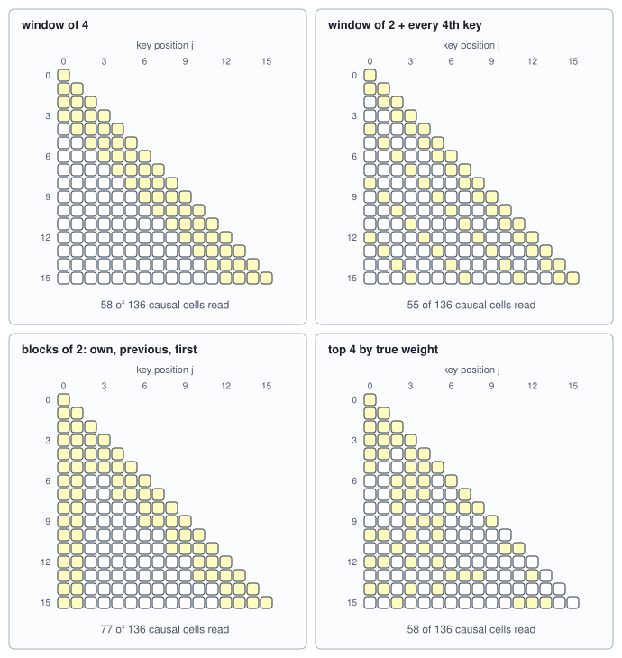
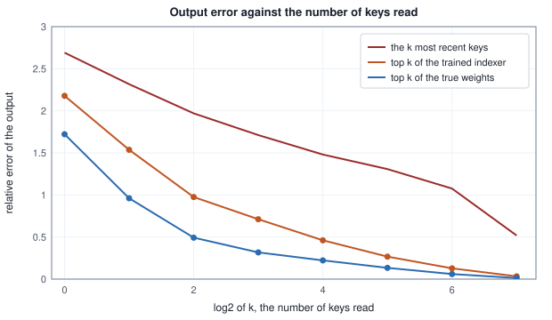
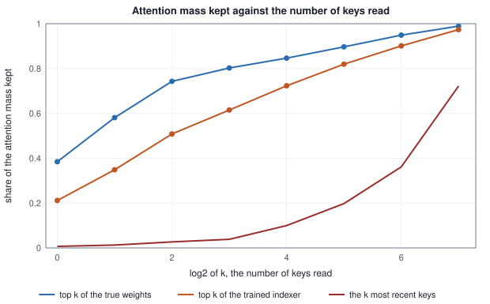

<!-- SPDX-License-Identifier: CC-BY-4.0 -->
<!-- Copyright (c) 2026 Martin Schröder <info@swedishembedded.com> -->

# Sparse Attention

*If each token only needs a few others, how do we find them cheaply?*

Here is one row of attention, the last query of a sequence of 256 tokens, with the weights sorted from the largest down. The layer is a toy, built so that every number can be recomputed from the page, and its construction is the first thing the block prints.

<!-- worked: sparse_attention.weights_of_one_query -->
A toy layer of one head: 256 positions, head width d_h = 32, 64 topics. Draw order: the 64 topic centres from `sparse_attention.model` (seed 0x33c722540d65a9d2), 32 normal draws per centre, row by row, each row divided by its length. A sequence from its own generator, in this order: 256 key topics (integer draws below 64); the key noise (256 x 32 normals, key by key); the values (256 x 32 normals, key by key); 256 query topics (integer draws below 64); the query noise (256 x 32 normals, query by query). Key j is 6 c[z_j] + 0.5 n_j, query i is 6 c[w_i] + 0.5 n_i, the value is the draw itself. Scores are s_ij = q_i . k_j / sqrt(32) for j <= i, softmax in the stable form. Sequence A is `sparse_attention.seq_a` (seed 0xbfd324dec28d97c3), sequence B is `sparse_attention.seq_b` (seed 0x5295d1557e172490).

Sequence A, query i = 255 (topic 43), which reads all 256 keys; 4 of them share its topic. The eight largest weights:

| rank | position j | same topic | weight p_ij | cumulative mass |
|---|---:|---:|---:|---:|
| 1 | 240 | yes | 0.3021 | 0.3021 |
| 2 | 222 | yes | 0.2415 | 0.5436 |
| 3 | 190 | yes | 0.2179 | 0.7615 |
| 4 | 120 | yes | 0.1175 | 0.8790 |
| 5 | 157 | no | 0.0053 | 0.8843 |
| 6 | 28 | no | 0.0052 | 0.8895 |
| 7 | 138 | no | 0.0048 | 0.8944 |
| 8 | 35 | no | 0.0044 | 0.8988 |

The smallest number of keys that carry 50%, 90% and 99% of the mass: 2, 9 and 134 of 256. Tolerance: weights to 4 decimals.
<!-- /worked -->

Four keys, one in sixty-four, carry 0.8790 of everything the query will read. The first key alone carries 0.3021. After the fourth the weights fall to about 0.005 each and stay there. Yet the layer paid for all 256 keys: 256 scores, a softmax over 256 numbers, and a weighted sum of 256 values. Of that work, 98% went to keys that hold 0.1210 of the mass.

Two lessons sit in the same table and they pull against each other. The first is that attention is concentrated: if we could find the four keys without looking at the others, we could attend to them alone and lose little. The second is the last sentence under the table. It takes 9 keys to reach 90% of the mass and 134 to reach 99%, so what is left out is not nothing, and how much it matters depends on what the values of the missing keys look like. The chapter takes both seriously. It asks how a layer can find the few keys that matter without scoring every key, what the finding costs, how a selection that cannot be differentiated is trained, how much of the output a selection of $k$ keys keeps, and how the keys that were selected are fetched from a cache that holds hundreds of thousands of them.

One query is one query. Over the 128 queries of positions 128 to 255 of the same toy, the share of the mass held by the $k$ largest weights of each query, averaged, is:

<!-- worked: sparse_attention.mass_by_k -->
Sequence A, the 128 queries i = 128 .. 255 (each reads i + 1 keys, between 129 and 256). For each k the mean over those queries of the mass held by the k largest weights of the query, and the mean share of the query's keys that k keys are. Tolerance: 4 decimals.

| k | mean mass of the top k | mean share of the keys read |
|---|---:|---:|
| 1 | 0.3850 | 0.0054 |
| 2 | 0.5700 | 0.0108 |
| 4 | 0.7115 | 0.0216 |
| 8 | 0.7762 | 0.0432 |
| 16 | 0.8260 | 0.0864 |
| 32 | 0.8832 | 0.1728 |
| 64 | 0.9417 | 0.3456 |
<!-- /worked -->

The concentration is the typical case on this toy and not the luck of one row: one key holds 0.3850 of the mass on average, 4 keys hold 0.7115 and 16 keys hold 0.8260, which is 8.6% of the keys a query reads. The same table shows the tail: 64 keys, a third of them, are needed for 0.9417.

Six ideas from earlier chapters are needed. The answers are at the end.

1. (Volume V, [Chapter 7](../v05-sequences/07-self-attention.md), scaled dot-product attention and the causal mask.) For one query at position $i$ and keys of width $d_h$, how many multiply-adds do the scores and the weighted sum of the values need, and which keys does the causal mask leave out?
2. (Volume V, [Chapter 12](../v05-sequences/12-kv-cache.md), the KV cache.) A layer has 8 key-value heads of width 128 and stores bf16 (2 bytes). How many bytes does one token add to the cache of one layer?
3. (Volume V, [Chapter 13](../v05-sequences/13-flash-attention.md), flash attention.) The online softmax carries three quantities while it reads keys in tiles. Which, and why does that let a kernel read a row in pieces?
4. (Volume VI, [Chapter 4](04-mixture-of-experts.md), top-$k$ gating.) A router scores $E$ experts and keeps $k$. What are the kept scores divided by, and why does a tie go to the lower index?
5. (Volume VI, [Chapter 3](03-attention-variants.md), sliding windows and sinks.) Which keys does a query at position $i$ read under a window of $n_{\mathrm{win}}$ keys and $n_{\mathrm{sink}}$ sinks, and what do the sinks do?
6. (Volume I, [Chapter 13](../v01-mathematics/13-information-theory.md), cross-entropy and KL divergence.) For two distributions $p$ and $r$ over the same keys, how is the cross-entropy of $p$ against $r$ related to the entropy of $p$ and to $\mathrm{KL}(p \,\|\, r)$?

## Rules that say where to look

The cheapest way to read fewer keys is to decide which in advance, from positions alone. Call the set of keys that the query at position $i$ reads $\mathcal{S}_i \subseteq \{0, \dots, i\}$. The row of the dense layer is the special case $\mathcal{S}_i = \{0, \dots, i\}$. A **sparse attention pattern** is a rule that gives every query its own $\mathcal{S}_i$ and sizes them so that most queries read far fewer than $i + 1$ keys; the attention of the query is then the softmax over the scores of those keys only. A pattern that depends on $i$ and not on the content of any token is a fixed pattern, and the literature made several.

A **window** keeps the $n_{\mathrm{win}}$ most recent keys, which Chapter 3 met as a way to bound the cache. **Global tokens** are a few positions that every query reads whatever its distance, the sinks of Chapter 3 or the few tokens chosen by the task, such as the classification token, that Beltagy and colleagues (2020) gave global attention in their Longformer. A stride keeps every $n_{\mathrm{str}}$-th key counting back from the query, so that a short list reaches far; Child and colleagues (2019) used a local pattern and a strided one with a stride of about $\sqrt{T}$, which brings the cost of a whole sequence to $O(T\sqrt{T})$. A **block** pattern divides the positions into runs of $n_{\mathrm{blk}}$ and lets a query read whole runs, which keeps the memory accesses contiguous; Zaheer and colleagues (2020) added a few random keys to windows and global tokens in their BigBird, and computed the whole in blocks. Figure 1 draws four of them on 16 positions, with a fourth panel for the choice that the rest of the chapter is about.



*Figure 1. Rows are queries, columns keys, yellow cells the keys read. The first three are rules on positions. The fourth, the 4 keys of largest true weight, has no rule: it is what the weights themselves choose, and it is not a window, a stride or a block.*

What does a fixed pattern keep of the toy's attention? The table reads 16 or so keys per query under each pattern, on the 128 queries of positions 128 to 255 of the toy, and for comparison gives the mass kept by the best 16 keys, chosen with the true weights in hand.

<!-- worked: sparse_attention.fixed_patterns -->
Sequence A, queries i = 128 .. 255. Window of w: positions i - w + 1 .. i. Global tokens: positions 0 .. 7. Every 16th key: i - 16, i - 32, ... down to the first non-negative position. Blocks: position j is in block j // 8; a query reads its own block up to itself, the whole previous block and block 0. Random keys: 16 distinct positions of 0 .. i by the first 16 steps of a Fisher-Yates shuffle of [0 .. i] (step t swaps entries t and t + integer(i + 1 - t)), queries in ascending order, generator `sparse_attention.random_keys` (seed 0x6ad077de9a0b210a). The last column is the mass of the best choice of as many keys as the pattern reads, query by query (the top k of the true weights). Tolerance: 4 decimals.

| pattern | mean keys read | mean mass kept | mass kept by the best keys of the same number |
|---|---:|---:|---:|
| window of 16 | 16.00 | 0.0756 | 0.8260 |
| window of 8 + 8 global tokens | 16.00 | 0.1059 | 0.8260 |
| window of 4 + every 16th key | 15.50 | 0.0693 | 0.8215 |
| blocks of 8: own, previous, first | 20.50 | 0.1233 | 0.8455 |
| 16 random keys | 16.00 | 0.1006 | 0.8260 |
<!-- /worked -->

Every fixed pattern keeps between 0.07 and 0.12 of the mass, about the share of keys it reads (0.0864 for 16 keys, in the table above), and the best 16 keys hold 0.8260. The toy is built to show this: its keys and queries belong to 64 topics assigned with no regard for position, so what a query needs is somewhere in its past and nothing about position says where. Real text is not like that for every head. A head that attends to the previous few tokens is a window head, and a window serves it exactly; a sink head attends to the first token. The patterns of the literature work because many heads are like that. What no pattern fixed in advance can serve is a head that retrieves, one whose answer is a name that appeared 40,000 tokens ago, and Chapter 3 showed the price of ignoring that: a window forgets. The section "What a real training run says" below returns to evidence from brain's own training runs.

Nor does the cost of a pattern go as far as one might hope when the pattern has to reach. Take a window of 512 and a stride of $\lfloor\sqrt{T}\rfloor$ and count what the last query reads.

<!-- worked: sparse_attention.strided_cost -->
The last query of a sequence of T keys. Dense reads T keys. A window reads 512. A window of 512 plus every s-th key back from the query, with stride s = floor(sqrt(T)), reads 512 + floor((T - 1) / s) minus the strided keys that fall inside the window, floor(512 / s).

| T | dense keys | window keys | window + strided keys | dense / (window + strided) |
|---|---:|---:|---:|---:|
| 4,096 | 4,096 | 512 | 567 | 7.2 |
| 65,536 | 65,536 | 512 | 765 | 85.7 |
| 1,048,576 | 1,048,576 | 512 | 1,535 | 683.1 |
<!-- /worked -->

The count grows as $\sqrt{T}$, as Child and colleagues designed it to, and at a million keys it is 683 times smaller than dense. What it reads, though, is every 1,024th key whether or not that key has anything to say. The pattern is cheap because it asks nothing of the content, and it misses for the same reason.

## What a choice of keys costs in the output

Before looking for a better rule, fix what is being lost. A selection $\mathcal{S}_i$ replaces the row $p_{ij}$ by the softmax over the selected scores,

$$
\hat{\mathbf{o}}_i = \sum_{j \in \mathcal{S}_i} \frac{p_{ij}}{m_i}\,\mathbf{v}_j,
\qquad
m_i = \sum_{j \in \mathcal{S}_i} p_{ij},
$$

where $p_{ij}$ are the dense weights of Chapter 7 and the division by $m_i$ is what renormalizing the softmax over fewer scores amounts to: $\exp(s_{ij})/\sum_{l \in \mathcal{S}_i}\exp(s_{il}) = p_{ij}/m_i$ because the denominator of the dense softmax cancels. The number $m_i$ is the **captured mass**, the share of the dense weight that the selected keys hold. It decides the error exactly. Write $\boldsymbol{\mu}_{\mathcal{S}}$ for the average of the selected values under the weights $p_{ij}/m_i$ (that is $\hat{\mathbf{o}}_i$ itself) and $\boldsymbol{\mu}_{\mathcal{R}}$ for the average of the left-out values under the weights $p_{ij}/(1 - m_i)$, where $\mathcal{R}_i$ is the rest. The dense output is a mixture of the two,

$$
\mathbf{o}_i = m_i\,\boldsymbol{\mu}_{\mathcal{S}} + (1 - m_i)\,\boldsymbol{\mu}_{\mathcal{R}},
\qquad\text{so}\qquad
\mathbf{o}_i - \hat{\mathbf{o}}_i = (1 - m_i)\,(\boldsymbol{\mu}_{\mathcal{R}} - \boldsymbol{\mu}_{\mathcal{S}}),
$$

and since each average has a length at most $\max_j \lVert\mathbf{v}_j\rVert$,

$$
\lVert \mathbf{o}_i - \hat{\mathbf{o}}_i \rVert \;\le\; 2\,(1 - m_i)\,\max_j \lVert\mathbf{v}_j\rVert .
$$

Three things follow. The error is zero when the selection holds all the mass and when the left-out values average to the selected ones; it is proportional to what is left out. Among all selections of $n_{\mathrm{sel}}$ keys, the one with the largest $m_i$, the $n_{\mathrm{sel}}$ largest weights, has the smallest bound, so the best selection of a given size is known: it is the top $n_{\mathrm{sel}}$ of the true weights. And the bound is only a bound; a query whose neglected tail points the same way as its head loses nothing. The table of the section "What the top $k$ keeps" ends by checking the identity on 1,024 (query, size) pairs.

The best selection is also unreachable. To rank the true weights one computes the scores of every key, which is the whole cost that sparse attention exists to avoid. The question becomes how close a cheap computation can get to the ranking.

## A cheap scorer that ranks every key

A **learned index selection** asks a second, small model for a score of every key, ranks those scores, and hands the top $n_{\mathrm{sel}}$ to the exact attention. The small model, called the **indexer**, has its own projections of the query and the key, narrower than the attention's, so that the score of one pair costs less than the attention's score of the same pair. In the simplest form, with two matrices $\mathbf{W}_{I,Q}$ and $\mathbf{W}_{I,K}$ of shape $[d_I, d_h]$ and $d_I < d_h$,

$$
\mathrm{ix}_{ij} = \frac{(\mathbf{W}_{I,Q}\,\mathbf{q}_i)\cdot(\mathbf{W}_{I,K}\,\mathbf{k}_j)}{\sqrt{d_I}},
\qquad
\mathcal{S}_i = \text{the } n_{\mathrm{sel}} \text{ positions } j \le i \text{ of largest } \mathrm{ix}_{ij}.
$$

The decoder in `crates/glmdsa` uses a richer scorer of the same family: $H_I$ small heads, each a dot product of width $d_I$ passed through a $\mathrm{relu}$ and weighted by a number that the query token itself produces,

$$
\mathrm{ix}_{ij} = \sum_{h=0}^{H_I - 1} \frac{g_{ih}}{\sqrt{H_I}}\;\mathrm{relu}\!\left(\frac{\mathbf{q}^{I}_{ih}\cdot\mathbf{k}^{I}_{j}}{\sqrt{d_I}}\right),
$$

with $g_{ih}$ a linear function of the token's normalized hidden state and a single indexer key $\mathbf{k}^I_j$ per token shared by all $H_I$ heads. The toy's single bilinear form and this one agree on what matters for the chapter: a score from narrow vectors, computed for every key, whose ranking stands in for the ranking of the true weights. Selection and attention together are two short routines.

```text
function select_top(score: array<real>[n], n_sel: int) -> array<int>:
    require n_sel >= 1, "a query reads at least one key"
    order = argsort(score, descending)     # ties keep the lower index first
    return sort(order[0:min(n_sel, n)])    # the selected positions, ascending

function sparse_attention_row(q: array<real>[d], K: array<real>[T, d],
                              V: array<real>[T, d], sel: array<int>)
                              -> array<real>[d]:
    require len(sel) >= 1, "an empty selection has no softmax"
    z = zeros(real, [len(sel)])
    for a in 0 .. len(sel):
        z[a] = dot(q, K[sel[a], :]) / sqrt(d)
    w = softmax(z)                         # the softmax over the selected scores
    o = zeros(real, [d])
    for a in 0 .. len(sel):
        o = o + w[a] * V[sel[a], :]
    return o
```

`sparse_attention_row` is the attention of Chapter 7 with the loop over keys replaced by a loop over a list. When `sel` lists every position it is the dense row, because the two softmaxes are then the same, the anchor against which every sparse routine of this chapter is checked.

What does the indexer cost? The attention of a query over $T$ cached keys needs, per head, a score of width $d_{qk}$ and a weighted value of width $d_v$ for every key; the indexer needs $H_I d_I$ multiply-adds per cached key, and the exact attention then runs over $n_{\mathrm{sel}}$ keys instead of $T$. The cost counted for one query of one layer, at the shape of `GlmConfig::glm5_2()` in `crates/glmdsa/src/config.rs` (64 query heads of key width 256 and value width 256, an indexer of 32 heads of width 128, 2,048 keys read):

<!-- worked: sparse_attention.indexer_cost -->
Multiply-adds for one query of one layer. Dense attention, per cached key: 64 heads x (256 + 256) = 32,768 (a score of width 256 and a weighted value of width 256 per head, each head reading its own key, the form without absorption). The indexer, per cached key: 32 heads x 128 = 4,096. Sparse attention reads min(T, 2048) keys. The selection itself (picking the 2048 largest of T scores) is not counted.

| T | dense | indexer scores | attention over the selected keys | indexer + selected | dense / total |
|---|---:|---:|---:|---:|---:|
| 2,048 | 67,108,864 | 8,388,608 | 67,108,864 | 75,497,472 | 0.89 |
| 4,096 | 134,217,728 | 16,777,216 | 67,108,864 | 83,886,080 | 1.60 |
| 16,384 | 536,870,912 | 67,108,864 | 67,108,864 | 134,217,728 | 4.00 |
| 65,536 | 2,147,483,648 | 268,435,456 | 67,108,864 | 335,544,320 | 6.40 |
| 131,072 | 4,294,967,296 | 536,870,912 | 67,108,864 | 603,979,776 | 7.11 |

Above T = 2048 the indexer pays for itself when 4096 T + 32,768 x 2048 < 32,768 T, that is T > 2048 x 32,768 / (32,768 - 4,096) = 2340.6. At or below 2048 keys the selection keeps everything and the indexer is pure cost.
<!-- /worked -->

At 131,072 keys the whole query costs 1/7.11 of the dense one, and 536,870,912 of its 603,979,776 multiply-adds, 88.9%, are the indexer reading every key. This is the structural fact of the method. The indexer is cheaper per key than the attention, here by a factor of 8, but it is not cheaper per query: it still looks at all $T$ keys, so the cost remains linear in $T$ and the saving is a constant factor, the ratio of the per-key costs. The attention over the selection, 67,108,864 multiply-adds, does not grow at all. The same table shows the other half: at 2,048 keys, and at any length up to 2,340, the indexer makes the layer more expensive than dense attention. A sparse layer is a bet that the context will be long.

The cost counted here is multiply-adds and leaves out the selection itself, picking the largest 2,048 of $T$ numbers. A partial selection does it in a number of comparisons proportional to $T$, but how it is done matters at the level of a kernel, and the section on brain's code returns to one that does not do it that way.

## An indexer has no gradient to learn from

The indexer's output is a ranking, and a ranking is piecewise constant: nudge a score slightly and the top $n_{\mathrm{sel}}$ is the same set, so the derivative of anything computed from the selection with respect to the scores is zero almost everywhere and undefined at ties. The loss of the language model, which depends on the indexer only through which keys were selected, therefore sends the indexer nothing. Two ways out are used, and brain has both.

The first is to leave the selection alone and let the gradient flow through the selected entries only. The attention over the selected keys is differentiable in $\mathbf{q}$, $\mathbf{k}_j$ and $\mathbf{v}_j$ for $j \in \mathcal{S}_i$, and the selection is a constant of the step. The model learns to use what the selection hands it; the selection learns nothing. Training from scratch that way, as the native sparse attention path of `crates/model/src/lsa/native.rs` does, works when the indexer is a fixed function of the model's own keys and queries.

The second is to train the indexer as a student of the dense attention. The target is what the model wants to read, the dense weights $p_{ij}$ over $j \le i$; the student is the indexer's own distribution, $\hat p_{ij} = \mathrm{softmax}_j(\mathrm{ix}_{ij})$ over the same keys; and the loss is the cross-entropy of $p$ against $\hat p$ averaged over queries,

$$
\mathcal{L} = -\frac{1}{N}\sum_{i}\sum_{j \le i} p_{ij}\,\log \hat p_{ij}
= \frac{1}{N}\sum_i \Bigl(H(p_{i\cdot}) + \mathrm{KL}(p_{i\cdot}\,\|\,\hat p_{i\cdot})\Bigr).
$$

The entropy $H(p_{i\cdot})$ belongs to the frozen attention, which the indexer cannot change, so minimizing the cross-entropy and minimizing the KL divergence are the same problem and have the same gradient. The gradient with respect to a score is the one of every softmax cross-entropy of Volume III, Chapter 3,

$$
\frac{\partial \mathcal{L}}{\partial\, \mathrm{ix}_{ij}} = \frac{1}{N}\bigl(\hat p_{ij} - p_{ij}\bigr),
$$

and from the score it runs through the indexer's own projections by the chain rule. Nothing flows into the attention: the indexer is detached from the language-model loss, trained after it or beside it, and the weights $p_{ij}$ are a fixed target. When the attention has several heads and the indexer has one distribution per query, the target is the average of the heads' weights.

The toy shows what this buys. The indexer has $d_I = 8$ where the attention has $d_h = 32$. It starts from small random projections and trains on 96 queries of sequence A by 200 steps of gradient descent; the table measures it on sequence B, which it never saw.

<!-- worked: sparse_attention.indexer_training -->
Indexer: s'_ij = (Wq q_i) . (Wk k_j) / sqrt(8) with Wq, Wk of shape [8, 32], entries drawn as normals divided by sqrt(32) from `sparse_attention.indexer_init` (seed 0x44c45cea9573ddc2), Wq first and then Wk, row by row. Trained on sequence A, the 96 queries i = 64, 66, ..., 254, by 200 steps of full-batch gradient descent at rate 1 on the mean over those queries of the cross-entropy between the dense weights p_i and softmax_j(s'_ij) over j <= i; the table's KL is that cross-entropy minus the mean entropy of the dense weights. Held-out columns: sequence B, queries 128 .. 255, the mean mass of the dense weights on the indexer's top 8 and top 32 keys (a random choice of 8 keys keeps 0.043 of it on average, 32 keys 0.173). Plain gradient descent at this rate is not chaotic: the values below agree to 1e-6 when the first weight is changed by 1e-12 or 3e-12, so every printed digit is reproducible to a tolerance of 0.001.

| step | mean KL on the training queries | held-out mass of the top 8 | held-out mass of the top 32 |
|---|---:|---:|---:|
| 0 | 3.529 | 0.029 | 0.144 |
| 50 | 0.259 | 0.594 | 0.789 |
| 100 | 0.233 | 0.610 | 0.792 |
| 200 | 0.211 | 0.615 | 0.820 |
<!-- /worked -->

The random indexer at step 0 keeps 0.029 of the mass in its top 8, below the 0.0432 that a random choice of 8 keys keeps: it is an unrelated ranking, and slightly below chance. After 50 steps it keeps 0.594, and after 200, 0.615, against the 0.802 of the best 8 keys. The KL on the training queries falls from 3.529 to 0.211 nats and the curve flattens: a map from 32 numbers to 8 cannot represent 64 topics, which would need directions in a space of at least that many dimensions. The gap between 0.615 and 0.802 is the price of the narrow scorer, and the next section converts it into keys.

## What the top $k$ keeps, and what that does to the output

Now run the selectors against each other. For every size $k$ the table gives, on the 128 held-out queries, the captured mass and the relative error of the output, $\lVert\mathbf{o}_i - \hat{\mathbf{o}}_i\rVert / \lVert\mathbf{o}_i\rVert$, for three choices of the $k$ keys: the best $k$ by true weight, the top $k$ of the trained indexer, and the $k$ most recent.

<!-- worked: sparse_attention.error_vs_k -->
Sequence B, queries i = 128 .. 255, and every k below. 'mass' is the mean over queries of the dense weight the selected keys hold; 'error' is the mean over queries of the length of (dense output - sparse output) divided by the length of the dense output, the sparse output being one softmax over the selected keys' own scores. Oracle: the k largest true weights. Indexer: the k largest scores of the trained indexer of the previous table. Window: the k most recent keys. Oracle, window and indexer columns are reproducible to a tolerance of 0.001.

| k | oracle mass | oracle error | indexer mass | indexer error | window mass | window error |
|---|---:|---:|---:|---:|---:|---:|
| 1 | 0.385 | 1.722 | 0.212 | 2.178 | 0.007 | 2.691 |
| 2 | 0.581 | 0.961 | 0.349 | 1.537 | 0.013 | 2.316 |
| 4 | 0.743 | 0.492 | 0.508 | 0.975 | 0.027 | 1.969 |
| 8 | 0.802 | 0.317 | 0.615 | 0.711 | 0.038 | 1.711 |
| 16 | 0.846 | 0.222 | 0.723 | 0.461 | 0.100 | 1.480 |
| 32 | 0.897 | 0.134 | 0.820 | 0.267 | 0.198 | 1.307 |
| 64 | 0.949 | 0.060 | 0.901 | 0.128 | 0.361 | 1.076 |
| 128 | 0.989 | 0.013 | 0.974 | 0.033 | 0.722 | 0.519 |

Reading every causal key gives an error of exactly 0 (checked on all 128 queries). Over the 1024 (query, k) pairs of the oracle, the largest difference between the error length and (1 - m) times the length of mu_R - mu_S is below 1e-12, and the largest ratio of the error length to 2 (1 - m) max_j |v_j| is 0.558, where max_j |v_j| = 7.841 on sequence B.
<!-- /worked -->





*Figures 2 and 3. The data of the table, with the number of keys on a logarithmic axis.*

Read the oracle column first. Eight keys keep 0.802 of the mass, and yet the error is 0.317, not the 0.198 that $1 - m$ suggests. The reason is in the identity: the error is $(1 - m_i)\lVert\boldsymbol{\mu}_{\mathcal{R}} - \boldsymbol{\mu}_{\mathcal{S}}\rVert$, and the dense output $\mathbf{o}_i$ is an average over many values that largely cancel, so it is shorter than either average and the relative error is inflated. With one key the error exceeds 1: the single key's value is farther from the dense output than the dense output is long. An error is small only when the mass is high. At 32 keys the error is 0.134 and at 128 it is 0.013.

The indexer column says what the narrow scorer costs. To reach an error of about 0.13 the oracle needs 32 keys and the indexer needs 64, so the imperfect ranking is paid for with a doubling of the keys read; at 128 keys the indexer's error is 0.033 and the oracle's 0.013. The window is the control, and on this toy it is a poor one by construction, but it makes a point worth keeping: a policy that spends its budget on keys that carry nothing converges only when the budget reaches the sequence.

The last line under the table closes two loops. Reading every causal key gives an error of exactly 0, which is the anchor of the previous section, and the bound of the identity held on all 1,024 pairs of the oracle, with the largest ratio of the error to the bound 0.558. The oracle and window columns are exact arithmetic. The indexer columns come from a training run, which at this rate is stable: a change of 1e-12 in the first weight moves no printed digit, so the digits can be reproduced.

## Scoring groups of keys, not keys

The indexer has made one kind of saving, a narrower dot product, and left the other untouched: it still scores every key. For a million keys that is a million scores per query per layer even at a fraction of the width. To change the exponent and not only the constant, the scores must be computed for fewer things than there are keys. The way brain does it is to group the keys and score the groups, and the result is what brain's sources call latent sparse attention.

**Latent sparse attention** (LSA) scores a query against **buckets** of keys instead of keys, reads the keys of the best buckets, and always adds the most recent keys and the first few. "Latent" refers to the space in which the grouping and the scoring are done: not the attention's own key space but a narrower, unit-length index space derived from it. Here is the mechanism as `crates/model/src/lsa` implements it, in the order a key meets it.

*The index space.* A key's index vector is its position-free content. For the training-free space of `crates/model/src/lsa/space.rs`, take the keys of all key-value heads before rotary rotation, drop the channels that rotate, concatenate the heads, and divide by the length. The query's index vector is the query heads of each key-value group summed, the channels that rotate dropped, the groups concatenated and the row divided by its length. The dot product of the two is then the sum over query heads of the position-free part of the attention logit. A learned indexer, the product of distillation as in the previous section, applies one more matrix to these vectors. Dropping the rotated channels is a choice with a reason: their contribution depends on the distance between query and key, which a grouping of keys, made once for every future query, cannot know, and recency is covered separately by the window.

*Buckets.* Keys arrive in position order. Every time a **cluster block** of $n_{\mathrm{cl}}$ consecutive keys is complete (512 by default), the block is merged into buckets and its buckets never change afterwards. Consecutive keys are first summed in pools of $n_{\mathrm{pool}}$ keys (`pool_size` in the configuration; 4 by default), because neighbouring keys in text are similar and a pool is a cheaper unit to merge than a key. The merge is Ward's: the **alignment** of a group is the length of the sum of its index vectors, and merging two groups costs the alignment that the union loses,

$$
\mathrm{cost}(a, b) = \lVert\mathbf{s}_a\rVert + \lVert\mathbf{s}_b\rVert - \lVert\mathbf{s}_a + \mathbf{s}_b\rVert,
$$

where $\mathbf{s}_a$ is the sum of the index vectors of group $a$ (the vector of the keys' sum, written $\mathbf{s}$ for sum and not to be confused with the state $\mathbf{S}$). Two groups pointing the same way lose nothing when they merge, two groups at right angles lose the most. The rules are exact, so that two implementations produce the same buckets. Groups are numbered by position of their first pool, 0, 1, 2, and so on. In each round, every live group finds the partner of least cost among the other live groups for which the sum of the two sizes (in keys) is at most the cap, inclusive (by default twice the average bucket size, so a union of exactly the cap is allowed); when two partners have equal cost the one with the lower index wins. A pair is **mutual** when each of the two chose the other. All mutual pairs are sorted by cost, cheapest first, equal costs by the lower member's index, and merged in that order; a merged group keeps the lower of the two indices and its sum is the sum of the two sums. If the number of live groups would fall below the target number of buckets, only as many pairs are merged as there are groups in excess of the target (the cheapest ones); the round ends there and the next one is not needed. A round in which no pair is mutual cannot occur while the cap allows any merge, and is an error. There is no seed and no assignment pass. The buckets of a block are then numbered 0, 1, 2, and so on in ascending order of the position of their lowest member, and the global bucket number is the block number times the number of buckets a block holds (8 for a block of 32 keys with average 4 keys a bucket) plus that local number. A bucket ends with the unit vector along the sum of its keys as its **centroid**, and its list of members.

*The read.* A query at position $i$ scores the centroids of the buckets of the blocks closed before its own, takes the best $n_{\mathrm{pick}}$ of them (`top_p` in the configuration; a tie to the lower bucket number), walks their members best bucket first keeping the keys outside the sinks and the window until it holds $n_{\mathrm{far}}$ of them (`top_k` in the configuration), and then adds the window of the last $n_{\mathrm{win}}$ positions and the sinks below it. The window must span a whole cluster block; the configuration refuses one that does not, because the query's own block has not been merged yet and is read only through the window. In the pseudocode of the book:

```text
function lsa_read(q: array<real>[d_I], C: array<real>[B, d_I],
                  members: list<list<int>>, i: int, n_cl: int, n_per_bkt: int,
                  n_pick: int, n_far: int, n_win: int, n_sink: int)
                  -> list<int>:
    require n_win >= n_cl, "the window must cover the open block"
    visible = (i // n_cl) * (n_cl // n_per_bkt)   # buckets of the closed blocks
    score = zeros(real, [visible])
    for b in 0 .. visible:
        score[b] = dot(q, C[b, :])
    order = argsort(score, descending)     # ties keep the lower bucket first
    wstart = max(0, i + 1 - n_win)
    sel = []
    for r in 0 .. min(n_pick, visible):
        for j in members[order[r]]:        # members are ascending positions
            if len(sel) < n_far and j >= n_sink and j < wstart:
                append j to sel
    for j in wstart ..= i:
        append j to sel
    for j in 0 .. min(n_sink, wstart):
        append j to sel
    return sel
```

Here `n_per_bkt` is the average number of keys in a bucket (4 on the toy, 8 by default), so that a block holds `n_cl // n_per_bkt` buckets. The names of the pseudocode are those of the prose: `n_pick` buckets are picked, at most `n_far` far keys are kept, `n_win` is the window and `n_sink` the number of sinks. The routine returns a list of unique, causal positions, and the attention over it is `sparse_attention_row`: LSA only decides which keys are read.

The toy has one change from the default: its neighbouring keys are unrelated by construction, so it merges keys one at a time rather than in pools of consecutive keys. Cluster blocks are 32 keys, buckets average 4, the window is 32, there are 2 sinks, a query picks 4 buckets and reads at most 16 far keys. First what the merge does with block 0 of sequence B, which holds 32 keys of 64 possible topics:

<!-- worked: sparse_attention.bucket_index_toy -->
Sequence B. Index vectors are the keys divided by their length. Blocks of 32 keys; 8 buckets a block (average 4 keys, at most 8); pools of 1 key, because the toy's neighbouring keys are unrelated by construction; the merge is the Ward rule of the chapter; a bucket's centroid is the sum of its keys divided by its length. Block 0 (positions 0 .. 31): the members of each bucket and their topics.

| bucket | member positions | member topics |
|---|---|---|
| 0 | 0, 7, 11, 12 | 23, 23, 42, 40 |
| 1 | 1, 13, 22, 24 | 39, 53, 39, 15 |
| 2 | 2, 10, 15, 20, 25 | 56, 0, 27, 18, 18 |
| 3 | 3, 4, 5, 21 | 30, 30, 55, 16 |
| 4 | 6, 19, 27, 28 | 62, 4, 4, 32 |
| 5 | 8, 9, 23 | 6, 61, 61 |
| 6 | 14, 16, 18, 30 | 2, 41, 10, 22 |
| 7 | 17, 26, 29, 31 | 14, 37, 7, 13 |

In the 8 blocks, 46 pairs of keys share a topic and lie in the same block; 46 of those pairs were merged into one bucket. Two keys chosen at random from a block of 32 share a bucket with probability 3/31 = 0.097.
<!-- /worked -->

The merge puts every pair of same-topic keys of a block into one bucket, 46 of 46 over the eight blocks, where two keys picked at random from a block would share a bucket with probability 0.097. It has not seen the topic labels; it has only seen the index vectors. Then the read, for the same sequence, against the best keys and the most recent keys at the same count:

<!-- worked: sparse_attention.lsa_toy -->
Read of a query: score the centroids of the buckets of closed blocks, take the 4 best (a tie to the lower bucket), walk their members best bucket first and keep those in [2, window start) until 16 are kept, then add the window of the last 32 positions and the sinks 0 .. 1.

Query 255 (topic 3) sees 56 buckets of the 7 closed blocks (it is in block 7, still open). The 4 buckets it picks, best first: 47, 27, 16, 5, holding 17 keys, of which 2 share its topic. It reads 50 of its 256 keys (16 far keys, the window 224 .. 255 and the sinks 0 and 1).

Sequence B, queries i = 128 .. 255, per query the same number of keys for the three rows. Tolerance: 4 decimals.

| selection | mean keys read | mean mass kept | mean relative error |
|---|---:|---:|---:|
| LSA read | 48.30 | 0.8240 | 0.2596 |
| best keys, same count | 48.30 | 0.9281 | 0.0869 |
| window, same count | 48.30 | 0.2816 | 1.1984 |
<!-- /worked -->

The read keeps 0.8240 of the mass with 48.30 keys on average, where the most recent 48 keep 0.2816. The best 48 keys keep 0.9281 and the error 0.0869 to the read's 0.2596; the distance between 0.8240 and 0.9281 is the loss of selecting through buckets and centroids, and it is not small. On this toy the window takes 32 of the 48 keys and carries almost nothing by construction, so the toy understates what the method does on text where recent keys matter.

What the structure buys is a different exponent. A query scores one centroid per bucket and a bucket averages 8 keys by default, so the scoring is $T/8$ dot products where the key-level indexer needed $T$. At the default sizes:

<!-- worked: sparse_attention.lsa_scale -->
The default index configuration (index width 64, buckets of 8 keys on average, blocks of 512 keys, 4096 far keys, a window of 512, 4 sinks), for a query at the end of a sequence of T keys with all blocks before it closed. 'Bucket scores' are the centroids a query scores (closed blocks x 64 buckets), each a dot product of width 64.

| T | keys read | bucket scores | bucket-score multiply-adds | multiply-adds to score every key |
|---|---:|---:|---:|---:|
| 16,384 | 4,612 | 2,048 | 131,072 | 1,048,576 |
| 131,072 | 4,612 | 16,384 | 1,048,576 | 8,388,608 |
| 1,048,576 | 4,612 | 131,072 | 8,388,608 | 67,108,864 |

The index of one block is 64 buckets x (64 centroid numbers + 16 member slots) x 4 bytes = 20,480 bytes for 512 tokens, 40 bytes per token and layer. The cached keys and values of a layer with 8 key-value heads of width 128 in bf16 are 8 x 128 x 2 x 2 = 4,096 bytes per token, so the index is 1.0% of them.
<!-- /worked -->

The keys read are 4,612 whatever the length, and the scoring work is one eighth of that of scoring every key at the same width, for a million keys 8,388,608 multiply-adds against 67,108,864. The bucket index is also small: 40 bytes per token and layer, 1.0% of the 4,096 bytes the keys and values of a layer with 8 key-value heads of width 128 occupy.

Eight times fewer scores is still linear in $T$. A **tree** read removes the last factor. `crates/model/src/lsa/tree.rs` groups the buckets again, into node buckets of a power of two children (Ward merges bucket pairs, then pairs of pairs), and again above those, so that a query scores a few node buckets at the top, keeps the best `beam_width` of them, scores the children of those, and so on down to buckets. The number of scores is then the sum over levels of the beam width times the number of children, which does not depend on $T$ except through the number of levels, a logarithm. As an illustration with sizes chosen here and not brain's configuration: node buckets of 8 children and a beam of 64 at each of three levels would score about $3 \times 64 \times 8 = 1{,}536$ centroids, where the flat read at a million keys scores 131,072. The levels grow as the index's pages complete, and the tree read is tested against a reference implementation on fixed inputs (`the_tree_matches_the_reference_implementation` in `crates/model/src/lsa/tests.rs`).

A different structure in the same directory is not LSA. `crates/model/src/anchor_memory.rs` implements a bank of `capacity` records per key-value group, written by tokens of completed blocks, which every token reads by softmax attention; the bank has a fixed size, so the state a layer carries is independent of the context. It selects which records to keep by a learned admission score at write time, not which keys to read at read time, and it belongs with the fixed-size state of Chapter 5, not with the selection of this one.

## Where the selected keys live

The selection is a list of positions. The cache that holds the keys is not a list. A decoder that serves many requests keeps its keys and values in a pool of fixed-size **pages** of $n_{\mathrm{pg}}$ rows, and a sequence reaches its rows through a **block table**, one physical page for each logical page of the sequence (the arrangement Chapter 12 of Volume V pointed ahead to, and a later volume builds in full). A **paged sparse layout** is that arrangement read sparsely: the K and V rows stay in their pages and the attention kernel gets the selected positions, resolves each through the block table of its sequence and reads the row where it is, never copying the selected rows into a contiguous buffer.

Figure 4 draws the whole path of a query through either selection and into the cache.


*Figure 4. The two selections of the chapter hand the same thing, a list of key positions per query, to the same exact attention.*

The point of the arrangement is the granularity of a read. If hardware fetched whole pages, selecting 16 keys would cost the pages that contain them. How many pages is that? On the toy, for the 16 keys of largest true weight:

<!-- worked: sparse_attention.page_traffic -->
Sequence A, queries i = 128 .. 255, a budget of 16 keys. The page of size P holds the keys P b .. P b + P - 1 (the last page of a query stops at the query). 'Pages touched' counts the distinct pages that hold the 16 keys of largest true weight; 'rows if pages are fetched whole' adds the rows of those pages. 'Page-granular mass' is the mass kept when the selection chooses whole pages instead: the 16 // P pages of largest total weight. Tolerance: 2 decimals for counts, 4 for mass.

| page size P | pages touched by the top 16 keys | rows if pages are fetched whole | key-granular mass (16 rows) | page-granular mass |
|---|---:|---:|---:|---:|
| 1 | 16.00 | 16.00 | 0.8260 | 0.8260 |
| 2 | 15.40 | 30.76 | 0.8260 | 0.7883 |
| 4 | 14.06 | 56.12 | 0.8260 | 0.7368 |
| 8 | 12.09 | 95.89 | 0.8260 | 0.6144 |
| 16 | 9.23 | 144.69 | 0.8260 | 0.4324 |
<!-- /worked -->

With pages of 16 rows, the 16 best keys of a query lie in 9.23 distinct pages on average, and fetching whole pages would read 144.69 rows to use 16. Even with pages of 2 rows the 16 keys touch 15.40 pages. The selection of a content-based indexer is scattered; its keys sit wherever the tokens that produced them sat. The alternative, a selection that picks whole pages so that a fetch is exact, costs mass: page-granular selection of the same row budget keeps 0.4324 at 16 rows to a page against 0.8260 for keys. So page granularity and selection granularity pull against each other: coarse pages make a fetch contiguous and a selection poor, fine pages make a selection good and a fetch scattered. The way out is the one the layout takes: select at the granularity of a key, store at the granularity of a page, and let the kernel read each selected row individually through the block table. A key row of 128 bf16 numbers is 256 bytes, long enough to be read on its own, and the page size then only affects how many entries the block table has.

What the kernel reads is counted in bytes, and the layout of the kernel matters to it. The sparse kernels of `crates/kernels/wgsl` are four: one workgroup per query head, one per key-value head that serves the whole group of query heads of that head from a single read of each row, the same over a packed int8 or FP8 pool, and a whole-row kernel over a packed pool. The cost model of `crates/gpu-core/src/cost.rs` counts their bytes; the table applies its formulas at a decode step for one layer.

<!-- worked: sparse_attention.sparse_kernel_bytes -->
K and V bytes read for one query of one layer with 32 query heads, 8 key-value heads of width 128, 4096 selected keys, out of T = 131,072. An f32 key and value channel are 4 + 4 bytes. A kernel with a workgroup per query head reads each selected key row once per query head (32 x), one per key-value head once per key-value head (8 x). An int8 pool stores a byte for K and one for V per channel and one f32 scale for each of K and V per key and key-value head. The dense row is the per-KV-head kernel over all T keys.

| kernel | bytes | fraction of dense |
|---|---:|---:|
| dense, per KV head, f32 | 1,073,741,824 | 1.00 |
| sparse, one workgroup per query head, f32 | 134,217,728 | 0.125 |
| sparse, one workgroup per KV head, f32 | 33,554,432 | 0.031 |
| sparse, one workgroup per KV head, int8 pool | 8,650,752 | 0.008 |
<!-- /worked -->

Reading 4,096 of the 131,072 keys is 1/32 of the keys; a kernel with a workgroup per query head reads each selected row 32 times where dense reads it 8 times, once per key-value head, so it moves $4/32 = 0.125$ of the dense bytes; reading each row once per key-value head gives 1/32, 0.031; and a packed int8 pool, which stores a byte per channel and a scale per row, gives 0.008, 8,650,752 bytes where the dense layer reads 1,073,741,824. These are counts of work, and bandwidth-bound decoding (Volume IV, Chapter 3) turns them into time at the device's own rate.

The index is paged as well. A page of the index holds the buckets of one cluster block, and is keyed by that block and by the physical key pages it was built from; sequences that share a cached prompt prefix share its index pages. An index page of 512 tokens at the default sizes is $64 \times (64 + 16) \times 4 = 20{,}480$ bytes, the 40 bytes per token of the table above. The page is derived from the keys already in the pool, so a prefix hit, a truncated sequence or a released page is repaired from the cache alone, without recomputing any token.

## One crossover that is measured

A sparse layer has a fixed overhead, the indexer or the bucket scoring, and an index to build. The count at 2,340 keys in the cost table says where that overhead stops paying in operations: the multiply-adds of the indexer plus the selected attention are fewer than dense only above that length. The measured version is in `crates/model/src/lsa/binding.rs`: when sparse attention is switched on, `measure_crossover` times one layer's dense chunk of prefill against its sparse read at growing positions on the device in use, and a prefill chunk that ends at or below the crossover reads densely and builds no index (`dense_until`). The mechanism came with commit `8a18b152d` (November 2026), whose message gives the reason: with every chunk read sparsely, short prompts prefilled more slowly than dense ones. The lesson is general. An algorithm whose saving is linear in the context and whose overhead is linear in the context too has a break-even, the break-even is a property of the device, and the honest implementation measures it and falls back below it.

## The two indexers and the kernels in brain

Brain holds two selections of this chapter, one in a decoder crate and one as a library, and a family of kernels that read what either of them selects.

**The indexer of the GLM decoder.** `crates/glmdsa` builds the GLM-5.2 decoder, and its sources call the indexer DSA. Each layer has a mode, `IdxMode::None`, `Full` or `Shared`, in `crates/glmdsa/src/config.rs`: a `Full` layer runs its own indexer, a `Shared` layer reuses the selection of the previous `Full` layer so that the cost of scoring is paid once for several layers, and `None` is dense. The indexer is the family of the section above: a per-head weight from the hidden state, a query projected from the query's latent residual, one key per token after a LayerNorm, a rotary rotation of a slice of the channels, the scores $\sum_h g_{ih}/\sqrt{H_I}\;\mathrm{relu}(\ldots)$ of the kernel `mla_index_scores.wgsl`, and `topk_mask.wgsl`, which turns the scores into an additive mask of 0 for the kept keys and $-\infty$ for the others. The mask is added to the dense score matrix before the softmax (`add_index_mask`). Two consequences are worth stating because the text above could suggest otherwise. First, the indexer runs in fp32, and is not a low-precision scorer. Second, because the mask is added to an already dense matrix of scores and `topk_mask` ranks each key against all the others of its row (the kernel's own header says its cost is still quadratic per row), this implementation computes the semantics of sparse attention, in training and in tests, and does not save the arithmetic. The saving of this chapter's cost table is realized by the other path.

The tests say what the implementation has been held to. `crates/glmdsa/tests/it/indexer.rs` has `indexer_allpass_equals_dense`, `index_topk` at or above the sequence length reproduces dense attention, and `indexer_sparse_restricts_attention`, a smaller `index_topk` changes the result. `topk_mask_kernel.rs` checks the kernel at a row length of 100 against an independently written host formula at every cell, in both regimes. The distillation of the previous sections is `crates/glmdsa/src/distill.rs`, a host-side forward, a softmax cross-entropy against the mean of the heads' dense weights, and an analytic gradient into the five indexer tensors; `distill_grads_match_finite_differences` checks the backward and `distill_training_converges` that the loss falls. Its update differs from the plain gradient descent of the toy: `Glm::distill_step` takes for each tensor a step of size `lr` along the gradient divided by its own root-mean-square, because the indexer starts near zero and its raw gradients are tiny. Commits `94317f4c1` (the indexer and IndexShare) and `d24534e71` (the distillation), both July 2026, introduced them, and the first states the property that all later work leans on: with `index_topk` at least the sequence length the mask passes everything and the model is the dense one. (The commit message says bit for bit; the test `indexer_allpass_equals_dense` compares the loss of the two models to $10^{-4}$, which is what the code establishes.)

**The bucket index as a library.** `crates/model/src/lsa` is the host reference of LSA and the specification that every device kernel is gated against. Its files follow the mechanism of the section above: `config` the sizes and their validation, `space` the index vectors, `ward` the merge, `index` the append-only bucket index of a sequence, `select` the read, `tree` the node levels, `attend` attention restricted to a selection, and `native` the training path. A `Selection` of per-query unique, causal positions is the contract between an index and attention: any algorithm that produces one can drive the same kernels. An index comes from one of three places, recorded in the artifact as its origin: a seeded random projection of the index space, the principal directions of the model's own keys, or distillation, `lsa/distill.rs`, whose teacher is the head-averaged attention restricted to the keys outside the sinks and window, cut to its `keep` largest entries and renormalized, and whose loss is the forward KL divergence, with the temperature of the student trained too.

The commit that introduced the reference, `8fe442f59` (November 2026), is a lesson in how a specification is made. The host code came first and was compared with the authors' reference implementation on a five-block fixture: the membership of every bucket and the selected keys agreed exactly, and the test `a_budget_past_the_context_reads_every_causal_key_and_is_dense_attention` checks that a budget past the context gives dense attention to a tolerance below $10^{-6}$. The fixture is a golden generated by a script in `tools/goldens` and, as the rules of this repository require, not committed; the test skips when it is absent.

**The kernels.** The attention half is `paged_sparse_flash_decode.wgsl` and its siblings, with the host side in `crates/model/src/paged_sparse.rs`. A query row's selection is `[count, table_row, live, pos_0, pos_1, ...]`: how many positions, which row of the block-table array, how many keys the sequence holds, then the positions. A position at or past `live` is masked out and never read, so a stale or corrupt selection cannot reach the block of another sequence, and `SparseRows::pack` refuses one up front. Commit `2336c4ceb` (November 2026) introduced the kernel with a gate that states what the indirection costs in correctness: selecting every key in order is bit for bit the dense `paged_flash_decode`, with the same tiles and the same reduction order, so the indirection adds nothing of its own. The per-KV-head, whole-row and packed variants are templated by head geometry, and the test `every_registered_sparse_variant_is_valid_wgsl_within_workgroup_memory` in `crates/model/src/paged_sparse/tests.rs` builds every variant an engine can register, parses and validates it with the `naga` front end of the shader language, and sums its workgroup memory against the 16 KiB of the portable profile. That check runs on every backend, including those that cannot execute the barrier-using kernels, so a bad template is caught before any device compiles it.

## What a real training run says, and a constant everyone agreed on

The toy of this chapter is built to make one point, that retrieval beyond a window needs selection by content. Brain has a test of the same point on a real training loop. The experiment in `crates/qwen3/tests/it/lsa_native.rs`, run by hand, trains from scratch a two-layer model on a recall task whose key-value pairs sit more than 200 tokens before the query, far beyond a window of 16 keys, under three attention rules: dense, native sparse (the second way out of the section on gradients, with the bucket index selecting) and window only. Commit `579d5b3bf` (November 2026) records the held-out answer loss: about 1 nat for dense and for sparse, and about 3.1 for the window against the chance loss $\ln 32 = 3.466$. Both numbers are one run on one day and moved between the commit message and the ledger that followed it; what does not move is the ordering, sparse attention learns the retrieval that a window cannot, and the sparse model served by the engine reading sparsely gives its answers the loss of the model that trained.

One more history is worth telling because the checks of this chapter would not have caught it. Knowledge #177 and commit `e4e41dd79` (29 September 2026) record that the GLM decoder read its rotary base from the configuration, 8e6 for GLM-5, while four kernels and a host reference compiled in 10,000. Among them were `rope_sub`, the indexer's partial rotation, and the rotation in `distill.rs`. Every test passed because every test compared one of these paths with another, and all of them were wrong by the same amount. The fix gave the base to the kernels as a parameter and added a test that rotates on the host at $\theta = 8\times10^6$ and compares each kernel with that; before the fix they missed by 1.13. An indexer is a particularly easy place for this: its scores decide a discrete ranking, an error in them produces a different selection and not an obviously wrong number, and the equivalence with dense attention at full budget, which every test here relies on, holds whatever the indexer computes. The only thing that can fail an indexer is a comparison with something that did not share its arithmetic.

## Check your understanding

1. A query's dense weights are $(0.5, 0.3, 0.1, 0.1)$ over four keys with values $(\mathbf{v}_0, \dots, \mathbf{v}_3)$. It reads keys 0 and 1 only. Write the sparse weights and the error $\mathbf{o} - \hat{\mathbf{o}}$ in terms of $\boldsymbol{\mu}_{\mathcal{S}}$ and $\boldsymbol{\mu}_{\mathcal{R}}$, and say when the error is zero although $m < 1$.
2. A colleague says that because the indexer is trained to match the dense attention, its top $k$ keys are the dense top $k$. Find the two reasons why this is not so and say which one the toy's table shows.
3. A sparse layer reads 2,048 keys and an indexer costs one eighth of a dense key. At what length does the layer begin to beat dense attention, and what would change it if the indexer cost a quarter?
4. A query's 16 most important keys lie in 9 pages of 16 rows. Compare the rows read by a fetch of those whole pages with those of a key-granular fetch, and say what a page-granular selection of 16 rows would lose.
5. The cross-entropy of the toy's training reached 0.211 above the entropy floor and stopped. What would a lower number require, and would a lower number by itself guarantee a better top $k$?
6. A test compares a sparse kernel with a host oracle and passes for every selection. Which property of the kernel has been shown and which has not?

## Summary

A dense row of attention reads every key, but the weights are concentrated: on the toy 4 of 256 keys hold 0.8790 of the mass, while 134 are needed for 0.99 of it. A sparse attention pattern is the set of keys each query reads. Fixed patterns, a window, global tokens, a stride, blocks, cost $O(1)$ to $O(\sqrt T)$ keys per query and keep little of the mass when what a query needs is somewhere that position does not say. A selection costs $(1 - m_i)(\boldsymbol{\mu}_{\mathcal{R}} - \boldsymbol{\mu}_{\mathcal{S}})$ in the output exactly, and the best selection of a given size is the top of the true weights, which cannot be had without computing them. Learned index selection ranks the keys by a cheap score, narrower than the attention's, and reads the top $n_{\mathrm{sel}}$ exactly; its cost is a per-key indexer cost plus a fixed attention, so it saves a constant factor and loses below a break-even length. The ranking has no gradient, so the indexer is trained as a student of the dense attention by minimizing a cross-entropy whose gradient is $\hat p - p$. Latent sparse attention changes the exponent by scoring buckets of keys, merged by Ward's rule in a low-dimensional index space, instead of keys, with a window and sinks added and an optional tree on top. A paged sparse layout stores K and V in pages and reads each selected row through the block table, because a content-based selection scatters over pages and selecting whole pages loses mass. Brain holds the semantics in `crates/glmdsa`, the saving in `crates/model/src/lsa` and `crates/model/src/paged_sparse.rs`, and gates every kernel against dense attention at full budget.

The chapter reads fewer keys per token. The next asks a different question about depth: if a model could use the same layers again, what would it buy to think longer by reusing them?

## References

- Child, R., Gray, S., Radford, A. and Sutskever, I. (2019). Generating Long Sequences with Sparse Transformers.
- Beltagy, I., Peters, M. E. and Cohan, A. (2020). Longformer: The Long-Document Transformer.
- Zaheer, M. et al. (2020). Big Bird: Transformers for Longer Sequences.
- Ward, J. H. (1963). Hierarchical Grouping to Optimize an Objective Function.

## Exercises

1. **[Calculate]** For the cost table's shape (64 heads of key width 256 and value width 256, an indexer of 32 heads of width 128, 2,048 keys read), find the length above which the indexed layer costs less than half of the dense one. What would $n_{\mathrm{sel}}$ have to be for the break-even to move to 8,192?
2. **[Calculate]** A query's dense weights over five keys are $(0.4, 0.3, 0.2, 0.05, 0.05)$ and the values are the scalars $(2, 0, -1, 4, -4)$. For the selections of size 1, 2 and 3 by true weight, compute $m$, $\hat o$, the error and the bound $2(1 - m)\max|v|$.
3. **[Calculate]** A pattern with window $w$ and stride $\lfloor\sqrt T\rfloor$ reads about $w + \sqrt T$ keys. For $w = 512$, at which $T$ does the stride term exceed the window, and what does the pattern read there?
4. **[Calculate]** Pages hold $n_{\mathrm{pg}}$ rows. Selecting $k$ keys uniformly at random without replacement from $T$ rows, give the expected number of distinct pages touched, using that a page is missed with probability $\binom{T - n_{\mathrm{pg}}}{k}/\binom{T}{k}$, and evaluate it for $T = 256$, $k = 16$, $n_{\mathrm{pg}} = 16$.
5. **[Implement]** Reproduce `sparse_attention.weights_of_one_query` and `sparse_attention.mass_by_k` from the generator and the draw order printed in the first block. Check the four weights and the cumulative mass 0.8790.
6. **[Implement]** Reproduce `sparse_attention.error_vs_k` for the oracle and the window columns, and verify the identity $\mathbf{o}_i - \hat{\mathbf{o}}_i = (1 - m_i)(\boldsymbol{\mu}_{\mathcal{R}} - \boldsymbol{\mu}_{\mathcal{S}})$ on every query and size to $10^{-12}$.
7. **[Implement]** Reproduce `sparse_attention.indexer_training` in your language: the initialization, the 96 training queries, the 200 steps and the gradient $(\hat p - p)/(N\sqrt{d_I})$ with respect to each score, pushed through the two projections. Compare the final KL with the table to the digits printed there, and say whether the digits you get beyond them are stable under a perturbation of $10^{-12}$ in one weight.
8. **[Implement]** Reproduce `sparse_attention.bucket_index_toy` and `sparse_attention.lsa_toy`: the Ward merge of the 32 keys of block 0 into 8 buckets of at most 8, and the read of query 255. Count the same-topic pairs that the merge keeps together.
9. **[Investigate]** On the toy, change the gain from 6 to 4 (a flatter attention) and measure how the mass of the top 8 and the number of keys needed for 90% change. How does the break-even of a sparse layer depend on the concentration of the weights?
10. **[Investigate]** Make the toy's keys locally related: let consecutive pairs of keys share a topic. Repeat the bucket experiment with pools of 2 keys and compare the mass kept with and without pooling. Why does the default configuration pool 4?
11. **[Investigate]** Replace the toy's bilinear indexer by the $\mathrm{relu}$ form with $H_I = 2$ heads of width 4, weights from the query projected linearly, and train it by the same distillation. Does it match the bilinear indexer's held-out mass at the same number of parameters?

## Key terms

- **sparse attention pattern**: the rule that gives each query the set of keys it reads, instead of all earlier keys, so that attention is a softmax over those keys only; fixed patterns depend on positions alone, such as a window, global tokens, a stride or blocks. <!-- concept: sparse-attention-pattern -->
- **learned index selection**: choosing the keys a query reads by ranking all keys with a second, cheaper scorer (the indexer) and attending exactly to the top few; the scorer is trained to imitate the dense attention because the ranking itself has no gradient. <!-- concept: learned-index-selection -->
- **latent sparse attention**: selecting keys by scoring buckets of keys in a low-dimensional unit-length index space, reading the members of the best buckets together with the most recent keys and the first few, so that the scoring work grows with the number of buckets and not the number of keys. <!-- concept: latent-sparse-attention -->
- **paged sparse layout**: storing keys and values in fixed-size pages reached through a block table and reading a content-based selection as a list of positions resolved through that table, row by row, without copying the selected rows into one buffer. <!-- concept: paged-sparse-layout -->

## Answers

**Recall questions.**

1. The scores need $T_i d_h$ multiply-adds and the weighted sum of the values another $T_i d_h$, for $T_i = i + 1$ keys, so $2(i + 1)d_h$ multiply-adds; the causal mask leaves out the keys $j > i$.
2. $2 \times 8 \times 128 \times 2 = 4{,}096$ bytes (a key and a value, 8 heads of 128, 2 bytes each).
3. The running maximum $m$, the running sum $\ell$ of the exponentials relative to $m$, and the running weighted sum $\mathbf{o}$ of the values; two partial states merge by rescaling to the larger maximum, so keys can be consumed in tiles in any grouping.
4. By their sum, so that the weights of the kept experts add up to 1; a tie goes to the lower index so that the choice is deterministic and a device and a host agree.
5. The $n_{\mathrm{win}}$ most recent keys, $i - n_{\mathrm{win}} + 1$ to $i$, plus the first $n_{\mathrm{sink}}$ positions; the sinks give the softmax a place to put mass when no key is relevant, and removing them changes the distribution of everything else.
6. The cross-entropy of $p$ against $r$ is $H(p) + \mathrm{KL}(p\,\|\,r)$, the entropy of $p$ plus the extra cost of coding with $r$; it is at least $H(p)$ with equality when $r = p$.

**Check your understanding.**

1. The sparse weights are $(0.5, 0.3)/0.8 = (0.625, 0.375)$, and $m = 0.8$. The error is $(1 - m)(\boldsymbol{\mu}_{\mathcal{R}} - \boldsymbol{\mu}_{\mathcal{S}}) = 0.2(\boldsymbol{\mu}_{\mathcal{R}} - \boldsymbol{\mu}_{\mathcal{S}})$, where $\boldsymbol{\mu}_{\mathcal{R}} = (\mathbf{v}_2 + \mathbf{v}_3)/2$. It is zero when $\boldsymbol{\mu}_{\mathcal{R}} = \boldsymbol{\mu}_{\mathcal{S}}$, that is when the left-out values average to the selected ones, for example if $\mathbf{v}_2 = \mathbf{v}_3 = 0.625\mathbf{v}_0 + 0.375\mathbf{v}_1$.
2. First, the indexer is narrow and cannot represent the dense weights exactly, so its ranking differs from theirs; second, the loss rewards matching the whole distribution, not the top $k$ set, so a ranking can fit the distribution well and still swap the $k$-th and $(k + 1)$-th keys. The table shows the first: at $k = 8$ the indexer keeps 0.615 of the mass against 0.802.
3. The indexer costs $1/8$ of dense per key, so it pays above $T = 2{,}048 \cdot 1/(1 - 1/8) = 2{,}340.6$, as in the cost table. At a quarter the break-even is $2{,}048/(1 - 1/4) = 2{,}730.7$: a more expensive indexer moves the break-even up.
4. A fetch of 9 whole pages of 16 rows reads $9 \times 16 = 144$ rows (the table's 144.69 is a mean over queries, whose last page is shorter), a key-granular fetch reads 16 rows. A page-granular selection of 16 rows is one page, and on the toy it keeps 0.4324 of the mass against 0.8260.
5. A lower number requires a scorer that can represent more of the dense distribution: a larger $d_I$, more heads, or more training. A lower KL does not by itself guarantee a better top $k$: KL is dominated by the head of the distribution, where the weights are large, and the ranking within the tail, which decides the $k$-th key, contributes little to it.
6. The test shows that the kernel computes the attention of the selection correctly, that is, the arithmetic given the positions. It does not show that the selection is good, or that the arithmetic of a kernel which has the same bug as the oracle is right; a comparison of two implementations of the same formula is silent about whether the formula is the intended one (knowledge #177).

**Exercises.**

1. The indexed layer costs $4{,}096\,T + 32{,}768 \cdot 2{,}048$ against $32{,}768\,T$. Half of dense means $4{,}096\,T + 67{,}108{,}864 < 16{,}384\,T$, so $T > 67{,}108{,}864 / 12{,}288 = 5{,}461.3$. For the break-even $T = 8{,}192$ with the same indexer, $4{,}096 \cdot 8{,}192 + 32{,}768\,n_{\mathrm{sel}} = 32{,}768 \cdot 8{,}192$ gives $n_{\mathrm{sel}} = 7{,}168$.
2. Size 1: $m = 0.4$, $\hat o = 2$, dense $o = 0.8 + 0 - 0.2 + 0.2 - 0.2 = 0.6$, error $1.4$, bound $2 \cdot 0.6 \cdot 4 = 4.8$. Size 2: $m = 0.7$, $\hat o = (0.4 \cdot 2 + 0)/0.7 = 1.1429$, error $0.5429$, bound $2.4$. Size 3: $m = 0.9$, $\hat o = (0.8 + 0 - 0.2)/0.9 = 0.6667$, error $0.0667$, bound $0.8$.
3. $\sqrt T > 512$ for $T > 262{,}144$, where the pattern reads about $1{,}024$ keys.
4. A given page is missed with probability $\binom{240}{16}/\binom{256}{16} = \prod_{u=0}^{15} (240 - u)/(256 - u) = 0.3446$, and there are 16 pages, so the expected number of pages touched is $16\,(1 - 0.3446) = 10.49$. The toy's 9.23 is lower because it averages over queries with 129 to 256 keys, which have 9 to 16 pages.
5. to 8. These are reproductions of the named worked examples. Exercise 5 must give weights 0.3021, 0.2415, 0.2179, 0.1175 and a cumulative mass 0.8790 after four keys; exercise 8 must give 46 of 46 same-topic pairs merged together.
9. With a gain of 4 the logit of a same-topic key is about $16/\sqrt{32} = 2.8$ instead of $36/\sqrt{32} = 6.4$, so expect the weights to spread over many more keys, the top 8 to keep less and the number of keys that carry 90% to grow. A sparse layer then needs a larger budget for the same error, which raises $n_{\mathrm{sel}}$ and with it the break-even of the cost table: the saving depends on the concentration of the weights, which is a property of the trained model and not of the method.
10. Pooling sums consecutive keys; when neighbours are related the pool's sum is a good summary of both, so the merge works with half as many units and should keep the mass. When they are unrelated, as in the original toy, a pool combines two topics into a vector that points at neither, and the groups it makes are worse. The default pools 4 because text has local structure.
11. There is no reference answer; report the held-out mass of the top 8 and top 32 and the number of parameters of each indexer ($2 d_I d_h$ for the bilinear one).
