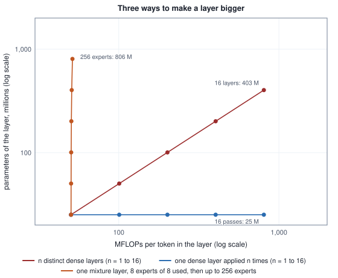
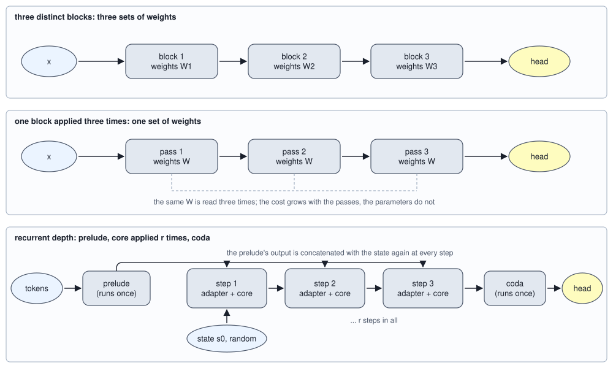
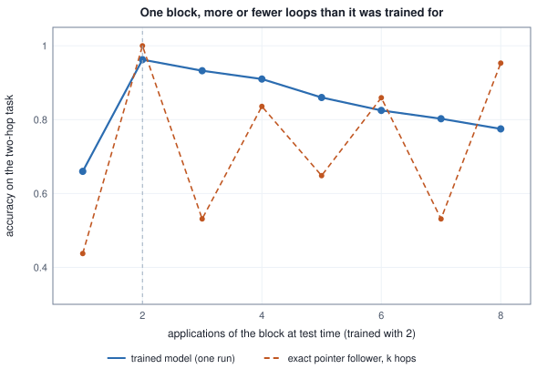

<!-- SPDX-License-Identifier: CC-BY-4.0 -->
<!-- Copyright (c) 2026 Martin Schröder <info@swedishembedded.com> -->

# Looped and Recurrent-Depth Transformers

*What if a model could think longer by reusing the same layers more times?*

The checkpoint that `crates/ouro` loads holds 2,667,974,657 numbers, and a token that passes through the model does more arithmetic than that count suggests. The table counts both.

<!-- worked: recurrent_depth.ouro_released -->
Counted from the tensors the config declares (embedding 49,152 by 2,048; per layer four gains, the four attention matrices, gate, up and down; final norm; the exit gate's 2,048 weights and one bias; an untied head). The total of the first row is 2,667,974,657, the number in the checkpoint's header. FLOPs per decoded token: 2 per weight of the layers' seven matrices for every application, plus 2 V D for the head; the scores and softmax are left out, so the row is a lower bound.

| model | distinct layers | layer applications per token | parameters | GFLOPs per token | FLOPs per parameter |
|---|---:|---:|---:|---:|---:|
| the released model: 48 layers, 4 passes | 48 | 192 | 2,667,974,657 | 19.93 | 7.47 |
| the same layers, 1 pass | 48 | 48 | 2,667,974,657 | 5.13 | 1.92 |
| 192 distinct layers (the compute of 4 passes) | 192 | 192 | 10,067,906,561 | 19.93 | 1.98 |
<!-- /worked -->

Read the first row against the third. The released model applies its 48 layers four times to every token, so a token meets 192 layer applications. A model of 192 distinct layers of the same shape would do the same 19.93 billion FLOPs per token and would hold 10,067,906,561 parameters, 3.77 times as many. The file is smaller by that factor for the same work per token, and the last column says what was done to get there: each parameter takes part in 7.47 FLOPs per token, where the ordinary stack of the third row gives 1.98.

[Chapter 4](04-mixture-of-experts.md) ran the trade in the other direction. A mixture holds parameters that a token never touches, and the cost of a token stays near that of a small model while the capacity grows. This model touches every parameter four times. One chapter bought parameters without compute and this one buys compute without parameters, and the question it has to answer is whether the second purchase is worth anything. A model that can apply the same weights again can, in principle, spend more arithmetic on a hard token than on an easy one, and that is the reason to want it. The chapter builds the smallest version of the idea, trains it on a task that needs repeated steps, lets the model choose how many steps to take, and then reads the two crates of brain that carry the idea in two different forms.

Six things from earlier chapters are used before this chapter explains them again, each as a one-line question. The answers are at the end.

1. (Volume V, [Chapter 9](../v05-sequences/09-transformer-block.md), the residual stream.) A pre-norm block reads the stream $\mathbf{x}$ and writes two sublayers into it. What is the block's output in terms of $\mathbf{x}$, the attention sublayer $\mathrm{attn}$, the feed-forward network $\mathrm{ffn}$ and the norm?
2. (Volume V, [Chapter 5](../v05-sequences/05-recurrent-networks.md), backpropagation through time.) The same matrix $\mathbf{W}$ is used at each of $n$ steps of an unrolled recurrence. How is the gradient of the loss with respect to $\mathbf{W}$ built from the steps?
3. (Volume III, [Chapter 12](../v03-neural-networks/12-training-dynamics.md), vanishing and exploding gradients.) A gradient passes through 32 layers and each multiplies its size by 0.9, or by 1.1. What is left?
4. (Volume VI, [Chapter 4](04-mixture-of-experts.md), experts.) A mixture layer holds 32 experts and a token uses 2. What share of the expert parameters does a token touch?
5. (Volume V, [Chapter 12](../v05-sequences/12-kv-cache.md), the KV cache.) What does a decoder keep for each earlier token in each layer, and why can it be kept unchanged?
6. (Volume I, [Chapter 9](../v01-mathematics/09-integrals-and-odes.md), Euler's method.) For $\mathrm{d}\mathbf{x}/\mathrm{d}\tau = g(\mathbf{x})$, what is one Euler step of size $h$?

## One block, applied again

Start with the smallest case that has the whole structure, a block of the shape of the released model and a count of four applications.

<!-- worked: recurrent_depth.stack_or_loop -->
A block of width D = 2048, 16 heads of width 128 (the attention matrices are four 2048 by 2048), SwiGLU hidden width F = 5632, two RMS norm gains, no biases: attention 16,777,216, feed-forward network 34,603,008, gains 4,096 parameters. FLOPs of one decoded token that reads 2048 cached tokens: 2 per weight of the seven matrices, plus 4 D T = 16,777,216 for the scores and the weighted sum of the values (norms, softmax and adds left out). The mixture row keeps the attention and replaces the three feed-forward matrices by 32 experts of the same shape and a router of 2048 by 32; a token uses 2 experts. Exact integers.

| layer or stack | block applications per token | parameters | FLOPs per token | FLOPs per parameter |
|---|---:|---:|---:|---:|
| one block | 1 | 51,384,320 | 119,537,664 | 2.33 |
| 4 distinct blocks | 4 | 205,537,280 | 478,150,656 | 2.33 |
| one block applied 4 times | 4 | 51,384,320 | 478,150,656 | 9.31 |
| one block, feed-forward network replaced by 32 experts, 2 used | 1 | 1,124,143,104 | 188,874,752 | 0.17 |
<!-- /worked -->

The second and third rows spend the same arithmetic. Four distinct blocks hold four sets of weights, 205,537,280 numbers, and the one block applied four times holds one, 51,384,320. Both do 478,150,656 FLOPs for a token that reads 2,048 cached tokens, so the looped stack does its arithmetic with a quarter of the parameters, 9.31 FLOPs per parameter against 2.33. The last row is the mixture of Chapter 4, with the feed-forward network replaced by 32 experts and 2 of them used: 1,124,143,104 parameters for 188,874,752 FLOPs, 0.17 FLOPs per parameter. Three ways of using a block lie on three sides of the starting point, and the figure puts them on one plot. From a dense layer, adding distinct layers moves along the diagonal, adding experts moves straight up, and applying the same layer more often moves straight to the right.



Reusing one set of weights at several depths is **weight-shared depth**. A **looped transformer** is a decoder in which the layers, one block or the whole stack, are applied again to their own output a fixed number of times; the embedding is applied once, at the start, and the head reads the stream at the end. The Universal Transformer (Dehghani and colleagues, 2019) shared one block across depth and let each position decide how many times to apply it, and Ouro is a present-day decoder built the same way with a stack of 48 layers as the shared unit. The upper two rows of the first figure draw the difference.



A count of FLOPs says what the loop costs and nothing about whether it helps. The remaining sections find out, on a task small enough to train in plain Python.

## Two lookups from one block

The task is the two-hop lookup of [Chapter 9 of Volume V](../v05-sequences/09-transformer-block.md). The input is four pairs $a \to f(a)$ of a random function $f$ on $\{0, 1, 2, 3\}$ in shuffled order and a query $x$, and the answer is $f(f(x))$. Finding the answer takes two lookups, the second needing the result of the first. That chapter solved it with two distinct blocks. Here a single block is applied twice, so that the second lookup is made by the same weights as the first.

<!-- worked: recurrent_depth.loop_setup -->
The task is the two-hop task of Volume V, Chapter 9 (`transformer_block.two_hop_example`, drawn exactly as there): four pairs a -> f(a) of a random function on {0, 1, 2, 3} in shuffled order and a query x, the target f(f(x)); ids 0 .. 15 are the pair tokens, ids 16 .. 19 the query tokens, T = 5, no position information. The decoder is that chapter's with ONE block: embedding table E [20, 16], the pre-norm block of width 16 with 2 heads and SwiGLU hidden width 24 (causal attention), a gain-only final RMS norm (epsilon 1e-6) and a head W_C [16, 4] on the last position. The block is applied 2 times in training and the loss is the cross-entropy of the last position after the second application. Parameters: 2,208 in the block, 2,608 in all (a decoder with two distinct blocks of Chapter 9 has 4,816). A predictor that knows the pointer and follows it exactly k times is right with probability 0.4375, 1.0000, 0.5312, 0.8359, 0.6484, 0.8594, 0.5312, 0.9531 for k = 1 .. 8 (enumerated over the 256 functions and 4 queries); in 43.8 percent of the pairs one hop already gives the answer, because f(x) is a fixed point.
<!-- /worked -->

The forward computation, with the block of Chapter 9 applied `n_loop` times to the stream:

```text
function looped_forward(ids: array<int>[T], E: array<real>[V, D],
                        Wq: array<real>[D, D], Wk: array<real>[D, D],
                        Wv: array<real>[D, D], Wo: array<real>[D, D],
                        g1: array<real>[D], g2: array<real>[D],
                        Wgate: array<real>[D, F], Wup: array<real>[D, F],
                        Wdown: array<real>[F, D], gf: array<real>[D],
                        Wc: array<real>[D, C], H: int, eps: real,
                        n_loop: int) -> array<real>[C]:
    require n_loop >= 1, "at least one application"
    X = zeros(real, [T, D])
    for i in 0 .. T:
        X[i, :] = E[ids[i], :]                          # the embeddings, once
    for t in 0 .. n_loop:
        X = block_forward(X, Wq, Wk, Wv, Wo, g1, g2,    # the same nine arrays
                          Wgate, Wup, Wdown, H, eps)    # at every application
    (Y, _, _) = rms_norm(X, gf, eps)
    logits = matmul(Y[T - 1:T, :], Wc)                  # the last position only
    return logits[0, :]
```

Two facts about the setup matter for what follows. The block is the pre-norm block of that chapter, so the stream $\mathbf{x}$ of five rows is updated twice per application, and the head reads only the last row. And the loss is placed on the last application alone: nothing in training mentions one application or three. They are what the test below varies.

A block applied twice has one set of weights and two uses of them, and its gradient has to account for both. The rule is the one of Volume V, Chapter 5: the gradient of a shared weight is the sum of the contributions of its uses, and the backward pass walks the uses in reverse, each use receiving the gradient that the later use passed down. Dropping one use, or letting a later use overwrite the earlier one's contribution instead of adding to it, gives a gradient that is wrong by the missing share. Central differences settle it, and the check is made on the loop model and on the exit model of a later section.

<!-- worked: recurrent_depth.shared_gradient_check -->
One example of the two-hop task from `recurrent_depth.check.example` (0x922c5c6fc22873f2), parameters from `recurrent_depth.check.loop` and `recurrent_depth.check.exit`, three entries of every tensor (the first, the middle and the last). Criterion: the largest relative error below 1e-6.

| model | entries checked | largest relative error, sum over the uses | same, last use only |
|---|---:|---:|---:|
| loop: block applied 2 times, loss after the last | 36 | below 1e-6 | 1.99 |
| exit: 3 passes, loss weighted by q | 40 | below 1e-6 | 1.74 |
<!-- /worked -->

The right-hand column is the same check on the wrong gradient that keeps the last use only; it fails by relative errors of 1.99 and 1.74, close to the largest value, 2, that this measure can take. Now the training.

<!-- worked: recurrent_depth.loop_training -->
Initialization: draws from `recurrent_depth.loop.init` (0x640596fe7b263ce0) in the order above. Training: the examples of the stream `recurrent_depth.loop.data` (0x61b49b1d3ab2ce26), step s of 600 takes the examples 16 (s - 1) to 16 s - 1; the gradient of a step is the mean of the 16 example gradients, with the block's gradient the sum over its two uses; Adam on every tensor at rate 0.01, beta 0.9 and 0.999, epsilon 1e-8, no weight decay, clipping or warmup. Mean training loss over the 20 steps up to step 100, 200, 400: 0.869, 0.659, 0.456. Test: the first 400 examples of `recurrent_depth.test` (0x9b4b7e9dbd7fde15), the largest logit (lowest id on a tie) against the target, with k = 1 .. 8 applications of the block. The relative change is the mean over the test examples of ||x_k - x_(k-1)|| / ||x_(k-1)|| for the stream matrices [5, 16] (x_0 the embeddings), the RMS of the stream the root mean square of the entries of x_k and the RMS of the change that of the entries of x_k - x_(k-1). A number that comes from a chaotic run is printed with only the digits that are the same in the run and in four copies of it whose first weight is changed by +1e-12, -1e-12, +3e-12 and -3e-12: in full if all agree on it, as 'about x' with the leading digits on which all agree, or as 'unstable' when not even one digit survives; the other digits cannot be reproduced in another implementation. The test accuracy of this run is chaotic in its second digit: where the five values differ, the cell gives the smallest and the largest of them, and the claims below the table are the statements that hold in every copy.

| loops k | test accuracy | exact pointer follower | relative change | RMS of the stream | RMS of the change |
|---|---:|---:|---:|---:|---:|
| 1 | 0.657 to 0.662 | 0.438 | about 2.6 | about 3.2 | about 2.8 |
| 2 | 0.953 to 0.963 | 1.000 | about 0.74 | about 4.7 | 2.32 |
| 3 | 0.930 to 0.940 | 0.531 | about 0.45 | about 6.4 | 2.11 |
| 4 | 0.900 to 0.910 | 0.836 | 0.318 | about 8.1 | about 2 |
| 5 | 0.845 to 0.870 | 0.648 | about 0.25 | about 9.8 | about 2 |
| 6 | 0.820 to 0.830 | 0.859 | about 0.2 | about 11.5 | about 2 |
| 7 | 0.800 to 0.807 | 0.531 | 0.175 | about 13.2 | about 2 |
| 8 | 0.772 to 0.780 | 0.953 | 0.153 | about 14.9 | about 2 |

What holds in every copy:

| claim | copies in which it holds |
|---|---:|
| accuracy is highest at k = 2, the number of applications it was trained with | 5 of 5 |
| accuracy at k = 2 is above 0.9 | 5 of 5 |
| accuracy at k = 1 is below 0.7 | 5 of 5 |
| accuracy falls at every k from 3 to 8 | 5 of 5 |
| accuracy at k = 8 is at least 0.1 below accuracy at k = 2 | 5 of 5 |
| the relative change of the stream falls at every k | 5 of 5 |
| the RMS of the stream grows at every k | 5 of 5 |
<!-- /worked -->

The first thing to read is the row at $k = 2$, the number of applications the block was trained with, where accuracy is above 0.9 in every copy. One application is right on fewer than 0.7 of the examples, which is above the 0.53 that a predictor limited to finding $f(x)$ can reach, so a single application already composes some of the two hops (the chapter does not dissect how). The second application is where the answer appears, and the same weights supply it.

The second thing is that more is not better. Accuracy falls at every $k$ from 3 to 8, in every copy, and at $k = 8$ it is at least 0.1 below its value at $k = 2$. A model that had learned to follow the pointer one step per application would fail differently. The column "exact pointer follower" is the accuracy of such a predictor, enumerated over all 256 functions and 4 queries: it is right at $k = 2$ and then swings with the parity of $k$, down to 0.531 at $k = 3$ and up to 0.859 at $k = 6$, because the orbit of $x$ under $f$ ends in a cycle and an odd number of further steps leaves it elsewhere on the cycle. The trained model does not swing. It loses accuracy smoothly, which says that its extra applications do not move a pointer; they move the stream by a smaller and smaller fraction of its length, and the answer decays.



The last three columns of the table say how the stream behaves, and they set up the next section. The RMS of the stream grows with every application, from about 3.2 after one to about 14.9 after eight, by about 1.7 per application from $k = 3$ on, in every copy. Chapter 9 measured the stream of a stack of distinct blocks growing like $\sqrt{1 + k}$; here the growth is nearly linear, as if the increments of one repeated block pointed in a common direction. The RMS of the change falls from about 2.8 at $k = 1$ to 2.32 and 2.11 at $k = 2$ and 3 and then stays near 2 up to $k = 8$, so the relative change falls (from 0.74 at $k = 2$ to 0.153 at $k = 8$, again in every copy) only because the stream it is measured against has grown. The loop does not converge. Each application adds an increment of about the same size to a stream that gets larger, and the direction the head reads drifts more slowly the larger the stream is.

## What a loop does to the stream beyond the trained depth

Why the stream behaves like this follows from what a pre-norm block is. Write the block as a map of the stream, with the two sublayers of Chapter 9 gathered into one increment:

$$\mathbf{x} \;\longmapsto\; \mathbf{x} + \boldsymbol{\Delta}(\mathbf{x}), \qquad \boldsymbol{\Delta}(\mathbf{x}) = \mathrm{attn}(\mathrm{norm}(\mathbf{x})) + \mathrm{ffn}\big(\mathrm{norm}(\mathbf{x} + \mathrm{attn}(\mathrm{norm}(\mathbf{x})))\big).$$

Applying the block $n_{\mathrm{loop}}$ times is the iteration $\mathbf{x}_t = \mathbf{x}_{t-1} + \boldsymbol{\Delta}(\mathbf{x}_{t-1})$. This is Euler's method with step size 1 on the equation $\mathrm{d}\mathbf{x}/\mathrm{d}\tau = \boldsymbol{\Delta}(\mathbf{x})$ (Volume I, Chapter 9): the stream is a position, the block is the velocity field, and a pass is a step of fixed length. Depth is time, as it was in Chapter 5 of Volume V, where an unrolled recurrence and a deep network turned out to be the same graph.

Two things can happen to such a sequence. A **fixed point** is a stream $\mathbf{x}^\ast$ at which $\boldsymbol{\Delta}(\mathbf{x}^\ast) = \mathbf{0}$: the block adds nothing, and further applications change nothing. The iteration is drawn to it if one step shrinks small differences, that is if $\lVert\mathbf{I} + \partial\boldsymbol{\Delta}/\partial\mathbf{x}\rVert < 1$ near it, and it is pushed away if that norm exceeds 1. Otherwise the stream does not settle and keeps moving. The toy is in the third case: its increments do not vanish, and a norm in front of each sublayer makes the sublayer's output depend on the direction of its input and not on its length, so the increment keeps its size while the stream grows. The backward pass meets the same quantity. The gradient through $n_{\mathrm{loop}}$ applications is a product of $n_{\mathrm{loop}}$ factors $\mathbf{I} + \partial\boldsymbol{\Delta}/\partial\mathbf{x}_{t}$, and a product of 32 factors that each scale by 0.9 or by 1.1 is 0.0343 or 21.1 (the third recall question): a deep loop inherits the vanishing and exploding gradients of a deep stack, and the identity in each factor is what keeps the product from being worse.

The simplest map with a fixed point shows what separates the cases. Take a scalar state $s$ pulled toward an input $u = 1$ at every step, $s \leftarrow a\,s + (1 - a)\,u$, from three starting states, and measure how far apart the three are after 4, 16 and 32 steps.

<!-- worked: recurrent_depth.injection_iterates -->
Starting states s_0 = -3, 0 and 5; input u_in = 1. For each gain a the table gives the spread (largest minus smallest) of the three states after 4, 16 and 32 steps of s <- a s + (1 - a) u_in (the spread of the recurrence without the input is the same, because a difference is multiplied by a either way), and the state reached from s_0 = 0 after 32 steps with the input and with the input removed. Tolerance: four significant digits.

| gain a | spread after 4 | spread after 16 | spread after 32 | from 0 after 32, with input | from 0 after 32, no input |
|---:|---:|---:|---:|---:|---:|
| 0.5 | 5.000e-01 | 1.221e-04 | 1.863e-09 | 1 | 0 |
| 0.9 | 5.249e+00 | 1.482e+00 | 2.747e-01 | 0.9657 | 0 |
| 1.0 | 8.000e+00 | 8.000e+00 | 8.000e+00 | 0 | 0 |
| 1.1 | 1.171e+01 | 3.676e+01 | 1.689e+02 | -20.11 | 0 |
<!-- /worked -->

The gain $a$ is the factor by which one step shrinks a difference, and the table has all three regimes. At $a = 0.5$ the three states are within $1.9 \times 10^{-9}$ of one another after 32 steps and have forgotten where they started; all three are at the input. At $a = 0.9$ they are still $0.2747$ apart after 32 steps, converging slowly, and from 0 the state has reached 0.9657 of the way to the input. At $a = 1$ nothing contracts, so the spread stays at 8 for ever, which is what a bare residual connection with no pull does. At $a = 1.1$ the spread grows to 168.9 after 32 steps and the state leaves. The last two columns show why the input in the recurrence matters: pulled toward $u = 1$ with a gain below 1 the state ends near 1 whatever it started as, and with the input removed it ends at 0, a point that carries no information about anything. A loop that is to improve an answer by more steps needs both properties, a gain below 1 so that the state settles and a pull toward the input so that where it settles depends on the question.

The toy loop has neither. It reads the embedding once, at the start, and nothing in the block pulls the stream back to it, and the norm that precedes each sublayer lets the stream grow. The two crates of this chapter each add something that the toy lacks, and the two additions differ. Ouro closes every pass with a norm and starts the next pass from the normed state, so the scale of the state is reset at each step. Huginn re-reads the input at every step through an adapter, which is the pull of the scalar table. The next two sections take them in turn, beginning with the question the toy raised: if the number of applications changes the answer, who decides it?

## Letting each token choose its depth

Whether a fixed count of passes is right depends on the input. A query whose first hop already lands on a fixed point is answered after one lookup, and a second hop adds nothing but cost; a query that needs both hops is wrong without the second. The toy's enumeration says how common the first case is, 43.8 percent of the pairs. A model that decided for itself how many applications to spend would save that arithmetic where it is not needed.

**Adaptive computation** is the name for letting the amount of computation depend on the input. Graves (2016) did it for recurrent networks with a halting unit: at each step a sigmoid of the state gives a probability of stopping, the steps are taken until their halting probabilities add up to 1, the output is the average of the step outputs weighted by those probabilities, and a penalty on the number of steps is added to the loss. Ouro's version replaces the stopping rule by a distribution. After pass $t$ a gate reads the final-normed state of the token, one linear map from the width $D$ to one number plus a bias, and turns it into the probability $\rho_t = \mathrm{sigmoid}(z_t)$ of stopping at pass $t$ given that the passes before did not. The probability of leaving at exactly pass $t$ is

$$q_t = \rho_t \prod_{j < t}(1 - \rho_j) \quad (t < n_{\mathrm{loop}}), \qquad q_{n_{\mathrm{loop}}} = \prod_{j < n_{\mathrm{loop}}}(1 - \rho_j),$$

where the last pass takes whatever mass is left, so that the $q_t$ add up to 1 and the gate of the last pass is never used. The head reads every pass's state, so each pass has a cross-entropy $\ell_t$. By hand, on four passes:

<!-- worked: recurrent_depth.exit_by_hand -->
Four passes. Gate logits z of passes 1 to 3 and the cross-entropy c of the head after each pass are given. lambda = sigmoid(z); q_t = lambda_t times the mass remaining; the last pass takes what remains. Tolerance: 4 decimals.

| pass t | gate logit z | lambda | mass remaining before t | exit probability q | cumulative | c |
|---|---:|---:|---:|---:|---:|---:|
| 1 | -1.0 | 0.2689 | 1.0000 | 0.2689 | 0.2689 | 2.0 |
| 2 | 0.0 | 0.5000 | 0.7311 | 0.3655 | 0.6345 | 1.2 |
| 3 | 1.0 | 0.7311 | 0.3655 | 0.2672 | 0.9017 | 0.9 |
| 4 | unused | unused | 0.0983 | 0.0983 | 1.0000 | 0.8 |

The weighted loss sum q_t c_t = 1.2957 nats. The expected number of passes sum t q_t = 2.1949 of 4. The first pass whose cumulative probability reaches the threshold: threshold 0.3: pass 2; threshold 0.5: pass 2; threshold 0.9: pass 3; threshold 1.0: pass 4. The gradient of the loss with respect to z_1, z_2, z_3 by the product form is (0.1894, 0.0597, 0.0072); it agrees with central differences at step 1e-6 to below 1e-6.
<!-- /worked -->

In pseudocode, with passes numbered from 0:

```text
function exit_distribution(z: array<real>[n_loop - 1]) -> array<real>[n_loop]:
    q = zeros(real, [n_loop])
    remaining = 1.0
    for t in 0 .. n_loop - 1:
        rho = sigmoid(z[t])
        q[t] = rho * remaining                  # leave here, having got this far
        remaining = remaining * (1.0 - rho)
    q[n_loop - 1] = remaining                   # the last pass takes the rest
    return q

function exit_pass(q: array<real>[n_loop], threshold: real) -> int:
    cdf = 0.0
    for t in 0 .. n_loop:
        cdf = cdf + q[t]
        if cdf >= threshold:
            return t                            # the first pass that reaches it
    return n_loop - 1
```

The objective the crate implements as the released one is the expected loss $\sum_t q_t \ell_t$, the weighted loss of the table, averaged over the tokens that have a target. The gradient with respect to the gate logit of pass $t$ is exact and has a product form, $\partial \mathcal{L}/\partial \rho_t = \ell_t \prod_{k<t}(1-\rho_k) - \sum_{j>t} \ell_j\, q_j/(1 - \rho_t)$, and `crates/ouro/src/model.rs` evaluates the products directly rather than dividing out $1 - \rho_t$, because the division is wrong where a gate saturates and $1 - \rho_t$ is zero. The hand example checks the formula against central differences. What the loss rewards is plain from its form: the weighted sum is smallest when the whole mass sits on the pass with the lowest $\ell_t$, and nothing in it charges for depth, so unlike Graves's penalty it does not push the model to stop early. The cross-entropy of the mixed distribution would be a different objective, $-\ln\sum_t q_t\,p_t(y)$, and it is never larger than the weighted sum, since $-\ln$ is convex; for two passes with probabilities 0.2 and 0.9 of the right answer and weights one half each, the weighted sum is 0.8574 and the mixture 0.5978. The crate's tests pin the weighted sum.

Here is the objective on the toy: three passes of the one block, pass $t > 1$ starting from the normed output of pass $t - 1$, a shared head, and a gate on the last row.

<!-- worked: recurrent_depth.exit_training -->
The same task and decoder with the objective of Ouro: 3 passes of the one block, pass t > 1 starting from the final-normed output of pass t - 1, each pass ending in the shared gain-only RMS norm, the head on the last position and the gate z = w . h + b of the last position (w [16] drawn as 0.1 normal() after W_C, b = -1.5); q from the gates of passes 1 and 2 as in the hand example; the loss of an example is sum q_t c_t. Initialization from `recurrent_depth.exit.init` (0x26e69b3361b0b9f0), the data stream `recurrent_depth.exit.data` (0x947815ae000dde7c), 800 steps, the optimizer and the test examples of the previous table. Mean training loss over the 20 steps up to step 100, 200, 400: 0.954, 0.879, 0.579. Of the 400 test examples, 179 have a fixed point at f(x) ('one hop enough'); the last two columns are the mean exit probability of that group and of the rest. A number that comes from a chaotic run is printed with only the digits that are the same in the run and in four copies of it whose first weight is changed by +1e-12, -1e-12, +3e-12 and -3e-12: in full if all agree on it, as 'about x' with the leading digits on which all agree, or as 'unstable' when not even one digit survives; the other digits cannot be reproduced in another implementation. The test numbers of this run scatter in their first digit, so each cell gives the smallest and the largest value over the run and its four copies, and the claims below the tables are the statements that hold in every copy.

| pass t | accuracy of the head after pass t | cross-entropy (nats) | mean exit probability q_t | q_t, one hop enough | q_t, the rest |
|---|---:|---:|---:|---:|---:|
| 1 | 0.487 to 0.545 | 1.464 to 1.892 | 0.086 to 0.185 | 0.157 to 0.345 | 0.028 to 0.065 |
| 2 | 0.940 to 1.000 | 0.025 to 0.195 | 0.064 to 0.171 | 0.049 to 0.148 | 0.077 to 0.231 |
| 3 | 0.948 to 1.000 | 0.013 to 0.195 | 0.688 to 0.850 | 0.539 to 0.795 | 0.739 to 0.895 |

The exit rule: leave at the first pass whose cumulative exit probability reaches the threshold (the last pass when none does).

| threshold | mean passes run (of 3) | accuracy at the exit pass |
|---|---:|---:|
| 0.3 | 2.425 to 2.745 | 0.953 to 1.000 |
| 0.5 | 2.518 to 2.770 | 0.953 to 1.000 |
| 0.8 | 2.587 to 2.825 | 0.953 to 1.000 |
| 0.95 | 2.710 to 2.987 | 0.953 to 1.000 |

What holds in every copy:

| claim | copies in which it holds |
|---|---:|
| the head after pass 1 is right on fewer than 0.6 of the examples | 5 of 5 |
| the heads after passes 2 and 3 are right on more than 0.9 | 5 of 5 |
| most of the exit probability is on the last pass (q_3 above 0.5) | 5 of 5 |
| q_1 of the 'one hop enough' group is at least 4 times q_1 of the rest | 5 of 5 |
| at threshold 0.5 fewer than 2.8 passes are run on average | 5 of 5 |
| at threshold 0.5 accuracy is within 0.03 of the accuracy of the last pass | 5 of 5 |
<!-- /worked -->

The head after the first pass is right on fewer than 0.6 of the examples in every copy, and the heads after the second and third pass on more than 0.9. The gate starts at the bias $-1.5$, which puts 0.67 of the mass on the last pass, and training leaves most of it there. But the gate also learned something about the input: the exit probability of the first pass for the examples where one hop is enough is at least 4 times that of the others, in every copy, and the cells of the "one hop enough" and "the rest" columns show the gap. It is a modest signal: the table gives 0.157 to 0.345 for the easy group, so even there the first pass keeps at most about a third of the mass.

What that is worth is in the second table, which applies the exit rule. At a threshold of 0.5 between 2.518 and 2.770 passes of 3 run on average across the five copies, a saving of 8 to 16 percent of the passes, and accuracy at the exit pass is within 0.03 of that of the last pass in every copy. This small saving is what the toy's training dynamics give. A larger saving needs a gate that is better trained or a loss that asks for it, and the chapter did not run either.

A word about what brain does with the rule. `exit_steps` in `crates/ouro/src/model.rs` implements it for every row of a batch, and `choose_exit` in `crates/ouro/src/decode.rs` for the one row of a decode step, and the released config has threshold 1.0, which selects the last pass. They run all the passes first and only then choose the head to read, so the arithmetic of the later passes is spent whatever the gate says: in brain the gate selects a pass, it does not stop the computation. Stopping would have a consequence that the cache section works out. The tests in `crates/ouro` use threshold 1.0 only, at which "the first pass whose cumulative probability reaches 1" and "the last pass" are the same pass, so they cannot tell the exit rule from a constant; a threshold below 1 is the case that would.

## A state that starts as noise

The second crate, `crates/huginn`, makes the other choice. Its layout is the third row of the first figure: a **prelude** of 2 blocks that embeds the tokens once, a **core** of 4 blocks applied $r$ times, and a **coda** of 2 blocks that reads the result out, ending in the tied head. The core does not start from the prelude's output. It starts from a latent state drawn at random, and at every step an adapter, a linear map from $2D$ to $D$, takes the state and the prelude's output side by side:

$$\mathbf{s}^{(t)} = \mathrm{core}\big(\mathbf{W}_{\mathrm{A}}\,[\,\mathbf{s}^{(t-1)};\ \mathbf{u}\,]\big),$$

for $t = 1, \dots, r$, with $\mathbf{s}^{(0)}$ a draw from a normal distribution of standard deviation $\sigma_{\mathrm{init}}$ and $\mathbf{u}$ the prelude's output for the token. This is the pull toward the input of the scalar table: the adapter reads $\mathbf{u}$ at every step, so the question never leaves the loop. A model of this kind, in which the number of core steps is a quantity chosen at run time and the state starts as noise, is **recurrent depth**. The embeddings are scaled by $\sqrt{D}$ before the prelude, the final norm is applied after the last core step and again after the coda, and the head shares the embedding table.

<!-- worked: recurrent_depth.huginn_released -->
Counted from the tensors the config declares: embedding (tied to the head) 346,030,080, adapter 5280 by 10560 = 55,756,800, final norm 5280, and 8 blocks of 395,398,080 parameters each (four gains, fused QKV, output matrix, two bias vectors, fused gate-and-up, projection), in all 3,564,976,800 parameters, whatever r is. One decoded token costs, per core step, the adapter and the 4 core blocks; the prelude and the coda run once; the head costs 2 V D once. FLOPs count 2 per weight of the seven matrices of every block, 2 per weight of the adapter and 2 V D for the head (scores left out).

| core steps r | layers a token passes through | GFLOPs per token | FLOPs per parameter |
|---|---:|---:|---:|
| 1 | 8 | 7.1 | 2.00 |
| 4 | 20 | 17.0 | 4.76 |
| 8 | 36 | 30.1 | 8.43 |
| 16 | 68 | 56.2 | 15.78 |
| 32 | 132 | 108.6 | 30.47 |
| 64 | 260 | 213.4 | 59.87 |
<!-- /worked -->

The parameters are those of eight blocks, an adapter and a table, 3,564,976,800 in all, whatever $r$ is, and a token meets $2 + 4r + 2$ layers. At $r = 32$, the value the config calls `mean_recurrence`, that is 132 layer applications and 108.6 billion FLOPs for a token, 30.47 per parameter; at $r = 1$ the model is 8 layers and 7.1 billion FLOPs. The released model's own `init_values` give the noise: a standard deviation of 0.008703883 times the embedding scale 72.663605, which is 0.6325 per coordinate of the state. The serving engine draws a plain normal of that deviation, and a comment in its code says that the reference truncates the normal.

Two things in the layout are choices worth seeing. First, the blocks. `crates/huginn/src/model.rs` writes its block as $\mathbf{x} \leftarrow \mathrm{norm}_2(\mathrm{attn}(\mathrm{norm}_1(\mathbf{x})) + \mathbf{x})$ and then $\mathbf{x} \leftarrow \mathrm{norm}_4(\mathrm{ffn}(\mathrm{norm}_3(\mathbf{x})) + \mathbf{x})$, each line reading the result of the one before: a norm on each sublayer's input and a norm on the sum, so the state leaves every block with a scale set by one gain vector. `crates/ouro` uses four norms too, but places the second of each pair on the branch, before the add: $\mathbf{x} \leftarrow \mathbf{x} + \mathrm{norm}_a(\mathrm{attn}(\mathrm{norm}_1(\mathbf{x})))$, and likewise for the feed-forward network. In Ouro the skip path is a pure identity within a pass, and the scale is reset between passes by the final norm. Both layouts keep the scale of the state under control, which the toy's loop did not.

Second, the state. In the toy the first application starts from the embedding. Here it starts from noise, so the answer cannot depend on the start, and the scalar table says when that holds: when the map contracts, the end state forgets where it began. A model trained from random starts is a model trained to contract. The code draws the state in two ways. The full forward takes it from the caller, one row per position (`set_state`), because a parity test must start from the state the reference started from; the serving engine in `crates/huginn/src/serve.rs` draws it once when the engine is built and reuses it for every position of every request.

How is it trained? The paper that introduced the model (Geiping and colleagues, 2025) samples a random number of core steps for each training sequence and back-propagates only through the last few of them, so that the cost of a training step stays bounded while the model learns to be run for many more steps than it was ever differentiated through. The code of brain does neither: `Huginn::new_train` builds its graph for `mean_recurrence` steps and differentiates every application, keeping the boundary residual of each ($r\,(n_{\mathrm{core}} + 1)$ buffers, the part of the tape that grows with $r$), so that the gradient of each core block is a sum of $r$ terms; the comment of its gradient check says that the reference truncates to a `mean_backprop_depth` and that the check runs with all steps inside the window. The gradient check is on a tiny configuration with $r = 3$. What brain exercises at run time is the other half of the idea, depth as a parameter: `Huginn::forward(steps)` records its graph for the number of steps given, and the parity test compares state, latent and logits after each of $1, \dots, r$ steps with the reference at the same weights and the same starting state. There is no exit criterion: the caller chooses $r$.

## What the cache keeps

Chapter 12 of Volume V made the KV cache from one fact: a key and a value depend only on the tokens up to their own position and the weights, so they never change and need not be recomputed. A shared block breaks the second half. The weights are the same, but the stream the block reads is not: the key that layer $\ell$ computes at position $i$ in the second pass comes from a different state than the key the same layer computed at the same position in the first pass. Two uses of one set of weights are two different functions of the input, and each needs its own cache. Ouro keys its caches by $(\text{pass}, \text{layer})$, and `crates/ouro/src/decode.rs` keeps exactly one pair of buffers per such key.

<!-- worked: recurrent_depth.kv_cache_bytes -->
Per token a layer stores a key and a value, each of the model's key width: 2,048 numbers for Ouro (16 heads of 128, no sharing between heads) and 5,280 for huginn-0125 (55 heads of 96). The columns on the right are a full context of 4,096 tokens (the positional capacity of huginn-0125) at 2 bytes per number (bf16) and at 4 bytes per number (the float32 the two engines of brain keep their caches in). Exact integers.

| layout | caches | bytes per token (2-byte) | 4,096 tokens (2-byte) | 4,096 tokens (4-byte) |
|---|---:|---:|---:|---:|
| 48 layers, 1 pass | 48 | 393,216 | 1,610,612,736 | 3,221,225,472 |
| Ouro, 4 passes | 192 | 1,572,864 | 6,442,450,944 | 12,884,901,888 |
| Ouro, one cache per layer for all 4 passes | 48 | 393,216 | 1,610,612,736 | 3,221,225,472 |
| Huginn, 32 core steps | 132 | 2,787,840 | 11,418,992,640 | 22,837,985,280 |
| Huginn, ring of 8 core histories | 12 | 253,440 | 1,038,090,240 | 2,076,180,480 |
<!-- /worked -->

The loop costs memory in proportion to its depth. Ouro with 4 passes keeps four times the cache of a 48-layer model, 1,572,864 bytes per token at two bytes per number and 6,442,450,944 bytes for 4,096 tokens, where one cache per layer shared by the four passes would hold a quarter of that, and would be wrong. Huginn keeps one cache per stage, a stage being a prelude block, a core block at a given step, or a coda block: with 32 core steps that is 132 caches and 11,418,992,640 bytes for 4,096 tokens at two bytes (22,837,985,280 at the four bytes the engine stores). The cost of a pass is paid twice, once in arithmetic and again in the bytes that a decode step must read, and Chapter 12's roofline reading of decode makes the second the harder to hide.

Skipping a pass is therefore not free of consequences. A token that exits at pass 2 has no keys and values in the caches of passes 3 and 4, and a later token that goes deeper reads those caches at the position of the earlier one. So the earlier token must either run its remaining passes only to fill the cache, which saves nothing, or the deeper token must read a substitute, a copy of the last pass it did compute, which is an approximation. That is the price any engine that skipped passes would pay; the engine of brain computes every pass and selects afterwards.

Both crates keep their caches in pages, and the history of that is a small lesson in what a shared name hides. The paged engine of Ouro first gave a sequence $T$ block tables that drew from one allocator, while every pass had its own plane. A sequence of $T$ passes was charged $T$ times its context against the blocks of one plane, and the pool ran dry; commit `a529406a0` gave each pass an allocator of the same capacity, so that admission counts pages per pass against the tightest plane, as the comment above `allocs` in `crates/ouro/src/serve.rs` now says. Huginn's per-stage caches faced the same sums at depth: commit `6b06ced23` records that the released depth of 32 steps, 132 planes of the whole context, did not fit a 24 GB card beside float32 weights, and the answer, which the crate attributes to the released model, is the ring `share` of `crates/huginn/src/serve.rs`. Core stage $k$ uses plane $k \bmod \mathrm{share}$, so a later step overwrites the history of the step `share / n_recurrent` before it. A ring at least as long as the core's stages is exactly the full history, and the test `a_ring_at_least_as_long_as_the_core_is_the_full_history` asserts that it generates the same tokens; a shorter ring generates with fewer planes at a divergence the crate does not bound. The last row of the table is a ring of 8: 12 planes and 1,038,090,240 bytes for 4,096 tokens at two bytes, one eleventh of the full 132.

## The two crates against their references

Each crate is gated against the reference implementation of the released model. The evidence has the shape that Chapter 2 of this volume taught, applied to a loop. For Ouro the fixtures are generated by `tools/goldens/ouro_dump_reference.py` and read by `crates/ouro/tests/it/parity.rs`: every pass's final-normed hidden state, its gate logit and its logits against the reference at the same weights, with relative L2 below $10^{-4}$ and largest absolute difference below $2 \times 10^{-3}$ on the tiny checkpoint (commit `f01ba40f0`). The same file recomputes the weighted training loss on the host from the reference's own gates and logits and compares it with the device's. The released 2.6B checkpoint has its own test gated on `BRAIN_OURO_DIR`, with the looser bound $2 \times 10^{-3}$ relative, so that an ordinary test run does not load 2.6 billion parameters. The fixtures are not committed, so a run without them skips.

Huginn's equivalent, `crates/huginn/tests/it/parity.rs`, gates state, latent and logits after every recurrent step of the tiny checkpoint at relative L2 below $10^{-4}$ (commit `9a679ba86`), where the reference is given the same starting state. A cached decode, one token at a time with one history per stage, reproduces the rows of the full forward to $10^{-4}$ absolute (commit `95bf6bfaf`), and the equivalent decode test of Ouro asks relative L2 below $2 \times 10^{-4}$ for the logits and for every pass's hidden state at every position (commit `c9de5bf9d`). These are the tests that would catch a cache shared across passes, the third row of the table above: a decode that read the first pass's keys in the second pass would not reproduce the full forward.

Training is checked by finite differences. `crates/gradcheck` builds the tiny Ouro (commit `0b58b2f60`) and the tiny Huginn (commit `09f0e68f5`) and compares the analytic gradient of every parameter with central differences along random sign directions (8 directions, step $10^{-3}$, passing at an absolute tolerance of $4 \times 10^{-3}$ or a relative tolerance of $8 \times 10^{-2}$). The one test of Ouro's file is named for what it guards: `ouro_shared_stack_accumulates_every_pass`. Look at what the comparison cannot do. The library's own documentation of `directional_check` warns that a partial gradient, a share missing from a parameter that a backward pass folds across stages, can leave the contraction onto the random direction small, and recommends an elementwise check beside it for exactly such parameters. The shared block's weights are such parameters, and the two tests use the directional check only. The elementwise check of the toy in this chapter, which compares individual entries and fails the last-use-only gradient at relative errors of 1.99 and 1.74, is the stricter form of what those tests do.

## Check your understanding

1. The second and third rows of the first table do the same arithmetic. Why does the looped row have a FLOPs-per-parameter ratio four times that of the stack, and what does that ratio not tell you about quality?
2. A reader sees that accuracy is highest at $k = 2$ and proposes: "the model was trained for two loops, so its stream has to be corrected for more loops by training with a random number of loops." What in the table supports the diagnosis and what does it leave open?
3. For gate logits $z = (0, 0, 0)$ on four passes, give $q$ and the expected number of passes. Then give the pass the rule selects at thresholds 0.5 and 0.9.
4. An engineer says: "Ouro exits at pass 2 for this token, so passes 3 and 4 are skipped and their cache can be freed for it." Find the error.
5. With gain $a = 0.9$ and the scalar recurrence of the table, how many steps does it take for the spread of the three starting states to fall below $10^{-3}$? Does the answer change if the input is removed?
6. Why does the weighted-sum objective $\sum_t q_t \ell_t$ lead each token's exit distribution to concentrate on one pass, where the cross-entropy of the mixed distribution would not?
7. Huginn's serving engine can run with a ring of 8 histories for 32 core steps. Name what that changes in the computation, and what it does not.

## Summary

A model that applies the same layers again holds the parameters of one pass and pays the arithmetic of several: for the released Ouro, 2.67 billion parameters for the work of 192 layers, 7.47 FLOPs per parameter against 1.98 for a stack of distinct layers. It is the reverse of a mixture of experts, which buys parameters without compute. The cost is spent twice, because each use of the shared weights reads a different stream and needs a cache of its own: Ouro keeps one per pass and layer, Huginn one per stage, and a skipped pass leaves a hole that a deeper token would read.

On the toy, a block trained to give the right answer at two applications is best at two and loses accuracy at every further application, in every copy, because a pre-norm loop does not settle: its increments keep their size while the stream grows. What lets a loop run more steps than it was trained for is a map that contracts and a pull toward the input, as in the scalar table, and the two crates build these in different ways: Ouro renormalizes between passes and weights its loss by a learned exit distribution, Huginn re-reads the prelude's output at every step from a noise start and leaves the number of steps to the caller. The exit gate of the toy learned a real but modest signal and saved 8 to 16 percent of the passes; in brain it selects a pass after all passes have run.

The next chapter turns from depth to length. A loop is a way to use a model longer on one token; Chapter 8 asks how a model trained on short texts can read long ones, and what that does to the cache this chapter has just counted.

## References

- Mostafa Dehghani, Stephan Gouws, Oriol Vinyals, Jakob Uszkoreit, Lukasz Kaiser. Universal Transformers. 2019.
- Alex Graves. Adaptive Computation Time for Recurrent Neural Networks. 2016.
- Jonas Geiping and colleagues. Scaling up Test-Time Compute with Latent Reasoning: A Recurrent Depth Approach. 2025.

## Exercises

1. **[Calculate]** For the block of the first table (width 2,048, hidden width 5,632), give the parameters, the FLOPs per token and the FLOPs per parameter of six distinct blocks and of one block applied six times. At how many applications does the looped row's FLOPs per parameter first exceed 20?
2. **[Calculate]** For three passes with gate logits $z = (0.5, 0.5)$, compute $q$, the expected number of passes, and the pass selected at thresholds 0.4, 0.6 and 0.9. For cross-entropies $(1.5, 0.9, 0.7)$, compute the weighted loss.
3. **[Calculate]** A Huginn engine runs 16 core steps. How many stages does it have, and how many bytes of keys and values does a context of 2,048 tokens take at two bytes per number? Repeat for a ring of 8.
4. **[Calculate]** For the scalar recurrence $s \leftarrow a s + (1 - a) u$, show that the difference of two states is multiplied by $a$ at every step, and find the number of steps for which the spread of the table falls below $10^{-3}$ for $a = 0.9$ and for $a = 0.5$.
5. **[Calculate]** Two passes have probabilities 0.5 and 0.8 of the right answer and exit weights $(0.25, 0.75)$. Compute the weighted loss and the cross-entropy of the mixture, and show that the second is smaller.
6. **[Implement]** Reproduce `recurrent_depth.exit_by_hand`: the table, the weighted loss, the expected passes and the exit pass at four thresholds, with the gradient checked by central differences at step $10^{-6}$ to below $10^{-6}$.
7. **[Implement]** Reproduce `recurrent_depth.shared_gradient_check` in your language: the gradient of the loss after two applications of one block as the sum of the uses, checked on three entries of every tensor to below $10^{-6}$, and the failure of the last-use-only gradient.
8. **[Implement]** Reproduce `recurrent_depth.injection_iterates` and the first and last columns of `recurrent_depth.stack_or_loop`.
9. **[Implement]** Train the decoder of `recurrent_depth.loop_training` from the stated initialization, data and optimizer and reproduce the shape of its table: the best accuracy at $k = 2$, a fall at every later $k$, and the growth of the RMS of the stream by about 1.7 per application. Your digits will differ from the printed ones in the second decimal.
10. **[Investigate]** Train the same decoder for three applications on a three-hop task (the target $f(f(f(x)))$) and evaluate it at one to eight. Is the best accuracy at three? The chapter did not run it.
11. **[Investigate]** Add Graves's penalty $\mu\,\bar n$ to the exit objective of `recurrent_depth.exit_training` and find the weight $\mu$ at which the mean number of passes at threshold 0.5 falls below 2 without the accuracy dropping by more than 0.03. The chapter did not run it.
12. **[Investigate]** Replace the embedding start of the toy loop by Huginn's layout: a noise state, an adapter on $[\mathbf{s}; \mathbf{u}]$, and a random number of loops per example. Does accuracy at the trained depth match the loop of the chapter, and does it hold for more loops? The chapter did not run it.

## Key terms

- **weight-shared depth**: using the same parameters at more than one depth of a network, so that its depth, and the arithmetic per token, can grow without the parameters growing; every use needs its own activations and its own cache. <!-- concept: weight-shared-depth -->
- **looped transformer**: a transformer whose block, or whole stack of blocks, is applied repeatedly to its own output a fixed number of times, with the embedding applied once at the start and the head reading the final state. <!-- concept: looped-transformer -->
- **adaptive computation**: letting the amount of computation depend on the input, here through a learned probability, read from each pass's state, of stopping at that pass, which weights the loss and selects how many passes a token receives. <!-- concept: adaptive-computation -->
- **recurrent depth**: a layout of a prelude that embeds the input once, a core applied a variable number of times to a latent state that starts as noise and re-reads the prelude's output at every step, and a coda that reads out the result, so that the amount of computation is chosen when the model is run. <!-- concept: recurrent-depth -->

## Answers

**Recall questions.**

1. $\mathbf{x}_1 = \mathbf{x} + \mathrm{attn}(\mathrm{norm}(\mathbf{x}))$ and the output is $\mathbf{x}_1 + \mathrm{ffn}(\mathrm{norm}(\mathbf{x}_1))$: each sublayer reads a normalized copy of the stream and adds its result to the stream itself.
2. It is the sum over the steps of each step's contribution to the gradient of $\mathbf{W}$, the contributions found by running backpropagation on the unrolled graph from the last step to the first.
3. $0.9^{32} = 0.0343$ and $1.1^{32} = 21.1$: the gradient vanishes or explodes geometrically in the depth.
4. $2/32 = 1/16$ of the expert parameters, plus all the shared and attention parameters.
5. The key and the value of that token in that layer, which depend only on the tokens up to it and on the weights, and so never change once computed.
6. $\mathbf{x}_{n+1} = \mathbf{x}_n + h\,g(\mathbf{x}_n)$.

**Check your understanding.**

1. Both do 478,150,656 FLOPs, and the looped row has a quarter of the parameters, so the ratio is four times larger (9.31 against 2.33). The ratio is a measure of how much arithmetic a parameter does; it says nothing about whether the second use of a parameter does anything useful, which only a trained model can show.
2. The table shows that accuracy falls at every $k$ from 3 to 8 in every copy, so more applications of the trained block do not help, and the stream columns show that the stream grows and does not settle. It leaves open whether training with a random number of loops, or a norm between loops, would give a model that benefits from more; the chapter did not run that.
3. $q = (0.5, 0.25, 0.125, 0.125)$ and the expected number of passes is $0.5 + 0.5 + 0.375 + 0.5 = 1.875$. The cumulative probabilities are $0.5, 0.75, 0.875, 1$, so the rule selects the first pass at threshold 0.5 and the fourth at 0.9, the first cumulative value that reaches 0.9 being the last.
4. A later token that goes to pass 3 or 4 attends to the keys and values of the earlier tokens in those passes, and this token has none there. Freeing the cache would leave a hole, and filling the hole means running the passes. In brain the passes run anyway and the gate only selects the head.
5. The spread is $8 \times 0.9^n$, below $10^{-3}$ when $n > \ln 8000 / \ln(1/0.9) = 85.3$, so 86 steps. Removing the input does not change it, because the difference of two states is multiplied by $a$ at every step either way.
6. The weighted sum is linear in $q$, so for one token it is smallest at a corner of the simplex, all the mass on the pass with the smallest loss; the gradient flows more strongly to a pass that already holds mass, and the mass concentrates. The cross-entropy of the mixture is $-\ln\sum_t q_t p_t(y)$, which is never larger than the weighted sum because $-\ln$ is convex, and which is lowered by keeping mass on several passes that are right in different ways, so nothing pushes it to a corner.
7. It changes the keys that core stage $k$ reads at earlier positions: they are the ones written by the last stage that shares its plane, not by stage $k$ itself, so the logits differ from the full history by an amount the crate does not bound. The weights, the number of steps and the arithmetic of a token are unchanged, and a ring as long as the core is the full history.

**Exercises.**

1. Six distinct blocks: $6 \times 51{,}384{,}320 = 308{,}305{,}920$ parameters and $6 \times 119{,}537{,}664 = 717{,}225{,}984$ FLOPs, 2.33 FLOPs per parameter. One block six times: 51,384,320 parameters, 717,225,984 FLOPs, 13.96 per parameter. The ratio of $n$ applications is $2.33\,n$, which first exceeds 20 at $n = 9$ (20.94).
2. $\rho = \mathrm{sigmoid}(0.5) = 0.6225$; $q_1 = 0.6225$, $q_2 = 0.3775 \times 0.6225 = 0.2350$, $q_3 = 0.3775^2 = 0.1425$; expected passes $0.6225 + 0.4700 + 0.4276 = 1.5201$. Cumulative: 0.6225, 0.8575, 1: threshold 0.4 selects pass 1, 0.6 pass 1, 0.9 pass 3. Weighted loss $0.6225 \times 1.5 + 0.2350 \times 0.9 + 0.1425 \times 0.7 = 0.9338 + 0.2115 + 0.0998 = 1.2450$ (to four decimals).
3. $2 + 4 \times 16 + 2 = 68$ stages. Each stores $2 \times 5280$ numbers per token: $68 \times 10{,}560 \times 2 \times 2048 = 2{,}941{,}255{,}680$ bytes. A ring of 8 has $2 + 8 + 2 = 12$ planes: $12 \times 10{,}560 \times 2 \times 2048 = 519{,}045{,}120$ bytes.
4. $s_a - s_b \to a(s_a - s_b)$ because $(a s_a + c) - (a s_b + c) = a(s_a - s_b)$. For $a = 0.9$, 86 steps (above); for $a = 0.5$, $8 \times 0.5^n < 10^{-3}$ needs $n > \log_2 8000 = 12.97$, so 13 steps.
5. Weighted: $0.25(-\ln 0.5) + 0.75(-\ln 0.8) = 0.25 \times 0.6931 + 0.75 \times 0.2231 = 0.1733 + 0.1674 = 0.3407$. Mixture: $-\ln(0.25 \times 0.5 + 0.75 \times 0.8) = -\ln 0.725 = 0.3216$, which is smaller.
6. to 9. These are reproductions of the named worked examples. In exercise 6 the weighted loss is 1.2957, the expected number of passes 2.1949 and the exit passes at 0.3, 0.5, 0.9 and 1.0 are 2, 2, 3 and 4. In exercise 7 the largest relative error of the summed gradient must be below $10^{-6}$ for both models and the last-use-only gradient must fail by relative errors of 1.99 and 1.74. In exercise 8, the last column of the stack-or-loop table reads 2.33, 2.33, 9.31, 0.17. In exercise 9 expect the digits of the table's accuracy column to differ; the claims below the table are what to check.
10. There is no reference answer. The hypothesis to test is that the best accuracy moves to the number of applications the block was trained with; use several seeds, since single runs of this toy scatter in the second digit.
11. There is no reference answer; report $\mu$, the mean passes and the accuracy at the exit pass over several seeds, since single runs of this toy scatter in the first digit.
12. There is no reference answer. Expect the training to be slower than the embedding start, because the noise enters the first application; test whether accuracy at more loops than trained is flat, as the contraction argument predicts.
