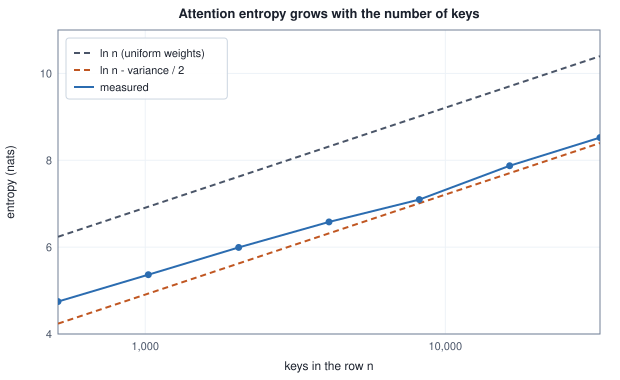

<!-- SPDX-License-Identifier: CC-BY-4.0 -->
<!-- Copyright (c) 2026 Martin Schröder <info@swedishembedded.com> -->

# Long Context

*How do models trained on short texts read long ones?*

A decoder is trained on texts of at most 4,096 tokens, and nothing in its files stops anyone from handing it 32,768. No error is raised. The rotation of Volume V computes an angle for position 20,000 as readily as for position 20, the cache grows by one row per token, the softmax normalizes whatever number of scores it is given, and a text comes out. It is usually a worse text than the model writes at 4,096, and past some length it is not a text at all. This chapter is about what changes in the computation when a model reads eight times the length it was trained on, three separate things, and about the repairs, each of which has a price that can be counted: in rotation rates, in bytes of cache, in bytes over a bus.

Seven ideas from earlier chapters are needed before the count starts. Try them first; the answers are at the end of the chapter.

1. (Volume V, [Chapter 8](../v05-sequences/08-positions.md), rotary embeddings.) Pair $m$ of a rotated head of width $d = 64$ turns by $\omega_m = \mathrm{base}^{-2m/d}$ radians per position, with base 10,000. What is the length in positions of one full turn of pair 24, and how many turns does it make over 4,096 positions?
2. (Volume V, [Chapter 12](../v05-sequences/12-kv-cache.md), the KV cache.) A decoder has 32 layers and 8 key-value heads of width 128 and stores its cache in bf16. How many bytes does one token of context cost, and how many GiB does a sequence of 32,768 tokens need?
3. (Volume VI, [Chapter 3](03-attention-variants.md), sliding windows.) A stack of $L$ layers, each reading a window of $n_{\mathrm{win}}$ keys, can be influenced by how many positions back?
4. (Volume I, [Chapter 13](../v01-mathematics/13-information-theory.md), entropy.) What is the entropy, in nats, of a uniform distribution over $n$ outcomes?
5. (Volume V, [Chapter 11](../v05-sequences/11-decoding.md), temperature.) Dividing the logits of a softmax by a temperature $\tau < 1$ does what to the entropy of the distribution?
6. (Volume IV, [Chapter 4](../v04-computation/04-gpu.md), the host bus.) On the model GPU of that chapter the memory delivers 800 (GB/s) and the host bus 32 (GB/s). How long does each take to move 8 GiB?
7. (Volume V, [Chapter 13](../v05-sequences/13-flash-attention.md), flash attention.) Why does an attention that never writes its score matrix to memory need only a linear amount of memory in the length, where the plain one needs a quadratic amount?

## Three things that change with the length

Take the running example of [Volume V, Chapter 8](../v05-sequences/08-positions.md): a head of width 64, base 10,000, a model trained on positions 0 to 4,095. Ask it to read 32,768 tokens, eight times as many. Call the factor $s = 8$.

### Angles that were never produced

Rotary embeddings rotate pair $m$ of the query and the key by the angle $p\,\omega_m$ at position $p$, and a score then depends on the offset $j - i$ through the angles $(j - i)\,\omega_m$. A pair with a long **period** $\tau_m = 2\pi/\omega_m$ (in positions, the distance for one full turn) is the one at risk. If the period is longer than the trained text, the pair never came round during training: it saw angles from 0 to $4095\,\omega_m$ and no others, and a longer text asks it for angles beyond that range, which the model's weights never had to interpret. A pair with a short period has met every angle many times over, and a longer text only repeats them.

<!-- worked: long_context.unseen_angles -->
Head width d = 64 (32 pairs), base 10000, trained on positions 0 to 4095, read at positions up to 32767 (s = 8). Pair m turns by w_m = base^(-2m/d) radians per position, so its wavelength is 2 pi / w_m positions and its largest angle at position p is p w_m. 'Turns' columns divide the angle by 2 pi. A pair whose largest trained angle is below 2 pi never completed one turn in training.

| pair m | w_m | wavelength (positions) | largest angle, trained | largest angle, extended | turns, trained | turns, extended | never completed a turn |
|---|---:|---:|---:|---:|---:|---:|---|
| 0 | 1 | 6.283 | 4095 | 3.277e+04 | 652 | 5.22e+03 | no |
| 8 | 0.1 | 62.83 | 409.5 | 3277 | 65.2 | 522 | no |
| 16 | 0.01 | 628.3 | 40.95 | 327.7 | 6.52 | 52.2 | no |
| 20 | 0.003162 | 1987 | 12.95 | 103.6 | 2.06 | 16.5 | no |
| 22 | 0.001778 | 3533 | 7.282 | 58.27 | 1.16 | 9.27 | no |
| 23 | 0.001334 | 4712 | 5.461 | 43.7 | 0.869 | 6.95 | yes |
| 24 | 0.001 | 6283 | 4.095 | 32.77 | 0.652 | 5.22 | yes |
| 28 | 0.0003162 | 1.987e+04 | 1.295 | 10.36 | 0.206 | 1.65 | yes |
| 31 | 0.0001334 | 4.712e+04 | 0.5461 | 4.37 | 0.0869 | 0.695 | yes |

Pairs that never completed a turn in training: 9 of 32 (m = 23 to 31). Pairs that have not completed one at 32767 either: 2 (m = 30 to 31). Wavelengths longer than the trained length 4096: pairs m >= 23.
<!-- /worked -->

Nine of the 32 pairs, $m = 23$ to $31$, have a period longer than the 4,096 trained positions. Pair 24 reached 4.095 radians in training, 0.65 of a turn, and at position 32,767 it would be at 32.77 radians, 5.22 turns, of which about 4.6 turns are an angle range that no training example visited. The last two pairs have not completed one turn even at 32,767. Volume V found the same nine pairs at twice the length; what is new here is that the unseen range grows in proportion to how far past the window the text goes, while the fast pairs, with their 652 turns in training, are unaffected.


### Attention that spreads thin

The second change is in the softmax, and it needs no position at all. A query scores $n$ keys and turns the scores into weights that sum to 1. With more keys, the same sharpness of scores gives a flatter distribution, because more tokens compete for the same total of 1. The quantity that measures this is the entropy of the weights, $\mathrm{Ent}(\mathbf{p}) = -\sum_j p_j \ln p_j$. For equal weights it is $\ln n$, which grows without bound.

To see how far the growth goes for scores that are not equal, take $n$ scores $x_j$ drawn independently from a Gaussian with mean 0 and variance $\sigma^2$, and weights $p_j = e^{x_j}/Z$ with $Z = \sum_j e^{x_j}$. The entropy is $\ln Z - \sum_j p_j x_j$, since $-\ln p_j = \ln Z - x_j$. For a large $n$ each sum is close to $n$ times its expectation, and the Gaussian has $\mathbb{E}[e^x] = e^{\sigma^2/2}$ and $\mathbb{E}[x e^x] = \sigma^2 e^{\sigma^2/2}$ (the second by differentiating the first with respect to a scale of $x$). Then $Z \approx n e^{\sigma^2/2}$ and $\sum_j p_j x_j \approx \sigma^2$, so

$$
\mathrm{Ent}(\mathbf{p}) \;\approx\; \ln n + \frac{\sigma^2}{2} - \sigma^2 \;=\; \ln n - \frac{\sigma^2}{2}.
$$

The approximation needs the sum to be spread over many terms and not carried by the one largest; for the variance of the example that is true from a few dozen keys on, but the heavy tail of $e^x$ makes the sample entropy converge slowly, which the table shows. The point is the dependence on $n$: multiplying the number of keys by $s$ adds $\ln s$ nats, whatever the variance. The table draws the scores and computes the entropy exactly.

<!-- worked: long_context.entropy_growth -->
One query, n keys, each score an independent draw of 2.0 x `normal()` (standard deviation 2.0, variance 4.0) from the generator seeded 0x53d323a0b0579206 (`seed_of` of the name `long_context.entropy`); 32,768 values are drawn once in order and the first n of them are the scores of the row with n keys. H is the entropy of softmax(scores) in nats (natural logarithm, the maximum subtracted first, sums left to right); the last two columns are the large-n approximation ln n - variance / 2 derived in the text and the difference.

| n keys | H | ln n | ln n - 2 | H - (ln n - 2) |
|---|---:|---:|---:|---:|
| 512 | 4.7469 | 6.2383 | 4.2383 | 0.5085 |
| 1,024 | 5.3656 | 6.9315 | 4.9315 | 0.4341 |
| 2,048 | 5.9933 | 7.6246 | 5.6246 | 0.3687 |
| 4,096 | 6.5805 | 8.3178 | 6.3178 | 0.2627 |
| 8,192 | 7.0956 | 9.0109 | 7.0109 | 0.0846 |
| 16,384 | 7.8743 | 9.7041 | 7.7041 | 0.1703 |
| 32,768 | 8.5230 | 10.3972 | 8.3972 | 0.1258 |
<!-- /worked -->

From 4,096 to 32,768 keys the measured entropy rises by $8.5230 - 6.5805 = 1.94$ nats, against $\ln 8 = 2.08$. A trained model is calibrated at the entropy of its trained length: its heads were shaped, by the loss, to be as sharp as 4,096 keys need them to be. Handed eight times as many, each head is about two nats blurrier, so a key that carried most of the weight now shares it. A pointer into the text, which is what a retrieval head is, loses the very weight it was trained to have; a later section puts a number on that.



### The cache and the arithmetic

The third change is the bill. [Volume V, Chapter 12](../v05-sequences/12-kv-cache.md) counted the cache at $2 L h_{\mathrm{kv}} d_h b$ bytes per token and a decoded token's attention at $4 L H d_h$ FLOPs per visible key. Both are linear in the number of tokens $n$ for decoding, and the prefill of a prompt, which sees $n(n+1)/2$ pairs of positions, is quadratic.

<!-- worked: long_context.eightfold_counts -->
The 7.5-billion decoder of Volume V, Chapter 12 (32 layers, 32 query heads and 8 key-value heads of width 128, bf16), a sequence of n tokens. Cache bytes: 131,072 per token. Attention FLOPs: 4 L H d_h = 524,288 per visible key (scores and weighted sum, all layers); a decoded token at context n sees n keys, a prefill of n tokens sees n (n + 1) / 2 key-query pairs in all.

| n | cache bytes | attention FLOPs of one decoded token | attention FLOPs of the prefill |
|---|---:|---:|---:|
| 4,096 | 536,870,912 | 2,147,483,648 | 4,399,120,252,928 |
| 32,768 | 4,294,967,296 | 17,179,869,184 | 281,483,566,645,248 |

Ratio of the prefill attention FLOPs, 32,768 against 4,096 tokens: 63.9863.
<!-- /worked -->

The cache is eight times larger, 4 GiB where it was 0.5 GiB, and so is the attention work of one decoded token. The attention work of the prefill is 63.99 times larger, close to the $8^2 = 64$ of a quadratic. The weights do not change and a decoded token still reads all 15 billion bytes of them, so the long context costs little per token at 4,096 and a lot at 32,768, where the cache has caught up with a quarter of the weights.

So there are three separate repairs to make, for three separate reasons. The rotation must not be asked for angles it never saw: changing the table of rotation rates so that it does not is called **RoPE scaling**, and the next three sections are three ways of doing it. The softmax must be given back some of its sharpness (the temperature of the fourth). The cache, the part that grows, must fit and must be moved sensibly (the sections after those).

## Position interpolation: one divisor for every pair

The oldest remedy, by Chen and colleagues (2023), is the one [Chapter 8 of Volume V](../v05-sequences/08-positions.md) stated: to read $s$ times the trained length, give position $p$ the angle that position $p/s$ had. Every rate is divided by $s$,

$$
\omega_m' = \frac{\omega_m}{s}, \qquad \text{angle at position } p = p\,\omega_m' = \frac{p}{s}\,\omega_m .
$$

The largest position, $s L_{\mathrm{train}} - 1$, then reaches an angle no larger than the one $L_{\mathrm{train}}$ reached, for every pair, and **position interpolation** has by construction no angle outside the trained range. The price is in what it does to neighbours. Two adjacent tokens differ by $\omega_m$ radians on pair $m$, and by $\omega_m / s$ after the division, so a model that tells "the previous token" from "the one before it" by the large angle difference of the fast pairs sees that difference shrunk $s$ times.

<!-- worked: long_context.neighbour_resolution -->
Pair 0 turns by 1 radian per position originally. The rotation between two neighbouring tokens on that pair under each scheme, and the length of the chord between their two unit vectors, 2 sin(angle / 2):

| scheme | rate ratio | angle between neighbours (rad) | chord |
|---|---:|---:|---:|
| original | 1.0000 | 1.0000 | 0.9589 |
| interpolation | 0.1250 | 0.1250 | 0.1249 |
| NTK-aware | 1.0000 | 1.0000 | 0.9589 |
| YaRN | 1.0000 | 1.0000 | 0.9589 |
<!-- /worked -->

On pair 0 the neighbouring tokens were a radian apart, with a chord of 0.959 between their unit vectors, and are 0.125 radian apart after interpolation by 8, with a chord of 0.125: the fastest pair has lost 87 percent of the contrast it used to give between neighbours. A model whose first layers lean on the fast pairs for local order must be trained again for the squeezed contrast, which is why interpolation is paired with a fine-tuning on long texts (the section on teaching the model the new length). The pairs that needed the division, the slow ones, were not the only ones to pay; the fast ones paid too. The next two remedies differ in how they spread the payment.

## NTK-aware scaling: change the base, not the positions

A single base sets the whole table, $\omega_m = \mathrm{base}^{-2m/d}$, so one number can reshape all the rates at once. **NTK-aware scaling** replaces the base by a larger $\mathrm{base}'$ chosen so that the slowest pair, the one that most needs interpolating, is divided by exactly $s$ and the fastest pair is left alone. The fastest pair, $m = 0$, has rate $\mathrm{base}^0 = 1$ for any base, so it is untouched without a condition. The slowest, $m = d/2 - 1$, has rate $\mathrm{base}^{-(d-2)/d}$, and requiring it to be $s$ times smaller,

$$
(\mathrm{base}')^{-(d-2)/d} = \frac{\mathrm{base}^{-(d-2)/d}}{s}
\;\;\Longrightarrow\;\;
\mathrm{base}' = \mathrm{base}\cdot s^{\,d/(d-2)} .
$$

(The name comes from an argument about the neural tangent kernel, made in a 2023 online post by a contributor known as bloc97, which Peng and colleagues cite; the derivation here is by matching the two ends, which is enough to fix the base.) Every pair $m$ then has the ratio

$$
\frac{\omega_m'}{\omega_m} = \left(\frac{\mathrm{base}'}{\mathrm{base}}\right)^{-2m/d} = s^{-2m/(d-2)} ,
$$

a geometric ramp from 1 at $m = 0$ to $1/s$ at $m = d/2 - 1$: the divisor grows exponentially with the pair index, so the fast pairs are divided by a little and the slow ones by almost the full $s$. For the running example, $\mathrm{base}' = 10{,}000 \times 8^{64/62} = 85{,}550.38$.

<!-- worked: long_context.frequency_tables -->
Head width d = 64, base 10000, trained length 4096, extension s = 8. NTK-aware base: base' = base x s^(d / (d - 2)) = 10000 x 8^(64/62) = 85550.38. YaRN with bounds alpha = 1 and beta = 32 turns: the 'index' ramp rises linearly from 0 at the pair floor(c(32)) to 1 at the pair ceil(c(1)) (Volume V, Chapter 8), the 'turns' ramp is linear in the number of turns n_m = 4096 w_m / 2 pi between 1 and 32. Rates in radians per position, to 4 significant digits (the rates are computed in double precision with the library functions pow and exp; the base' of NTK-aware scaling is used unrounded).

| pair m | original | interpolation | NTK-aware | YaRN (index ramp) | YaRN (turns ramp) |
|---|---:|---:|---:|---:|---:|
| 0 | 1 | 0.125 | 1 | 1 | 1 |
| 1 | 0.7499 | 0.09374 | 0.7012 | 0.7499 | 0.7499 |
| 4 | 0.3162 | 0.03953 | 0.2418 | 0.3162 | 0.3162 |
| 8 | 0.1 | 0.0125 | 0.05847 | 0.1 | 0.1 |
| 10 | 0.05623 | 0.007029 | 0.02875 | 0.05623 | 0.05623 |
| 12 | 0.03162 | 0.003953 | 0.01414 | 0.02737 | 0.02146 |
| 16 | 0.01 | 0.00125 | 0.003419 | 0.005962 | 0.002808 |
| 20 | 0.003162 | 0.0003953 | 0.0008267 | 0.001034 | 0.00049 |
| 23 | 0.001334 | 0.0001667 | 0.0002851 | 0.0001667 | 0.0001667 |
| 24 | 0.001 | 0.000125 | 0.0001999 | 0.000125 | 0.000125 |
| 27 | 0.0004217 | 5.271e-05 | 6.893e-05 | 5.271e-05 | 5.271e-05 |
| 31 | 0.0001334 | 1.667e-05 | 1.667e-05 | 1.667e-05 | 1.667e-05 |

Pairs whose rate equals the original, and pairs whose rate equals the original divided by s (32 pairs). A library pow is not bit-exact, so 'equals' is a tolerance on the rate x of the scheme against the original rate w of the pair: |x - w| <= 1e-12 w for 'unchanged' and |x - w / s| <= 1e-9 w for 'divided by s'; a count differs in another implementation only if its rates are not within these tolerances.

| scheme | unchanged | divided by s exactly |
|---|---:|---:|
| original | 32 | 0 |
| position interpolation | 0 | 32 |
| NTK-aware | 1 | 1 |
| YaRN, ramp over the pair index | 11 | 9 |
| YaRN, ramp over the turns | 11 | 9 |
<!-- /worked -->

The figure draws the ratio for each scheme, including YaRN, whose rule comes next.


Pair 0 is kept exactly, which interpolation could not do, and the contrast between neighbours on the fastest pair is the one thing NTK-aware scaling wins outright. It has a flaw that the figure makes visible. The ratio is a straight line on the logarithmic axis, whatever the periods of the pairs are, and the pairs that need the full division, the nine that never completed a turn, are not the ones that get it. Only the last pair is divided by $s$; pair 23 is divided by $8^{46/62} = 4.68$. The next table asks, for those nine pairs, how far past the trained angle each scheme reaches at position 32,767.

<!-- worked: long_context.untrained_reach -->
For the 9 pairs that never completed a turn in training (m = 23 to 31), the largest angle reached at position 32767 divided by the angle w_m x 4096 that the trained window ends at; a value above 1 means angles no training example produced. d = 64, base 10000, s = 8.

| scheme | m = 23 | m = 25 | m = 27 | m = 29 | m = 31 |
|---|---:|---:|---:|---:|---:|
| unscaled | 8.000 | 8.000 | 8.000 | 8.000 | 8.000 |
| interpolation | 1.000 | 1.000 | 1.000 | 1.000 | 1.000 |
| NTK-aware | 1.710 | 1.495 | 1.308 | 1.144 | 1.000 |
| YaRN | 1.000 | 1.000 | 1.000 | 1.000 | 1.000 |

Pairs among the 9 with a value above 1, and the largest value:

| scheme | pairs above 1 | largest value |
|---|---:|---:|
| unscaled | 9 | 8.000 |
| interpolation | 0 | 1.000 |
| NTK-aware | 8 | 1.710 |
| YaRN | 0 | 1.000 |
<!-- /worked -->

Unscaled, all nine pairs reach 8 times the angle they were trained to; interpolation brings every one back to 1.000. NTK-aware scaling leaves eight of the nine reaching angles that nobody trained, by up to 1.71 times at pair 23. That is a smaller dose of the first problem, not none of it, and it came from fixing the base by one end condition. The people who proposed the next scheme looked at what a pair does and not at where it sits in a line.

## YaRN: decide for each pair what its wavelength allows

The pairs fall into three kinds, and the kind is read from one number, how many turns a pair makes over the trained length, $n_m = L_{\mathrm{train}}/\tau_m = L_{\mathrm{train}}\,\omega_m/2\pi$ ($n_{24} = 0.65$ above).

- A pair with many turns has seen all its angles many times. What its scores can depend on is the angle modulo a turn, and a longer text only gives it more laps. Dividing its rate would change its meaning for nothing: it should keep its rate, which is **extrapolation** in the only sense that matters here, because the model already extrapolates along a circle.
- A pair with less than one turn tells absolute distance within the window, an angle that grows monotonically over everything the model has read. A longer text takes it to angles outside the range. It should be interpolated, divided by $s$, so that its largest angle is the trained one.
- A pair in between has made a few turns; it is the unclear case and gets a blend.

**YaRN** (yet another RoPE extension, Peng and colleagues, 2023) makes this rule exact. Two bounds on the number of turns, $\alpha = 1$ and $\beta = 32$, define a ramp $\gamma(n)$ that is 0 up to $\alpha$, 1 from $\beta$ on and linear in $n$ between, and the rate of a pair is a blend of its interpolated and its original rate,

$$
\omega_m' = \bigl(1 - \gamma(n_m)\bigr)\frac{\omega_m}{s} + \gamma(n_m)\,\omega_m .
$$

This is the paper's definition, a ramp in the number of turns. The implementation that checkpoints and engines follow (the reference function of the `transformers` library, of which brain's module is a port, see below) ramps linearly in the pair index instead, between the pair where $n$ reaches $\beta$ and the pair where it reaches $\alpha$. Volume V gave the index at which a pair makes $n$ turns, found from $\omega_m = \mathrm{base}^{-2m/d}$ by solving $L_{\mathrm{train}}\,\omega_m/2\pi = n$ for $m$:

$$
c(n) = \frac{d\,\ln\!\bigl(L_{\mathrm{train}}/(2\pi n)\bigr)}{2\ln\mathrm{base}},
\qquad
\mathrm{low} = \lfloor c(\beta)\rfloor,\quad \mathrm{high} = \lceil c(\alpha)\rceil ,
$$

$$
\gamma_m = 1 - \min\!\Bigl(1, \max\bigl(0, \tfrac{m - \mathrm{low}}{\mathrm{high} - \mathrm{low}}\bigr)\Bigr).
$$

In that chapter's pseudocode the ramp weight is that of the interpolated rate, which is $1 - \gamma_m$ here. For the running example $c(32) = 10.47$ and $c(1) = 22.51$, so the ramp runs from pair 10 to pair 23. The two ramps put the same nine pairs at full interpolation and the same eleven at none; they differ in the blend between, because $n_m$ falls geometrically with $m$ and a linear ramp in the index is a curved one in the turns.

<!-- worked: long_context.ramp_comparison -->
Weight of the interpolated rate for pairs 8 to 24 (every second pair), d = 64, base 10000, trained length 4096, alpha = 1, beta = 32: turns over the trained length, the weight under the ramp over the pair index and under the ramp over the turns.

| pair m | turns n_m | index ramp | turns ramp |
|---|---:|---:|---:|
| 8 | 65.19 | 0.000 | 0.000 |
| 10 | 36.66 | 0.000 | 0.000 |
| 12 | 20.61 | 0.154 | 0.367 |
| 14 | 11.59 | 0.308 | 0.658 |
| 16 | 6.519 | 0.462 | 0.822 |
| 18 | 3.666 | 0.615 | 0.914 |
| 20 | 2.061 | 0.769 | 0.966 |
| 22 | 1.159 | 0.923 | 0.995 |
| 24 | 0.6519 | 1.000 | 1.000 |
<!-- /worked -->

At pair 16, with 6.5 turns, the turn ramp has already moved 0.82 of the way to the interpolated rate and the index ramp 0.46. Nothing in this chapter says which is better for a model; what can be said is that brain's table is the index ramp, the column "YaRN (index ramp)" of the frequency table above. The counts under that table, 11 pairs unchanged and 9 divided by exactly 8 for either ramp, are the structure that matters: YaRN leaves the fast third of the table alone, divides the slow quarter by $s$, and the angles those nine pairs reach at 32,767 are exactly the trained ones (the YaRN row of the table of reach is 1.000 for every one).

### The temperature

Interpolating the rates repairs the angles. It does not repair the entropy of the second section, and YaRN's second correction is for that. It multiplies the cosine and the sine of every pair by $\mu(s) = 0.1\ln s + 1$, so that the rotated query and the rotated key are each $\mu$ times larger and every score is multiplied by $\lambda = \mu^2$. In softmax terms that is a temperature below 1 (the section on temperature of Volume V divided the logits by a number; this multiplies them by $\lambda$).

What should $\lambda$ be? The entropy argument gives a condition. With the scores scaled by $\lambda$ their standard deviation becomes $\lambda\sigma$, so the entropy of a row of $n$ keys is $\ln n - \lambda^2\sigma^2/2$. Keeping the entropy of $sn$ keys equal to the entropy of $n$ keys without scaling means $\ln s - \lambda^2\sigma^2/2 = -\sigma^2/2$, that is

$$
\lambda^2 = 1 + \frac{2\ln s}{\sigma^2} .
$$

The scale needed depends on the spread $\sigma$ of the scores, which the derivation does not know. The paper does not derive $\mu$ either: it fitted $\mu(s) = 0.1\ln s + 1$ by finding the scale with the lowest perplexity (the exponential of the mean cross-entropy per token, [Chapter 13 of Volume I](../v01-mathematics/13-information-theory.md)) at each extension on four sizes of one model family without fine-tuning, and found that the same values served a second family. The table solves the condition above for the variance that would make the fitted value exact.

<!-- worked: long_context.temperature_factor -->
t(s) = 0.1 ln s + 1 multiplies the cosine and the sine of every pair, so the rotated query and key are each t(s) times larger and the score is multiplied by lambda = t(s)^2. Keeping the entropy of the row at its value for n keys when there are s n of them needs lambda^2 = 1 + 2 ln(s) / variance (derived in the text); the last column solves that for the variance of the scores that t(s) would be exactly right for.

| extension s | t(s) | lambda = t(s)^2 | lambda^2 | variance that makes t exact |
|---|---:|---:|---:|---:|
| 2 | 1.0693 | 1.1434 | 1.3074 | 4.509 |
| 4 | 1.1386 | 1.2965 | 1.6809 | 4.072 |
| 8 | 1.2079 | 1.4591 | 2.1291 | 3.683 |
| 16 | 1.2773 | 1.6314 | 2.6614 | 3.338 |
| 32 | 1.3466 | 1.8133 | 3.2879 | 3.030 |
| 64 | 1.4159 | 2.0047 | 4.0190 | 2.755 |

The scores of the previous block (variance 4.0): entropy with n = 4096 keys and lambda = 1: 6.5805; with n = 32768 keys and lambda = 1: 8.5230; with n = 32768 keys and lambda = t(8)^2 = 1.4591: 6.7634.
<!-- /worked -->

For the extensions from 2 to 8 the fit corresponds to a score variance between 3.7 and 4.5, a standard deviation of about 2, and the variance falls slowly to 2.8 at $s = 64$. The spread of a trained model's scores is not measured here, so this is a consistency check and not an explanation: the form $1 + \text{const}\cdot\ln s$ is what keeping the entropy asks for, and 0.1 is what happened to fit. In the entropy table's scores, with variance 4, scaling by $\lambda = 1.4591$ brings the entropy of 32,768 keys back to 6.7634, within 0.18 nats of the 6.5805 of 4,096 keys, from 8.5230.

The two corrections act in different places, and in an engine they are one table. The rates go into the angle, the factor $\mu$ multiplies the cosine and the sine that come out of it, and both are fixed per position when the keys are written, so a cached key is consistent with the table it was written under. A scheme that changed the table with the current length (the one called dynamic scaling, which raises the base as the text grows) would make every cached key stale; brain refuses a declaration of that type, as the next section shows.

## What brain reads, and what it computes

`crates/model/src/rope_scaling.rs` turns a checkpoint's `rope_scaling` entry into one table, whichever scheme it names. It reads `rope_type` and, failing that, the older key `type`, and implements four schemes: `linear` (the position interpolation above, every rate divided by the factor), `yarn` (below), `llama3`, and an explicit table of per-channel divisors that llama.cpp stores. The `llama3` scheme of the Llama 3.1 family is the same three-band idea as YaRN's with its cuts in wavelength and no attention factor: channels whose wavelength is shorter than the original window divided by `high_freq_factor` keep their rate, those longer than the window divided by `low_freq_factor` are divided by `factor`, and the channels in between are blended linearly in their number of turns over the original window. Each scheme returns the per-pair rates and an attention factor, which is 1.0 for every scheme but YaRN; a consumer feeds them to one table-driven rotation kernel and never branches on the scheme. For YaRN the kernels `rope_base_yarn.wgsl` and `rope_paged_yarn.wgsl` multiply cosine and sine by the factor, as the section above wrote.

The YaRN table, in `crates/model/src/yarn.rs`, is a port of the reference function of the `transformers` library, with the index ramp and the defaults $\beta = 32$, $\alpha = 1$ and the factor $0.1\ln s + 1$. A factor of at most 1 returns the unscaled table bit for bit; the test `identity_gate_factor_one_is_bit_for_bit_unscaled` pins that, so adopting the scaling cannot move the output of a model that never uses it. Two tests pin the table against an oracle computed in double precision: `pinned_oracle_small_64_factor2` (the configuration of Volume V) and `pinned_oracle_qwen_style_128`, a head of width 128 at base 1e6 with $L_{\mathrm{train}} = 32{,}768$ and $s = 4$. The second configuration is the one the independent implementation of this chapter reproduces:

<!-- worked: long_context.yarn_128 -->
Head width d = 128 (64 pairs), base 1e6, trained length 32768, s = 4, bounds 32 and 1. Correction range [23, 40], attention factor 0.1 ln 4 + 1 = 1.1386294. Pairs 0 to 4 of the scaled table: 1, 0.8058422, 0.6493816, 0.5232991, 0.4216965. Pairs 59 to 63: 7.356818e-07, 5.928434e-07, 4.777382e-07, 3.849816e-07, 3.102344e-07. Pair 63 divided by its original rate: 0.2500000.
<!-- /worked -->

The correction range [23, 40] is the one the test `ramp_mask_boundary_and_monotonicity` asserts, the attention factor 1.1386294 and the first and last five rates are the digits the oracle test lists, and the last pair, divided by exactly 4, shows the interpolated end of the table. A further test, `crates/model/tests/it/rope_scaling_golden.rs`, compares the whole table with the `inv_freq` buffer that `transformers` builds for each DeepSeek text checkpoint, within 2 ulp of `f32`.

Brain implements no NTK-aware scheme as such: the base is a parameter of every kernel, and a checkpoint that wanted a larger base would declare it, but the reader has no case that computes $\mathrm{base}'$. A type it does not implement is an error and not "no scaling". The reason is a bug whose cost was invisible. Three decoders had each read `rope_scaling` themselves and kept it only when the type spelled `yarn`; linear scaling of a code model, the `llama3` scaling of Llama 3.1 and even YaRN under the newer key `rope_type` became plain RoPE without a word, so each checkpoint loaded, ran and computed with rates it was not trained with (knowledge #175). The test that asserted the drop had reasoned that YaRN's formula must not run under another name, which is true, and refusing the declaration achieves it without running the model unscaled. Commit `543651959` (September 2026) replaced the three readers with the module above; the tests that pinned the drop now pin the refusal, and a declaration named `dynamic` is an error.

A second story is about a number that was derived, and derived wrongly. Serving past a checkpoint's declared window needs a YaRN configuration, and commit `41658981a` (October 2026), with knowledge #338, found the derived one was not the published recipe. Qwen3 declares a window of 40,960, which is the 32,768 it was pretrained on plus 8,192 of generation headroom, and the engine derived the factor as the requested context over the declared window, so a request for 131,072 tokens got $s = 131072/40960 = 3.2$ with the window 40,960. The recipe the model's authors publish is $s = 4$ over 32,768. The two differ in everything the table of this chapter is made of: the correction range moves (the pair index at which $r$ crosses 32 and 1 depends on $L_{\mathrm{train}}$) and so does the attention factor, $0.1\ln 4 + 1 = 1.1386$ against $0.1\ln 3.2 + 1 = 1.1163$. The function `pretrained_window` of `crates/catalog/src/resident_llm.rs` now takes the largest power of two not above the declared window, and the test `serving_a_qwen3_at_128k_derives_qwens_published_yarn_recipe` pins the derived configuration at 131,072 against the oracle table. The entry records two more findings that the chapter's mathematics predicts. A needle test on the 8-billion model at 8k to 125k tokens retrieved 15 of 15 under either scaling, so the test could not tell the two apart, and the recipe was adopted because it is the documented and reference-checked one and not because it was shown better. And with a scaling derived for every request, short prompts changed: 0 of 12 short summaries were byte-identical between no scaling and YaRN, which is what a table in which 41 of the 64 pairs have a different rate must do to a text of any length. Automatic sizing of the context therefore stops at the declared window now, and going past it is an explicit request.

One more commit, `d63b3f031` (September 2026), is the position-table story of the previous volume seen from here: the table for chunked prefill of a hybrid decoder was the one call site that YaRN never reached, so a model wrote keys at one rotation and read them with queries at another, and the defect only showed once scaling was on, a round boundary was crossed and a position past the original window was reached, all at once.

## Teaching the model the new length

Everything so far changes the table and leaves the weights alone. Whether that is enough depends on the scheme and the factor. A model that reads a scaled table without further training sees angles inside its trained range (interpolation, YaRN) but at different rates than it learned, and its quality at the longer length depends on how gracefully its weights tolerate that. Chen and colleagues found that interpolation needs a fine-tuning on long texts, which they report as a small amount of training next to the pretraining, and the YaRN paper reports that its table reaches a given extension with fewer tokens of fine-tuning and also gives usable results without any. The word for the whole procedure is **context extension**: choose the new length $L_{\mathrm{ext}} = s L_{\mathrm{train}}$, set the rotation table of the chosen scheme, continue training the same model with the same loss on texts of the new length (a mixture of lengths keeps the short ones from degrading), and evaluate the loss as a function of position to see that it does not rise past $L_{\mathrm{train}}$. Nothing new is learned about language; what is learned is to read the squeezed angles and the sharper scores.

What brain supports is the inference side. A checkpoint's declared table is read and applied, and a request past the window is served with the derived YaRN table of the previous section, which is the no-fine-tuning case. On the training side, brain's LoRA fine-tuning of the Qwen3 decoders runs at long lengths, and what limited it is the instructive part. Knowledge #193 records a 5,824-token step that failed when the scores buffer of the attention was created. The training attention kept three slabs of scores, probabilities and gradients for every layer, one slab per layer being $4HT^2$ bytes for $H$ query heads and $T$ tokens, and the largest binding the device would accept was 2047 MiB:

<!-- worked: long_context.score_slab_limit -->
Training attention that keeps its scores: one buffer of H T^2 f32 numbers = 4 H T^2 bytes for H = 16 query heads (Qwen3-0.6B and 1.7B), against the largest single binding of 2047 MiB = 2,146,435,072 bytes that the device of knowledge #193 reported. The smallest T whose buffer exceeds it is 5792. The last column is the 4 H T bytes of the one log-sum-exp number per row and head that a flash backward keeps instead.

| T | bytes of the score buffer | MiB | over the binding limit | bytes of the log-sum-exp rows |
|---|---:|---:|---:|---:|
| 2,048 | 268,435,456 | 256.00 | no | 131,072 |
| 4,096 | 1,073,741,824 | 1024.00 | no | 262,144 |
| 5,791 | 2,146,283,584 | 2046.86 | no | 370,624 |
| 5,792 | 2,147,024,896 | 2047.56 | yes | 370,688 |
| 8,192 | 4,294,967,296 | 4096.00 | yes | 524,288 |
| 16,384 | 17,179,869,184 | 16384.00 | yes | 1,048,576 |
| 32,768 | 68,719,476,736 | 65536.00 | yes | 2,097,152 |
<!-- /worked -->

The buffer passes 2047 MiB at $T = 5{,}792$ and passes $2^{31}$ bytes, 2048 MiB, at 5,793 (the entry writes 5,793 beside the 2047 MiB figure; the two differ by one token). A device limit on one buffer is a limit on the length, whatever the total memory is, and growing the card does not move it. The remedy was not a smaller batch. Training moved to the causal flash kernels of the previous volume (`flash_attn_causal_gqa` and its two backward kernels), which keep one log-sum-exp number per row and head, the last column of the table, and rebuild each softmax weight from it in the backward pass. The entry lists three more changes that a long block needed before it fitted and finished a step: the backward recomputes each layer's forward from the saved residual so that all layers share one set of activation buffers, the language-model head works in row chunks, and the tape is submitted one layer at a time, because a 16k-token backward of about 80 seconds in one submission met the 30-second bound the engine puts on a wait. With those, the entry's table has Qwen3-0.6B completing training steps at lengths up to 40,960 tokens.

## What a long cache costs, in four formats

Back to the third change. The cache of one sequence, in four formats, for the two decoders of Volume V:

<!-- worked: long_context.cache_budget -->
Bytes per token = 2 (keys and values) x layers x key-value heads x head width x bytes per element. f32 4 bytes, bf16 2 bytes; int8 and fp8 (E4M3) 1 byte per element plus one f32 scale per (token, key-value head) row, so 1 + 4 / d_h bytes per element, 1.03125 at d_h = 128. GiB for ONE sequence.

| model | tier | bytes per element | bytes per token | GiB at 131,072 tokens | GiB at 4,096 tokens |
|---|---|---:|---:|---:|---:|
| 7.5-billion decoder (8 key-value heads) | f32 | 4.00000 | 262,144 | 32.00 | 1.000 |
| 7.5-billion decoder (8 key-value heads) | bf16 | 2.00000 | 131,072 | 16.00 | 0.500 |
| 7.5-billion decoder (8 key-value heads) | int8 | 1.03125 | 67,584 | 8.25 | 0.258 |
| 7.5-billion decoder (8 key-value heads) | fp8 | 1.03125 | 67,584 | 8.25 | 0.258 |
| 70-billion decoder (8 key-value heads) | f32 | 4.00000 | 655,360 | 80.00 | 2.500 |
| 70-billion decoder (8 key-value heads) | bf16 | 2.00000 | 327,680 | 40.00 | 1.250 |
| 70-billion decoder (8 key-value heads) | int8 | 1.03125 | 168,960 | 20.63 | 0.645 |
| 70-billion decoder (8 key-value heads) | fp8 | 1.03125 | 168,960 | 20.63 | 0.645 |

The 80-layer decoder of Volume VI, Chapter 3 (every 5th layer global, the others a window of 1,024 keys, 1,024 key and 1,024 value numbers per token and layer):

| tier | GiB at 131,072 tokens | GiB at 4,096 tokens |
|---|---:|---:|
| bf16 | 8.250 | 0.500 |
| int8 | 4.254 | 0.258 |
<!-- /worked -->

The 7.5-billion decoder needs 16 GiB of bf16 cache for one sequence of 131,072 tokens, more than its 14 GiB of weights, and 40 GiB for the 70-billion one. Two columns of that table are tools. Halving the bytes per element, from 4 to 2, is the move from f32 to bf16 that the previous volume already counted. Going on to one byte per element, 8.25 GiB, uses the formats of [Volume IV, Chapter 12](../v04-computation/12-quantization.md): an 8-bit integer or an 8-bit float, each stored with one f32 scale for every (token, key-value head) row of $d_h$ elements, which is the $1 + 4/d_h$ bytes per element of the table. Three other tools are older:

- **Fewer layers that read everything.** The windowed layers of [Chapter 3](03-attention-variants.md) keep a ring of $n_{\mathrm{win}}$ rows however long the text is; the last block of the table is the 80-layer decoder of that chapter, four windowed layers to each global one, which at 131,072 tokens is 8.25 GiB in bf16 against the 40 GiB of 80 global layers, and 4.25 GiB in int8.
- **Fewer keys read per token**, the selection of [Chapter 6](06-sparse-attention.md), which reads and fetches a few thousand positions and not all.
- **Cache in blocks**, so that a sequence holds memory for the tokens it has and not for its longest possible text. This is paging, and Volume XIV's chapter on managing the cache builds it; the block bookkeeping is `crates/model/src/paged.rs`.


### The error that eight bits add

The scale of a row is what makes eight bits enough. For the integer tier a row $\mathbf{x}$ of $d_h$ values is stored as $q_i = \mathrm{round}(x_i/s_{\mathrm{row}})$ with $s_{\mathrm{row}} = \max_i|x_i|/127$, so the largest value is $\pm127$ and the grid step is $s_{\mathrm{row}}$. The rounding error of each element is nearly uniform in $\pm s_{\mathrm{row}}/2$, of mean square $s_{\mathrm{row}}^2/12$, and so the error of a row has the relative size $\sqrt{d_h\,s_{\mathrm{row}}^2/12}/\lVert\mathbf{x}\rVert$ (the 8-bit float, E4M3 of Volume IV with its largest value 448, has a grid that is relative and not uniform, with 3 mantissa bits). A row with a large outlier has a large $s_{\mathrm{row}}$ and loses resolution on all its other elements, which is why brain also has a *clip*: a calibrated per-head ceiling on $\max|x|$, below which `scale = min(absmax, clip) / 127` and above which the element is clamped. The table measures the stored rows and the attention output, with the integer tier's error predicted from this derivation.

<!-- worked: long_context.kv_error -->
4 key-value heads of width 64, 120 cached tokens, 16 queries per head, all random from the generator seeded 0xbf267212d15b90b5 (`seed_of` of the name `long_context.kv_error`). Draw order: the key rows of head 0 token by token, then the other heads, then the value rows in the same order, then the query vectors (head, query, channel). Each key or value row is exp(`normal()`) times a vector of 64 `normal()` draws (the gain is drawn first), so row magnitudes differ by a factor of several; queries are 64 `normal()` draws. The attention output of a query is softmax(q.k / 8) V in double precision from the cached values. 'bf16' rounds each value to float32 and then to the nearest bfloat16 (ties to even); 'int8' stores round(x / s) with s = absmax / 127 of the row, clamped to +-127; 'fp8' stores the nearest E4M3 value to x / s with s = absmax / 448 (ties to the even mantissa code). Row error: sqrt(sum of squared errors / sum of squares) over all 2 x 4 x 120 rows. Predicted (int8): each row's error is uniform in +-s/2, so its mean square is s^2 / 12 per element. Output error: the same ratio over the outputs of all 64 queries.

| tier | relative error of the stored rows | predicted | relative error of the attention output |
|---|---:|---:|---:|
| bf16 | 0.00161 |  | 0.00328 |
| int8 | 0.00581 | 0.00592 | 0.011 |
| fp8 | 0.0256 |  | 0.0467 |
<!-- /worked -->

The predicted error of the int8 rows, 0.00592, is within 2 percent of the measured 0.00581. The attention output has about twice the error of the stored rows for all three formats (0.0033 for bf16, 0.011 for int8, 0.047 for fp8), which is the noise of the keys passing through a softmax and of the values being averaged, plus an error in the scores that a 3-mantissa-bit float makes larger. These are the numbers of a toy with random rows of mixed magnitude, not of a trained model, and what they establish is the order: the eight-bit formats add a relative error of order $10^{-2}$ to an attention output and bf16 of order $10^{-3}$. Knowledge #340 measured the same three formats on the real 27-billion model over 20 prompts and 64 forced decode steps each: the difference between two numerically different but equally correct computations of the model itself (its f32 decode against its f32 chunked prefill) was already a relative L2 of 0.117, and bf16, int8 and fp8 caches measured 0.139, 0.143 and 0.139 against the f32 reference, within 1.22 times that floor, with top-1 agreement of 92.0, 91.9 and 91.6 percent against 92.4 at the floor.

### What brain stores

`crates/model/src/kv_tier.rs` names the four formats **tiers** (`f32`, `bf16`, `int8`, `fp8`) and derives every size from one descriptor, so that the planner that counts bytes and the kernels that read them cannot disagree: the test `a_planes_bytes_halve_for_bf16_and_quarter_for_int8_plus_its_scales` and the footprint test of the fp8 tier check the $1 + 4/d_h$ of the table. The int8 and fp8 append kernels (`paged_kv_append_i8_clipped_batched.wgsl`, `paged_kv_append_fp8_clipped_batched.wgsl`) compute `scale = min(absmax, clip) / 127` or `/ 448` per (token, head) row, and the attention kernels widen each element as they load it, so the arithmetic is f32 in every tier and only the resident bytes change. Commit `eb0978bc4` (July 2026) added the int8 pool for the Qwen3 server, `48b53f5a7` (October 2026) the tiers of a hybrid decoder and `4ed91ed4b` (October 2026) the fp8 tier. The serving configuration of `crates/catalog/src/resident_llm.rs` defaults to int8 and leaves fp8 and the calibration opt-in. One limit of the layout is a long-context one: the kernels address a plane by a 32-bit element index, so a plane holds at most $2^{32}$ elements, `MAX_PLANE_ELEMS`, which at a key-value width of 1,024 is 4,194,304 token rows, 32 sequences of 128k, and a pool larger than that would alias its own start; the test `addressing_stops_at_the_u32_element_index` pins the bound, and the constructor refuses a larger plane. A second limit is the one of the training section: a driver accepts a buffer binding of a size the device reports, 128 MiB on a software fallback and 2047 MiB on a desktop card, and commit `ff9818e32` (September 2026) made the engine read that limit from the device before allocating its per-layer key and value buffers, since a constant had let a serving configuration that was legal on one card reach `create_bind_group` on another.

## Moving a cache to host memory

The tiers shrink the bytes. The other lever is where the bytes live: a device has tens of GiB and its host has hundreds. **KV offload** is keeping some of a cache in host memory and moving it to the device when it is needed. Whether that helps is a question of what crosses the bus, so count it. The model of Volume IV: device memory 800 (GB/s), host bus 32 (GB/s), arithmetic 40,000 (GFLOP/s); costs are counted as bytes and FLOPs and compared as ratios of model time, never as seconds on a machine. The 7.5-billion decoder with an int8 cache, one sequence of 131,072 tokens:

<!-- worked: long_context.offload_traffic -->
The 7.5-billion decoder (L = 32, 8 key-value heads of width 128) with an int8 cache: 67,584 bytes per token, 8,858,370,048 bytes (8.25 GiB) for 131,072 tokens. Model of Volume IV, Chapter 4: device memory 800 (GB/s), host bus 32 (GB/s), arithmetic 40,000 (GFLOP/s). The model time of an operation is its bytes over the bandwidth (or its FLOPs over the arithmetic rate); the last column divides it by the model time of the first row, one read of the whole cache from device memory (one unit).

| operation | bytes or FLOPs | model time (units) |
|---|---:|---:|
| read the whole cache from device memory for one decoded token | 8,858,370,048 | 1 |
| stream the whole cache over the host bus for one decoded token | 8,858,370,048 | 25 |
| fetch only 2,048 selected positions over the host bus for one token | 138,412,032 | 0.391 |
| swap the sequence out (once) | 8,858,370,048 | 25 |
| swap the sequence out and back in (once each) | 17,716,740,096 | 50 |
| prefill the 131,072 tokens again (arithmetic only) | 6,333,222,386,401,280 FLOPs | 1.43e+04 |

The re-prefill is a floor, since attention and the head do not reach the arithmetic rate. Model time of the re-prefill over that of the swap out and back in: 286.

The FLOPs of the re-prefill of n tokens, from Chapter 12 of Volume V: F(n) = 2 n B + 4 L H d_h n (n + 1) / 2 + 2 D V, with B = 6,979,321,856 the numbers in the weight matrices of the layers (everything but the embedding table, which is also the head), L = 32 layers, H = 32 query heads of width d_h = 128 (so 4 L H d_h = 524,288 for each visible key; the sum over the n new tokens of the keys each sees is n (n + 1) / 2), and the head 2 D V = 1,050,673,152 once, for the last row. The first term, with the head, is linear in n; the second is quadratic. The first column of the next table is the weights term plus the head, the second the attention term, the third their sum F(n), and the last the model time of F(n) at the arithmetic rate of the model above, over the model time of a swap out and back in (2 x 67,584 n bytes at the bus bandwidth of the model above).

| n tokens | weights and head FLOPs | attention FLOPs | F(n) | re-prefill time / swap time |
|---|---:|---:|---:|---:|
| 4,096 | 5.718e+13 | 4.399e+12 | 6.157e+13 | 89 |
| 16,384 | 2.287e+14 | 7.037e+13 | 2.991e+14 | 108 |
| 65,536 | 9.148e+14 | 1.126e+15 | 2.041e+15 | 184 |
| 131,072 | 1.83e+15 | 4.504e+15 | 6.333e+15 | 286 |
<!-- /worked -->

A decoded token attends to the whole sequence, so the cache is read once per token. Read from device memory it costs one unit of model time; across the bus it would cost 25 units, which is the ratio of the two bandwidths. Keeping the blocks that "have not been used lately" on the host and fetching them on demand is the design that suggests itself, an LRU over blocks, and it fails here for a reason in the attention and not the bus: every block of a sequence being decoded is read by every token, so no block is cold, and a block-level scheme streams the whole cache every step. Brain's module `crates/model/src/kv_offload.rs` says this in its header and builds the other design. It moves whole sequences, between scheduler turns: a sequence the scheduler is not advancing this round has all its blocks copied to a byte-budgeted pool of host memory and its device blocks freed for the sequences that are running, and it is copied back when it is advanced again. The cost of the swap, 17.7 GB for the round trip of this sequence, 50 units in the model, is paid once per scheduling transition and not once per token, so it is spread over every token that the other sequences generate in the meantime. The effect is on concurrency, the number of admitted sequences, and not on the length that one running sequence can reach.

The alternative to a swap is dropping the cache and prefilling the prompt again when the sequence resumes. The last line of the table counts it: $6.3 \times 10^{15}$ FLOPs, about 14,300 units at the model's arithmetic rate, a floor since the attention and the head do not reach it, which is 286 times the model time of the swap out and back in. That ratio grows with the length. The weights part of the recomputation and the swap are both linear in the tokens, so their ratio is a constant, about 83 for this decoder: a token's recomputation costs $2B \approx 1.4 \times 10^{10}$ FLOPs ($B$ the numbers in the layers' weight matrices, a little below the 7.5 billion parameters because the embedding table is not multiplied per token) against 67,584 bytes each way for its swap. The attention of the recomputation is quadratic, $4LHd_h\,n(n+1)/2$ FLOPs, and adds to the numerator: the second table gives 89 at 4,096 tokens, 108 at 16,384, 184 at 65,536 and 286 at 131,072, the attention share of the FLOPs rising from 7 percent to 71 percent. The comparison therefore favors the swap more and more as the sequence grows, and for a model of this size it is the cheaper path at every length where the fixed costs of starting a transfer do not dominate.

Where blocks do become cold, a block-level scheme works. A windowed layer never reads a block older than its window again, and it does not need that block at all, so there is nothing to offload there; the ring of Chapter 3 frees it. A layer that selects its positions, as in [Chapter 6](06-sparse-attention.md), reads only the selected ones, and the third row of the table counts what a fetch of 2,048 selected positions across the bus costs per token: 138 MB, 0.39 units in the model, 64 times fewer than the whole cache. The point of that row is that a sparse reader pays a bus price in proportion to what it selects, so it can afford a cold tier to the extent that its selection is predictable.

Commit `c58d4d842` (September 2026) added the module as a primitive and gave its gate: demote then promote returns the exact bytes, as raw 32-bit words so that any dtype, including the packed int8 and its scales, round-trips without a numeric reinterpretation, across physically permuted blocks that another sequence has written in between. Commit `78681e2aa` (September 2026) made the Qwen3 engine an adopter, with two kernels that gather and scatter an arbitrary set of blocks in chunks bounded at 64 MiB. Commit `4007c65c7` (September 2026) wired the setting through the server, `--kv-offload-gb`, off by default, because it spends host memory on a box shared with other work, and its documentation says plainly that the setting buys concurrency and not a longer single context, since a session that is decoding still needs all its cache in device memory. In the commit's message the device-to-host bus of the box it was built on measured much slower than the host-to-device one, a factor the symmetric 32 (GB/s) of the model above ignores; the chapter uses the model because it is a count, and the commit's measurement is one box on one day.

## Prefill in chunks

A prompt of 131,072 tokens run through the model in one pass holds, in each layer, an activation for every row. The widest is the pair of outputs of the gate and up matrices of the feed-forward network, $2 c F$ numbers for $c$ rows; if the scores are materialised there is also a slab of $H\,c\,n$. Running the prompt in pieces of $c$ rows on one cache is chunked prefill: each chunk attends to the cache that the earlier chunks wrote and to itself, causally, and appends its own keys and values.

<!-- worked: long_context.chunked_prefill_memory -->
A prompt of n = 131,072 tokens through the 7.5-billion decoder of Volume V, Chapter 12 (D = 4096, F = 14336, 32 query heads of width 128, 8 key-value heads, bf16, weights 15,009,316,864 bytes), in chunks of c tokens. One layer's widest activation is the pair of outputs of the gate and up matrices, 2 c F x 2 bytes; the stream is c D x 2 bytes; a materialised score slab for the last chunk is H c n x 4 bytes (f32). Every chunk reads the weights once, so the weights are read ceil(n / c) times (the last column).

| chunk c | chunks | gate+up, GiB | stream, GiB | score slab, GiB | weights read in all, GiB |
|---|---:|---:|---:|---:|---:|
| 131,072 | 1 | 7.000 | 1.000 | 2048.0 | 14.0 |
| 16,384 | 8 | 0.875 | 0.125 | 256.0 | 111.8 |
| 2,048 | 64 | 0.109 | 0.016 | 32.0 | 894.6 |
| 512 | 256 | 0.027 | 0.004 | 8.0 | 3578.5 |
<!-- /worked -->

Activation memory is proportional to the chunk, 7 GiB for the widest activation at $c = 131{,}072$ and 0.109 GiB at 2,048. The cost is in the last column: every chunk reads the weights once, so the weights are read $\lceil n/c\rceil$ times, 895 GiB in all at $c = 2{,}048$ against 14 GiB in one pass. A chunk of 2,048 rows is still far above the 54 rows at which [Volume V, Chapter 12](../v05-sequences/12-kv-cache.md) found a prefill limited by arithmetic and not by bytes, so the repeated reads are paid for by the arithmetic of 2,048 rows each. A chunk of 512 reads 3,578 GiB; the choice is the largest chunk whose activations fit. The score slab, 32 GiB even at 2,048 rows against all keys, is why a materialised attention is not an option here, and why the flash kernels are used.

The change does not alter the result. A prefill in chunks must produce the logits of the one-pass prefill, because the second chunk's rows see the first chunk's cache exactly as the rows of a one-pass prefill see the earlier rows:

<!-- worked: long_context.chunk_equality -->
The model of Volume V, Chapter 12 (`kv_cache.model`, seed 0xe354ebf228c667c0) and a prompt of 12 token ids, each `integer(12)` from the generator seeded 0x581dbdb647f222d9 (`seed_of` of the name `long_context.chunk_prompt`): [1, 9, 10, 2, 11, 7, 1, 4, 5, 11, 8, 2]. The prompt is run in one call and in chunks of c tokens on one cache; the logits of every position are compared. The difference is measured in double precision, and every row reads the same keys and values and adds them in the same order whatever the chunking, so the test is insensitive to the weights (any weights give the same result): it checks the bookkeeping of the cache (the positions written, the keys each row sees and the causal mask), not the numerical drift that a different summation order would cause, and not the quality of the model.

| chunk size c | calls | largest difference of any logit from the one-call prefill |
|---|---:|---:|
| 12 | 1 | below 1e-12 |
| 5 | 3 | below 1e-12 |
| 4 | 3 | below 1e-12 |
| 1 | 12 | below 1e-12 |
<!-- /worked -->

Chapter 12 of Volume V proved the cache equivalence for one prompt and a decode step; here a chunk is a decode step of several rows, and the result is below 1e-12 for every chunk size. What that settles is the bookkeeping: positions, visible keys and mask. Every chunking adds the same numbers in the same order, so the test cannot fail through a weight and would pass for any weights; it says nothing about the quality of the model or about the drift that a different summation order would cause. In brain, commit `4b3d58fc1` (July 2026) split the batched forward so that decode and prefill share one path, with a prefill that streams the prompt in chunks of up to a maximum number of tokens; its message reports that chunks of 2 reproduce the whole-prompt hidden state bit for bit. The decoder interface carries the idea as `prefill_chunk(table, prompt, budget)` in `crates/model/src/serve.rs`: at most `budget` tokens, continuing where the previous call for this sequence stopped, with the sequence free to be released between calls. For a windowed layer a chunk of $c$ rows also needs a ring of $n_{\mathrm{win}} + c - 1$ rows, the slack of Chapter 3.

## Testing whether a model can read it

A claim that a model reads 128k tokens is a claim about behaviour, and a test of it has to be specified exactly. The most common one is the **needle in a haystack**. A fact (the needle, a sentence that no other text repeats) is inserted at a chosen depth of a long filler text (the haystack), the model is asked a question that only the fact answers, and an answer is correct when it contains the fact. Repeating over a grid of context lengths and depths gives a table of accuracy by length and depth.

```text
function needle_grid(answer: function(list<text>, text) -> text,
                     filler: function(int) -> text, needle: text, question: text,
                     expected: text, lengths: list<int>, depths: list<real>)
                     -> array<real>[len(lengths), len(depths)]:
    require all(0.0 <= d and d <= 1.0 for d in depths)
    grid = zeros(real, [len(lengths), len(depths)])
    for a in 0 .. len(lengths):
        for b in 0 .. len(depths):
            at = floor(depths[b] * (lengths[a] - 1))
            prompt = list of lengths[a] sentences, where sentence i is
                     needle if i == at else filler(i)
            reply = answer(prompt, question)
            grid[a, b] = 1.0 if expected occurs in reply else 0.0
    return grid
```

The test measures whether one fact can be found and read out at each place, and its machinery is the part of attention the chapter has been counting. A single head that retrieves has a query that matches the needle's key, and the needle's weight is $e^{x_{\mathrm{needle}}}/(e^{x_{\mathrm{needle}}} + \sum_j e^{x_j})$ over the other keys. The single-head toy below fixes the needle's score at 10, five standard deviations above scores of variance 4, and asks what that weight is when the haystack has $n$ keys, unscaled and with YaRN's factor.

<!-- worked: long_context.needle_dilution -->
One query. Among n keys, n have a score of 2.0 x `normal()` (the first n of 32,768 draws from the generator seeded 0x53b38bcdfaa1ec18, `seed_of` of the name `long_context.needle`) and one needle has the score 10, which is 5 standard deviations. The table is the softmax weight of the needle. 'Unscaled': the scores as they are. 'YaRN factor': every score multiplied by lambda = (0.1 ln s + 1)^2 with s = n / 4096.

| n noise keys | s | lambda | needle weight, unscaled | needle weight, YaRN factor |
|---|---:|---:|---:|---:|
| 4,096 | 1 | 1.0000 | 0.4251 | 0.4251 |
| 8,192 | 2 | 1.1434 | 0.2647 | 0.4517 |
| 16,384 | 4 | 1.2965 | 0.1535 | 0.4781 |
| 32,768 | 8 | 1.4591 | 0.0852 | 0.5209 |
<!-- /worked -->

At 4,096 keys the needle holds 0.4251 of the weight, and at 32,768 it holds 0.0852, a fifth: the retrieval that was a coin toss weighted toward the needle is now a diluted average with the needle at a twelfth of it. Multiplying the scores by $\lambda = (0.1\ln s + 1)^2$ restores it, to 0.5209 at $s = 8$. The toy has a single score distribution and not a trained model; what it shows is the direction and the size of the effect of the entropy section, and that a retrieval at a longer length can be lost to the softmax without any position problem at all.

The needle test also has limits, and knowing them is part of using it. It asks for one fact in a text of unrelated filler, which is the easiest long-context task: a single head can do it by matching, nothing needs aggregating across the text, and a model can pass it while failing at tasks that need several facts, or the order of events, or a count. Liu and colleagues (2024) varied the position of the relevant passage in the context of a question-answering task and found accuracy highest at the beginning and the end and lowest in the middle, a U-shaped curve over depth that a single average over depths hides; a grid over depths is the minimum, and the middle of the grid is where to look. And knowledge #338 gave a practical limit: a needle test at 8k to 125k tokens retrieved 15 of 15 under two different YaRN configurations, so it could not choose between them, and it has nothing to say about the 12 short summaries that changed. A test that every candidate passes is not evidence that the candidates are equal. The measurements that discriminate are the loss as a function of position on long texts (the quantity extension training lowers), accuracy on tasks that aggregate, and, for a change to the table, the agreement of the changed model with the unchanged one on short inputs, which is the one the commit asked for and the one a needle test does not provide.

## Check your understanding

1. At width 64 and base 10,000, a model trained on 4,096 positions is read at 8,192 with no scaling. Which pairs are asked for angles that were never produced in training, and how does the answer change at 32,768?
2. A colleague says: "position interpolation never produces an unseen angle, so it cannot hurt a short text." Find the error, using the table of neighbours.
3. NTK-aware scaling raises the base by $s^{d/(d-2)}$. Compute the ratio of the new rate to the old for pair 31 of the width-64 head and state what it shows about which pairs are interpolated by the full factor.
4. YaRN's first correction acts on the rates and its second on the scores. For $s = 4$ give the factor on the cosine and sine and the factor on the scores, and say what each repairs.
5. Rows of 128 key values have absmax 6.35 and are stored as int8 with a per-row scale. What is the grid step, and what is the expected relative error of the row if its values have a root mean square of 1?
6. A server swaps a sequence's cache to host memory whenever it is not being decoded. A reader proposes to swap only the oldest blocks of the sequence that is being decoded. Why does this fail for full attention, and for which layers would it work?
7. A prompt of $n$ tokens is run in chunks of $c$ rows. How many times are the weights read, and why does the logits of the last position not change with $c$?
8. A needle test scores 100 percent at every length and depth for two candidate models. What can and what can not be concluded?

## Summary

A model that reads eight times its trained length meets three changes at once: rotation angles that no training example produced, which the slow pairs of the rotary table cause; a softmax whose entropy has grown by $\ln s$, so that each head is blurrier than it was trained to be; and a cache and an attention that are eight and, for prefill, sixty-four times larger. The rotation is repaired by dividing rates, by a single divisor (position interpolation), by a geometric ramp from a larger base (NTK-aware scaling), or by a decision for each pair from its number of turns over the trained length (YaRN), which leaves the fast pairs alone and divides the slow ones. The softmax is repaired by multiplying the scores by $(0.1\ln s + 1)^2$, a fitted constant that agrees with the entropy argument for a score spread of about 2. A model usually also needs training at the new length. Brain reads and applies every one of these tables through one reader that refuses what it does not implement, and its history shows the cost of a quiet drop of a scaling and of a wrongly derived one.

The memory repairs are counted in bytes. Eight-bit tiers cut the cache to a little over a quarter of f32 for a relative error of order $10^{-2}$ on an attention output; windowed layers bound the cache of most layers; offload moves whole sequences, not blocks, because a decoded sequence reads all of its cache at every token; chunked prefill bounds activations by the chunk, at the price of reading the weights again for each chunk. A needle test checks that one fact can be found, which is the easiest thing a long context allows. The next chapter turns from making a known architecture longer to a different question, how a new architecture idea is taken from a hypothesis to evidence, with an experiment designed to show it wrong.

## References

- Shouyuan Chen, Sherman Wong, Liangjian Chen, Yuandong Tian. Extending Context Window of Large Language Models via Positional Interpolation. 2023.
- Bowen Peng, Jeffrey Quesnelle, Honglu Fan, Enrico Shippole. YaRN: Efficient Context Window Extension of Large Language Models. 2023.
- Nelson F. Liu, Kevin Lin, John Hewitt, Ashwin Paranjape, Michele Bevilacqua, Fabio Petroni, Percy Liang. Lost in the Middle: How Language Models Use Long Contexts. 2024.

## Exercises

1. **[Calculate]** For a head of width 128 and base 10,000, trained on 8,192 positions and read at 65,536, find the pairs that never complete a turn in training, using $\omega_m = \mathrm{base}^{-2m/d}$, and the number of turns of pair 60 over 65,536 positions.
2. **[Calculate]** Compute $\mathrm{base}'$ for NTK-aware scaling at $d = 128$, base 10,000 and $s = 4$, and the ratio $\omega_m'/\omega_m$ at $m = 0$, $32$ and $63$.
3. **[Calculate]** For $d = 64$, base 10,000, $L_{\mathrm{train}} = 4096$, compute $c(32)$ and $c(1)$ of the YaRN correction range and the weights of the two ramps at pair 14.
4. **[Calculate]** Derive $\lambda^2 = 1 + 2\ln s/\sigma^2$ again for scores of variance 9 and $s = 16$, and compare $\lambda$ with $(0.1\ln 16 + 1)^2$.
5. **[Calculate]** A decoder has 28 layers, 4 key-value heads of width 128 and a bf16 cache. Give the bytes per token in bf16 and in int8 with one f32 scale per row, and how many sequences of 131,072 tokens fit in 24 GiB beside 8 GiB of weights in each.
6. **[Calculate]** A sequence of 65,536 tokens has an int8 cache of 33,792 bytes per token. Compute the bytes and the model time of a swap out and in over the 32 (GB/s) bus, the model time to recompute it by prefill at $2P$ FLOPs per token for $P = 3 \times 10^9$ at 40,000 (GFLOP/s), attention left out, and their ratio.
7. **[Implement]** Reproduce `long_context.frequency_tables`: the rates of position interpolation, NTK-aware scaling and both YaRN ramps for the listed pairs, and the counts of unchanged pairs and of pairs divided by $s$.
8. **[Implement]** Reproduce `long_context.untrained_reach` and `long_context.yarn_128`: the table of the largest angle at position 32,767 over the trained angle, and the correction range and first and last five rates of the 128-wide table.
9. **[Implement]** Reproduce `long_context.entropy_growth` and `long_context.needle_dilution` from the generator seeds printed above them, drawing the scores in the stated order; your entropies agree to four decimals.
10. **[Implement]** Reproduce `long_context.kv_error`: implement the bfloat16 rounding, the per-row int8 and the per-row E4M3 storage, and report the relative error of the stored rows and of the attention output.
11. **[Investigate]** Train the toy of Volume V, Chapter 10 on sequences of 16, give it rotary positions, and evaluate it at 16, 32 and 64 positions with no scaling, with interpolation and with the YaRN table. Which scheme keeps the loss lowest, and does the temperature factor matter? The chapter did not run it.
12. **[Investigate]** Replace the random scores of the needle toy with the scores of a trained attention head at a long input of your own and measure its entropy against $n$. Is $\ln n - \sigma^2/2$ the right shape, and what $\sigma$ would the YaRN factor imply? The chapter did not run it.

## Key terms

- **RoPE scaling**: changing the rotation rates of the rotary table (and sometimes the magnitude of the rotated vectors) so that a model trained on one length can be run at a longer one, by dividing all rates, a geometric ramp of them or a different rule for each pair. <!-- concept: rope-scaling -->
- **YaRN**: a rope scaling that gives each frequency pair a rate between its original and its original divided by the extension factor, by the number of turns it makes over the trained length, and multiplies the cosine and sine of every pair by $0.1\ln s + 1$ to restore the sharpness of the softmax. <!-- concept: yarn -->
- **context extension**: making a model trained on texts of one length usable at a longer one, by choosing a scaling table for the new length and, usually, continuing to train it on texts of that length. <!-- concept: context-extension -->
- **KV offload**: keeping part of the key-value cache in host memory and moving it back to the device when it is needed; because a decoded sequence reads all its cache at every token, what pays is moving whole sequences between scheduling turns, which raises how many sequences can be admitted and not how long one running sequence can be. <!-- concept: kv-offload -->

## Answers

**Recall questions.**

1. $\omega_{24} = 10000^{-48/64} = 10^{-3}$, so one turn is $2\pi/0.001 = 6{,}283$ positions, longer than 4,096; over 4,096 positions the pair makes $4096/6283 = 0.652$ turns.
2. $2 \times 32 \times 8 \times 128 \times 2 = 131{,}072$ bytes per token; for 32,768 tokens $131{,}072 \times 32{,}768 = 4{,}294{,}967{,}296$ bytes, 4 GiB.
3. $L(n_{\mathrm{win}} - 1) + 1$ positions: each layer adds $n_{\mathrm{win}} - 1$ of reach.
4. $\ln n$ nats, the largest entropy any distribution over $n$ outcomes can have.
5. It lowers the entropy: the distribution is sharper, more of its weight on the largest logits, and in the limit $\tau \to 0$ it is a point mass on the argmax.
6. 8 GiB is $8.59 \times 10^9$ bytes: over the memory $8.59 \times 10^9/800 \times 10^9 = 10.7$ ms, over the bus $8.59 \times 10^9/32 \times 10^9 = 268$ ms; 25 times as long, the ratio of the bandwidths.
7. It tiles the computation and keeps a running maximum and sum for each query row, so only a tile of scores exists at a time; the memory is for the inputs and the output rows, linear in the length.

**Check your understanding.**

1. Pairs 23 to 31 (periods above 4,096) are asked for angles beyond $4095\,\omega_m$ at 8,192; at 32,768 the same nine pairs, with the excess eight times larger, and two of them (30 and 31) still have less than one turn.
2. Interpolation puts no angle outside the trained range, but it changes the rate of every pair, including the fast ones: pair 0 turns by 0.125 radian between neighbours at $s = 8$ and not 1, so a short text is read at squeezed contrast too, and a model that uses the fast pairs for local order sees an angle it never saw between neighbours.
3. $s^{-2 \cdot 31/62} = 1/s = 0.125$: pair 31 is divided by exactly $s$, and pair 23 is divided by $8^{46/62} = 4.68$, so only the last pair gets the full division and eight of the nine slow pairs still reach unseen angles.
4. $\mu = 0.1\ln 4 + 1 = 1.1386$ on the cosine and sine and $\mu^2 = 1.2965$ on the scores. The rates repair the angles of the slow pairs; the factor restores the sharpness that $\ln 4 = 1.39$ nats of extra entropy would take away.
5. The grid step is $6.35/127 = 0.05$, the error of an element has root mean square $0.05/\sqrt{12} = 0.0144$, so a 128-element row has an error of norm $0.0144 \times \sqrt{128} = 0.163$ against a norm of $\sqrt{128} = 11.3$: a relative error of 0.0144.
6. Every decoded token reads all blocks of its sequence, so no block is cold, and the bus would move the offloaded blocks back at every token at 25 times the cost of reading them from the device. It would work for a layer that no longer reads a block, a windowed layer for blocks outside its window (which are freed, not offloaded), and for a selecting layer for blocks that its selection rarely picks.
7. $\lceil n/c\rceil$ times, once per chunk. The logits of the last position are the same because each chunk's rows read the earlier chunks' keys and values exactly as the rows of a one-pass prefill read the earlier rows; only the order of the loops changes.
8. It can be concluded that each model can retrieve one inserted fact at every tested length and depth; it cannot be concluded that the two read long texts equally well, that either aggregates facts, or that a scaling table has not changed their short-text behaviour, since the test saturates and cannot rank them.

**Exercises.**

1. At width 128 and base 10,000 pair $m$ has $\omega_m = 10000^{-m/64}$; over 8,192 positions pairs 0 to 49 complete a turn and pairs 50 to 63 (14 pairs) do not. Pair 60 makes $65536\,\omega_{60}/2\pi = 1.855$ turns over 65,536 positions.
2. $\mathrm{base}' = 10000 \times 4^{128/126} = 40{,}889.94$; the ratios are $1$, $4^{-64/126} = 0.4945$ and $4^{-1} = 0.25$ at $m = 0$, $32$, $63$.
3. $c(32) = 10.47$ and $c(1) = 22.51$, so the range is $[10, 23]$; at pair 14 the weight of the interpolated rate is $(14 - 10)/13 = 0.308$ for the index ramp and $0.658$ for the turn ramp.
4. $\lambda^2 = 1 + 2\ln 16/9 = 1.616$, $\lambda = 1.271$, against $(0.1\ln 16 + 1)^2 = 1.631$: the fitted factor is larger than the entropy argument gives for a score variance of 9, and equal to it near a variance of 3.3.
5. $2 \times 28 \times 4 \times 128 = 28{,}672$ elements per token: 57,344 bytes in bf16 and $28{,}672 \times 1.03125 = 29{,}568$ bytes in int8. A sequence of 131,072 tokens takes 7.00 GiB and 3.61 GiB; in $24 - 8 = 16$ GiB, 2 sequences in bf16 and 4 in int8.
6. The cache is $65{,}536 \times 33{,}792 = 2{,}214{,}592{,}512$ bytes; out and in is $4{,}429{,}185{,}024$ bytes, which over 32 (GB/s) is $0.1384$ in the unit of seconds of the model. Recomputing is $65{,}536 \times 2 \times 3 \times 10^9 = 3.93 \times 10^{14}$ FLOPs, $9.83$ in the same unit at 40,000 (GFLOP/s), 71 times the swap.
