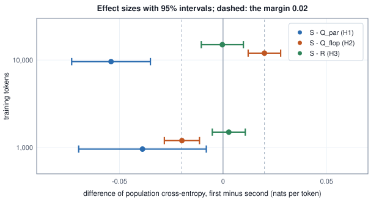

<!-- SPDX-License-Identifier: CC-BY-4.0 -->
<!-- Copyright (c) 2026 Martin Schröder <info@swedishembedded.com> -->

# A Research Architecture: The Spectral Language Model

*How do you test a new architectural idea honestly, using brain's spectral language model as the example?*

Here are two language models with different weights in every tensor. Their predictions agree to twelve decimals for every context. One is an ordinary decoder with a dense feed-forward network; the other holds its hidden state as Fourier coefficients and has had its weights rewritten to match.

<!-- worked: spectral_lm.absorption -->
The dense model of arm Q_par at the initial parameters of run 0 (`spectral_lm.run0.init`, 0xe864b265513b3b5c), and the model whose E1, E2, Wg, Wu are multiplied on the right by the 8 x 8 real Fourier basis Q (the full basis, D = m = 8) and whose Wd is multiplied on the left by Q^T. Largest difference between the two models' predicted probabilities over all 36 contexts and 6 next tokens: below 1e-12 (yes). The weights themselves are different (the first row of Wg changes by up to 0.474 in an entry), and so is every coordinate of the stream; the function is not.
<!-- /worked -->

Nothing was lost and nothing was gained, and that is the first thing to understand about an idea that looks like a research contribution. "Store the hidden state in the frequency domain" sounds like a change to the model. As it stands it is a change of coordinates, and a model that learns every map that touches its hidden state absorbs a change of coordinates into its weights without noticing. If the idea is to be worth anything it has to be a different idea from the one it first appears to be: one that can be wrong, built, and then honestly tried against the evidence that would show it wrong.

Testing it takes two things that depend on each other. One is the architecture of `crates/spectrallm`, brain's spectral language model: what lives in the frequency domain, what is computed there, what the transforms cost, and why a causal model can transform along the feature axis of a token but not along the sequence. The other is a method: a hypothesis stated before the run with the result that would refute it, a baseline that differs from the candidate in exactly one thing, equal tuning, seeds, an ablation, effect sizes with intervals, and a report that says what the interval does not settle. The method is applied to a small spectral model trained in plain Python against matched baselines, and its result is then compared with what brain recorded for the real one.

Causality, the residual stream, the Fourier basis, baselines, intervals and gradient checks all meet in this experiment; each comes back first as a question.

1. (Volume V, [Chapter 4](../v05-sequences/04-language-modeling.md), the causal language model.) A model predicts the token at position $t$ from the tokens before it. What makes a model causal, and what happens to the training loss if the prediction at $t$ can see the token at $t$ itself?
2. (Volume V, [Chapter 9](../v05-sequences/09-transformer-block.md), the residual stream.) Write the output of a pre-norm block in terms of its input $\mathbf{x}$, the attention sublayer and the feed-forward network.
3. (Volume I, [Chapter 14](../v01-mathematics/14-fourier.md), the discrete Fourier transform.) The real orthonormal Fourier basis of $\mathbb{R}^N$ is the columns of a matrix $\mathbf{S}$. What is $\mathbf{S}^\top\mathbf{S}$, what does that say about the lengths of $\mathbf{x}$ and $\mathbf{S}^\top\mathbf{x}$, and how many complex multiplications does the fast transform need for $N = 512$, against the definition?
4. (Volume II, [Chapter 8](../v02-learning/08-experiments.md), ablations and baselines.) Why must a baseline differ from the method under test in one thing only?
5. (Volume II, Chapter 8, uncertainty.) Eight paired differences have mean $-0.04$ and standard deviation $0.02$. Give the standard error and the 95 percent interval (multiplier $2.3646$ for 7 degrees of freedom).
6. (Volume III, [Chapter 6](../v03-neural-networks/06-gradient-checking.md), gradient checks.) How is an analytic gradient checked against central differences, and what does the check need to be run in double precision?

## A change of coordinates that changes nothing

The pair above is small enough to state completely. A token context is the last two symbols $(a, b)$ of a text over six symbols. The hidden state is $\mathbf{x} = \mathbf{E}_2[a] + \mathbf{E}_1[b] \in \mathbb{R}^8$ from two embedding tables, a pre-norm block adds a feed-forward network's output to it, a normalization follows, and the tied table $\mathbf{E}_1$ gives the six logits. Take any orthogonal matrix $\mathbf{Q} \in \mathbb{R}^{8 \times 8}$, here the real Fourier basis of Volume I with all eight functions kept, and write the hidden state in its coordinates, $\mathbf{z} = \mathbf{Q}^\top\mathbf{x}$.

Every operation that touches the stream is one of three. Addition: $\mathbf{Q}^\top(\mathbf{x} + \mathbf{y}) = \mathbf{Q}^\top\mathbf{x} + \mathbf{Q}^\top\mathbf{y}$. A dense map that reads the stream: $\mathbf{W}\mathbf{x} = (\mathbf{W}\mathbf{Q})(\mathbf{Q}^\top\mathbf{x}) = (\mathbf{W}\mathbf{Q})\,\mathbf{z}$, so reading in the new coordinates uses the matrix $\mathbf{W}\mathbf{Q}$. A dense map that writes to it: if $\mathbf{y} = \mathbf{W}'\mathbf{u}$ is added to $\mathbf{x}$, then $\mathbf{Q}^\top\mathbf{y} = (\mathbf{Q}^\top\mathbf{W}')\mathbf{u}$ is added to $\mathbf{z}$. The embedding tables are maps that write the stream, and the tied head reads it, so $\mathbf{E} \mapsto \mathbf{E}\mathbf{Q}$ handles both. The remaining operation is the RMS normalization, and an orthogonal map does not change the root mean square of a vector, because it does not change its length: $\mathrm{rms}(\mathbf{Q}^\top\mathbf{x}) = \mathrm{rms}(\mathbf{x})$. Without a learned gain the normalization commutes with $\mathbf{Q}$ exactly; with a gain $\boldsymbol{\gamma}$ the elementwise product becomes the dense symmetric map $\mathbf{Q}^\top\mathrm{diag}(\boldsymbol{\gamma})\mathbf{Q}$, which is one more dense matrix. Induction over the blocks gives the statement that the paper behind brain's crate states as a proposition, here called **basis absorption**: a decoder whose only operations on the residual stream are additions, dense maps and RMS normalization computes the same function in any orthonormal basis of its stream, with its weights rewritten by $\mathbf{W}\mapsto\mathbf{W}\mathbf{Q}$ on the way in and $\mathbf{W}\mapsto\mathbf{Q}^\top\mathbf{W}$ on the way out. The block above is that rewriting carried out numerically, and the weights it printed as changed are the same function.

Two consequences decide what has to be tested. Keeping only the lowest $m$ of the $D$ coordinates of such a model is a model of width $m$ with dense maps, which is an ordinary narrower decoder, so a "truncated-spectrum transformer with dense maps" needs no new code and no new experiment; it is a control that already exists. And no result about a Fourier-coordinate stream can come from the coordinates alone. Whatever a spectral model does differently has to come from an operation defined relative to the basis, one that would not survive being rewritten in another orthonormal basis, because it is not a dense map.

The hypothesis the paper in `papers/spectral-lm` opens with is the one basis absorption kills if it is read literally: a hidden state "could be stored as a few Fourier coefficients of a longer virtual signal and processed by per-frequency operators, cutting parameters and arithmetic". Read carefully it has two parts that can each be wrong. The first is representational: a residual stream of $m$ coefficients of a $D$-sample signal. The second is operational: operators that are diagonal in frequency, with a nonlinearity taken in the signal domain. Only the second can matter, and only against the right controls.

## A residual stream of Fourier coefficients

Fix an even signal length $D$ and a retained width $m \le D$. Volume I built the real orthonormal Fourier basis of $\mathbb{R}^D$ in frequency order: the constant $1/\sqrt{D}$, then for $k = 1, \dots, D/2 - 1$ the pair $\sqrt{2/D}\cos(2\pi k j/D)$ and $\sqrt{2/D}\sin(2\pi k j/D)$ over $j = 0, \dots, D-1$, then the alternation $(-1)^j/\sqrt{D}$. Collect the first $m$ functions as the columns of $\mathbf{S} \in \mathbb{R}^{D\times m}$. Its columns are orthonormal, $\mathbf{S}^\top\mathbf{S} = \mathbf{I}_m$.

A **Fourier residual stream** is a residual stream whose entries are the coefficients $\mathbf{z} \in \mathbb{R}^m$ of a band-limited signal $\mathbf{x} = \mathbf{S}\mathbf{z} \in \mathbb{R}^D$, the lowest $m$ coefficients of a virtual signal of $D$ samples that is never stored: the model holds $\mathbf{z}$ for each token, the embedding table writes $m$ coefficients, the head reads $m$, and the signal exists only inside a mixer, for the moment it is needed. By Parseval's identity (Volume I) the lengths agree, $\lVert\mathbf{S}\mathbf{z}\rVert = \lVert\mathbf{z}\rVert$, so the normalization of the stream is the same whether it is measured in coefficients or in samples. Here is the basis of the toy model trained below ($D = 16$, $m = 8$), with one synthesis computed both ways.

<!-- worked: spectral_lm.basis_check -->
D = 16, m = 8: the retained functions are the constant, the cosine and sine at frequencies 1, 2 and 3, and the cosine at frequency 4 (its sine partner, index 8, is cut off). Draw order: z[0] .. z[7] from `spectral_lm.basis_check` (0x80d9b2cd38d71d6e), z[i] = rng.normal(). Largest deviation of S^T S from the identity: below 1e-12 (yes). Largest difference between the dense product S z and the FFT synthesis: below 1e-12 (yes). |z|^2 = 5.0373, |S z|^2 = 5.0373 (Parseval). The FFT used 32 complex multiplications and 64 complex additions (the dense product: 128 real multiplications).

| j | z[j] | (S z)[j] dense | (S z)[j] by FFT |
|---|---:|---:|---:|
| 0 | 0.4635 | 0.7203 | 0.7203 |
| 1 | 0.6973 | -0.1221 | -0.1221 |
| 2 | 0.0547 | -0.3664 | -0.3664 |
| 3 | -0.0237 | 0.3905 | 0.3905 |
| 4 | 0.3303 | 0.9872 | 0.9872 |
| 5 | 0.5686 | 0.4081 | 0.4081 |
| 6 | -1.9188 | -0.6644 | -0.6644 |
| 7 | 0.4674 | -0.8967 | -0.8967 |
| 8 |  | -0.1748 | -0.1748 |
| 9 |  | 0.5072 | 0.5072 |
| 10 |  | 0.5013 | 0.5013 |
| 11 |  | 0.0183 | 0.0183 |
| 12 |  | -0.4082 | -0.4082 |
| 13 |  | -0.3297 | -0.3297 |
| 14 |  | 0.3320 | 0.3320 |
| 15 |  | 0.9514 | 0.9514 |
<!-- /worked -->

The second column holds the eight coefficients, and the third and fourth the sixteen samples, equal within the tolerance stated above the table. The fourth was not computed by multiplying by $\mathbf{S}$. It was computed with one complex transform of length 16, and the derivation of how is short. The pair $(a_k, b_k) = (z_{2k-1}, z_{2k})$ contributes $\sqrt{2/D}\,(a_k\cos\theta + b_k\sin\theta)$ at sample $j$, with $\theta = 2\pi kj/D$, and that equals $\sqrt{2/D}\,\mathrm{Re}\big[(a_k - i\,b_k)e^{i\theta}\big]$. Place $(a_k - i b_k)/\sqrt{2}$ in bin $k$ of a length-$D$ spectrum and its conjugate in bin $D - k$, put $z_0$ in bin 0 and the Nyquist coefficient, if retained, in bin $D/2$, set every bin above the retained band to zero, and the inverse transform of this Hermitian spectrum, divided by $\sqrt{D}$, is real and equals $\mathbf{S}\mathbf{z}$. The coefficients of the analysis $\mathbf{S}^\top\mathbf{x}$ are read off the forward transform the same way. The kernels `crates/kernels/wgsl/rdft_synth.wgsl` and `rdft_analysis.wgsl` compute exactly this identity, with in-place butterflies after a bit-reversed load, one workgroup per row.

What does the transform cost? The definition spends $D$ outputs times $m$ multiply-adds, $2Dm$ FLOPs per row (a multiply and an add count as two). The fast transform of Volume I does a length-$D$ transform in $(D/2)\log_2 D$ butterflies, and a butterfly is one complex multiplication (six real operations) and two complex additions (four), so ten, which gives $5D\log_2 D$. Counting the operations of a recursive transform confirms it.

<!-- worked: spectral_lm.transform_cost -->
First table: operations of one transform row of length D with m = D/2 retained modes, by the definition (2 D m: D outputs, m multiply-adds each) and by the FFT count 5 D log2 D.

| D | m = D/2 | dense product 2 D m | FFT 5 D log2 D | dense / FFT | fewer operations |
|---|---:|---:|---:|---:|---:|
| 16 | 8 | 256 | 320 | 0.80 | dense |
| 32 | 16 | 1,024 | 800 | 1.28 | FFT |
| 64 | 32 | 4,096 | 1,920 | 2.13 | FFT |
| 128 | 64 | 16,384 | 4,480 | 3.66 | FFT |
| 256 | 128 | 65,536 | 10,240 | 6.40 | FFT |
| 512 | 256 | 262,144 | 23,040 | 11.38 | FFT |
| 1024 | 512 | 1,048,576 | 51,200 | 20.48 | FFT |
| 2048 | 1024 | 4,194,304 | 112,640 | 37.24 | FFT |

Second table: the recursion of this module run on D zeros and its operations counted (a complex multiplication is 6 real operations, a complex addition 2); the total equals 5 D log2 D exactly.

| D | twiddle multiplications | complex additions | 6 x mult + 2 x add | 5 D log2 D |
|---|---:|---:|---:|---:|
| 16 | 32 | 64 | 320 | 320 |
| 64 | 192 | 384 | 1,920 | 1,920 |
| 512 | 2,304 | 4,608 | 23,040 | 23,040 |

Third table: per token and block, FLOPs as counted in the text (filters 4 C m, gated product 5 C D, 3 C transforms; SwiGLU 6 m f), parameters 3 C m against 3 m f.

| shape | spectral mixer | its parameters | FLOPs, dense transforms | FLOPs, FFT transforms | SwiGLU of equal parameters (params / FLOPs) | SwiGLU of larger width (params / FLOPs) |
|---|---:|---:|---:|---:|---:|---:|
| the toy model trained here | m = 8, D = 16, C = 4 | 96 | 3,520 | 4,288 | f = 4: 96 / 192 | f = 72: 1,728 / 3,456 |
| the paper's shape | m = 256, D = 512, C = 24 | 18,432 | 18,960,384 | 1,744,896 | f = 24: 18,432 / 36,864 | f = 1024: 786,432 / 1,572,864 |
<!-- /worked -->

The first table has a surprise in its top row. At $D = 16$ with $m = 8$ the fast transform needs 320 operations and the definition 256, so the "fast" transform is 25 percent more work at the size of the toy, and the two cross between $D = 16$ and $D = 32$. The factor by which the fast transform wins is $2Dm/(5D\log_2 D) = 2m/(5\log_2 D)$, which is $11.38$ at the shape of brain's paper ($D = 512$, $m = 256$). The same exercise shows why a count is a promise and not a measurement: the third table puts the mixer's FLOPs at that shape at 18,960,384 with dense transforms and 1,744,896 with the fast ones, a factor of about eleven; what a card did with that factor is part of brain's record.

## The mixer: where the frequencies meet

A model needs a feed-forward sublayer that is not a dense map on the stream. Take the transformer's SwiGLU, $\mathbf{W}_{\mathrm{down}}\big(\mathrm{silu}(\mathbf{W}_{\mathrm{gate}}\mathbf{h}) \odot \mathbf{W}_{\mathrm{up}}\mathbf{h}\big)$, with $\mathbf{h} = \mathrm{RMSNorm}(\mathbf{z})$, three dense matrices of $m f$ entries each. A frequency-domain version has two ingredients, and each is there for a reason.

The first is a filter diagonal in frequency. Volume I's convolution theorem says a convolution is a gain per frequency, and a learned gain per frequency is a learned filter: for $\mathbf{h} \in \mathbb{R}^m$ the map $\mathbf{h} \mapsto \mathbf{g}\odot\mathbf{h}$ with $\mathbf{g} \in \mathbb{R}^m$ has $m$ parameters where a dense map has $m^2$. A bank of $C$ such filters has $Cm$. Diagonal maps alone are useless: a stack of them is a diagonal map, and nothing in them lets one frequency affect another.

The second ingredient supplies the coupling. Multiply two signals sample by sample, and the spectrum of the product is the convolution of their spectra, so every pair of modes whose frequencies add or subtract to $k$ contributes to mode $k$. The module multiplies the cosine of frequency 1 by the cosine of frequency 2 in the signal domain and analyses the product.

<!-- worked: spectral_lm.product_couples_modes -->
D = 16 and the full basis. Mode 1 (cosine at frequency 1) and mode 3 (cosine at frequency 2), each as a signal S e_i, multiplied sample by sample; the product analysed with S^T. Entries with magnitude below 1e-12 are left out; 1 / sqrt(2 D) = 0.17678.

| mode i | basis function | coefficient of the product |
|---|---:|---:|
| 1 | cos, k = 1 | 0.17678 |
| 5 | cos, k = 3 | 0.17678 |
<!-- /worked -->

Two modes went in and two came out, at frequencies 1 and 3: $\cos\theta\cos 2\theta = \tfrac12(\cos\theta + \cos 3\theta)$, each coefficient $1/\sqrt{2D}$. No diagonal map could produce a coefficient at frequency 3 from inputs at 1 and 2, and no dense map can do it with $m$ parameters per row either. This coupling is what the signal domain is for. If both factors are band-limited to the lowest $m$ modes, their product lives in the lowest $2m$ (frequencies add), so with $D \ge 2m$ the bilinear part of the mixer is computed without aliasing, which is why brain's configuration uses $D = 2m$ in its registered runs; the factor $\mathrm{silu}$ is not band-limited, so $D/m$ remains a tunable ratio and not a guarantee.

Put together, for $\mathbf{h} \in \mathbb{R}^m$ and learned filters $\mathbf{g}_c, \mathbf{u}_c, \mathbf{w}_c \in \mathbb{R}^m$, the rows of three matrices $\mathbf{G}, \mathbf{U}, \mathbf{W} \in \mathbb{R}^{C\times m}$, the **spectral mixer** with $C$ channels is

$$
M(\mathbf{h}) \;=\; \sum_{c=1}^{C} \mathbf{w}_c \odot \mathbf{S}^\top\Big[\,\mathrm{silu}\big(\mathbf{S}(\mathbf{g}_c\odot\mathbf{h})\big) \,\odot\, \mathbf{S}(\mathbf{u}_c\odot\mathbf{h})\,\Big].
$$

Read from the inside out: filter the input spectrum twice, synthesize both filtered spectra into $D$-sample signals, multiply gated by a silu in the signal domain, analyse back to $m$ coefficients, weight per mode and sum over channels. This is brain's `crates/spectrallm/src/mixer.rs`, and its forward is five named steps. In the book's pseudocode:

```text
function spectral_mixer(h: array<real>[m], G: array<real>[C, m], U: array<real>[C, m],
                        W: array<real>[C, m], S: array<real>[D, m]) -> array<real>[m]
    require S has orthonormal columns, that is S^T S = I
    y = zeros(real, [m])
    for c in 0 .. C:
        hg = G[c, :] * h                                   # filters: equal shapes, elementwise
        hu = U[c, :] * h
        a = [dot(S[j, :], hg) for j in 0 .. D]             # synthesis: D samples
        b = [dot(S[j, :], hu) for j in 0 .. D]
        s = [silu(a[j]) * b[j] for j in 0 .. D]            # the product, sample by sample
        t = [dot(S[:, i], s) for i in 0 .. m]              # analysis: back to m coefficients
        y = y + W[c, :] * t
    return y
```

The backward pass reuses the same two transforms in the opposite direction, because $\mathbf{S}$ has orthonormal columns and so synthesis and analysis are adjoints: $\mathrm{d}\mathbf{s} = \mathbf{S}\,\mathrm{d}\mathbf{t}$ and $\mathrm{d}\mathbf{h}_g = \mathbf{S}^\top\mathrm{d}\mathbf{a}$. The mixer has $3Cm$ parameters per block, against $3mf$ for a SwiGLU of hidden width $f$. In the count of `forward_flops_per_token` in `crates/spectrallm/src/config.rs`, used throughout here, it costs $4Cm$ operations for its filters, $5CD$ for the product and $3C$ transforms, two syntheses and one analysis per channel. The parameter count $3Cm$ is pinned by the unit test `mixer_parameter_counts` in the same file. The figure draws one channel.


A last cost is easy to miss, because it is not arithmetic. The mixer keeps, per token and block, three buffers of $C \cdot m$ numbers (the two filtered inputs and the analysis output) and three of $C \cdot D$ (the two syntheses and their product), all needed again by the backward pass. At brain's registered shape $m = 256$, $D = 512$, $C = 24$ that is $3 \cdot 24 \cdot 256 + 3 \cdot 24 \cdot 512 = 55{,}296$ numbers per token and block, against the three buffers of a SwiGLU with $f = 1024$, which are $3{,}072$: eighteen times more. A model that has few parameters can still have a lot of activations.

## Where the sequence goes: causality

Everything so far transforms the feature axis of a single token, and there is a more obvious place to put a Fourier transform in a language model: along the sequence. A transform over the $T$ positions of a text mixes tokens in a single $O(T\log T)$ step, which is cheaper than attention's $O(T^2)$, and the idea is old enough to have been built and published, as FNet and as the adaptive Fourier neural operator. A causal model cannot use it as it stands, and the reason can be seen in eight numbers.

Take a sequence of $T = 8$ positions with one scalar feature each, and apply a global filter along the sequence axis: transform, multiply each frequency by a real gain, transform back. Increase the input at the last position by 1 and look at the output at every position.

<!-- worked: spectral_lm.leak_table -->
Sequence length T = 8. Generator `spectral_lm.leak` (0xa74380fc1bcff57d), in this order: the gains g[0] .. g[4] are rng.uniform() + 0.5, and g[5], g[6], g[7] are copies of g[3], g[2], g[1]; then the causal kernel k[0] .. k[7] is eight rng.uniform() draws; then the token vectors, 64 rng.normal() draws, row by row (the mixer is the spectral mixer of this chapter's toy model with the initial weights of run 0, applied to the RMS-normalised vector of each token: the RMS norm has no gain and its epsilon is 1e-06, inside the root). 'Sequence transform' is y = Re IDFT(g * DFT(x)) over the sequence axis of a scalar feature; 'causal kernel' is y_i = sum over j <= i of k[i - j] x_j computed with FFTs of length 16 on zero-padded inputs; 'feature-axis mixer' maps each token's own 8 features. Each entry is the largest change of output position i when the input at the last position, 7, is increased by 1 (for the feature-axis mixer: every one of that token's 8 raw features by 1, before the RMS norm, and the change is measured on the largest absolute difference over the 8 outputs of the mixer alone, without the residual connection).

| output position i | sequence transform | causal kernel, zero-padded | feature-axis mixer |
|---|---:|---:|---:|
| 0 | 0.0452 | 0 | 0 |
| 1 | 0.0791 | 0 | 0 |
| 2 | 0.0190 | 0 | 0 |
| 3 | 0.0897 | 0 | 0 |
| 4 | 0.0190 | 0 | 0 |
| 5 | 0.0791 | 0 | 0 |
| 6 | 0.0452 | 0 | 0 |
| 7 | 1.2059 | 0.6669 | 1.8209 |

Entries above the diagonal of the sequence transform's matrix (output i reading input j > i): 28 of 28 are nonzero, the largest has magnitude 0.0897; for the zero-padded causal kernel the largest is below 1e-12 (yes).
<!-- /worked -->

The second column is the whole problem. The output at position 0 changes by 0.0452 when only the input at position 7 changed, and a model trained to predict token $t+1$ from outputs at position $t$ is predicting with a view of tokens that come later; all 28 of the matrix entries above the diagonal are nonzero. During training the loss would fall as the model learned to read the answer off the future, and during generation, when there is no future, the answer would be missing. That is the failure of the first recall question, with the leak hidden in a transform rather than in a mask.

The sequence transform can be repaired, and the third column shows how: a convolution with a causal kernel, computed through transforms of length $2T$ on zero-padded inputs, has zeros above the diagonal, because zero padding turns the circular convolution into a linear one and a kernel supported on non-negative lags looks only backward. Each such mixer needs the length $2T$, a kernel the model can learn only up to $T$ taps, and a recompute at decode time, so the design is a research direction of its own and not a minor edit.

The spectral model of brain does not take it. Its transforms run along the feature axis of every token separately, so the fourth column is zero by construction: the mixer in `crates/spectrallm/src/mixer.rs` takes a block of `rows` rows (a training batch or a single decode token, in its own words) and every transform is per row, `fft_workgroups` giving one workgroup to each. The sequence axis is left to attention, which is causal by its mask (Volume V). The property is tested by a stronger check than reading the code, `incremental_decode_matches_the_full_forward` in `crates/spectrallm/tests/it/model.rs`: it feeds the model one token at a time through a key-value cache, which cannot see the future, and requires the logits to equal those of the full-sequence forward at every position, for both the spectral and the SwiGLU mixer, to within $10^{-4}$. A model that leaked the future into the past would fail it at position 0. That test is a regression check for the architecture's most important invariant and is worth copying into any new decoder.

The paper states its scope in one sentence: it "does not study Fourier token mixing along the sequence axis". The crate's roadmap records it as the lead follow-on, with a different mechanism, a recurrent state mixing along the sequence, and with attention in some blocks. That is where the open question sits, and it is the one hypothesis here whose result is not known.

## The decoder to test

The experiments of brain ran a decoder with six blocks of width 256 on a corpus of children's stories on a graphics card. The same question can be asked of a model small enough for plain Python: a decoder that sees the last two symbols, not the whole text, with one block, and trained on a source whose entropy is known exactly. Nothing about causality is lost, because the context is the past and nothing else; what is lost is attention, and with it any test of how the mixer behaves beside it. The result is an experiment about the mixer, and that is all it is.

The source is an order-2 Markov chain on six symbols. Its conditional distributions are fixed once, so that the best possible model is known, and a model's quality can be measured without sampling noise.

<!-- worked: spectral_lm.source_table -->
The source: an order-2 Markov chain on V = 6 symbols, p(c | a, b) = softmax over c of 1.5 g[a][b][c] with g[a][b][c] drawn from `spectral_lm.source` (0x874d0b2253910a12) by rng.normal(), in the order a, b, c with c fastest. The stationary distribution over the pair (a, b) (probability that two consecutive tokens are a then b) is found by iterating the chain from the uniform pair distribution until it moves by less than 1e-16 or 5000 times. First four of the 36 contexts:

| context (a, b) | stationary probability | p(0) | p(1) | p(2) | p(3) | p(4) | p(5) |
|---|---:|---:|---:|---:|---:|---:|---:|
| (0, 0) | 0.0395 | 0.018 | 0.831 | 0.058 | 0.029 | 0.044 | 0.019 |
| (0, 1) | 0.0479 | 0.106 | 0.070 | 0.232 | 0.395 | 0.119 | 0.078 |
| (1, 0) | 0.0164 | 0.060 | 0.653 | 0.014 | 0.130 | 0.001 | 0.142 |
| (1, 1) | 0.0083 | 0.090 | 0.257 | 0.379 | 0.239 | 0.012 | 0.022 |

Stationary probabilities range from 0.0014 to 0.0992 (uniform would be 0.0278). The entropy rate of the source, the lowest cross-entropy any model can reach, is 1.0053 nats per token; a model that ignores the context and predicts uniformly gets ln 6 = 1.7918.
<!-- /worked -->

A trained model $q$ is scored by its **population cross-entropy** $L_{\mathrm{pop}}$, the expected negative log-probability it gives the next symbol under the source's own distribution of contexts and continuations: $L_{\mathrm{pop}} = \sum_{(a,b)}\pi(a,b)\,\mathrm{CE}\big(p(\cdot\mid a,b),\,q(\cdot\mid a,b)\big)$. It equals the entropy rate of the source plus the Kullback-Leibler divergence between the source and the model, so it can never go below $1.0053$ and the gap above it is the model's excess loss. A real experiment has no such luxury; it has a held-out split, which adds a sampling error to every number. Here the only randomness left is the training sequence and the initial weights, and both are controlled.

The decoder is the toy of the first section: $\mathbf{x} = \mathbf{E}_2[a] + \mathbf{E}_1[b]$ with $\mathbf{E}_1, \mathbf{E}_2\in\mathbb{R}^{6\times 8}$, one pre-norm block with no attention, $\mathbf{x}' = \mathbf{x} + \mathrm{mixer}(\mathrm{RMSNorm}(\mathbf{x}))$, a final RMS normalization (no learned gains anywhere; $\varepsilon = 10^{-6}$), and logits $\mathbf{E}_1\,\mathrm{RMSNorm}(\mathbf{x}')$ through the tied table. The only thing that varies between the four arms is the mixer.

| arm | mixer | what it tests |
|---|---|---|
| S | spectral mixer, Fourier basis, $m = 8$, $D = 16$, $C = 4$ | the candidate |
| Q_par | SwiGLU with $f = 4$ | same parameters as S: the baseline for H1 |
| Q_flop | SwiGLU with $f = 72$ | about the same arithmetic as S: the baseline for H2 |
| R | the spectral mixer with a random orthonormal $16\times 8$ matrix in place of $\mathbf{S}$ | the ablation of H3: is it the Fourier basis, or just the shape? |

The counts follow the formulas above.

<!-- worked: spectral_lm.arms_table -->
Embedding parameters: two tables of V x m = 6 x 8 (the tied head reads E1). Mixer FLOPs per token as in the arithmetic section: spectral rows with dense transforms and with FFT counts, SwiGLU rows 6 m f. No biases, no learnable norm gains.

| arm | sublayer | shape | embedding parameters | sublayer parameters | all parameters | FLOPs (dense) | FLOPs (FFT) |
|---|---:|---:|---:|---:|---:|---:|---:|
| S | spectral, Fourier basis | C = 4, D = 16 | 96 | 96 | 192 | 3,520 | 4,288 |
| R | spectral, random orthonormal basis | C = 4, D = 16 | 96 | 96 | 192 | 3,520 | 4,288 |
| Q_par | SwiGLU, equal parameters | f = 4 | 96 | 96 | 192 | 192 | 192 |
| Q_flop | SwiGLU, equal arithmetic | f = 72 | 96 | 1,728 | 1,824 | 3,456 | 3,456 |
<!-- /worked -->

Q_par is chosen to match S in parameters, $3Cm = 3mf$ at $f = C = 4$, and differs from it in that one sublayer and nothing else: the same embeddings, the same normalizations, the same training. Q_flop is chosen to match S in arithmetic, and the count it matches is the dense-transform count, 3,520 against 3,456, because that is the one this toy's code runs; at the FFT count it would get $f = 89$. A baseline of equal arithmetic has 18 times the parameters of S in its sublayer, and that is the point of having two: the question "is the mixer better" has no answer until it is asked as "better per what".

Weights are drawn from the generator `spectral_lm.run<i>.init` as `rng.normal()` samples, scaled and in this order: $\mathbf{E}_1$ ($6\times 8$ row by row, standard deviation 0.5), $\mathbf{E}_2$ (the same), then the mixer. SwiGLU arms draw $\mathbf{W}_{\mathrm{gate}}$ ($f\times 8$), $\mathbf{W}_{\mathrm{up}}$ ($f \times 8$), $\mathbf{W}_{\mathrm{down}}$ ($8\times f$), all with standard deviation 0.25. The spectral arms draw $\mathbf{G}$, $\mathbf{U}$, $\mathbf{W}$ (each $C\times 8$ row by row) with standard deviation $0.25\sqrt{D} = 1$: a row of $\mathbf{S}$ has squared length $m/D$ on average, so $\mathbf{S}(\mathbf{g}\odot\mathbf{h})$ with $\mathbf{h}$ of unit root mean square has per-sample variance $(m/D)s^2$, a dense gate with fan-in $m$ and standard deviation $\sigma$ has $m\sigma^2$, and the two are equal at $s = \sigma\sqrt{D}$, the rule `crates/spectrallm/src/init.rs` also uses. The arm R then draws a $16\times 8$ matrix of unit normals row by row and orthonormalizes its columns in order by Gram-Schmidt. The data of run $i$ come from `spectral_lm.run<i>.data`: two symbols from `rng.integer(6)`, then each next symbol from one `rng.uniform()` taken against the cumulative distribution of the context. The eight runs use these seeds:

<!-- worked: spectral_lm.seeds_table -->
| run | data seed (`spectral_lm.run<i>.data`) | init seed (`spectral_lm.run<i>.init`) |
|---|---:|---:|
| 1 | 0xb7bf7629285a0fb6 | 0x7f9b3dfeb3a67aac |
| 2 | 0x7fc244213d21a4da | 0x34a3ddf943a8e9c2 |
| 3 | 0xff7cbae3005d4fde | 0xe9ba88b56814e859 |
| 4 | 0xd801f384ca37d3ca | 0x557221562c65fc8d |
| 5 | 0x194478d1bce79eac | 0xda1e70e41763c2d6 |
| 6 | 0xe014580cbeca2002 | 0x69566572968627c7 |
| 7 | 0xa884728dc1591906 | 0x4ea722d6de464854 |
| 8 | 0xb89d597447755912 | 0xd27e3ac51d683b9f |
<!-- /worked -->

Training is full-batch Adam on the mean cross-entropy of a 1,200-token sequence, which gives 1,198 predictions (the first two tokens are only context; each later token is predicted from the two before it), so the mean is over 1,198 terms ($\beta = (0.9, 0.999)$, $\varepsilon = 10^{-8}$, no weight decay, no clipping, the moments bias-corrected at the 1-based step $s$) for $T = 240$ steps, with the rate annealed by a cosine from its peak $\eta_{\max}$ towards a tenth of it: $\eta_s = \eta_{\max}\,\bigl(0.1 + 0.9 \cdot \tfrac12 (1 + \cos(\pi (s - 1)/T))\bigr)$ for $s = 1, \dots, T$. The first step is at the peak, and the last, at $s = T$, is at a little above a tenth, since the angle is $\pi (T - 1)/T$ and not $\pi$. The selection runs use the same formula with $T = 120$. Because the model sees only the last two symbols, the gradient of the whole sequence is a sum over the 36 contexts weighted by how often each continuation occurred, and a step costs 36 forward and backward passes whatever the length of the sequence. The loss that training minimizes is the empirical cross-entropy of the sequence; the one reported in the tables is the population cross-entropy.

Before any of that is trained, the backward pass of every mixer is checked against central differences: the hand-written gradients of the mixers are where a bug would hide inside a result that looks like an effect.

<!-- worked: spectral_lm.gradient_check -->
Every entry of every trainable tensor, central difference with step 1e-5 of the empirical loss (the mean cross-entropy of the 1200-token training sequence of run 0, `spectral_lm.run0.data` 0x4a1d1f714eb114d6) at the initial parameters of run 0 (`spectral_lm.run0.init` 0xe864b265513b3b5c). Relative error |numerical - analytic| / max(|numerical|, |analytic|, 1e-3); the criterion is below 1e-6. The SwiGLU arm of equal arithmetic runs the same code as `Q_par` with f = 72 instead of 4.

| arm | sublayer | entries checked | largest relative error |
|---|---:|---:|---:|
| S | spectral, Fourier basis | 192 | below 1e-6 |
| R | spectral, random orthonormal basis | 192 | below 1e-6 |
| Q_par | SwiGLU, equal parameters | 192 | below 1e-6 |
<!-- /worked -->

All three pass the criterion on every one of their entries (all trainable entries of S, R and Q_par, and the arm Q_flop runs Q_par's code at another width). The same discipline is applied to the real model in `crates/gradcheck/tests/it/spectrallm_fd.rs`, for both mixers and both transform paths and with the tied embedding checked entry by entry, at a tolerance sized for single-precision arithmetic (an absolute $4\times 10^{-3}$ and a relative $0.08$, against recorded largest errors of 0.012 to 0.024). A result built on a gradient that was not checked is a result about the bug.

## Stating the test before running it

An experiment is only a test if it can fail. Before the first run, three hypotheses, one margin and one rule were written down, and they have not changed.

The unit is $L_{\mathrm{pop}}$ in nats per token and a difference is "first arm minus second", so a negative number favours the first arm. The **margin** is 0.02 nats: a difference smaller than this is too small to matter to the question, and the margin was set before looking at any result. Each hypothesis is judged by the paired 95 percent interval of the mean difference over the runs: it is *supported* when the interval lies wholly on the predicted side of the margin, *refuted* when it lies wholly on the other side, and *undecided* when it straddles it. That is the rule, and an undecided verdict is a legitimate outcome, not a failure of nerve.

- **H1.** S is not worse than Q_par by more than the margin: $L_{\mathrm{pop}}(\mathrm{S}) - L_{\mathrm{pop}}(\mathrm{Q\_par}) \le +0.02$. Prediction: supported. It would be refuted by an interval wholly above $+0.02$.
- **H2.** Q_flop, with the same arithmetic, is better than S by more than the margin: $L_{\mathrm{pop}}(\mathrm{S}) - L_{\mathrm{pop}}(\mathrm{Q\_flop}) \ge +0.02$. Prediction: supported. It would be refuted by an interval wholly below $+0.02$.
- **H3.** The Fourier basis itself does not matter: $|L_{\mathrm{pop}}(\mathrm{S}) - L_{\mathrm{pop}}(\mathrm{R})| < 0.02$, an equivalence that needs the whole interval inside the margin on both sides. Prediction: supported, because the paper's argument that only structure relative to the basis can matter applies to a random basis equally.

This is **architecture hypothesis testing** in the small: a precise claim about what an architecture buys, a falsifiable prediction with the result that would refute it, a baseline that differs in exactly one thing, equal tuning and seeds, an ablation of the part the idea is named for, an effect size with its uncertainty compared with a margin chosen in advance, and an honest report of what came out, whichever way. Each element answers a specific way of fooling oneself that Volume II named, and each shows its use below.

The baselines differ from S in the mixer only, so a difference can be attributed to the mixer. They come in two kinds because "equal" has two meanings, and a candidate that wins at one and loses at the other has found its niche, not a contradiction. The ablation R differs from S in the basis only. If R matched S, the basis itself would not be what matters, which is what H3 predicts and what the paper's argument suggests; if R lost, the Fourier ordering of modes would be doing something the per-mode filters could use.

Tuning effort is held equal, since unequal effort is one of the cheapest ways to manufacture a win that Volume II listed. Each arm gets the same three peak rates, 0.01, 0.03 and 0.1, one run each from the initial parameters of run 0, 120 annealed steps, scored by the final training loss, and the lowest is the arm's rate. The seeds are paired: run $i$ gives every arm the same training sequence, and the same $\mathbf{E}_1$, $\mathbf{E}_2$ draws, so the paired differences remove the variation that the sequence contributes to every arm alike. The number of runs, eight, was fixed in advance by the arithmetic budget of a plain-Python experiment and was not extended after looking.

<!-- worked: spectral_lm.lr_selection -->
Learning-rate selection of the amended recipe: 120 full-batch Adam steps from the initial parameters of run 0, the rate annealed over those steps (step s = 1 .. 120 runs at peak (0.1 + 0.9 (1 + cos(pi (s - 1) / 120)) / 2), so the first step is at the peak and the last at 0.1002 of it), one run per arm and rate, scored by the final training loss (mean cross-entropy of the 1200-token training sequence, whose 1198 predictions are made from the 2 tokens before each of positions 2 .. 1199; nats per prediction); the lowest decides the arm's peak rate. A number that comes from a chaotic run is printed with only the digits that are the same in the run and in four copies of it whose first weight is changed by +1e-12, -1e-12, +3e-12 and -3e-12: in full if all agree on it, as 'about x' with the leading digits on which all agree, or as 'unstable' when not even one digit survives; the other digits cannot be reproduced in another implementation.

| arm | rate 0.01 | rate 0.03 | rate 0.1 | chosen |
|---|---:|---:|---:|---:|
| S | 1.285 | 1.122 | 1.058 | 0.1 |
| R | 1.243 | 1.113 | 1.060 | 0.1 |
| Q_par | 1.295 | 1.122 | 1.061 | 0.1 |
| Q_flop | 1.027 | 0.993 | 0.983 | 0.1 |
<!-- /worked -->

Every arm chooses the largest rate in its grid, which is not a comfortable fact. A selection at the edge of its grid has not finished selecting, and the check of a later section shows that two of the arms would have liked more.

## What the runs said

The recipe written down before the first run held the rate constant. Its runs end at points that move by less than 0.05 nats (the table below) when one weight starts a trillionth away, which is the order of the spread over runs (about 0.02) and means the chaotic part of training is visible in the digits; it did not change the answer to any hypothesis.

<!-- worked: spectral_lm.first_attempt -->
The recipe registered before the first run: a constant rate chosen from (0.01, 0.03, 0.1) by the same selection (one run per arm and rate from the initial parameters of run 0, 120 steps at the constant rate, the lowest final training loss), 1200-token sequences, 240 steps, the same eight runs. Each run was repeated once with the embedding weight E1[0][0] increased by 1e-12. Verdicts of the original runs and of the repeats by the registered rule:

| hypothesis | claim | verdict, original runs | verdict, copies with one weight changed by 1e-12 |
|---|---:|---:|---:|
| H1 | S - Q_par <= +0.02 | supported | supported |
| H2 | S - Q_flop >= +0.02 | refuted | refuted |
| H3 | |S - R| < 0.02 | supported | supported |

How far the repeat of a run ends from the run, in population cross-entropy (nats per token). A run at a constant rate is chaotic at the end, so the change itself cannot be reproduced; each cell is a bound that is at least ten times the value measured (the smallest of 0.05, 0.1, 0.5 that does so):

| arm | peak rate | largest change of a run's final loss | mean change |
|---|---:|---:|---:|
| S | 0.1 | below 0.05 | below 0.05 |
| R | 0.1 | below 0.05 | below 0.05 |
| Q_par | 0.03 | below 0.05 | below 0.05 |
| Q_flop | 0.1 | below 0.05 | below 0.05 |

For scale, the standard deviation over the eight runs of one arm lies between 0.01 and 0.03 (to the nearest hundredth outward, for the same reason).
<!-- /worked -->

That is the table of the recipe as first written, run at the same length: the verdicts of H1 and H3 are those of the prediction and H2 is refuted. The recipe was then amended to anneal the rate as brain's own runs do, which brings the final points to digits that survive the perturbation test in nearly every cell, and the grid was widened to include 0.1 once the best rate of every arm was found to lie at the top of the narrower one. The number of steps was cut from 300 to 240 to keep the arithmetic of the whole experiment within its budget. These are changes made after seeing results of the earlier recipes, and they are listed so that a reader can discount accordingly; the verdicts did not move because of them, which is the thing to check when a protocol is amended. What follows is the amended recipe.

<!-- worked: spectral_lm.final_losses -->
Population cross-entropy (nats per token, computed exactly against the source) after 240 full-batch Adam steps, the rate annealed from the arm's peak rate over the 240 steps, for runs 1 to 8 (seeds in the table above); the source's entropy rate is 1.0053. Mean and sd (divisor n - 1) are over the eight runs. Digits by the stable-digits rule stated under the table of learning rates: a number is printed only with the digits that agree in the run and in its four nudged copies.

|  | S | R | Q_par | Q_flop |
|---|---:|---:|---:|---:|
| peak rate | 0.1 | 0.1 | 0.1 | 0.1 |
| run 1 | 1.079 | 1.079 | 1.189 | 1.094 |
| run 2 | 1.122 | 1.118 | 1.143 | 1.153 |
| run 3 | 1.074 | 1.074 | 1.131 | 1.089 |
| run 4 | 1.124 | 1.109 | 1.129 | 1.146 |
| run 5 | 1.100 | 1.098 | 1.163 | 1.104 |
| run 6 | 1.123 | 1.105 | 1.118 | 1.137 |
| run 7 | 1.088 | 1.096 | about 1.12 | 1.109 |
| run 8 | 1.091 | 1.100 | 1.123 | 1.127 |
| mean | 1.100 | 1.097 | 1.139 | 1.120 |
| sd | 0.020 | 0.015 | 0.025 | 0.024 |
<!-- /worked -->

Mean $L_{\mathrm{pop}}$ is $1.100$ for S, $1.097$ for R, $1.139$ for Q_par and $1.120$ for Q_flop, with standard deviations over the runs of about $0.02$; the entropy of the source is $1.0053$. Every arm is above it, so no arm has learned the source, and S's mean excess loss is about $0.095$ nats. Differences between arms run through the same eight data sequences, so the effect sizes use the paired differences.

<!-- worked: spectral_lm.effect_sizes -->
Paired differences of the population cross-entropy over the same eight runs (the arms of a run share the data sequence), first arm minus second in nats per token, so a negative difference favours the first arm. Mean difference and the 95 percent t interval of the mean (7 degrees of freedom, multiplier 2.3646, the Student t value of Volume II, Chapter 8). Verdicts by the registered rule: supported when the interval lies wholly on the predicted side of the margin 0.02, refuted when wholly on the other side, undecided otherwise; a verdict that differs between a run and its nudged copies would print 'unstable'. Digits by the stable-digits rule stated under the table of learning rates: a number is printed only with the digits that agree in the run and in its four nudged copies.

| hypothesis | claim | mean difference | 95% interval | verdict |
|---|---:|---:|---:|---:|
| H1 | S - Q_par <= +0.02 | -0.039 | -0.070 to -0.008 | supported |
| H2 | S - Q_flop >= +0.02 | -0.020 | -0.028 to -0.011 | refuted |
| H3 | |S - R| < 0.02 | +0.003 | -0.005 to +0.011 | supported |
<!-- /worked -->

The reading is in the intervals, not the means. H1 is **supported**: S is better than Q_par by 0.039 nats and the whole interval, $-0.070$ to $-0.008$, lies below the margin $+0.02$. H3 is supported: S and R differ by $+0.003$ with an interval of $-0.005$ to $+0.011$, entirely inside $\pm 0.02$, so at this resolution the Fourier basis and a random orthonormal one are the same. This agrees with the argument of the first section: what the mixer does, it does through the gated product in a wider space and the per-mode gains, and the identity of the wider space's basis is not what carries it.

H2 is **refuted**, and it was predicted to be supported. S is better than the arithmetic-matched SwiGLU by 0.020 nats with an interval of $-0.028$ to $-0.011$, wholly on the wrong side of $+0.02$. A prediction that fails is the most informative result of the three, and the right thing to do is to ask why before it is explained away. The curves show it.


The SwiGLU of equal arithmetic learns fastest and then gets worse: its mean population loss reaches a minimum near step 60 and climbs afterwards, while its training loss keeps falling. This is overfitting, and the table of the gap between the loss on the training sequence and the loss on the source says how much.

<!-- worked: spectral_lm.fit_gap -->
Mean over the eight runs of the loss on the training sequence and of the population cross-entropy after the last step, and the mean of their difference (population minus training; positive when the model does better on the sequence it was trained on than on the source). Digits by the stable-digits rule stated under the table of learning rates: a number is printed only with the digits that agree in the run and in its four nudged copies.

| training tokens | arm | all parameters | training loss | population cross-entropy | population minus training |
|---|---:|---:|---:|---:|---:|
| 1,200 | S | 192 | 0.971 | 1.100 | +0.129 |
| 1,200 | R | 192 | 0.976 | 1.097 | +0.121 |
| 1,200 | Q_par | 192 | 1.047 | 1.139 | +0.092 |
| 1,200 | Q_flop | 1,824 | 0.943 | 1.120 | +0.177 |
| 12,000 | S | 192 | 1.022 | 1.033 | +0.011 |
| 12,000 | R | 192 | 1.022 | 1.033 | +0.011 |
| 12,000 | Q_par | 192 | 1.077 | 1.087 | +0.010 |
| 12,000 | Q_flop | 1,824 | 0.999 | 1.013 | +0.014 |
<!-- /worked -->

With 1,200 tokens the arm of 1,824 parameters is 0.177 nats better on its training sequence than on the source, and S, with 192, is 0.129 better; the 36 contexts of the source are seen about 33 times each, which is too few for a model that can memorize a table. With 12,000 tokens the gaps are about 0.01 for every arm, and the ordering the prediction expected appears. The failure of H2 was a failure of the experiment's design as much as of the prediction: it did not control the ratio of data to parameters, and a baseline with 18 times the sublayer parameters (9.5 times in all) was given the same 1,200 tokens as the candidate. That is a confound, and it was found by looking at the curves, which is the use of a curve.

A confound is only removed by a new experiment, and a new experiment after the result is exploratory, whatever it confirms. The same eight runs were trained again on sequences of 12,000 tokens, the first 1,200 of which are the old sequences, with the rate selected afresh. The hypotheses were not re-registered and the verdicts below are labelled for what they are.

<!-- worked: spectral_lm.final_losses_more -->
The same eight runs trained on 12000-token sequences (the 1200-token sequence of each run is the first 1200 tokens of its 12000-token one; 11998 predictions), rates selected afresh. First the selection, as before: for each arm and rate, one run from the initial parameters of run 0 of 120 annealed full-batch steps, scored by the final training loss (mean cross-entropy of the 12000-token sequence of run 0, nats per prediction). Then, for each arm at its chosen peak rate, the population cross-entropy after 240 steps (rate annealed over those 240 steps), nats per token; the entropy rate is 1.0053. Digits by the stable-digits rule stated under the table of learning rates: a number is printed only with the digits that agree in the run and in its four nudged copies.

| arm | rate 0.01 | rate 0.03 | rate 0.1 | chosen |
|---|---:|---:|---:|---:|
| S | 1.303 | 1.141 | 1.086 | 0.1 |
| R | 1.274 | 1.119 | 1.079 | 0.1 |
| Q_par | 1.296 | 1.119 | 1.108 | 0.1 |
| Q_flop | 1.053 | 1.026 | 1.021 | 0.1 |

|  | S | R | Q_par | Q_flop |
|---|---:|---:|---:|---:|
| peak rate | 0.1 | 0.1 | 0.1 | 0.1 |
| run 1 | 1.030 | 1.038 | 1.129 | 1.013 |
| run 2 | 1.024 | 1.041 | about 1.07 | 1.012 |
| run 3 | 1.040 | 1.025 | 1.064 | 1.013 |
| run 4 | 1.048 | 1.033 | 1.093 | 1.011 |
| run 5 | 1.028 | 1.024 | 1.070 | 1.013 |
| run 6 | 1.029 | 1.041 | 1.085 | 1.014 |
| run 7 | 1.040 | 1.035 | 1.086 | 1.013 |
| run 8 | 1.024 | 1.031 | about 1.1 | 1.015 |
| mean | 1.033 | 1.033 | 1.087 | 1.013 |
| sd | 0.009 | 0.007 | about 0.02 | 0.001 |
<!-- /worked -->

<!-- worked: spectral_lm.effect_sizes_more -->
The same contrasts on the 12000-token sequences. Paired differences of the population cross-entropy over the same eight runs (the arms of a run share the data sequence), first arm minus second in nats per token, so a negative difference favours the first arm. Mean difference and the 95 percent t interval of the mean (7 degrees of freedom, multiplier 2.3646, the Student t value of Volume II, Chapter 8). Verdicts by the registered rule: supported when the interval lies wholly on the predicted side of the margin 0.02, refuted when wholly on the other side, undecided otherwise; a verdict that differs between a run and its nudged copies would print 'unstable'. Digits by the stable-digits rule stated under the table of learning rates: a number is printed only with the digits that agree in the run and in its four nudged copies.

| hypothesis | claim | mean difference | 95% interval | verdict |
|---|---:|---:|---:|---:|
| H1 | S - Q_par <= +0.02 | -0.054 | about -0.07 to -0.035 | supported |
| H2 | S - Q_flop >= +0.02 | +0.020 | +0.012 to +0.028 | undecided |
| H3 | |S - R| < 0.02 | 0.000 | -0.011 to +0.010 | supported |
<!-- /worked -->

At ten times the data H1 is still supported and stronger ($-0.054$), H3 is supported again (the mean difference rounds to zero), and H2 is undecided: S trails Q_flop by 0.020 exactly at the margin, interval $+0.012$ to $+0.028$, straddling it. The SwiGLU of equal arithmetic now sits within 0.008 nats of the source's entropy, so it cannot be better than S by much more than S's own excess, 0.028; the margin was set without looking at how much room the task leaves, and a task that the strongest baseline almost solves cannot rank the others. That is a second design flaw, and the honest summary is that H2 was not shown at either length.



The figure puts the three contrasts and both data sizes on one axis with the margin: H1's interval is wholly left of zero at both sizes; H3's sits inside the dashed lines at both; H2 moves from the left of $+0.02$ across it.

## What the interval can and cannot say

Three checks bound what a result of this size is worth.

First, runs. Judge the same three contrasts from the first three runs alone, as brain's registered comparison did for its three seeds, and from all eight.

<!-- worked: spectral_lm.fewer_runs -->
The three contrasts of the main comparison judged from runs 1 to 3 alone and from all eight: the 95 percent interval (7 degrees of freedom for eight runs, 2 for three, multiplier 4.303) and the verdict by the registered rule. Digits by the stable-digits rule stated under the table of learning rates: a number is printed only with the digits that agree in the run and in its four nudged copies.

| hypothesis | claim | runs 1 to 3 | all eight runs |
|---|---:|---:|---:|
| H1 | S - Q_par <= +0.02 | -0.174 to +0.049: undecided | -0.070 to -0.008: supported |
| H2 | S - Q_flop >= +0.02 | -0.042 to +0.002: refuted | -0.028 to -0.011: refuted |
| H3 | |S - R| < 0.02 | -0.005 to +0.008: supported | -0.005 to +0.011: supported |
<!-- /worked -->

With three runs H1 is undecided: the interval runs from $-0.174$ to $+0.049$ and contains both the margin and zero, since a 95 percent interval of three values uses the multiplier 4.303 and is more than three times as wide as that of eight. The same effect, with the same true size, is a finding with eight runs and a shrug with three. Three runs could establish a large effect and nothing smaller.

How many runs would an equivalence need? The standard deviation of the paired differences S minus R sets it.

<!-- worked: spectral_lm.seeds_needed -->
The standard deviation of the eight paired differences S - R (divisor n - 1) is 0.010 nats per token. If that spread held for n runs, the half-width of the 95 percent interval of the mean would be t sd / sqrt(n), with t the Student multiplier for n - 1 degrees of freedom. An equivalence at the margin 0.02 needs the half-width below the margin even when the true difference is zero.

| runs n | multiplier t | half-width | below the margin 0.02 |
|---|---:|---:|---:|
| 3 | 4.303 | 0.024 | no |
| 4 | 3.182 | 0.015 | yes |
| 6 | 2.571 | 0.010 | yes |
| 8 | 2.365 | 0.008 | yes |
| 12 | 2.201 | 0.006 | yes |
| 16 | 2.131 | 0.005 | yes |
| 24 | 2.069 | 0.004 | yes |
| 32 | 2.040 | 0.003 | yes |
<!-- /worked -->

With that spread, three runs cannot show equivalence at 0.02 even when the true difference is zero, four can, and eight leave a margin of safety. This table is a projection from one measured spread, not a result, and the number of runs it calls for grows with the square of the spread.

Second, the grid. The selection runs were repeated at one rate above the grid.

<!-- worked: spectral_lm.edge_check -->
The selection runs of the main recipe (run 0, 120 annealed steps) at the largest rate of the grid, 0.1, and at 0.3, scored by the final training loss (two decimals; the runs are not repeated under nudges, so only the comparison is read).

| arm | training loss at 0.1 | training loss at 0.3 | 0.3 compared with 0.1 |
|---|---:|---:|---:|
| S | 1.06 | 1.04 | lower |
| R | 1.06 | 1.02 | lower |
| Q_par | 1.06 | 1.09 | higher |
| Q_flop | 0.98 | 1.01 | higher |
<!-- /worked -->

At 0.3 the training loss of S and R is lower than at 0.1, and that of the two SwiGLU arms is higher. So the grid, which was equal for every arm, was cut off above the best rate of the two spectral arms and not of the others, and the comparison favours the SwiGLU arms by a small amount. This is a bias against the candidate, which makes its wins more believable and its H2 loss less so, and it is the reason a tuning grid is wider than the range the winner is expected to be in. The consequence has not been computed: all the runs were done at the grid of the table above, and a run at a wider grid would be a new experiment (exercise 9).

Third, the scale. Every number is about a six-symbol source, an order-2 context, one block, no attention, 192 to 1,824 parameters and 240 steps. The first section said the mixer is a different idea from the coordinates, and this experiment says that at this size it is a better use of 96 parameters than a SwiGLU of width 4, and that its advantage over a SwiGLU with its arithmetic depends on how much data there is. It does not say anything about attention, depth, language, or the question of the paper's title at all. A hypothesis is confirmed only inside the conditions that were varied.

What does not appear in the intervals matters more than what does. The three verdicts are conditional on one recipe, one source, one margin and one set of seeds. A reader who wanted to overturn H3 would train the ablation on a harder source; a reader who wanted to overturn H1 would tune Q_par's rate more finely. The methods above make those objections cheap to state, and that is their contribution.

## What brain recorded

The real version of this question was run in brain and its record kept, and the record illustrates the discipline above, with its own amendments stated. `crates/spectrallm` was introduced in commit `78c842f18` (25 October 2026), with the mixer, the FFT and dense transform paths, a SwiGLU mixer as the conventional control (its message: "so the conventional control is the same code with one sublayer swapped"), and a list of correctness gates in its message that the tests of the crate then confirm: finite-difference gradients for both mixers and both transform paths, the FFT kernels against the dense basis product, the SwiGLU model against `qwen3::Qwen` on the same weights (`swiglu_control_is_the_qwen3_decoder`), decoding against the full forward, the CPU backend against the GPU, and a fixed batch memorized. The kernels were added in commit `04f26375a`. Commit `b5cb9e4a3` made each gate print its measurement as a line that a script turns into the paper's correctness table, so that a number in the paper names the test that produced it.

The registered protocol came before the runs. Commit `ed5ac8f30` fixed the configurations of the comparison (six blocks of width 256, a spectral mixer with $C = 24$ at $D = 512$ against a SwiGLU of hidden width 24 with its exact parameter count and a SwiGLU of width 1024 with nearly its FFT-counted arithmetic), the 33.6M-token schedule and the learning-rate selection rule, in a protocol file that also states the hypotheses; it is an ancestor of the commit that holds the primary records, commit `609bb62bc`. The two baselines are the ones of H1 and H2 above, and the choice of $D = 2m$ is the one the aliasing argument above gives. A later commit, `ee7d5fa80`, lowered the byte limit on scored documents from 2,000 to 1,500, because under the 4096-token vocabulary a document of 2,000 bytes could exceed the 512-token training context, and it states that the change was made before any scored run; an amendment made before looking is cheap, and the protocol names it.

An amendment made after looking is the other kind. The paper's first write-up of H1, registered as "rejected if the mean difference over seeds exceeds 0.02", decided it by a different and stricter rule, that the upper end of the interval lies below the margin. Commit `b68af93c1` changed the text to decide H1 by its registered rule, and to report that it also holds under the stricter reading. The diff of that commit shows both texts, and it is the same lesson as the one in the previous section in a different form: the rule that decides is the one written before the data.

The recorded outcome, recomputed from the records of commit `609bb62bc` (three seeds each; the validation text in bits per byte; Welch intervals): the spectral mixer reached about $0.659$ bits per byte, the parameter-matched SwiGLU about $0.674$ and the arithmetic-matched SwiGLU about $0.568$. Against the parameter-matched control the difference is about $-0.015$ with an interval of about $-0.030$ to $+0.001$, so with three seeds H1 holds by its registered rule and its interval reaches zero. Against the arithmetic-matched control the spectral model is worse by about $0.091$ (interval about $0.088$ to $0.094$), and the paper's own summary is that the mixer buys parameter efficiency and not arithmetic efficiency. The ordering, better than the parameter-matched control and worse than the arithmetic-matched one, is the ordering of the toy at 12,000 tokens, in a different setting; that is a reason to think the toy is not misleading and no reason to think it proves anything.

The cost record is the one place where a count and a measurement can be laid side by side. The registered shape has an analytic mixer cost that is about eleven times smaller with fast transforms than with dense ones. The records of the systems plan, from commit `319bc23e5`, time a training step both ways at five shapes.

<!-- perf-number: historical measurement, commit 319bc23e5 -->
On one Tesla P40 card in October 2026, the fast path shortened the step by between about 6 and 18 percent at four of the five shapes, and at the fifth, $(m, D, C) = (128, 256, 24)$, the dense product was the faster one; the paper's H4, "the fast transform is faster at every evaluated shape", was rejected on that shape (commit `a0466345d`). At that shape the analytic count of the fast transform is $6.4$ times smaller. The tuned matrix product the dense path runs is a far better user of the card than a butterfly network of barriers, and the lesson is the one the count of transform costs already stated: the number of operations is a promise about the work, not about the time.

<!-- perf-number: historical measurement, commit 609bb62bc -->
Trained on the same card for the same 33.6M tokens, the spectral model ran at about 7,850 tokens per second against about 16,000 and 14,500 for the two controls, and its peak device memory was about 4,100 MiB against 658 and 910, a ratio that the eighteen-fold count of activations above explains in direction, the rest of a step's memory being weights, optimizer state and attention that both models share.

The residual-stream study answers the other half of the hypothesis, the representational one that basis absorption made precise. If a Fourier basis were a good coordinate system for a trained model, truncating a pretrained model's stream to its lowest modes would cost little. The recorded study of Qwen3-0.6B (commit `5badba61d`, written up in commit `cf0f07e67`) found that the lowest 64 of its 1,024 Fourier modes keep about 6 percent of the stream's energy, close to the fraction $64/1024$ that any basis blind to the coordinates keeps, and raise the next-token loss by about 7.9 nats, where the principal components keep more than 99 percent of the energy and cost about 0.6 nats. These numbers are read from the record file, not re-derived: a pretrained model's coordinates carry no frequency order, as basis absorption predicts, and a Fourier representation has to be learned from the start.

Two things remain open, and the crate's roadmap (ranked in commit `a0625ca81`) lists them. The first is the sequence axis: the registered study measured the feature axis only, and the leading follow-on puts a recurrent mixer along the sequence with attention in some blocks. The second is the post hoc extension, more seeds of the primary pair and the rate that the selection ranked last, which commit `c8f490b98` describes as a draft "until its records exist"; no records of it are quoted here. The registered results are final, and the extension is unfinished.

## Summary

A hidden state stored as Fourier coefficients is, by itself, a change of coordinates that any model with dense maps absorbs into its weights, so the idea has content only through operators defined relative to the basis: a Fourier residual stream of $m$ coefficients of a virtual $D$-sample signal, and a mixer of per-mode filters around a gated product taken in the signal domain, where multiplication couples frequencies. Its transforms cost $5D\log_2 D$ operations per row by the fast transform and $2Dm$ by the definition, which are not in the order the names suggest at small $D$, and its activations are $C\cdot D$ wide per token, so few parameters do not mean little memory. A causal model may transform the feature axis of each token but not the sequence axis, which leaks the future into the past in every entry above the diagonal; brain keeps the transform per row and tests causality by requiring incremental decoding to equal the full forward.

The method is the second result. State a hypothesis with a margin and a rule before the run; choose a baseline that differs in one thing, and two when "equal" has two meanings; ablate the part the idea is named for; tune every arm equally and widen the grid until the best rate is inside it; pair the seeds; report effect sizes with intervals and judge them against the margin. On the toy, the spectral mixer is better than a parameter-matched SwiGLU, the Fourier basis is no better than a random one, and the prediction that an equal-arithmetic SwiGLU would be clearly better failed at one data size and was undecided at another, for a reason the curves showed. The record kept in brain has the same shape with larger numbers, including the amendments it had to disclose.

The experiment counts every parameter and FLOP by hand and ends with a claim about cost. The next chapter makes those counts systematic: parameters, FLOPs per token, and memory for inference and training, for any model before it is run.

## Check your understanding

1. A colleague argues: "$\mathbf{S}$ is orthogonal, so the spectral mixer is a SwiGLU in disguise." Find the step that fails, using the product table.
2. A causal model applies a global filter along the sequence axis to its hidden states and trains with teacher forcing. Predict what the training loss does and what generation does, and say which row of the leak table shows why.
3. A report says: "Our mixer beats the baseline, $p < 0.05$." Name three things the sentence leaves out that the tables above supply.
4. The training data of the toy are halved to 600 tokens. Do you expect the gap between training loss and population loss of Q_flop to grow or shrink, and what happens to the verdict of H2? Give your reasoning from the table of gaps.
5. The $(m, D, C) = (128, 256, 24)$ shape has a 6.4 times smaller FFT count and a slower FFT step. A reader concludes "the count was wrong". What is wrong with the conclusion?
6. A paper tunes its method on a grid of five rates and its baseline on a grid of two. Which of the checks above would expose it?
7. The three-run interval of H1 is wider than the eight-run interval. Is it only because $\sqrt{n}$ is smaller? Compute both multipliers and say which factor is larger.

## References

- James Lee-Thorp, Joshua Ainslie, Ilya Eckstein, Santiago Ontanon. FNet: Mixing Tokens with Fourier Transforms. 2022 (first posted 2021).
- James W. Cooley, John W. Tukey. An Algorithm for the Machine Calculation of Complex Fourier Series. Mathematics of Computation, 1965.
- John Guibas, Morteza Mardani, Zongyi Li, Andrew Tao, Anima Anandkumar, Bryan Catanzaro. Adaptive Fourier Neural Operators: Efficient Token Mixers for Transformers. 2021.

## Exercises

1. **[Calculate]** A normalization has learned gain $\boldsymbol{\gamma} = (1, 2)$ in a two-dimensional stream and the basis change is a rotation by $45^\circ$. Give the matrix $\mathbf{Q}^\top\mathrm{diag}(\boldsymbol{\gamma})\mathbf{Q}$ that replaces the gain in the new coordinates, and say why it is not diagonal.
2. **[Calculate]** Find the smallest power of two $D$ at which $5D\log_2 D$ is below $2Dm$ with $m = D/2$, and the ratio there. Check it against the first table of `spectral_lm.transform_cost`.
3. **[Calculate]** At $D = 16$ multiply the cosine of frequency 1 and the cosine of frequency 3 (modes 1 and 5) in the signal domain. Which modes appear and with what coefficients? Check against `spectral_lm.product_couples_modes` with the modes changed.
4. **[Calculate]** For $m = 512$, $D = 1024$, $C = 32$ give the parameters of the spectral mixer, its FLOPs per token and block with dense and with fast transforms, the parameters and FLOPs of the SwiGLU with $f = C$, and the activation count per token and block.
5. **[Calculate]** Eight paired differences have mean $+0.012$ and standard deviation $0.014$. Give the 95 percent interval (multiplier $2.3646$) and the verdicts it gives for H1 (claim $\le +0.02$), for H2 (claim $\ge +0.02$) and for H3 (equivalence inside $\pm 0.02$).
6. **[Implement]** Implement the sequence-axis leak of `spectral_lm.leak_table`: the circulant matrix of a global filter with the stated gains, and the zero-padded causal kernel, and reproduce the table to its printed digits, including the count of nonzero entries above the diagonal.
7. **[Implement]** Implement the spectral mixer's forward and backward in your language and reproduce `spectral_lm.gradient_check`: every entry below $10^{-6}$ for the arms S, R and Q_par at the stated seeds.
8. **[Implement]** Reproduce run 1 of `spectral_lm.final_losses` for the arms S and Q_par: the data sequence, the initial weights in the stated draw order, the selection of the rate and the 240 annealed steps, to the digits that survive the nudges.
9. **[Investigate]** Widen the rate grid for the spectral arms to include 0.3 and 1.0, repeat the selection, and report whether the verdict of H2 at 1,200 tokens changes. Write down in advance what result would make you conclude that the edge of the grid was responsible.
10. **[Investigate]** Design the recorded follow-on for the toy: a causal sequence-axis mixer that carries a state along the sequence, as an extra arm. State the hypothesis, the margin, the baseline that differs in one thing and the result that would refute it, before building anything.
11. **[Investigate]** Replace the source by one with an order-3 context and repeat the three hypotheses with the same margin. Which of the three verdicts do you expect to change, and which of the two design flaws found above does the new source remove?

## Key terms

- **Fourier residual stream**: a residual stream whose entries are the lowest $m$ coefficients of a real orthonormal Fourier basis of a virtual signal of $D$ samples, never stored in full; a basis change alone is absorbed into a dense model's weights, so it matters only together with operators defined relative to the basis. <!-- concept: fourier-residual-stream -->
- **architecture hypothesis testing**: deciding whether a new architectural idea is worth anything by a hypothesis and a margin stated before the run, a baseline that differs from the candidate in exactly one thing, equal tuning and paired seeds, an ablation of the part the idea is named for, and an effect size with its interval judged against the margin. <!-- concept: architecture-hypothesis-testing -->

## Answers

**Recall questions.**

1. A model is causal when the prediction at position $t$ depends only on tokens at positions up to $t$ (the targets are the inputs shifted by one, and attention is masked so that no position reads a later one). If the prediction at $t$ could see the token at $t$ itself, or any later one, the model would learn to copy it, the training loss would fall toward zero, and the model would be useless in generation, where those tokens do not exist.
2. $\mathbf{x}' = \mathbf{x} + \mathrm{attn}(\mathrm{norm}(\mathbf{x}))$ and then $\mathbf{x}'' = \mathbf{x}' + \mathrm{ffn}(\mathrm{norm}(\mathbf{x}'))$; each sublayer reads a normalized copy and writes an increment back into the stream.
3. $\mathbf{S}^\top\mathbf{S} = \mathbf{I}$; the length of $\mathbf{S}^\top\mathbf{x}$ equals the length of $\mathbf{x}$ (for a full basis; Parseval); the fast transform needs $(N/2)\log_2 N = 2{,}304$ complex multiplications at $N = 512$ and the definition $N^2 = 262{,}144$.
4. So that a difference in the result can be attributed to that one thing; with two differences, either could be the cause.
5. The standard error is $0.02/\sqrt{8} = 0.00707$, the half-width $2.3646 \times 0.00707 = 0.0167$, and the interval is $-0.0567$ to $-0.0233$.
6. Perturb one parameter by $\pm h$, form $(L(\theta+h) - L(\theta-h))/(2h)$, and compare it with the analytic gradient by a relative error; double precision keeps the cancellation in the numerator small enough that the error of the check is far below the error being looked for.

**Check your understanding.**

1. An orthogonal $\mathbf{S}$ makes synthesis and analysis exact inverses on the band, but the mixer applies a nonlinearity and a product between them, $\mathrm{silu}(\mathbf{S}\cdot)\odot\mathbf{S}\cdot$, in the signal domain. The product table shows frequencies 1 and 2 producing frequencies 1 and 3, and a diagonal or a dense map on the coefficients cannot reproduce that with the mixer's $3Cm$ parameters. Basis absorption holds only when every operation is dense, an addition or a normalization.
2. The training loss falls toward zero, because the output at position $t$ includes a weighted copy of the token at $t+1$ (every entry above the diagonal is nonzero, for example 0.0452 at position 0 from position 7); in generation, when the later tokens do not exist, the predictions are wrong. The sequence-transform column of the table shows the leak.
3. The effect size and its interval, the margin below which the difference does not matter, the number of runs and the equal tuning of the baseline (the data and the rates are controlled; here eight paired runs and the same grid for every arm); also what the baseline matches (parameters or arithmetic), since the winner changes with that.
4. The gap of Q_flop grows, since it already was 0.177 at 1,200 tokens against 0.014 at 12,000 and half the data means half as many occurrences of every context. The advantage of the equal-arithmetic SwiGLU would shrink further, so H2 would be refuted by a larger margin; the table is the guide, and the exact numbers would need a new run.
5. A count is the work, and time is work divided by the rate the device achieves on that kind of work. A matrix product on a tuned kernel can run at a far higher fraction of the card's peak than a butterfly network with a barrier per stage, so fewer operations can be slower. The count is right and is not a time.
6. The check of tuning effort: unequal tuning is one of the ways to manufacture a win that Volume II listed, and the edge check shows how a grid that is too narrow for one arm shifts the comparison; the report should show the same grid for every arm.
7. No. The multiplier is $4.303$ for 2 degrees of freedom against $2.3646$ for 7, a ratio of $1.82$, and $\sqrt{8/3} = 1.63$, so the multiplier is the larger factor and the standard deviation of three values also fluctuates.

**Exercises.**

1. A rotation by $45^\circ$ is $\mathbf{Q} = \tfrac{1}{\sqrt 2}\begin{pmatrix}1 & -1\\ 1 & 1\end{pmatrix}$ and $\mathbf{Q}^\top\mathrm{diag}(1, 2)\mathbf{Q} = \begin{pmatrix}1.5 & 0.5\\ 0.5 & 1.5\end{pmatrix}$. It is not diagonal because the gain scales the original coordinates, which are now mixed; it is a dense symmetric matrix, as the proof of the first section says.
2. $D = 32$: $5 \cdot 32 \cdot 5 = 800$ against $2 \cdot 32 \cdot 16 = 1{,}024$, a ratio of $1.28$ (at $D = 16$ the fast count of 320 is above the 256 of the definition).
3. $\cos(\theta)\cos(3\theta) = \tfrac12(\cos 2\theta + \cos 4\theta)$: modes 3 and 7 (cosines at frequencies 2 and 4), each with coefficient $1/\sqrt{2D} = 0.17678$.
4. Parameters $3Cm = 49{,}152$; FLOPs with fast transforms $4Cm + 5CD + 3C\cdot 5D\log_2 D = 65{,}536 + 163{,}840 + 4{,}915{,}200 = 5{,}144{,}576$; with dense transforms $229{,}376 + 100{,}663{,}296 = 100{,}892{,}672$; the SwiGLU with $f = 32$ has $49{,}152$ parameters and $6mf = 98{,}304$ FLOPs; activations $3\cdot 32\cdot 512 + 3\cdot 32\cdot 1024 = 147{,}456$ numbers.
5. Standard error $0.014/\sqrt 8 = 0.00495$, half-width $0.0117$, interval $+0.0003$ to $+0.0237$. H1 ($\le +0.02$): undecided, since the interval straddles $+0.02$. H2 ($\ge +0.02$): undecided, for the same reason. H3: undecided, as the upper end $0.0237$ exceeds $0.02$.
6. See `spectral_lm.leak_table`; the matrix entry is $J_{ij} = \tfrac1T\sum_k g_k\cos(2\pi k(i-j)/T)$, all 28 entries above the diagonal are nonzero and the largest is $0.0897$.
7. See `spectral_lm.gradient_check`; the criterion is a relative error below $10^{-6}$ against central differences with step $10^{-5}$.
8. See `spectral_lm.final_losses`; the value for S in run 1 is $1.079$ and for Q_par $1.189$.
9. The answer is an experiment. A reasonable pre-registered criterion: if the training loss at the best rate of the widened grid is lower than at 0.1 for S and R by a margin larger than their seed spread, repeat the primary comparison with those rates, and attribute H2's refutation to the edge of the grid if its interval then no longer lies wholly below $+0.02$, and to the data otherwise.
10. The answer is a design: the hypothesis and the baseline are stated in terms of the sequence axis (a decaying recurrent mixer of a state of fixed size against the same layer with attention); the refuting result is an interval above the margin at equal parameters; the control differs in the sequence mixer only.
11. An order-3 source has 216 contexts instead of 36, so the strongest baseline no longer almost solves the task: the ceiling flaw is relieved. The overfitting flaw is not: with the same 1,200 tokens each context is seen about 5.5 times instead of 33, so the data must grow with the contexts before H2 can be judged. H1 and H3 are expected to hold.
