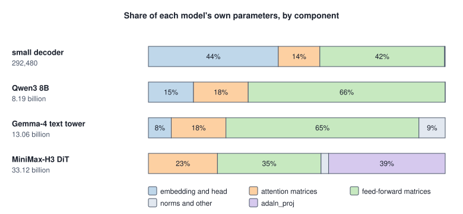
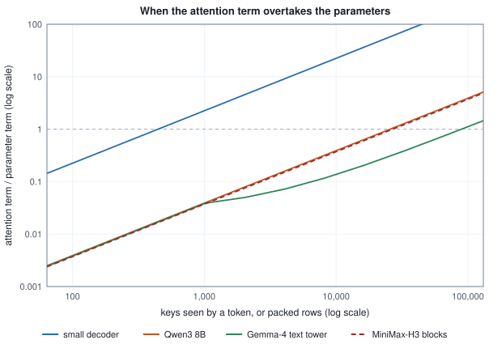
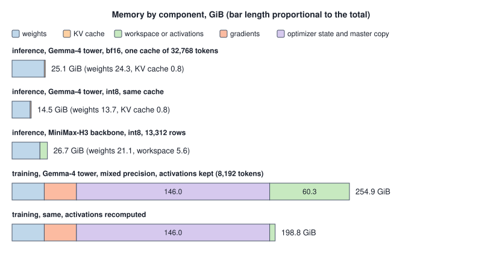

<!-- SPDX-License-Identifier: CC-BY-4.0 -->
<!-- Copyright (c) 2026 Martin Schröder <info@swedishembedded.com> -->

# Counting Parameters, FLOPs and Memory

*Before running a model, how do we know what it will cost?*

The documentation of `crates/gemma4` calls its checkpoint a 12-billion-parameter model in a file of 26 GB, and the message of commit `972519cc0` says that reading the file the plain way turned "26 GB of file" into "~49 GB of resident host `Vec<f32>`". Three numbers, 12, 26 and 49, and a reader of Volumes IV and V can already doubt them. A bf16 number takes two bytes and an f32 number four, so 26 GB of bf16 should become 52 GB of f32, not 49, and 26 GB at two bytes a number is 13 billion numbers, not 12. Counting the tensors settles it.

<!-- worked: model_cost.opening_numbers -->
Counted from the tensor list of the Gemma-4 text tower (the sum of the shapes of the 670 tensors that `gemma4_tensor_manifest` lists for `Gemma4Config::gemma4_12b`), against what the crate's documentation and a commit message say. GB is 10^9 bytes, GiB is 2^30.

| quantity | counted from the tensors | said in the crate and its history |
|---|---:|---|
| numbers in the tower and its aggregate projection | 13,063,411,504 | the crate's constructor is named `gemma4_12b` |
| the same without the aggregate projection | 11,907,350,320 |  |
| bytes at bf16 (2 per number) | 26,126,823,008 = 26.13 GB = 24.33 GiB | "26 GB" |
| bytes as f32 on the host (4 per number) | 52,253,646,016 = 52.25 GB = 48.67 GiB | "~49 GB" |
<!-- /worked -->

Nothing was wrong, and each of the three numbers was right in its own unit. The tower of 48 layers without its projection holds 11.9 billion numbers, which is the "12B" of the name; the projection that LTX-2.5 adds on top brings the file to 13.06 billion numbers, and 13.06 billion at two bytes is the 26 GB. At four bytes it is 52.25 GB, exactly twice the file, which is 48.67 GiB: the commit set a decimal 26 beside a binary 49, and the expansion it describes is a factor of two. A single count of numbers, multiplied by the bytes of a format, gives every size that matters, and the work of this chapter is to make that count, and two others that depend on it, exact before anything is loaded.

There are three ledgers. The first is the **parameter count**, the number of numbers a model stores. The second is the arithmetic that one token needs, the third is the memory a run needs, and all three are functions of the shape of the model alone, so they can be written down before a single weight is read. Earlier chapters counted them for particular models: Volume V counted GPT-2 and its training step, Volume VI counted decoders, a mixture, a hybrid and a looped stack, each for the question of its own chapter. This chapter writes the general formulas that those counts were instances of, applies them to two models that brain ports, the text tower of Gemma-4 and the diffusion transformer of MiniMax-H3, and ends with what the best-known empirical studies say about how to spend the budget the three ledgers define.

Six things from earlier chapters are used before this chapter explains them again, each as a one-line question. The answers are at the end.

1. (Volume V, [Chapter 9](../v05-sequences/09-transformer-block.md), the transformer block.) A pre-norm block with a gated network holds which weight matrices, and what are their shapes in terms of the width $D$ and the hidden width $F$?
2. (Volume V, [Chapter 12](../v05-sequences/12-kv-cache.md), the KV cache.) How many bytes does a decoder add to its cache for each token, in terms of the layers $L$, the key-value heads $h_{\mathrm{kv}}$, the head width $d_h$ and the bytes $b$ of a stored value?
3. (Volume IV, [Chapter 1](../v04-computation/01-number-formats.md), the bf16 format.) How many bytes does a bf16 number take, and what does it share with an f32 number that an fp16 number does not?
4. (Volume VI, [Chapter 4](04-mixture-of-experts.md), the router.) A layer has $E$ experts and a token uses $k$ of them. Which of the layer's parameters does the token's arithmetic touch?
5. (Volume III, [Chapter 7](../v03-neural-networks/07-optimizers.md), Adam.) Besides each parameter and its gradient, what does Adam keep for the parameter?
6. (Volume II, [Chapter 2](../v02-learning/02-linear-regression.md), least squares.) What is the slope of the least-squares line through the points $(x_i, y_i)$?

## A decoder counted tensor by tensor

Start with a model small enough to count by hand. The decoder below has a vocabulary of 1,000 tokens, width 64 and four layers. Each layer has 8 query heads and 2 key-value heads of width 8, so that $H d_h = 64 = D$, a SwiGLU network of hidden width 160 and RMS norms with a gain. As in Chapter 1, queries and keys are normalized per head, which adds a gain of $d_h$ numbers for each, and the output matrix is separate from the embedding table. The table lists every tensor the checkpoint of such a decoder would hold, with its shape and the number of numbers in it.

<!-- worked: model_cost.small_tensor_table -->
The small decoder: vocabulary V = 1000, width D = 64, L = 4 layers, H = 8 query heads and h_kv = 2 key-value heads of width d_h = 8 (so H d_h = 64 = D and a key or value matrix has 16 columns), a SwiGLU network of hidden width F = 160, RMS norms with a gain and no shift, QK-norm gains of d_h numbers for queries and again for keys, no biases and a separate output matrix. A layer holds 41,104 numbers.

| tensor | shape | numbers in one | how many | numbers in all |
|---|---|---:|---:|---:|
| token embedding table | [1000, 64] | 64,000 | 1 | 64,000 |
| input norm gain | [64] | 64 | 4 | 256 |
| W_Q | [64, 64] | 4,096 | 4 | 16,384 |
| W_K | [64, 16] | 1,024 | 4 | 4,096 |
| W_V | [64, 16] | 1,024 | 4 | 4,096 |
| W_O | [64, 64] | 4,096 | 4 | 16,384 |
| QK-norm gain of queries | [8] | 8 | 4 | 32 |
| QK-norm gain of keys | [8] | 8 | 4 | 32 |
| post-attention norm gain | [64] | 64 | 4 | 256 |
| W_gate | [64, 160] | 10,240 | 4 | 40,960 |
| W_up | [64, 160] | 10,240 | 4 | 40,960 |
| W_down | [160, 64] | 10,240 | 4 | 40,960 |
| final norm gain | [64] | 64 | 1 | 64 |
| output matrix (untied head) | [1000, 64] | 64,000 | 1 | 64,000 |

Total 292,480; with the head tied to the embedding table the output matrix goes and the total is 228,480.
<!-- /worked -->

A layer holds 41,104 numbers, four of them 164,416, and the model 292,480. The two matrices that dominate the layer are those of the network, 30,720 of its 41,104 numbers (three matrices of $64 \times 160$), and the attention matrices come second with 10,240. The norm gains and the QK-norm gains together are 144 numbers per layer, a third of a percent. Reading the table from the bottom up gives the general formula. Each layer holds the four attention matrices, whose widths are $H d_h$ for queries and output and $h_{\mathrm{kv}} d_h$ for keys and values, the three matrices of the network, two gains of width $D$ and the two QK-norm gains of width $d_h$; the model adds the embedding table, the final gain and, when the head is not tied, a second table of $V D$:

$$P = V D\,(1 + e_{\mathrm{h}}) + D + L\,\bigl(2 D H d_h + 2 D h_{\mathrm{kv}} d_h + 3 D F + 2 D + 2 d_h\bigr),$$

with $e_{\mathrm{h}} = 1$ for a separate output matrix and $e_{\mathrm{h}} = 0$ for a tied one. The first thing the formula gives is a check on Chapter 1's counts, which were summed tensor by tensor from the published shapes of its decoders. If the formula is right it must give the same totals, and it does:

<!-- worked: model_cost.formula_agrees -->
The formula P = V D (1 + e_h) + D + L (2 D H d_h + 2 D h_kv d_h + 3 D F + 2 d_h + 2 D), with e_h = 1 for a separate output matrix and e_h = 0 for a tied one and the 2 d_h only with QK-norm, against the counts of Chapter 1 (`modern_decoder.parameters`, tensor by tensor, from the shapes of that chapter's table). The last two columns drop the norm gains and the final norm: the leading terms V D (1 + e_h) + L (2 D H d_h + 2 D h_kv d_h + 3 D F) and the share of P that they leave out.

| decoder | P by the formula | P by the tensors of Chapter 1 | equal | leading terms | left out |
|---|---:|---:|---:|---:|---:|
| small decoder | 292,480 | 292,480 | yes | 291,840 | 0.219% |
| Qwen3 0.6B | 596,049,920 | 596,049,920 | yes | 595,984,384 | 0.011% |
| Qwen3 8B | 8,190,735,360 | 8,190,735,360 | yes | 8,190,427,136 | 0.004% |
| Llama-2 13B | 13,015,864,320 | 13,015,864,320 | yes | 13,015,449,600 | 0.003% |

The shapes that went in (Qwen3 0.6B ties its head, the others do not; only Llama-2 13B has no QK-norm; all four use a SwiGLU network and no biases):

| decoder | V | D | L | H | h_kv | d_h | F | head | QK-norm |
|---|---:|---:|---:|---:|---:|---:|---:|---|---|
| small decoder | 1,000 | 64 | 4 | 8 | 2 | 8 | 160 | separate | yes |
| Qwen3 0.6B | 151,936 | 1,024 | 28 | 16 | 8 | 128 | 3,072 | tied | yes |
| Qwen3 8B | 151,936 | 4,096 | 36 | 32 | 8 | 128 | 12,288 | separate | yes |
| Llama-2 13B | 32,000 | 5,120 | 40 | 40 | 40 | 128 | 13,824 | separate | no |
<!-- /worked -->

The last two columns say what can be dropped when a rough count is enough. The norm gains are a fraction of a percent of every model in the table, so the leading terms $V D (1 + e_{\mathrm{h}}) + L(2 D H d_h + 2 D h_{\mathrm{kv}} d_h + 3 D F)$ are the working formula, and the page of an architecture usually needs only these. The embedding is the other thing that changes with size: the embedding table and the separate output matrix together, $2 V D$, are 43.8 percent of the small decoder (128,000 of 292,480 numbers; the table alone is 21.9 percent) and 15.2 percent of Qwen3 8B (1,244,659,712 of 8,190,735,360), because $V D$ grows with the width $D$ while the layers' share grows with $L D^2$. This is why the "attention plus network" part of $P \approx V D + L (\ldots)$ is the one to keep for large models and why the table of a small model misleads about the proportions of a large one.

Three caveats about what the count is. It is the number of numbers stored, so a tied head is counted once; the byte size of a checkpoint is the count times the bytes of the format, plus whatever scales a quantized format carries, which later sections count. It is not the number of parameters that a token uses, and the next section separates the two. And it is only as good as the tensor list it was summed from: the section on estimates that went wrong at the end of the chapter has a hand-written formula that missed one matrix per layer.

## Stored against used: mixtures and layers of different kinds

A parameter takes part in a token's arithmetic only if a matrix product multiplies something by it. In a dense decoder every layer matrix and the head do, the embedding table does not (a lookup reads one row and multiplies nothing), and the norm gains do not (they scale elements). The number of **active parameters**, $N_{\mathrm{act}}$, is the number that take part in the products of one token. For a dense model it is Volume V's $N_{\mathrm{p}}$ with the embedding table counted as the head: $N_{\mathrm{act}} = L(2 D H d_h + 2 D h_{\mathrm{kv}} d_h + 3 D F) + V D$.

A mixture of experts is where the two counts part. Chapter 4's layer stores $E$ experts and a router and uses $k$ experts, so its stored parameters are $E \cdot 3 D F_e + D E$ and its active ones $k \cdot 3 D F_e + D E$, the router being read whole. Here is the small decoder with its network replaced by a mixture whose experts together hold the same hidden width.

<!-- worked: model_cost.small_mixture_counts -->
The small decoder with its SwiGLU network (D = 64, F = 160) replaced by a mixture of E = 8 experts of hidden width 40, k = 2 used per token, 1 shared expert and a router of D by E weights (an expert is 3 D F_e numbers; `mixture_of_experts.layer_costs` counts the network). N_act is the number of parameters that take part in the products of one token: the attention matrices, the network's used weights and the head; the embedding lookup is not a product.

| feed-forward layer | parameters of the network | used per token | P (whole model) | N_act | P / N_act |
|---|---:|---:|---:|---:|---:|
| dense network, F = 160 | 30,720 | 30,720 | 292,480 | 227,840 | 1.284 |
| mixture: 8 experts of width 40, 2 used, 1 shared, router | 69,632 | 23,552 | 448,128 | 199,168 | 2.250 |
<!-- /worked -->

The mixture stores 53 percent more parameters than the dense model (448,128 against 292,480) and uses fewer of them per token (199,168 against 227,840): storage went up and arithmetic went down, in the same model, which no single number can say. Chapter 4's count of Qwen3.5-35B-A3B is the same bookkeeping at scale, and the table below puts three models of earlier chapters in the vocabulary of this one.

<!-- worked: model_cost.earlier_counts_unified -->
Three models of earlier chapters in the quantities of this one: P stored parameters, N_act the parameters a token's products touch (Chapter 1's count of the matrices and the head, Chapter 4's `qwen_counts_data` for the mixture), and 2 N_act, the parameter term of the forward FLOPs per token. For GPT-2 small the product with the tied head is counted once, so N_act is the N_p of Volume V, Chapter 10.

| model | layers | P | N_act | P / N_act | 2 N_act |
|---|---|---:|---:|---:|---:|
| GPT-2 small | dense | 124,439,808 | 123,532,032 | 1.007 | 247,064,064 |
| Qwen3 8B | dense | 8,190,735,360 | 7,568,097,280 | 1.082 | 15,136,194,560 |
| Qwen3.5-35B-A3B | mixture, hybrid layers | 34,660,610,688 | 2,946,429,568 | 11.764 | 5,892,859,136 |
<!-- /worked -->

A dense model has $P / N_{\mathrm{act}}$ near 1 (the embedding table is what separates them), the mixture has 11.8, and the pair $(P, N_{\mathrm{act}})$ is what a model card's "35B, A3B" means. A looped stack of Chapter 7 is the third case: its stored count is that of one pass, and its arithmetic is $n_{\mathrm{loop}}$ times the active count. In general, a token's arithmetic follows $N_{\mathrm{act}}$ times the number of times each is used, and the memory of the weights follows $P$.

Layers of different kinds are handled by one more step, which is the usual one in bookkeeping: sum over the layers, each with its own numbers. A hybrid decoder (Chapter 5) has layers whose token mixer is attention and layers whose mixer is a recurrence; a model with local and global attention (Chapter 3) has layers with different windows and head widths. The routine below takes one record per layer and returns the three quantities that the rest of the chapter needs: the parameter count, the FLOPs per token (the next section derives them) and the cache bytes of one sequence.

```text
record LayerSpec:
    mixer: int            # numbers in the matrices of the token mixer
    ffn_stored: int       # numbers of every network (or expert) matrix, router included
    ffn_used: int         # the network numbers that one token's products touch
    gains: int            # norm gains, QK-norm gains and scalars
    kv_per_token: int     # numbers of keys and values added to the cache per token (0 for a mixer with a fixed state)
    window: int           # cached tokens kept (larger than any context for full attention)
    score_width: int      # H d_h, the width of the score product (0 for a mixer without scores)

function ledger(layers: list<LayerSpec>, embedding: int, tail_stored: int, tail_used: int,
                T: int, b: int) -> (int, int, int):
    P = embedding + tail_stored
    n_act = tail_used
    attn = 0
    cache = 0
    for l in 0 .. len(layers):
        s = layers[l]
        P = P + s.mixer + s.ffn_stored + s.gains
        n_act = n_act + s.mixer + s.ffn_used
        keys = min(T, s.window)                  # a token sees at most T keys, and at most `window`
        attn = attn + 4 * s.score_width * keys
        cache = cache + s.kv_per_token * keys * b
    return (P, 2 * n_act + attn, cache)
```

The tail is whatever follows the layers: the output matrix for a language model, a projection for an encoder. The worked module runs this routine on the small decoder and on the text tower of Gemma-4 (whose layer records come from the tensor list of the next section) and compares its three results with the closed forms of the tables:

<!-- worked: model_cost.ledger_agrees -->
The routine `ledger` of the chapter, run on a list of layer records, against the closed forms of the earlier tables (the parameter formula, 2 N_p + 4 L H d_h T, and the cache formula with the window). FLOPs per token are those of a token that sees T keys. For Gemma-4 the 40 sliding layers carry a window of 1,024 and the 8 full layers none; the tail is the aggregate projection (used: its weights; stored: weights and biases) and the final norm gain.

| case | P | FLOPs per token | cache bytes | equal to the closed forms |
|---|---:|---:|---:|---:|
| small decoder, T = 1,024, bf16 | 292,480 | 1,504,256 | 262,144 | yes |
| Gemma-4 text tower, T = 8,192, bf16 | 13,063,411,504 | 26,930,577,408 | 469,762,048 | yes |
| Gemma-4 text tower, T = 131,072, bf16 | 13,063,411,504 | 59,142,832,128 | 2,483,027,968 | yes |
<!-- /worked -->

## Two checkpoints counted from their tensor lists

Both models of this section are in brain's tree as ports, and both are cheap to count because the crates keep the checkpoint's tensor list in code and test it. Neither is a mixture and neither is a hybrid of recurrences, so they show the other ways in which layers differ: how attention is laid out, and what the parameters are for.

The Gemma-4 text tower of `crates/gemma4` is a decoder stack of 48 layers of width 3,840 that LTX-2.5 uses as a text encoder: a prompt goes through once and the hidden states of every layer feed a projection, so the crate has no output matrix and no cache (`crates/gemma4/src/config.rs`, `crates/gemma4/src/import.rs`). What makes its layers differ is attention. Every sixth layer is full attention (the layers 5, 11, ..., 47, counting from 0) and the other 40 are sliding-window attention with a window of 1,024. The two kinds do not just differ in the mask. A sliding layer has 8 key-value heads of width 256, a full layer has one key-value head of width 512, so the full layers are multi-query attention with twice the head width, and they have no value matrix at all: the crate's flag `attention_k_eq_v` makes a full layer take its value from the raw output of its key projection. The query heads are 16 in both kinds. Each layer has four norms (one before and one after each of attention and the network), a layer scalar, QK-norms, and a gated network whose gate is a tanh GELU. After the last layer, the hidden states of the embedding and of all 48 layers are concatenated, 49 of width 3,840 for each token, and projected to 4,096 numbers for the video stream of LTX and to 2,048 for its audio stream.

The diffusion transformer of MiniMax-H3 in `crates/minimaxh3` is a different kind of model: no tokens in a vocabulary, no cache, no causal mask. It denoises video and audio together in one packed sequence of rows of video, audio and text, and every row attends to every row, in 50 blocks of width 5,376 with 56 heads of width 128. The attention matrices project to a width of $H d_h = 7{,}168$, wider than the stream, and the gate and value matrices of the network are stored as one tensor of $2F$ by $D$. What is peculiar is the conditioning. Each block has an `adaln_proj`, a linear map from a 2,688-number embedding of the timestep to eighteen vectors of width 5,376: six modulation vectors for each of three modalities, which scale, shift and gate the block's two halves (`crates/minimaxh3/src/config.rs`, `crates/minimaxh3/src/model.rs`). The tensor list of the crate's own test fixture holds all of it, and so the whole count follows; the second table of the block below prints the shape of every tensor behind each group, and the `adaln_proj` of a block holds a weight of $18 D \times 2{,}688$ and a bias of $18 D$ numbers.

<!-- worked: model_cost.gemma4_parameters -->
The text tower of Gemma-4 as `Gemma4Config::gemma4_12b` configures it: V = 262,144, D = 3,840, F = 15,360, L = 48 layers, H = 16 query heads. Layers 5, 11, ..., 47 (0-indexed) are full attention with 1 key-value head of width 512 and no V matrix (the key output serves as the value); the other 40 are sliding-window attention with 8 key-value heads of width 256 (window 1,024). Each layer has four norm gains and a layer scalar; the tower has no output matrix; after the last layer an aggregate projection maps the 49 hidden states (embedding output and 48 layers) of one token, 188,160 numbers, to 4,096 and to 2,048 numbers, each with a bias. The attention matrices of one sliding layer hold 47,185,920 numbers, those of a full layer 64,880,640.

| group | numbers | share |
|---|---:|---:|
| embedding table | 1,006,632,960 | 7.71% |
| attention matrices | 2,406,481,920 | 18.42% |
| QK-norm gains | 28,672 | 0.00% |
| feed-forward matrices | 8,493,465,600 | 65.02% |
| layer norms and scalars | 741,168 | 0.01% |
| aggregate projection | 1,156,061,184 | 8.85% |
| **total** | 13,063,411,504 | 100% |

What the crate's tests and docs state, against what the tensor list above gives.

| quantity | counted here | stated in the crate | where |
|---|---|---|---|
| tensors in a sliding layer / a full layer | 14 / 13 | 14 / 13 | `manifest_matches_the_real_12b_checkpoint_header_count` |
| importable tensors | 670 | 670 | the same test |
| importable + 11 out of scope + 5 assets | 686 | 686 | the same test |
| full-attention layers (0-indexed) | 5, 11, 17, 23, 29, 35, 41, 47 | 5, 11, 17, 23, 29, 35, 41, 47 | `gemma4_12b_layer_types_match_the_real_checkpoints_explicit_array` |
| file at bf16 (2 bytes per number) | 26.13 GB | 26 GB | doc of `crates/gemma4/src/lib.rs` |
| the same numbers as f32 on the host | 52.25 GB = 48.67 GiB | ~49 GB | doc of `crates/gemma4/src/gguf_src.rs` |
<!-- /worked -->

The table at the bottom of the block compares the count from the tensor list with what the crate's tests and documentation state. Every number agrees: 14 tensors in a sliding layer and 13 in a full one, 670 importable tensors, and 686 in the file once the 11 of the vision and audio towers that LTX never reads and the 5 asset blobs are added, with the full-attention layers where the crate's explicit list puts them. Two observations come with the count. The parameters are not where the layers' structure suggests: the 8 full layers carry larger attention matrices (64.9 million numbers against 47.2 million) but are a sixth of the layers, and the network is 65 percent of the whole. And the aggregate projection, 1.16 billion numbers or 9 percent, is a part of the file that the "12B" of the name does not count.

<!-- worked: model_cost.minimaxh3_parameters -->
The diffusion transformer of MiniMax-H3 as `H3TransformerConfig::real` configures it: D = 5,376, 50 blocks plus 2 token-refiner blocks, 56 heads of width 128 (plain multi-head attention, no sharing, QKV width 7,168 larger than D), a gated network of hidden width 14,336 whose gate and value matrices are one tensor of 2 F by D, and for every block an `adaln_proj` from the 2,688-number time embedding to 18 D numbers, six modulation vectors for each of three modalities. The tensor list is the one the crate's own fixture `rand_tensors` builds.

| group | numbers | share |
|---|---:|---:|
| attention matrices (blocks) | 7,707,033,600 | 23.27% |
| feed-forward matrices (blocks) | 11,560,550,400 | 34.90% |
| head norms and block norms | 550,400 | 0.00% |
| adaln_proj (blocks) | 13,010,457,600 | 39.28% |
| token refiner (2 blocks, no adaln_proj) | 770,730,752 | 2.33% |
| input projections and text embedder | 28,229,376 | 0.09% |
| time embedder | 15,835,008 | 0.05% |
| output norm and heads | 29,605,760 | 0.09% |
| **total** | 33,122,992,896 | 100% |

The tensors behind each group, as the fixture lists them (shapes are [rows, columns], a vector has one dimension; all linear maps are stored as [out, in]).

| group | tensors in one instance and their shapes | instances |
|---|---|---:|
| attention matrices (blocks) | to_q, to_k, to_v [7168, 5376] each; to_out [5376, 7168] | 50 |
| feed-forward matrices (blocks) | ff.net.0.proj [28672, 5376]; ff.net.2 [5376, 14336] | 50 |
| head norms and block norms | norm_q, norm_k [128] each; norm1, norm2 [5376] each (2 x 5376 + 2 x 128 = 11008 per block) | 50 |
| adaln_proj (blocks) | linear.weight [96768, 2688]; linear.bias [96768] | 50 |
| token refiner (2 blocks, no adaln_proj) | per block the attention, norm and feed-forward tensors above (no adaln_proj); once more final_norm [5376] | 2 |
| input projections and text embedder | proj_in.weight [5376, 96] and bias [5376]; audio_proj_in.weight [5376, 32] and bias [5376]; context_embedder.weight [5376, 5120] and bias [5376] | 1 |
| time embedder | linear_1.weight [5376, 256] and bias [5376]; linear_2.weight [2688, 5376] and bias [2688] | 1 |
| output norm and heads | norm_out.norm.weight [5376]; norm_out.linear.weight [10752, 2688] and bias [10752]; proj_out.weight [96, 5376] and bias [96]; audio_proj_out.weight [32, 5376] and bias [32] | 1 |

The same tensor list against what the crate pins or states.

| quantity | counted here | stated in the crate | where |
|---|---|---|---|
| QKV width H d_h | 7,168 | 7,168 (56 x 128), not equal to D | `real_config_matches_the_checkpoint_header_numbers` |
| adaln_proj output width 18 D | 96,768 | 96,768 | the same test |
| one block without adaln_proj | 385.4 M | within 3.5e8 to 4.5e8 (the comment says ~395M) | `the_cost_model_ranks_a_block_above_the_endpoint_weights` |
| adaln_proj of one block | 260.2 M | 260M per block | doc of `crates/minimaxh3/src/lib.rs` |
| adaln_proj of the 50 blocks | 13.01 B of 33.12 B | 13.0B of 33B | the same doc |
| adaln_proj share of a block's bytes | 40.3% | 40% | doc of `StreamingDit` |
| adaln_proj at f32 | 52.0 GB | 52 GB | test comment in `resident_minimaxh3.rs` |
| all parameters at f32 | 132.5 GB | ~132 GB | doc of `dit_shard.rs` |
| parameters without adaln_proj (the resident backbone) | 20.11 B | ~20B | doc of `crates/minimaxh3/src/lib.rs` |
<!-- /worked -->

The count for MiniMax-H3 is 33.12 billion, which is the 33B of the crate's documentation, and 39 percent of it is a single group: the `adaln_proj` of 50 blocks, 13.0 billion numbers. The last table also holds a mismatch. The test `the_cost_model_ranks_a_block_above_the_endpoint_weights` states that a block without `adaln_proj` is "~395M params" in its comment, and the range it asserts, 3.5 to 4.5 hundred million, is satisfied; the count gives 385.4 million. The comment is 10 million too high and the test is unaffected, but a comment that states a count should state it. Everything else the crate says about its sizes (52 GB of `adaln_proj` at f32, about 132 GB for the whole model at f32, a backbone of about 20 billion parameters) the tensor list confirms.



The figure puts the four models side by side. The shares of the three real models say what a count of parameters is a count of: for Qwen3 and Gemma-4 about two thirds are the network and about a fifth attention, and in MiniMax-H3 two fifths are the one group, `adaln_proj`, that does no work per token. That is the point at which the second ledger has something to add.

## What one token costs in arithmetic

A parameter that takes part in a product costs two FLOPs per token, one multiply and one add. This is the whole of the first term: a token's forward pass multiplies by every active parameter once, so it costs $2 N_{\mathrm{act}}$ FLOPs. Volume V, Chapter 10 derived it for a linear map ($2nab$ FLOPs for $n$ rows of a matrix with $a b$ parameters) and counted $6 N_{\mathrm{p}}$ for training; this chapter uses the forward third of that rule.

The second term is the one that parameters do not count. The scores of attention multiply a query by each of the keys it sees, and the weighted sum multiplies each weight by a value, and neither product has a weight in it. For one layer and one token that sees $T$ keys, the scores are $T$ dot products of width $H d_h$ over all heads, $2 H d_h T$ FLOPs, and the weighted sum is the same, so the layer costs $4 H d_h T$ and the stack $4 L H d_h T$. (Volume V, Chapter 12 wrote it as $4 L H d_h$ per visible key.) Together, the **FLOPs per token** of a forward pass are

$$F_{\mathrm{tok}}(T) = 2 N_{\mathrm{act}} + 4 L H d_h T,$$

the first term a constant of the model and the second linear in the context. Grouped key-value heads do not change the second term: the product has one query per query head, and sharing keys saves cache bytes, not these FLOPs. The norms, the softmax, the rotation and the gates are left out, each a few operations per element of a tensor that a matrix product touches thousands of times; they cost bytes moved, which Volume IV's roofline counts, not arithmetic.

What changes the formula is how the mixer is built. A window of $w$ replaces $T$ by $\min(T, w)$. A mixture replaces $N_{\mathrm{act}}$'s network part by the used experts. A recurrent or linear-attention layer replaces the term by a cost that does not depend on $T$ (Chapter 5 counted it). A model that attends in both directions, as the diffusion transformer does, sees all $R$ rows of the packed sequence from every row, where a causal prefill averages $T/2$ keys per token. The small decoder gives the first exact numbers, and each row of the table agrees with Chapter 1's `decode_flops`.

<!-- worked: model_cost.flops_small_decoder -->
The small decoder (V = 1000, D = 64, L = 4, H = 8, d_h = 8, h_kv = 2, F = 160, separate head): N_p = L (2 D H d_h + 2 D h_kv d_h + 3 D F) + V D = 227,840. A token that sees T keys (itself included) costs 2 N_p + 4 L H d_h T FLOPs; the last column is the attention term over the parameter term, 4 L H d_h T / (2 N_p), equal to 1 at T = N_p / (2 L H d_h) = 445.0. Every row agrees with `modern_decoder.decode_flops` for a token at cache length T - 1.

| T | parameter term 2 N_p | attention term 4 L H d_h T | FLOPs per token | attention / parameter |
|---|---:|---:|---:|---:|
| 1 | 455,680 | 1,024 | 456,704 | 0.0022 |
| 16 | 455,680 | 16,384 | 472,064 | 0.0360 |
| 128 | 455,680 | 131,072 | 586,752 | 0.2876 |
| 445 | 455,680 | 455,680 | 911,360 | 1.0000 |
| 1,024 | 455,680 | 1,048,576 | 1,504,256 | 2.3011 |
| 8,192 | 455,680 | 8,388,608 | 8,844,288 | 18.4090 |
<!-- /worked -->

The last column is the ratio of the two terms, and it decides which kind of cost a model has. At 16 tokens the attention term is 3.6 percent of the total; at 445 tokens it equals the parameter term; at 8,192 it is 18 times larger. The crossing is at $T^\ast = N_{\mathrm{act}} / (2 L H d_h)$, which depends on the model and not on the hardware. For the small decoder that is 445, a short context; for a large model it is far longer, because $N_{\mathrm{act}}$ grows with $D^2$ while the attention term grows with $D$.

<!-- worked: model_cost.flops_models -->
GFLOPs (10^9) per token, or per packed row for the diffusion transformer, split into the parameter term and the attention term. Qwen3 8B: 2 N_p with N_p the matrices and the head, 4 L H d_h T. Gemma-4: 2 times the attention and network matrices of 48 layers plus the aggregate projection of 188,160 inputs to 6,144 outputs (2 x 188,160 x 6,144), and an attention term in which the 40 sliding layers see min(T, 1,024) keys with H d_h = 4,096 and the 8 full layers see T keys with H d_h = 8,192. MiniMax-H3: 2 times the matrices of 50 blocks (`adaln_proj` excluded: it does nothing per row), and 4 H d_h R per block over R packed rows, all rows attending to all rows.

| model | T or R | parameter term (G) | attention term (G) | attention / parameter |
|---|---:|---:|---:|---:|
| Qwen3 8B (full attention) | 1,024 | 15.136 | 0.604 | 0.040 |
| Qwen3 8B (full attention) | 8,192 | 15.136 | 4.832 | 0.319 |
| Qwen3 8B (full attention) | 131,072 | 15.136 | 77.309 | 5.108 |
| Gemma-4 text tower (5:1 sliding : full) | 1,024 | 24.112 | 0.940 | 0.039 |
| Gemma-4 text tower (5:1 sliding : full) | 8,192 | 24.112 | 2.819 | 0.117 |
| Gemma-4 text tower (5:1 sliding : full) | 131,072 | 24.112 | 35.031 | 1.453 |
| MiniMax-H3 blocks (no mask) | 4,096 | 38.535 | 5.872 | 0.152 |
| MiniMax-H3 blocks (no mask) | 13,312 | 38.535 | 19.084 | 0.495 |
| MiniMax-H3 blocks (no mask) | 32,768 | 38.535 | 46.976 | 1.219 |
<!-- /worked -->



Three things stand out in the table and the figure. The first is that the parameter term of a dense 8-billion model is 15.1 billion FLOPs and that of the Gemma-4 tower 24.1 billion, and the attention term crosses the parameter term at about 26,000 keys for Qwen3 8B. Within the 1,024 or 8,192 tokens of ordinary prompts it is a few percent to a third; at 131,072 tokens it is five times the parameter term and a decoder spends most of its arithmetic on attention. The second is Gemma-4's bend: its 40 sliding layers stop growing at 1,024 keys, so only the 8 full layers keep adding, and the 131,072-token ratio is 1.45 where a model of Qwen3's shape reaches 5.1. This is the arithmetic reason to window most of the layers, in the same way that Chapter 3 gave the cache reason. The third is MiniMax-H3: the packed sequence of a clip is 13,312 rows in the memory measurement of the crate, so every row attends to all of them, and the attention term is already half of the parameter term (0.495) at that length. The parameter term for its blocks is 38.5 billion FLOPs per row and the 13.0 billion parameters of `adaln_proj` contribute none of it, because their output depends on the timestep and not on the row: 39 percent of the parameters take no part in the per-row arithmetic at all, an exact instance of "parameters are not FLOPs".

The crate's own probe agrees with the formula. `crates/minimaxh3/examples/dit_attn_vram.rs` counts the FLOPs of one block over $R$ rows as $2 R (4 H d_h D + 3 F D) + 4 R^2 H d_h$ and divides them by the measured time to print a rate; that is $2 N_{\mathrm{block}} R + 4 H d_h R^2$, the matrices of the block times $R$ plus the attention term per row times $R$, as above. The count is a property of the shapes, and the rate is a property of the shapes and a device.

## Inference memory: the weights, the cache and the scratch

A run that has the model loaded holds four things, and a formula can bound each before the load. The **inference memory formula** of this chapter is

$$M_{\mathrm{inf}} = P\, b_w + \sum_{\ell} 2\, h_{\mathrm{kv},\ell}\, d_{h,\ell}\, \min(T, w_\ell)\, b_{\mathrm{kv}} + \mathrm{scr}(c) + \mathrm{ovh},$$

the weights at $b_w$ bytes per parameter, the cache summed over the layers with each layer's window $w_\ell$ and $b_{\mathrm{kv}}$ bytes per stored value, the scratch $\mathrm{scr}(c)$ that one forward over $c$ rows allocates, and an overhead $\mathrm{ovh}$ for what the allocator and the driver add. Volume IV, Chapter 1 gave the bytes of the formats and Chapter 12 the group-wise scales of the quantized ones, and Volume V, Chapter 12 gave the cache. The rest of this section gives the generalization of each term, on the two models of the chapter.

**Weights.** The bytes per parameter of a format are its element size plus its share of the scales. bf16 is 2. The packed formats of `crates/model/src/ops.rs` store one f32 scale per 32 weights along the input axis, so int8 costs $(32 \cdot 8 + 32) / 32 = 9$ bits and 4-bit costs 5, which is 1.125 and 0.625 bytes.

<!-- worked: model_cost.weights_bytes_table -->
Weight memory in GiB (2^30 bytes) with every parameter stored at the format's rate (the norm gains and biases, under 0.1% of the numbers, are left at the same rate). The packed formats carry one f32 scale per 32 weights along the input axis: (32 x 8 + 32) / 32 bits = 9 bits for int8, 5 bits for 4-bit. P: Qwen3 8B 8,190,735,360, Gemma-4 text tower 13,063,411,504, MiniMax-H3 DiT 33,122,992,896.

| format | bytes per parameter | Qwen3 8B (GiB) | Gemma-4 text tower (GiB) | MiniMax-H3 DiT (GiB) |
|---|---:|---:|---:|---:|
| f32 | 4.0000 | 30.51 | 48.67 | 123.39 |
| bf16 | 2.0000 | 15.26 | 24.33 | 61.70 |
| int8, group 32 | 1.1250 | 8.58 | 13.69 | 34.70 |
| 4-bit, group 32 | 0.6250 | 4.77 | 7.60 | 19.28 |
<!-- /worked -->

Every column is the count times the bytes per parameter, and what differs between the cells is whether the result fits: Gemma-4's text tower is 24.3 GiB at bf16 and 13.7 GiB at int8, so a card of 16 GiB holds the second and not the first, before any cache or scratch. The crate's doc for MiniMax-H3, "a ~20B backbone that fits resident at int8 across two 24GB cards", is the same arithmetic with `adaln_proj` removed: 20.11 billion parameters at 1.125 bytes are 21.1 GiB, which does not fit one such card with room for anything else.

**The cache, per layer type.** The cache term sums over layers because layers differ. If the Gemma-4 tower decoded with a cache (it does not in brain, which encodes a prompt in one forward pass, so this is what a decoder of its shape would need), a sliding layer would store $2 \times 8 \times 256$ numbers per token and keep the last 1,024 tokens, and a full layer $2 \times 1 \times 512$ numbers per token and keep all of them.

<!-- worked: model_cost.kv_cache_gemma4 -->
If the Gemma-4 text tower decoded with a cache (brain's `crates/gemma4` encodes a whole prompt in one forward and keeps none, so this is the cache a decoder of this shape would need), a sliding layer would store 2 x 8 x 256 numbers per token = 8,192 bytes in bf16 and keep the last 1,024 tokens, and a full layer 2 x 1 x 512 numbers = 2,048 bytes and keep all of them (40 sliding layers, 8 full). The comparison column gives every one of the 48 layers the sliding layers' geometry and no window (48 x 8,192 bytes per token). GiB for one sequence.

| tokens | 48 layers, 8 heads of 256, no window | Gemma-4 layout | ratio |
|---|---:|---:|---:|
| 1,024 | 0.375 | 0.328 | 1.14 |
| 8,192 | 3.000 | 0.438 | 6.86 |
| 32,768 | 12.000 | 0.812 | 14.77 |
| 131,072 | 48.000 | 2.312 | 20.76 |
<!-- /worked -->

Beyond 1,024 tokens the 40 sliding layers stop growing, a constant 320 MiB, and only the 8 full layers, each with a single key-value head, add 16,384 bytes per token. A stack of 48 layers all with 8 heads of width 256 and no window would need 48 GiB at 131,072 tokens; this layout needs 2.3 GiB, a factor of 20.8, and the cache does not exceed the 24.3 GiB of bf16 weights until a context of about 1.6 million tokens (Exercise 11). A hybrid stack would carry, in the same place, the fixed state of its recurrent layers, with `kv_per_token` zero and the state added once; Chapter 5 counted the state of Qwen3.5's recurrent layers in the same unit.

**Scratch: one row and many rows.** A forward pass over $c$ rows allocates buffers of a few widths per row, and so $\mathrm{scr}(c)$ is linear in $c$ with a slope that is a sum of widths. The inventory of the diffusion block is exact in the crate's `block_workspace_bytes`: five buffers of width $D$, five of width $H d_h$, one of width $F$ and one of width $\max(3 H d_h, 2F)$ in f32, because the two halves of the block share their slots, and the int8 copies of the linears' inputs. That is 455,168 bytes per row, so a decode step of one row needs 0.4 MB and a prefill of a chunk of rows needs that many times the chunk (Volume XIV treats chunked prefill; here the rule is only that the scratch is the chunk times the slope). The quadratic buffer is attention's score matrix, if the kernel materializes it.

<!-- worked: model_cost.workspace_tables -->
One block of the MiniMax-H3 DiT over R packed rows. The inventory behind the first column: five fp32 buffers of width D = 5,376, five of width H d_h = 7,168, one of width F = 14,336 and one of max(3 H d_h, 2 F) = 28,672, and the int8 copies of the linears' inputs (2 D + H d_h + F bytes), which is 455,168 bytes per row; with the halves of the block sharing buffers it is linear in R. The columns headed materialized are what two score matrices (scores and probabilities, H x R x R fp32 numbers each) would add; the last column is the packed query-key-value slab (3 R H d_h fp32 numbers) the fused kernel uses instead.

| rows R | block workspace (bytes) | (GiB) | scores and probabilities materialized (bytes) | (GiB) | fused slab (GiB) |
|---|---:|---:|---:|---:|---:|
| 1 | 455,168 | 0.000 | 448 | 0.000 | 0.000 |
| 512 | 233,046,016 | 0.217 | 117,440,512 | 0.109 | 0.041 |
| 4,096 | 1,864,368,128 | 1.736 | 7,516,192,768 | 7.000 | 0.328 |
| 8,192 | 3,728,736,256 | 3.473 | 30,064,771,072 | 28.000 | 0.656 |
| 13,312 | 6,059,196,416 | 5.643 | 79,389,786,112 | 73.938 | 1.066 |

The score matrix of the Gemma-4 tower is materialized in `crates/gemma4` (H x T x T fp32 numbers for every layer's forward):

| tokens T | scores of one layer, 16 heads (GiB) |
|---|---:|
| 512 | 0.016 |
| 1,024 | 0.062 |
| 4,096 | 1.000 |
| 8,192 | 4.000 |
<!-- /worked -->

The two ways to attend differ by a factor that depends on the rows. At 13,312 rows the block's own scratch is 6.06 GB (6,059,196,416 bytes; the comment on `block_workspace_bytes` records "6.05 GB beside the block's weights, against 6.05 GB modelled"), and two materialized score matrices would be 79.4 GB: more than three 24 GB cards for one block's scores. At 4,096 and 8,192 rows they are the 7.5 GB and the 30 GB that the doc of the probe example gives, 7.00 and 28.00 GiB in the unit of the table. The quadratic growth is the reason that the diffusion transformer uses a fused kernel that never writes the scores (commit `6626e37fc` is the port that has it, with the materialized path kept as the reference definition). The Gemma-4 crate does write them, $H T^2$ numbers for every layer's forward: 1 GiB at 4,096 tokens and 4 GiB at 8,192, and doubling the prompt quadruples them.

**Overhead, and why a planner needs a rule for it.** The three terms above are what the model holds. The allocator and the driver hold more, and the rule that brain uses for it was set by a measured failure. `capacity::headroom` in `crates/gpu-core/src/capacity.rs` budgets a fraction of what a card reports free: a budget $b$ holds when $1.14\, b + 512\ \mathrm{MiB}$ is at most the free bytes, and the headroom is never less than 2 GiB. Commit `753a538fe` records the case that set it, an int8 MiniMax-H3 on an idle card with 24,433 MiB free.

<!-- worked: model_cost.headroom_rule -->
A weights-only estimate leaves out what the allocator adds. The rule of `gpu_core::capacity::headroom`: a budget b of the free bytes holds when 1.14 b + 512 MiB is at most the free bytes, and the headroom is never less than 2 GiB. The case that set the terms, an idle 24 GB card with an int8 diffusion transformer:

| quantity | value |
|---|---:|
| free bytes reported by the card | 24,433 MiB |
| budget with the old fixed headroom of 2 GiB | 22,385 MiB |
| budget with (free - 512 MiB) / 1.14 | 20,983 MiB |
| buffers the int8 load requested (when it failed) | 21,232 MiB |
| old budget fits the request | yes |
| new budget fits the request | no |
| headroom taken off the free bytes by the new rule | 3,450 MiB |
<!-- /worked -->

The fixed 2 GiB headroom of the old rule budgeted 22,385 MiB, the load requested 21,232 MiB, the plan put the model on one card, and wgpu failed. The new rule budgets 20,983 MiB, so the plan splits the model over two cards. The 14 percent and the 512 MiB are measured terms of one allocator on one card, not constants of nature, and the doc of `headroom` lists three cases that set them; the general lesson is that every formula above is a lower bound on what the device reports as used, and a planner that fills a card to its sum will fail by the overhead.

## Training memory: the state that follows the parameters

Training holds the weights and three more things per parameter: its gradient, the optimizer's moments and, in mixed precision, a higher-precision master copy of the weight. The **training memory formula** is

$$M_{\mathrm{train}} = P\,(b_v + b_g + b_m + n_{\mathrm{slot}}\, b_{\mathrm{slot}}) + n\, a_{\mathrm{tok}} + \mathrm{scr},$$

with $b_v$, $b_g$, $b_m$ and $b_{\mathrm{slot}}$ the bytes of a value, a gradient, a master copy (zero if there is none) and one optimizer slot, $n_{\mathrm{slot}}$ the number of slots (2 for Adam: Volume III, Chapter 7), $n$ the tokens of the step, $a_{\mathrm{tok}}$ the bytes one token keeps for the backward pass under the chosen policy (the next paragraphs count it) and $\mathrm{scr}$ the scratch. The first group is per parameter and independent of the batch; the second is per token and independent of the parameters. Volume V, Chapter 10 added the first group for fp32, 16 bytes per parameter, and the second for GPT-2.

`crates/paramstore/src/precision.rs` is where brain keeps the accounting of the first group: four independent choices per parameter (the value's type, the gradient's, the master policy and the format of the moments), each with its physical bytes, scales included. The worked module recomputes its pinned test case and three others:

<!-- worked: model_cost.training_bytes_per_parameter -->
Bytes of the training state of n = 1,000 parameters under AdamW (two moment slots). A moment slot in 8-bit blocks is n + 4 ceil(n / 256) = 1,016 bytes. The last row of the first table is the case that `bytes_are_physical_and_components_independent` pins in `crates/paramstore/src/precision.rs` (values 2,000, gradients 2,000, moments 2 x 1,016, master 4,000).

| recipe | values | gradients | master copy | two moments | total | bytes per parameter |
|---|---:|---:|---:|---:|---:|---:|
| f32 values, f32 gradients, f32 moments, no master | 4,000 | 4,000 | 0 | 8,000 | 16,000 | 16.000 |
| bf16 values and gradients, f32 master, f32 moments | 2,000 | 2,000 | 4,000 | 8,000 | 16,000 | 16.000 |
| bf16 values and gradients, f32 master, bf16 moments | 2,000 | 2,000 | 4,000 | 4,000 | 12,000 | 12.000 |
| bf16 values and gradients, f32 master, 8-bit block moments | 2,000 | 2,000 | 4,000 | 2,032 | 10,032 | 10.032 |
<!-- /worked -->

The first two rows are the point of the table, and they are the same: 16 bytes per parameter. Mixed precision with an f32 master copy does not reduce the memory of the state. It replaces a 4-byte value with a 2-byte value and a 4-byte master, which is 6, and a 4-byte gradient with a 2-byte one, so the sum $2 + 2 + 4 + 8$ equals $4 + 4 + 8$, and what mixed precision gains is the arithmetic and the activations (kept in bf16). This is the "16 bytes per parameter" that the ZeRO paper counts for mixed-precision Adam as 2 for the values, 2 for the gradients and 12 for the f32 copy and moments (Rajbhandari and colleagues, 2020). Only a narrower moment saves state: bf16 moments cut it to 12 bytes, and 8-bit moments in blocks of 256 (one byte per element and a 4-byte scale per block, so $2 \times (1 + 4/256)$ bytes for both slots) to 10.03.

The activations are the second group. Volume V, Chapter 10 counted what GPT-2's layer keeps and found that attention's two score tensors dominate; a rule that generalizes to the models of this chapter is the same rule, stated once: a layer keeps every tensor that a backward product or a normalization reads. For a block with a gated network and a fused attention kernel (which keeps one logsumexp per head instead of the score matrices) that is the block input, the two norm outputs that matrices read and the residual after attention, the queries and the attention output, the keys and values, the logsumexp, and the network's gate, up and product. The rule reproduces the 36,864 numbers per token and block of Chapter 10's table for GPT-2 when the score tensors are kept (the worked module asserts it), so it counts what the chapter counted. Applied to a layer of the Gemma-4 tower:

<!-- worked: model_cost.activations_per_layer_table -->
Numbers a Gemma-4 layer keeps per token for the backward pass under the rule of Volume V, Chapter 10 (every tensor a backward product or norm reads), with a fused attention kernel that keeps one logsumexp per head. The rule reproduces the 36,864 numbers per token and block of that chapter's table for GPT-2 small (checked when this table is built).

| tensor | sliding layer | full layer |
|---|---:|---:|
| block input, norm outputs read by matrices, residual after attention (4 D) | 15,360 | 15,360 |
| two more norms of the layer (2 D) | 7,680 | 7,680 |
| queries and attention output (2 H d_h) | 8,192 | 16,384 |
| keys and values (2 h_kv d_h) | 4,096 | 1,024 |
| logsumexp per head (H) | 16 | 16 |
| gate, up and their product (3 F) | 46,080 | 46,080 |
| **one layer** | 81,424 | 86,544 |
<!-- /worked -->

A sliding layer keeps 81,424 numbers per token and a full layer 86,544; the network's three tensors are more than half of it, as the shares of the parameters suggested. The diffusion transformer of MiniMax-H3 is counted by the same rule:

<!-- worked: model_cost.h3_activations_per_block_table -->
Numbers a MiniMax-H3 block keeps per packed row for the backward pass under the same rule (D = 5,376, H = 56 heads of d_h = 128 so H d_h = 7,168, F = 14,336), with a fused attention kernel that keeps one logsumexp per head. The block has two norms and no post-norms, so the 2 D of extra norms that the Gemma-4 layer keeps are absent; the AdaLN tables are side inputs and are not counted per row. Over the 50 blocks one row keeps 4,662,000 numbers.

| tensor | numbers per row |
|---|---:|
| block input, the two norm outputs the matrices read, the residual after attention (4 D) | 21,504 |
| queries and attention output (2 H d_h) | 14,336 |
| keys and values (2 H d_h, no sharing) | 14,336 |
| logsumexp per head (H) | 56 |
| gate and value pre-activations and the product (3 F) | 43,008 |
| **one block, per row** | 93,240 |
<!-- /worked -->

It has no sharing of keys and values and no cache, so a row keeps more than a token of the tower, and the 4,662,000 numbers per row of the training table below are these 93,240 over 50 blocks. With recomputation, a layer keeps only its input, and the backward pass rebuilds one layer's tensors at a time: $L D$ numbers for the 48 boundaries plus one layer's full set. Knowledge #233 has the same count measured on a 27-billion-parameter hybrid model after recomputation: 20,480 bytes per boundary in f32 (5,120 numbers of 4 bytes) and 65 boundaries for 64 layers, 1.33 MB per token, the largest single term once the layer's own working set is segmented. The commit that gave the host trainers of `crates/minimaxh3` the same policy, `263a8211d`, describes the cache under recomputation as "every block's input and what a block rebuild reads (the adaLN tables, contexts and RoPE tables)": the boundaries plus the side inputs that the rebuild needs.

<!-- worked: model_cost.training_memory_models -->
Training memory of two models if they were trained, in GiB: brain trains neither at this size (the Gemma-4 crate is an inference port with no trainer; MiniMax-H3 has a host f64 reference trainer for gradient checks), so these are what the formula says, not what a run measured. State = P x (value + gradient + master + two moments) bytes. Activations are kept in bf16 (2 bytes) for 8,192 tokens of Gemma-4 and 13,312 packed rows of the DiT; the attention state is a logsumexp per head (a fused attention kernel). Numbers kept per token: Gemma-4 3,949,312 (all layers) or 270,864 with recomputation (the 48 residual snapshots and one full layer); DiT 4,662,000 or 362,040.

| model | recipe | state | activations kept | activations, recomputed | total, kept | total, recomputed |
|---|---|---:|---:|---:|---:|---:|
| Gemma-4 text tower | f32 everywhere, AdamW | 194.7 | 60.3 | 4.1 | 254.9 | 198.8 |
| Gemma-4 text tower | bf16 values and gradients, f32 master, f32 moments | 194.7 | 60.3 | 4.1 | 254.9 | 198.8 |
| Gemma-4 text tower | bf16 values and gradients, f32 master, bf16 moments | 146.0 | 60.3 | 4.1 | 206.3 | 150.1 |
| MiniMax-H3 DiT | f32 everywhere, AdamW | 493.6 | 115.6 | 9.0 | 609.2 | 502.5 |
| MiniMax-H3 DiT | bf16 values and gradients, f32 master, f32 moments | 493.6 | 115.6 | 9.0 | 609.2 | 502.5 |
| MiniMax-H3 DiT | bf16 values and gradients, f32 master, bf16 moments | 370.2 | 115.6 | 9.0 | 485.8 | 379.2 |
<!-- /worked -->



Read the table with one caveat first: brain trains neither of these models at this size. The Gemma-4 crate is an inference port with no trainer, and MiniMax-H3's trainer in `crates/minimaxh3/src/grad.rs` is a host reference in f64 for gradient checks, so the table is what the formula says a training run would need, not what a run measured. Taken as that, the table shows 195 GiB of state for the 13-billion-parameter tower and 494 GiB for the 33-billion one at 16 bytes per parameter, against activations of 60 GiB (8,192 tokens, all layers kept) and 4 GiB with recomputation for the first and 116 and 9 GiB for the second at 13,312 rows. For a model of this size the state, not the activations, is the floor under the run once recomputation is on, and it is the term that a different optimizer format or sharding changes; a later volume (Volume XIII) treats those. For a model the size of GPT-2, Chapter 10's table had the opposite proportions.

One more number of brain's is an estimate of the second group, and it can be set beside these counts. `calibrated_activation_bytes` in `crates/model/src/memplan.rs` plans a step before a model is loaded from one constant, "calibrated on the 27B (64 layers, width 5120): 78 GiB at 16K tokens against 67 GiB at 8K for the bf16 base", of 1.4 MiB per token for that shape:

<!-- worked: model_cost.activation_estimates -->
Activation memory of one training step: the planner's calibrated estimate against the counts of this chapter. The code's own description of the constant is "calibrated on the 27B (64 layers, width 5120): 78 GiB at 16K tokens against 67 GiB at 8K for the bf16 base"; it prices the Gemma-4 tower here only to set the scales side by side.

| quantity | value | in GiB |
|---|---:|---:|
| two points of the 27B run: (78 - 67) GiB over (16,384 - 8,192) tokens | 1.375 MiB per token |  |
| the constant in the code, 1.4 MiB per token over 64 layers of width 5,120 | 4.4800 bytes per token, layer and unit of width |  |
| planner estimate for the Gemma-4 tower at 8,192 tokens (48 layers, width 3,840) | 6,764,573,491 | 6.30 GiB |
| this chapter's count, every layer kept, bf16 | 64,705,527,808 | 60.26 GiB |
| this chapter's count, recomputed, bf16 | 4,437,835,776 | 4.13 GiB |
<!-- /worked -->

The planner's 6.3 GiB for the Gemma-4 tower sits near the recomputed count (4.1 GiB) and an order of magnitude below the count with every layer kept (60.3 GiB). The code's description says it is "an estimate for planning a step before a model is loaded, not a measurement of any one trainer", and the two points it is derived from tell nothing about which policy that run used, so the comparison shows how far apart the policies are and not that the estimate is wrong.

## What the loss does as these numbers grow

Counting what a model costs is half a decision. The other half is what that cost buys, and the only general answer is empirical. **Scaling laws** are measured relations between the loss of a language model and the quantities this chapter has counted: the number of parameters $P$, the number of training tokens $n_{\mathrm{tok}}$ and the compute $C$ of the run. Where the earlier sections derived their results from shapes, this one reports findings of two studies, and the first thing to say about a finding is what it assumed.

Kaplan and colleagues (2020) trained transformer language models over a range of sizes and found that the test loss fell as a power law in each of the three quantities when the other two were not the bottleneck, with exponents that they reported as about 0.076 for the parameters, about 0.095 for the data and about 0.05 for the compute; a power law $\ell = c\,P^{-\alpha_{\mathrm{s}}}$ is a straight line on log-log axes, with slope $-\alpha_{\mathrm{s}}$. They also concluded that, for a given compute, most of the budget should go to a larger model, trained on comparatively few tokens. Hoffmann and colleagues (2022) repeated the question with a wider range and three different fitting procedures and reached a different allocation: parameters and tokens should grow in about equal proportion, which is usually quoted as about 20 tokens per parameter. Their model, Chinchilla, had 70 billion parameters trained on 1.4 trillion tokens, the 20 to 1 of the rule, for a compute about equal to that of an earlier model with four times the parameters and far fewer tokens. The connecting formula, used in both, is the training-compute estimate of Volume V, Chapter 10: $C \approx 6 P n_{\mathrm{tok}}$ FLOPs, six per parameter per token, attention left out.

How does one read such a result, and how far can it be trusted? The demonstration below fits a power law to points that are synthetic and known, so that the fit can be judged against the truth. It is not a claim about any real model.

<!-- worked: model_cost.power_law_fit -->
Generator: the book's SplitMix64, seed 0xafa155acb4a885b5 (`seed_of` of the name `model_cost.power_law`). Synthetic points, not measurements of any model: loss = 15.0 P^(-0.08) (1 + 0.01 z) at the eight sizes P = 1,000,000 x 4^i, i = 0 .. 7, with one standard normal z drawn per size in increasing order of size (the generator's `normal()`, Box-Muller). The fit is ordinary least squares of ln(loss) on ln(P) (natural logarithms, the library `log`), closed form, sums added left to right.

| P | loss | fitted | deviation |
|---|---:|---:|---:|
| 1,000,000 | 4.9143 | 4.9946 | -1.61% |
| 4,000,000 | 4.5014 | 4.4645 | 0.83% |
| 16,000,000 | 4.0344 | 3.9907 | 1.10% |
| 64,000,000 | 3.5593 | 3.5671 | -0.22% |
| 256,000,000 | 3.2066 | 3.1886 | 0.56% |
| 1,024,000,000 | 2.8603 | 2.8501 | 0.36% |
| 4,096,000,000 | 2.5329 | 2.5477 | -0.58% |
| 16,384,000,000 | 2.2679 | 2.2773 | -0.41% |

Slope -0.0809 with standard error 0.0011, so the exponent is estimated as 0.0809 against the true 0.08; intercept 2.7265 (true ln 15.0 = 2.7081); R^2 = 0.99896. At 10 times the largest size the fit predicts 1.8901 and the generating law gives 1.9008 (-0.56% apart).
<!-- /worked -->

The fit is Volume II's least squares applied to the logarithms: $\ln \ell = \ln c - \alpha_{\mathrm{s}} \ln P$, a line whose slope is the exponent, so the slope formula of recall question 6 is the whole method. With 1 percent noise on eight points spanning four orders of magnitude it recovers the exponent to within its standard error (0.0809 against a true 0.08, standard error 0.0011) and predicts the loss at ten times the largest size to within 0.6 percent. That is the best case: the generating law is exactly a power law. The same procedure on a law with a floor is the realistic one.

<!-- worked: model_cost.power_law_with_floor -->
Noise-free synthetic points of a law with an irreducible term: loss = 1.7 + 40.0 P^(-0.3) at the same eight sizes (losses 2.3340, 2.1183, 1.9759, 1.8821, 1.8201, 1.7792, 1.7523, 1.7345). A straight line on the log-log plot is fitted to a window of the points; the table gives the exponent it finds, R^2, its prediction at 10 times the window's largest size and the true value there.

| window of sizes | fitted exponent | R^2 | prediction at 10x | true value at 10x | prediction error |
|---|---:|---:|---:|---:|---:|
| 1,000,000 to 64,000,000 | 0.0516 | 0.97763 | 1.6518 | 1.7912 | -7.8% |
| 16,000,000 to 1,024,000,000 | 0.0251 | 0.97275 | 1.6688 | 1.7397 | -4.1% |
| 256,000,000 to 16,384,000,000 | 0.0115 | 0.97009 | 1.6840 | 1.7173 | -1.9% |
| 1,000,000 to 16,384,000,000 | 0.0290 | 0.88854 | 1.5565 | 1.7173 | -9.4% |
<!-- /worked -->


Eight points with no noise at all produce fitted exponents of 0.0516, 0.0251 and 0.0115 for three windows of the same curve, and each prediction at ten times the window's largest size is off by 2 to 8 percent, always on the same side, because a straight line has no floor to bend towards; the fit with all eight points has an $R^2$ of 0.89 and a prediction error of 9.4 percent. A high $R^2$ does not certify a power law over a window in which the curve is bending, and a power-law fit extrapolated to a size where the floor matters is optimistic. Published studies deal with this by adding the floor as a parameter (Hoffmann and colleagues fit $\ell = E + A P^{-\alpha} + B n_{\mathrm{tok}}^{-\beta}$) and by using more than one procedure, and the exponents they report carry the spread of their data and procedures, which a single number conceals.

What the studies assume matters at least as much as what they find. Both measure the loss on a held-out text of the same distribution as the training data and say nothing about other tasks; both fix an architecture family (dense decoders trained with a tuned schedule) and sizes within some range, so a mixture, a recurrent hybrid or a model trained for many epochs is outside what they fitted; the two studies disagree on the allocation, and the disagreement is itself a measure of how uncertain the rule is; and the rule of 20 tokens per parameter minimizes the loss for a fixed training compute, which is a different question from the cheapest model to serve, where a smaller model trained on more tokens costs less per request (a point about use, not a finding of either study). So the rule is the first thing to check a plan against, not the thing to apply without looking.

<!-- worked: model_cost.compute_optimal -->
The compute-optimal split under C = 6 P n and n = 20 P: P = sqrt(C / 120) parameters and n = 20 P tokens use all of C. The first three rows are round budgets; the last row is the budget that 20 tokens per parameter would ask for a model with the parameter count of the Gemma-4 text tower (this says nothing about how that model was trained). For comparison, the GPT-2 small run of Volume V, Chapter 10 trained 124,439,808 parameters on 10,000,000,000 tokens, 80.4 tokens per parameter, where the rule asks 20.

| budget C (FLOPs) | parameters P | tokens n | 6 P n |
|---|---:|---:|---:|
| 1e+19 | 2.887e+08 | 5.774e+09 | 1.000e+19 |
| 1e+21 | 2.887e+09 | 5.774e+10 | 1.000e+21 |
| 1e+23 | 2.887e+10 | 5.774e+11 | 1.000e+23 |
| (a model of Gemma-4's size) | 1.306e+10 | 2.613e+11 | 2.048e+22 |
<!-- /worked -->

The table applies the rule. For $C = 6 P n_{\mathrm{tok}}$ and $n_{\mathrm{tok}} = 20 P$ the budget gives $P = \sqrt{C/120}$, so that a hundredfold in compute buys a tenfold in parameters and in tokens. The GPT-2 run of Volume V, Chapter 10, 124 million parameters on 10 billion tokens, used 80 tokens per parameter, four times as many as the rule's 20, which is the proportion of a model that is meant to be small and well trained. The last row prices 20 tokens per parameter for a model with the parameter count of the Gemma-4 tower, 2.0e22 FLOPs; it states what the rule would ask and nothing about how that model was trained.

## Where brain keeps these counts, and where they parted from the machine

The ledgers live in brain in several places, and the chapter's formulas can be set against each.

`crates/modelcost` is the shared pricing registry behind `brain flops` and `brain models list` and `profile`. It was extracted in commit `a41a240d5`, and its module doc states the reason: two commands priced models separately and could disagree, so there is now one engine and one cache. It has two tiers and no closed-form formula. The exact tier builds a real model at the architecture's own configuration with zero weights (the cost is a function of shape, not of values) and reports the recorded dispatch list of one forward pass at batch 1, the number of FLOPs, integer operations and bytes of the kernels that ran, with a coverage figure for kernels that had no cost formula (`crates/modelcost/src/lib.rs`). The second tier sums the byte sizes of an architecture's tensor manifest at 4 bytes per element and says in its doc why it reports no FLOPs: a quantized format is dequantized at launch, so quantization changes bytes moved and not operations, and "a `2 x params` FLOP guess would be wrong for a conv/diffusion/MoE architecture's real op mix". That is the limit of this chapter's second formula, stated from the other side: $2 N_{\mathrm{act}} + 4 L H d_h T$ is the count of the matrix products of a transformer, and the recorded tier is what counts what a graph of any shape actually ran. The registry holds three exact pricers (qwen3, gpt2, lfm2) and two bandwidth-only ones (qwen35, qwen35moe); neither Gemma-4 nor MiniMax-H3 is registered, so their counts above come from their own tensor manifests (`crates/gemma4/src/import.rs`, the fixture of `crates/minimaxh3/src/model.rs`) and nothing in modelcost could be set against them.

Two details of the crate are worth taking over. A per-layer cost is derived from dry probes at 0, 1 and 2 layers and verified affine at the third point, and a stack that fails the check is refused (`per_unit_cost` in `crates/modelcost/src/pricers.rs`): that is the property that makes $P$ and $F_{\mathrm{tok}}$ sums over layers, and the crate tests that a non-affine series is refused. A hybrid stack such as lfm2 reports the average per layer, `total / n_layers`, and the code says it is an average and not a derived value. And a cache entry carries the hash of the configuration it was priced from, so a changed shape drops the entry instead of serving a stale number. How the crate is tested is the part to be plain about. Its tests check structure, not numbers: every manifest has at least one tensor on its tiny configuration, the bandwidth total equals the hand-summed manifest, the exact tier reports a positive FLOP count, a 0/1/2-probe series is accepted or refused, a corrupt cache is ignored. None pins a count at a real configuration, and its `measure` path times a forward pass but measures no allocation. Where a number of this chapter is pinned in code it is by the tests of the crates themselves: the 670 and 14 and 13 of `crates/gemma4`, the 7,168 and 96,768 of `crates/minimaxh3`, and the 1,000-parameter byte case of `crates/paramstore`.

The planner of the second and third groups of this chapter is in `crates/model/src/memplan.rs`. It names the categories (weights, gradients, decode state, optimizer state, activations, cache, staging and transfers), gives each an ordered list of variants from the stored form downward, and picks the variants that fit a capacity before anything is loaded, pulling levers in a fixed order and only the ones the caller authorized. A variant may not be larger than the one before it, so a lever can only shrink the footprint, and when nothing fits it refuses with the arithmetic. Commit `f6e06ff2f` made this the one sizing authority: qwen35's refusals, qwen3's estimate and the pre-load budget check all call it. Its tests state the optimizer-state arithmetic of a full fine-tune in f32 (values $4n$, gradients $4n$, moments $8n$ for 2 billion parameters, 8 GB of values) and refuse a rung that would not be smaller.

Three episodes in this tree, two estimates that were wrong and one that had to follow an allocation, are each a lesson about one term of the formulas.

*A hand-written count that missed a matrix.* Commit `dec49aaec` fixed `te_bytes` in `crates/flux1`, which had derived the weight bytes of the T5-XXL text encoder by hand from its width, hidden width and layer count and counted two network matrices per layer where a T5 block has three. The commit says the placement plan sized the encoder off the undercount, found a card with room for that number, and then the real allocation did not fit. The fix reads the crate's own tensor manifest, the same count the crate's tests pin to the reference. The commit message puts the undercount at "about 5 GiB".

<!-- worked: model_cost.t5_undercount -->
The weights of the T5-XXL encoder at f32 (`T5Config::xxl`): V = 32,128, D = 4,096, F = 10,240, 24 layers, 64 heads of width 64, three network matrices per layer (two input matrices and one output matrix), one shared relative-position table of 32 by 64, and per layer two norm gains of 4,096 (before attention and before the network) with a final norm gain of 4,096; QKVO are four matrices of 4,096 by 4,096. The hand-written formula counted 2 D F per layer for the network, and counted the embedding table, the four attention matrices and the two norm gains of every layer, but not the final norm gain or the position table.

| quantity | value | in GiB |
|---|---:|---:|
| numbers by the tensor list | 4,762,310,656 |  |
| bytes at f32 by the tensor list | 19,049,242,624 | 17.74 GiB |
| bytes by the hand-written formula (two network matrices per layer) | 15,022,686,208 | 13.99 GiB |
| bytes missing | 4,026,556,416 | 3.750 GiB |
| one network matrix per layer, 24 x 4,096 x 10,240 x 4 bytes | 4,026,531,840 | 3.750 GiB |
| final norm gain and position table, (4,096 + 32 x 64) x 4 bytes | 24,576 |  |
| the two lines above added | 4,026,556,416 |  |
<!-- /worked -->

The count gives 3.75 GiB, 4.03 GB: the one network matrix per layer that the commit names, 4,026,531,840 bytes, plus the 24,576 bytes of the final norm gain and the position table that a formula written from the layers alone also lacks, so "about 5 GiB" is an overstatement of the same error, and the commit's mechanism and the test it added stand. The general lesson is the one this chapter started with: derive bytes from the tensor list, the one source of truth, and do not re-derive it. `Weight::bytes_for` in `crates/model/src/ops.rs` says of itself that it is "the one place a tier's footprint is stated, so a planner's estimate and a built model's report agree", and the pre-flight estimate of `crates/qwen3/src/footprint.rs` is written to use the same arithmetic as the build it predicts for the same reason.

*A budget from the card's size.* Commit `bafa88f7d` records a MiniMax-H3 clip at 768 by 448 that was placed on cards with 21.9 GiB free, int8 blocks plus an 8 GB workspace, and ran out of device memory in the first step. `StreamPlan::cards` had offered each card its total size less a reserve, which counts the driver's share and other processes' allocations as available; it now budgets from what the card reports free. The commit's test makes the rule an assertion: a card with 10 GiB free and a 3 GiB reserve offers 7 GiB. Commit `753a538fe` of the same day, as the section on inference showed, replaced the flat reserve by the proportional one. The two together say that $\mathrm{ovh}$ in the inference formula is a function of what the plan holds and what the card has already given away.

*A scratch estimate that followed an allocation.* Commit `b8eef7c3c` made the two halves of the diffusion block share their scratch buffers, which cut the memory one block needs, and changed the estimate in the same commit.

<!-- perf-number: historical measurement, commit b8eef7c3c -->
In November 2026, on one Tesla P40 card, the commit's message reports one real-shape block over 13,312 rows reaching a memory peak of 6.48 GB after the change against 8.68 GB before, with the time of the block unchanged.

The 6.48 GB includes the block's own int8 weights, about 0.43 GB (385.4 million weights at 1.125 bytes), and the workspace formula of the section on inference memory models the remaining 6.06 GB. The rule here is that a scratch model is a measurement written as a formula: the formula is `block_workspace_bytes`, the measurement is the commit, and the estimate that the resident placement and the catalog's cost estimate read is the formula, so that changing the allocation changes the estimate in the same commit.

A fourth observation concerns parameters that need not be held. Commit `5044ed6d4` stopped the resident model and the streamed blocks from holding `adaln_proj` at all: its output depends on the timestep alone, so a generation evaluates it once per timestep it will visit and keeps the rows in a bounded cache keyed by the timestep's exact bits. The 13.0 billion parameters of the projection are 52 GB at f32 on the host, and the cache is at most 512 timesteps of 50 blocks of 96,768 numbers at f32, 9.9 GB (`DEFAULT_CAPACITY` in `crates/minimaxh3/src/adaln.rs`; the arithmetic is in `dit_host_bytes` in `crates/catalog/src/resident_minimaxh3.rs`). A parameter count and a residency are different numbers, and a model whose counted parameters include a function of a small input can be cheaper to hold than its count.

## Summary

The cost of a model before it runs is three sums over its tensor list. The parameter count $P$ is the sum of the shapes, and $P \approx V D(1 + e_{\mathrm{h}}) + L(2 D H d_h + 2 D h_{\mathrm{kv}} d_h + 3 D F)$ for a decoder with a gated network, with the active count $N_{\mathrm{act}}$ smaller than $P$ for a mixture and equal to a pass times the stored count for a looped stack. FLOPs per token are $2 N_{\mathrm{act}} + 4 L H d_h T$, the attention term shrinking under a window, growing with the packed rows of a bidirectional model, and crossing the parameter term at a context that the shapes decide. Inference memory is $P b_w$ plus a cache summed over layers by their own windows plus scratch linear in the rows plus an overhead that a planner must budget from what the card reports free. Training memory is 16 bytes per parameter for Adam in either f32 or mixed precision, fewer only with narrower moments, plus activations per token that recomputation cuts by an order of magnitude at the cost of a forward pass. Scaling laws are empirical power laws in these quantities, with a compute rule of $6 P n_{\mathrm{tok}}$ and about 20 tokens per parameter; the demonstration shows that a fit is only as good as its window and its floor.

The limits are plain. The two models counted here are two models, and the formulas were checked against the tensor lists and tests of their crates and the counts of earlier chapters, not against a measured run. The inference scratch is measured for one block on one card in one commit. The training memory is the formula's output, not a trainer's. The scaling-law results are two studies' findings under their assumptions. What this chapter gives is the arithmetic that lets a reader state, before running a model, what it must hold and what it must do; the next chapter, the project that ends the volume, applies that arithmetic to alternative blocks on equal terms.

## References

- Jared Kaplan, Sam McCandlish, Tom Henighan, Tom B. Brown, Benjamin Chess, Rewon Child, Scott Gray, Alec Radford, Jeffrey Wu and Dario Amodei, *Scaling Laws for Neural Language Models*, 2020.
- Jordan Hoffmann, Sebastian Borgeaud, Arthur Mensch and colleagues, *Training Compute-Optimal Large Language Models*, 2022.
- Samyam Rajbhandari, Jeff Rasley, Olatunji Ruwase and Yuxiong He, *ZeRO: Memory Optimizations Toward Training Trillion Parameter Models*, 2020.
- Vijay Korthikanti, Jared Casper, Sangkug Lym, Lawrence McAfee, Michael Andersch, Mohammad Shoeybi and Bryan Catanzaro, *Reducing Activation Recomputation in Large Transformer Models*, 2022: its analysis of which activations dominate the memory of a transformer layer and which are cheap to recompute is the background of the activation rule of this chapter.

## Check your understanding

1. A colleague reads "35B total, 3B active" and computes the weight memory at bf16 as $3 \times 10^9 \times 2$ bytes, 6 GB. Find the error and give the figure that Chapter 4's count implies.
2. Qwen3 8B is moved from a context of 8,192 tokens to 16,384. By what factor does the forward FLOPs per token of a token at the end of the context change? Use the table of this chapter.
3. The curve of the Gemma-4 tower in the figure of the attention ratio bends at 1,024 keys and the curve of the MiniMax-H3 blocks does not. Why?
4. "Mixed precision halves the memory of training: bf16 values and gradients take half of the f32 bytes." Find the error with the table of bytes per parameter.
5. The fit of the noisy synthetic points has $R^2 = 0.999$ and a standard error of 0.0011 on the exponent. A reader extrapolates it a thousandfold past the largest size. Which two things in the demonstrations of this chapter make that unsafe?
6. The Gemma-4 crate materializes the score matrix of 16 heads as f32 for each layer. A prompt grows from 4,096 to 8,192 tokens. What happens to the memory of the scores, and does it depend on the 48 layers?
7. A planner estimates the bytes of a T5-XXL encoder by writing 2 network matrices per layer. What does the error cost and which source of truth removes this class of error?

## Exercises

1. **[Calculate]** A decoder has $V = 2{,}000$, $D = 96$, $L = 6$, $H = 6$ query heads and $h_{\mathrm{kv}} = 2$ key-value heads of width $d_h = 16$, $F = 256$ in a SwiGLU network, RMS norms, no QK-norm and a head tied to the embedding table. Count $P$ with the formula and write the per-layer count term by term.
2. **[Calculate]** Replace the network of the decoder of Exercise 1 by a mixture of 16 experts of hidden width 64, 2 used, no shared expert, plus a router of $D \times 16$. Give the stored and the used parameters of the network, the change in $P$, and $N_{\mathrm{act}}$ before and after.
3. **[Calculate]** In the small decoder of the chapter halve the key-value heads from 2 to 1. By how much do $P$ and $N_{\mathrm{act}}$ change, what happens to the attention term of the FLOPs per token, and what is the new crossing context $T^\ast$?
4. **[Calculate]** For the layout of the Gemma-4 tower (40 sliding layers with 8 key-value heads of width 256 and a window of 1,024, 8 full layers with one key-value head of width 512), give the cache of one sequence of 65,536 tokens in bf16 and in a one-byte format.
5. **[Calculate]** Qwen3 8B (8,190,735,360 parameters) is trained with bf16 values and gradients, an f32 master copy and 8-bit block moments of 256 elements. Give the bytes per parameter and the state in GiB, and compare with f32 everywhere.
6. **[Calculate]** Apply `capacity::headroom` to a card reporting 16 GiB free. Give the budget and the headroom in MiB.
7. **[Implement]** Reproduce the table of `model_cost.small_tensor_table` and the equality checks of `model_cost.formula_agrees` for the small decoder, writing the count both tensor by tensor and by the formula, and confirm that they agree.
8. **[Implement]** Reproduce `model_cost.gemma4_parameters` from the tensor list as the chapter describes it (the rule for which layers are full, the 14 and 13 tensors of the two layer kinds, the aggregate projection), including the totals 670 and 13,063,411,504.
9. **[Implement]** Reproduce `model_cost.power_law_fit`: the generator, its draw order, the eight sizes, the noise, the logarithms and the least-squares fit, and print the slope, its standard error and the extrapolation to ten times the largest size.
10. **[Investigate]** In the noise-free law with a floor of the chapter, fit $\ln(\ell - E)$ against $\ln P$ for a range of trial floors $E$ and find the floor that gives the straightest line. How close does it come to 1.7, and what does your result say about the three-parameter fit of the studies?
11. **[Investigate]** At what context does the cache of the Gemma-4 layout in bf16 equal the weights of the tower in bf16? Compare with a decoder of 7.5 billion parameters and 128 KiB per token of Chapter 12, and say what each difference of the two designs contributes.
12. **[Calculate]** A budget of $10^{22}$ FLOPs is to be spent by the rule $C = 6 P n_{\mathrm{tok}}$ and $n_{\mathrm{tok}} = 20 P$. Give $P$ and $n_{\mathrm{tok}}$, and say what changes in the plan if the model will be served to many users.

## Key terms

- **parameter count**: the number of numbers a model stores, the sum over its tensors of the product of their shape; multiplied by the bytes of a format it gives the size of the weights, and it is larger than the number a token's arithmetic uses for a mixture or a model with parameters that are not products. <!-- concept: parameter-count -->
- **FLOPs per token**: the arithmetic of a forward pass for one token, two FLOPs for every active parameter plus four per layer, query-head width and key seen for the attention products, $2N_{\mathrm{act}} + 4LHd_hT$; a property of the shapes and not of the hardware. <!-- concept: flops-per-token -->
- **inference memory formula**: the sum that bounds what a loaded model holds: the weights at their bytes per parameter, the cache summed over layers with each layer's window, the scratch of one forward pass over a chunk of rows, and an overhead for the allocator and the driver. <!-- concept: inference-memory-formula -->
- **training memory formula**: the sum for a training step: for each parameter its value, gradient, optimizer slots and master copy (16 bytes under Adam in either f32 or mixed precision), plus the numbers kept per token for the backward pass, reduced by recomputation, plus scratch. <!-- concept: training-memory-formula -->
- **scaling laws**: measured relations, close to power laws, between the loss of a language model and its parameters, its training tokens and its compute, with the compute estimate $6Pn_{\mathrm{tok}}$ and the finding of about 20 tokens per parameter for a fixed compute; findings of particular studies under their assumptions. <!-- concept: scaling-laws -->

## Answers

**Recall questions.**

1. A SwiGLU block holds the attention matrices $\mathbf{W}_Q$, $\mathbf{W}_K$, $\mathbf{W}_V$ and $\mathbf{W}_O$, the gate and up matrices $[D, F]$ and the down matrix $[F, D]$, and two norm gains of $D$ numbers (Chapter 9 of Volume V; Chapter 1 of this volume gave the widths $H d_h$ and $h_{\mathrm{kv}} d_h$ of the attention matrices).
2. $2 L h_{\mathrm{kv}} d_h b$ bytes: keys and values, in each layer, for each key-value head of width $d_h$, at $b$ bytes a value.
3. Two bytes. A bf16 number has the same 8 exponent bits as an f32 number and a mantissa cut to 7 bits, so it has f32's range at lower precision; an fp16 number has 5 exponent bits.
4. The router in full (every row of its matrix is read to score the experts), the $k$ chosen experts' matrices, and a shared expert if there is one. The other $E - k$ experts are stored and not touched.
5. Two numbers: the first and the second moment, the running averages of the gradient and of its square.
6. $\sum (x_i - \bar{x})(y_i - \bar{y}) / \sum (x_i - \bar{x})^2$ with $\bar{x}$ and $\bar{y}$ the means.

**Check your understanding.**

1. The weights of all experts must be stored, whether or not a token uses them, so the memory follows $P$ and not $N_{\mathrm{act}}$ (unless experts are moved in and out, which trades memory for transfers). From Chapter 4's count, $P = 34{,}660{,}610{,}688$ and at bf16 the weights are 69.3 GB, 64.6 GiB; only the arithmetic per token follows the 2.95 billion.
2. The attention term doubles from 4.832 to 9.664 billion FLOPs while the parameter term stays at 15.136, so the total goes from 19.968 to 24.800, a factor of 1.242.
3. The 40 sliding layers see at most 1,024 keys, so beyond that context only the 8 full layers' attention term grows and the ratio rises more slowly. The blocks of MiniMax-H3 are bidirectional full attention over all packed rows, so the ratio is proportional to the rows at every length.
4. It saves nothing in the state: f32 everywhere is $4 + 4 + 8 = 16$ bytes per parameter and bf16 values and gradients with an f32 master copy and f32 moments are $2 + 2 + 4 + 8 = 16$. The gain of mixed precision is in arithmetic and in activations kept in a narrower format; the state falls only with narrower moments (12 bytes with bf16 moments, 10.03 with 8-bit blocks).
5. The first is extrapolation: the standard error is of the slope inside the window, and three orders of magnitude beyond it a small error in the slope is multiplied by the distance. The second is the floor: the noise-free curve with a floor gave a high $R^2$ for every window and still predicted 2 to 9 percent low within one decade, since a straight line has no floor. A high $R^2$ in a window says nothing about whether the law is a power law outside it.
6. The scores are $H T^2$ numbers per layer: 4 GiB at 8,192 tokens against 1 GiB at 4,096, four times as much, since the buffer is reused by the next layer and does not multiply by 48.
7. It misses one network matrix per layer, 4.03 GB (3.75 GiB) of weights at f32, and the plan puts the encoder on a card that has room for the estimate and not for the real allocation. The tensor list (the manifest that the import, the tests and the forward share) removes the error class, because every size is then a sum of shapes someone has already checked.

**Exercises.**

1. The leading terms: $V D = 192{,}000$; per layer $2 D H d_h = 2 \cdot 96 \cdot 96 = 18{,}432$ (since $H d_h = 96$), $2 D h_{\mathrm{kv}} d_h = 2 \cdot 96 \cdot 32 = 6{,}144$, $3 D F = 73{,}728$, two norm gains 192, so 98,496 per layer and 590,976 for six. Then $P = 192{,}000 + 96 + 590{,}976 = 783{,}072$ (the 96 is the final gain).
2. The expert network stores $16 \cdot 3 \cdot 96 \cdot 64 + 96 \cdot 16 = 294{,}912 + 1{,}536 = 296{,}448$ numbers against the dense 73,728, and uses $2 \cdot 18{,}432 + 1{,}536 = 38{,}400$. $P$ grows by $6 \cdot (296{,}448 - 73{,}728) = 1{,}336{,}320$, to 2,119,392. $N_{\mathrm{act}}$ falls from $6(18{,}432 + 6{,}144 + 73{,}728) + 192{,}000 = 781{,}824$ to $6(18{,}432 + 6{,}144 + 38{,}400) + 192{,}000 = 569{,}856$.
3. The key and value matrices lose half their columns, $2 \cdot 64 \cdot 8 = 1{,}024$ numbers per layer, 4,096 over four layers: $P$ goes from 292,480 to 288,384 and $N_{\mathrm{act}}$ from 227,840 to 223,744. The attention term $4 L H d_h T$ does not depend on $h_{\mathrm{kv}}$ and is unchanged; with a smaller parameter term the crossing falls from 445 to $223{,}744 / 512 = 437$.
4. Sliding layers: $40 \cdot 8{,}192 \cdot 1{,}024 = 335{,}544{,}320$ bytes in bf16; full layers: $8 \cdot 2{,}048 \cdot 65{,}536 = 1{,}073{,}741{,}824$ bytes; together 1,409,286,144 bytes, 1.3125 GiB in bf16. In a one-byte format the numbers halve, 0.656 GiB (ignoring any scales).
5. $2 + 2 + 4 + 2(1 + 4/256) = 10.03125$ bytes per parameter; times 8,190,735,360 is 82.2 GB, 76.5 GiB. Everything in f32 is 16 bytes per parameter, 122.1 GiB.
6. Free 16,384 MiB: $(16{,}384 - 512)/1.14 = 13{,}923$ MiB budget (13,922.8), so the headroom is 2,461 MiB, above the floor of 2,048.
7. The tensor by tensor sum is 292,480, the formula gives the same, and the formula agrees with Chapter 1's counts for the four shapes of the table.
8. The totals are 670 tensors and 13,063,411,504 numbers; the groups are in the table of the chapter.
9. Slope $-0.0809$, standard error 0.0011, intercept 2.7265; the prediction at $1.6384 \times 10^{11}$ is 1.8901, against the law's 1.9008.
10. The straightest line is at the trial floor $E = 1.7$, where $\ln(\ell - E) = \ln 40 - 0.3 \ln P$ exactly and $R^2 = 1$. A fit with three parameters (floor, scale, exponent) recovers the generating law from noise-free data; with noise it cannot separate a small floor from a smaller exponent over a narrow window, which is why the published fits use many runs and more than one procedure.
11. Beyond 1,024 tokens the cache is 320 MiB plus 16,384 bytes per token; it equals 24.33 GiB (26,126,823,008 bytes) at $(26{,}126{,}823{,}008 - 335{,}544{,}320) / 16{,}384 \approx 1.57$ million tokens. The 7.5-billion decoder pays 131,072 bytes per token on every token and passes its 14 GiB of weights at about 115,000 tokens. The difference is the product of three choices: the window (the 40 sliding layers stop growing), one key-value head instead of eight in the full layers, and the full layers being a sixth of the stack.
12. $P = \sqrt{10^{22}/120} = 9.13 \times 10^9$ and $n_{\mathrm{tok}} = 1.83 \times 10^{11}$. A model that will be served to many users has a per-request cost that follows $N_{\mathrm{act}}$, so a smaller model trained on more tokens than the rule asks can be the cheaper plan for the same loss.
